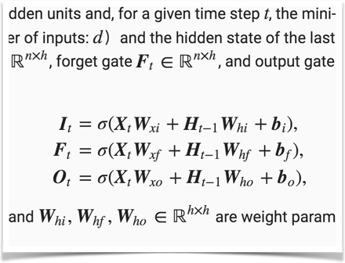
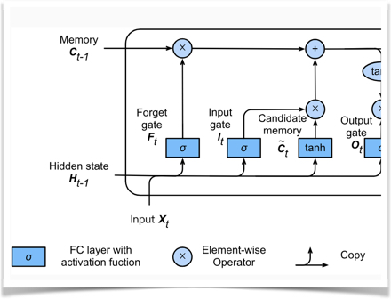
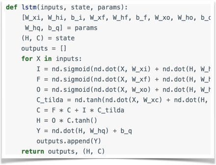
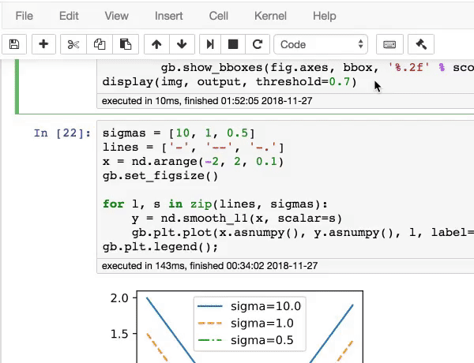
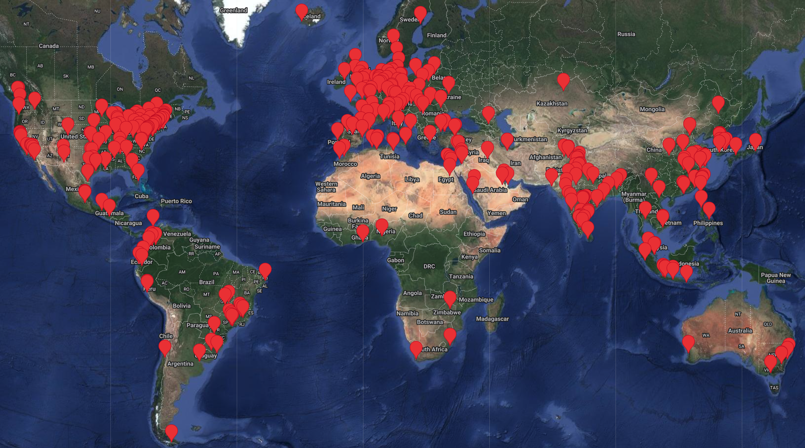

<div align="left">
  
</div>

# 《动手学深度学习》（D2L.ai）：含多框架代码、数学与讨论的交互式深度学习教材

[](https://github.com/d2l-ai/d2l-en/actions/workflows/ci.yml)

[图书网站](https://d2l.ai/) | [加州大学伯克利分校 STAT 157 课程](http://courses.d2l.ai/berkeley-stat-157/index.html)

<h5 align="center"><i>理解深度学习的最佳方式就是动手实践。</i></h5>

<p align="center">
  
  
  
  
</p>

> **译本说明**：本仓库是英文版 *Dive into Deep Learning*（即《动手学深度学习》，D2L.ai）的中文全译本，翻译底本为 [d2l-ai/d2l-en](https://github.com/d2l-ai/d2l-en) 的提交 `23d7a5aecceee57d1292c56e90cce307f183bb0a`（release 1.0.3）。

> **在线阅读**：<https://fau-linrui.github.io/dive-into-deep-learning-zh/>（与 d2l.ai 同款的在线图书站点，支持全书搜索与 PyTorch / MXNet / JAX / TensorFlow 代码切换）

这本开源教材代表着我们的一种尝试：让深度学习变得平易近人，并向读者传授概念、背景知识与代码。全书以 Jupyter 笔记本撰写，将讲解性的图示、数学和交互式示例与自包含的代码无缝地融合在一起。

我们的目标是提供一份这样的资源：
1. 所有人都可以免费获取；
1. 具备足够的技术深度，为真正走上应用机器学习科学家之路提供起点；
1. 包含可运行的代码，向读者展示如何在实际中解决问题；
1. 允许我们和整个社区快速更新内容；
1. 辅以论坛，用于对技术细节进行交互式讨论并解答问题。

## 使用 D2L 的大学
<p align="center">
  
</p>


如果本书对你有所帮助，请为本仓库加星（★），或使用以下 BibTeX 条目引用本书：

```
@book{zhang2023dive,
    title={Dive into Deep Learning},
    author={Zhang, Aston and Lipton, Zachary C. and Li, Mu and Smola, Alexander J.},
    publisher={Cambridge University Press},
    note={\url{https://D2L.ai}},
    year={2023}
}
```


## 推荐语

> <p>“在不到十年的时间里，人工智能革命已从研究实验室席卷到众多行业，并深入到我们日常生活的每个角落。《动手学深度学习》是一部优秀的深度学习教材，任何想了解深度学习为何点燃了人工智能革命——我们时代最强大的技术力量——的人都应该读一读。”</p>
> <b>&mdash; 黄仁勋（Jensen Huang），NVIDIA 创始人兼首席执行官</b>

> <p>“这是一部应运而生、引人入胜的著作：它不仅全面概述了深度学习原理，还结合可动手编程的代码详细讲解各类算法，并且对计算机视觉和自然语言处理中的深度学习作了最前沿的导引。如果你想畅游深度学习，就翻开这本书吧！”</p>
> <b>&mdash; 韩家炜，伊利诺伊大学厄巴纳-香槟分校 Michael Aiken 讲席教授</b>

> <p>“这是机器学习文献中一部非常受欢迎的佳作，它通过整合 Jupyter 笔记本，着重强调动手实践。对深度学习的学生而言，这本书对于精通这一领域将极有价值。”</p>
> <b>&mdash; Bernhard Schölkopf，马克斯·普朗克智能系统研究所所长</b>

> <p>“《动手学深度学习》在动手实践与深入讲解之间取得了极佳的平衡。我在自己的深度学习课程中使用了本书，并向所有希望全面、扎实地理解深度学习的人推荐它。”</p>
> <b>&mdash; Colin Raffel，北卡罗来纳大学教堂山分校助理教授</b>

## 贡献（[了解如何参与](https://d2l.ai/chapter_appendix-tools-for-deep-learning/contributing.html)）

这本开源教材受益于社区贡献者的教学建议、错别字修正和其他改进。你的帮助对于让本书更好地服务每一位读者很有价值。

**亲爱的 [D2L 贡献者](https://github.com/d2l-ai/d2l-en/graphs/contributors)，请将你的 GitHub ID 和姓名发送至 d2lbook.en AT gmail DOT com，以便你的姓名出现在[致谢](https://d2l.ai/chapter_preface/index.html#acknowledgments)中。谢谢。**


## 许可摘要

这本开源教材依据知识共享署名-相同方式共享 4.0 国际许可协议（Creative Commons Attribution-ShareAlike 4.0 International License）提供。详见 [LICENSE](LICENSE) 文件。

本书中的示例代码和参考代码依据修改版 MIT 许可协议提供。详见 [LICENSE-SAMPLECODE](LICENSE-SAMPLECODE) 文件。

[中文版](https://github.com/d2l-ai/d2l-zh) | [讨论并报告问题](https://discuss.d2l.ai/) | [行为准则](CODE_OF_CONDUCT.md)
