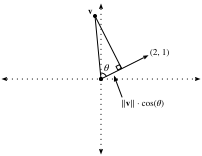
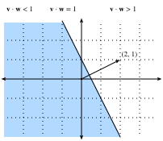
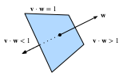
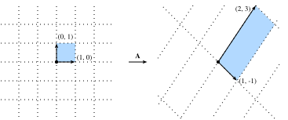

# 几何与线性代数运算
:label:`sec_geometry-linear-algebraic-ops`

在 :numref:`sec_linear-algebra` 中，我们接触了线性代数的基础知识，并了解了它如何用于表达变换数据的常见运算。线性代数是支撑我们在深度学习中——更广泛地说，在机器学习中——所做的大量工作的关键数学支柱之一。虽然 :numref:`sec_linear-algebra` 包含了足以说明现代深度学习模型机制的数学工具，但线性代数这门学科还有丰富得多的内容。本节我们将更深入地探讨，重点介绍线性代数运算的一些几何解释，并引入若干基本概念，包括特征值和特征向量。

## 向量的几何
首先，我们需要讨论向量的两种常见几何解释：把向量视为空间中的点，或视为空间中的方向。从根本上说，向量就是一个数字列表，例如下面这个 Python 列表。

```{.python .input}
#@tab all
v = [1, 7, 0, 1]
```

数学家通常把它写成*列*向量或*行*向量，也就是写成

$$
\mathbf{x} = \begin{bmatrix}1\\7\\0\\1\end{bmatrix},
$$

或

$$
\mathbf{x}^\top = \begin{bmatrix}1 & 7 & 0 & 1\end{bmatrix}.
$$

这两者往往有不同的解释：数据样例是列向量，而用于构成加权和的权重是行向量。不过，保持灵活是有好处的。正如我们在 :numref:`sec_linear-algebra` 中所述，尽管单个向量的默认取向是列向量，但对于表示表格数据集的矩阵而言，把每个数据样例视为矩阵中的行向量更为常见。

给定一个向量，我们应当给出的第一种解释是把它视为空间中的一个点。在二维或三维空间中，我们可以用向量的分量来确定这些点相对于一个称为*原点*（origin）的固定参考的位置，从而将这些点可视化。这一点可以在 :numref:`fig_grid` 中看到。


:label:`fig_grid`

这种几何视角使我们能够在更抽象的层面上考虑问题。我们不再面对像把图片分类为猫或狗这样看似不可逾越的问题，而是可以开始把任务抽象为空间中的点集，并把任务设想为发现如何将两个不同的点簇分开。

与此同时，人们看待向量还有第二种视角：把向量视为空间中的方向。我们不仅可以把向量 $\mathbf{v} = [3,2]^\top$ 看作原点向右 $3$ 个单位、向上 $2$ 个单位的位置，还可以把它看作本身就是一个方向：向右走 $3$ 步、向上走 $2$ 步。这样，我们就会把 :numref:`fig_arrow` 中的所有向量视为同一个。


:label:`fig_arrow`

这种视角转换的好处之一是，我们可以在视觉上理解向量加法的过程。具体来说，我们先沿一个向量给出的方向走，再沿另一个向量给出的方向走，如 :numref:`fig_add-vec` 所示。


:label:`fig_add-vec`

向量减法也有类似的解释。考虑恒等式 $\mathbf{u} = \mathbf{v} + (\mathbf{u}-\mathbf{v})$，可以看出向量 $\mathbf{u}-\mathbf{v}$ 就是从点 $\mathbf{v}$ 指向点 $\mathbf{u}$ 的方向。


## 点积与夹角
正如我们在 :numref:`sec_linear-algebra` 中所见，取两个列向量 $\mathbf{u}$ 和 $\mathbf{v}$，可以通过下式计算它们的点积：

$$\mathbf{u}^\top\mathbf{v} = \sum_i u_i\cdot v_i.$$
:eqlabel:`eq_dot_def`

由于 :eqref:`eq_dot_def` 是对称的，我们将模仿经典乘法的记号，写成

$$
\mathbf{u}\cdot\mathbf{v} = \mathbf{u}^\top\mathbf{v} = \mathbf{v}^\top\mathbf{u},
$$

以强调交换向量的顺序会得到相同的结果。

点积 :eqref:`eq_dot_def` 也有一种几何解释：它与两个向量之间的夹角密切相关。考虑 :numref:`fig_angle` 中所示的夹角。


:label:`fig_angle`

首先，考虑两个特定的向量：

$$
\mathbf{v} = (r,0) \; \textrm{and} \; \mathbf{w} = (s\cos(\theta), s \sin(\theta)).
$$

向量 $\mathbf{v}$ 的长度为 $r$，平行于 $x$ 轴；向量 $\mathbf{w}$ 的长度为 $s$，与 $x$ 轴成 $\theta$ 角。如果计算这两个向量的点积，我们会看到

$$
\mathbf{v}\cdot\mathbf{w} = rs\cos(\theta) = \|\mathbf{v}\|\|\mathbf{w}\|\cos(\theta).
$$

经过一些简单的代数变形，我们可以重新排列各项得到

$$
\theta = \arccos\left(\frac{\mathbf{v}\cdot\mathbf{w}}{\|\mathbf{v}\|\|\mathbf{w}\|}\right).
$$

简而言之，对于这两个特定向量，点积与范数相结合就告诉了我们两个向量之间的夹角。这一事实在一般情况下同样成立。这里我们不推导该表达式，不过，如果我们考虑用两种方式写出 $\|\mathbf{v} - \mathbf{w}\|^2$：一种用点积，另一种用余弦定理从几何上写出，就可以得到完整的关系。事实上，对于任意两个向量 $\mathbf{v}$ 和 $\mathbf{w}$，它们之间的夹角为

$$\theta = \arccos\left(\frac{\mathbf{v}\cdot\mathbf{w}}{\|\mathbf{v}\|\|\mathbf{w}\|}\right).$$
:eqlabel:`eq_angle_forumla`

这是一个很好的结果，因为计算中没有任何地方依赖于二维。事实上，我们可以在三维甚至三百万维中毫无问题地使用它。

作为一个简单的例子，我们来看如何计算一对向量之间的夹角：

```{.python .input}
#@tab mxnet
%matplotlib inline
from d2l import mxnet as d2l
from IPython import display
from mxnet import gluon, np, npx
npx.set_np()

def angle(v, w):
    return np.arccos(v.dot(w) / (np.linalg.norm(v) * np.linalg.norm(w)))

angle(np.array([0, 1, 2]), np.array([2, 3, 4]))
```

```{.python .input}
#@tab pytorch
%matplotlib inline
from d2l import torch as d2l
from IPython import display
import torch
from torchvision import transforms
import torchvision

def angle(v, w):
    return torch.acos(v.dot(w) / (torch.norm(v) * torch.norm(w)))

angle(torch.tensor([0, 1, 2], dtype=torch.float32), torch.tensor([2.0, 3, 4]))
```

```{.python .input}
#@tab tensorflow
%matplotlib inline
from d2l import tensorflow as d2l
from IPython import display
import tensorflow as tf

def angle(v, w):
    return tf.acos(tf.tensordot(v, w, axes=1) / (tf.norm(v) * tf.norm(w)))

angle(tf.constant([0, 1, 2], dtype=tf.float32), tf.constant([2.0, 3, 4]))
```

我们现在还不会用到它，但知道以下事实是有用的：夹角为 $\pi/2$（等价地，$90^{\circ}$）的向量称为*正交*（orthogonal）的。考察上面的等式可知，这发生在 $\theta = \pi/2$ 时，而这也等价于 $\cos(\theta) = 0$。这只有在点积本身为零时才可能，并且两个向量正交当且仅当 $\mathbf{v}\cdot\mathbf{w} = 0$。在从几何上理解对象时，这将是一个很有用的公式。

有人会合理地发问：计算夹角有什么用？答案在于我们希望数据所具有的那类不变性。考虑一张图像及其副本，其中每个像素值都相同，但亮度只有原来的 $10\%$。单个像素的值通常与原始值相差很大。因此，如果计算原始图像与较暗图像之间的距离，这个距离可能很大。然而，对于大多数机器学习应用而言，*内容*是相同的——在猫/狗分类器看来，它仍然是一张猫的图像。不过，如果考虑夹角，就不难看出对于任意向量 $\mathbf{v}$，$\mathbf{v}$ 与 $0.1\cdot\mathbf{v}$ 之间的夹角为零。这对应于这样一个事实：缩放向量保持方向不变，只改变长度。从夹角的角度看，较暗的图像被视为是相同的。

这样的例子随处可见。在文本中，如果我们写一份内容相同但长度翻倍的文档，可能希望所讨论的主题保持不变。对于某些编码（例如统计词表中单词出现次数），这对应于表示文档的向量翻倍，因此我们同样可以使用夹角。

### 余弦相似度
在机器学习语境中，当用夹角来度量两个向量的接近程度时，从业者采用*余弦相似度*（cosine similarity）这一术语来指代下式
$$
\cos(\theta) = \frac{\mathbf{v}\cdot\mathbf{w}}{\|\mathbf{v}\|\|\mathbf{w}\|}.
$$

当两个向量指向同一方向时，余弦取最大值 $1$；当它们指向相反方向时，余弦取最小值 $-1$；当两个向量正交时，余弦值为 $0$。请注意，如果高维向量的各分量以均值为 $0$ 的方式随机采样，那么它们的余弦几乎总是接近于 $0$。


## 超平面

除了处理向量之外，想要在线性代数上深入下去，你必须理解的另一个关键对象是*超平面*（hyperplane），它是直线（二维）或平面（三维）向更高维的推广。在 $d$ 维向量空间中，超平面具有 $d-1$ 维，并将空间划分为两个半空间。

我们从一个例子开始。假设有一个列向量 $\mathbf{w}=[2,1]^\top$。我们想知道：“满足 $\mathbf{w}\cdot\mathbf{v} = 1$ 的点 $\mathbf{v}$ 是什么样的？”回想上面 :eqref:`eq_angle_forumla` 中点积与夹角的联系，可以看出这等价于
$$
\|\mathbf{v}\|\|\mathbf{w}\|\cos(\theta) = 1 \; \iff \; \|\mathbf{v}\|\cos(\theta) = \frac{1}{\|\mathbf{w}\|} = \frac{1}{\sqrt{5}}.
$$


:label:`fig_vector-project`

如果考虑这个表达式的几何含义，我们会看到它等价于说：$\mathbf{v}$ 在 $\mathbf{w}$ 方向上的投影长度恰好为 $1/\|\mathbf{w}\|$，如 :numref:`fig_vector-project` 所示。所有满足这一条件的点构成一条与向量 $\mathbf{w}$ 垂直的直线。如果我们愿意，可以求出这条直线的方程，并发现它就是 $2x + y = 1$，或者等价地 $y = 1 - 2x$。

如果我们现在考察满足 $\mathbf{w}\cdot\mathbf{v} > 1$ 或 $\mathbf{w}\cdot\mathbf{v} < 1$ 的点集，就会发现这两种情形分别对应投影长度大于或小于 $1/\|\mathbf{w}\|$。因此，这两个不等式定义了直线的两侧。这样，我们就找到了一种把空间切成两半的方法：一侧所有点的点积低于某个阈值，另一侧则高于该阈值，如 :numref:`fig_space-division` 所示。


:label:`fig_space-division`

更高维的情形也大致相同。如果我们取 $\mathbf{w} = [1,2,3]^\top$，并考察三维空间中满足 $\mathbf{w}\cdot\mathbf{v} = 1$ 的点，就会得到一个与给定向量 $\mathbf{w}$ 垂直的平面。两个不等式再次定义了该平面的两侧，如 :numref:`fig_higher-division` 所示。


:label:`fig_higher-division`

虽然我们的可视化能力到此为止，但没有什么能阻止我们在几十维、几百维乃至数十亿维中做同样的事。在思考机器学习模型时，这种情况经常出现。例如，我们可以把 :numref:`sec_softmax` 中的线性分类模型理解为寻找能够分隔不同目标类别的超平面的方法。在这种语境下，这类超平面通常被称为*决策平面*（decision plane）。大多数深度学习分类模型都以一个接入 softmax 的线性层收尾，因此可以把深度神经网络的作用理解为：找到一个非线性嵌入，使得目标类别能够被超平面干净地分隔开。

举一个手工构造的例子：注意，只需取两类样本均值之间的向量来定义决策平面，并凭肉眼估计一个粗糙的阈值，我们就能得到一个合理的模型，用于对 Fashion-MNIST 数据集（见 :numref:`sec_fashion_mnist`）中 T 恤和长裤的小图像进行分类。首先，我们加载数据并计算均值。

```{.python .input}
#@tab mxnet
# Load in the dataset
train = gluon.data.vision.FashionMNIST(train=True)
test = gluon.data.vision.FashionMNIST(train=False)

X_train_0 = np.stack([x[0] for x in train if x[1] == 0]).astype(float)
X_train_1 = np.stack([x[0] for x in train if x[1] == 1]).astype(float)
X_test = np.stack(
    [x[0] for x in test if x[1] == 0 or x[1] == 1]).astype(float)
y_test = np.stack(
    [x[1] for x in test if x[1] == 0 or x[1] == 1]).astype(float)

# Compute averages
ave_0 = np.mean(X_train_0, axis=0)
ave_1 = np.mean(X_train_1, axis=0)
```

```{.python .input}
#@tab pytorch
# Load in the dataset
trans = []
trans.append(transforms.ToTensor())
trans = transforms.Compose(trans)
train = torchvision.datasets.FashionMNIST(root="../data", transform=trans,
                                          train=True, download=True)
test = torchvision.datasets.FashionMNIST(root="../data", transform=trans,
                                         train=False, download=True)

X_train_0 = torch.stack(
    [x[0] * 256 for x in train if x[1] == 0]).type(torch.float32)
X_train_1 = torch.stack(
    [x[0] * 256 for x in train if x[1] == 1]).type(torch.float32)
X_test = torch.stack(
    [x[0] * 256 for x in test if x[1] == 0 or x[1] == 1]).type(torch.float32)
y_test = torch.stack([torch.tensor(x[1]) for x in test
                      if x[1] == 0 or x[1] == 1]).type(torch.float32)

# Compute averages
ave_0 = torch.mean(X_train_0, axis=0)
ave_1 = torch.mean(X_train_1, axis=0)
```

```{.python .input}
#@tab tensorflow
# Load in the dataset
((train_images, train_labels), (
    test_images, test_labels)) = tf.keras.datasets.fashion_mnist.load_data()


X_train_0 = tf.cast(tf.stack(train_images[[i for i, label in enumerate(
    train_labels) if label == 0]] * 256), dtype=tf.float32)
X_train_1 = tf.cast(tf.stack(train_images[[i for i, label in enumerate(
    train_labels) if label == 1]] * 256), dtype=tf.float32)
X_test = tf.cast(tf.stack(test_images[[i for i, label in enumerate(
    test_labels) if label == 0]] * 256), dtype=tf.float32)
y_test = tf.cast(tf.stack(test_images[[i for i, label in enumerate(
    test_labels) if label == 1]] * 256), dtype=tf.float32)

# Compute averages
ave_0 = tf.reduce_mean(X_train_0, axis=0)
ave_1 = tf.reduce_mean(X_train_1, axis=0)
```

仔细考察这些均值可能会提供有用的信息，所以我们画出它们的样子。在这个例子中，我们看到均值确实像一张模糊的 T 恤图像。

```{.python .input}
#@tab mxnet, pytorch
# Plot average t-shirt
d2l.set_figsize()
d2l.plt.imshow(ave_0.reshape(28, 28).tolist(), cmap='Greys')
d2l.plt.show()
```

```{.python .input}
#@tab tensorflow
# Plot average t-shirt
d2l.set_figsize()
d2l.plt.imshow(tf.reshape(ave_0, (28, 28)), cmap='Greys')
d2l.plt.show()
```

在第二种情况下，我们再次看到均值像一张模糊的长裤图像。

```{.python .input}
#@tab mxnet, pytorch
# Plot average trousers
d2l.plt.imshow(ave_1.reshape(28, 28).tolist(), cmap='Greys')
d2l.plt.show()
```

```{.python .input}
#@tab tensorflow
# Plot average trousers
d2l.plt.imshow(tf.reshape(ave_1, (28, 28)), cmap='Greys')
d2l.plt.show()
```

在完全由机器学习得到的方案中，我们会从数据集中学习阈值。而在本例中，我只是凭肉眼手工挑了一个在训练数据上看起来不错的阈值。

```{.python .input}
#@tab mxnet
# Print test set accuracy with eyeballed threshold
w = (ave_1 - ave_0).T
predictions = X_test.reshape(2000, -1).dot(w.flatten()) > -1500000

# Accuracy
np.mean(predictions.astype(y_test.dtype) == y_test, dtype=np.float64)
```

```{.python .input}
#@tab pytorch
# Print test set accuracy with eyeballed threshold
w = (ave_1 - ave_0).T
# '@' is Matrix Multiplication operator in pytorch.
predictions = X_test.reshape(2000, -1) @ (w.flatten()) > -1500000

# Accuracy
torch.mean((predictions.type(y_test.dtype) == y_test).float(), dtype=torch.float64)
```

```{.python .input}
#@tab tensorflow
# Print test set accuracy with eyeballed threshold
w = tf.transpose(ave_1 - ave_0)
predictions = tf.reduce_sum(X_test * tf.nest.flatten(w), axis=0) > -1500000

# Accuracy
tf.reduce_mean(
    tf.cast(tf.cast(predictions, y_test.dtype) == y_test, tf.float32))
```

## 线性变换的几何

通过 :numref:`sec_linear-algebra` 以及上面的讨论，我们已经对向量、长度和角度的几何有了扎实的理解。然而，还有一个重要的对象我们尚未讨论，那就是以矩阵表示的线性变换的几何理解。要充分内化矩阵在两个可能不同的高维空间之间变换数据时能做什么，需要大量的练习，这超出了本附录的范围。不过，我们可以从二维情形开始建立直觉。

假设我们有某个矩阵：

$$
\mathbf{A} = \begin{bmatrix}
a & b \\ c & d
\end{bmatrix}.
$$

如果要把它作用于任意向量 $\mathbf{v} = [x, y]^\top$，我们做乘法就会看到

$$
\begin{aligned}
\mathbf{A}\mathbf{v} & = \begin{bmatrix}a & b \\ c & d\end{bmatrix}\begin{bmatrix}x \\ y\end{bmatrix} \\
& = \begin{bmatrix}ax+by\\ cx+dy\end{bmatrix} \\
& = x\begin{bmatrix}a \\ c\end{bmatrix} + y\begin{bmatrix}b \\d\end{bmatrix} \\
& = x\left\{\mathbf{A}\begin{bmatrix}1\\0\end{bmatrix}\right\} + y\left\{\mathbf{A}\begin{bmatrix}0\\1\end{bmatrix}\right\}.
\end{aligned}
$$

这看起来可能是一次奇怪的运算，原本清楚的事情变得有些难以捉摸。然而，它告诉我们：可以用矩阵作用于*两个特定向量*的方式来写出矩阵变换*任意*向量的方式，这两个向量就是 $[1,0]^\top$ 和 $[0,1]^\top$。这值得稍加思考。我们本质上把一个无限的问题（任意一对实数会怎样）化归为一个有限的问题（这些特定向量会怎样）。这些向量就是一个*基*（basis）的例子：空间中的任意向量都可以写成这些*基向量*的加权和。

我们画出使用下面这个特定矩阵时会发生什么

$$
\mathbf{A} = \begin{bmatrix}
1 & 2 \\
-1 & 3
\end{bmatrix}.
$$

如果考察特定向量 $\mathbf{v} = [2, -1]^\top$，可以看到它就是 $2\cdot[1,0]^\top + -1\cdot[0,1]^\top$，因此我们知道矩阵 $A$ 会把它映射到 $2(\mathbf{A}[1,0]^\top) + -1(\mathbf{A}[0,1])^\top = 2[1, -1]^\top - [2,3]^\top = [0, -5]^\top$。如果仔细地把这一逻辑贯彻下去，比如考虑所有整数点对组成的网格，就会发现矩阵乘法可以倾斜、旋转和缩放这个网格，但网格结构必须保持原样，如 :numref:`fig_grid-transform` 所示。


:label:`fig_grid-transform`

这是关于矩阵表示的线性变换最需要内化的直观要点。矩阵无法以不同的方式扭曲空间的不同部分。它们所能做的只是取我们空间中的原始坐标，对其倾斜、旋转和缩放。

有些扭曲可能很严重。例如矩阵

$$
\mathbf{B} = \begin{bmatrix}
2 & -1 \\ 4 & -2
\end{bmatrix},
$$

把整个二维平面压缩成一条直线。识别并处理这类变换是后面某节的主题，但从几何上看，我们可以看出它与上面看到的那类变换有本质不同。例如，矩阵 $\mathbf{A}$ 的结果可以“弯折回”原始网格，而矩阵 $\mathbf{B}$ 的结果则不能，因为我们永远无法知道向量 $[1,2]^\top$ 来自哪里——它来自 $[1,1]^\top$ 还是 $[0, -1]^\top$？

虽然这幅图针对的是 $2\times2$ 矩阵，但没有什么能阻止我们把所得的教益推广到更高维。如果我们取类似的基向量，例如 $[1,0, \ldots,0]$，观察矩阵把它们映射到哪里，就能开始体会到矩阵乘法如何扭曲我们所处理维度下的整个空间。

## 线性相关

再次考虑矩阵

$$
\mathbf{B} = \begin{bmatrix}
2 & -1 \\ 4 & -2
\end{bmatrix}.
$$

它把整个平面压缩到直线 $y = 2x$ 上。现在的问题是：有没有什么办法只通过观察矩阵本身就发现这一点？答案是确实可以。设 $\mathbf{b}_1 = [2,4]^\top$ 和 $\mathbf{b}_2 = [-1, -2]^\top$ 为 $\mathbf{B}$ 的两个列向量。回想一下，被矩阵 $\mathbf{B}$ 变换的一切都可以写成矩阵各列的加权和，例如 $a_1\mathbf{b}_1 + a_2\mathbf{b}_2$。我们称之为*线性组合*（linear combination）。$\mathbf{b}_1 = -2\cdot\mathbf{b}_2$ 这一事实意味着，这两个列向量的任意线性组合都可以完全只用例如 $\mathbf{b}_2$ 来表示，因为

$$
a_1\mathbf{b}_1 + a_2\mathbf{b}_2 = -2a_1\mathbf{b}_2 + a_2\mathbf{b}_2 = (a_2-2a_1)\mathbf{b}_2.
$$

这意味着，从某种意义上说，其中一个列向量是多余的，因为它没有定义空间中唯一的方向。这不应让我们感到太意外，因为我们已经看到这个矩阵把整个平面压缩成了一条直线。此外，我们看到线性相关性 $\mathbf{b}_1 = -2\cdot\mathbf{b}_2$ 恰好刻画了这一点。为了使两个向量之间的关系更对称，我们把它写成

$$
\mathbf{b}_1  + 2\cdot\mathbf{b}_2 = 0.
$$

一般而言，如果存在*不全为零*的系数 $a_1, \ldots, a_k$，使得一组向量 $\mathbf{v}_1, \ldots, \mathbf{v}_k$ 满足

$$
\sum_{i=1}^k a_i\mathbf{v_i} = 0.
$$

我们就说这组向量*线性相关*（linearly dependent）。在这种情况下，我们可以用其余向量的某种组合解出其中一个向量，从而有效地使其变得多余。因此，矩阵各列之间存在线性相关，就见证了该矩阵正在把空间压缩到某个更低的维度。如果不存在线性相关，我们就说这些向量*线性无关*（linearly independent）。如果一个矩阵的各列线性无关，就不会发生压缩，该运算可以撤销。

## 秩

如果有一个一般的 $n\times m$ 矩阵，一个合理的问题是：该矩阵映射到多少维的空间？一个称为*秩*（rank）的概念将回答这个问题。在上一节中，我们指出线性相关见证了空间被压缩到更低的维度，因此我们可以用它来定义秩的概念。具体而言，矩阵 $\mathbf{A}$ 的秩是所有列子集中线性无关列的最大数目。例如，矩阵

$$
\mathbf{B} = \begin{bmatrix}
2 & 4 \\ -1 & -2
\end{bmatrix},
$$

的 $\textrm{rank}(B)=1$，因为两个列向量线性相关，但单独取出任一列都不线性相关。举一个更具挑战性的例子，我们可以考虑

$$
\mathbf{C} = \begin{bmatrix}
1& 3 & 0 & -1 & 0 \\
-1 & 0 & 1 & 1 & -1 \\
0 & 3 & 1 & 0 & -1 \\
2 & 3 & -1 & -2 & 1
\end{bmatrix},
$$

可以证明 $\mathbf{C}$ 的秩为 2，因为例如前两列线性无关，而任意四组三列的组合都是线性相关的。

按上述描述，这个过程非常低效。它需要检查给定矩阵列的所有子集，因此列数一多，计算量可能呈指数级增长。后面我们会看到一种计算矩阵秩的更高效方法，但就目前而言，这些内容已足以说明该概念定义明确并理解其含义。

## 可逆性

上面我们看到，乘以一个列向量线性相关的矩阵是无法撤销的，也就是说，不存在总能恢复输入的逆运算。然而，乘以一个满秩矩阵（即某个秩为 $n$ 的 $n \times n$ 矩阵 $\mathbf{A}$），我们应当总是能够撤销它。考虑矩阵

$$
\mathbf{I} = \begin{bmatrix}
1 & 0 & \cdots & 0 \\
0 & 1 & \cdots & 0 \\
\vdots & \vdots & \ddots & \vdots \\
0 & 0 & \cdots & 1
\end{bmatrix}.
$$

即对角线上为 1、其余位置为 0 的矩阵。我们称它为*单位*矩阵（identity matrix）。它作用于我们的数据时保持数据不变。为了找到一个能够撤销矩阵 $\mathbf{A}$ 所做变换的矩阵，我们希望找到矩阵 $\mathbf{A}^{-1}$，使得

$$
\mathbf{A}^{-1}\mathbf{A} = \mathbf{A}\mathbf{A}^{-1} =  \mathbf{I}.
$$

如果把它看作一个方程组，我们有 $n \times n$ 个未知数（即 $\mathbf{A}^{-1}$ 的元素）和 $n \times n$ 个方程（即乘积 $\mathbf{A}^{-1}\mathbf{A}$ 的每个元素与 $\mathbf{I}$ 的每个元素之间必须成立的等式），因此一般应当期望存在解。事实上，下一节我们将看到一个称为*行列式*（determinant）的量，它具有这样的性质：只要行列式不为零，我们就能找到解。我们称这样的矩阵 $\mathbf{A}^{-1}$ 为*逆*矩阵（inverse matrix）。举例来说，如果 $\mathbf{A}$ 是一般的 $2 \times 2$ 矩阵

$$
\mathbf{A} = \begin{bmatrix}
a & b \\
c & d
\end{bmatrix},
$$

那么可以看到其逆为

$$
 \frac{1}{ad-bc}  \begin{bmatrix}
d & -b \\
-c & a
\end{bmatrix}.
$$

我们可以通过实际验证来检验这一点：用上述公式给出的逆矩阵去相乘，确实成立。

```{.python .input}
#@tab mxnet
M = np.array([[1, 2], [1, 4]])
M_inv = np.array([[2, -1], [-0.5, 0.5]])
M_inv.dot(M)
```

```{.python .input}
#@tab pytorch
M = torch.tensor([[1, 2], [1, 4]], dtype=torch.float32)
M_inv = torch.tensor([[2, -1], [-0.5, 0.5]])
M_inv @ M
```

```{.python .input}
#@tab tensorflow
M = tf.constant([[1, 2], [1, 4]], dtype=tf.float32)
M_inv = tf.constant([[2, -1], [-0.5, 0.5]])
tf.matmul(M_inv, M)
```

### 数值问题
虽然矩阵的逆在理论上很有用，但必须说明，在实践中大多数时候我们并不希望*使用*矩阵的逆来解决问题。一般而言，对于求解形如

$$
\mathbf{A}\mathbf{x} = \mathbf{b},
$$

的线性方程，存在远比先计算逆矩阵再相乘得到

$$
\mathbf{x} = \mathbf{A}^{-1}\mathbf{b}.
$$

更为数值稳定的算法。正如除以一个小数会导致数值不稳定一样，对一个接近低秩的矩阵求逆也会如此。

此外，矩阵 $\mathbf{A}$ 常常是*稀疏*的，也就是说它只包含少量非零值。如果去看一些例子，我们会发现这并不意味着逆矩阵也是稀疏的。即使 $\mathbf{A}$ 是一个 $1$ 百万乘 $1$ 百万的矩阵，其中只有 $5$ 百万个非零元素（因此我们只需存储这 $5$ 百万个元素），其逆矩阵通常也几乎每个元素都非零，需要我们存储全部 $1\textrm{M}^2$ 个元素——也就是 $1$ 万亿个元素！

虽然我们没有时间深入探讨线性代数中经常遇到的棘手数值问题，但我们希望给你一些关于何时应当谨慎行事的直觉；一般而言，在实践中避免求逆是一条好的经验法则。

## 行列式
线性代数的几何视角为理解一个称为*行列式*（determinant）的基本量提供了一种直观方式。考虑之前的网格图，但这次带有一个高亮区域（:numref:`fig_grid-filled`）。


:label:`fig_grid-filled`

看这个高亮的方块。这是一个边由 $(0, 1)$ 和 $(1, 0)$ 给出的方块，因此面积为 1。在 $\mathbf{A}$ 变换这个方块之后，我们看到它变成了一个平行四边形。没有理由认为这个平行四边形的面积应与初始面积相同，事实上，在这里展示的具体情形

$$
\mathbf{A} = \begin{bmatrix}
1 & 2 \\
-1 & 3
\end{bmatrix},
$$

中，通过坐标几何计算这个平行四边形的面积，会得到面积为 $5$。

一般而言，如果有一个矩阵

$$
\mathbf{A} = \begin{bmatrix}
a & b \\
c & d
\end{bmatrix},
$$

经过一些计算可以看出，所得平行四边形的面积为 $ad-bc$。这个面积就被称为*行列式*。

我们用一些示例代码快速验证一下。

```{.python .input}
#@tab mxnet
import numpy as np
np.linalg.det(np.array([[1, -1], [2, 3]]))
```

```{.python .input}
#@tab pytorch
torch.det(torch.tensor([[1, -1], [2, 3]], dtype=torch.float32))
```

```{.python .input}
#@tab tensorflow
tf.linalg.det(tf.constant([[1, -1], [2, 3]], dtype=tf.float32))
```

眼尖的读者会注意到，这个表达式可以为零，甚至为负。对于为负的情形，这涉及数学中普遍采用的一种约定：如果矩阵把图形翻转了，我们就说面积为负。现在我们来看看，当行列式为零时，我们能了解到更多信息。

考虑

$$
\mathbf{B} = \begin{bmatrix}
2 & 4 \\ -1 & -2
\end{bmatrix}.
$$

如果计算这个矩阵的行列式，我们得到 $2\cdot(-2 ) - 4\cdot(-1) = 0$。根据上面的理解，这是合理的。$\mathbf{B}$ 把原始图像中的方块压缩成一条线段，而线段的面积为零。确实，被压缩到更低维的空间是变换后面积为零的唯一途径。因此我们看到下面的结论成立：矩阵 $A$ 可逆当且仅当其行列式不等于零。

作为最后的补充，想象我们在平面上画了任意一个图形。像计算机科学家那样思考，我们可以把这个图形分解为一组小方块，使得图形的面积本质上就是分解中方块的数目。如果我们现在用一个矩阵变换这个图形，就会把每个小方块映射为平行四边形，而每个平行四边形的面积由行列式给出。于是我们看到，对于任意图形，行列式都给出了矩阵缩放该图形面积的（带符号的）倍数。

计算更大矩阵的行列式可能很繁琐，但直觉是相同的。行列式仍然是 $n\times n$ 矩阵缩放 $n$ 维体积的倍数。

## 张量与常见线性代数运算

在 :numref:`sec_linear-algebra` 中引入了张量的概念。本节我们将更深入地探讨张量收缩（tensor contraction，即矩阵乘法的张量对应物），并看看它如何为许多矩阵和向量运算提供统一的视角。

对于矩阵和向量，我们知道如何将它们相乘来变换数据。如果张量要对我们有用，就需要有类似的定义。回想矩阵乘法：

$$
\mathbf{C} = \mathbf{A}\mathbf{B},
$$

或等价地

$$ c_{i, j} = \sum_{k} a_{i, k}b_{k, j}.$$

这一模式可以推广到张量。对于张量而言，并不存在一种可以普遍选定的求和方式，因此我们需要确切地指定要对哪些索引求和。例如，我们可以考虑

$$
y_{il} = \sum_{jk} x_{ijkl}a_{jk}.
$$

这样的变换称为*张量收缩*（tensor contraction）。它能表示比矩阵乘法灵活得多的变换族。

作为一种常用的记号简化，我们可以注意到，求和恰好是对表达式中出现不止一次的索引进行的，因此人们常常使用*爱因斯坦记号*（Einstein notation），其中求和隐式地对所有重复出现的索引进行。这就给出了紧凑的表达式：

$$
y_{il} = x_{ijkl}a_{jk}.
$$

### 线性代数中的常见例子

我们来看看之前见过的许多线性代数定义如何用这种紧凑的张量记号来表示：

* $\mathbf{v} \cdot \mathbf{w} = \sum_i v_iw_i$
* $\|\mathbf{v}\|_2^{2} = \sum_i v_iv_i$
* $(\mathbf{A}\mathbf{v})_i = \sum_j a_{ij}v_j$
* $(\mathbf{A}\mathbf{B})_{ik} = \sum_j a_{ij}b_{jk}$
* $\textrm{tr}(\mathbf{A}) = \sum_i a_{ii}$

这样，我们就可以用简短的张量表达式取代大量专门的记号。

### 用代码表示
张量同样可以在代码中灵活地进行运算。正如在 :numref:`sec_linear-algebra` 中所见，我们可以如下创建张量。

```{.python .input}
#@tab mxnet
# Define tensors
B = np.array([[[1, 2, 3], [4, 5, 6]], [[7, 8, 9], [10, 11, 12]]])
A = np.array([[1, 2], [3, 4]])
v = np.array([1, 2])

# Print out the shapes
A.shape, B.shape, v.shape
```

```{.python .input}
#@tab pytorch
# Define tensors
B = torch.tensor([[[1, 2, 3], [4, 5, 6]], [[7, 8, 9], [10, 11, 12]]])
A = torch.tensor([[1, 2], [3, 4]])
v = torch.tensor([1, 2])

# Print out the shapes
A.shape, B.shape, v.shape
```

```{.python .input}
#@tab tensorflow
# Define tensors
B = tf.constant([[[1, 2, 3], [4, 5, 6]], [[7, 8, 9], [10, 11, 12]]])
A = tf.constant([[1, 2], [3, 4]])
v = tf.constant([1, 2])

# Print out the shapes
A.shape, B.shape, v.shape
```

爱因斯坦求和已被直接实现。爱因斯坦求和中的索引可以作为字符串传入，随后是要参与运算的张量。例如，要实现矩阵乘法，我们可以考虑上面见过的爱因斯坦求和（$\mathbf{A}\mathbf{v} = a_{ij}v_j$），并去掉索引本身，得到如下实现：

```{.python .input}
#@tab mxnet
# Reimplement matrix multiplication
np.einsum("ij, j -> i", A, v), A.dot(v)
```

```{.python .input}
#@tab pytorch
# Reimplement matrix multiplication
torch.einsum("ij, j -> i", A, v), A@v
```

```{.python .input}
#@tab tensorflow
# Reimplement matrix multiplication
tf.einsum("ij, j -> i", A, v), tf.matmul(A, tf.reshape(v, (2, 1)))
```

这是一种高度灵活的记号。例如，如果我们想计算传统上写作

$$
c_{kl} = \sum_{ij} \mathbf{b}_{ijk}\mathbf{a}_{il}v_j.
$$

的量，可以用爱因斯坦求和实现为：

```{.python .input}
#@tab mxnet
np.einsum("ijk, il, j -> kl", B, A, v)
```

```{.python .input}
#@tab pytorch
torch.einsum("ijk, il, j -> kl", B, A, v)
```

```{.python .input}
#@tab tensorflow
tf.einsum("ijk, il, j -> kl", B, A, v)
```

这种记号对人类来说可读且高效，但如果出于某种原因需要以编程方式生成张量收缩，它就会显得笨重。为此，`einsum` 通过为每个张量提供整数索引，提供了另一种记号。例如，同一个张量收缩也可以写成：

```{.python .input}
#@tab mxnet
np.einsum(B, [0, 1, 2], A, [0, 3], v, [1], [2, 3])
```

```{.python .input}
#@tab pytorch
# PyTorch does not support this type of notation.
```

```{.python .input}
#@tab tensorflow
# TensorFlow does not support this type of notation.
```

这两种记号都能在代码中简洁而高效地表示张量收缩。

## 小结
* 向量在几何上可以解释为空间中的点或方向。
* 点积把夹角的概念推广到任意高维空间。
* 超平面是直线和平面的高维推广。它们可用于定义决策平面，而决策平面常用作分类任务的最后一步。
* 矩阵乘法在几何上可以解释为对底层坐标的均匀扭曲。它们表示一种非常受限但在数学上很清晰的向量变换方式。
* 线性相关是一种判断一组向量是否处于比预期更低维空间的方法（例如你有 $3$ 个向量却位于一个 $2$ 维空间中）。矩阵的秩是其列向量中线性无关子集的最大大小。
* 当矩阵的逆有定义时，矩阵求逆使我们能够找到另一个矩阵来抵消第一个矩阵的作用。矩阵求逆在理论上有用，但在实践中需要小心，因为存在数值不稳定性。
* 行列式使我们能够度量矩阵对空间的扩张或收缩程度。非零行列式意味着矩阵可逆（非奇异），而行列式为零意味着矩阵不可逆（奇异）。
* 张量收缩和爱因斯坦求和为表达机器学习中出现的许多计算提供了简洁干净的记号。

## 练习
1. 下面两个向量之间的夹角是多少？
$$
\vec v_1 = \begin{bmatrix}
1 \\ 0 \\ -1 \\ 2
\end{bmatrix}, \qquad \vec v_2 = \begin{bmatrix}
3 \\ 1 \\ 0 \\ 1
\end{bmatrix}?
$$
2. 判断正误：$\begin{bmatrix}1 & 2\\0&1\end{bmatrix}$ 和 $\begin{bmatrix}1 & -2\\0&1\end{bmatrix}$ 互为逆矩阵吗？
3. 假设我们在平面上画了一个面积为 $100\textrm{m}^2$ 的图形。用下面的矩阵变换该图形后，面积是多少？
$$
\begin{bmatrix}
2 & 3\\
1 & 2
\end{bmatrix}.
$$
4. 下列哪些向量组线性无关？
 * $\left\{\begin{pmatrix}1\\0\\-1\end{pmatrix}, \begin{pmatrix}2\\1\\-1\end{pmatrix}, \begin{pmatrix}3\\1\\1\end{pmatrix}\right\}$
 * $\left\{\begin{pmatrix}3\\1\\1\end{pmatrix}, \begin{pmatrix}1\\1\\1\end{pmatrix}, \begin{pmatrix}0\\0\\0\end{pmatrix}\right\}$
 * $\left\{\begin{pmatrix}1\\1\\0\end{pmatrix}, \begin{pmatrix}0\\1\\-1\end{pmatrix}, \begin{pmatrix}1\\0\\1\end{pmatrix}\right\}$
5. 假设有一个矩阵可以写成 $A = \begin{bmatrix}c\\d\end{bmatrix}\cdot\begin{bmatrix}a & b\end{bmatrix}$，其中 $a, b, c$ 和 $d$ 取某些值。判断正误：这类矩阵的行列式总是 $0$ 吗？
6. 向量 $e_1 = \begin{bmatrix}1\\0\end{bmatrix}$ 和 $e_2 = \begin{bmatrix}0\\1\end{bmatrix}$ 是正交的。矩阵 $A$ 需要满足什么条件，才能使 $Ae_1$ 和 $Ae_2$ 正交？
7. 对于任意矩阵 $A$，如何用爱因斯坦记号写出 $\textrm{tr}(\mathbf{A}^4)$？

:begin_tab:`mxnet`
[讨论](https://discuss.d2l.ai/t/410)
:end_tab:

:begin_tab:`pytorch`
[讨论](https://discuss.d2l.ai/t/1084)
:end_tab:

:begin_tab:`tensorflow`
[讨论](https://discuss.d2l.ai/t/1085)
:end_tab:
