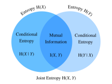

# 信息论
:label:`sec_information_theory`

宇宙中充满了信息。信息为跨越学科鸿沟提供了共同语言：从莎士比亚的十四行诗到研究人员在 Cornell ArXiv 上的论文，从梵高的画作《星月夜》到贝多芬的《第五交响曲》，从最早的编程语言 Plankalkül 到最先进的机器学习算法。无论形式如何，一切都必须遵循信息论的规律。借助信息论，我们可以度量并比较不同信号中包含多少信息。本节中，我们将探究信息论的基本概念以及信息论在机器学习中的应用。

在开始之前，让我们先勾勒机器学习与信息论之间的关系。机器学习旨在从数据中提取有意义的信号并作出关键预测。另一方面，信息论研究信息的编码、解码、传输与处理。因此，信息论为讨论机器学习系统中的信息处理提供了基础语言。例如，许多机器学习应用使用 :numref:`sec_softmax` 中描述的交叉熵损失。这一损失可以直接从信息论的考量中推导出来。


## 信息

让我们从信息论的“灵魂”——信息——开始。*信息*（information）可以用任何具有一个或多个编码格式的特定序列的事物来编码。假设我们给自己布置一项任务：尝试定义信息的概念。我们的出发点可以是什么呢？

考虑下面这个思想实验。我们有一位朋友，他有一副纸牌。他会洗牌、翻开一些牌，并告诉我们关于这些牌的陈述。我们将尝试评估每个陈述的信息含量。

首先，他翻开一张牌并告诉我们：“我看到一张牌。”这完全没有给我们提供任何信息。我们本来就确信情况如此，所以我们希望这个信息量应当是零。

接下来，他翻开一张牌并说：“我看到一张红桃。”这给我们提供了一些信息，但实际上只可能有$4$种花色，且每种出现的可能性相同，所以我们对这一结果并不感到意外。我们希望，无论信息的度量是什么，这个事件的信息含量都应当较低。

接下来，他翻开一张牌并说：“这是黑桃$3$。”这包含更多信息。确实，有$52$种等可能的可能结果，而我们的朋友告诉了我们究竟是哪一种。这应当是中等数量的信息。

让我们把这个实验推到逻辑的极端。假设最后他翻开牌堆中的每一张牌，读出一整副洗过的牌的顺序。牌堆有$52!$种不同的排列，同样都等可能，因此我们需要大量信息才能知道是其中哪一种。

我们发展出的任何信息概念都必须符合这一直觉。事实上，在接下来的几节中我们将学会如何计算：这些事件分别包含$0\textrm{ bits}$、$2\textrm{ bits}$、$~5.7\textrm{ bits}$和$~225.6\textrm{ bits}$的信息。

回顾这些思想实验，我们会看到一个自然的想法。作为起点，我们与其关心知识本身，不如基于这样的想法：信息表示事件令人意外的程度或事件抽象的“可能性”。例如，如果我们想描述一个不寻常的事件，就需要大量信息。而对于一个常见事件，我们可能不需要多少信息。

1948 年，Claude E. Shannon 发表了*《通信的数学理论》*（*A Mathematical Theory of Communication*） :cite:`Shannon.1948`，奠定了信息论。在这篇文章中，Shannon 首次引入了信息熵的概念。我们的旅程将从这里开始。


### 自信息

既然信息体现的是事件的抽象可能性，那么如何把这种可能性映射为比特数呢？Shannon 引入了*比特*（bit）这一术语作为信息的单位，而这个术语最初是由 John Tukey 创造的。那么，“比特”是什么？我们为什么用它来度量信息？从历史上看，老式发报机只能发送或接收两类代码：$0$和$1$。事实上，二进制编码在所有现代数字计算机上仍然被普遍使用。这样一来，任何信息都由一系列$0$和$1$编码。因此，长度为$n$的二进制数字序列包含$n$比特信息。

现在，假设对于任意代码序列，每个$0$或$1$都以$\frac{1}{2}$的概率出现。于是，一个由长度为$n$的代码序列构成的事件$X$，其发生概率为$\frac{1}{2^n}$。同时，正如前面提到的，这个序列包含$n$比特信息。那么，我们能否推广出一个数学函数，把概率$p$转换为比特数？Shannon 通过定义*自信息*（self-information）

$$I(X) = - \log_2 (p),$$

给出了答案，它表示我们为这个事件$X$接收到的信息*比特数*。注意，本节中我们将一直使用以 2 为底的对数。为简洁起见，本节其余部分将省略对数记号中的下标 2，即$\log(.)$总是指$\log_2(.)$。例如，代码“0010”的自信息为

$$I(\textrm{"0010"}) = - \log (p(\textrm{"0010"})) = - \log \left( \frac{1}{2^4} \right) = 4 \textrm{ bits}.$$

我们可以如下计算自信息。在此之前，让我们先导入本节所需的所有包。

```{.python .input}
#@tab mxnet
from mxnet import np
from mxnet.metric import NegativeLogLikelihood
from mxnet.ndarray import nansum
import random

def self_information(p):
    return -np.log2(p)

self_information(1 / 64)
```

```{.python .input}
#@tab pytorch
import torch
from torch.nn import NLLLoss

def nansum(x):
    # Define nansum, as pytorch does not offer it inbuilt.
    return x[~torch.isnan(x)].sum()

def self_information(p):
    return -torch.log2(torch.tensor(p)).item()

self_information(1 / 64)
```

```{.python .input}
#@tab tensorflow
import tensorflow as tf

def log2(x):
    return tf.math.log(x) / tf.math.log(2.)

def nansum(x):
    return tf.reduce_sum(tf.where(tf.math.is_nan(
        x), tf.zeros_like(x), x), axis=-1)

def self_information(p):
    return -log2(tf.constant(p)).numpy()

self_information(1 / 64)
```

## 熵

由于自信息只度量单个离散事件的信息，我们需要一个更一般化的度量，适用于离散分布或连续分布的任意随机变量。


### 熵的动机

让我们试着把需求具体化。这里我们要非正式地陈述所谓的*Shannon 熵公理*（axioms of Shannon entropy）。结果表明，下面这一组常识性陈述会迫使我们得到唯一的信息定义。这些公理的形式化版本以及其他若干公理可参见 :citet:`Csiszar.2008`。

1.  通过观测一个随机变量所获得的信息，不依赖于我们如何称呼这些元素，也不依赖于是否存在概率为零的额外元素。
2.  通过观测两个随机变量所获得的信息，不超过分别观测它们所获信息之和。如果它们独立，那么恰好等于两者之和。
3.  观测（几乎）确定的事件时获得的信息为（几乎）零。

虽然证明这一事实超出了本书的范围，但重要的是要知道，它唯一地决定了熵必须具有的形式。这些公理允许的唯一含糊之处在于基本单位的选择，而这一选择最常见的规范化方式就是我们前面看到的：一次公平抛硬币所提供的信息为一比特。

### 定义

对于任何服从概率分布$P$、具有概率密度函数（p.d.f.）或概率质量函数（p.m.f.）$p(x)$的随机变量$X$，我们通过*熵*（entropy）（或*Shannon 熵*）来度量期望的信息量

$$H(X) = - E_{x \sim P} [\log p(x)].$$
:eqlabel:`eq_ent_def`

具体来说，如果$X$是离散的，则$$H(X) = - \sum_i p_i \log p_i \textrm{, where } p_i = P(X_i).$$

否则，如果$X$是连续的，我们也将熵称为*微分熵*（differential entropy）

$$H(X) = - \int_x p(x) \log p(x) \; dx.$$

我们可以如下定义熵。

```{.python .input}
#@tab mxnet
def entropy(p):
    entropy = - p * np.log2(p)
    # Operator `nansum` will sum up the non-nan number
    out = nansum(entropy.as_nd_ndarray())
    return out

entropy(np.array([0.1, 0.5, 0.1, 0.3]))
```

```{.python .input}
#@tab pytorch
def entropy(p):
    entropy = - p * torch.log2(p)
    # Operator `nansum` will sum up the non-nan number
    out = nansum(entropy)
    return out

entropy(torch.tensor([0.1, 0.5, 0.1, 0.3]))
```

```{.python .input}
#@tab tensorflow
def entropy(p):
    return nansum(- p * log2(p))

entropy(tf.constant([0.1, 0.5, 0.1, 0.3]))
```

### 解释

你可能会好奇：在熵的定义 :eqref:`eq_ent_def` 中，我们为什么取负对数的期望？下面给出一些直觉。

首先，我们为什么使用*对数*（logarithm）函数$\log$？假设$p(x) = f_1(x) f_2(x) \ldots, f_n(x)$，其中每个分量函数$f_i(x)$彼此独立。这意味着每个$f_i(x)$都独立地对从$p(x)$获得的总信息作出贡献。如上所述，我们希望熵公式在独立随机变量上具有可加性。幸运的是，$\log$能够自然地把概率分布的乘积转化为各项之和。

其次，我们为什么使用*负的*$\log$？从直觉上说，越频繁的事件所包含的信息应当少于越罕见的事件，因为我们往往从异常情形中获得比从寻常情形中更多的信息。然而，$\log$随概率单调递增，而且在$[0, 1]$中的所有取值上确实为负。我们需要在事件概率与其熵之间构造一种单调递减的关系，并且理想情况下该关系始终为正（因为我们观测到的任何事物都不应迫使我们忘记已知的东西）。因此，我们在$\log$函数前面加上一个负号。

最后，*期望*函数从何而来？考虑一个随机变量$X$。我们可以把自信息（$-\log(p)$）解释为看到某个特定结果时我们所具有的*惊讶*（surprise）程度。确实，当概率趋近于零时，惊讶程度变得无穷大。类似地，我们可以把熵解释为观测$X$时平均的惊讶程度。例如，想象一个老虎机系统独立地发出符号${s_1, \ldots, s_k}$，各符号出现的概率分别为${p_1, \ldots, p_k}$。那么这个系统的熵等于观测每个输出所得自信息的平均值，即

$$H(S) = \sum_i {p_i \cdot I(s_i)} = - \sum_i {p_i \cdot \log p_i}.$$


### 熵的性质

通过上面的例子和解释，我们可以推导出熵 :eqref:`eq_ent_def` 的如下性质。这里，我们把$X$称为事件，把$P$称为$X$的概率分布。

* 对所有离散的$X$，$H(X) \geq 0$（对连续的$X$，熵可能为负）。

* 如果$X \sim P$具有 p.d.f. 或 p.m.f. $p(x)$，而我们试图用一个新概率分布$Q$（其 p.d.f. 或 p.m.f. 为$q(x)$）来估计$P$，那么 $$H(X) = - E_{x \sim P} [\log p(x)] \leq  - E_{x \sim P} [\log q(x)], \textrm{ with equality if and only if } P = Q.$$ 另一种说法是，$H(X)$给出了编码从$P$中抽取的符号所需的平均比特数的一个下界。

* 如果$X \sim P$，那么当$x$在全部可能结果上均匀分布时，它传递的信息量最大。具体来说，如果概率分布$P$是离散的，且有$k$个类别$\{p_1, \ldots, p_k \}$，那么 $$H(X) \leq \log(k), \textrm{ with equality if and only if } p_i = \frac{1}{k}, \forall i.$$ 如果$P$是连续随机变量，情况就复杂得多。不过，如果我们额外要求$P$的支撑集是一个有限区间（所有取值都在$0$和$1$之间），那么当$P$为该区间上的均匀分布时，它具有最高的熵。


## 互信息

前面我们定义了单个随机变量$X$的熵，那么一对随机变量$(X, Y)$的熵又如何呢？我们可以把这些技术看作在试图回答如下这类问题：“与分别考虑二者相比，$X$和$Y$合在一起包含什么信息？其中是否存在冗余信息，还是全部都是独特信息？”

在下面的讨论中，我们总是把$(X, Y)$当作服从联合概率分布$P$、具有 p.d.f. 或 p.m.f. $p_{X, Y}(x, y)$的一对随机变量，而$X$和$Y$分别服从概率分布$p_X(x)$和$p_Y(y)$。


### 联合熵

类似于单个随机变量的熵 :eqref:`eq_ent_def`，我们定义一对随机变量$(X, Y)$的*联合熵*（joint entropy）$H(X, Y)$为

$$H(X, Y) = -E_{(x, y) \sim P} [\log p_{X, Y}(x, y)]. $$
:eqlabel:`eq_joint_ent_def`

确切地说，一方面，如果$(X, Y)$是一对离散随机变量，那么

$$H(X, Y) = - \sum_{x} \sum_{y} p_{X, Y}(x, y) \log p_{X, Y}(x, y).$$

另一方面，如果$(X, Y)$是一对连续随机变量，那么我们定义*微分联合熵*（differential joint entropy）为

$$H(X, Y) = - \int_{x, y} p_{X, Y}(x, y) \ \log p_{X, Y}(x, y) \;dx \;dy.$$

我们可以把 :eqref:`eq_joint_ent_def` 看作告诉我们这对随机变量中的总随机性。作为一对极端情形，如果$X = Y$是两个相同的随机变量，那么这对变量中的信息恰好等于其中一个的信息，于是$H(X, Y) = H(X) = H(Y)$。在另一个极端，如果$X$和$Y$独立，那么$H(X, Y) = H(X) + H(Y)$。事实上，我们总是有：一对随机变量所含的信息既不小于任一随机变量的熵，也不大于二者熵之和。

$$
H(X), H(Y) \le H(X, Y) \le H(X) + H(Y).
$$

让我们从零开始实现联合熵。

```{.python .input}
#@tab mxnet
def joint_entropy(p_xy):
    joint_ent = -p_xy * np.log2(p_xy)
    # Operator `nansum` will sum up the non-nan number
    out = nansum(joint_ent.as_nd_ndarray())
    return out

joint_entropy(np.array([[0.1, 0.5], [0.1, 0.3]]))
```

```{.python .input}
#@tab pytorch
def joint_entropy(p_xy):
    joint_ent = -p_xy * torch.log2(p_xy)
    # Operator `nansum` will sum up the non-nan number
    out = nansum(joint_ent)
    return out

joint_entropy(torch.tensor([[0.1, 0.5], [0.1, 0.3]]))
```

```{.python .input}
#@tab tensorflow
def joint_entropy(p_xy):
    joint_ent = -p_xy * log2(p_xy)
    # Operator `nansum` will sum up the non-nan number
    out = nansum(joint_ent)
    return out

joint_entropy(tf.constant([[0.1, 0.5], [0.1, 0.3]]))
```

注意，这与之前的*代码*相同，只是现在我们把它解释为作用于两个随机变量的联合分布。


### 条件熵

上面定义的联合熵是一对随机变量所包含的信息量。这很有用，但往往并不是我们关心的。考虑机器学习的情形。设$X$为描述图像像素值的随机变量（或随机变量向量），$Y$为类别标签这个随机变量。$X$应当包含大量信息——一张自然图像是复杂的事物。然而，在图像已经给出之后，$Y$中所含的信息应当很少。确实，除非数字难以辨认，数字的图像本身就已经包含了它是什么数字的信息。因此，为了继续扩展我们的信息论词汇，我们需要能够推理某个随机变量在给定另一个随机变量条件下的信息含量。

在概率论中，我们看到过*条件概率*（conditional probability）的定义，用来度量变量之间的关系。现在我们要类似地定义*条件熵*（conditional entropy）$H(Y \mid X)$。我们可以把它写成

$$ H(Y \mid X) = - E_{(x, y) \sim P} [\log p(y \mid x)],$$
:eqlabel:`eq_cond_ent_def`

其中$p(y \mid x) = \frac{p_{X, Y}(x, y)}{p_X(x)}$是条件概率。具体来说，如果$(X, Y)$是一对离散随机变量，那么

$$H(Y \mid X) = - \sum_{x} \sum_{y} p(x, y) \log p(y \mid x).$$

如果$(X, Y)$是一对连续随机变量，那么*微分条件熵*（differential conditional entropy）类似地定义为

$$H(Y \mid X) = - \int_x \int_y p(x, y) \ \log p(y \mid x) \;dx \;dy.$$


现在自然会问：*条件熵*$H(Y \mid X)$与熵$H(X)$、联合熵$H(X, Y)$之间关系如何？利用上面的定义，我们可以简洁地表达出来：

$$H(Y \mid X) = H(X, Y) - H(X).$$

这有一个直观的解释：给定$X$时$Y$中的信息（$H(Y \mid X)$）等于$X$和$Y$合在一起的信息（$H(X, Y)$）减去$X$中已经包含的信息。这给出了$Y$中未被$X$表示的那部分信息。

现在，让我们从零开始实现条件熵 :eqref:`eq_cond_ent_def`。

```{.python .input}
#@tab mxnet
def conditional_entropy(p_xy, p_x):
    p_y_given_x = p_xy/p_x
    cond_ent = -p_xy * np.log2(p_y_given_x)
    # Operator `nansum` will sum up the non-nan number
    out = nansum(cond_ent.as_nd_ndarray())
    return out

conditional_entropy(np.array([[0.1, 0.5], [0.2, 0.3]]), np.array([0.2, 0.8]))
```

```{.python .input}
#@tab pytorch
def conditional_entropy(p_xy, p_x):
    p_y_given_x = p_xy/p_x
    cond_ent = -p_xy * torch.log2(p_y_given_x)
    # Operator `nansum` will sum up the non-nan number
    out = nansum(cond_ent)
    return out

conditional_entropy(torch.tensor([[0.1, 0.5], [0.2, 0.3]]),
                    torch.tensor([0.2, 0.8]))
```

```{.python .input}
#@tab tensorflow
def conditional_entropy(p_xy, p_x):
    p_y_given_x = p_xy/p_x
    cond_ent = -p_xy * log2(p_y_given_x)
    # Operator `nansum` will sum up the non-nan number
    out = nansum(cond_ent)
    return out

conditional_entropy(tf.constant([[0.1, 0.5], [0.2, 0.3]]),
                    tf.constant([0.2, 0.8]))
```

### 互信息

给定前面关于随机变量$(X, Y)$的设定，你可能会好奇：“既然我们知道$Y$中包含了多少不在$X$中的信息，那么能否类似地问$X$和$Y$之间共享了多少信息？”答案就是$(X, Y)$的*互信息*（mutual information），我们记作$I(X, Y)$。

与其直接跳入形式化定义，不如先练习一下直觉：仅用前面已经构造出的术语来推导互信息的表达式。我们希望找出两个随机变量之间共享的信息。一种可以尝试的做法是：先取$X$和$Y$合在一起所包含的全部信息，然后去掉那些不共享的部分。$X$和$Y$合在一起所包含的信息写作$H(X, Y)$。我们要从中减去$X$中但不在$Y$中的信息，以及$Y$中但不在$X$中的信息。正如上一节所见，这两部分分别由$H(X \mid Y)$和$H(Y \mid X)$给出。于是我们有，互信息应当是

$$
I(X, Y) = H(X, Y) - H(Y \mid X) - H(X \mid Y).
$$

确实，这就是互信息的一个合法定义。如果我们把这些项的定义展开并合并，稍作代数运算即可看出它等同于

$$I(X, Y) = E_{x} E_{y} \left\{ p_{X, Y}(x, y) \log\frac{p_{X, Y}(x, y)}{p_X(x) p_Y(y)} \right\}. $$
:eqlabel:`eq_mut_ent_def`


我们可以用图 :numref:`fig_mutual_information` 概括所有这些关系。下面这些陈述为什么也都等价于$I(X, Y)$，是检验直觉的绝佳练习。

* $H(X) - H(X \mid Y)$
* $H(Y) - H(Y \mid X)$
* $H(X) + H(Y) - H(X, Y)$


:label:`fig_mutual_information`


在许多方面，我们可以把互信息 :eqref:`eq_mut_ent_def` 看作 :numref:`sec_random_variables` 中所见相关系数的一种有理论依据的推广。这使我们不仅能够询问变量之间的线性关系，还能询问两个随机变量之间任意种类的最大共享信息。

现在，让我们从零开始实现互信息。

```{.python .input}
#@tab mxnet
def mutual_information(p_xy, p_x, p_y):
    p = p_xy / (p_x * p_y)
    mutual = p_xy * np.log2(p)
    # Operator `nansum` will sum up the non-nan number
    out = nansum(mutual.as_nd_ndarray())
    return out

mutual_information(np.array([[0.1, 0.5], [0.1, 0.3]]),
                   np.array([0.2, 0.8]), np.array([[0.75, 0.25]]))
```

```{.python .input}
#@tab pytorch
def mutual_information(p_xy, p_x, p_y):
    p = p_xy / (p_x * p_y)
    mutual = p_xy * torch.log2(p)
    # Operator `nansum` will sum up the non-nan number
    out = nansum(mutual)
    return out

mutual_information(torch.tensor([[0.1, 0.5], [0.1, 0.3]]),
                   torch.tensor([0.2, 0.8]), torch.tensor([[0.75, 0.25]]))
```

```{.python .input}
#@tab tensorflow
def mutual_information(p_xy, p_x, p_y):
    p = p_xy / (p_x * p_y)
    mutual = p_xy * log2(p)
    # Operator `nansum` will sum up the non-nan number
    out = nansum(mutual)
    return out

mutual_information(tf.constant([[0.1, 0.5], [0.1, 0.3]]),
                   tf.constant([0.2, 0.8]), tf.constant([[0.75, 0.25]]))
```

### 互信息的性质

与其记住互信息的定义 :eqref:`eq_mut_ent_def`，你只需要记住它的一些显著性质：

* 互信息是对称的，即$I(X, Y) = I(Y, X)$。
* 互信息是非负的，即$I(X, Y) \geq 0$。
* $I(X, Y) = 0$当且仅当$X$和$Y$独立。例如，如果$X$和$Y$独立，那么知道$Y$并不会给出关于$X$的任何信息，反之亦然，因此它们的互信息为零。
* 另一种情形是，如果$X$是$Y$的可逆函数，那么$Y$和$X$共享全部信息，且 $$I(X, Y) = H(Y) = H(X).$$

### 逐点互信息

在本章开头处理熵时，我们能够把$-\log(p_X(x))$解释为我们在多大程度上对特定结果感到*惊讶*。我们可以对互信息中的对数项给出类似的解释，它通常称为*逐点互信息*（pointwise mutual information）：

$$\textrm{pmi}(x, y) = \log\frac{p_{X, Y}(x, y)}{p_X(x) p_Y(y)}.$$
:eqlabel:`eq_pmi_def`

我们可以把 :eqref:`eq_pmi_def` 看作在度量结果$x$和$y$的特定组合比我们在独立随机结果下所预期的可能性高出多少或低了多少。如果它数值很大且为正，那么这两个特定结果发生的频率远高于随机情形下的频率（*注意*：分母是$p_X(x) p_Y(y)$，即两个结果独立时的概率）；而如果它数值很大且为负，则表示这两个结果的发生远少于随机情形下我们预期的频率。

这使我们能够把互信息 :eqref:`eq_mut_ent_def` 解释为：与它们独立时我们预期的情形相比，我们看到两个结果同时发生时的平均惊讶程度。

### 互信息的应用

互信息在其纯粹的定义中可能有些抽象，那么它与机器学习有什么关系呢？在自然语言处理中，最困难的问题之一是*歧义消解*（ambiguity resolution），即根据上下文无法确定某个词含义的问题。例如，最近新闻中有一个标题报道说“Amazon is on fire”。你可能会想：是 Amazon 公司有栋楼着火了，还是亚马逊雨林着火了？

在这种情况下，互信息可以帮助我们消解这一歧义。我们首先找出一组词，其中每个词都与 Amazon 公司具有较大的互信息，例如电子商务、技术、在线。其次，我们再找出一组词，其中每个词都与亚马逊雨林具有较大的互信息，例如雨、森林、热带。当我们需要消解“Amazon”的歧义时，可以比较哪一组词在 Amazon 一词的上下文中出现得更多。在这种情况下，文章会接着描述森林，从而使上下文变得清晰。


## Kullback–Leibler 散度

正如我们在 :numref:`sec_linear-algebra` 中所讨论的，我们可以用范数来度量任意维空间中的两点之间的距离。我们希望能够对概率分布做类似的事情。实现这一点的方法有很多，而信息论提供了其中最优美的一种。我们现在就来探究*Kullback–Leibler（KL）散度*（Kullback–Leibler divergence），它提供了一种度量两个分布是否接近的方法。


### 定义

给定服从概率分布$P$、具有 p.d.f. 或 p.m.f. $p(x)$的随机变量$X$，我们用另一个概率分布$Q$（具有 p.d.f. 或 p.m.f. $q(x)$）来估计$P$。那么$P$与$Q$之间的*Kullback–Leibler（KL）散度*（或*相对熵*（relative entropy））为

$$D_{\textrm{KL}}(P\|Q) = E_{x \sim P} \left[ \log \frac{p(x)}{q(x)} \right].$$
:eqlabel:`eq_kl_def`

与逐点互信息 :eqref:`eq_pmi_def` 一样，我们也可以再次对对数项给出解释：$-\log \frac{q(x)}{p(x)} = -\log(q(x)) - (-\log(p(x)))$在$P$下看到$x$的频率远高于在$Q$下预期的频率时会很大且为正，而在看到该结果的频率远低于预期时会很大且为负。这样，我们就可以把它解释为：相对于在参照分布下观测该结果时的惊讶程度，我们观测时的*相对*惊讶程度。

让我们从零开始实现 KL 散度。

```{.python .input}
#@tab mxnet
def kl_divergence(p, q):
    kl = p * np.log2(p / q)
    out = nansum(kl.as_nd_ndarray())
    return out.abs().asscalar()
```

```{.python .input}
#@tab pytorch
def kl_divergence(p, q):
    kl = p * torch.log2(p / q)
    out = nansum(kl)
    return out.abs().item()
```

```{.python .input}
#@tab tensorflow
def kl_divergence(p, q):
    kl = p * log2(p / q)
    out = nansum(kl)
    return tf.abs(out).numpy()
```

### KL 散度的性质

让我们看一看 KL 散度 :eqref:`eq_kl_def` 的一些性质。

* KL 散度是非对称的，即存在$P,Q$使得 $$D_{\textrm{KL}}(P\|Q) \neq D_{\textrm{KL}}(Q\|P).$$
* KL 散度是非负的，即 $$D_{\textrm{KL}}(P\|Q) \geq 0.$$ 注意仅当$P = Q$时等号成立。
* 如果存在$x$使得$p(x) > 0$且$q(x) = 0$，那么$D_{\textrm{KL}}(P\|Q) = \infty$。
* KL 散度与互信息之间有着密切的关系。除了 :numref:`fig_mutual_information` 中展示的关系之外，$I(X, Y)$在数值上也等价于如下各项：
    1. $D_{\textrm{KL}}(P(X, Y)  \ \| \ P(X)P(Y))$；
    1. $E_Y \{ D_{\textrm{KL}}(P(X \mid Y) \ \| \ P(X)) \}$；
    1. $E_X \{ D_{\textrm{KL}}(P(Y \mid X) \ \| \ P(Y)) \}$。

  对第一项，我们把互信息解释为$P(X, Y)$与$P(X)$和$P(Y)$的乘积之间的 KL 散度，因此它是联合分布与“假设二者独立时的分布”之间差异的度量。对第二项，互信息告诉我们：学习$X$的分布取值后，关于$Y$的不确定性平均降低了多少。第三项同理。


### 例子

让我们通过一个玩具例子来明确地看看这种非对称性。

首先，我们生成并排序三个长度为$10,000$的张量：一个服从正态分布$N(0, 1)$的目标张量$p$，以及两个候选张量$q_1$和$q_2$，它们分别服从正态分布$N(-1, 1)$和$N(1, 1)$。

```{.python .input}
#@tab mxnet
random.seed(1)

nd_len = 10000
p = np.random.normal(loc=0, scale=1, size=(nd_len, ))
q1 = np.random.normal(loc=-1, scale=1, size=(nd_len, ))
q2 = np.random.normal(loc=1, scale=1, size=(nd_len, ))

p = np.array(sorted(p.asnumpy()))
q1 = np.array(sorted(q1.asnumpy()))
q2 = np.array(sorted(q2.asnumpy()))
```

```{.python .input}
#@tab pytorch
torch.manual_seed(1)

tensor_len = 10000
p = torch.normal(0, 1, (tensor_len, ))
q1 = torch.normal(-1, 1, (tensor_len, ))
q2 = torch.normal(1, 1, (tensor_len, ))

p = torch.sort(p)[0]
q1 = torch.sort(q1)[0]
q2 = torch.sort(q2)[0]
```

```{.python .input}
#@tab tensorflow
tensor_len = 10000
p = tf.random.normal((tensor_len, ), 0, 1)
q1 = tf.random.normal((tensor_len, ), -1, 1)
q2 = tf.random.normal((tensor_len, ), 1, 1)

p = tf.sort(p)
q1 = tf.sort(q1)
q2 = tf.sort(q2)
```

由于$q_1$和$q_2$关于 y 轴（即$x=0$）对称，我们预期$D_{\textrm{KL}}(p\|q_1)$与$D_{\textrm{KL}}(p\|q_2)$的取值相近。如下所示，$D_{\textrm{KL}}(p\|q_1)$与$D_{\textrm{KL}}(p\|q_2)$之间只有不到 3%的偏差。

```{.python .input}
#@tab all
kl_pq1 = kl_divergence(p, q1)
kl_pq2 = kl_divergence(p, q2)
similar_percentage = abs(kl_pq1 - kl_pq2) / ((kl_pq1 + kl_pq2) / 2) * 100

kl_pq1, kl_pq2, similar_percentage
```

相反，你可能会发现$D_{\textrm{KL}}(q_2 \|p)$与$D_{\textrm{KL}}(p \| q_2)$相差很大，如下所示约相差 40%。

```{.python .input}
#@tab all
kl_q2p = kl_divergence(q2, p)
differ_percentage = abs(kl_q2p - kl_pq2) / ((kl_q2p + kl_pq2) / 2) * 100

kl_q2p, differ_percentage
```

## 交叉熵

如果你对信息论在深度学习中的应用感到好奇，这里有一个简单的例子。我们定义概率分布为$p(x)$的真实分布$P$，以及概率分布为$q(x)$的估计分布$Q$，本节余下部分将使用它们。

假设我们需要基于给定的$n$个数据样例{$x_1, \ldots, x_n$}求解一个二元分类问题。假定我们分别用$1$和$0$表示正类和负类标签$y_i$，并且我们的神经网络由$\theta$参数化。如果我们希望找到一个最佳的$\theta$，使得$\hat{y}_i= p_{\theta}(y_i \mid x_i)$，那么自然地可以应用 :numref:`sec_maximum_likelihood` 中所见的最大对数似然方法。具体来说，对真实标签$y_i$和预测$\hat{y}_i= p_{\theta}(y_i \mid x_i)$，被分类为正类的概率为$\pi_i= p_{\theta}(y_i = 1 \mid x_i)$。因此，对数似然函数为

$$
\begin{aligned}
l(\theta) &= \log L(\theta) \\
  &= \log \prod_{i=1}^n \pi_i^{y_i} (1 - \pi_i)^{1 - y_i} \\
  &= \sum_{i=1}^n y_i \log(\pi_i) + (1 - y_i) \log (1 - \pi_i). \\
\end{aligned}
$$

最大化对数似然函数$l(\theta)$与最小化$- l(\theta)$是等价的，因此我们可以从这里找到最佳的$\theta$。为了把上述损失推广到任意分布，我们同样把$-l(\theta)$称为*交叉熵损失*（cross-entropy loss）$\textrm{CE}(y, \hat{y})$，其中$y$服从真实分布$P$，$\hat{y}$服从估计分布$Q$。

这一切都是由最大似然视角推导出来的。然而，如果我们仔细观察就会发现，像$\log(\pi_i)$这样的项进入了我们的计算，这有力地说明我们可以从信息论的角度理解该表达式。


### 形式化定义

与 KL 散度类似，对随机变量$X$，我们也可以通过*交叉熵*（cross-entropy）来度量估计分布$Q$与真实分布$P$之间的散度，

$$\textrm{CE}(P, Q) = - E_{x \sim P} [\log(q(x))].$$
:eqlabel:`eq_ce_def`

利用上文讨论的熵的性质，我们也可以把它解释为熵$H(P)$与$P$和$Q$之间 KL 散度之和，即

$$\textrm{CE} (P, Q) = H(P) + D_{\textrm{KL}}(P\|Q).$$


我们可以如下实现交叉熵损失。

```{.python .input}
#@tab mxnet
def cross_entropy(y_hat, y):
    ce = -np.log(y_hat[range(len(y_hat)), y])
    return ce.mean()
```

```{.python .input}
#@tab pytorch
def cross_entropy(y_hat, y):
    ce = -torch.log(y_hat[range(len(y_hat)), y])
    return ce.mean()
```

```{.python .input}
#@tab tensorflow
def cross_entropy(y_hat, y):
    # `tf.gather_nd` is used to select specific indices of a tensor.
    ce = -tf.math.log(tf.gather_nd(y_hat, indices = [[i, j] for i, j in zip(
        range(len(y_hat)), y)]))
    return tf.reduce_mean(ce).numpy()
```

现在为标签和预测定义两个张量，并计算它们的交叉熵损失。

```{.python .input}
#@tab mxnet
labels = np.array([0, 2])
preds = np.array([[0.3, 0.6, 0.1], [0.2, 0.3, 0.5]])

cross_entropy(preds, labels)
```

```{.python .input}
#@tab pytorch
labels = torch.tensor([0, 2])
preds = torch.tensor([[0.3, 0.6, 0.1], [0.2, 0.3, 0.5]])

cross_entropy(preds, labels)
```

```{.python .input}
#@tab tensorflow
labels = tf.constant([0, 2])
preds = tf.constant([[0.3, 0.6, 0.1], [0.2, 0.3, 0.5]])

cross_entropy(preds, labels)
```

### 性质

正如本节开头所提到的，交叉熵 :eqref:`eq_ce_def` 可用于在优化问题中定义损失函数。事实证明，以下各项是等价的：

1. 对分布$P$最大化$Q$的预测概率（即$E_{x
\sim P} [\log (q(x))]$）；
1. 最小化交叉熵$\textrm{CE} (P, Q)$；
1. 最小化 KL 散度$D_{\textrm{KL}}(P\|Q)$。

交叉熵的定义间接证明了目标 2 与目标 3 之间的等价关系，只要真实数据的熵$H(P)$是常数。


### 交叉熵作为多类分类的目标函数

如果我们深入考察带交叉熵损失$\textrm{CE}$的分类目标函数，就会发现最小化$\textrm{CE}$等价于最大化对数似然函数$L$。

首先，假设给定一个有$n$个样例的数据集，并且它可以被分为$k$个类别。对每个数据样例$i$，我们用*独热编码*（one-hot encoding）表示任意$k$类标签$\mathbf{y}_i = (y_{i1}, \ldots, y_{ik})$。具体来说，如果样例$i$属于类别$j$，则我们把第$j$个分量设为$1$，其他所有分量设为$0$，即

$$ y_{ij} = \begin{cases}1 & j \in J; \\ 0 &\textrm{otherwise.}\end{cases}$$

例如，如果一个多类分类问题包含三个类别$A$、$B$和$C$，那么标签$\mathbf{y}_i$可以编码为{$A: (1, 0, 0); B: (0, 1, 0); C: (0, 0, 1)$}。


假设我们的神经网络由$\theta$参数化。对于真实标签向量$\mathbf{y}_i$和预测$$\hat{\mathbf{y}}_i= p_{\theta}(\mathbf{y}_i \mid \mathbf{x}_i) = \sum_{j=1}^k y_{ij} p_{\theta} (y_{ij}  \mid  \mathbf{x}_i).$$

因此，*交叉熵损失*将为

$$
\textrm{CE}(\mathbf{y}, \hat{\mathbf{y}}) = - \sum_{i=1}^n \mathbf{y}_i \log \hat{\mathbf{y}}_i
 = - \sum_{i=1}^n \sum_{j=1}^k y_{ij} \log{p_{\theta} (y_{ij}  \mid  \mathbf{x}_i)}.\\
$$

另一方面，我们也可以通过最大似然估计来处理这个问题。首先，让我们简要介绍$k$类多项伯努利分布（multinoulli distribution）。它是伯努利分布从二分类到多分类的推广。如果一个随机变量$\mathbf{z} = (z_{1}, \ldots, z_{k})$服从参数为$\mathbf{p} =$ ($p_{1}, \ldots, p_{k}$)的$k$类*多项伯努利分布*（multinoulli distribution），即$$p(\mathbf{z}) = p(z_1, \ldots, z_k) = \textrm{Multi} (p_1, \ldots, p_k), \textrm{ where } \sum_{i=1}^k p_i = 1,$$那么$\mathbf{z}$的联合概率质量函数（p.m.f.）为
$$\mathbf{p}^\mathbf{z} = \prod_{j=1}^k p_{j}^{z_{j}}.$$


可以看出，每个数据样例的标签$\mathbf{y}_i$服从参数为$\boldsymbol{\pi} =$ ($\pi_{1}, \ldots, \pi_{k}$)的$k$类多项伯努利分布。因此，每个数据样例$\mathbf{y}_i$的联合 p.m.f. 为$\mathbf{\pi}^{\mathbf{y}_i} = \prod_{j=1}^k \pi_{j}^{y_{ij}}.$
于是，对数似然函数为

$$
\begin{aligned}
l(\theta)
 = \log L(\theta)
 = \log \prod_{i=1}^n \boldsymbol{\pi}^{\mathbf{y}_i}
 = \log \prod_{i=1}^n \prod_{j=1}^k \pi_{j}^{y_{ij}}
 = \sum_{i=1}^n \sum_{j=1}^k y_{ij} \log{\pi_{j}}.\\
\end{aligned}
$$

在最大似然估计中，我们通过令$\pi_{j} = p_{\theta} (y_{ij}  \mid  \mathbf{x}_i)$来最大化目标函数$l(\theta)$。因此，对任何多类分类问题，最大化上述对数似然函数$l(\theta)$都等价于最小化交叉熵损失$\textrm{CE}(y, \hat{y})$。


为了检验上述证明，让我们应用内置的度量`NegativeLogLikelihood`。使用与前面例子相同的`labels`和`preds`，我们将得到与上一个例子在小数点后 5 位一致的数值损失。

```{.python .input}
#@tab mxnet
nll_loss = NegativeLogLikelihood()
nll_loss.update(labels.as_nd_ndarray(), preds.as_nd_ndarray())
nll_loss.get()
```

```{.python .input}
#@tab pytorch
# Implementation of cross-entropy loss in PyTorch combines `nn.LogSoftmax()`
# and `nn.NLLLoss()`
nll_loss = NLLLoss()
loss = nll_loss(torch.log(preds), labels)
loss
```

```{.python .input}
#@tab tensorflow
def nll_loss(y_hat, y):
    # Convert labels to one-hot vectors.
    y = tf.keras.utils.to_categorical(y, num_classes= y_hat.shape[1])
    # We will not calculate negative log-likelihood from the definition.
    # Rather, we will follow a circular argument. Because NLL is same as
    # `cross_entropy`, if we calculate cross_entropy that would give us NLL
    cross_entropy = tf.keras.losses.CategoricalCrossentropy(
        from_logits = True, reduction = tf.keras.losses.Reduction.NONE)
    return tf.reduce_mean(cross_entropy(y, y_hat)).numpy()

loss = nll_loss(tf.math.log(preds), labels)
loss
```

## 小结

* 信息论是研究信息的编码、解码、传输与处理的一个学科领域。
* 熵是度量不同信号中呈现了多少信息的单位。
* KL 散度也可以度量两个分布之间的散度。
* 交叉熵可以看作多类分类的目标函数。最小化交叉熵损失等价于最大化对数似然函数。


## 练习

1. 验证第一节中的纸牌例子确实具有所声称的熵。
1. 证明对任意分布$p$和$q$，KL 散度$D(p\|q)$都是非负的。提示：使用 Jensen 不等式，即利用$-\log x$是凸函数这一事实。
1. 让我们从几个数据源计算熵：
    * 假设你在观察一只猴子在打字机上产生的输出。猴子随机按下打字机的$44$个按键中的任意一个（你可以假定它还没有发现任何特殊按键或 Shift 键）。你观测到每个字符有多少比特的随机性？
    * 你对这只猴子不满意，于是把它换成了一名醉酒的排字工。它能够生成单词，尽管并不连贯。它从$2,000$个词的词表中随机选一个词。假设英文单词的平均长度为$4.5$个字母。你现在观测到每个字符有多少比特的随机性？
    * 你对结果仍不满意，于是把排字工换成了一个高质量的语言模型。该语言模型目前每个词的困惑度可以低至$15$。语言模型的字符*困惑度*（perplexity）定义为：一组概率的几何平均值的倒数，其中每个概率对应于单词中的一个字符。具体来说，如果给定单词的长度为$l$，那么$\textrm{PPL}(\textrm{word}) = \left[\prod_i p(\textrm{character}_i)\right]^{ -\frac{1}{l}} = \exp \left[ - \frac{1}{l} \sum_i{\log p(\textrm{character}_i)} \right].$假设测试单词有 4.5 个字母，你现在观测到每个字符有多少比特的随机性？
1. 直观地解释为什么$I(X, Y) = H(X) - H(X \mid Y)$。然后，把等式两边都表示为关于联合分布的期望来证明它成立。
1. 两个高斯分布$\mathcal{N}(\mu_1, \sigma_1^2)$和$\mathcal{N}(\mu_2, \sigma_2^2)$之间的 KL 散度是多少？

:begin_tab:`mxnet`
[讨论](https://discuss.d2l.ai/t/420)
:end_tab:

:begin_tab:`pytorch`
[讨论](https://discuss.d2l.ai/t/1104)
:end_tab:

:begin_tab:`tensorflow`
[讨论](https://discuss.d2l.ai/t/1105)
:end_tab:
