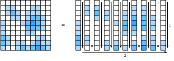

# 积分学
:label:`sec_integral_calculus`

微分只占传统微积分教育内容的一半。另一根支柱是积分，它一开始看起来像是一个相当不相干的问题：“这条曲线下方的面积是多少？”积分看似与微分无关，但通过所谓的*微积分基本定理*，它与微分紧密交织在一起。

在本书讨论的机器学习层面上，我们并不需要深入理解积分。不过，我们仍会做一个简要介绍，为以后遇到的各种应用奠定基础。

## 几何解释
假设我们有一个函数 $f(x)$。为简单起见，假定 $f(x)$ 非负（从不取小于零的值）。我们想要理解的是：$f(x)$ 与 $x$ 轴之间包含的面积是多少？

```{.python .input}
#@tab mxnet
%matplotlib inline
from d2l import mxnet as d2l
from IPython import display
from mpl_toolkits import mplot3d
from mxnet import np, npx
npx.set_np()

x = np.arange(-2, 2, 0.01)
f = np.exp(-x**2)

d2l.set_figsize()
d2l.plt.plot(x, f, color='black')
d2l.plt.fill_between(x.tolist(), f.tolist())
d2l.plt.show()
```

```{.python .input}
#@tab pytorch
%matplotlib inline
from d2l import torch as d2l
from IPython import display
from mpl_toolkits import mplot3d
import torch

x = torch.arange(-2, 2, 0.01)
f = torch.exp(-x**2)

d2l.set_figsize()
d2l.plt.plot(x, f, color='black')
d2l.plt.fill_between(x.tolist(), f.tolist())
d2l.plt.show()
```

```{.python .input}
#@tab tensorflow
%matplotlib inline
from d2l import tensorflow as d2l
from IPython import display
from mpl_toolkits import mplot3d
import tensorflow as tf

x = tf.range(-2, 2, 0.01)
f = tf.exp(-x**2)

d2l.set_figsize()
d2l.plt.plot(x, f, color='black')
d2l.plt.fill_between(x.numpy(), f.numpy())
d2l.plt.show()
```

在大多数情况下，这个面积会是无穷大或未定义的（想一想 $f(x) = x^{2}$ 下方的面积），因此人们常常谈论一对端点之间的面积，例如 $a$ 与 $b$ 之间的面积。

```{.python .input}
#@tab mxnet
x = np.arange(-2, 2, 0.01)
f = np.exp(-x**2)

d2l.set_figsize()
d2l.plt.plot(x, f, color='black')
d2l.plt.fill_between(x.tolist()[50:250], f.tolist()[50:250])
d2l.plt.show()
```

```{.python .input}
#@tab pytorch
x = torch.arange(-2, 2, 0.01)
f = torch.exp(-x**2)

d2l.set_figsize()
d2l.plt.plot(x, f, color='black')
d2l.plt.fill_between(x.tolist()[50:250], f.tolist()[50:250])
d2l.plt.show()
```

```{.python .input}
#@tab tensorflow
x = tf.range(-2, 2, 0.01)
f = tf.exp(-x**2)

d2l.set_figsize()
d2l.plt.plot(x, f, color='black')
d2l.plt.fill_between(x.numpy()[50:250], f.numpy()[50:250])
d2l.plt.show()
```

我们将用下面的积分符号来表示这一面积：

$$
\textrm{Area}(\mathcal{A}) = \int_a^b f(x) \;dx.
$$

其中的内层变量是一个哑变量，很像 $\sum$ 中求和的索引，因此它也可以用任何我们喜欢的内层值来等价地写出：

$$
\int_a^b f(x) \;dx = \int_a^b f(z) \;dz.
$$

有一种传统的方法可以尝试理解如何近似这类积分：我们可以想象把 $a$ 与 $b$ 之间的区域切成 $N$ 个竖直的窄条。如果 $N$ 很大，我们就可以用矩形来近似每个窄条的面积，然后把各面积相加，得到曲线下方的总面积。让我们看一个在代码中这样做的例子。我们将在后面的小节中看到如何得到真实值。

```{.python .input}
#@tab mxnet
epsilon = 0.05
a = 0
b = 2

x = np.arange(a, b, epsilon)
f = x / (1 + x**2)

approx = np.sum(epsilon*f)
true = np.log(2) / 2

d2l.set_figsize()
d2l.plt.bar(x.asnumpy(), f.asnumpy(), width=epsilon, align='edge')
d2l.plt.plot(x, f, color='black')
d2l.plt.ylim([0, 1])
d2l.plt.show()

f'approximation: {approx}, truth: {true}'
```

```{.python .input}
#@tab pytorch
epsilon = 0.05
a = 0
b = 2

x = torch.arange(a, b, epsilon)
f = x / (1 + x**2)

approx = torch.sum(epsilon*f)
true = torch.log(torch.tensor([5.])) / 2

d2l.set_figsize()
d2l.plt.bar(x, f, width=epsilon, align='edge')
d2l.plt.plot(x, f, color='black')
d2l.plt.ylim([0, 1])
d2l.plt.show()

f'approximation: {approx}, truth: {true}'
```

```{.python .input}
#@tab tensorflow
epsilon = 0.05
a = 0
b = 2

x = tf.range(a, b, epsilon)
f = x / (1 + x**2)

approx = tf.reduce_sum(epsilon*f)
true = tf.math.log(tf.constant([5.])) / 2

d2l.set_figsize()
d2l.plt.bar(x, f, width=epsilon, align='edge')
d2l.plt.plot(x, f, color='black')
d2l.plt.ylim([0, 1])
d2l.plt.show()

f'approximation: {approx}, truth: {true}'
```

问题在于，虽然这种做法可以在数值上进行，但我们只能对最简单的函数解析地这样做，比如

$$
\int_a^b x \;dx.
$$

而任何稍微复杂一点的东西，比如上面代码中的例子

$$
\int_a^b \frac{x}{1+x^{2}} \;dx.
$$

就超出了这种直接方法所能求解的范围。

我们将转而采取另一种方法。我们会直观地借助面积的概念来讨论，并学习用于求积分的主要计算工具：*微积分基本定理*（fundamental theorem of calculus）。这将构成我们学习积分的基础。

## 微积分基本定理

为了更深入地探讨积分理论，让我们引入一个函数

$$
F(x) = \int_0^x f(y) dy.
$$

这个函数度量了 $0$ 与 $x$ 之间的面积，具体取决于我们如何改变 $x$。请注意，这正是我们所需的一切，因为

$$
\int_a^b f(x) \;dx = F(b) - F(a).
$$

这是对如下事实的数学编码：我们可以先度量到远端点的面积，再减去到近端点的面积，如 :numref:`fig_area-subtract` 所示。


:label:`fig_area-subtract`

于是，只要弄清楚 $F(x)$ 是什么，我们就能求出任意区间上的积分。

为此，让我们考虑一个实验。正如我们在微积分中经常做的那样，设想把取值移动一个微小的量时会发生什么。由上面的说明，我们知道

$$
F(x+\epsilon) - F(x) = \int_x^{x+\epsilon} f(y) \; dy.
$$

这告诉我们，函数的变化量等于函数在一小条窄条下方的面积。

接下来我们要做一个近似。如果看这样一小条面积，它看起来接近于一个矩形面积，其高度为 $f(x)$ 的值，底边宽度为 $\epsilon$。事实上，可以证明当 $\epsilon \rightarrow 0$ 时，这个近似会越来越好。因此我们可以得出结论：

$$
F(x+\epsilon) - F(x) \approx \epsilon f(x).
$$

然而，现在我们可以注意到：如果我们在计算 $F$ 的导数，这恰恰是我们所期望的模式！于是我们看到下面这个相当令人惊讶的事实：

$$
\frac{dF}{dx}(x) = f(x).
$$

这就是*微积分基本定理*。我们可以把它写成展开形式
$$\frac{d}{dx}\int_0^x  f(y) \; dy = f(x).$$
:eqlabel:`eq_ftc`

它把求面积（*先验地*看相当困难）这一概念，归结为关于导数的陈述（而导数是被理解得完整得多的东西）。最后必须提到一点：这并没有告诉我们 $F(x)$ 究竟是什么。事实上，对任意 $C$，$F(x) + C$ 都有相同的导数。这是积分理论中无法回避的事实。值得庆幸的是，请注意在处理定积分时，常数会相互抵消，因此与结果无关。

$$
\int_a^b f(x) \; dx = (F(b) + C) - (F(a) + C) = F(b) - F(a).
$$

这看起来也许像是抽象的废话，但让我们花一点时间体会一下：它给了我们一个全新的计算积分的视角。我们的目标不再是用某种切分再求和的流程去试图还原面积，而是只需找到一个函数，使其导数恰好是我们手头的函数！这很不可思议，因为现在只要把 :numref:`sec_derivative_table` 中的表格倒过来，我们就能列出许多相当困难的积分。例如，我们知道 $x^{n}$ 的导数是 $nx^{n-1}$。因此，利用基本定理 :eqref:`eq_ftc` 可以说

$$
\int_0^{x} ny^{n-1} \; dy = x^n - 0^n = x^n.
$$

类似地，我们知道 $e^{x}$ 的导数是它自身，这意味着

$$
\int_0^{x} e^{x} \; dx = e^{x} - e^{0} = e^x - 1.
$$

通过这种方式，我们可以自由地借用微分学的思想来发展整套积分理论。每一条积分法则都源自这一个事实。

## 换元法
:label:`subsec_integral_example`

与微分一样，有一些法则使积分的计算更容易处理。事实上，微分学的每一条法则（如积法则、和法则、链式法则）在积分学中都有对应的法则（分别是分部积分、积分的线性性、换元积分公式）。本节我们将深入探讨其中可以说是最重要的一条：换元积分公式。

首先，假设我们有一个本身就是积分的函数：

$$
F(x) = \int_0^x f(y) \; dy.
$$

假设我们想知道，把它与另一个函数复合得到 $F(u(x))$ 时，这个函数会是什么样子。由链式法则，我们知道

$$
\frac{d}{dx}F(u(x)) = \frac{dF}{du}(u(x))\cdot \frac{du}{dx}.
$$

借助上面的基本定理 :eqref:`eq_ftc`，我们可以把这一点转化为关于积分的陈述。这给出

$$
F(u(x)) - F(u(0)) = \int_0^x \frac{dF}{du}(u(y))\cdot \frac{du}{dy} \;dy.
$$

回想 $F$ 本身是一个积分，就可以把左端改写为

$$
\int_{u(0)}^{u(x)} f(y) \; dy = \int_0^x \frac{dF}{du}(u(y))\cdot \frac{du}{dy} \;dy.
$$

类似地，回想 $F$ 是一个积分，并利用基本定理 :eqref:`eq_ftc`，我们可以认出 $\frac{dF}{dx} = f$，因此可以得出结论

$$\int_{u(0)}^{u(x)} f(y) \; dy = \int_0^x f(u(y))\cdot \frac{du}{dy} \;dy.$$
:eqlabel:`eq_change_var`

这就是*换元积分*（change of variables）公式。

为了得到更直观的推导，考虑在 $x$ 与 $x+\epsilon$ 之间对 $f(u(x))$ 求积分会发生什么。对于很小的 $\epsilon$，这个积分近似为 $\epsilon f(u(x))$，即相应矩形的面积。现在，让我们把它与 $f(y)$ 从 $u(x)$ 到 $u(x+\epsilon)$ 的积分相比较。我们知道 $u(x+\epsilon) \approx u(x) + \epsilon \frac{du}{dx}(x)$，因此这个矩形的面积近似为 $\epsilon \frac{du}{dx}(x)f(u(x))$。于是，要使这两个矩形的面积一致，我们需要把第一个矩形乘以 $\frac{du}{dx}(x)$，如 :numref:`fig_rect-transform` 所示。


:label:`fig_rect-transform`

这告诉我们

$$
\int_x^{x+\epsilon} f(u(y))\frac{du}{dy}(y)\;dy = \int_{u(x)}^{u(x+\epsilon)} f(y) \; dy.
$$

这就是针对单个小矩形表达的换元积分公式。

如果 $u(x)$ 和 $f(x)$ 选得合适，这可以让我们计算极其复杂的积分。例如，即便取 $f(y) = 1$ 和 $u(x) = e^{-x^{2}}$（这意味着 $\frac{du}{dx}(x) = -2xe^{-x^{2}}$），也能说明

$$
e^{-1} - 1 = \int_{e^{-0}}^{e^{-1}} 1 \; dy = -2\int_0^{1} ye^{-y^2}\;dy,
$$

于是通过移项可得

$$
\int_0^{1} ye^{-y^2}\; dy = \frac{1-e^{-1}}{2}.
$$

## 关于符号约定的说明

目光敏锐的读者会注意到上面计算中有一些奇怪之处。具体地说，像

$$
\int_{e^{-0}}^{e^{-1}} 1 \; dy = e^{-1} -1 < 0,
$$

这样的计算会产生负数。在考虑面积时，看到负值可能很奇怪，因此值得深究一下约定究竟是什么。

数学家采用有向面积的概念。这体现在两个方面。第一，如果我们考虑一个有时小于零的函数 $f(x)$，那么面积也会为负。例如

$$
\int_0^{1} (-1)\;dx = -1.
$$

类似地，从右向左而不是从左向右进行的积分也被视为负面积

$$
\int_0^{-1} 1\; dx = -1.
$$

标准面积（正函数从左到右）总是正的。任何通过翻转得到的东西（比如关于 $x$ 轴翻转，得到负数的积分；或者关于 $y$ 轴翻转，得到顺序颠倒的积分）都会产生负面积。而事实上，翻转两次会得到一对负号，相互抵消而得到正面积

$$
\int_0^{-1} (-1)\;dx =  1.
$$

如果这段讨论听起来很熟悉，那确实如此！在 :numref:`sec_geometry-linear-algebraic-ops` 中，我们讨论过行列式如何以非常类似的方式表示有向面积。

## 多重积分
在某些情况下，我们需要在更高维度中工作。例如，假设我们有一个二元函数，比如 $f(x, y)$，并且想知道当 $x$ 在 $[a, b]$ 上取值、$y$ 在 $[c, d]$ 上取值时 $f$ 下方的体积。

```{.python .input}
#@tab mxnet
# Construct grid and compute function
x, y = np.meshgrid(np.linspace(-2, 2, 101), np.linspace(-2, 2, 101),
                   indexing='ij')
z = np.exp(- x**2 - y**2)

# Plot function
ax = d2l.plt.figure().add_subplot(111, projection='3d')
ax.plot_wireframe(x.asnumpy(), y.asnumpy(), z.asnumpy())
d2l.plt.xlabel('x')
d2l.plt.ylabel('y')
d2l.plt.xticks([-2, -1, 0, 1, 2])
d2l.plt.yticks([-2, -1, 0, 1, 2])
d2l.set_figsize()
ax.set_xlim(-2, 2)
ax.set_ylim(-2, 2)
ax.set_zlim(0, 1)
ax.dist = 12
```

```{.python .input}
#@tab pytorch
# Construct grid and compute function
x, y = torch.meshgrid(torch.linspace(-2, 2, 101), torch.linspace(-2, 2, 101))
z = torch.exp(- x**2 - y**2)

# Plot function
ax = d2l.plt.figure().add_subplot(111, projection='3d')
ax.plot_wireframe(x, y, z)
d2l.plt.xlabel('x')
d2l.plt.ylabel('y')
d2l.plt.xticks([-2, -1, 0, 1, 2])
d2l.plt.yticks([-2, -1, 0, 1, 2])
d2l.set_figsize()
ax.set_xlim(-2, 2)
ax.set_ylim(-2, 2)
ax.set_zlim(0, 1)
ax.dist = 12
```

```{.python .input}
#@tab tensorflow
# Construct grid and compute function
x, y = tf.meshgrid(tf.linspace(-2., 2., 101), tf.linspace(-2., 2., 101))
z = tf.exp(- x**2 - y**2)

# Plot function
ax = d2l.plt.figure().add_subplot(111, projection='3d')
ax.plot_wireframe(x, y, z)
d2l.plt.xlabel('x')
d2l.plt.ylabel('y')
d2l.plt.xticks([-2, -1, 0, 1, 2])
d2l.plt.yticks([-2, -1, 0, 1, 2])
d2l.set_figsize()
ax.set_xlim(-2, 2)
ax.set_ylim(-2, 2)
ax.set_zlim(0, 1)
ax.dist = 12
```

我们将其记为

$$
\int_{[a, b]\times[c, d]} f(x, y)\;dx\;dy.
$$

假设我们希望计算这个积分。我的主张是：可以先对 $x$ 求积分，再转到对 $y$ 求积分，即

$$
\int_{[a, b]\times[c, d]} f(x, y)\;dx\;dy = \int_c^{d} \left(\int_a^{b} f(x, y) \;dx\right) \; dy.
$$

让我们看看这为什么成立。

考虑上图，我们把函数划分成 $\epsilon \times \epsilon$ 的小方格，并用整数坐标 $i, j$ 对它们编号。此时，我们的积分近似为

$$
\sum_{i, j} \epsilon^{2} f(\epsilon i, \epsilon j).
$$

一旦把问题离散化，我们就可以按任意喜欢的次序把这些小方格上的值相加，而不必担心值的改变。这一点在 :numref:`fig_sum-order` 中有所展示。特别地，我们可以说

$$
 \sum _ {j} \epsilon \left(\sum_{i} \epsilon f(\epsilon i, \epsilon j)\right).
$$


:label:`fig_sum-order`

内层的和正是积分

$$
G(\epsilon j) = \int _a^{b} f(x, \epsilon j) \; dx.
$$

的离散化。最后请注意，如果把这后两个表达式结合起来，就得到

$$
\sum _ {j} \epsilon G(\epsilon j) \approx \int _ {c}^{d} G(y) \; dy = \int _ {[a, b]\times[c, d]} f(x, y)\;dx\;dy.
$$

因此，把一切放在一起，我们就有

$$
\int _ {[a, b]\times[c, d]} f(x, y)\;dx\;dy = \int _ c^{d} \left(\int _ a^{b} f(x, y) \;dx\right) \; dy.
$$

注意，一旦离散化，我们所做的只不过是重新排列了把一串数相加的次序。这也许使它看起来微不足道，但这个结果（称为*Fubini 定理*）并不总是成立！对于做机器学习时会遇到的那类数学（连续函数），这无需担心；不过，可以构造出它不成立的例子（例如函数 $f(x, y) = xy(x^2-y^2)/(x^2+y^2)^3$ 在矩形 $[0,2]\times[0,1]$ 上）。

注意，先对 $x$ 求积分、再对 $y$ 求积分这一选择是任意的。我们同样可以选择先对 $y$、再对 $x$ 求积分，从而看到

$$
\int _ {[a, b]\times[c, d]} f(x, y)\;dx\;dy = \int _ a^{b} \left(\int _ c^{d} f(x, y) \;dy\right) \; dx.
$$

很多时候，我们会把记号压缩为向量形式，并说对于 $U = [a, b]\times [c, d]$，这就是

$$
\int _ U f(\mathbf{x})\;d\mathbf{x}.
$$

## 多重积分中的换元法
与 :eqref:`eq_change_var` 中的单变量情形一样，在高维积分内部换元的能力是一个关键工具。让我们不加推导地总结这一结果。

我们需要一个能重新参数化积分域的函数。我们可以取 $\phi : \mathbb{R}^n \rightarrow \mathbb{R}^n$，即任何一个接受 $n$ 个实变量并返回另外 $n$ 个实变量的函数。为保持表达式简洁，我们假定 $\phi$ 是*单射*的，也就是说它从不会自我折叠（$\phi(\mathbf{x}) = \phi(\mathbf{y}) \implies \mathbf{x} = \mathbf{y}$）。

此时，我们可以说

$$
\int _ {\phi(U)} f(\mathbf{x})\;d\mathbf{x} = \int _ {U} f(\phi(\mathbf{x})) \left|\det(D\phi(\mathbf{x}))\right|\;d\mathbf{x}.
$$

其中 $D\phi$ 是 $\phi$ 的*雅可比矩阵*（Jacobian），它是 $\boldsymbol{\phi} = (\phi_1(x_1, \ldots, x_n), \ldots, \phi_n(x_1, \ldots, x_n))$ 的偏导数矩阵，

$$
D\boldsymbol{\phi} = \begin{bmatrix}
\frac{\partial \phi _ 1}{\partial x _ 1} & \cdots & \frac{\partial \phi _ 1}{\partial x _ n} \\
\vdots & \ddots & \vdots \\
\frac{\partial \phi _ n}{\partial x _ 1} & \cdots & \frac{\partial \phi _ n}{\partial x _ n}
\end{bmatrix}.
$$

仔细观察可以发现，这与单变量的链式法则 :eqref:`eq_change_var` 相似，只不过我们把 $\frac{du}{dx}(x)$ 这一项换成了 $\left|\det(D\phi(\mathbf{x}))\right|$。让我们看看如何解释这一项。回想一下，$\frac{du}{dx}(x)$ 这一项的作用是说明应用 $u$ 把我们的 $x$ 轴拉伸了多少。在高维情形下，同样的过程是确定应用 $\boldsymbol{\phi}$ 会把一个小正方形（或小*超立方体*）的面积（或体积、超体积）拉伸多少倍。如果 $\boldsymbol{\phi}$ 是乘以某个矩阵，那么我们已经知道行列式如何给出答案。

稍作推导便可证明，*雅可比矩阵*提供了多变量函数 $\boldsymbol{\phi}$ 在一点处的最佳矩阵近似，正如我们可以用导数和梯度以直线或平面来近似一样。因此，雅可比矩阵的行列式恰好反映了我们在单变量情形中确定的那个缩放因子。

补全其中的细节需要一些工作，所以如果现在还不清楚，也不必担心。让我们至少看一个以后会用到的例子。考虑积分

$$
\int _ {-\infty}^{\infty} \int _ {-\infty}^{\infty} e^{-x^{2}-y^{2}} \;dx\;dy.
$$

直接摆弄这个积分不会有任何进展；但如果我们换元，就能取得重大进展。如果令 $\boldsymbol{\phi}(r, \theta) = (r \cos(\theta),  r\sin(\theta))$（也就是说 $x = r \cos(\theta)$、$y = r \sin(\theta)$），那么应用换元公式可以看到，这与下面的积分相同：

$$
\int _ 0^\infty \int_0 ^ {2\pi} e^{-r^{2}} \left|\det(D\mathbf{\phi}(\mathbf{x}))\right|\;d\theta\;dr,
$$

其中

$$
\left|\det(D\mathbf{\phi}(\mathbf{x}))\right| = \left|\det\begin{bmatrix}
\cos(\theta) & -r\sin(\theta) \\
\sin(\theta) & r\cos(\theta)
\end{bmatrix}\right| = r(\cos^{2}(\theta) + \sin^{2}(\theta)) = r.
$$

因此，该积分为

$$
\int _ 0^\infty \int _ 0 ^ {2\pi} re^{-r^{2}} \;d\theta\;dr = 2\pi\int _ 0^\infty re^{-r^{2}} \;dr = \pi,
$$

其中最后一步等式来自我们在 :numref:`subsec_integral_example` 一节中用过的相同计算。

当我们在 :numref:`sec_random_variables` 中研究连续随机变量时，会再次遇到这个积分。

## 小结

* 积分理论使我们能够回答关于面积或体积的问题。
* 微积分基本定理让我们能够利用关于导数的知识来计算面积，其观察依据是：到某一点为止的面积，其导数由被积函数的值给出。
* 高维积分可以通过迭代单变量积分来计算。

## 习题
1. $\int_1^2 \frac{1}{x} \;dx$ 是多少？
2. 使用换元积分公式计算 $\int_0^{\sqrt{\pi}}x\sin(x^2)\;dx$。
3. $\int_{[0,1]^2} xy \;dx\;dy$ 是多少？
4. 使用换元积分公式分别计算 $\int_0^2\int_0^1xy(x^2-y^2)/(x^2+y^2)^3\;dy\;dx$ 和 $\int_0^1\int_0^2f(x, y) = xy(x^2-y^2)/(x^2+y^2)^3\;dx\;dy$，看看它们确实不同。

:begin_tab:`mxnet`
[讨论](https://discuss.d2l.ai/t/414)
:end_tab:

:begin_tab:`pytorch`
[讨论](https://discuss.d2l.ai/t/1092)
:end_tab:


:begin_tab:`tensorflow`
[讨论](https://discuss.d2l.ai/t/1093)
:end_tab:
