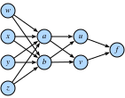
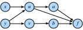

# 多元微积分
:label:`sec_multivariable_calculus`

现在我们已经对单变量函数的导数有了相当扎实的理解，让我们回到最初的问题：考虑一个含有可能多达数十亿个权重的损失函数。

## 高维微分
:numref:`sec_single_variable_calculus` 告诉我们，如果只改变这数十亿个权重中的某一个、保持其他所有权重不变，那么我们知道会发生什么！这不过是一个单变量函数，因此可以写出

$$L(w_1+\epsilon_1, w_2, \ldots, w_N) \approx L(w_1, w_2, \ldots, w_N) + \epsilon_1 \frac{d}{dw_1} L(w_1, w_2, \ldots, w_N).$$
:eqlabel:`eq_part_der`

我们将固定其他变量、只对一个变量求得的导数称为*偏导数*（partial derivative），并用记号 $\frac{\partial}{\partial w_1}$ 表示 :eqref:`eq_part_der` 中的导数。

现在，我们在此基础上把 $w_2$ 略微改变为 $w_2 + \epsilon_2$：

$$
\begin{aligned}
L(w_1+\epsilon_1, w_2+\epsilon_2, \ldots, w_N) & \approx L(w_1, w_2+\epsilon_2, \ldots, w_N) + \epsilon_1 \frac{\partial}{\partial w_1} L(w_1, w_2+\epsilon_2, \ldots, w_N+\epsilon_N) \\
& \approx L(w_1, w_2, \ldots, w_N) \\
& \quad + \epsilon_2\frac{\partial}{\partial w_2} L(w_1, w_2, \ldots, w_N) \\
& \quad + \epsilon_1 \frac{\partial}{\partial w_1} L(w_1, w_2, \ldots, w_N) \\
& \quad + \epsilon_1\epsilon_2\frac{\partial}{\partial w_2}\frac{\partial}{\partial w_1} L(w_1, w_2, \ldots, w_N) \\
& \approx L(w_1, w_2, \ldots, w_N) \\
& \quad + \epsilon_2\frac{\partial}{\partial w_2} L(w_1, w_2, \ldots, w_N) \\
& \quad + \epsilon_1 \frac{\partial}{\partial w_1} L(w_1, w_2, \ldots, w_N).
\end{aligned}
$$

我们再次使用了这样一个想法：$\epsilon_1\epsilon_2$ 是更高阶的项，可以用与上一节丢弃 $\epsilon^{2}$ 相同的方式丢弃，同时结合了我们在 :eqref:`eq_part_der` 中看到的内容。依此继续下去，我们可以写出

$$
L(w_1+\epsilon_1, w_2+\epsilon_2, \ldots, w_N+\epsilon_N) \approx L(w_1, w_2, \ldots, w_N) + \sum_i \epsilon_i \frac{\partial}{\partial w_i} L(w_1, w_2, \ldots, w_N).
$$

这看起来可能一团糟，但我们可以让它更熟悉：注意到右边的和恰好看起来像点积，因此若令

$$
\boldsymbol{\epsilon} = [\epsilon_1, \ldots, \epsilon_N]^\top \; \textrm{and} \;
\nabla_{\mathbf{x}} L = \left[\frac{\partial L}{\partial x_1}, \ldots, \frac{\partial L}{\partial x_N}\right]^\top,
$$

那么

$$L(\mathbf{w} + \boldsymbol{\epsilon}) \approx L(\mathbf{w}) + \boldsymbol{\epsilon}\cdot \nabla_{\mathbf{w}} L(\mathbf{w}).$$
:eqlabel:`eq_nabla_use`

我们将向量 $\nabla_{\mathbf{w}} L$ 称为 $L$ 的*梯度*（gradient）。

等式 :eqref:`eq_nabla_use` 值得稍作思考。它的形式与我们在单变量情形下遇到的完全相同，只不过我们把一切都转化成了向量与点积。它让我们能近似地说明：在对输入作任意扰动时，函数 $L$ 将如何变化。正如我们将在下一节看到的，这将为我们提供一个重要的工具，帮助我们从几何上理解如何利用梯度中包含的信息进行学习。

但首先，让我们通过一个例子看看这种近似的实际效果。假设我们处理的是函数

$$
f(x, y) = \log(e^x + e^y) \textrm{ with gradient } \nabla f (x, y) = \left[\frac{e^x}{e^x+e^y}, \frac{e^y}{e^x+e^y}\right].
$$

如果我们考察像 $(0, \log(2))$ 这样的点，就会看到

$$
f(x, y) = \log(3) \textrm{ with gradient } \nabla f (x, y) = \left[\frac{1}{3}, \frac{2}{3}\right].
$$

因此，如果想在 $(\epsilon_1, \log(2) + \epsilon_2)$ 处近似 $f$，我们看到应当取 :eqref:`eq_nabla_use` 的具体实例：

$$
f(\epsilon_1, \log(2) + \epsilon_2) \approx \log(3) + \frac{1}{3}\epsilon_1 + \frac{2}{3}\epsilon_2.
$$

我们可以在代码中检验这一点，看看该近似有多好。

```{.python .input}
#@tab mxnet
%matplotlib inline
from d2l import mxnet as d2l
from IPython import display
from mpl_toolkits import mplot3d
from mxnet import autograd, np, npx
npx.set_np()

def f(x, y):
    return np.log(np.exp(x) + np.exp(y))
def grad_f(x, y):
    return np.array([np.exp(x) / (np.exp(x) + np.exp(y)),
                     np.exp(y) / (np.exp(x) + np.exp(y))])

epsilon = np.array([0.01, -0.03])
grad_approx = f(0, np.log(2)) + epsilon.dot(grad_f(0, np.log(2)))
true_value = f(0 + epsilon[0], np.log(2) + epsilon[1])
f'approximation: {grad_approx}, true Value: {true_value}'
```

```{.python .input}
#@tab pytorch
%matplotlib inline
from d2l import torch as d2l
from IPython import display
from mpl_toolkits import mplot3d
import torch
import numpy as np

def f(x, y):
    return torch.log(torch.exp(x) + torch.exp(y))
def grad_f(x, y):
    return torch.tensor([torch.exp(x) / (torch.exp(x) + torch.exp(y)),
                     torch.exp(y) / (torch.exp(x) + torch.exp(y))])

epsilon = torch.tensor([0.01, -0.03])
grad_approx = f(torch.tensor([0.]), torch.log(
    torch.tensor([2.]))) + epsilon.dot(
    grad_f(torch.tensor([0.]), torch.log(torch.tensor(2.))))
true_value = f(torch.tensor([0.]) + epsilon[0], torch.log(
    torch.tensor([2.])) + epsilon[1])
f'approximation: {grad_approx}, true Value: {true_value}'
```

```{.python .input}
#@tab tensorflow
%matplotlib inline
from d2l import tensorflow as d2l
from IPython import display
from mpl_toolkits import mplot3d
import tensorflow as tf
import numpy as np

def f(x, y):
    return tf.math.log(tf.exp(x) + tf.exp(y))
def grad_f(x, y):
    return tf.constant([(tf.exp(x) / (tf.exp(x) + tf.exp(y))).numpy(),
                        (tf.exp(y) / (tf.exp(x) + tf.exp(y))).numpy()])

epsilon = tf.constant([0.01, -0.03])
grad_approx = f(tf.constant([0.]), tf.math.log(
    tf.constant([2.]))) + tf.tensordot(
    epsilon, grad_f(tf.constant([0.]), tf.math.log(tf.constant(2.))), axes=1)
true_value = f(tf.constant([0.]) + epsilon[0], tf.math.log(
    tf.constant([2.])) + epsilon[1])
f'approximation: {grad_approx}, true Value: {true_value}'
```

## 梯度的几何与梯度下降
再次考虑 :eqref:`eq_nabla_use` 中的表达式：

$$
L(\mathbf{w} + \boldsymbol{\epsilon}) \approx L(\mathbf{w}) + \boldsymbol{\epsilon}\cdot \nabla_{\mathbf{w}} L(\mathbf{w}).
$$

假设我想利用它来帮助最小化损失 $L$。让我们先从几何上理解 :numref:`sec_autograd` 中首次描述的梯度下降算法。我们要做的是：

1. 为初始参数 $\mathbf{w}$ 取一个随机选择。
2. 找到在 $\mathbf{w}$ 处使 $L$ 下降最快的方向 $\mathbf{v}$。
3. 沿该方向迈出一小步：$\mathbf{w} \rightarrow \mathbf{w} + \epsilon\mathbf{v}$。
4. 重复。

我们唯一不完全清楚如何做的，是计算第二步中的向量 $\mathbf{v}$。我们把这样的方向称为*最速下降方向*（direction of steepest descent）。利用 :numref:`sec_geometry-linear-algebraic-ops` 中对点积的几何理解，我们看到可以把 :eqref:`eq_nabla_use` 改写为

$$
L(\mathbf{w} + \mathbf{v}) \approx L(\mathbf{w}) + \mathbf{v}\cdot \nabla_{\mathbf{w}} L(\mathbf{w}) = L(\mathbf{w}) + \|\nabla_{\mathbf{w}} L(\mathbf{w})\|\cos(\theta).
$$

注意，为方便起见，我们已令所取方向的长度为 1，并用 $\theta$ 表示 $\mathbf{v}$ 与 $\nabla_{\mathbf{w}} L(\mathbf{w})$ 之间的夹角。如果我们想找到使 $L$ 下降得尽可能快的方向，就要使这个表达式尽可能为负。我们所选的方向进入该等式的唯一途径是 $\cos(\theta)$，因此我们希望使这个余弦尽可能为负。现在回想余弦函数的形状，我们可以通过令 $\cos(\theta) = -1$ 来使它尽可能为负，等价地说，就是让梯度与我们所选方向之间的夹角为 $\pi$ 弧度，也就是 $180$ 度。实现这一点的唯一方式，是朝着完全相反的方向前进：选择 $\mathbf{v}$ 指向与 $\nabla_{\mathbf{w}} L(\mathbf{w})$ 完全相反的方向！

这就把我们引向机器学习中最重要的数学概念之一：最速下降方向指向 $-\nabla_{\mathbf{w}}L(\mathbf{w})$ 的方向。于是，我们的非形式化算法可以改写如下。

1. 为初始参数 $\mathbf{w}$ 取一个随机选择。
2. 计算 $\nabla_{\mathbf{w}} L(\mathbf{w})$。
3. 沿上述方向的反方向迈出一小步：$\mathbf{w} \leftarrow \mathbf{w} - \epsilon\nabla_{\mathbf{w}} L(\mathbf{w})$。
4. 重复。


这个基本算法已经被许多研究者以多种方式修改和调整，但它们的核心概念全都相同：利用梯度找到使损失下降得尽可能快的方向，并更新参数以沿该方向迈出一步。

## 关于数学优化的一点说明
贯穿本书，我们完全聚焦于数值优化技术，实践原因在于：在深度学习场景中遇到的所有函数都过于复杂，无法显式地最小化。

然而，思考上面得到的几何理解能告诉我们关于直接优化函数的哪些信息，是一项有用的练习。

假设我们希望找到使某个函数 $L(\mathbf{x})$ 最小的 $\mathbf{x}_0$ 的取值。再假设有人给了我们一个值，并告诉我们它正是使 $L$ 最小的值。我们能否检查些什么，看看他们的答案是否至少看起来合理？

再次考虑 :eqref:`eq_nabla_use`：
$$
L(\mathbf{x}_0 + \boldsymbol{\epsilon}) \approx L(\mathbf{x}_0) + \boldsymbol{\epsilon}\cdot \nabla_{\mathbf{x}} L(\mathbf{x}_0).
$$

如果梯度不为零，我们就知道可以沿方向 $-\epsilon \nabla_{\mathbf{x}} L(\mathbf{x}_0)$ 迈出一步，找到一个更小的 $L$ 值。因此，如果我们确实处在最小值处，这种情况就不可能发生！于是可以得出结论：如果 $\mathbf{x}_0$ 是最小值点，那么 $\nabla_{\mathbf{x}} L(\mathbf{x}_0) = 0$。我们把满足 $\nabla_{\mathbf{x}} L(\mathbf{x}_0) = 0$ 的点称为*临界点*（critical point）。

这很好，因为在某些罕见情形下，我们*确实*可以显式地找出所有梯度为零的点，并从中挑出取值最小的那个。

作为一个具体例子，考虑函数
$$
f(x) = 3x^4 - 4x^3 -12x^2.
$$

该函数的导数为
$$
\frac{df}{dx} = 12x^3 - 12x^2 -24x = 12x(x-2)(x+1).
$$

最小值只可能位于 $x = -1, 0, 2$ 处，函数在这些点的取值分别为 $-5,0, -32$，因此可以断定当 $x = 2$ 时函数取得最小值。快速作图可以确认这一点。

```{.python .input}
#@tab mxnet
x = np.arange(-2, 3, 0.01)
f = (3 * x**4) - (4 * x**3) - (12 * x**2)

d2l.plot(x, f, 'x', 'f(x)')
```

```{.python .input}
#@tab pytorch
x = torch.arange(-2, 3, 0.01)
f = (3 * x**4) - (4 * x**3) - (12 * x**2)

d2l.plot(x, f, 'x', 'f(x)')
```

```{.python .input}
#@tab tensorflow
x = tf.range(-2, 3, 0.01)
f = (3 * x**4) - (4 * x**3) - (12 * x**2)

d2l.plot(x, f, 'x', 'f(x)')
```

这突出了一个无论在理论上还是数值上工作都该知道的重要事实：我们能最小化（或最大化）函数的可能点，其梯度都等于零；然而，并非每个梯度为零的点都是真正的*全局*最小值（或最大值）。

## 多元链式法则
假设我们有一个四变量函数（$w, x, y$ 和 $z$），它可以由许多项复合而成：

$$\begin{aligned}f(u, v) & = (u+v)^{2} \\u(a, b) & = (a+b)^{2}, \qquad v(a, b) = (a-b)^{2}, \\a(w, x, y, z) & = (w+x+y+z)^{2}, \qquad b(w, x, y, z) = (w+x-y-z)^2.\end{aligned}$$
:eqlabel:`eq_multi_func_def`

在处理神经网络时，这类等式链很常见，因此理解如何计算这类函数的梯度至关重要。如果我们观察变量之间是如何直接相互关联的，就能在 :numref:`fig_chain-1` 中开始看到这种联系的直观提示。


:label:`fig_chain-1`

我们完全可以只把 :eqref:`eq_multi_func_def` 中的所有内容复合起来，写出

$$
f(w, x, y, z) = \left(\left((w+x+y+z)^2+(w+x-y-z)^2\right)^2+\left((w+x+y+z)^2-(w+x-y-z)^2\right)^2\right)^2.
$$

然后只用单变量导数来求导，但若真这样做，我们很快会发现自己被大量项淹没，其中许多还是重复的！事实上，例如可以看出：

$$
\begin{aligned}
\frac{\partial f}{\partial w} & = 2 \left(2 \left(2 (w + x + y + z) - 2 (w + x - y - z)\right) \left((w + x + y + z)^{2}- (w + x - y - z)^{2}\right) + \right.\\
& \left. \quad 2 \left(2 (w + x - y - z) + 2 (w + x + y + z)\right) \left((w + x - y - z)^{2}+ (w + x + y + z)^{2}\right)\right) \times \\
& \quad \left(\left((w + x + y + z)^{2}- (w + x - y - z)^2\right)^{2}+ \left((w + x - y - z)^{2}+ (w + x + y + z)^{2}\right)^{2}\right).
\end{aligned}
$$

如果我们接着还想计算 $\frac{\partial f}{\partial x}$，最终又会得到一个类似的等式，其中包含许多重复的项，而且两个导数之间还有许多*共享的*重复项。这代表着数量巨大的浪费计算；如果我们需要以这种方式计算导数，那么整场深度学习革命在开始之前就会停滞了！


让我们把问题拆开。我们先试着理解当改变 $a$ 时 $f$ 如何变化，本质上假设 $w, x, y$ 和 $z$ 都不存在。我们将像第一次处理梯度时那样推理。让我们取 $a$，并给它加上一个小量 $\epsilon$。

$$
\begin{aligned}
& f(u(a+\epsilon, b), v(a+\epsilon, b)) \\
\approx & f\left(u(a, b) + \epsilon\frac{\partial u}{\partial a}(a, b), v(a, b) + \epsilon\frac{\partial v}{\partial a}(a, b)\right) \\
\approx & f(u(a, b), v(a, b)) + \epsilon\left[\frac{\partial f}{\partial u}(u(a, b), v(a, b))\frac{\partial u}{\partial a}(a, b) + \frac{\partial f}{\partial v}(u(a, b), v(a, b))\frac{\partial v}{\partial a}(a, b)\right].
\end{aligned}
$$

第一行来自偏导数的定义，第二行来自梯度的定义。像 $\frac{\partial f}{\partial u}(u(a, b), v(a, b))$ 这样的表达式，要精确追踪每个导数的求值位置在记号上很累赘，因此我们常常把它缩写为更易记的形式

$$
\frac{\partial f}{\partial a} = \frac{\partial f}{\partial u}\frac{\partial u}{\partial a}+\frac{\partial f}{\partial v}\frac{\partial v}{\partial a}.
$$

思考这一过程的含义是有用的。我们试图理解形如 $f(u(a, b), v(a, b))$ 的函数在 $a$ 变化时其值如何变化。这可以通过两条路径发生：一条是 $a \rightarrow u \rightarrow f$，另一条是 $a \rightarrow v \rightarrow f$。我们可以分别通过链式法则计算这两部分贡献：$\frac{\partial w}{\partial u} \cdot \frac{\partial u}{\partial x}$ 和 $\frac{\partial w}{\partial v} \cdot \frac{\partial v}{\partial x}$，再把它们相加。

设想我们有另一个不同的函数网络，其中右侧的函数依赖于与左侧相连的函数，如 :numref:`fig_chain-2` 所示。


:label:`fig_chain-2`

要计算诸如 $\frac{\partial f}{\partial y}$ 这样的量，我们需要对从 $y$ 到 $f$ 的所有（此处为 $3$ 条）路径求和，得到

$$
\frac{\partial f}{\partial y} = \frac{\partial f}{\partial a} \frac{\partial a}{\partial u} \frac{\partial u}{\partial y} + \frac{\partial f}{\partial u} \frac{\partial u}{\partial y} + \frac{\partial f}{\partial b} \frac{\partial b}{\partial v} \frac{\partial v}{\partial y}.
$$

以这种方式理解链式法则，在试图理解梯度如何流经网络，以及为什么像 LSTM（:numref:`sec_lstm`）或残差层（:numref:`sec_resnet`）中的那些架构选择能通过控制梯度流动来帮助塑造学习过程时，将带来巨大的回报。

## 反向传播算法

让我们回到上一节 :eqref:`eq_multi_func_def` 的例子，其中

$$
\begin{aligned}
f(u, v) & = (u+v)^{2} \\
u(a, b) & = (a+b)^{2}, \qquad v(a, b) = (a-b)^{2}, \\
a(w, x, y, z) & = (w+x+y+z)^{2}, \qquad b(w, x, y, z) = (w+x-y-z)^2.
\end{aligned}
$$

如果我们想计算比如 $\frac{\partial f}{\partial w}$，可以应用多元链式法则，得到：

$$
\begin{aligned}
\frac{\partial f}{\partial w} & = \frac{\partial f}{\partial u}\frac{\partial u}{\partial w} + \frac{\partial f}{\partial v}\frac{\partial v}{\partial w}, \\
\frac{\partial u}{\partial w} & = \frac{\partial u}{\partial a}\frac{\partial a}{\partial w}+\frac{\partial u}{\partial b}\frac{\partial b}{\partial w}, \\
\frac{\partial v}{\partial w} & = \frac{\partial v}{\partial a}\frac{\partial a}{\partial w}+\frac{\partial v}{\partial b}\frac{\partial b}{\partial w}.
\end{aligned}
$$

让我们试着用这种分解来计算 $\frac{\partial f}{\partial w}$。注意，这里需要的只是各个单步偏导数：

$$
\begin{aligned}
\frac{\partial f}{\partial u} = 2(u+v), & \quad\frac{\partial f}{\partial v} = 2(u+v), \\
\frac{\partial u}{\partial a} = 2(a+b), & \quad\frac{\partial u}{\partial b} = 2(a+b), \\
\frac{\partial v}{\partial a} = 2(a-b), & \quad\frac{\partial v}{\partial b} = -2(a-b), \\
\frac{\partial a}{\partial w} = 2(w+x+y+z), & \quad\frac{\partial b}{\partial w} = 2(w+x-y-z).
\end{aligned}
$$

如果我们把它写成代码，这就会变成一个相当容易处理的表达式。

```{.python .input}
#@tab all
# Compute the value of the function from inputs to outputs
w, x, y, z = -1, 0, -2, 1
a, b = (w + x + y + z)**2, (w + x - y - z)**2
u, v = (a + b)**2, (a - b)**2
f = (u + v)**2
print(f'    f at {w}, {x}, {y}, {z} is {f}')

# Compute the single step partials
df_du, df_dv = 2*(u + v), 2*(u + v)
du_da, du_db, dv_da, dv_db = 2*(a + b), 2*(a + b), 2*(a - b), -2*(a - b)
da_dw, db_dw = 2*(w + x + y + z), 2*(w + x - y - z)

# Compute the final result from inputs to outputs
du_dw, dv_dw = du_da*da_dw + du_db*db_dw, dv_da*da_dw + dv_db*db_dw
df_dw = df_du*du_dw + df_dv*dv_dw
print(f'df/dw at {w}, {x}, {y}, {z} is {df_dw}')
```

然而请注意，这仍然不能让我们轻松地计算诸如 $\frac{\partial f}{\partial x}$ 这样的量。原因在于我们选择应用链式法则的*方式*。回顾上面的做法，我们总是尽可能把 $\partial w$ 保留在分母中。这样一来，我们所选择的应用链式法则的方式，是在考察 $w$ 如何改变其他每个变量。如果这正是我们想要的，那这会是个好主意。然而，回想一下我们来自深度学习的动机：我们想看的是每个参数如何改变*损失*。本质上，我们要尽可能把 $\partial f$ 保留在分子中，并据此应用链式法则！

更明确地说，注意我们可以写出

$$
\begin{aligned}
\frac{\partial f}{\partial w} & = \frac{\partial f}{\partial a}\frac{\partial a}{\partial w} + \frac{\partial f}{\partial b}\frac{\partial b}{\partial w}, \\
\frac{\partial f}{\partial a} & = \frac{\partial f}{\partial u}\frac{\partial u}{\partial a}+\frac{\partial f}{\partial v}\frac{\partial v}{\partial a}, \\
\frac{\partial f}{\partial b} & = \frac{\partial f}{\partial u}\frac{\partial u}{\partial b}+\frac{\partial f}{\partial v}\frac{\partial v}{\partial b}.
\end{aligned}
$$

注意，这种链式法则的应用让我们显式地计算 $\frac{\partial f}{\partial u}, \frac{\partial f}{\partial v}, \frac{\partial f}{\partial a}, \frac{\partial f}{\partial b}, \; \textrm{and} \; \frac{\partial f}{\partial w}$。没有什么能阻止我们同时纳入这些等式：

$$
\begin{aligned}
\frac{\partial f}{\partial x} & = \frac{\partial f}{\partial a}\frac{\partial a}{\partial x} + \frac{\partial f}{\partial b}\frac{\partial b}{\partial x}, \\
\frac{\partial f}{\partial y} & = \frac{\partial f}{\partial a}\frac{\partial a}{\partial y}+\frac{\partial f}{\partial b}\frac{\partial b}{\partial y}, \\
\frac{\partial f}{\partial z} & = \frac{\partial f}{\partial a}\frac{\partial a}{\partial z}+\frac{\partial f}{\partial b}\frac{\partial b}{\partial z}.
\end{aligned}
$$

然后跟踪当我们改变整个网络中的*任意*节点时 $f$ 如何变化。让我们把它实现出来。

```{.python .input}
#@tab all
# Compute the value of the function from inputs to outputs
w, x, y, z = -1, 0, -2, 1
a, b = (w + x + y + z)**2, (w + x - y - z)**2
u, v = (a + b)**2, (a - b)**2
f = (u + v)**2
print(f'f at {w}, {x}, {y}, {z} is {f}')

# Compute the derivative using the decomposition above
# First compute the single step partials
df_du, df_dv = 2*(u + v), 2*(u + v)
du_da, du_db, dv_da, dv_db = 2*(a + b), 2*(a + b), 2*(a - b), -2*(a - b)
da_dw, db_dw = 2*(w + x + y + z), 2*(w + x - y - z)
da_dx, db_dx = 2*(w + x + y + z), 2*(w + x - y - z)
da_dy, db_dy = 2*(w + x + y + z), -2*(w + x - y - z)
da_dz, db_dz = 2*(w + x + y + z), -2*(w + x - y - z)

# Now compute how f changes when we change any value from output to input
df_da, df_db = df_du*du_da + df_dv*dv_da, df_du*du_db + df_dv*dv_db
df_dw, df_dx = df_da*da_dw + df_db*db_dw, df_da*da_dx + df_db*db_dx
df_dy, df_dz = df_da*da_dy + df_db*db_dy, df_da*da_dz + df_db*db_dz

print(f'df/dw at {w}, {x}, {y}, {z} is {df_dw}')
print(f'df/dx at {w}, {x}, {y}, {z} is {df_dx}')
print(f'df/dy at {w}, {x}, {y}, {z} is {df_dy}')
print(f'df/dz at {w}, {x}, {y}, {z} is {df_dz}')
```

我们从 $f$ 反向朝输入计算导数，而不是从输入正向计算到输出（如上面第一段代码所做），正是这一点赋予了该算法名字：*反向传播*（backpropagation）。注意其中有两个步骤：
1. 从前到后计算函数的值以及各个单步偏导数。虽然上面的做法没有这样做，但这可以合并成一次单独的*正向传播*。
2. 从后到前计算 $f$ 的梯度。我们称之为*反向传播*。

这正是每个深度学习算法所实现的内容，以便在一次传递中计算出损失关于网络中每个权重的梯度。我们拥有这样的分解，这本身是一个令人惊叹的事实。

为了看看如何将这一过程封装起来，让我们快速看一个例子。

```{.python .input}
#@tab mxnet
# Initialize as ndarrays, then attach gradients
w, x, y, z = np.array(-1), np.array(0), np.array(-2), np.array(1)

w.attach_grad()
x.attach_grad()
y.attach_grad()
z.attach_grad()

# Do the computation like usual, tracking gradients
with autograd.record():
    a, b = (w + x + y + z)**2, (w + x - y - z)**2
    u, v = (a + b)**2, (a - b)**2
    f = (u + v)**2

# Execute backward pass
f.backward()

print(f'df/dw at {w}, {x}, {y}, {z} is {w.grad}')
print(f'df/dx at {w}, {x}, {y}, {z} is {x.grad}')
print(f'df/dy at {w}, {x}, {y}, {z} is {y.grad}')
print(f'df/dz at {w}, {x}, {y}, {z} is {z.grad}')
```

```{.python .input}
#@tab pytorch
# Initialize as ndarrays, then attach gradients
w = torch.tensor([-1.], requires_grad=True)
x = torch.tensor([0.], requires_grad=True)
y = torch.tensor([-2.], requires_grad=True)
z = torch.tensor([1.], requires_grad=True)
# Do the computation like usual, tracking gradients
a, b = (w + x + y + z)**2, (w + x - y - z)**2
u, v = (a + b)**2, (a - b)**2
f = (u + v)**2

# Execute backward pass
f.backward()

print(f'df/dw at {w.data.item()}, {x.data.item()}, {y.data.item()}, '
      f'{z.data.item()} is {w.grad.data.item()}')
print(f'df/dx at {w.data.item()}, {x.data.item()}, {y.data.item()}, '
      f'{z.data.item()} is {x.grad.data.item()}')
print(f'df/dy at {w.data.item()}, {x.data.item()}, {y.data.item()}, '
      f'{z.data.item()} is {y.grad.data.item()}')
print(f'df/dz at {w.data.item()}, {x.data.item()}, {y.data.item()}, '
      f'{z.data.item()} is {z.grad.data.item()}')
```

```{.python .input}
#@tab tensorflow
# Initialize as ndarrays, then attach gradients
w = tf.Variable(tf.constant([-1.]))
x = tf.Variable(tf.constant([0.]))
y = tf.Variable(tf.constant([-2.]))
z = tf.Variable(tf.constant([1.]))
# Do the computation like usual, tracking gradients
with tf.GradientTape(persistent=True) as t:
    a, b = (w + x + y + z)**2, (w + x - y - z)**2
    u, v = (a + b)**2, (a - b)**2
    f = (u + v)**2

# Execute backward pass
w_grad = t.gradient(f, w).numpy()
x_grad = t.gradient(f, x).numpy()
y_grad = t.gradient(f, y).numpy()
z_grad = t.gradient(f, z).numpy()

print(f'df/dw at {w.numpy()}, {x.numpy()}, {y.numpy()}, '
      f'{z.numpy()} is {w_grad}')
print(f'df/dx at {w.numpy()}, {x.numpy()}, {y.numpy()}, '
      f'{z.numpy()} is {x_grad}')
print(f'df/dy at {w.numpy()}, {x.numpy()}, {y.numpy()}, '
      f'{z.numpy()} is {y_grad}')
print(f'df/dz at {w.numpy()}, {x.numpy()}, {y.numpy()}, '
      f'{z.numpy()} is {z_grad}')
```

上面所做的一切都可以通过调用 `f.backwards()` 自动完成。

## 黑塞矩阵
与单变量微积分一样，考虑高阶导数是有用的，这样我们就能把握如何比仅用梯度更好地近似一个函数。

处理多变量函数的高阶导数时，会立刻遇到一个问题：这类导数数量巨大。如果我们有一个 $n$ 元函数 $f(x_1, \ldots, x_n)$，那么可以取 $n^{2}$ 个二阶导数，即对任意选定的 $i$ 和 $j$：

$$
\frac{d^2f}{dx_idx_j} = \frac{d}{dx_i}\left(\frac{d}{dx_j}f\right).
$$

传统上，这些导数被组装成一个矩阵，称为*黑塞矩阵*（Hessian）：

$$\mathbf{H}_f = \begin{bmatrix} \frac{d^2f}{dx_1dx_1} & \cdots & \frac{d^2f}{dx_1dx_n} \\ \vdots & \ddots & \vdots \\ \frac{d^2f}{dx_ndx_1} & \cdots & \frac{d^2f}{dx_ndx_n} \\ \end{bmatrix}.$$
:eqlabel:`eq_hess_def`

并非该矩阵的每个元素都是独立的。事实上，我们可以证明，只要两个*混合偏导数*（对多于一个变量求得的偏导数）都存在且连续，那么对任意的 $i$ 和 $j$，都有

$$
\frac{d^2f}{dx_idx_j} = \frac{d^2f}{dx_jdx_i}.
$$

这一点可以通过如下方式看出：先沿 $x_i$ 的方向扰动函数，再沿 $x_j$ 的方向扰动，然后把结果与先扰动 $x_j$、再扰动 $x_i$ 的情形相比较；已知这两种次序都会导致 $f$ 输出相同的最终变化。

与单变量情形一样，我们可以用这些导数更好地了解函数在一点附近的行为。特别地，我们可以用它找到在点 $\mathbf{x}_0$ 附近的最佳拟合二次函数，正如我们在单变量情形中看到的那样。

让我们看一个例子。假设 $f(x_1, x_2) = a + b_1x_1 + b_2x_2 + c_{11}x_1^{2} + c_{12}x_1x_2 + c_{22}x_2^{2}$。这是二元二次函数的一般形式。如果我们在零点处考察函数值、梯度以及黑塞矩阵 :eqref:`eq_hess_def`：

$$
\begin{aligned}
f(0,0) & = a, \\
\nabla f (0,0) & = \begin{bmatrix}b_1 \\ b_2\end{bmatrix}, \\
\mathbf{H} f (0,0) & = \begin{bmatrix}2 c_{11} & c_{12} \\ c_{12} & 2c_{22}\end{bmatrix},
\end{aligned}
$$

那么只要写出

$$
f(\mathbf{x}) = f(0) + \nabla f (0) \cdot \mathbf{x} + \frac{1}{2}\mathbf{x}^\top \mathbf{H} f (0) \mathbf{x}.
$$

就能还原出原来的多项式。

一般来说，如果我们在任意点 $\mathbf{x}_0$ 处计算这一展开式，就会看到

$$
f(\mathbf{x}) = f(\mathbf{x}_0) + \nabla f (\mathbf{x}_0) \cdot (\mathbf{x}-\mathbf{x}_0) + \frac{1}{2}(\mathbf{x}-\mathbf{x}_0)^\top \mathbf{H} f (\mathbf{x}_0) (\mathbf{x}-\mathbf{x}_0).
$$

这对任意维度的输入都成立，并且给出了任意函数在一点处的最佳二次近似。作为例子，让我们画出函数

$$
f(x, y) = xe^{-x^2-y^2}.
$$

可以算出其梯度和黑塞矩阵为
$$
\nabla f(x, y) = e^{-x^2-y^2}\begin{pmatrix}1-2x^2 \\ -2xy\end{pmatrix} \; \textrm{and} \; \mathbf{H}f(x, y) = e^{-x^2-y^2}\begin{pmatrix} 4x^3 - 6x & 4x^2y - 2y \\ 4x^2y-2y &4xy^2-2x\end{pmatrix}.
$$

于是，稍作代数运算即可看出，在 $[-1,0]^\top$ 处的近似二次函数为

$$
f(x, y) \approx e^{-1}\left(-1 - (x+1) +(x+1)^2+y^2\right).
$$

```{.python .input}
#@tab mxnet
# Construct grid and compute function
x, y = np.meshgrid(np.linspace(-2, 2, 101),
                   np.linspace(-2, 2, 101), indexing='ij')
z = x*np.exp(- x**2 - y**2)

# Compute approximating quadratic with gradient and Hessian at (1, 0)
w = np.exp(-1)*(-1 - (x + 1) + (x + 1)**2 + y**2)

# Plot function
ax = d2l.plt.figure().add_subplot(111, projection='3d')
ax.plot_wireframe(x.asnumpy(), y.asnumpy(), z.asnumpy(),
                  **{'rstride': 10, 'cstride': 10})
ax.plot_wireframe(x.asnumpy(), y.asnumpy(), w.asnumpy(),
                  **{'rstride': 10, 'cstride': 10}, color='purple')
d2l.plt.xlabel('x')
d2l.plt.ylabel('y')
d2l.set_figsize()
ax.set_xlim(-2, 2)
ax.set_ylim(-2, 2)
ax.set_zlim(-1, 1)
ax.dist = 12
```

```{.python .input}
#@tab pytorch
# Construct grid and compute function
x, y = torch.meshgrid(torch.linspace(-2, 2, 101),
                   torch.linspace(-2, 2, 101))

z = x*torch.exp(- x**2 - y**2)

# Compute approximating quadratic with gradient and Hessian at (1, 0)
w = torch.exp(torch.tensor([-1.]))*(-1 - (x + 1) + 2 * (x + 1)**2 + 2 * y**2)

# Plot function
ax = d2l.plt.figure().add_subplot(111, projection='3d')
ax.plot_wireframe(x.numpy(), y.numpy(), z.numpy(),
                  **{'rstride': 10, 'cstride': 10})
ax.plot_wireframe(x.numpy(), y.numpy(), w.numpy(),
                  **{'rstride': 10, 'cstride': 10}, color='purple')
d2l.plt.xlabel('x')
d2l.plt.ylabel('y')
d2l.set_figsize()
ax.set_xlim(-2, 2)
ax.set_ylim(-2, 2)
ax.set_zlim(-1, 1)
ax.dist = 12
```

```{.python .input}
#@tab tensorflow
# Construct grid and compute function
x, y = tf.meshgrid(tf.linspace(-2., 2., 101),
                   tf.linspace(-2., 2., 101))

z = x*tf.exp(- x**2 - y**2)

# Compute approximating quadratic with gradient and Hessian at (1, 0)
w = tf.exp(tf.constant([-1.]))*(-1 - (x + 1) + 2 * (x + 1)**2 + 2 * y**2)

# Plot function
ax = d2l.plt.figure().add_subplot(111, projection='3d')
ax.plot_wireframe(x.numpy(), y.numpy(), z.numpy(),
                  **{'rstride': 10, 'cstride': 10})
ax.plot_wireframe(x.numpy(), y.numpy(), w.numpy(),
                  **{'rstride': 10, 'cstride': 10}, color='purple')
d2l.plt.xlabel('x')
d2l.plt.ylabel('y')
d2l.set_figsize()
ax.set_xlim(-2, 2)
ax.set_ylim(-2, 2)
ax.set_zlim(-1, 1)
ax.dist = 12
```

这构成了 :numref:`sec_gd` 中所讨论的牛顿法的基础：在牛顿法中，我们迭代地进行数值优化，每次找到最佳拟合的二次函数，然后精确地最小化该二次函数。

## 矩阵微积分初探
涉及矩阵的函数的导数结果都特别好。本节在记号上可能变得较重，初次阅读时可以跳过；但了解涉及常见矩阵运算的函数的导数往往比最初预想的要干净得多，是很有用的，尤其考虑到矩阵运算在深度学习应用中的核心地位。

让我们从一个例子开始。假设我们有某个固定的列向量 $\boldsymbol{\beta}$，想要取乘积函数 $f(\mathbf{x}) = \boldsymbol{\beta}^\top\mathbf{x}$，并理解当我们改变 $\mathbf{x}$ 时点积如何变化。

在机器学习中处理矩阵导数时，有一种有用的记号约定，叫做*分母布局矩阵导数*（denominator layout matrix derivative）：我们按照微分分母中向量、矩阵或张量的形状来组装偏导数。此时，我们会写出

$$
\frac{df}{d\mathbf{x}} = \begin{bmatrix}
\frac{df}{dx_1} \\
\vdots \\
\frac{df}{dx_n}
\end{bmatrix},
$$

其中我们匹配了列向量 $\mathbf{x}$ 的形状。

如果把函数按分量写出来，就是

$$
f(\mathbf{x}) = \sum_{i = 1}^{n} \beta_ix_i = \beta_1x_1 + \cdots + \beta_nx_n.
$$

如果现在对比如 $\beta_1$ 求偏导数，注意除第一项外其他项都为零，而第一项不过是 $x_1$ 乘以 $\beta_1$，于是得到

$$
\frac{df}{dx_1} = \beta_1,
$$

或者更一般地，

$$
\frac{df}{dx_i} = \beta_i.
$$

现在我们可以把它重新组装成矩阵，得到

$$
\frac{df}{d\mathbf{x}} = \begin{bmatrix}
\frac{df}{dx_1} \\
\vdots \\
\frac{df}{dx_n}
\end{bmatrix} = \begin{bmatrix}
\beta_1 \\
\vdots \\
\beta_n
\end{bmatrix} = \boldsymbol{\beta}.
$$

这说明了矩阵微积分的几个特点，我们在本节中将反复遇到：

* 第一，计算会变得相当复杂。
* 第二，最终结果比中间过程干净得多，而且总是看起来与单变量情形相似。此时请注意，$\frac{d}{dx}(bx) = b$ 与 $\frac{d}{d\mathbf{x}} (\boldsymbol{\beta}^\top\mathbf{x}) = \boldsymbol{\beta}$ 是相似的。
* 第三，转置常常似乎凭空出现。核心原因在于我们遵循匹配分母形状的约定，因此当我们相乘矩阵时，往往需要取转置才能匹配回原来项的形状。

为了继续建立直觉，让我们尝试一个稍难一些的计算。假设我们有一个列向量 $\mathbf{x}$ 和一个方阵 $A$，想要计算

$$\frac{d}{d\mathbf{x}}(\mathbf{x}^\top A \mathbf{x}).$$
:eqlabel:`eq_mat_goal_1`

为了获得更易于操作的记号，让我们用爱因斯坦记号来考虑这个问题。此时，函数可以写成

$$
\mathbf{x}^\top A \mathbf{x} = x_ia_{ij}x_j.
$$

为了计算导数，我们需要对每个 $k$ 搞清楚

$$
\frac{d}{dx_k}(\mathbf{x}^\top A \mathbf{x}) = \frac{d}{dx_k}x_ia_{ij}x_j.
$$

的值。由积法则可得

$$
\frac{d}{dx_k}x_ia_{ij}x_j = \frac{dx_i}{dx_k}a_{ij}x_j + x_ia_{ij}\frac{dx_j}{dx_k}.
$$

对于像 $\frac{dx_i}{dx_k}$ 这样的项，不难看出当 $i=k$ 时它为 1，否则为零。这意味着求和式中每个 $i$ 与 $k$ 不同的项都会消失，因此第一个和式中保留下来的只有那些 $i=k$ 的项。对第二个和式，同样的推理要求 $j=k$。于是得到

$$
\frac{d}{dx_k}x_ia_{ij}x_j = a_{kj}x_j + x_ia_{ik}.
$$

现在，爱因斯坦记号中索引的名称是任意的——此处 $i$ 与 $j$ 不同这一事实在这一点上对该计算无关紧要，因此我们可以重新编号，让两者都用 $i$，从而看到

$$
\frac{d}{dx_k}x_ia_{ij}x_j = a_{ki}x_i + x_ia_{ik} = (a_{ki} + a_{ik})x_i.
$$

现在，要让推导继续下去，就需要一些练习了。让我们试着用矩阵运算来识别这一结果。$a_{ki} + a_{ik}$ 是 $\mathbf{A} + \mathbf{A}^\top$ 的第 $k, i$ 个分量。这给出

$$
\frac{d}{dx_k}x_ia_{ij}x_j = [\mathbf{A} + \mathbf{A}^\top]_{ki}x_i.
$$

类似地，这一项现在是矩阵 $\mathbf{A} + \mathbf{A}^\top$ 与向量 $\mathbf{x}$ 的乘积，因此我们看到

$$
\left[\frac{d}{d\mathbf{x}}(\mathbf{x}^\top A \mathbf{x})\right]_k = \frac{d}{dx_k}x_ia_{ij}x_j = [(\mathbf{A} + \mathbf{A}^\top)\mathbf{x}]_k.
$$

于是我们看到，:eqref:`eq_mat_goal_1` 中所求导数的第 $k$ 个元素，正是右边向量的第 $k$ 个元素，因此两者相同。由此得到

$$
\frac{d}{d\mathbf{x}}(\mathbf{x}^\top A \mathbf{x}) = (\mathbf{A} + \mathbf{A}^\top)\mathbf{x}.
$$

这比上一个例子需要多得多的计算，但最终结果很小。更有甚者，考虑下面针对传统单变量导数的计算：

$$
\frac{d}{dx}(xax) = \frac{dx}{dx}ax + xa\frac{dx}{dx} = (a+a)x.
$$

等价地，$\frac{d}{dx}(ax^2) = 2ax = (a+a)x$。同样，我们得到的结果看起来很像单变量结果，只是多了一个转置。

至此，这一模式应该已显得有些可疑了，让我们试着弄清原因。当我们这样求矩阵导数时，先假设得到的表达式会是另一个矩阵表达式：一个可以用矩阵及其转置的乘积与和写出的表达式。如果这样的表达式存在，它就必须对所有矩阵都成立。特别地，它必须对 $1 \times 1$ 矩阵成立，此时矩阵乘积就是数的乘积，矩阵和就是数的和，而转置什么也不做！换句话说，我们得到的表达式*必须*与单变量表达式一致。这意味着，经过一些练习，人们常常只需知道相应的单变量表达式应该是什么样子，就能猜出矩阵导数！

让我们试一试。假设 $\mathbf{X}$ 是一个 $n \times m$ 矩阵，$\mathbf{U}$ 是一个 $n \times r$ 矩阵，$\mathbf{V}$ 是一个 $r \times m$ 矩阵。让我们试着计算

$$\frac{d}{d\mathbf{V}} \|\mathbf{X} - \mathbf{U}\mathbf{V}\|_2^{2} = \;?$$
:eqlabel:`eq_mat_goal_2`

这个计算在矩阵分解领域中很重要。不过对我们来说，它只是一个待计算的导数。让我们想象一下 $1\times1$ 矩阵时它会是什么样子。此时，我们得到表达式

$$
\frac{d}{dv} (x-uv)^{2}= -2(x-uv)u,
$$

其中导数相当标准。如果我们试着把它转换回矩阵表达式，会得到

$$
\frac{d}{d\mathbf{V}} \|\mathbf{X} - \mathbf{U}\mathbf{V}\|_2^{2}= -2(\mathbf{X} - \mathbf{U}\mathbf{V})\mathbf{U}.
$$

然而，仔细看就会发现这并不完全行得通。回忆一下，$\mathbf{X}$ 是 $n \times m$ 的，$\mathbf{U}\mathbf{V}$ 也是，因此矩阵 $2(\mathbf{X} - \mathbf{U}\mathbf{V})$ 是 $n \times m$ 的。另一方面，$\mathbf{U}$ 是 $n \times r$ 的，而我们不能把 $n \times m$ 矩阵与 $n \times r$ 矩阵相乘，因为维度不匹配！

我们想得到 $\frac{d}{d\mathbf{V}}$，它与 $\mathbf{V}$ 形状相同，即 $r \times m$。所以我们需要设法取一个 $n \times m$ 矩阵和一个 $n \times r$ 矩阵，把它们相乘（也许还要用上一些转置），得到一个 $r \times m$ 矩阵。我们可以通过把 $U^\top$ 与 $(\mathbf{X} - \mathbf{U}\mathbf{V})$ 相乘来做到这一点。于是，我们可以猜测 :eqref:`eq_mat_goal_2` 的解是

$$
\frac{d}{d\mathbf{V}} \|\mathbf{X} - \mathbf{U}\mathbf{V}\|_2^{2}= -2\mathbf{U}^\top(\mathbf{X} - \mathbf{U}\mathbf{V}).
$$

为了说明这确实成立，若不给出详细计算就未免失职。如果你已经相信这条经验法则有效，尽可跳过下面这段推导。为了计算

$$
\frac{d}{d\mathbf{V}} \|\mathbf{X} - \mathbf{U}\mathbf{V}\|_2^2,
$$

我们必须对每个 $a$ 和 $b$ 求出

$$
\frac{d}{dv_{ab}} \|\mathbf{X} - \mathbf{U}\mathbf{V}\|_2^{2}= \frac{d}{dv_{ab}} \sum_{i, j}\left(x_{ij} - \sum_k u_{ik}v_{kj}\right)^2.
$$

回想一下，就 $\frac{d}{dv_{ab}}$ 而言，$\mathbf{X}$ 和 $\mathbf{U}$ 的所有元素都是常数，因此我们可以把导数移入求和号内，并对平方项应用链式法则，得到

$$
\frac{d}{dv_{ab}} \|\mathbf{X} - \mathbf{U}\mathbf{V}\|_2^{2}= \sum_{i, j}2\left(x_{ij} - \sum_k u_{ik}v_{kj}\right)\left(-\sum_k u_{ik}\frac{dv_{kj}}{dv_{ab}} \right).
$$

与前面的推导一样，我们注意到 $\frac{dv_{kj}}{dv_{ab}}$ 只有在 $k=a$ 且 $j=b$ 时才非零。若这两个条件中任何一个不成立，求和式中的该项即为零，可以放心地舍去。我们看到

$$
\frac{d}{dv_{ab}} \|\mathbf{X} - \mathbf{U}\mathbf{V}\|_2^{2}= -2\sum_{i}\left(x_{ib} - \sum_k u_{ik}v_{kb}\right)u_{ia}.
$$

这里有一个重要的微妙之处：要求 $k=a$ 这一条件不会出现在内层求和之中，因为那个 $k$ 是一个哑变量，我们是在内层项内部对它求和的。为了看一个记号上更清晰的例子，请思考为什么有

$$
\frac{d}{dx_1} \left(\sum_i x_i \right)^{2}= 2\left(\sum_i x_i \right).
$$

从这一点出发，我们可以开始识别求和式的各个分量。首先，

$$
\sum_k u_{ik}v_{kb} = [\mathbf{U}\mathbf{V}]_{ib}.
$$

因此，求和号内部的整个表达式是

$$
x_{ib} - \sum_k u_{ik}v_{kb} = [\mathbf{X}-\mathbf{U}\mathbf{V}]_{ib}.
$$

这意味着我们现在可以把导数写成

$$
\frac{d}{dv_{ab}} \|\mathbf{X} - \mathbf{U}\mathbf{V}\|_2^{2}= -2\sum_{i}[\mathbf{X}-\mathbf{U}\mathbf{V}]_{ib}u_{ia}.
$$

我们希望它看起来像某个矩阵的 $a, b$ 元素，这样才能像前一个例子那样借助技巧得到矩阵表达式；这意味着我们需要交换 $u_{ia}$ 上索引的顺序。如果我们注意到 $u_{ia} = [\mathbf{U}^\top]_{ai}$，就可以写出

$$
\frac{d}{dv_{ab}} \|\mathbf{X} - \mathbf{U}\mathbf{V}\|_2^{2}= -2\sum_{i} [\mathbf{U}^\top]_{ai}[\mathbf{X}-\mathbf{U}\mathbf{V}]_{ib}.
$$

这是一个矩阵乘积，因此可以断定

$$
\frac{d}{dv_{ab}} \|\mathbf{X} - \mathbf{U}\mathbf{V}\|_2^{2}= -2[\mathbf{U}^\top(\mathbf{X}-\mathbf{U}\mathbf{V})]_{ab}.
$$

于是我们可以写出 :eqref:`eq_mat_goal_2` 的解

$$
\frac{d}{d\mathbf{V}} \|\mathbf{X} - \mathbf{U}\mathbf{V}\|_2^{2}= -2\mathbf{U}^\top(\mathbf{X} - \mathbf{U}\mathbf{V}).
$$

这与我们上面猜测的解一致！

此时很自然地会问：“为什么我不能直接把学过的所有微积分法则都写成矩阵版本？显然这仍然是机械的。为什么不干脆一劳永逸地做完！”确实存在这样的法则，:cite:`Petersen.Pedersen.ea.2008` 给出了极好的总结。然而，与标量值相比，矩阵运算的组合方式多得多，因此矩阵导数法则远多于单变量导数法则。通常情况下，最好的做法是直接用索引运算，或者在合适时交给自动微分处理。

## 小结

* 在高维情形下，我们可以定义梯度，其作用与一维情形下的导数相同。它们让我们看到，当我们对输入作任意微小改变时，多变量函数如何变化。
* 反向传播算法可以看作组织多元链式法则的一种方法，使得许多偏导数能够被高效地计算。
* 矩阵微积分让我们能够以简洁的方式写出矩阵表达式的导数。

## 习题
1. 给定列向量 $\boldsymbol{\beta}$，计算 $f(\mathbf{x}) = \boldsymbol{\beta}^\top\mathbf{x}$ 和 $g(\mathbf{x}) = \mathbf{x}^\top\boldsymbol{\beta}$ 两者的导数。为什么你会得到相同的答案？
2. 设 $\mathbf{v}$ 是一个 $n$ 维向量。$\frac{\partial}{\partial\mathbf{v}}\|\mathbf{v}\|_2$ 是什么？
3. 设 $L(x, y) = \log(e^x + e^y)$。计算梯度。梯度的各分量之和是多少？
4. 设 $f(x, y) = x^2y + xy^2$。证明唯一的临界点是 $(0,0)$。通过考察 $f(x, x)$，判断 $(0,0)$ 是最大值、最小值还是都不是。
5. 假设我们在最小化函数 $f(\mathbf{x}) = g(\mathbf{x}) + h(\mathbf{x})$。如何用 $g$ 和 $h$ 几何地解释条件 $\nabla f = 0$？


:begin_tab:`mxnet`
[讨论](https://discuss.d2l.ai/t/413)
:end_tab:

:begin_tab:`pytorch`
[讨论](https://discuss.d2l.ai/t/1090)
:end_tab:


:begin_tab:`tensorflow`
[讨论](https://discuss.d2l.ai/t/1091)
:end_tab:
