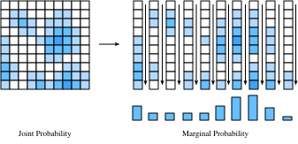

# 随机变量
:label:`sec_random_variables`

在 :numref:`sec_prob` 中，我们看到了处理离散随机变量的一些基础内容。这里的离散随机变量是指只取有限个可能值或整数值的随机变量。本节我们将建立*连续随机变量*的理论，这类随机变量可以取任意实数值。

## 连续随机变量

连续随机变量比离散随机变量要微妙得多。一个恰当的类比是：这一技术跨越的难度，相当于从“把一串数相加”跳到“对函数积分”的难度。因此，我们需要花些时间来建立这一理论。

### 从离散到连续

为了理解处理连续随机变量时遇到的额外技术挑战，让我们做一个思想实验。假设我们往飞镖盘上掷飞镖，并且想知道它恰好落在距靶心 $2 \textrm{cm}$ 处的概率。

首先，我们设想只测到一位数字的精度，也就是说，把结果分到 $0 \textrm{cm}$、$1 \textrm{cm}$、$2 \textrm{cm}$ 等若干个区间里。假设我们向飞镖盘掷 $100$ 支飞镖，如果其中有 $20$ 支落在 $2\textrm{cm}$ 对应的区间内，我们就断定：我们掷出的飞镖中有 $20\%$ 落在距靶心 $2 \textrm{cm}$ 处。

然而，仔细一想，这并不符合我们的问题！我们要的是恰好相等，而这些区间容纳的是所有落在比如 $1.5\textrm{cm}$ 到 $2.5\textrm{cm}$ 之间的飞镖。

我们并不气馁，继续推进。我们测量得更精确一些，比如分成 $1.9\textrm{cm}$、$2.0\textrm{cm}$、$2.1\textrm{cm}$ 等区间，此时发现或许 $100$ 支飞镖中有 $3$ 支落在 $2.0\textrm{cm}$ 这个区间内。于是我们断定概率为 $3\%$。

然而，这什么问题也没解决！我们只是把问题又往下推了一位小数。让我们抽象一点来看。设想我们知道前 $k$ 位数字与 $2.00000\ldots$ 相符的概率，并想知道前 $k+1$ 位相符的概率。相当合理的一个假设是：第 ${k+1}^{\textrm{th}}$ 位本质上是从集合 $\{0, 1, 2, \ldots, 9\}$ 中随机选取的。至少，我们无法设想存在一个有物理意义的过程，会迫使距靶心的微米数偏爱以 $7$ 而不是 $3$ 结尾。

这意味着，我们要求的每一位额外精度，本质上都应使相符的概率除以 $10$。换言之，我们可以期望

$$
P(\textrm{distance is}\; 2.00\ldots, \;\textrm{to}\; k \;\textrm{digits} ) \approx p\cdot10^{-k}.
$$

值 $p$ 本质上编码了前几位数字的情形，而 $10^{-k}$ 则处理其余部分。

请注意，如果我们把位置精确到小数点后 $k=4$ 位，那就意味着我们知道该值落在比如说 $[1.99995,2.00005]$ 这个区间内，而这个区间的长度为 $2.00005-1.99995 = 10^{-4}$。于是，如果把该区间的长度记为 $\epsilon$，我们可以说

$$
P(\textrm{distance is in an}\; \epsilon\textrm{-sized interval around}\; 2 ) \approx \epsilon \cdot p.
$$

让我们把这一步再推到极致。我们一直只考虑点 $2$，从没考虑过其他点。其他点在本质上并没有什么不同，但 $p$ 的取值很可能不同。我们至少可以期望：掷飞镖的人更可能击中靠近中心的点，比如 $2\textrm{cm}$ 而不是 $20\textrm{cm}$。因此，$p$ 的值并非固定不变，而应依赖于点 $x$。这告诉我们，应当期望

$$P(\textrm{distance is in an}\; \epsilon \textrm{-sized interval around}\; x ) \approx \epsilon \cdot p(x).$$
:eqlabel:`eq_pdf_deriv`

事实上，:eqref:`eq_pdf_deriv` 恰好定义了*概率密度函数*（probability density function）。它是一个函数 $p(x)$，编码了击中某一点附近相对于另一点附近的相对概率。让我们可视化一下这样的函数可能长什么样。

```{.python .input}
#@tab mxnet
%matplotlib inline
from d2l import mxnet as d2l
from IPython import display
from mxnet import np, npx
npx.set_np()

# Plot the probability density function for some random variable
x = np.arange(-5, 5, 0.01)
p = 0.2*np.exp(-(x - 3)**2 / 2)/np.sqrt(2 * np.pi) + \
    0.8*np.exp(-(x + 1)**2 / 2)/np.sqrt(2 * np.pi)

d2l.plot(x, p, 'x', 'Density')
```

```{.python .input}
#@tab pytorch
%matplotlib inline
from d2l import torch as d2l
from IPython import display
import torch
torch.pi = torch.acos(torch.zeros(1)).item() * 2  # Define pi in torch

# Plot the probability density function for some random variable
x = torch.arange(-5, 5, 0.01)
p = 0.2*torch.exp(-(x - 3)**2 / 2)/torch.sqrt(2 * torch.tensor(torch.pi)) + \
    0.8*torch.exp(-(x + 1)**2 / 2)/torch.sqrt(2 * torch.tensor(torch.pi))

d2l.plot(x, p, 'x', 'Density')
```

```{.python .input}
#@tab tensorflow
%matplotlib inline
from d2l import tensorflow as d2l
from IPython import display
import tensorflow as tf
tf.pi = tf.acos(tf.zeros(1)).numpy() * 2  # Define pi in TensorFlow

# Plot the probability density function for some random variable
x = tf.range(-5, 5, 0.01)
p = 0.2*tf.exp(-(x - 3)**2 / 2)/tf.sqrt(2 * tf.constant(tf.pi)) + \
    0.8*tf.exp(-(x + 1)**2 / 2)/tf.sqrt(2 * tf.constant(tf.pi))

d2l.plot(x, p, 'x', 'Density')
```

函数值较大的位置，表示我们更可能在那里找到随机取值。低矮的部分则是我们不太可能找到随机取值的区域。

### 概率密度函数

现在让我们进一步研究这一点。对于随机变量 $X$，我们已经直观地看到概率密度函数是什么：密度函数是一个函数 $p(x)$，满足

$$P(X \; \textrm{is in an}\; \epsilon \textrm{-sized interval around}\; x ) \approx \epsilon \cdot p(x).$$
:eqlabel:`eq_pdf_def`

但这对 $p(x)$ 的性质意味着什么呢？

第一，概率从不为负，因此我们也应期望 $p(x) \ge 0$。

第二，让我们设想把 $\mathbb{R}$ 切成无穷多个宽度为 $\epsilon$ 的窄条，比如窄条 $(\epsilon\cdot i, \epsilon \cdot (i+1)]$。对其中每一个窄条，由 :eqref:`eq_pdf_def` 可知概率近似为

$$
P(X \; \textrm{is in an}\; \epsilon\textrm{-sized interval around}\; x ) \approx \epsilon \cdot p(\epsilon \cdot i),
$$

所以对所有窄条求和应当得到

$$
P(X\in\mathbb{R}) \approx \sum_i \epsilon \cdot p(\epsilon\cdot i).
$$

这不过是 :numref:`sec_integral_calculus` 中讨论过的积分近似，因此我们可以说

$$
P(X\in\mathbb{R}) = \int_{-\infty}^{\infty} p(x) \; dx.
$$

我们知道 $P(X\in\mathbb{R}) = 1$，因为随机变量必定取*某个*数，于是可以断定对任何密度都有

$$
\int_{-\infty}^{\infty} p(x) \; dx = 1.
$$

事实上，进一步深究还会发现，对任意的 $a$ 和 $b$，都有

$$
P(X\in(a, b]) = \int _ {a}^{b} p(x) \; dx.
$$

我们可以像之前一样，在代码中借助同样的离散近似方法来近似这一点。此时，我们可以近似落入蓝色区域的概率。

```{.python .input}
#@tab mxnet
# Approximate probability using numerical integration
epsilon = 0.01
x = np.arange(-5, 5, 0.01)
p = 0.2*np.exp(-(x - 3)**2 / 2) / np.sqrt(2 * np.pi) + \
    0.8*np.exp(-(x + 1)**2 / 2) / np.sqrt(2 * np.pi)

d2l.set_figsize()
d2l.plt.plot(x, p, color='black')
d2l.plt.fill_between(x.tolist()[300:800], p.tolist()[300:800])
d2l.plt.show()

f'approximate Probability: {np.sum(epsilon*p[300:800])}'
```

```{.python .input}
#@tab pytorch
# Approximate probability using numerical integration
epsilon = 0.01
x = torch.arange(-5, 5, 0.01)
p = 0.2*torch.exp(-(x - 3)**2 / 2) / torch.sqrt(2 * torch.tensor(torch.pi)) +\
    0.8*torch.exp(-(x + 1)**2 / 2) / torch.sqrt(2 * torch.tensor(torch.pi))

d2l.set_figsize()
d2l.plt.plot(x, p, color='black')
d2l.plt.fill_between(x.tolist()[300:800], p.tolist()[300:800])
d2l.plt.show()

f'approximate Probability: {torch.sum(epsilon*p[300:800])}'
```

```{.python .input}
#@tab tensorflow
# Approximate probability using numerical integration
epsilon = 0.01
x = tf.range(-5, 5, 0.01)
p = 0.2*tf.exp(-(x - 3)**2 / 2) / tf.sqrt(2 * tf.constant(tf.pi)) +\
    0.8*tf.exp(-(x + 1)**2 / 2) / tf.sqrt(2 * tf.constant(tf.pi))

d2l.set_figsize()
d2l.plt.plot(x, p, color='black')
d2l.plt.fill_between(x.numpy().tolist()[300:800], p.numpy().tolist()[300:800])
d2l.plt.show()

f'approximate Probability: {tf.reduce_sum(epsilon*p[300:800])}'
```

事实证明，这两条性质恰好刻画出所有可能的概率密度函数（常见的缩写是 *p.d.f.*）。它们是非负函数 $p(x) \ge 0$，且满足

$$\int_{-\infty}^{\infty} p(x) \; dx = 1.$$
:eqlabel:`eq_pdf_int_one`

我们通过积分来解释这个函数，从而得到随机变量落在指定区间内的概率：

$$P(X\in(a, b]) = \int _ {a}^{b} p(x) \; dx.$$
:eqlabel:`eq_pdf_int_int`

在 :numref:`sec_distributions` 中，我们会看到若干常见的分布，不过现在让我们继续在抽象层面讨论。

### 累积分布函数

在上一节中，我们看到了概率密度函数（p.d.f.）的概念。在实践中，这是讨论连续随机变量的一种常用方法，但它有一个显著的陷阱：p.d.f. 的取值本身并不是概率，而是一个必须被积分才能得到概率的函数。密度大于 $10$ 本身并无问题，只要它大于 $10$ 的区间长度不超过 $1/10$ 即可。这可能有违直觉，因此人们常常也从*累积分布函数*（cumulative distribution function，c.d.f.）的角度来思考，而后者*确实*是概率。

特别地，利用 :eqref:`eq_pdf_int_int`，我们定义密度为 $p(x)$ 的随机变量 $X$ 的 c.d.f. 为

$$
F(x) = \int _ {-\infty}^{x} p(x) \; dx = P(X \le x).
$$

让我们观察几条性质。

* 当 $x\rightarrow -\infty$ 时，$F(x) \rightarrow 0$。
* 当 $x\rightarrow \infty$ 时，$F(x) \rightarrow 1$。
* $F(x)$ 是非减的（$y > x \implies F(y) \ge F(x)$）。
* 如果 $X$ 是连续随机变量，那么 $F(x)$ 是连续的（没有跳跃）。

关于第四条性质，请注意如果 $X$ 是离散的，这一条就不成立，比如它以概率 $1/2$ 分别取 $0$ 和 $1$ 时。此时

$$
F(x) = \begin{cases}
0 & x < 0, \\
\frac{1}{2} & x < 1, \\
1 & x \ge 1.
\end{cases}
$$

在这个例子中，我们看到了使用 c.d.f. 的一个好处：它能在同一框架下处理连续或离散的随机变量，甚至二者的混合（抛一枚硬币：若为正面，返回掷骰子的点数；若为反面，返回飞镖掷出后距靶心的距离）。

### 均值

假设我们处理的是一个随机变量 $X$。分布本身可能很难解释。若能简洁地概括随机变量的行为，往往很有用。帮助我们刻画随机变量行为的数称为*汇总统计量*（summary statistics）。其中最常遇到的是*均值*（mean）、*方差*（variance）和*标准差*（standard deviation）。

*均值*编码了随机变量的平均值。如果我们有一个离散随机变量 $X$，它以概率 $p_i$ 取值 $x_i$，那么均值由加权平均给出：把每个取值乘以随机变量取该值的概率，再求和：

$$\mu_X = E[X] = \sum_i x_i p_i.$$
:eqlabel:`eq_exp_def`

我们对均值的解释（尽管要谨慎）应是：它本质上告诉我们随机变量倾向于位于何处。

作为一个本节将反复考察的极简例子，令 $X$ 为这样的随机变量：它以概率 $p$ 取值 $a-2$，以概率 $p$ 取值 $a+2$，以概率 $1-2p$ 取值 $a$。利用 :eqref:`eq_exp_def` 可以算出，对 $a$ 和 $p$ 的任意可能取值，均值都是

$$
\mu_X = E[X] = \sum_i x_i p_i = (a-2)p + a(1-2p) + (a+2)p = a.
$$

于是我们看到均值为 $a$。这与直觉相符，因为 $a$ 正是我们用来居中随机变量的位置。

由于这些性质很有用，让我们总结几条。

* 对任意随机变量 $X$ 和数 $a$ 与 $b$，有 $\mu_{aX+b} = a\mu_X + b$。
* 如果有两个随机变量 $X$ 和 $Y$，则 $\mu_{X+Y} = \mu_X+\mu_Y$。

均值有助于理解随机变量的平均行为，但仅有均值甚至不足以获得完整的直观理解。每笔交易赚 $\$10 \pm \$1$ 与赚 $\$10 \pm \$15$ 大不相同，尽管两者的平均值相同。后者的波动程度大得多，因此代表着大得多的风险。所以，要理解随机变量的行为，我们至少还需要一个指标：某种衡量随机变量波动范围的量度。

### 方差

这促使我们考虑随机变量的*方差*。它是随机变量偏离均值的程度的定量度量。考虑表达式 $X - \mu_X$。这是随机变量与其均值之间的偏差。该值可正可负，因此我们需要做点什么让它变为正值，以便度量偏差的大小。

一个合理的尝试是考察 $\left|X-\mu_X\right|$，这确实引出一个有用的量，称为*平均绝对偏差*（mean absolute deviation），然而由于与其他数学和统计学领域的联系，人们常常采用另一种做法。

具体地说，人们考察 $(X-\mu_X)^2.$ 如果我们取均值来看这个量的典型大小，就得到方差

$$\sigma_X^2 = \textrm{Var}(X) = E\left[(X-\mu_X)^2\right] = E[X^2] - \mu_X^2.$$
:eqlabel:`eq_var_def`

:eqref:`eq_var_def` 中的最后一个等式，可以通过展开中间的定义并利用期望的性质得到。

让我们回到例子，其中 $X$ 是以概率 $p$ 取值 $a-2$、以概率 $p$ 取值 $a+2$、以概率 $1-2p$ 取值 $a$ 的随机变量。此时 $\mu_X = a$，因此我们只需计算 $E\left[X^2\right]$。这很容易做到：

$$
E\left[X^2\right] = (a-2)^2p + a^2(1-2p) + (a+2)^2p = a^2 + 8p.
$$

于是，由 :eqref:`eq_var_def` 我们看到方差为

$$
\sigma_X^2 = \textrm{Var}(X) = E[X^2] - \mu_X^2 = a^2 + 8p - a^2 = 8p.
$$

这个结果同样言之成理。$p$ 的最大可能取值是 $1/2$，对应着用抛硬币的方式选取 $a-2$ 或 $a+2$。此时方差为 $4$，对应着 $a-2$ 和 $a+2$ 都距均值 $2$ 个单位，而 $2^2 = 4$。在另一个极端，如果 $p=0$，那么这个随机变量总是取 $0$，因此它完全没有方差。

下面列出方差的一些性质：

* 对任意随机变量 $X$，$\textrm{Var}(X) \ge 0$，且 $\textrm{Var}(X) = 0$ 当且仅当 $X$ 为常数。
* 对任意随机变量 $X$ 和数 $a$ 与 $b$，有 $\textrm{Var}(aX+b) = a^2\textrm{Var}(X)$。
* 如果有两个*相互独立*的随机变量 $X$ 和 $Y$，则 $\textrm{Var}(X+Y) = \textrm{Var}(X) + \textrm{Var}(Y)$。

在解释这些值时，可能会遇到一点小麻烦。具体地说，让我们设想在这一计算中始终追踪单位会发生什么。假设我们处理的是网页上给商品打出的星级评分。那么 $a$、$a-2$ 和 $a+2$ 都以星为单位度量。类似地，均值 $\mu_X$ 也以星为单位（因为它是加权平均）。然而，到了方差这里，我们立刻遇到一个问题：我们要考察的 $(X-\mu_X)^2$ 的单位是*星的平方*。这意味着方差本身无法与原始测量值相比。为了让它可解释，我们需要回到原来的单位。

### 标准差

这个汇总统计量总可以通过取平方根从方差中推出！于是我们定义*标准差*（standard deviation）为

$$
\sigma_X = \sqrt{\textrm{Var}(X)}.
$$

在我们的例子中，这意味着现在标准差为 $\sigma_X = 2\sqrt{2p}$。如果在前面的评论例子中处理的是以星为单位的量，那么 $\sigma_X$ 也以星为单位。

关于方差的性质可以改述为标准差的性质。

* 对任意随机变量 $X$，$\sigma_{X} \ge 0$。
* 对任意随机变量 $X$ 和数 $a$ 与 $b$，有 $\sigma_{aX+b} = |a|\sigma_{X}$
* 如果有两个*相互独立*的随机变量 $X$ 和 $Y$，则 $\sigma_{X+Y} = \sqrt{\sigma_{X}^2 + \sigma_{Y}^2}$。

此时很自然会问：“如果标准差以原始随机变量的单位度量，它是否代表了我们能就这个随机变量画出的某种东西？”答案是响亮的“是”！事实上，就像均值告诉了我们随机变量的典型位置一样，标准差给出了该随机变量的典型变化范围。我们可以借助所谓的切比雪夫不等式（Chebyshev's inequality）把这一点严格化：

$$P\left(X \not\in [\mu_X - \alpha\sigma_X, \mu_X + \alpha\sigma_X]\right) \le \frac{1}{\alpha^2}.$$
:eqlabel:`eq_chebyshev`

或者用文字表述：当 $\alpha=10$ 时，任何随机变量的样本中有 $99\%$ 落在均值 $10$ 个标准差以内。这为我们的标准汇总统计量提供了直接的解读。

为了看清这一命题为何相当微妙，让我们再来看一看贯穿全节的例子，其中 $X$ 是以概率 $p$ 取值 $a-2$、以概率 $p$ 取值 $a+2$、以概率 $1-2p$ 取值 $a$ 的随机变量。我们看到均值为 $a$，标准差为 $2\sqrt{2p}$。这意味着，如果取 $\alpha = 2$ 代入切比雪夫不等式 :eqref:`eq_chebyshev`，就会看到表达式为

$$
P\left(X \not\in [a - 4\sqrt{2p}, a + 4\sqrt{2p}]\right) \le \frac{1}{4}.
$$

这意味着对任意 $p$ 值，该随机变量都有 $75\%$ 的时间落在这个区间内。现在请注意，当 $p \rightarrow 0$ 时，这个区间也收敛到单点 $a$。但我们知道随机变量只取 $a-2, a$ 和 $a+2$，因此最终我们能够确定 $a-2$ 和 $a+2$ 会落在区间之外！问题在于，这会在什么 $p$ 值处发生。于是我们想求解：对什么 $p$ 有 $a+4\sqrt{2p} = a+2$？解得 $p=1/8$，这*恰好*是可能发生这种情况的第一个 $p$ 值，且不违反我们“分布中至多 $1/4$ 的样本会落在区间之外”的论断（$1/8$ 在左，$1/8$ 在右）。

让我们可视化这一点。我们将用三根竖直的柱来表示取这三个值的概率，柱高与概率成比例。区间将画成中间的一条水平线。第一幅图展示 $p > 1/8$ 时的情形，此时区间安全地包含所有点。

```{.python .input}
#@tab mxnet
# Define a helper to plot these figures
def plot_chebyshev(a, p):
    d2l.set_figsize()
    d2l.plt.stem([a-2, a, a+2], [p, 1-2*p, p], use_line_collection=True)
    d2l.plt.xlim([-4, 4])
    d2l.plt.xlabel('x')
    d2l.plt.ylabel('p.m.f.')

    d2l.plt.hlines(0.5, a - 4 * np.sqrt(2 * p),
                   a + 4 * np.sqrt(2 * p), 'black', lw=4)
    d2l.plt.vlines(a - 4 * np.sqrt(2 * p), 0.53, 0.47, 'black', lw=1)
    d2l.plt.vlines(a + 4 * np.sqrt(2 * p), 0.53, 0.47, 'black', lw=1)
    d2l.plt.title(f'p = {p:.3f}')

    d2l.plt.show()

# Plot interval when p > 1/8
plot_chebyshev(0.0, 0.2)
```

```{.python .input}
#@tab pytorch
# Define a helper to plot these figures
def plot_chebyshev(a, p):
    d2l.set_figsize()
    d2l.plt.stem([a-2, a, a+2], [p, 1-2*p, p], use_line_collection=True)
    d2l.plt.xlim([-4, 4])
    d2l.plt.xlabel('x')
    d2l.plt.ylabel('p.m.f.')

    d2l.plt.hlines(0.5, a - 4 * torch.sqrt(2 * p),
                   a + 4 * torch.sqrt(2 * p), 'black', lw=4)
    d2l.plt.vlines(a - 4 * torch.sqrt(2 * p), 0.53, 0.47, 'black', lw=1)
    d2l.plt.vlines(a + 4 * torch.sqrt(2 * p), 0.53, 0.47, 'black', lw=1)
    d2l.plt.title(f'p = {p:.3f}')

    d2l.plt.show()

# Plot interval when p > 1/8
plot_chebyshev(0.0, torch.tensor(0.2))
```

```{.python .input}
#@tab tensorflow
# Define a helper to plot these figures
def plot_chebyshev(a, p):
    d2l.set_figsize()
    d2l.plt.stem([a-2, a, a+2], [p, 1-2*p, p], use_line_collection=True)
    d2l.plt.xlim([-4, 4])
    d2l.plt.xlabel('x')
    d2l.plt.ylabel('p.m.f.')

    d2l.plt.hlines(0.5, a - 4 * tf.sqrt(2 * p),
                   a + 4 * tf.sqrt(2 * p), 'black', lw=4)
    d2l.plt.vlines(a - 4 * tf.sqrt(2 * p), 0.53, 0.47, 'black', lw=1)
    d2l.plt.vlines(a + 4 * tf.sqrt(2 * p), 0.53, 0.47, 'black', lw=1)
    d2l.plt.title(f'p = {p:.3f}')

    d2l.plt.show()

# Plot interval when p > 1/8
plot_chebyshev(0.0, tf.constant(0.2))
```

第二幅图表明，当 $p = 1/8$ 时，区间恰好触及那两个点。这说明该不等式是*紧的*，因为在保持不等式成立的前提下，不可能取更小的区间。

```{.python .input}
#@tab mxnet
# Plot interval when p = 1/8
plot_chebyshev(0.0, 0.125)
```

```{.python .input}
#@tab pytorch
# Plot interval when p = 1/8
plot_chebyshev(0.0, torch.tensor(0.125))
```

```{.python .input}
#@tab tensorflow
# Plot interval when p = 1/8
plot_chebyshev(0.0, tf.constant(0.125))
```

第三幅图表明，当 $p < 1/8$ 时，区间只包含中心点。这并不违反不等式，因为我们只需保证不超过 $1/4$ 的概率落在区间之外，这意味着一旦 $p < 1/8$，$a-2$ 和 $a+2$ 这两点就可以被舍弃了。

```{.python .input}
#@tab mxnet
# Plot interval when p < 1/8
plot_chebyshev(0.0, 0.05)
```

```{.python .input}
#@tab pytorch
# Plot interval when p < 1/8
plot_chebyshev(0.0, torch.tensor(0.05))
```

```{.python .input}
#@tab tensorflow
# Plot interval when p < 1/8
plot_chebyshev(0.0, tf.constant(0.05))
```

### 连续情形下的均值与方差

以上讨论都是针对离散随机变量的，但连续随机变量的情形类似。为了直观地理解这一点，设想我们把实数轴划分成长度为 $\epsilon$ 的区间 $(\epsilon i, \epsilon (i+1)]$。这样一来，我们的连续随机变量就被离散化了，就可以利用 :eqref:`eq_exp_def` 说

$$
\begin{aligned}
\mu_X & \approx \sum_{i} (\epsilon i)P(X \in (\epsilon i, \epsilon (i+1)]) \\
& \approx \sum_{i} (\epsilon i)p_X(\epsilon i)\epsilon, \\
\end{aligned}
$$

其中 $p_X$ 是 $X$ 的密度。这是对 $xp_X(x)$ 的积分的一个近似，因此我们可以得出结论

$$
\mu_X = \int_{-\infty}^\infty xp_X(x) \; dx.
$$

类似地，利用 :eqref:`eq_var_def`，方差可以写成

$$
\sigma^2_X = E[X^2] - \mu_X^2 = \int_{-\infty}^\infty x^2p_X(x) \; dx - \left(\int_{-\infty}^\infty xp_X(x) \; dx\right)^2.
$$

上面关于均值、方差和标准差的一切陈述在此情形下仍然适用。例如，如果我们考虑密度为

$$
p(x) = \begin{cases}
1 & x \in [0,1], \\
0 & \textrm{otherwise}.
\end{cases}
$$

的随机变量，可以算出

$$
\mu_X = \int_{-\infty}^\infty xp(x) \; dx = \int_0^1 x \; dx = \frac{1}{2}.
$$

以及

$$
\sigma_X^2 = \int_{-\infty}^\infty x^2p(x) \; dx - \left(\frac{1}{2}\right)^2 = \frac{1}{3} - \frac{1}{4} = \frac{1}{12}.
$$

作为一个警示，让我们再考察一个例子，即所谓的*柯西分布*（Cauchy distribution）。它的 p.d.f. 为

$$
p(x) = \frac{1}{1+x^2}.
$$

```{.python .input}
#@tab mxnet
# Plot the Cauchy distribution p.d.f.
x = np.arange(-5, 5, 0.01)
p = 1 / (1 + x**2)

d2l.plot(x, p, 'x', 'p.d.f.')
```

```{.python .input}
#@tab pytorch
# Plot the Cauchy distribution p.d.f.
x = torch.arange(-5, 5, 0.01)
p = 1 / (1 + x**2)

d2l.plot(x, p, 'x', 'p.d.f.')
```

```{.python .input}
#@tab tensorflow
# Plot the Cauchy distribution p.d.f.
x = tf.range(-5, 5, 0.01)
p = 1 / (1 + x**2)

d2l.plot(x, p, 'x', 'p.d.f.')
```

这个函数看起来无害，而且查一下积分表就会发现它下方的面积为一，因此它确实定义了一个连续随机变量。

为了看清问题出在哪里，让我们试着计算它的方差。这将涉及利用 :eqref:`eq_var_def` 计算

$$
\int_{-\infty}^\infty \frac{x^2}{1+x^2}\; dx.
$$

被积函数看起来像这样：

```{.python .input}
#@tab mxnet
# Plot the integrand needed to compute the variance
x = np.arange(-20, 20, 0.01)
p = x**2 / (1 + x**2)

d2l.plot(x, p, 'x', 'integrand')
```

```{.python .input}
#@tab pytorch
# Plot the integrand needed to compute the variance
x = torch.arange(-20, 20, 0.01)
p = x**2 / (1 + x**2)

d2l.plot(x, p, 'x', 'integrand')
```

```{.python .input}
#@tab tensorflow
# Plot the integrand needed to compute the variance
x = tf.range(-20, 20, 0.01)
p = x**2 / (1 + x**2)

d2l.plot(x, p, 'x', 'integrand')
```

这个函数下方的面积显然是无穷大，因为它本质上就是常数一，只是在零点附近有一个小凹陷；而且我们确实可以证明

$$
\int_{-\infty}^\infty \frac{x^2}{1+x^2}\; dx = \infty.
$$

这意味着它没有定义良好的有限方差。

然而，再深入看下去，还会得到一个更令人不安的结果。让我们试着利用 :eqref:`eq_exp_def` 计算均值。使用换元积分公式，我们看到

$$
\mu_X = \int_{-\infty}^{\infty} \frac{x}{1+x^2} \; dx = \frac{1}{2}\int_1^\infty \frac{1}{u} \; du.
$$

里面的积分正是对数的定义，因此它本质上是 $\log(\infty) = \infty$，所以根本没有定义良好的平均值！

机器学习科学家在定义模型时会让我们通常不必处理这些问题，绝大多数情况下处理的都是具有良好定义的均值和方差的随机变量。然而，偶尔也有一些*重尾*（heavy tails）随机变量（即那些取大值的概率足够大、以致均值或方差未定义的随机变量）在物理系统建模中很有用，因此值得了解它们的存在。

### 联合密度函数

以上工作都假设我们处理的是单个实值随机变量。但如果我们处理的是两个或更多可能高度相关的随机变量呢？这种情况在机器学习中才是常态：设想像 $R_{i, j}$ 这样的随机变量，它编码图像中 $(i, j)$ 坐标处像素的红色值；或者 $P_t$，它是时刻 $t$ 的股票价格对应的随机变量。相邻像素的颜色往往相似，相邻时刻的价格往往相近。我们不能把它们当作彼此独立的随机变量并指望建立起成功的模型（我们将在 :numref:`sec_naive_bayes` 中看到一个因这种假设而表现不佳的模型）。我们需要发展出处理这些相关连续随机变量的数学语言。

值得庆幸的是，借助 :numref:`sec_integral_calculus` 中的多重积分，我们可以发展出这样的语言。为简单起见，假设我们有两个可能相关的随机变量 $X, Y$。那么，与单变量情形类似，我们可以提出这样的问题：

$$
P(X \;\textrm{is in an}\; \epsilon \textrm{-sized interval around}\; x \; \textrm{and} \;Y \;\textrm{is in an}\; \epsilon \textrm{-sized interval around}\; y ).
$$

与单变量情形类似的推理表明，它应当近似为

$$
P(X \;\textrm{is in an}\; \epsilon \textrm{-sized interval around}\; x \; \textrm{and} \;Y \;\textrm{is in an}\; \epsilon \textrm{-sized interval around}\; y ) \approx \epsilon^{2}p(x, y),
$$

其中 $p(x, y)$ 是某个函数。它被称为 $X$ 和 $Y$ 的联合密度。与我们在单变量情形看到的一样，它具有类似的性质。即：

* $p(x, y) \ge 0$；
* $\int _ {\mathbb{R}^2} p(x, y) \;dx \;dy = 1$；
* $P((X, Y) \in \mathcal{D}) = \int _ {\mathcal{D}} p(x, y) \;dx \;dy$。

这样，我们就能处理多个可能相关的随机变量。如果我们想处理多于两个的随机变量，可以通过考虑 $p(\mathbf{x}) = p(x_1, \ldots, x_n)$，把多元密度扩展到任意多个坐标。非负性以及总积分为一这两条性质仍然成立。

### 边缘分布
处理多个变量时，我们常常希望能够忽略这些关系，转而问：“这一个变量是如何分布的？”这样的分布称为*边缘分布*（marginal distribution）。

具体地说，假设我们有两个随机变量 $X, Y$，其联合密度为 $p _ {X, Y}(x, y)$。我们将用下标来指明密度对应的是哪些随机变量。求边缘分布的问题，就是拿着这个函数去求出 $p _ X(x)$。

与大多数事情一样，最好回到直观图像来判断应该成立什么。回想密度的定义：它是函数 $p _ X$，使得

$$
P(X \in [x, x+\epsilon]) \approx \epsilon \cdot p _ X(x).
$$

这里没有提到 $Y$，但如果我们得到的只是 $p _{X, Y}$，就需要以某种方式把 $Y$ 纳入进来。我们可以先观察到，这等同于

$$
P(X \in [x, x+\epsilon] \textrm{, and } Y \in \mathbb{R}) \approx \epsilon \cdot p _ X(x).
$$

我们的密度并不直接告诉我们这种情况下会发生什么，我们还需要把 $y$ 也划分成小区间，因此可以把它写成

$$
\begin{aligned}
\epsilon \cdot p _ X(x) & \approx \sum _ {i} P(X \in [x, x+\epsilon] \textrm{, and } Y \in [\epsilon \cdot i, \epsilon \cdot (i+1)]) \\
& \approx \sum _ {i} \epsilon^{2} p _ {X, Y}(x, \epsilon\cdot i).
\end{aligned}
$$


:label:`fig_marginal`

这告诉我们要把一条直线上的一串小方格上的密度值加起来，如 :numref:`fig_marginal` 所示。事实上，从两边约去一个 epsilon 因子，并认出右边的和是关于 $y$ 的积分之后，我们可以得出结论

$$
\begin{aligned}
 p _ X(x) &  \approx \sum _ {i} \epsilon p _ {X, Y}(x, \epsilon\cdot i) \\
 & \approx \int_{-\infty}^\infty p_{X, Y}(x, y) \; dy.
\end{aligned}
$$

于是我们看到

$$
p _ X(x) = \int_{-\infty}^\infty p_{X, Y}(x, y) \; dy.
$$

这告诉我们，要得到边缘分布，就要对我们不关心的那些变量求积分。这一过程通常被称为对不需要的变量*积分消去*（integrating out）或*边缘化消去*（marginalized out）。

### 协方差

处理多个随机变量时，还有一个值得了解的汇总统计量：*协方差*（covariance）。它度量两个随机变量一起波动的程度。

假设我们有两个随机变量 $X$ 和 $Y$。首先假定它们是离散的，以概率 $p_{ij}$ 取值 $(x_i, y_j)$。此时，协方差定义为

$$\sigma_{XY} = \textrm{Cov}(X, Y) = \sum_{i, j} (x_i - \mu_X) (y_j-\mu_Y) p_{ij}. = E[XY] - E[X]E[Y].$$
:eqlabel:`eq_cov_def`

为了直观地思考它：考虑下面这对随机变量。假设 $X$ 取值为 $1$ 和 $3$，$Y$ 取值为 $-1$ 和 $3$。假设我们有如下概率

$$
\begin{aligned}
P(X = 1 \; \textrm{and} \; Y = -1) & = \frac{p}{2}, \\
P(X = 1 \; \textrm{and} \; Y = 3) & = \frac{1-p}{2}, \\
P(X = 3 \; \textrm{and} \; Y = -1) & = \frac{1-p}{2}, \\
P(X = 3 \; \textrm{and} \; Y = 3) & = \frac{p}{2},
\end{aligned}
$$

其中 $p$ 是 $[0,1]$ 中一个可由我们选取的参数。注意，如果 $p=1$，那么两者总是同时取各自的最小值或最大值；如果 $p=0$，那么它们必定同时取彼此翻转后的值（一方大时另一方小，反之亦然）。如果 $p=1/2$，那么四种可能性出现的概率都相同，两者之间不应有任何关联。让我们计算协方差。首先注意 $\mu_X = 2$、$\mu_Y = 1$，因此可以利用 :eqref:`eq_cov_def` 计算：

$$
\begin{aligned}
\textrm{Cov}(X, Y) & = \sum_{i, j} (x_i - \mu_X) (y_j-\mu_Y) p_{ij} \\
& = (1-2)(-1-1)\frac{p}{2} + (1-2)(3-1)\frac{1-p}{2} + (3-2)(-1-1)\frac{1-p}{2} + (3-2)(3-1)\frac{p}{2} \\
& = 4p-2.
\end{aligned}
$$

当 $p=1$（两者同时取最大正值或最大负值的情形）时，协方差为 $2$。当 $p=0$（两者彼此翻转的情形）时，协方差为 $-2$。最后，当 $p=1/2$（两者无关的情形）时，协方差为 $0$。于是我们看到，协方差度量了这两个随机变量之间的关联程度。

关于协方差还有一点需要提醒：它只度量线性关系。像 $X = Y^2$ 这样更复杂的关系，其中 $Y$ 等概率地从 $\{-2, -1, 0, 1, 2\}$ 中随机选取，就可能被漏掉。事实上，简单计算一下就会发现，尽管其中一个变量是另一个变量的确定性函数，这两个随机变量的协方差却为零。

对连续随机变量而言，情况大体相同。此时我们已经对离散与连续之间的转换相当熟悉了，因此我们将不加推导地给出 :eqref:`eq_cov_def` 的连续版本。

$$
\sigma_{XY} = \int_{\mathbb{R}^2} (x-\mu_X)(y-\mu_Y)p(x, y) \;dx \;dy.
$$

为了可视化，让我们看一组协方差可调的随机变量。

```{.python .input}
#@tab mxnet
# Plot a few random variables adjustable covariance
covs = [-0.9, 0.0, 1.2]
d2l.plt.figure(figsize=(12, 3))
for i in range(3):
    X = np.random.normal(0, 1, 500)
    Y = covs[i]*X + np.random.normal(0, 1, (500))

    d2l.plt.subplot(1, 4, i+1)
    d2l.plt.scatter(X.asnumpy(), Y.asnumpy())
    d2l.plt.xlabel('X')
    d2l.plt.ylabel('Y')
    d2l.plt.title(f'cov = {covs[i]}')
d2l.plt.show()
```

```{.python .input}
#@tab pytorch
# Plot a few random variables adjustable covariance
covs = [-0.9, 0.0, 1.2]
d2l.plt.figure(figsize=(12, 3))
for i in range(3):
    X = torch.randn(500)
    Y = covs[i]*X + torch.randn(500)

    d2l.plt.subplot(1, 4, i+1)
    d2l.plt.scatter(X.numpy(), Y.numpy())
    d2l.plt.xlabel('X')
    d2l.plt.ylabel('Y')
    d2l.plt.title(f'cov = {covs[i]}')
d2l.plt.show()
```

```{.python .input}
#@tab tensorflow
# Plot a few random variables adjustable covariance
covs = [-0.9, 0.0, 1.2]
d2l.plt.figure(figsize=(12, 3))
for i in range(3):
    X = tf.random.normal((500, ))
    Y = covs[i]*X + tf.random.normal((500, ))

    d2l.plt.subplot(1, 4, i+1)
    d2l.plt.scatter(X.numpy(), Y.numpy())
    d2l.plt.xlabel('X')
    d2l.plt.ylabel('Y')
    d2l.plt.title(f'cov = {covs[i]}')
d2l.plt.show()
```

让我们看看协方差的一些性质：

* 对任意随机变量 $X$，$\textrm{Cov}(X, X) = \textrm{Var}(X)$。
* 对任意随机变量 $X, Y$ 和数 $a$ 与 $b$，$\textrm{Cov}(aX+b, Y) = \textrm{Cov}(X, aY+b) = a\textrm{Cov}(X, Y)$。
* 如果 $X$ 与 $Y$ 相互独立，那么 $\textrm{Cov}(X, Y) = 0$。

此外，我们可以用协方差来推广之前看到的一个关系。回想一下，如果 $X$ 和 $Y$ 是两个相互独立的随机变量，那么

$$
\textrm{Var}(X+Y) = \textrm{Var}(X) + \textrm{Var}(Y).
$$

有了协方差的知识，我们可以推广这一关系。事实上，一些代数运算可以表明，一般情况下

$$
\textrm{Var}(X+Y) = \textrm{Var}(X) + \textrm{Var}(Y) + 2\textrm{Cov}(X, Y).
$$

这使我们能把方差求和法则推广到相关的随机变量。

### 相关性

正如我们在均值和方差的情形中所做的那样，现在让我们考虑单位。如果 $X$ 以某种单位度量（比如英寸），而 $Y$ 以另一种单位度量（比如美元），那么协方差就以这两种单位的乘积 $\textrm{inches} \times \textrm{dollars}$ 度量。这些单位可能难以解释。此时我们往往想要一个无量纲的关联度量。事实上，我们常常并不关心精确的定量相关性，而是问相关性是否同向、以及关系有多强。

为了看清什么才是合理的，让我们做一个思想实验。假设我们把以英寸和美元度量的随机变量改成以英寸和美分度量。此时随机变量 $Y$ 被乘以 $100$。如果按定义推导一遍，这意味着 $\textrm{Cov}(X, Y)$ 会被乘以 $100$。于是我们看到，此时单位的改变使协方差变化为原来的 $100$ 倍。因此，要找到与单位无关的相关性度量，我们需要除以另一个同样会被放大 $100$ 倍的量。事实上我们有一个明确的候选者：标准差！的确，如果我们定义*相关系数*（correlation coefficient）为

$$\rho(X, Y) = \frac{\textrm{Cov}(X, Y)}{\sigma_{X}\sigma_{Y}},$$
:eqlabel:`eq_cor_def`

就会看到这是一个无量纲的值。稍作数学推导便可证明，这个数介于 $-1$ 和 $1$ 之间，其中 $1$ 表示最大正相关，而 $-1$ 表示最大负相关。

回到上面那个明确的离散例子，可以看到 $\sigma_X = 1$、$\sigma_Y = 2$，因此利用 :eqref:`eq_cor_def` 可以算出这两个随机变量之间的相关性为

$$
\rho(X, Y) = \frac{4p-2}{1\cdot 2} = 2p-1.
$$

它现在介于 $-1$ 和 $1$ 之间，其行为符合预期：$1$ 表示最相关，$-1$ 表示相关性最小。

再举一个例子，考虑 $X$ 为任意随机变量，$Y=aX+b$ 为 $X$ 的任意线性确定性函数。于是可以算出

$$\sigma_{Y} = \sigma_{aX+b} = |a|\sigma_{X},$$

$$\textrm{Cov}(X, Y) = \textrm{Cov}(X, aX+b) = a\textrm{Cov}(X, X) = a\textrm{Var}(X),$$

从而由 :eqref:`eq_cor_def` 可得

$$
\rho(X, Y) = \frac{a\textrm{Var}(X)}{|a|\sigma_{X}^2} = \frac{a}{|a|} = \textrm{sign}(a).
$$

于是我们看到，对任意 $a > 0$ 相关性为 $+1$，对任意 $a < 0$ 相关性为 $-1$，这说明相关性度量的是两个随机变量相关联的程度与方向，而不是波动所取的尺度。

让我们再次画出一组相关性可调的随机变量。

```{.python .input}
#@tab mxnet
# Plot a few random variables adjustable correlations
cors = [-0.9, 0.0, 1.0]
d2l.plt.figure(figsize=(12, 3))
for i in range(3):
    X = np.random.normal(0, 1, 500)
    Y = cors[i] * X + np.sqrt(1 - cors[i]**2) * np.random.normal(0, 1, 500)

    d2l.plt.subplot(1, 4, i + 1)
    d2l.plt.scatter(X.asnumpy(), Y.asnumpy())
    d2l.plt.xlabel('X')
    d2l.plt.ylabel('Y')
    d2l.plt.title(f'cor = {cors[i]}')
d2l.plt.show()
```

```{.python .input}
#@tab pytorch
# Plot a few random variables adjustable correlations
cors = [-0.9, 0.0, 1.0]
d2l.plt.figure(figsize=(12, 3))
for i in range(3):
    X = torch.randn(500)
    Y = cors[i] * X + torch.sqrt(torch.tensor(1) -
                                 cors[i]**2) * torch.randn(500)

    d2l.plt.subplot(1, 4, i + 1)
    d2l.plt.scatter(X.numpy(), Y.numpy())
    d2l.plt.xlabel('X')
    d2l.plt.ylabel('Y')
    d2l.plt.title(f'cor = {cors[i]}')
d2l.plt.show()
```

```{.python .input}
#@tab tensorflow
# Plot a few random variables adjustable correlations
cors = [-0.9, 0.0, 1.0]
d2l.plt.figure(figsize=(12, 3))
for i in range(3):
    X = tf.random.normal((500, ))
    Y = cors[i] * X + tf.sqrt(tf.constant(1.) -
                                 cors[i]**2) * tf.random.normal((500, ))

    d2l.plt.subplot(1, 4, i + 1)
    d2l.plt.scatter(X.numpy(), Y.numpy())
    d2l.plt.xlabel('X')
    d2l.plt.ylabel('Y')
    d2l.plt.title(f'cor = {cors[i]}')
d2l.plt.show()
```

下面列出相关性的一些性质。

* 对任意随机变量 $X$，$\rho(X, X) = 1$。
* 对任意随机变量 $X, Y$ 和数 $a$ 与 $b$，$\rho(aX+b, Y) = \rho(X, aY+b) = \rho(X, Y)$。
* 如果 $X$ 与 $Y$ 相互独立且方差非零，那么 $\rho(X, Y) = 0$。

最后一点提示：你可能会觉得其中一些公式似曾相识。事实上，如果在假设 $\mu_X = \mu_Y = 0$ 的情况下把一切展开，就会看到它是

$$
\rho(X, Y) = \frac{\sum_{i, j} x_iy_ip_{ij}}{\sqrt{\sum_{i, j}x_i^2 p_{ij}}\sqrt{\sum_{i, j}y_j^2 p_{ij}}}.
$$

这看起来像是若干个项的乘积之和除以若干项之和的平方根。这正是两个向量 $\mathbf{v}, \mathbf{w}$ 之间夹角余弦的公式，只不过不同坐标按 $p_{ij}$ 加权：

$$
\cos(\theta) = \frac{\mathbf{v}\cdot \mathbf{w}}{\|\mathbf{v}\|\|\mathbf{w}\|} = \frac{\sum_{i} v_iw_i}{\sqrt{\sum_{i}v_i^2}\sqrt{\sum_{i}w_i^2}}.
$$

事实上，如果我们把范数看作与标准差相关，把相关性看作夹角的余弦，那么从几何中获得的大量直觉都可以用于思考随机变量。

## 小结
* 连续随机变量是可以取连续统中值的随机变量。它们有一些技术上的困难，使其处理起来比离散随机变量更具挑战性。
* 概率密度函数使我们能够处理连续随机变量：它给出一个函数，该函数在某区间上曲线下方的面积给出了在该区间内找到一个样本点的概率。
* 累积分布函数是观察到随机变量小于给定阈值的概率。它提供了一个有用的替代视角，把离散变量和连续变量统一起来。
* 均值是随机变量的平均值。
* 方差是随机变量与其均值之差的平方的期望。
* 标准差是方差的平方根。它可以看作度量随机变量可能取值范围的大小。
* 切比雪夫不等式让我们把这一直觉严格化：它给出一个显式区间，随机变量在大多数时候都落于其中。
* 联合密度使我们能够处理相关的随机变量。我们可以对联合密度关于不想要的随机变量求积分来做边缘化，从而得到所需随机变量的分布。
* 协方差和相关系数提供了一种度量两个相关随机变量之间任何线性关系的方法。

## 习题
1. 假设有一个随机变量，其密度在 $x \ge 1$ 时为 $p(x) = \frac{1}{x^2}$，其他情况下为 $p(x) = 0$。$P(X > 2)$ 是多少？
2. 拉普拉斯分布是一个密度由 $p(x = \frac{1}{2}e^{-|x|}$ 给出的随机变量。该函数的均值和标准差各是多少？提示：$\int_0^\infty xe^{-x} \; dx = 1$，$\int_0^\infty x^2e^{-x} \; dx = 2$。
3. 我在街上走到你面前说：“我有一个随机变量，均值为 $1$、标准差为 $2$，而且我观测到 $25\%$ 的样本取值大于 $9$。”你相信我吗？为什么相信或为什么不相信？
4. 假设你有两个随机变量 $X, Y$，其联合密度在 $x, y \in [0,1]$ 时为 $p_{XY}(x, y) = 4xy$，其他情况下为 $p_{XY}(x, y) = 0$。$X$ 和 $Y$ 的协方差是多少？


:begin_tab:`mxnet`
[讨论](https://discuss.d2l.ai/t/415)
:end_tab:

:begin_tab:`pytorch`
[讨论](https://discuss.d2l.ai/t/1094)
:end_tab:


:begin_tab:`tensorflow`
[讨论](https://discuss.d2l.ai/t/1095)
:end_tab:
