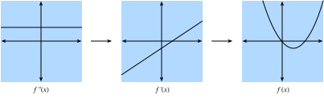
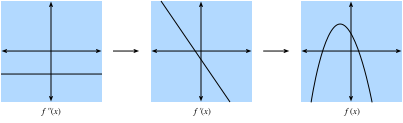
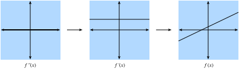

# 单变量微积分
:label:`sec_single_variable_calculus`

在 :numref:`sec_calculus` 中，我们看到了微分学的基本要素。本节将更深入地探讨微积分的基础知识，以及如何在机器学习的背景下理解和应用它们。

## 微分学
微分学从根本上研究的是函数在微小变化下如何表现。为了看清这一点为何对深度学习如此核心，让我们考虑一个例子。

假设我们有一个深度神经网络，为方便起见，把其中的权重连结成一个向量 $\mathbf{w} = (w_1, \ldots, w_n)$。给定一个训练数据集，我们考虑神经网络在该数据集上的损失，将其记作 $\mathcal{L}(\mathbf{w})$。

这个函数极其复杂，它编码了给定架构下所有可能的模型在该数据集上的表现，因此几乎无法判断哪一组权重 $\mathbf{w}$ 能使损失最小。于是，在实践中，我们通常先*随机*初始化权重，然后迭代地朝使损失下降得尽可能快的方向迈出小步。

问题于是变成表面上同样不简单的问题：我们如何找到使权重下降得尽可能快的方向？为了深入探讨，让我们先考察只有一个权重的情形：$L(\mathbf{w}) = L(x)$，其中 $x$ 是一个实数值。

让我们取 $x$，并试着理解把它改变一个很小的量、变成 $x + \epsilon$ 时会发生什么。如果想具体一点，可以想一个像 $\epsilon = 0.0000001$ 这样的数。为了帮助直观理解，我们在 $[0, 3]$ 上画一个示例函数 $f(x) = \sin(x^x)$。

```{.python .input}
#@tab mxnet
%matplotlib inline
from d2l import mxnet as d2l
from IPython import display
from mxnet import np, npx
npx.set_np()

# Plot a function in a normal range
x_big = np.arange(0.01, 3.01, 0.01)
ys = np.sin(x_big**x_big)
d2l.plot(x_big, ys, 'x', 'f(x)')
```

```{.python .input}
#@tab pytorch
%matplotlib inline
from d2l import torch as d2l
from IPython import display
import torch
torch.pi = torch.acos(torch.zeros(1)).item() * 2  # Define pi in torch

# Plot a function in a normal range
x_big = torch.arange(0.01, 3.01, 0.01)
ys = torch.sin(x_big**x_big)
d2l.plot(x_big, ys, 'x', 'f(x)')
```

```{.python .input}
#@tab tensorflow
%matplotlib inline
from d2l import tensorflow as d2l
from IPython import display
import tensorflow as tf
tf.pi = tf.acos(tf.zeros(1)).numpy() * 2  # Define pi in TensorFlow

# Plot a function in a normal range
x_big = tf.range(0.01, 3.01, 0.01)
ys = tf.sin(x_big**x_big)
d2l.plot(x_big, ys, 'x', 'f(x)')
```

在这样大的尺度上，函数的行为并不简单。然而，如果我们把范围缩小到像 $[1.75,2.25]$ 这样更小的区间，就会看到图像变得简单得多。

```{.python .input}
#@tab mxnet
# Plot a the same function in a tiny range
x_med = np.arange(1.75, 2.25, 0.001)
ys = np.sin(x_med**x_med)
d2l.plot(x_med, ys, 'x', 'f(x)')
```

```{.python .input}
#@tab pytorch
# Plot a the same function in a tiny range
x_med = torch.arange(1.75, 2.25, 0.001)
ys = torch.sin(x_med**x_med)
d2l.plot(x_med, ys, 'x', 'f(x)')
```

```{.python .input}
#@tab tensorflow
# Plot a the same function in a tiny range
x_med = tf.range(1.75, 2.25, 0.001)
ys = tf.sin(x_med**x_med)
d2l.plot(x_med, ys, 'x', 'f(x)')
```

把这一做法推向极端：如果我们放大到一个极小的片段，函数的行为会变得简单得多，它就是一条直线。

```{.python .input}
#@tab mxnet
# Plot a the same function in a tiny range
x_small = np.arange(2.0, 2.01, 0.0001)
ys = np.sin(x_small**x_small)
d2l.plot(x_small, ys, 'x', 'f(x)')
```

```{.python .input}
#@tab pytorch
# Plot a the same function in a tiny range
x_small = torch.arange(2.0, 2.01, 0.0001)
ys = torch.sin(x_small**x_small)
d2l.plot(x_small, ys, 'x', 'f(x)')
```

```{.python .input}
#@tab tensorflow
# Plot a the same function in a tiny range
x_small = tf.range(2.0, 2.01, 0.0001)
ys = tf.sin(x_small**x_small)
d2l.plot(x_small, ys, 'x', 'f(x)')
```

这就是单变量微积分的关键观察：在足够小的范围内，熟悉函数的行为可以用一条直线来建模。这意味着，对大多数函数而言，可以合理地期望：当我们把函数的 $x$ 值移动一点点时，输出 $f(x)$ 也会移动一点点。我们唯一需要回答的问题是：“与输入的变化相比，输出的变化有多大？是一半？还是两倍？”

于是，我们可以考虑函数输出的变化与输入微小变化之比。形式化地，可以将其写为

$$
\frac{L(x+\epsilon) - L(x)}{(x+\epsilon) - x} = \frac{L(x+\epsilon) - L(x)}{\epsilon}.
$$

这已经足以让我们开始在代码中尝试了。例如，假设我们知道 $L(x) = x^{2} + 1701(x-4)^3$，那么可以如下查看该值在点 $x = 4$ 处有多大。

```{.python .input}
#@tab all
# Define our function
def L(x):
    return x**2 + 1701*(x-4)**3

# Print the difference divided by epsilon for several epsilon
for epsilon in [0.1, 0.001, 0.0001, 0.00001]:
    print(f'epsilon = {epsilon:.5f} -> {(L(4+epsilon) - L(4)) / epsilon:.5f}')
```

现在，如果留心观察，我们会注意到这个数的输出可疑地接近 $8$。事实上，如果减小 $\epsilon$，我们会看到该值逐步接近 $8$。因此我们可以正确地得出结论：我们寻求的值（输入的变化能在多大程度上改变输出）在点 $x=4$ 处应为 $8$。数学家编码这一事实的方式是

$$
\lim_{\epsilon \rightarrow 0}\frac{L(4+\epsilon) - L(4)}{\epsilon} = 8.
$$

稍作一点历史题外话：在神经网络研究的最初几十年里，科学家使用这种算法（*有限差分法*）来评估损失函数在小扰动下如何变化：只需改变权重，看看损失如何变化。这在计算上是低效的，因为要查看一个变量的单次变化如何影响损失，需要对损失函数求值两次。如果我们试图对区区几千个参数这样做，就需要在整个数据集上对网络进行数千次求值！直到 1986 年，:citet:`Rumelhart.Hinton.Williams.ea.1988` 引入的*反向传播算法*才提供了解决之道：它能在与在整个数据集上对网络做一次预测相同的计算时间内，计算出权重的*任何*变化合在一起会如何改变损失。

回到我们的例子，这个值 $8$ 随 $x$ 的取值不同而不同，因此把它定义为 $x$ 的函数是合理的。更形式化地说，这种依赖于取值的变率称为*导数*（derivative），记作

$$\frac{df}{dx}(x) = \lim_{\epsilon \rightarrow 0}\frac{f(x+\epsilon) - f(x)}{\epsilon}.$$
:eqlabel:`eq_der_def`

不同的教材会使用不同的导数记号。例如，以下所有记号都表示同一件事：

$$
\frac{df}{dx} = \frac{d}{dx}f = f' = \nabla_xf = D_xf = f_x.
$$

大多数作者会选定一种记号并坚持使用，然而即便如此也并非必然。最好熟悉所有这些记号。本书将通篇使用 $\frac{df}{dx}$ 这一记号，除非我们要对复杂表达式求导，此时我们会用 $\frac{d}{dx}f$ 来写出像

$$
\frac{d}{dx}\left[x^4+\cos\left(\frac{x^2+1}{2x-1}\right)\right].
$$

这样的表达式。

通常，再次拆解导数的定义 :eqref:`eq_der_def`，看看当我们对 $x$ 作微小改变时函数如何变化，在直觉上是很有用的：

$$\begin{aligned} \frac{df}{dx}(x) = \lim_{\epsilon \rightarrow 0}\frac{f(x+\epsilon) - f(x)}{\epsilon} & \implies \frac{df}{dx}(x) \approx \frac{f(x+\epsilon) - f(x)}{\epsilon} \\ & \implies \epsilon \frac{df}{dx}(x) \approx f(x+\epsilon) - f(x) \\ & \implies f(x+\epsilon) \approx f(x) + \epsilon \frac{df}{dx}(x). \end{aligned}$$
:eqlabel:`eq_small_change`

最后一个等式值得明确点出。它告诉我们，如果你取任意一个函数并让输入变化一个很小的量，那么输出的变化量就是该很小的量乘以导数。

这样，我们就可以把导数理解为比例因子，它告诉我们输入的变化能在输出中带来多大的变化。

## 微积分法则
:label:`sec_derivative_table`

现在我们转向理解如何计算显式函数的导数。完整的微积分形式化处理会从第一性原理推导一切。这里我们不会沉溺于这种诱惑，而是帮助读者理解常见的法则。

### 常用导数
正如 :numref:`sec_calculus` 中所见，计算导数时，人们往往可以用一系列法则把计算化为少数几个核心函数。为便于查阅，这里再重复一遍。

* **常数的导数。** $\frac{d}{dx}c = 0$。
* **线性函数的导数。** $\frac{d}{dx}(ax) = a$。
* **幂法则。** $\frac{d}{dx}x^n = nx^{n-1}$。
* **指数函数的导数。** $\frac{d}{dx}e^x = e^x$。
* **对数函数的导数。** $\frac{d}{dx}\log(x) = \frac{1}{x}$。

### 求导法则
如果每个导数都需要单独计算并存入表格，微分学将几乎无法进行。数学的一项恩赐是：我们可以推广上述导数，并计算更复杂的导数，比如求 $f(x) = \log\left(1+(x-1)^{10}\right)$ 的导数。正如 :numref:`sec_calculus` 中提到的，做到这一点的关键在于，把函数以各种方式组合时会发生什么编纂成规则，其中最重要的是：和、积与复合。

* **和法则。** $\frac{d}{dx}\left(g(x) + h(x)\right) = \frac{dg}{dx}(x) + \frac{dh}{dx}(x)$。
* **积法则。** $\frac{d}{dx}\left(g(x)\cdot h(x)\right) = g(x)\frac{dh}{dx}(x) + \frac{dg}{dx}(x)h(x)$。
* **链式法则。** $\frac{d}{dx}g(h(x)) = \frac{dg}{dh}(h(x))\cdot \frac{dh}{dx}(x)$。

让我们看看如何利用 :eqref:`eq_small_change` 来理解这些法则。对于和法则，考虑如下推理链：

$$
\begin{aligned}
f(x+\epsilon) & = g(x+\epsilon) + h(x+\epsilon) \\
& \approx g(x) + \epsilon \frac{dg}{dx}(x) + h(x) + \epsilon \frac{dh}{dx}(x) \\
& = g(x) + h(x) + \epsilon\left(\frac{dg}{dx}(x) + \frac{dh}{dx}(x)\right) \\
& = f(x) + \epsilon\left(\frac{dg}{dx}(x) + \frac{dh}{dx}(x)\right).
\end{aligned}
$$

把这个结果与 $f(x+\epsilon) \approx f(x) + \epsilon \frac{df}{dx}(x)$ 这一事实相比较，我们看到 $\frac{df}{dx}(x) = \frac{dg}{dx}(x) + \frac{dh}{dx}(x)$，正如所愿。这里的直觉是：当我们改变输入 $x$ 时，$g$ 和 $h$ 分别以 $\frac{dg}{dx}(x)$ 和 $\frac{dh}{dx}(x)$ 共同贡献于输出的变化。


积法则更为微妙，需要对这些表达式的处理方式作一个新的观察。我们像之前一样从 :eqref:`eq_small_change` 出发：

$$
\begin{aligned}
f(x+\epsilon) & = g(x+\epsilon)\cdot h(x+\epsilon) \\
& \approx \left(g(x) + \epsilon \frac{dg}{dx}(x)\right)\cdot\left(h(x) + \epsilon \frac{dh}{dx}(x)\right) \\
& = g(x)\cdot h(x) + \epsilon\left(g(x)\frac{dh}{dx}(x) + \frac{dg}{dx}(x)h(x)\right) + \epsilon^2\frac{dg}{dx}(x)\frac{dh}{dx}(x) \\
& = f(x) + \epsilon\left(g(x)\frac{dh}{dx}(x) + \frac{dg}{dx}(x)h(x)\right) + \epsilon^2\frac{dg}{dx}(x)\frac{dh}{dx}(x). \\
\end{aligned}
$$


这与上面所做的计算相似，确实我们看到答案（$\frac{df}{dx}(x) = g(x)\frac{dh}{dx}(x) + \frac{dg}{dx}(x)h(x)$）就位于 $\epsilon$ 旁边，但还多出一个大小为 $\epsilon^{2}$ 的项。我们将其称为*高阶项*（higher-order term），因为 $\epsilon^2$ 的幂次高于 $\epsilon^1$ 的幂次。我们将在后面的章节中看到，有时我们希望跟踪这些项，不过现在请注意：如果 $\epsilon = 0.0000001$，那么 $\epsilon^{2}= 0.0000000000001$，要小得多。当 $\epsilon \rightarrow 0$ 时，我们可以放心地忽略高阶项。作为本附录的一般约定，我们将用“$\approx$”表示两个表达式在忽略高阶项的意义下相等。然而，如果希望更形式化一些，可以考察差商

$$
\frac{f(x+\epsilon) - f(x)}{\epsilon} = g(x)\frac{dh}{dx}(x) + \frac{dg}{dx}(x)h(x) + \epsilon \frac{dg}{dx}(x)\frac{dh}{dx}(x),
$$

并看到当 $\epsilon \rightarrow 0$ 时，右端的项也趋于零。

最后，对于链式法则，我们同样可以像之前一样利用 :eqref:`eq_small_change` 推进，并看到

$$
\begin{aligned}
f(x+\epsilon) & = g(h(x+\epsilon)) \\
& \approx g\left(h(x) + \epsilon \frac{dh}{dx}(x)\right) \\
& \approx g(h(x)) + \epsilon \frac{dh}{dx}(x) \frac{dg}{dh}(h(x))\\
& = f(x) + \epsilon \frac{dg}{dh}(h(x))\frac{dh}{dx}(x),
\end{aligned}
$$

其中第二行我们把函数 $g$ 的输入（$h(x)$）看作被微小量 $\epsilon \frac{dh}{dx}(x)$ 平移了。

这些法则为我们提供了一套灵活的工具，几乎可以计算任何想要的表达式。例如，

$$
\begin{aligned}
\frac{d}{dx}\left[\log\left(1+(x-1)^{10}\right)\right] & = \left(1+(x-1)^{10}\right)^{-1}\frac{d}{dx}\left[1+(x-1)^{10}\right]\\
& = \left(1+(x-1)^{10}\right)^{-1}\left(\frac{d}{dx}[1] + \frac{d}{dx}[(x-1)^{10}]\right) \\
& = \left(1+(x-1)^{10}\right)^{-1}\left(0 + 10(x-1)^9\frac{d}{dx}[x-1]\right) \\
& = 10\left(1+(x-1)^{10}\right)^{-1}(x-1)^9 \\
& = \frac{10(x-1)^9}{1+(x-1)^{10}}.
\end{aligned}
$$

其中每一行依次使用了以下法则：

1. 链式法则与对数函数的导数。
2. 和法则。
3. 常数的导数、链式法则与幂法则。
4. 和法则、线性函数的导数、常数的导数。

做这个例子之后，有两件事应该清楚了：

1. 任何能用和、积、常数、幂、指数与对数写出的函数，都可以机械地按这些法则计算导数。
2. 让人来执行这些法则可能既繁琐又容易出错！

值得庆幸的是，这两点合在一起提示了前进的方向：这正是机械化的完美候选！事实上，本节稍后我们将再次讨论的反向传播，正是这样的机械化。

### 线性近似
处理导数时，对上面所用的近似作几何解释往往很有用。特别地，请注意等式

$$
f(x+\epsilon) \approx f(x) + \epsilon \frac{df}{dx}(x),
$$

用一条经过点 $(x, f(x))$、斜率为 $\frac{df}{dx}(x)$ 的直线来近似 $f$ 的值。据此我们说，导数给出了函数 $f$ 的线性近似，如下图所示：

```{.python .input}
#@tab mxnet
# Compute sin
xs = np.arange(-np.pi, np.pi, 0.01)
plots = [np.sin(xs)]

# Compute some linear approximations. Use d(sin(x)) / dx = cos(x)
for x0 in [-1.5, 0, 2]:
    plots.append(np.sin(x0) + (xs - x0) * np.cos(x0))

d2l.plot(xs, plots, 'x', 'f(x)', ylim=[-1.5, 1.5])
```

```{.python .input}
#@tab pytorch
# Compute sin
xs = torch.arange(-torch.pi, torch.pi, 0.01)
plots = [torch.sin(xs)]

# Compute some linear approximations. Use d(sin(x))/dx = cos(x)
for x0 in [-1.5, 0.0, 2.0]:
    plots.append(torch.sin(torch.tensor(x0)) + (xs - x0) *
                 torch.cos(torch.tensor(x0)))

d2l.plot(xs, plots, 'x', 'f(x)', ylim=[-1.5, 1.5])
```

```{.python .input}
#@tab tensorflow
# Compute sin
xs = tf.range(-tf.pi, tf.pi, 0.01)
plots = [tf.sin(xs)]

# Compute some linear approximations. Use d(sin(x))/dx = cos(x)
for x0 in [-1.5, 0.0, 2.0]:
    plots.append(tf.sin(tf.constant(x0)) + (xs - x0) *
                 tf.cos(tf.constant(x0)))

d2l.plot(xs, plots, 'x', 'f(x)', ylim=[-1.5, 1.5])
```

### 高阶导数

现在让我们做一件表面上可能有些奇怪的事。取一个函数 $f$ 并计算导数 $\frac{df}{dx}$。这给出了 $f$ 在任意点处的变率。

然而，导数 $\frac{df}{dx}$ 本身可以看作一个函数，因此没有什么能阻止我们对 $\frac{df}{dx}$ 再求导，得到 $\frac{d^2f}{dx^2} = \frac{df}{dx}\left(\frac{df}{dx}\right)$。我们把这称为 $f$ 的二阶导数。这个函数是 $f$ 的变率的变率，换句话说，是变化率本身如何变化。我们可以反复求导任意多次，得到所谓的 $n$ 阶导数。为保持记号简洁，我们将 $n$ 阶导数记为

$$
f^{(n)}(x) = \frac{d^{n}f}{dx^{n}} = \left(\frac{d}{dx}\right)^{n} f.
$$

让我们试着理解*为什么*这是一个有用的概念。下面我们可视化 $f^{(2)}(x)$、$f^{(1)}(x)$ 和 $f(x)$。

首先，考虑二阶导数 $f^{(2)}(x)$ 为正常数的情形。这意味着一阶导数的斜率为正。因此，一阶导数 $f^{(1)}(x)$ 可能起初为负，在某点变为零，最后变为正。这告诉了我们原函数 $f$ 的斜率，因而函数 $f$ 本身先递减、变平、再递增。换句话说，函数 $f$ 向上弯曲，并且只有一个最小值，如 :numref:`fig_positive-second` 所示。


:label:`fig_positive-second`


其次，如果二阶导数为负常数，那意味着一阶导数递减。这意味着一阶导数可能起初为正，在某点变为零，然后变为负。因此，函数 $f$ 本身先递增、变平、再递减。换句话说，函数 $f$ 向下弯曲，并且只有一个最大值，如 :numref:`fig_negative-second` 所示。


:label:`fig_negative-second`


第三，如果二阶导数始终为零，那么一阶导数永远不会改变——它是常数！这意味着 $f$ 以固定的速率递增（或递减），此时 $f$ 本身就是一条直线，如 :numref:`fig_zero-second` 所示。


:label:`fig_zero-second`

总而言之，二阶导数可以解释为描述函数 $f$ 弯曲的方式。正二阶导数导致向上弯曲，负二阶导数意味着 $f$ 向下弯曲，而零二阶导数意味着 $f$ 完全不会弯曲。

让我们再向前推进一步。考虑函数 $g(x) = ax^{2}+ bx + c$。于是可以算出

$$
\begin{aligned}
\frac{dg}{dx}(x) & = 2ax + b \\
\frac{d^2g}{dx^2}(x) & = 2a.
\end{aligned}
$$

如果我们心中有某个原函数 $f(x)$，可以计算它的前两阶导数，并求出使它们与该计算结果相匹配的 $a, b$ 和 $c$ 的取值。与上一节我们看到一阶导数给出最佳直线近似类似，这种构造给出了最佳二次近似。让我们对 $f(x) = \sin(x)$ 可视化这一过程。

```{.python .input}
#@tab mxnet
# Compute sin
xs = np.arange(-np.pi, np.pi, 0.01)
plots = [np.sin(xs)]

# Compute some quadratic approximations. Use d(sin(x)) / dx = cos(x)
for x0 in [-1.5, 0, 2]:
    plots.append(np.sin(x0) + (xs - x0) * np.cos(x0) -
                              (xs - x0)**2 * np.sin(x0) / 2)

d2l.plot(xs, plots, 'x', 'f(x)', ylim=[-1.5, 1.5])
```

```{.python .input}
#@tab pytorch
# Compute sin
xs = torch.arange(-torch.pi, torch.pi, 0.01)
plots = [torch.sin(xs)]

# Compute some quadratic approximations. Use d(sin(x)) / dx = cos(x)
for x0 in [-1.5, 0.0, 2.0]:
    plots.append(torch.sin(torch.tensor(x0)) + (xs - x0) *
                 torch.cos(torch.tensor(x0)) - (xs - x0)**2 *
                 torch.sin(torch.tensor(x0)) / 2)

d2l.plot(xs, plots, 'x', 'f(x)', ylim=[-1.5, 1.5])
```

```{.python .input}
#@tab tensorflow
# Compute sin
xs = tf.range(-tf.pi, tf.pi, 0.01)
plots = [tf.sin(xs)]

# Compute some quadratic approximations. Use d(sin(x)) / dx = cos(x)
for x0 in [-1.5, 0.0, 2.0]:
    plots.append(tf.sin(tf.constant(x0)) + (xs - x0) *
                 tf.cos(tf.constant(x0)) - (xs - x0)**2 *
                 tf.sin(tf.constant(x0)) / 2)

d2l.plot(xs, plots, 'x', 'f(x)', ylim=[-1.5, 1.5])
```

我们将在下一节把这一思想推广为*泰勒级数*。

### 泰勒级数


如果在点 $x_0$ 处给定前 $n$ 阶导数的值，即 $\left\{ f(x_0), f^{(1)}(x_0), f^{(2)}(x_0), \ldots, f^{(n)}(x_0) \right\}$，那么*泰勒级数*（Taylor series）提供了一种近似函数 $f(x)$ 的方法。其思路是找到一个 $n$ 次多项式，使其在 $x_0$ 处与所有给定的导数相匹配。

我们在上一节看到了 $n=2$ 的情形，稍作代数运算即可得到

$$
f(x) \approx \frac{1}{2}\frac{d^2f}{dx^2}(x_0)(x-x_0)^{2}+ \frac{df}{dx}(x_0)(x-x_0) + f(x_0).
$$

如上所示，分母中的 $2$ 是为了抵消对 $x^2$ 求两次导数时得到的 $2$，而对其他项求两次导数时结果都为零。同样的逻辑也适用于一阶导数和函数值本身。

如果把这一逻辑进一步推到 $n=3$，我们会得到

$$
f(x) \approx \frac{\frac{d^3f}{dx^3}(x_0)}{6}(x-x_0)^3 + \frac{\frac{d^2f}{dx^2}(x_0)}{2}(x-x_0)^{2}+ \frac{df}{dx}(x_0)(x-x_0) + f(x_0).
$$

其中 $6 = 3 \times 2 = 3!$ 来自对 $x^3$ 求三次导数后出现在前面的常数。


此外，我们可以通过

$$
P_n(x) = \sum_{i = 0}^{n} \frac{f^{(i)}(x_0)}{i!}(x-x_0)^{i}.
$$

得到一个 $n$ 次多项式，其中记号

$$
f^{(n)}(x) = \frac{d^{n}f}{dx^{n}} = \left(\frac{d}{dx}\right)^{n} f.
$$


事实上，$P_n(x)$ 可以看作对函数 $f(x)$ 的最佳 $n$ 次多项式近似。

我们并不打算深入探讨上述近似的误差，但值得提一下无限极限的情形。此时，对于性质良好的函数（称为实解析函数），例如 $\cos(x)$ 或 $e^{x}$，我们可以写出无穷多项，并精确地近似同一个函数

$$
f(x) = \sum_{n = 0}^\infty \frac{f^{(n)}(x_0)}{n!}(x-x_0)^{n}.
$$

以 $f(x) = e^{x}$ 为例。由于 $e^{x}$ 是其自身的导数，我们知道 $f^{(n)}(x) = e^{x}$。因此，$e^{x}$ 可以通过在 $x_0 = 0$ 处取泰勒级数来重构，即

$$
e^{x} = \sum_{n = 0}^\infty \frac{x^{n}}{n!} = 1 + x + \frac{x^2}{2} + \frac{x^3}{6} + \cdots.
$$

让我们看看这在代码中如何工作，并观察提高泰勒近似的阶数如何使我们更接近目标函数 $e^x$。

```{.python .input}
#@tab mxnet
# Compute the exponential function
xs = np.arange(0, 3, 0.01)
ys = np.exp(xs)

# Compute a few Taylor series approximations
P1 = 1 + xs
P2 = 1 + xs + xs**2 / 2
P5 = 1 + xs + xs**2 / 2 + xs**3 / 6 + xs**4 / 24 + xs**5 / 120

d2l.plot(xs, [ys, P1, P2, P5], 'x', 'f(x)', legend=[
    "Exponential", "Degree 1 Taylor Series", "Degree 2 Taylor Series",
    "Degree 5 Taylor Series"])
```

```{.python .input}
#@tab pytorch
# Compute the exponential function
xs = torch.arange(0, 3, 0.01)
ys = torch.exp(xs)

# Compute a few Taylor series approximations
P1 = 1 + xs
P2 = 1 + xs + xs**2 / 2
P5 = 1 + xs + xs**2 / 2 + xs**3 / 6 + xs**4 / 24 + xs**5 / 120

d2l.plot(xs, [ys, P1, P2, P5], 'x', 'f(x)', legend=[
    "Exponential", "Degree 1 Taylor Series", "Degree 2 Taylor Series",
    "Degree 5 Taylor Series"])
```

```{.python .input}
#@tab tensorflow
# Compute the exponential function
xs = tf.range(0, 3, 0.01)
ys = tf.exp(xs)

# Compute a few Taylor series approximations
P1 = 1 + xs
P2 = 1 + xs + xs**2 / 2
P5 = 1 + xs + xs**2 / 2 + xs**3 / 6 + xs**4 / 24 + xs**5 / 120

d2l.plot(xs, [ys, P1, P2, P5], 'x', 'f(x)', legend=[
    "Exponential", "Degree 1 Taylor Series", "Degree 2 Taylor Series",
    "Degree 5 Taylor Series"])
```

泰勒级数有两个主要应用：

1. *理论应用*：当我们试图理解一个过于复杂的函数时，使用泰勒级数常常能把它转化为可以直接处理的多项式。

2. *数值应用*：有些函数（如 $e^{x}$ 或 $\cos(x)$）机器难以计算。机器可以存储固定精度的数值表（这种做法很常见），但这仍然留下诸如“$\cos(1)$ 的第 1000 位数字是什么？”这样的问题。泰勒级数往往有助于回答这类问题。


## 小结

* 导数可以用来表达当我们对输入作微小改变时函数如何变化。
* 基本导数可以借助求导法则组合起来，构造出任意复杂的导数。
* 导数可以迭代求取，得到二阶或更高阶导数。阶数每提高一次，就提供关于函数行为的更精细信息。
* 利用单个数据样例的导数信息，我们可以用泰勒级数得到的多项式来近似性质良好的函数。


## 习题

1. $x^3-4x+1$ 的导数是什么？
2. $\log(\frac{1}{x})$ 的导数是什么？
3. 判断对错：如果 $f'(x) = 0$，那么 $f$ 在 $x$ 处取得最大值或最小值？
4. 对于 $x\ge0$，$f(x) = x\log(x)$ 的最小值在哪里（这里假设 $f$ 在 $f(0)$ 处取极限值 $0$）？


:begin_tab:`mxnet`
[讨论](https://discuss.d2l.ai/t/412)
:end_tab:

:begin_tab:`pytorch`
[讨论](https://discuss.d2l.ai/t/1088)
:end_tab:


:begin_tab:`tensorflow`
[讨论](https://discuss.d2l.ai/t/1089)
:end_tab:
