# 使用AWS EC2 实例
:label:`sec_aws`

在本节中，我们将向你展示如何在一台全新的Linux 机器上安装所有库。回想一下，我们在 :numref:`sec_sagemaker` 中讨论了如何使用Amazon SageMaker，而在AWS 上自行搭建实例的花费更低。本演练包括三个步骤：

1. 从AWS EC2 申请一个GPU Linux 实例。
1. 安装CUDA，或使用预装了CUDA 的亚马逊机器镜像（Amazon Machine Image）。
1. 安装深度学习框架以及其他运行本书代码所需的库。

这一过程也适用于其他实例（以及其他云平台），只是需要做一些小的修改。在继续之前，你需要创建一个AWS 账号，更多细节请参阅 :numref:`sec_sagemaker`。


## 创建并运行EC2 实例

登录AWS 账号后，点击“EC2”（:numref:`fig_aws`）进入EC2 面板。

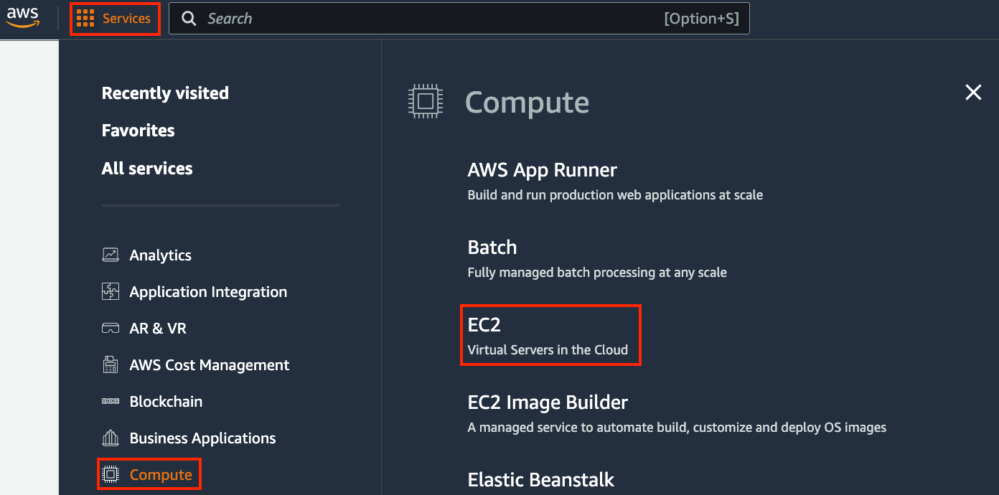
:width:`400px`
:label:`fig_aws`

:numref:`fig_ec2` 展示了EC2 面板。

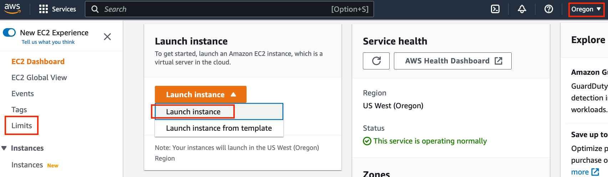
:width:`700px`
:label:`fig_ec2`

### 预设位置
选择一个附近的数据中心以降低延迟，例如“Oregon”（在 :numref:`fig_ec2` 的右上角用红框标出）。如果你位于中国，
可以选择附近的亚太区域，例如首尔或东京。请注意，
某些数据中心可能没有GPU 实例。


### 提高限额

在选择实例之前，先点击左侧栏中的“Limits”标签（如
:numref:`fig_ec2` 所示），检查是否存在数量限制。
:numref:`fig_limits` 展示了这类限制的一个示例。
该账号目前无法在对应区域开通“p2.xlarge”实例。如果你
需要开通一个或多个实例，请点击“Request limit increase”链接
申请更高的实例配额。
通常，处理申请需要一个工作日。

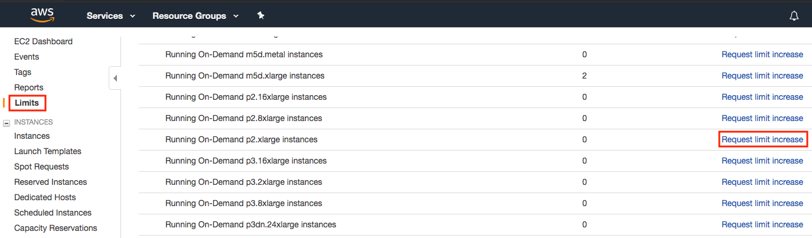
:width:`700px`
:label:`fig_limits`


### 启动实例

接下来，点击 :numref:`fig_ec2` 中红框标注的“Launch Instance”按钮来启动实例。

首先，我们选择一个合适的亚马逊机器镜像（AMI）。选择Ubuntu 实例（:numref:`fig_ubuntu`）。


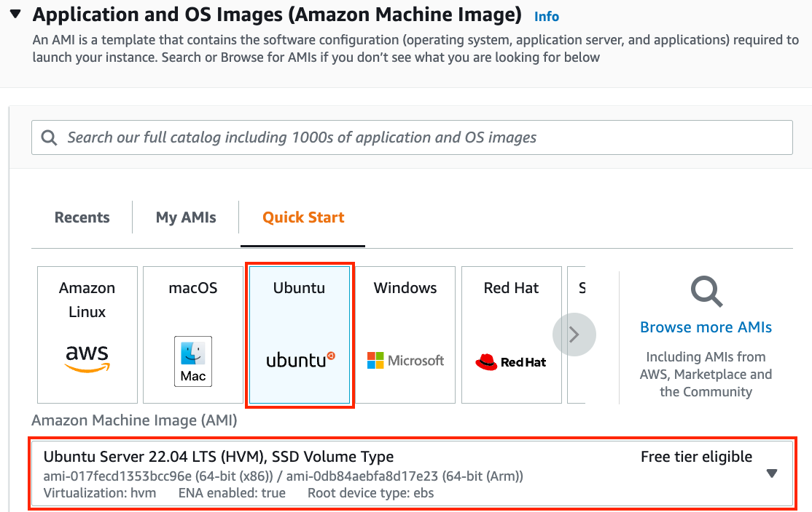
:width:`700px`
:label:`fig_ubuntu`

EC2 提供许多不同的实例配置可供选择。对初学者来说，这有时会让人感到不知所措。:numref:`tab_ec2` 列出了几种合适的机器。

:不同的EC2 实例类型
:label:`tab_ec2`

| 名称 | GPU         | 说明                          |
|------|-------------|-------------------------------|
| g2   | Grid K520   | 老旧                          |
| p2   | Kepler K80  | 较旧，但作为竞价实例通常很便宜 |
| g3   | Maxwell M60 | 性价比良好                    |
| p3   | Volta V100  | FP16 性能高                   |
| p4   | Ampere A100 | 针对大规模训练的高性能        |
| g4   | Turing T4   | 针对FP16/INT8 推理优化        |


所有这些服务器都有多种规格，用于表示所使用的GPU 数量。例如，p2.xlarge 有1 块GPU，而p2.16xlarge 有16 块GPU 和更大的内存。更多细节请参阅[AWS EC2 文档](https://aws.amazon.com/ec2/instance-types/)或[汇总页面](https://www.ec2instances.info)。为了演示，一台p2.xlarge 就足够了（在 :numref:`fig_p2x` 的红框中标出）。

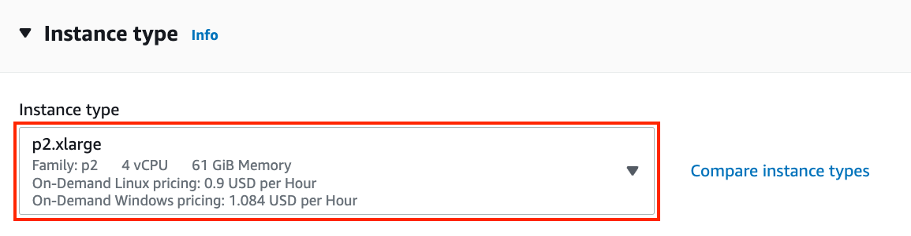
:width:`700px`
:label:`fig_p2x`

请注意，你应当使用带有合适驱动程序的GPU 实例，以及支持GPU 的深度学习框架。否则，使用GPU 不会带来任何好处。

接下来，我们选择用于访问
实例的密钥对。如果没有密钥对，请点击 :numref:`fig_keypair` 中的“Create new key pair”生成一个密钥对。随后，
你可以选择
之前生成的密钥对。
如果你生成了新的密钥对，请务必下载它并将其保存在安全的位置。这是你
通过SSH 登录服务器的唯一方式。

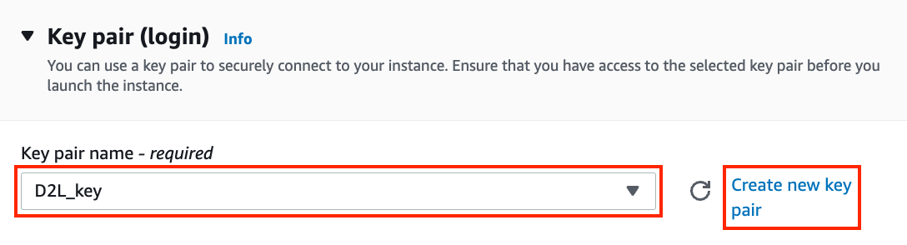
:width:`500px`
:label:`fig_keypair`

在本例中，我们将保持“Network settings”的默认配置（点击“Edit”按钮可以配置子网和安全组等项目）。我们只是把默认硬盘大小增加到64 GB（:numref:`fig_disk`）。请注意，仅CUDA 本身就会占用4 GB。

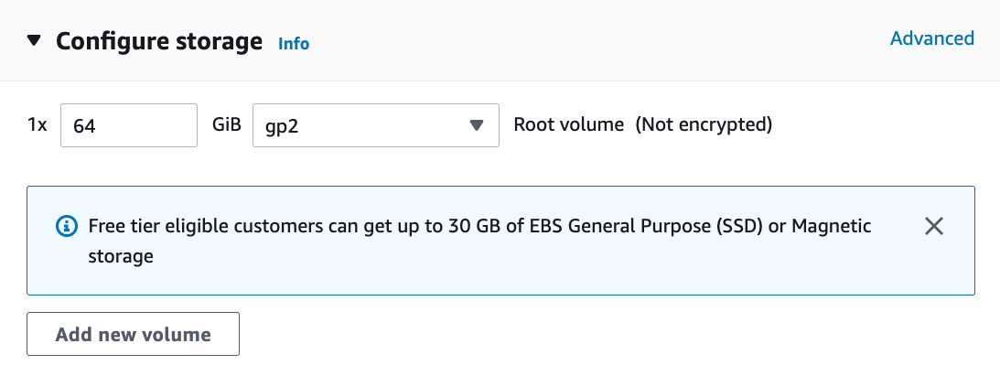
:width:`700px`
:label:`fig_disk`


点击“Launch Instance”启动已创建的
实例。点击
:numref:`fig_launching` 中显示的实例ID，即可查看该实例的状态。

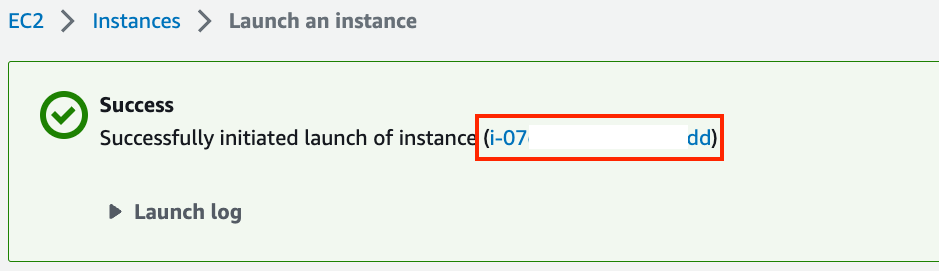
:width:`700px`
:label:`fig_launching`

### 连接到实例

如 :numref:`fig_connect` 所示，实例状态变为绿色后，右键点击该实例并选择`Connect`，即可查看实例的访问方式。

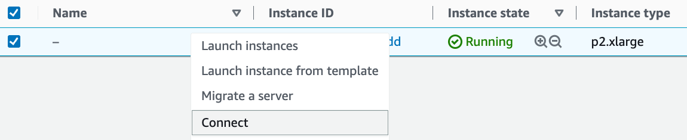
:width:`700px`
:label:`fig_connect`

如果这是新密钥，那么为了让SSH 正常工作，该密钥不能被公开查看。进入存放`D2L_key.pem`的文件夹，
并执行以下命令
使该密钥不可被公开查看：

```bash
chmod 400 D2L_key.pem
```


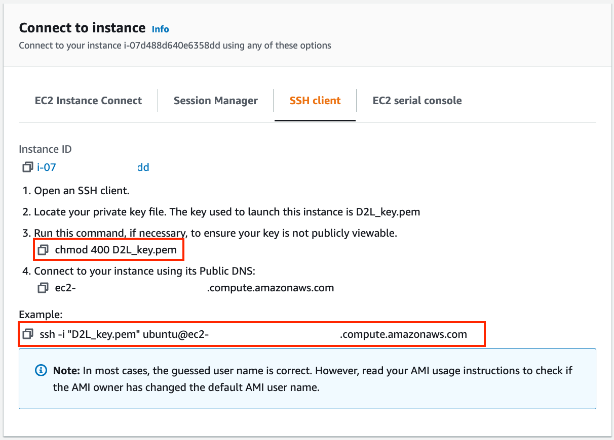
:width:`400px`
:label:`fig_chmod`


现在，复制 :numref:`fig_chmod` 下方红框中的SSH 命令，粘贴到命令行中：

```bash
ssh -i "D2L_key.pem" ubuntu@ec2-xx-xxx-xxx-xxx.y.compute.amazonaws.com
```


当命令行提示“Are you sure you want to continue connecting (yes/no)”时，输入“yes”并按回车键登录实例。

现在，你的服务器已经准备就绪。


## 安装CUDA

在安装CUDA 之前，请务必使用最新的驱动程序更新实例。

```bash
sudo apt-get update && sudo apt-get install -y build-essential git libgfortran3
```


这里我们下载CUDA 12.1。访问NVIDIA 的[官方仓库](https://developer.nvidia.com/cuda-toolkit-archive)，找到下载链接，如 :numref:`fig_cuda` 所示。

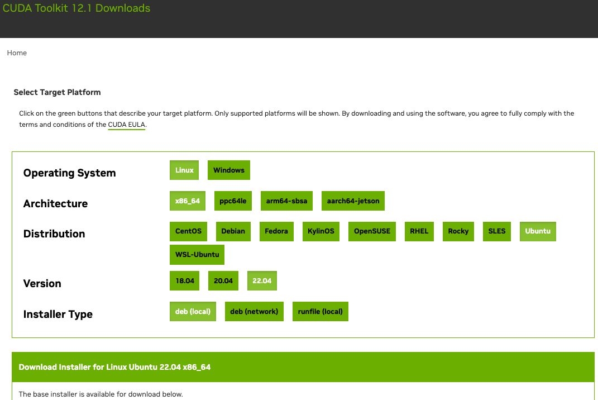
:width:`500px`
:label:`fig_cuda`

复制这些安装指令，粘贴到终端中，即可安装CUDA 12.1。

```bash
# The link and file name are subject to changes
wget https://developer.download.nvidia.com/compute/cuda/repos/ubuntu2204/x86_64/cuda-ubuntu2204.pin
sudo mv cuda-ubuntu2204.pin /etc/apt/preferences.d/cuda-repository-pin-600
wget https://developer.download.nvidia.com/compute/cuda/12.1.0/local_installers/cuda-repo-ubuntu2204-12-1-local_12.1.0-530.30.02-1_amd64.deb
sudo dpkg -i cuda-repo-ubuntu2204-12-1-local_12.1.0-530.30.02-1_amd64.deb
sudo cp /var/cuda-repo-ubuntu2204-12-1-local/cuda-*-keyring.gpg /usr/share/keyrings/
sudo apt-get update
sudo apt-get -y install cuda
```


安装完成后，运行以下命令查看GPU：

```bash
nvidia-smi
```


最后，将CUDA 添加到库路径中，以便其他库能够找到它，例如在`~/.bashrc`末尾追加以下几行。

```bash
export PATH="/usr/local/cuda-12.1/bin:$PATH"
export LD_LIBRARY_PATH=${LD_LIBRARY_PATH}:/usr/local/cuda-12.1/lib64
```


## 安装运行代码所需的库

要在EC2 实例上运行本书的代码，
只需按照 :ref:`chap_installation` 中面向Linux 用户的步骤操作，
并遵循以下在远程Linux 服务器上工作的提示：

* 要下载Miniconda 安装页面上的bash 脚本，请右键点击下载链接并选择“Copy Link Address”，然后执行`wget [copied link address]`。
* 运行`~/miniconda3/bin/conda init`之后，你可以执行`source ~/.bashrc`，而不必关闭并重新打开当前 shell。


## 远程运行Jupyter 笔记本

要远程运行Jupyter 笔记本，你需要使用SSH 端口转发。毕竟，云端的服务器没有显示器和键盘。为此，请从你的台式机（或笔记本计算机）按如下方式登录服务器：

```
# This command must be run in the local command line
ssh -i "/path/to/key.pem" ubuntu@ec2-xx-xxx-xxx-xxx.y.compute.amazonaws.com -L 8889:localhost:8888
```


接下来，在EC2 实例上进入
已下载的本书代码
所在位置，
然后运行：

```
conda activate d2l
jupyter notebook
```


:numref:`fig_jupyter` 展示了运行Jupyter 笔记本后可能得到的输出。最后一行是端口8888 的URL。

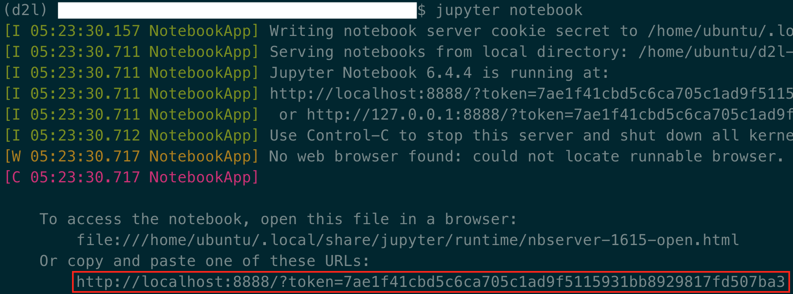
:width:`700px`
:label:`fig_jupyter`

由于你使用端口转发把端口映射到了8889，
请复制 :numref:`fig_jupyter` 红框中的最后一行，
将URL 中的“8888”替换为“8889”，
然后在本地浏览器中打开它。


## 关闭未使用的实例

由于云服务按使用时间计费，你应当关闭未使用的实例。注意，这里有几种不同的做法：

* “停止”（Stopping）实例意味着你之后还能重新启动它。这类似于关闭普通服务器的电源。不过，停止的实例仍会因其保留的硬盘空间而被收取少量费用。
* “终止”（Terminating）实例会删除与该实例关联的所有数据。这包括磁盘，因此你无法再次启动它。只有在你确定将来不再需要该实例时才这样做。

如果你想把这个实例用作创建更多实例的模板，
请右键点击 :numref:`fig_connect` 中的示例并选择“Image”$\rightarrow$
“Create”，为该实例创建镜像。完成后，选择
“Instance State”$\rightarrow$“Terminate”来终止该实例。下次
你想使用这个实例时，可以按照本节的步骤
基于保存的镜像
创建一个实例。唯一的区别在于，在
:numref:`fig_ubuntu` 显示的“1. Choose AMI”中，你必须使用左侧的“My AMIs”选项来选择
已保存的镜像。创建的实例将保留存储在镜像硬盘
上的信息。例如，你无需重新安装CUDA 和其他运行时
环境。


## 小结

* 我们可以按需启动和停止实例，而不必购买并组装自己的计算机。
* 在使用支持GPU 的深度学习框架之前，我们需要安装CUDA。
* 我们可以使用端口转发在远程服务器上运行Jupyter 笔记本。


## 练习

1. 云服务提供了便利，但价格并不便宜。了解如何启动[竞价实例](https://aws.amazon.com/ec2/spot/)，看看如何降低成本。
1. 试用不同的GPU 服务器。它们有多快？
1. 试用多GPU 服务器。你能把规模扩展得怎么样？


[讨论](https://discuss.d2l.ai/t/423)
