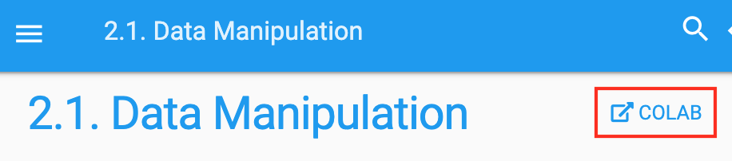
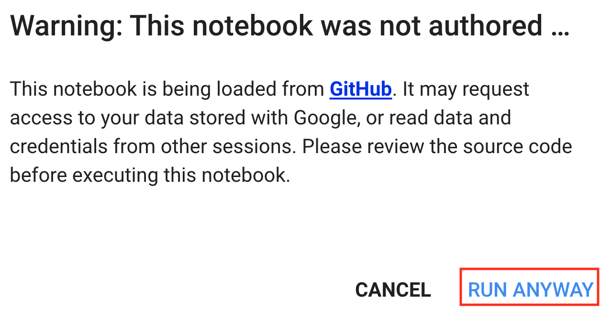

# 使用Google Colab
:label:`sec_colab`

我们在 :numref:`sec_sagemaker` 和 :numref:`sec_aws` 中介绍了如何在AWS 上运行本书。另一种选择是：如果你有Google 账号，
也可以在[Google Colab](https://colab.research.google.com/)上运行本书。

要在Colab 上运行某一节的代码，只需点击 :numref:`fig_colab` 所示的`Colab`按钮。

:width:`300px`
:label:`fig_colab`

如果你是第一次运行代码单元格，
就会收到 :numref:`fig_colab2` 所示的警告消息。
只需点击“RUN ANYWAY”将其忽略即可。

:width:`300px`
:label:`fig_colab2`

接下来，Colab 会为你连接一个实例，以运行本节的代码。
具体来说，如果需要GPU，
就会自动请求Colab 连接到GPU 实例。

## 小结

* 你可以使用Google Colab 运行本书每一节的代码。
* 如果本书任何一节需要GPU，就会请求Colab 连接到GPU 实例。

## 练习

1. 使用Google Colab 打开本书的任何一节。
1. 使用Google Colab 编辑并运行任何需要GPU 的小节。

[讨论](https://discuss.d2l.ai/t/424)
