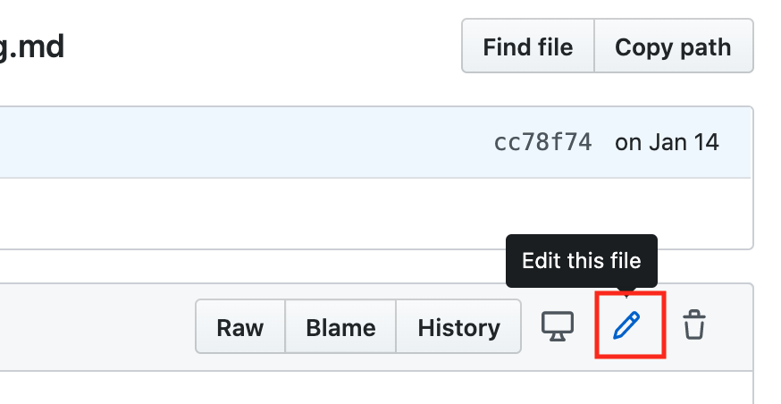
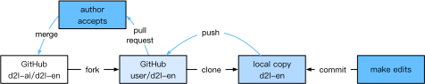
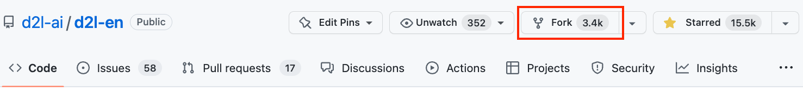
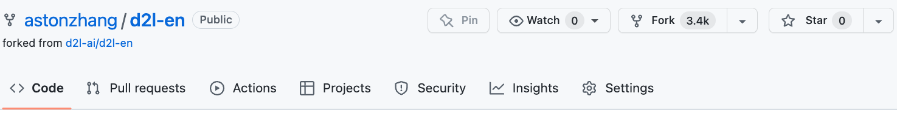
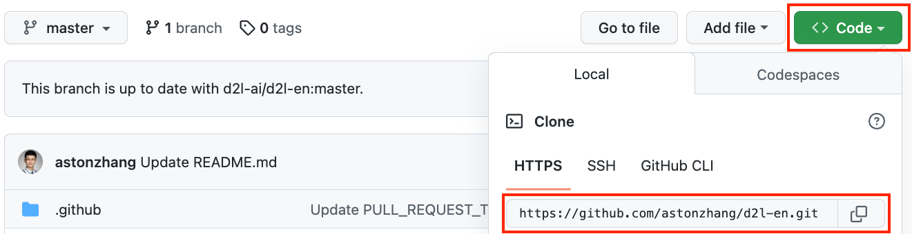
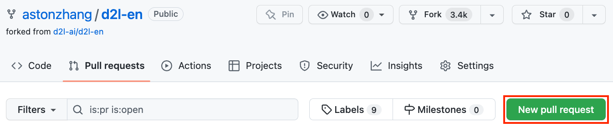
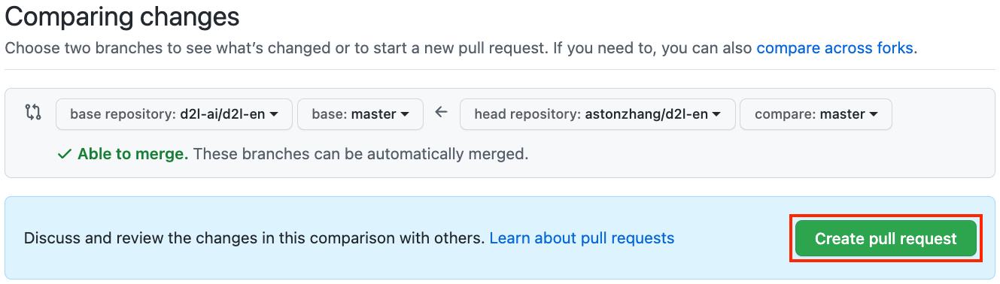

# 为本书做贡献
:label:`sec_how_to_contribute`

[读者](https://github.com/d2l-ai/d2l-en/graphs/contributors)的贡献帮助我们改进本书。如果你发现错别字、过时的链接、你认为我们遗漏了文献引用的地方、代码看起来不够优雅的地方，或者解释不清楚的地方，请回馈贡献，帮助我们帮助读者。在普通图书中，两次印刷之间的延迟（因而错别字修正之间的延迟）可以以年计，而在本书中，纳入一项改进通常只需要几小时到几天。这一切都得益于版本控制和持续集成（CI）测试。为此，你需要向GitHub 仓库提交一个[拉取请求](https://github.com/d2l-ai/d2l-en/pulls)（pull request）。当你的拉取请求被作者合并到代码仓库后，你就成为一名贡献者。

## 提交小改动

最常见的贡献是修改一句话或修正错别字。我们建议你在[GitHub 仓库](https://github.com/d2l-ai/d2l-en)中找到源文件并直接编辑该文件。例如，你可以通过[Find file](https://github.com/d2l-ai/d2l-en/find/master)按钮（:numref:`fig_edit_file`）搜索文件，以定位源文件（一个markdown 文件）。然后点击右上角的“Edit this file”按钮，在markdown 文件中进行修改。


:width:`300px`
:label:`fig_edit_file`

完成之后，在页面底部的“Propose file change”面板中填写你的改动说明，然后点击“Propose file change”按钮。页面会跳转到一个新页面，供你审阅自己的改动（:numref:`fig_git_createpr`）。如果一切无误，点击“Create pull request”按钮即可提交拉取请求。

## 提议重大改动

如果你计划更新大部分文本或代码，那么需要多了解一些本书使用的格式。源文件基于[markdown 格式](https://daringfireball.net/projects/markdown/syntax)，并通过[D2L-Book](http://book.d2l.ai/user/markdown.html)包提供了一组扩展，例如引用公式、图像、章节和文献。你可以使用任意markdown 编辑器打开这些文件并进行修改。

如果你想修改代码，我们建议你按照 :numref:`sec_jupyter` 所述，使用Jupyter 笔记本打开这些markdown 文件，以便运行并测试你的改动。请记住，在提交改动之前清除所有输出，因为我们的CI 系统会执行你更新的小节以生成输出。

有些小节可能支持多种框架实现。
如果你添加新的代码块，请使用`%%tab`在代码块的第一行标记它。例如，
对于PyTorch 代码块使用`%%tab pytorch`，对于TensorFlow 代码块使用`%%tab tensorflow`，或者对于所有实现的共享代码块使用`%%tab all`。更多信息可以参阅`d2lbook`包。

## 提交重大改动

我们建议你使用标准的Git 流程提交重大改动。简而言之，该流程如 :numref:`fig_contribute` 所述。


:label:`fig_contribute`

我们将带你详细走过这些步骤。如果你已经熟悉Git，可以跳过本节。为具体起见，我们假设贡献者的用户名是“astonzhang”。

### 安装Git

Git 开源书介绍了[如何安装 Git](https://git-scm.com/book/en/v2)。在 Ubuntu Linux 上通常可以通过`apt install git`来完成，在 macOS 上可以安装 Xcode 开发者工具，或者使用 GitHub 的[桌面客户端](https://desktop.github.com)。如果你没有 GitHub 账号，就需要注册一个。

### 登录GitHub

在浏览器中输入本书代码仓库的[地址](https://github.com/d2l-ai/d2l-en/)。点击 :numref:`fig_git_fork` 右上角红框中的`Fork`按钮，即可复制本书的仓库。现在这是*你的副本*，你可以随意修改它。


:width:`700px`
:label:`fig_git_fork`


现在，本书的代码仓库会被复刻（即复制）到你的用户名下，例如 :numref:`fig_git_forked` 左上角显示的`astonzhang/d2l-en`。


:width:`700px`
:label:`fig_git_forked`

### 克隆仓库

要克隆仓库（即创建一个本地副本），我们需要获取其仓库地址。:numref:`fig_git_clone` 中的绿色按钮显示了该地址。如果你决定长期保留这个复刻，请确保你的本地副本与主仓库保持同步。目前，只需按照 :ref:`chap_installation` 中的说明开始即可。主要区别在于，你现在下载的是仓库的*你自己的复刻*。


:width:`700px`
:label:`fig_git_clone`

```
# Replace your_github_username with your GitHub username
git clone https://github.com/your_github_username/d2l-en.git
```


### 编辑并推送

现在该编辑本书了。最好按照 :numref:`sec_jupyter` 中的说明在 Jupyter 笔记本中编辑。完成修改并确认无误。假设我们修改了文件`~/d2l-en/chapter_appendix-tools-for-deep-learning/contributing.md`中的一个错别字。
然后，你可以查看自己修改了哪些文件。

此时，Git 会提示`chapter_appendix-tools-for-deep-learning/contributing.md`文件已被修改。

```
mylaptop:d2l-en me$ git status
On branch master
Your branch is up-to-date with 'origin/master'.

Changes not staged for commit:
  (use "git add <file>..." to update what will be committed)
  (use "git checkout -- <file>..." to discard changes in working directory)

	modified:   chapter_appendix-tools-for-deep-learning/contributing.md
```


确认这正是你想要的之后，执行以下命令：

```
git add chapter_appendix-tools-for-deep-learning/contributing.md
git commit -m 'Fix a typo in git documentation'
git push
```


改动后的代码随后会出现在你个人的仓库复刻中。要请求加入你的改动，你必须为本书的官方仓库创建一个拉取请求。

### 提交拉取请求

如 :numref:`fig_git_newpr` 所示，在 GitHub 上进入你复刻的仓库并选择“New pull request”。这会打开一个页面，显示你的改动与本书主仓库当前内容之间的差异。


:width:`700px`
:label:`fig_git_newpr`


最后，点击 :numref:`fig_git_createpr` 所示的按钮提交拉取请求。请务必在拉取请求中描述你所做的改动。
这会让作者更容易审阅并将其合并到书中。根据改动的不同，它可能立即被接受、被拒绝，或者更可能的是，你会得到一些关于改动的反馈。一旦你采纳了这些反馈，就可以继续推进了。


:width:`700px`
:label:`fig_git_createpr`


## 小结

* 你可以使用GitHub 为本书做贡献。
* 对于小改动，你可以直接在GitHub 上编辑文件。
* 对于重大改动，请复刻仓库、在本地编辑，并在准备就绪后再回馈贡献。
* 拉取请求是汇集贡献的方式。尽量不要提交巨大的拉取请求，因为这会让它难以理解和合并。最好提交几个较小的拉取请求。


## 练习

1. 为`d2l-ai/d2l-en`仓库加星标并复刻它。
1. 如果你发现任何需要改进的地方（例如缺少文献引用），请提交拉取请求。
1. 通常更好的做法是使用新的分支创建拉取请求。请通过[Git 分支](https://git-scm.com/book/en/v2/Git-Branching-Branches-in-a-Nutshell)学习如何操作。

[讨论](https://discuss.d2l.ai/t/426)
