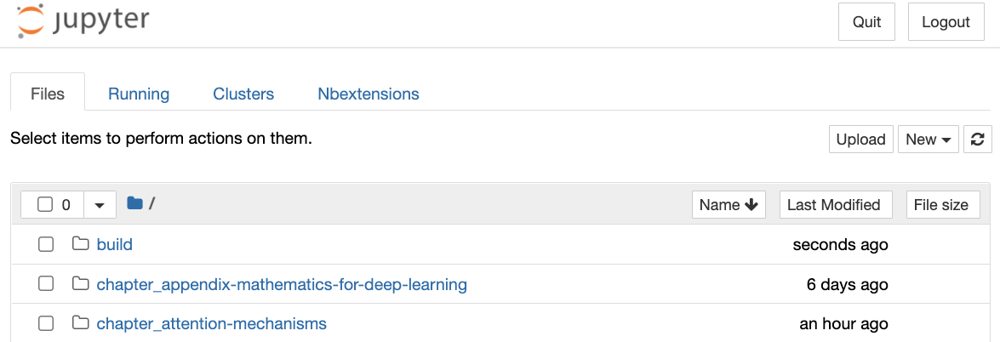
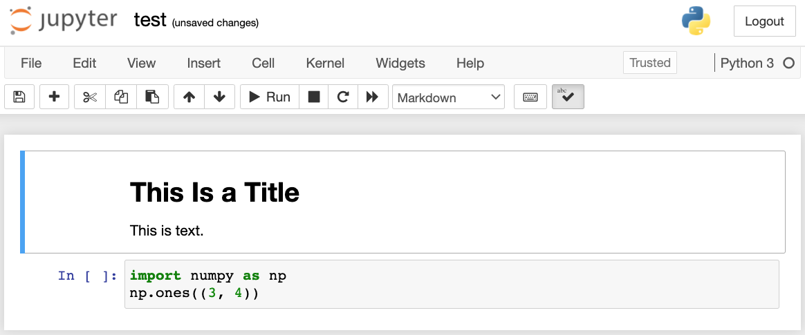
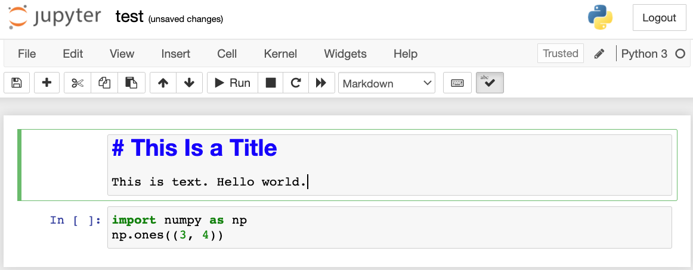
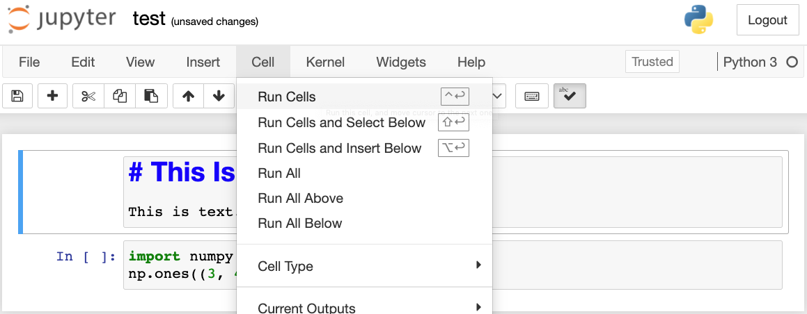
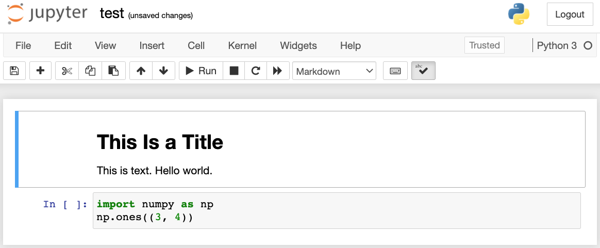
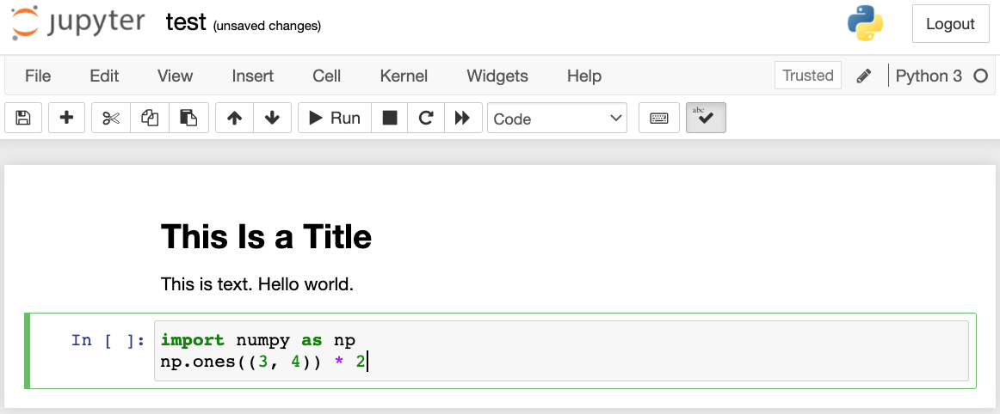
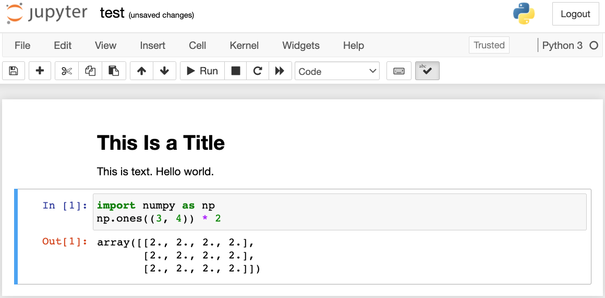

# 使用Jupyter 笔记本
:label:`sec_jupyter`


本节介绍如何使用Jupyter 笔记本编辑和运行本书各节的代码。
请确保你已按照 :ref:`chap_installation` 中的说明安装好Jupyter 并下载了代码。
如果想进一步了解Jupyter，请参阅其[文档](https://jupyter.readthedocs.io/en/latest/)中出色的教程。


## 在本地编辑和运行代码

假设本书代码的本地路径为`xx/yy/d2l-en/`。在 shell 中将目录切换到该路径（`cd xx/yy/d2l-en`），然后运行命令`jupyter notebook`。如果你的浏览器没有自动执行这一操作，请打开 http://localhost:8888，你将看到Jupyter 的界面以及所有包含本书代码的文件夹，如 :numref:`fig_jupyter00` 所示。


:width:`600px`
:label:`fig_jupyter00`


点击网页上显示的文件夹即可访问笔记本文件。这些文件通常带有后缀“.ipynb”。为简洁起见，我们创建一个临时的“test.ipynb”文件。点击该文件后显示的内容如 :numref:`fig_jupyter01` 所示。这个笔记本包含一个Markdown 单元格和一个代码单元格。Markdown 单元格的内容包括“This Is a Title”和“This is text.”。代码单元格包含两行Python代码。


:width:`600px`
:label:`fig_jupyter01`


双击Markdown 单元格即可进入编辑模式。在单元格末尾添加一个新的文本字符串“Hello world.”，如 :numref:`fig_jupyter02` 所示。


:width:`600px`
:label:`fig_jupyter02`


如 :numref:`fig_jupyter03` 所示，点击菜单栏中的“Cell”$\rightarrow$“Run Cells”即可运行编辑后的单元格。


:width:`600px`
:label:`fig_jupyter03`

运行后，Markdown 单元格如 :numref:`fig_jupyter04` 所示。


:width:`600px`
:label:`fig_jupyter04`


接下来，点击代码单元格。在最后一行代码之后将各元素乘以2，如 :numref:`fig_jupyter05` 所示。


:width:`600px`
:label:`fig_jupyter05`


你也可以用快捷键（默认为“Ctrl + Enter”）运行单元格，并从 :numref:`fig_jupyter06` 中获得输出结果。


:width:`600px`
:label:`fig_jupyter06`


当一个笔记本包含更多单元格时，我们可以点击菜单栏中的“Kernel”$\rightarrow$“Restart & Run All”来运行整个笔记本中的所有单元格。点击菜单栏中的“Help”$\rightarrow$“Edit Keyboard Shortcuts”，即可按你的偏好编辑快捷键。

## 高级选项

除本地编辑之外，还有两件事相当重要：以Markdown 格式编辑笔记本，以及远程运行Jupyter。当我们想在更快的服务器上运行代码时，后者就显得很重要。前者之所以重要，是因为Jupyter 原生的ipynb 格式会存储大量与内容无关的辅助数据，这些数据大多与代码的运行方式和运行位置有关。这会让Git 感到困惑，使审阅贡献变得非常困难。幸运的是，还有一种替代方案——以Markdown 格式进行原生编辑。

### Jupyter 中的Markdown 文件

如果你希望为本书内容做出贡献，就需要在GitHub 上修改源文件（md 文件，而不是ipynb 文件）。借助notedown 插件，我们可以直接在Jupyter 中修改md 格式的笔记本。


首先，安装notedown 插件，运行Jupyter 笔记本并加载该插件：

```
pip install d2l-notedown  # You may need to uninstall the original notedown.
jupyter notebook --NotebookApp.contents_manager_class='notedown.NotedownContentsManager'
```


你也可以让Jupyter 笔记本在每次运行时默认开启notedown 插件。首先，生成一个Jupyter 笔记本配置文件（如果已经生成过，可以跳过这一步）。

```
jupyter notebook --generate-config
```


然后，在Jupyter 笔记本配置文件的末尾添加以下行（对于Linux 或macOS，该文件通常位于路径`~/.jupyter/jupyter_notebook_config.py`）：

```
c.NotebookApp.contents_manager_class = 'notedown.NotedownContentsManager'
```


此后，你只需运行`jupyter notebook`命令，即可默认开启notedown 插件。

### 在远程服务器上运行Jupyter 笔记本

有时，你可能想在远程服务器上运行Jupyter 笔记本，并通过本地计算机上的浏览器访问它。如果你的本地计算机安装了Linux 或macOS（Windows 也可以借助PuTTY 等第三方软件支持这一功能），就可以使用端口转发：

```
ssh myserver -L 8888:localhost:8888
```


上面的字符串`myserver`是远程服务器的地址。然后，我们就可以通过 http://localhost:8888 访问运行Jupyter 笔记本的远程服务器`myserver`。本附录后面将详细介绍如何在AWS 实例上运行Jupyter 笔记本。

### 执行时间

我们可以使用`ExecuteTime`插件为Jupyter 笔记本中每个代码单元格的执行计时。使用以下命令安装该插件：

```
pip install jupyter_contrib_nbextensions
jupyter contrib nbextension install --user
jupyter nbextension enable execute_time/ExecuteTime
```


## 小结

* 借助Jupyter 笔记本工具，我们可以编辑、运行本书的每一节，并为其做出贡献。
* 我们可以使用端口转发在远程服务器上运行Jupyter 笔记本。


## 练习

1. 在本地计算机上使用Jupyter 笔记本编辑并运行本书中的代码。
1. 通过端口转发*远程*使用Jupyter 笔记本编辑并运行本书中的代码。
1. 对于$\mathbb{R}^{1024 \times 1024}$中的两个方阵，比较运算$\mathbf{A}^\top \mathbf{B}$和$\mathbf{A} \mathbf{B}$的运行时间。哪一个更快？


[讨论](https://discuss.d2l.ai/t/421)
