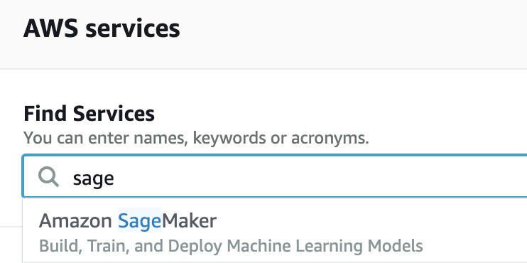
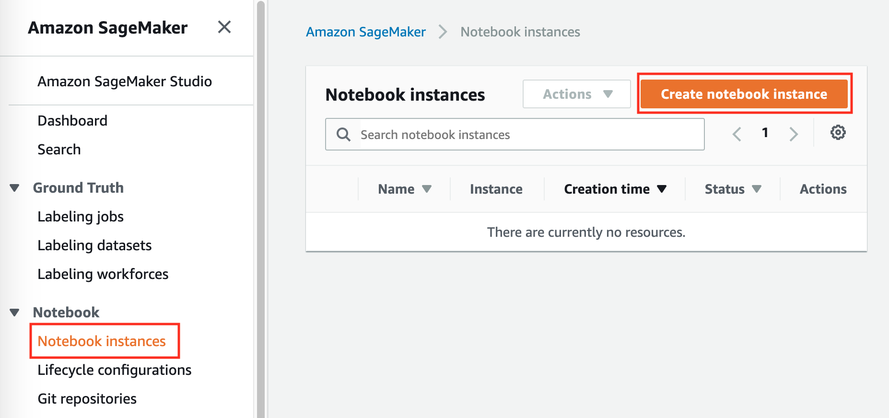
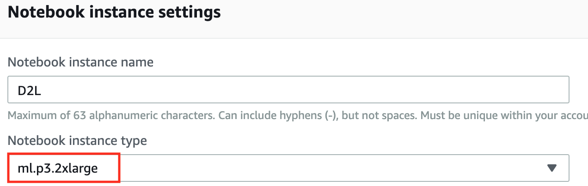
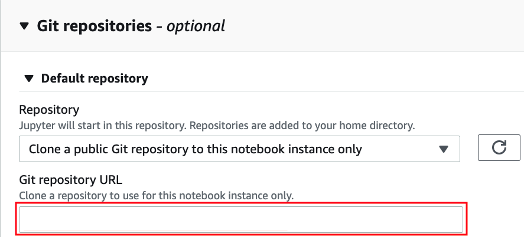
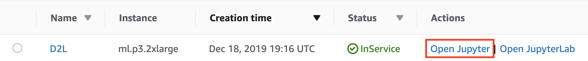
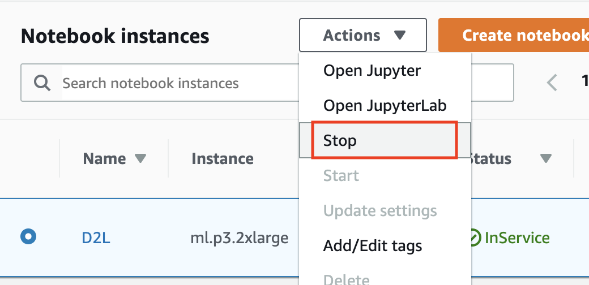
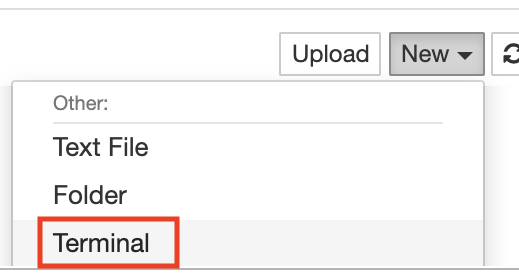

# 使用Amazon SageMaker
:label:`sec_sagemaker`

深度学习应用可能需要大量计算资源，
这些资源很容易超出本地机器所能提供的范围。
云计算服务让你能够借助更强大的计算机，
更轻松地运行本书中需要大量GPU 计算的代码。
本节将介绍如何使用Amazon SageMaker
运行本书的代码。

## 注册

首先，我们需要在 https://aws.amazon.com/ 注册一个账号。
为了增强安全性，建议使用双重身份验证。
此外，最好设置详细的账单和支出提醒，以免出现意外，
例如忘记停止正在运行的实例。
登录AWS 账号后，进入你的[控制台](http://console.aws.amazon.com/)并搜索“Amazon SageMaker”（见 :numref:`fig_sagemaker`），
然后点击它打开SageMaker 面板。


:width:`300px`
:label:`fig_sagemaker`

## 创建SageMaker 实例

接下来，我们按照 :numref:`fig_sagemaker-create` 所述创建一个笔记本实例。


:width:`400px`
:label:`fig_sagemaker-create`

SageMaker 提供多种[实例类型](https://aws.amazon.com/sagemaker/pricing/instance-types/)，它们的计算能力和价格各不相同。
创建笔记本实例时，我们可以指定实例的名称和类型。
在 :numref:`fig_sagemaker-create-2` 中，我们选择`ml.p3.2xlarge`：该实例配备一块Tesla V100 GPU 和一个8 核CPU，对于本书的大部分内容来说已经足够强大。


:width:`400px`
:label:`fig_sagemaker-create-2`

:begin_tab:`mxnet`
用于在SageMaker 上运行的ipynb 格式的整本书可在 https://github.com/d2l-ai/d2l-en-sagemaker 获取。我们可以指定这个GitHub 仓库URL（:numref:`fig_sagemaker-create-3`），让SageMaker 在创建实例时克隆它。
:end_tab:

:begin_tab:`pytorch`
用于在SageMaker 上运行的ipynb 格式的整本书可在 https://github.com/d2l-ai/d2l-pytorch-sagemaker 获取。我们可以指定这个GitHub 仓库URL（:numref:`fig_sagemaker-create-3`），让SageMaker 在创建实例时克隆它。
:end_tab:

:begin_tab:`tensorflow`
用于在SageMaker 上运行的ipynb 格式的整本书可在 https://github.com/d2l-ai/d2l-tensorflow-sagemaker 获取。我们可以指定这个GitHub 仓库URL（:numref:`fig_sagemaker-create-3`），让SageMaker 在创建实例时克隆它。
:end_tab:


:width:`400px`
:label:`fig_sagemaker-create-3`

## 运行和停止实例

创建实例可能需要几分钟时间。
实例就绪后，点击它旁边的“Open Jupyter”链接（:numref:`fig_sagemaker-open`），即可在该实例上
编辑并运行本书的所有Jupyter 笔记本
（与 :numref:`sec_jupyter` 中的步骤类似）。


:width:`400px`
:label:`fig_sagemaker-open`


完成工作后，不要忘记停止该实例，以免继续产生费用（:numref:`fig_sagemaker-stop`）。


:width:`300px`
:label:`fig_sagemaker-stop`

## 更新笔记本

:begin_tab:`mxnet`
这本开源图书的笔记本会在GitHub 的[d2l-ai/d2l-en-sagemaker](https://github.com/d2l-ai/d2l-en-sagemaker)仓库中定期更新。
要更新到最新版本，
你可以在SageMaker 实例上打开终端（:numref:`fig_sagemaker-terminal`）。
:end_tab:

:begin_tab:`pytorch`
这本开源图书的笔记本会在GitHub 的[d2l-ai/d2l-pytorch-sagemaker](https://github.com/d2l-ai/d2l-pytorch-sagemaker)仓库中定期更新。
要更新到最新版本，
你可以在SageMaker 实例上打开终端（:numref:`fig_sagemaker-terminal`）。
:end_tab:


:begin_tab:`tensorflow`
这本开源图书的笔记本会在GitHub 的[d2l-ai/d2l-tensorflow-sagemaker](https://github.com/d2l-ai/d2l-tensorflow-sagemaker)仓库中定期更新。
要更新到最新版本，
你可以在SageMaker 实例上打开终端（:numref:`fig_sagemaker-terminal`）。
:end_tab:



:width:`300px`
:label:`fig_sagemaker-terminal`

从远程仓库拉取更新之前，你或许希望先提交本地改动。
否则，只需在终端中执行以下命令，丢弃所有本地改动：

:begin_tab:`mxnet`

```bash
cd SageMaker/d2l-en-sagemaker/
git reset --hard
git pull
```


:end_tab:

:begin_tab:`pytorch`

```bash
cd SageMaker/d2l-pytorch-sagemaker/
git reset --hard
git pull
```


:end_tab:

:begin_tab:`tensorflow`

```bash
cd SageMaker/d2l-tensorflow-sagemaker/
git reset --hard
git pull
```


:end_tab:

## 小结

* 我们可以使用Amazon SageMaker 创建笔记本实例，以运行本书中需要大量GPU 计算的代码。
* 我们可以通过Amazon SageMaker 实例上的终端更新笔记本。


## 练习


1. 使用Amazon SageMaker 编辑并运行任何需要GPU 的小节。
1. 打开终端，访问存放本书所有笔记本的本地目录。


[讨论](https://discuss.d2l.ai/t/422)
