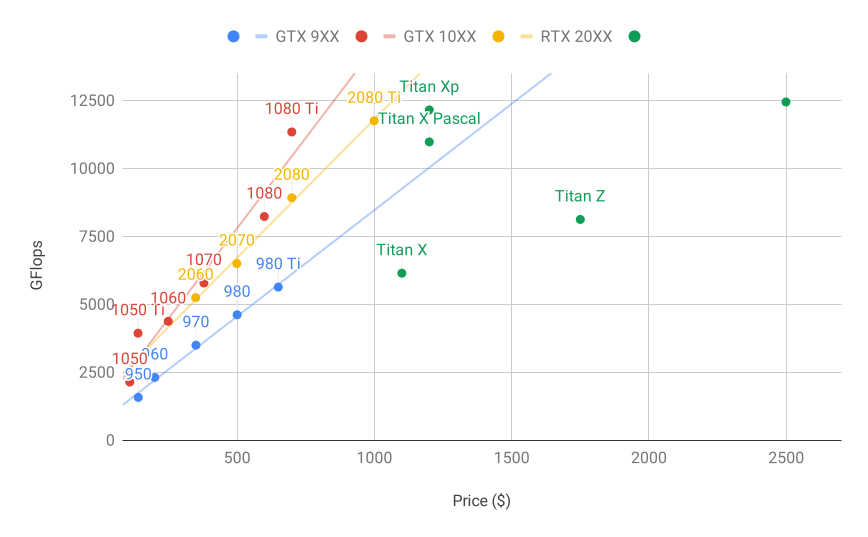
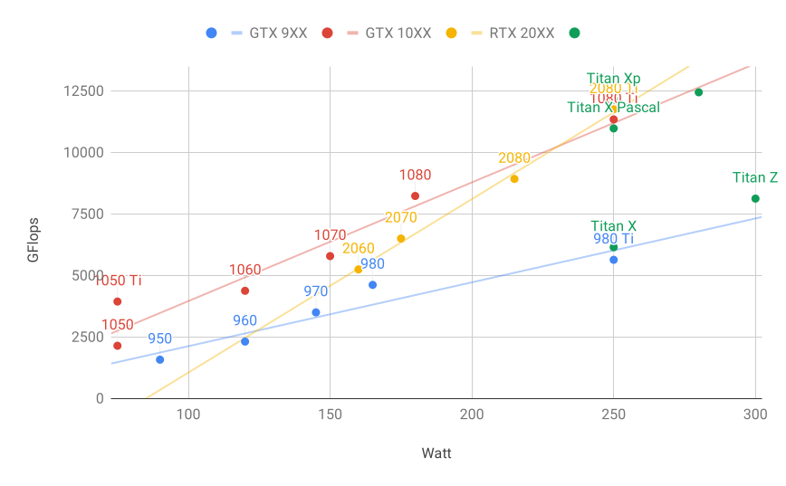

# 选择服务器和GPU
:label:`sec_buy_gpu`

深度学习训练通常需要大量计算。目前，GPU 是深度学习性价比最高的硬件加速器。具体来说，与 CPU 相比，GPU 更便宜且性能更高，往往高出一个数量级以上。此外，一台服务器可以支持多块 GPU，高端服务器最多可支持 8 块。更典型的数字是工程工作站最多 4 块 GPU，因为散热、制冷和供电需求会迅速超出办公楼所能支持的范围。对于更大规模的部署，云计算（例如亚马逊的 [P3](https://aws.amazon.com/ec2/instance-types/p3/) 和 [G4](https://aws.amazon.com/blogs/aws/in-the-works-ec2-instances-g4-with-nvidia-t4-gpus/) 实例）是实用得多的方案。

## 选择服务器

通常没有必要购买多线程的高端 CPU，因为大部分计算都发生在 GPU 上。话虽如此，由于 Python 中存在全局解释器锁（GIL），当我们有 4~8 块 GPU 时，CPU 的单线程性能可能就会有影响。在其他条件相同的情况下，这说明核心数较少但时钟频率较高的 CPU 可能是更经济的选择。例如，在 6 核 4 GHz 和 8 核 3.5 GHz 的 CPU 之间选择时，前者要好得多，尽管其总体速度较低。
一个重要考虑因素是 GPU 耗电量大，因此散热量也大。这要求非常好的散热，以及足够大的机箱来容纳 GPU。如果可能的话，请遵循以下准则：

1. **电源**。GPU 耗电量很大。预算按每块设备最高 350W 计算（请检查显卡的*峰值需求*而不是典型需求，因为高效的代码可能会消耗大量能量）。如果电源功率不足以满足需求，你就会发现系统变得不稳定。
1. **机箱尺寸**。GPU 体积大，辅助电源接口往往需要额外的空间。此外，大机箱更容易散热。
1. **GPU 散热**。如果你有大量 GPU，可能需要考虑水冷。此外，应选择*公版设计*，即使风扇较少也无妨，因为公版足够薄，可以在设备之间留出进风空间。如果你购买多风扇 GPU，安装多块 GPU 时它可能太厚而无法获得足够的空气，从而导致过热降频。
1. **PCIe 插槽**。将数据移入和移出 GPU（以及在 GPU 之间交换数据）需要大量带宽。我们推荐具有 16 条通道的 PCIe 3.0 插槽。如果你安装多块 GPU，请务必仔细阅读主板说明，确保同时使用多块 GPU 时仍能提供 16$\times$ 带宽，并确保额外插槽提供的是 PCIe 3.0 而不是 PCIe 2.0。有些主板在安装多块 GPU 后会降级到 8$\times$ 甚至 4$\times$ 带宽。这在一定程度上是由于 CPU 提供的 PCIe 通道数量有限。

简而言之，以下是搭建深度学习服务器的一些建议：

* **入门级**。购买一块低功耗的低端 GPU（适合深度学习的廉价游戏 GPU 功耗为 150~200W）。如果运气好，你当前的计算机就能支持它。
* **1 块 GPU**。4 核低端 CPU 就足够了，大多数主板也能满足要求。目标至少 32 GB DRAM，并投资一块 SSD 用于本地数据访问。600W 的电源应该足够。购买风扇较多的 GPU。
* **2 块 GPU**。4~6 核的低端 CPU 就足够了。目标 64 GB DRAM，并投资一块 SSD。两块高端 GPU 需要 1000W 左右的电源。就主板而言，请确保它有*两个* PCIe 3.0 x16 插槽。如果可能，请选择在两个 PCIe 3.0 x16 插槽之间留有两个空位（间距 60mm）的主板，以便增加进风。在这种情况下，请购买两块风扇较多的 GPU。
* **4 块 GPU**。请确保购买单线程速度相对较快的 CPU（即高时钟频率）。你可能需要一个具有较多 PCIe 通道的 CPU，例如 AMD Threadripper。你很可能需要相对昂贵的主板才能获得 4 个 PCIe 3.0 x16 插槽，因为它们可能需要 PLX 芯片来复用 PCIe 通道。购买采用公版设计、较窄且能让空气在 GPU 之间流通的 GPU。你需要 1600~2000W 的电源，而你办公室的插座可能不支持。这台服务器运行时可能*又吵又热*。你不会想把它放在桌子下面。建议配备 128 GB DRAM。准备一块 SSD（1~2 TB NVMe）用于本地存储，并配一组以 RAID 配置的硬盘来存储数据。
* **8 块 GPU**。你需要购买专用的多 GPU 服务器机箱，配备多个冗余电源（例如 2+1 冗余，每个电源 1600W）。这需要双路服务器 CPU、256 GB ECC DRAM、一块快速网卡（推荐 10 GBE），你还需要检查服务器是否支持 GPU 的*物理外形尺寸*。消费级 GPU 与服务器 GPU（例如 RTX 2080 与 Tesla V100）的风道和布线位置差异很大。这意味着你可能无法把消费级 GPU 安装到服务器中，因为电源线的间隙不足，或者缺少合适的线束（这是本书一位合著者的痛苦经历）。

## 选择GPU

目前，AMD 和 NVIDIA 是独立 GPU 的两大主要制造商。NVIDIA 最早进入深度学习领域，并通过 CUDA 为深度学习框架提供更好的支持。因此，大多数购买者选择 NVIDIA GPU。

NVIDIA 提供两类 GPU，分别面向个人用户（例如 GTX 和 RTX 系列）和企业用户（通过 Tesla 系列）。这两类 GPU 的计算能力相当。不过，企业级 GPU 通常采用（被动式）强制风冷、更大的显存以及 ECC（纠错）内存。这些 GPU 更适合数据中心，价格通常比消费级 GPU 贵十倍。

如果你是拥有 100 台以上服务器的大公司，应当考虑 NVIDIA Tesla 系列，或者改用云端的 GPU 服务器。对于拥有 10 台以上服务器的实验室或中小型公司，NVIDIA RTX 系列可能是最具成本效益的。你可以购买采用 Supermicro 或 Asus 机箱的预配置服务器，这类机箱能高效容纳 4~8 块 GPU。

GPU 厂商通常每一到两年发布一代新产品，例如 2017 年发布的 GTX 1000（Pascal）系列和 2019 年发布的 RTX 2000（Turing）系列。每个系列都提供多种不同型号，性能水平各不相同。GPU 性能主要取决于以下三个参数的组合：

1. **计算能力**。我们通常关注 32 位浮点计算能力。16 位浮点训练（FP16）也正在进入主流。如果你只关心预测，也可以使用 8 位整数。最新一代 Turing GPU 提供 4 位加速。遗憾的是，在本书撰写时，用于训练低精度网络的算法尚未普及。
1. **显存大小**。随着模型变大或训练时使用的批量变大，你将需要更多 GPU 显存。注意区分 HBM2（高带宽内存）和 GDDR6（图形 DDR）显存。HBM2 更快，但也贵得多。
1. **显存带宽**。只有拥有足够的显存带宽，你才能充分发挥计算能力。如果使用 GDDR6，请留意较宽的内存总线。

对大多数用户来说，看计算能力就足够了。请注意，许多 GPU 提供不同类型的加速。例如，NVIDIA 的 TensorCore（张量核心）能将一部分运算符加速 5$\times$。请确保你的库支持这种加速。GPU 显存不应少于 4 GB（8 GB 要好得多）。尽量避免让 GPU 同时用于显示图形用户界面（改用集成显卡）。如果无法避免，请额外增加 2 GB 内存以确保安全。

:numref:`fig_flopsvsprice` 比较了各种 GTX 900、GTX 1000 和 RTX 2000 系列型号的 32 位浮点计算能力和价格。图中给出的价格是撰写本书时维基百科上的价格。

:label:`fig_flopsvsprice`

我们可以从中看到几点：

1. 在每个系列内部，价格和性能大致成正比。Titan 型号因提供更大的 GPU 显存而有显著的溢价。不过，较新的型号具有更好的成本效益，比较 980 Ti 和 1080 Ti 即可看出这一点。RTX 2000 系列的价格似乎没有改善多少。然而，这是因为它们提供了远为优越的低精度性能（FP16、INT8 和 INT4）。
2. GTX 1000 系列的性价比大约是 900 系列的两倍。
3. 对于 RTX 2000 系列，性能（以 GFLOPs 计）是价格的*仿射*函数。

:label:`fig_wattvsprice`

:numref:`fig_wattvsprice` 表明，能耗大多随计算量的增加而线性增长。其次，较晚的几代产品能效更高。这似乎与 RTX 2000 系列对应的图相矛盾。不过，这是 TensorCore 功耗高得不成比例所导致的。

## 小结

* 搭建服务器时，要注意电源、PCIe 总线通道、CPU 单线程速度和散热。
* 如果可能，应当购买最新一代的 GPU。
* 大规模部署应使用云端。
* 高密度服务器可能无法兼容所有 GPU。购买前请检查机械和散热规格。
* 为了获得高效率，请使用 FP16 或更低精度。

[讨论](https://discuss.d2l.ai/t/425)
