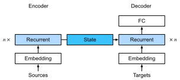
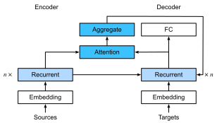

```{.python .input}
%load_ext d2lbook.tab
tab.interact_select('mxnet', 'pytorch', 'tensorflow', 'jax')
```

# Bahdanau 注意力机制
:label:`sec_seq2seq_attention`

在 :numref:`sec_seq2seq` 中接触机器翻译时，
我们设计了基于两个 RNN 的编码器-解码器架构
来进行序列到序列学习 :cite:`Sutskever.Vinyals.Le.2014`。
具体来说，RNN 编码器把变长序列
变换为*形状固定*的上下文变量。
然后，RNN 解码器根据已生成的词元
和该上下文变量，
逐词元地生成输出（目标）序列。

回想 :numref:`fig_seq2seq_details`，我们在此
（:numref:`fig_s2s_attention_state`）重复该图并补充一些细节。按惯例，在 RNN 中，编码器会把关于源序列的所有相关信息转换到某个内部的*固定维数*状态表示中。解码器正是把这一状态作为生成翻译序列的完整且唯一的信息来源。换言之，序列到序列机制把中间状态视为可能作为输入的任意字符串的充分统计量。


:label:`fig_s2s_attention_state`

对于短序列而言这相当合理，
但对于长序列（例如一本书的一章，
甚至只是一个很长的句子）显然不可行。
毕竟，用不了多久，
中间表示中就没有足够的“空间”
来存储源序列中所有重要的内容。
因此，解码器将无法翻译长而复杂的句子。
最早遇到这一问题的人之一是 :citet:`Graves.2013`，
他试图设计一个 RNN 来生成手写文本。
由于源文本长度任意，
他们设计了一个可微的注意力模型，
把文本字符与长得多的笔迹轨迹对齐，
其中对齐只朝一个方向移动。
这反过来又借鉴了语音识别中的解码算法，
例如隐马尔可夫模型 :cite:`rabiner1993fundamentals`。

受“学习对齐”这一思想的启发，
:citet:`Bahdanau.Cho.Bengio.2014` 提出了一个*不带*
单向对齐限制的可微注意力模型。
在预测一个词元时，
如果并非所有输入词元都相关，
模型就只对齐（或关注）输入序列中
被认为与当前预测相关的部分。
随后，这被用于在生成下一个词元之前更新当前状态。
尽管描述起来相当不起眼，
这一*Bahdanau 注意力机制*可以说已成为
过去十年深度学习中最具影响力的思想之一，
催生了 Transformer :cite:`Vaswani.Shazeer.Parmar.ea.2017`
以及许多相关的新架构。

```{.python .input}
%%tab mxnet
from d2l import mxnet as d2l
from mxnet import init, np, npx
from mxnet.gluon import rnn, nn
npx.set_np()
```

```{.python .input}
%%tab pytorch
from d2l import torch as d2l
import torch
from torch import nn
```

```{.python .input}
%%tab tensorflow
from d2l import tensorflow as d2l
import tensorflow as tf
```

```{.python .input}
%%tab jax
from d2l import jax as d2l
from flax import linen as nn
from jax import numpy as jnp
import jax
```

## 模型

我们沿用 :numref:`sec_seq2seq` 中序列到序列架构引入的记号，特别是 :eqref:`eq_seq2seq_s_t`。
关键思想是：状态（即汇总源句子的上下文变量$\mathbf{c}$）不再保持固定，而是作为原始文本（编码器隐藏状态$\mathbf{h}_{t}$）和已生成文本（解码器隐藏状态$\mathbf{s}_{t'-1}$）两者的函数被动态更新。这样得到$\mathbf{c}_{t'}$，它在任意解码时间步$t'$之后更新。假设输入序列的长度为$T$。此时，上下文变量就是注意力汇聚的输出：

$$\mathbf{c}_{t'} = \sum_{t=1}^{T} \alpha(\mathbf{s}_{t' - 1}, \mathbf{h}_{t}) \mathbf{h}_{t}.$$

我们用$\mathbf{s}_{t' - 1}$作为查询，用
$\mathbf{h}_{t}$同时作为键和值。请注意，$\mathbf{c}_{t'}$随后被用于生成状态$\mathbf{s}_{t'}$并生成一个新词元：见 :eqref:`eq_seq2seq_s_t`。特别地，注意力权重$\alpha$按照 :eqref:`eq_attn-scoring-alpha` 中那样，使用由 :eqref:`eq_additive-attn` 定义的加性注意力评分函数计算。使用注意力的这种 RNN 编码器-解码器架构如 :numref:`fig_s2s_attention_details` 所示。请注意，后来该模型被修改为把解码器中已生成的词元也作为进一步的上下文纳入进来（即注意力求和不再止于$T$，而是一直进行到$t'-1$）。例如，关于这一策略应用于语音识别的描述，参见 :citet:`chan2015listen`。


:label:`fig_s2s_attention_details`

## 定义带注意力的解码器

为了实现带注意力的 RNN 编码器-解码器，
我们只需要重新定义解码器
（从注意力函数中省略已生成的符号可以简化设计）。
我们从[**带注意力的解码器基接口**]入手，
定义一个名字毫不令人意外的`AttentionDecoder`类。

```{.python .input}
%%tab pytorch, mxnet, tensorflow
class AttentionDecoder(d2l.Decoder):  #@save
    """The base attention-based decoder interface."""
    def __init__(self):
        super().__init__()

    @property
    def attention_weights(self):
        raise NotImplementedError
```

我们需要在`Seq2SeqAttentionDecoder`类中
[**实现 RNN 解码器**]。
解码器的状态用以下内容初始化：
(i) 编码器最后一层在所有时间步上的隐藏状态，
用作注意力的键和值；
(ii) 编码器最终时间步所有层的隐藏状态，
用于初始化解码器的隐藏状态；
(iii) 编码器的有效长度，
用于在注意力汇聚中排除填充词元。
在每个解码时间步，
把上一时间步得到的解码器最后一层隐藏状态
用作注意力机制的查询。
注意力机制的输出与输入嵌入连结起来，
作为 RNN 解码器的输入。

```{.python .input}
%%tab mxnet
class Seq2SeqAttentionDecoder(AttentionDecoder):
    def __init__(self, vocab_size, embed_size, num_hiddens, num_layers,
                 dropout=0):
        super().__init__()
        self.attention = d2l.AdditiveAttention(num_hiddens, dropout)
        self.embedding = nn.Embedding(vocab_size, embed_size)
        self.rnn = rnn.GRU(num_hiddens, num_layers, dropout=dropout)
        self.dense = nn.Dense(vocab_size, flatten=False)
        self.initialize(init.Xavier())

    def init_state(self, enc_outputs, enc_valid_lens):
        # Shape of outputs: (num_steps, batch_size, num_hiddens).
        # Shape of hidden_state: (num_layers, batch_size, num_hiddens)
        outputs, hidden_state = enc_outputs
        return (outputs.swapaxes(0, 1), hidden_state, enc_valid_lens)

    def forward(self, X, state):
        # Shape of enc_outputs: (batch_size, num_steps, num_hiddens).
        # Shape of hidden_state: (num_layers, batch_size, num_hiddens)
        enc_outputs, hidden_state, enc_valid_lens = state
        # Shape of the output X: (num_steps, batch_size, embed_size)
        X = self.embedding(X).swapaxes(0, 1)
        outputs, self._attention_weights = [], []
        for x in X:
            # Shape of query: (batch_size, 1, num_hiddens)
            query = np.expand_dims(hidden_state[-1], axis=1)
            # Shape of context: (batch_size, 1, num_hiddens)
            context = self.attention(
                query, enc_outputs, enc_outputs, enc_valid_lens)
            # Concatenate on the feature dimension
            x = np.concatenate((context, np.expand_dims(x, axis=1)), axis=-1)
            # Reshape x as (1, batch_size, embed_size + num_hiddens)
            out, hidden_state = self.rnn(x.swapaxes(0, 1), hidden_state)
            hidden_state = hidden_state[0]
            outputs.append(out)
            self._attention_weights.append(self.attention.attention_weights)
        # After fully connected layer transformation, shape of outputs:
        # (num_steps, batch_size, vocab_size)
        outputs = self.dense(np.concatenate(outputs, axis=0))
        return outputs.swapaxes(0, 1), [enc_outputs, hidden_state,
                                        enc_valid_lens]

    @property
    def attention_weights(self):
        return self._attention_weights
```

```{.python .input}
%%tab pytorch
class Seq2SeqAttentionDecoder(AttentionDecoder):
    def __init__(self, vocab_size, embed_size, num_hiddens, num_layers,
                 dropout=0):
        super().__init__()
        self.attention = d2l.AdditiveAttention(num_hiddens, dropout)
        self.embedding = nn.Embedding(vocab_size, embed_size)
        self.rnn = nn.GRU(
            embed_size + num_hiddens, num_hiddens, num_layers,
            dropout=dropout)
        self.dense = nn.LazyLinear(vocab_size)
        self.apply(d2l.init_seq2seq)

    def init_state(self, enc_outputs, enc_valid_lens):
        # Shape of outputs: (num_steps, batch_size, num_hiddens).
        # Shape of hidden_state: (num_layers, batch_size, num_hiddens)
        outputs, hidden_state = enc_outputs
        return (outputs.permute(1, 0, 2), hidden_state, enc_valid_lens)

    def forward(self, X, state):
        # Shape of enc_outputs: (batch_size, num_steps, num_hiddens).
        # Shape of hidden_state: (num_layers, batch_size, num_hiddens)
        enc_outputs, hidden_state, enc_valid_lens = state
        # Shape of the output X: (num_steps, batch_size, embed_size)
        X = self.embedding(X).permute(1, 0, 2)
        outputs, self._attention_weights = [], []
        for x in X:
            # Shape of query: (batch_size, 1, num_hiddens)
            query = torch.unsqueeze(hidden_state[-1], dim=1)
            # Shape of context: (batch_size, 1, num_hiddens)
            context = self.attention(
                query, enc_outputs, enc_outputs, enc_valid_lens)
            # Concatenate on the feature dimension
            x = torch.cat((context, torch.unsqueeze(x, dim=1)), dim=-1)
            # Reshape x as (1, batch_size, embed_size + num_hiddens)
            out, hidden_state = self.rnn(x.permute(1, 0, 2), hidden_state)
            outputs.append(out)
            self._attention_weights.append(self.attention.attention_weights)
        # After fully connected layer transformation, shape of outputs:
        # (num_steps, batch_size, vocab_size)
        outputs = self.dense(torch.cat(outputs, dim=0))
        return outputs.permute(1, 0, 2), [enc_outputs, hidden_state,
                                          enc_valid_lens]

    @property
    def attention_weights(self):
        return self._attention_weights
```

```{.python .input}
%%tab tensorflow
class Seq2SeqAttentionDecoder(AttentionDecoder):
    def __init__(self, vocab_size, embed_size, num_hiddens, num_layers,
                 dropout=0):
        super().__init__()
        self.attention = d2l.AdditiveAttention(num_hiddens, num_hiddens,
                                               num_hiddens, dropout)
        self.embedding = tf.keras.layers.Embedding(vocab_size, embed_size)
        self.rnn = tf.keras.layers.RNN(tf.keras.layers.StackedRNNCells(
            [tf.keras.layers.GRUCell(num_hiddens, dropout=dropout)
             for _ in range(num_layers)]), return_sequences=True,
                                       return_state=True)
        self.dense = tf.keras.layers.Dense(vocab_size)

    def init_state(self, enc_outputs, enc_valid_lens):
        # Shape of outputs: (batch_size, num_steps, num_hiddens).
        # Length of list hidden_state is num_layers, where the shape of its
        # element is (batch_size, num_hiddens)
        outputs, hidden_state = enc_outputs
        return (tf.transpose(outputs, (1, 0, 2)), hidden_state,
                enc_valid_lens)

    def call(self, X, state, **kwargs):
        # Shape of output enc_outputs: # (batch_size, num_steps, num_hiddens)
        # Length of list hidden_state is num_layers, where the shape of its
        # element is (batch_size, num_hiddens)
        enc_outputs, hidden_state, enc_valid_lens = state
        # Shape of the output X: (num_steps, batch_size, embed_size)
        X = self.embedding(X)  # Input X has shape: (batch_size, num_steps)
        X = tf.transpose(X, perm=(1, 0, 2))
        outputs, self._attention_weights = [], []
        for x in X:
            # Shape of query: (batch_size, 1, num_hiddens)
            query = tf.expand_dims(hidden_state[-1], axis=1)
            # Shape of context: (batch_size, 1, num_hiddens)
            context = self.attention(query, enc_outputs, enc_outputs,
                                     enc_valid_lens, **kwargs)
            # Concatenate on the feature dimension
            x = tf.concat((context, tf.expand_dims(x, axis=1)), axis=-1)
            out = self.rnn(x, hidden_state, **kwargs)
            hidden_state = out[1:]
            outputs.append(out[0])
            self._attention_weights.append(self.attention.attention_weights)
        # After fully connected layer transformation, shape of outputs:
        # (batch_size, num_steps, vocab_size)
        outputs = self.dense(tf.concat(outputs, axis=1))
        return outputs, [enc_outputs, hidden_state, enc_valid_lens]

    @property
    def attention_weights(self):
        return self._attention_weights
```

```{.python .input}
%%tab jax
class Seq2SeqAttentionDecoder(nn.Module):
    vocab_size: int
    embed_size: int
    num_hiddens: int
    num_layers: int
    dropout: float = 0

    def setup(self):
        self.attention = d2l.AdditiveAttention(self.num_hiddens, self.dropout)
        self.embedding = nn.Embed(self.vocab_size, self.embed_size)
        self.dense = nn.Dense(self.vocab_size)
        self.rnn = d2l.GRU(num_hiddens, num_layers, dropout=self.dropout)

    def init_state(self, enc_outputs, enc_valid_lens, *args):
        # Shape of outputs: (num_steps, batch_size, num_hiddens).
        # Shape of hidden_state: (num_layers, batch_size, num_hiddens)
        outputs, hidden_state = enc_outputs
        # Attention Weights are returned as part of state; init with None
        return (outputs.transpose(1, 0, 2), hidden_state, enc_valid_lens)

    @nn.compact
    def __call__(self, X, state, training=False):
        # Shape of enc_outputs: (batch_size, num_steps, num_hiddens).
        # Shape of hidden_state: (num_layers, batch_size, num_hiddens)
        # Ignore Attention value in state
        enc_outputs, hidden_state, enc_valid_lens = state
        # Shape of the output X: (num_steps, batch_size, embed_size)
        X = self.embedding(X).transpose(1, 0, 2)
        outputs, attention_weights = [], []
        for x in X:
            # Shape of query: (batch_size, 1, num_hiddens)
            query = jnp.expand_dims(hidden_state[-1], axis=1)
            # Shape of context: (batch_size, 1, num_hiddens)
            context, attention_w = self.attention(query, enc_outputs,
                                                  enc_outputs, enc_valid_lens,
                                                  training=training)
            # Concatenate on the feature dimension
            x = jnp.concatenate((context, jnp.expand_dims(x, axis=1)), axis=-1)
            # Reshape x as (1, batch_size, embed_size + num_hiddens)
            out, hidden_state = self.rnn(x.transpose(1, 0, 2), hidden_state,
                                         training=training)
            outputs.append(out)
            attention_weights.append(attention_w)

        # Flax sow API is used to capture intermediate variables
        self.sow('intermediates', 'dec_attention_weights', attention_weights)

        # After fully connected layer transformation, shape of outputs:
        # (num_steps, batch_size, vocab_size)
        outputs = self.dense(jnp.concatenate(outputs, axis=0))
        return outputs.transpose(1, 0, 2), [enc_outputs, hidden_state,
                                            enc_valid_lens]
```

下面，我们[**测试所实现的
带注意力解码器**]，
使用由四个序列组成的小批量，
每个序列长度为七个时间步。

```{.python .input}
%%tab all
vocab_size, embed_size, num_hiddens, num_layers = 10, 8, 16, 2
batch_size, num_steps = 4, 7
encoder = d2l.Seq2SeqEncoder(vocab_size, embed_size, num_hiddens, num_layers)
decoder = Seq2SeqAttentionDecoder(vocab_size, embed_size, num_hiddens,
                                  num_layers)
if tab.selected('mxnet'):
    X = d2l.zeros((batch_size, num_steps))
    state = decoder.init_state(encoder(X), None)
    output, state = decoder(X, state)
if tab.selected('pytorch'):
    X = d2l.zeros((batch_size, num_steps), dtype=torch.long)
    state = decoder.init_state(encoder(X), None)
    output, state = decoder(X, state)
if tab.selected('tensorflow'):
    X = tf.zeros((batch_size, num_steps))
    state = decoder.init_state(encoder(X, training=False), None)
    output, state = decoder(X, state, training=False)
if tab.selected('jax'):
    X = jnp.zeros((batch_size, num_steps), dtype=jnp.int32)
    state = decoder.init_state(encoder.init_with_output(d2l.get_key(),
                                                        X, training=False)[0],
                               None)
    (output, state), _ = decoder.init_with_output(d2l.get_key(), X,
                                                  state, training=False)
d2l.check_shape(output, (batch_size, num_steps, vocab_size))
d2l.check_shape(state[0], (batch_size, num_steps, num_hiddens))
d2l.check_shape(state[1][0], (batch_size, num_hiddens))
```

## [**训练**]

既然我们已经指定了新的解码器，
就可以仿照 :numref:`sec_seq2seq_training` 进行：
指定超参数，
实例化一个普通的编码器和一个带注意力的解码器，
并训练该模型进行机器翻译。

```{.python .input}
%%tab all
data = d2l.MTFraEng(batch_size=128)
embed_size, num_hiddens, num_layers, dropout = 256, 256, 2, 0.2
if tab.selected('mxnet', 'pytorch', 'jax'):
    encoder = d2l.Seq2SeqEncoder(
        len(data.src_vocab), embed_size, num_hiddens, num_layers, dropout)
    decoder = Seq2SeqAttentionDecoder(
        len(data.tgt_vocab), embed_size, num_hiddens, num_layers, dropout)
if tab.selected('mxnet', 'pytorch'):
    model = d2l.Seq2Seq(encoder, decoder, tgt_pad=data.tgt_vocab['<pad>'],
                        lr=0.005)
if tab.selected('jax'):
    model = d2l.Seq2Seq(encoder, decoder, tgt_pad=data.tgt_vocab['<pad>'],
                        lr=0.005, training=True)
if tab.selected('mxnet', 'pytorch', 'jax'):
    trainer = d2l.Trainer(max_epochs=30, gradient_clip_val=1, num_gpus=1)
if tab.selected('tensorflow'):
    with d2l.try_gpu():
        encoder = d2l.Seq2SeqEncoder(
            len(data.src_vocab), embed_size, num_hiddens, num_layers, dropout)
        decoder = Seq2SeqAttentionDecoder(
            len(data.tgt_vocab), embed_size, num_hiddens, num_layers, dropout)
        model = d2l.Seq2Seq(encoder, decoder, tgt_pad=data.tgt_vocab['<pad>'],
                            lr=0.005)
    trainer = d2l.Trainer(max_epochs=30, gradient_clip_val=1)
trainer.fit(model, data)
```

模型训练完成后，
我们用它[**翻译几个英文句子**]
成法语，并计算它们的 BLEU 分数。

```{.python .input}
%%tab all
engs = ['go .', 'i lost .', 'he\'s calm .', 'i\'m home .']
fras = ['va !', 'j\'ai perdu .', 'il est calme .', 'je suis chez moi .']
if tab.selected('pytorch', 'mxnet', 'tensorflow'):
    preds, _ = model.predict_step(
        data.build(engs, fras), d2l.try_gpu(), data.num_steps)
if tab.selected('jax'):
    preds, _ = model.predict_step(
        trainer.state.params, data.build(engs, fras), data.num_steps)
for en, fr, p in zip(engs, fras, preds):
    translation = []
    for token in data.tgt_vocab.to_tokens(p):
        if token == '<eos>':
            break
        translation.append(token)
    print(f'{en} => {translation}, bleu,'
          f'{d2l.bleu(" ".join(translation), fr, k=2):.3f}')
```

让我们在翻译最后一个英文句子时
[**可视化注意力权重**]。
我们看到，每个查询
在键-值对上分配了非均匀的权重。
这表明，在每个解码步，
输入序列的不同部分
被选择性地聚合到注意力汇聚中。

```{.python .input}
%%tab all
if tab.selected('pytorch', 'mxnet', 'tensorflow'):
    _, dec_attention_weights = model.predict_step(
        data.build([engs[-1]], [fras[-1]]), d2l.try_gpu(), data.num_steps, True)
if tab.selected('jax'):
    _, (dec_attention_weights, _) = model.predict_step(
        trainer.state.params, data.build([engs[-1]], [fras[-1]]),
        data.num_steps, True)
attention_weights = d2l.concat(
    [step[0][0][0] for step in dec_attention_weights], 0)
attention_weights = d2l.reshape(attention_weights, (1, 1, -1, data.num_steps))
```

```{.python .input}
%%tab mxnet
# Plus one to include the end-of-sequence token
d2l.show_heatmaps(
    attention_weights[:, :, :, :len(engs[-1].split()) + 1],
    xlabel='Key positions', ylabel='Query positions')
```

```{.python .input}
%%tab pytorch
# Plus one to include the end-of-sequence token
d2l.show_heatmaps(
    attention_weights[:, :, :, :len(engs[-1].split()) + 1].cpu(),
    xlabel='Key positions', ylabel='Query positions')
```

```{.python .input}
%%tab tensorflow
# Plus one to include the end-of-sequence token
d2l.show_heatmaps(attention_weights[:, :, :, :len(engs[-1].split()) + 1],
                  xlabel='Key positions', ylabel='Query positions')
```

```{.python .input}
%%tab jax
# Plus one to include the end-of-sequence token
d2l.show_heatmaps(attention_weights[:, :, :, :len(engs[-1].split()) + 1],
                  xlabel='Key positions', ylabel='Query positions')
```

## 小结

在预测一个词元时，如果并非所有输入词元都相关，带 Bahdanau 注意力机制的 RNN 编码器-解码器会有选择地聚合输入序列的不同部分。这是通过把状态（上下文变量）视为加性注意力汇聚的输出来实现的。
在 RNN 编码器-解码器中，Bahdanau 注意力机制把上一时间步的解码器隐藏状态作为查询，把编码器在所有时间步上的隐藏状态同时作为键和值。


## 练习

1. 在实验中将 GRU 替换为 LSTM。
1. 修改实验，把加性注意力评分函数替换为缩放点积。它如何影响训练效率？

:begin_tab:`mxnet`
[讨论](https://discuss.d2l.ai/t/347)
:end_tab:

:begin_tab:`pytorch`
[讨论](https://discuss.d2l.ai/t/1065)
:end_tab:

:begin_tab:`tensorflow`
[讨论](https://discuss.d2l.ai/t/3868)
:end_tab:

:begin_tab:`jax`
[讨论](https://discuss.d2l.ai/t/18028)
:end_tab:
