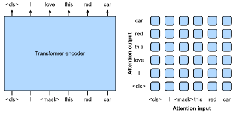
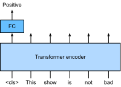
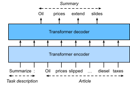
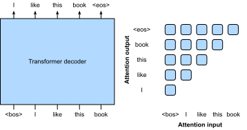
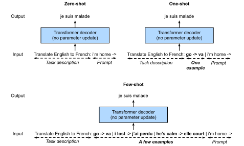

# Transformer的大规模预训练
:label:`sec_large-pretraining-transformers`

到目前为止，在我们关于图像分类和机器翻译的实验中，模型都是在包含输入-输出样例的数据集上*从头开始*训练的，以执行特定任务。例如，一个Transformer用英语-法语对训练（ :numref:`sec_transformer` ），以便这个模型能把输入的英文文本翻译成法文。因此，每个模型都成为一个*特定的专家*，甚至对数据分布的轻微偏移也很敏感（ :numref:`sec_environment-and-distribution-shift` ）。为了获得泛化能力更好的模型，甚至是为了获得能力更强的、无论是否需要适应都能执行多种任务的*通才*模型，在大规模数据上*预训练*模型已经越来越常见。

有了更多用于预训练的数据之后，Transformer架构在模型规模和训练计算量增加时表现更好，展现出卓越的*扩展*行为。具体而言，基于Transformer的语言模型的性能随模型参数量、训练词元数和训练计算量的增长按幂律扩展 :cite:`kaplan2020scaling`。Transformer的可扩展性还体现在：在更大的数据上训练的更大的视觉Transformer性能显著提升（在 :numref:`sec_vision-transformer` 中讨论过）。最近的成功案例包括Gato，这是一个*通才*模型，能够玩Atari游戏、为图像生成描述、聊天以及充当机器人 :cite:`reed2022generalist`。Gato是单个Transformer，在不同的模态（包括文本、图像、关节力矩和按钮按压）上预训练时扩展良好。值得注意的是，所有这些多模态数据都被序列化为一个平坦的词元序列，Transformer可以像处理文本词元（ :numref:`sec_transformer` ）或图像块（ :numref:`sec_vision-transformer` ）那样来处理它。

在Transformer针对多模态数据的预训练取得令人瞩目的成功之前，Transformer已经在海量文本上得到了广泛的预训练。最初为机器翻译而提出的Transformer架构（ :numref:`fig_transformer` ）由一个用于表示输入序列的编码器和一个用于生成目标序列的解码器组成。总的来说，Transformer有三种不同的使用模式：*仅编码器*、*编码器-解码器*和*仅解码器*。作为本章的结束，我们将回顾这三种模式，并解释预训练Transformer中的可扩展性。

## 仅编码器

当只使用Transformer编码器时，输入的词元序列被转换为同样数量的表示，这些表示可以进一步投影为输出（例如分类）。Transformer编码器由自注意力层组成，其中所有输入词元都相互关注。例如，:numref:`fig_vit` 中描绘的视觉Transformer就是仅编码器的，它把一个输入图像块序列转换为一个特殊“&lt;cls&gt;”词元的表示。由于该表示依赖于所有输入词元，它会被进一步投影为分类标签。这种设计受到一个更早的、在文本上预训练的仅编码器Transformer——BERT（Bidirectional Encoder Representations from Transformers）的启发 :cite:`Devlin.Chang.Lee.ea.2018`。

### 预训练BERT

:label:`fig_bert-encoder-only`

BERT使用*掩码语言建模*（masked language modeling）在文本序列上进行预训练：把随机掩码了词元的输入文本送入Transformer编码器，以预测被掩码的词元。如 :numref:`fig_bert-encoder-only` 所示，原始文本序列“I”、“love”、“this”、“red”、“car”前面加上“&lt;cls&gt;”词元，而“&lt;mask&gt;”词元随机替换“love”；然后在预训练期间最小化被掩码词元“love”与其预测之间的交叉熵损失。请注意，Transformer编码器的注意力模式没有任何约束（ :numref:`fig_bert-encoder-only` 右侧），因此所有词元都可以相互关注。于是，对“love”的预测依赖于序列中它之前和之后的输入词元。这就是BERT被称为“双向编码器”的原因。由于不需要人工标注，来自书籍和维基百科的大规模文本数据都可以用来预训练BERT。

### 微调BERT

预训练后的BERT可以被*微调*，以处理涉及单段文本或文本对的下游编码任务。在微调过程中，可以向BERT添加带有随机参数的额外层：这些参数以及预训练的BERT参数都会被*更新*，以拟合下游任务的训练数据。

:label:`fig_bert-finetune-classification`

:numref:`fig_bert-finetune-classification` 展示了为情感分析微调BERT的过程。这里的Transformer编码器就是一个预训练好的BERT，它以文本序列作为输入，并把“&lt;cls&gt;”表示（输入的全局表示）送入一个额外的全连接层来预测情感。在微调期间，通过基于梯度的算法最小化情感分析数据上预测与标签之间的交叉熵损失，其中额外层从头训练，而BERT的预训练参数则被更新。BERT能做的远不止情感分析。这个3.5亿参数的BERT从2500亿个训练词元中学到的通用语言表示，推动了自然语言任务的最新技术水平，例如单段文本分类、文本对分类或回归、文本标注以及问答。

你可能注意到，这些下游任务包括文本对理解。BERT预训练还有另一个损失，用于预测一个句子是否紧跟在另一个句子之后。然而后来发现，当在2万亿个词元上预训练同样规模的BERT变体RoBERTa时，这个损失不太有用 :cite:`Liu.Ott.Goyal.ea.2019`。BERT的其他衍生模型改进了模型架构或预训练目标，例如ALBERT（强制参数共享） :cite:`lan2019albert`、SpanBERT（表示并预测文本片段） :cite:`joshi2020spanbert`、DistilBERT（通过知识蒸馏实现轻量化） :cite:`sanh2019distilbert` 以及ELECTRA（替换词元检测） :cite:`clark2019electra`。此外，BERT还启发了计算机视觉中的Transformer预训练，例如视觉Transformer :cite:`Dosovitskiy.Beyer.Kolesnikov.ea.2021`、Swin Transformer :cite:`liu2021swin` 和MAE（掩码自编码器） :cite:`he2022masked`。

## 编码器-解码器

由于Transformer编码器把输入词元序列转换为同样数量的输出表示，仅编码器模式无法像机器翻译那样生成任意长度的序列。正如最初为机器翻译所提出的，Transformer架构可以配备一个解码器，它以编码器输出和解码器输出为条件，自回归地逐个词元预测任意长度的目标序列：（i）为了以编码器输出为条件，编码器-解码器交叉注意力（ :numref:`fig_transformer` 中解码器的多头注意力）允许目标词元关注*所有*输入词元；（ii）以解码器输出为条件是通过所谓的*因果*注意力（这个名称在文献中很常见，但具有误导性，因为它与严格意义上的因果关系研究几乎没有联系）模式（ :numref:`fig_transformer` 中解码器的掩码多头注意力）来实现的，其中任何目标词元只能关注目标序列中*过去*和*当前*的词元。

为了在人工标注的机器翻译数据之外预训练编码器-解码器Transformer，BART :cite:`lewis2019bart` 和T5 :cite:`raffel2020exploring` 是两个同时提出的、在大规模文本语料库上预训练的编码器-解码器Transformer。二者都试图在预训练目标中重建原始文本，而前者强调对输入加噪（例如掩码、删除、置换和旋转），后者则通过全面的消融研究突出了多任务统一。

### 预训练T5

作为预训练Transformer编码器-解码器的一个例子，T5（Text-to-Text Transfer Transformer）把许多任务统一为同一个文本到文本问题：对于任何任务，编码器的输入是任务描述（例如“Summarize”、“:”），后面跟着任务输入（例如一篇文章的词元序列），而解码器预测任务输出（例如概括输入文章的词元序列）。为了完成文本到文本的任务，T5被训练为根据输入文本生成某些目标文本。

:label:`fig_t5-encoder-decoder`

为了从任意原始文本得到输入和输出，T5的预训练任务是预测连续片段。具体而言，文本中的词元被随机替换为特殊词元，其中每个连续片段都被替换为同一个特殊词元。考虑 :numref:`fig_t5-encoder-decoder` 中的例子，其中原始文本是“I”、“love”、“this”、“red”、“car”。词元“love”、“red”、“car”被随机替换为特殊词元。由于“red”和“car”是一个连续片段，它们被替换为同一个特殊词元。于是，输入序列是“I”、“&lt;X&gt;”、“this”、“&lt;Y&gt;”，目标序列是“&lt;X&gt;”、“love”、“&lt;Y&gt;”、“red”、“car”、“&lt;Z&gt;”，其中“&lt;Z&gt;”是另一个标记结束的特殊词元。如 :numref:`fig_t5-encoder-decoder` 所示，解码器具有因果注意力模式，以防止它在序列预测期间关注未来的词元。

在T5中，预测连续片段也被称为重建被破坏的文本。在这一目标下，T5用来自C4（Colossal Clean Crawled Corpus）数据的1万亿个词元进行预训练，该数据由来自网络的干净英文文本组成 :cite:`raffel2020exploring`。

### 微调T5

与BERT类似，T5需要在特定任务的训练数据上微调（更新T5参数）才能执行该任务。与BERT微调的主要区别包括：（i）T5的输入包含任务描述；（ii）T5可以用它的Transformer解码器生成任意长度的序列；（iii）不需要额外的层。

:label:`fig_t5-finetune-summarization`

:numref:`fig_t5-finetune-summarization` 以文本摘要为例解释了T5的微调。在这个下游任务中，任务描述词元“Summarize”、“:”以及其后的文章词元被输入到编码器。

微调之后，110亿参数的T5（T5-11B）在多个编码（例如分类）和生成（例如摘要）基准测试上取得了当时最优的结果。自发布以来，T5在后续研究中得到了广泛使用。例如，Switch Transformer就是在T5的基础上设计的，它只激活一部分参数以获得更好的计算效率 :cite:`fedus2022switch`。在一个名为Imagen的文本到图像模型中，文本被输入到一个冻结的、拥有46亿参数的T5编码器（T5-XXL） :cite:`saharia2022photorealistic`。:numref:`fig_imagen` 中逼真的文本到图像示例表明，即便不进行微调，单独的T5编码器也可能有效地表示文本。

:width:`700px`
:label:`fig_imagen`

## 仅解码器

我们已经回顾了仅编码器和编码器-解码器两种Transformer。作为另一种选择，仅解码器Transformer从 :numref:`fig_transformer` 所描绘的原始编码器-解码器架构中去掉了整个编码器，以及带有编码器-解码器交叉注意力的解码器子层。如今，仅解码器Transformer已成为大规模语言建模（ :numref:`sec_language-model` ）中的*事实上的*架构，它通过自监督学习利用世界上丰富的无标注文本语料库。

### GPT与GPT-2

GPT（generative pre-training）模型以语言建模为训练目标，选择Transformer解码器作为其主干网络 :cite:`Radford.Narasimhan.Salimans.ea.2018`。

:label:`fig_gpt-decoder-only`

按照 :numref:`subsec_partitioning-seqs` 中描述的自回归语言模型训练方式，:numref:`fig_gpt-decoder-only` 展示了用Transformer编码器预训练GPT的过程，其中目标序列是输入序列向后平移一个词元。请注意，Transformer解码器中的注意力模式强制每个词元只能关注它之前的词元（无法关注未来的词元，因为它们尚未被选出）。

GPT有1亿参数，需要针对各个下游任务进行微调。一年之后，一个更大的Transformer解码器语言模型GPT-2被提出 :cite:`Radford.Wu.Child.ea.2019`。与GPT中原有的Transformer解码器相比，GPT-2采用了前置规范化（在 :numref:`subsec_vit-encoder` 中讨论过）以及改进的初始化和权重缩放。在40 GB文本上预训练的15亿参数GPT-2，在*不更新参数或架构*的情况下，在语言建模基准测试上取得了当时最优的结果，并在多个其他任务上取得了有希望的结果。

### GPT-3及以后

GPT-2展示了用同一个语言模型在无需更新模型的情况下执行多种任务的潜力。这比微调的计算效率更高，因为微调需要通过梯度计算来更新模型。

:label:`fig_gpt-3-xshot`

在解释如何以更高的计算效率、在不更新参数的情况下使用语言模型之前，回想一下 :numref:`sec_rnn-scratch` 中的内容：语言模型经过训练，可以根据某个前缀文本序列生成文本序列。因此，预训练的语言模型可以*在不更新参数的情况下*，根据包含任务描述、任务特定的输入-输出样例以及提示（任务输入）的输入序列，生成作为序列的任务输出。这种学习范式称为*上下文学习*（in-context learning） :cite:`brown2020language`，根据任务特定输入-输出样例的数量为零个、一个或几个，它可以进一步分为*零样本*、*单样本*和*少样本*（ :numref:`fig_gpt-3-xshot` ）。

:width:`400px`
:label:`fig_gpt3-xshot-scaling`

GPT-3中测试了这三种设置 :cite:`brown2020language`，其最大版本使用的数据和模型规模大约比GPT-2大两个数量级。GPT-3使用与其直接前身GPT-2相同的Transformer解码器架构，只是注意力模式（ :numref:`fig_gpt-decoder-only` 右侧）在交替的层中更加稀疏。GPT-3用3000亿个词元预训练，模型规模越大其表现越好，其中少样本性能提升得最快（ :numref:`fig_gpt3-xshot-scaling` ）。

其后的GPT-4模型在报告中没有完全公开技术细节 :cite:`openai2023gpt4`。与其前身相比，GPT-4是一个大规模多模态模型，可以同时接受文本和图像作为输入，并生成文本输出。

## 可扩展性

:numref:`fig_gpt3-xshot-scaling` 在GPT-3语言模型中实证地展示了Transformer的可扩展性。在语言建模方面，更全面的关于Transformer可扩展性的实证研究使研究者看到了用更多数据和更多计算训练更大Transformer的前景 :cite:`kaplan2020scaling`。

:width:`700px`
:label:`fig_scaling-power-law3`

如 :numref:`fig_scaling-power-law3` 所示，*幂律扩展*可以在性能与模型规模（参数量，不包括嵌入层）、数据集规模（训练词元数）以及训练计算量（PetaFLOP/s-days，不包括嵌入层）的关系中观察到。一般来说，协同增加这三个因素会带来更好的性能。然而，*如何*协同增加它们仍然是一个有争议的问题 :cite:`hoffmann2022training`。

:width:`700px`
:label:`fig_scaling-sample-conv`

除了性能提升之外，大模型还比小模型享有更好的样本效率。:numref:`fig_scaling-sample-conv` 表明，大模型需要更少的训练样本（处理的词元数）就能达到小模型所达到的同等水平，并且性能随计算量平滑扩展。

:width:`250px`
:label:`fig_scaling-gpt3`

:citet:`kaplan2020scaling` 中的实证扩展行为已在后续的大型Transformer模型中得到了检验。例如，GPT-3在 :numref:`fig_scaling-gpt3` 中以再高两个数量级的结果支持了这一假设。

## 大语言模型

GPT系列中Transformer的可扩展性启发了后续的大语言模型。GPT-2的Transformer解码器被用于训练拥有5300亿参数的Megatron-Turing NLG :cite:`smith2022using`，训练词元数为2700亿。Gopher :cite:`rae2021scaling` 遵循GPT-2的设计，拥有2800亿参数，用3000亿词元预训练，在不同任务上表现出有竞争力的性能。Chinchilla :cite:`hoffmann2022training` 继承了相同的架构，并使用与Gopher相同的计算预算，但它的规模小得多（700亿参数），训练时间长得多（1.4万亿个训练词元），在许多任务上超过了Gopher，并且更强调词元数而非参数数。为了延续语言建模的扩展路线，PaLM（Pathway Language Model） :cite:`chowdhery2022palm` 是一个经过改进设计的、5400亿参数的Transformer解码器，在7800亿个词元上预训练，在BIG-Bench基准测试上超过了人类的平均表现 :cite:`srivastava2022beyond`。其后续版本PaLM 2 :cite:`anil2023palm` 以大约1:1的比例扩展数据和模型，并改进了多语言和推理能力。其他大语言模型，例如进一步训练通才模型（PaLM）的Minerva :cite:`lewkowycz2022solving`，以及未在通用语料库上训练的Galactica :cite:`taylor2022galactica`，都展现出了有前景的定量推理和科学推理能力。

OPT（Open Pretrained Transformers） :cite:`zhang2022opt`、BLOOM :cite:` scao2022bloom` 和FALCON :cite:`penedo2023refinedweb` 等开源发布使大语言模型的研究和使用大众化。开源的Llama 1 :cite:`touvron2023llama` 关注推理时的计算效率，通过使用比通常更多的词元进行训练，超过了规模大得多的模型。更新后的Llama 2 :cite:`touvron2023llama2` 进一步把预训练语料库扩大了40%，由此得到的产品模型可能达到有竞争力的闭源模型的性能。

:citet:`wei2022emergent` 讨论了大语言模型的涌现能力，这些能力存在于较大的模型中，而不存在于较小的模型中。然而，仅仅增大模型规模并不会天然地使模型更好地遵循人类指令。:citet:`wei2021finetuned,sanh2021multitask` 发现，在一系列通过*指令*描述的数据集上微调大语言模型，可以提高在留出任务上的零样本性能。:citet:`ouyang2022training` 使用*基于人类反馈的强化学习*对GPT-3进行微调，使其遵循各种不同的指令。在由此得到的、通过微调使语言模型与人类意图对齐的InstructGPT之后 :cite:`ouyang2022training`，[ChatGPT](https://chat.openai.com/) 可以基于与人类的对话生成类人的回复（例如代码调试和创意写作），并可以零样本地执行许多自然语言处理任务 :cite:`qin2023chatgpt`。:citet:`bai2022constitutional` 用模型输出代替人类输入（例如人工标注的数据），从而部分自动化指令微调过程，这也称为*基于人工智能反馈的强化学习*。

大语言模型提供了一个令人兴奋的前景：通过构造文本输入来诱导模型通过上下文学习执行所需任务，这也称为*提示*（prompting）。值得注意的是，*思维链提示*（chain-of-thought prompting） :cite:`wei2022chain` 是一种使用少样本“问题、中间推理步骤、答案”示例的上下文学习方法，它激发出大语言模型的复杂推理能力，以求解数学、常识和符号推理任务。采样多条推理路径 :cite:`wang2023self`、让少样本示例多样化 :cite:`zhang2023automatic` 以及把复杂问题分解为子问题 :cite:`zhou2023least` 都可以提高推理准确率。事实上，只要在每个答案之前加上“Let's think step by step”这样简单的提示，大语言模型甚至就能以不错的准确率进行*零样本*思维链推理 :cite:`kojima2022large`。即使对于由文本和图像组成的多模态输入，语言模型也能进行多模态思维链推理，其准确率高于仅使用文本输入 :cite:`zhang2023multicot`。

## 小结与讨论

Transformer已经以仅编码器（例如BERT）、编码器-解码器（例如T5）和仅解码器（例如GPT系列）的形式进行预训练。预训练模型可以通过更新模型（例如微调）或不更新模型（例如少样本）来适应不同的任务。Transformer的可扩展性表明，更好的性能得益于更大的模型、更多的训练数据和更多的训练计算量。由于Transformer最初是为文本数据设计和预训练的，本节略微偏向自然语言处理。尽管如此，上面讨论的那些模型常常可以在跨多种模态的较新模型中找到。例如，
（i）Chinchilla :cite:`hoffmann2022training` 被进一步扩展为Flamingo :cite:`alayrac2022flamingo`，这是一个用于少样本学习的视觉语言模型；
（ii）GPT-2 :cite:`Radford.Wu.Child.ea.2019` 和视觉Transformer在CLIP（Contrastive Language-Image Pre-training）中编码文本和图像 :cite:`radford2021learning`，其图像和文本嵌入后来被用于DALL-E 2文本到图像系统 :cite:`ramesh2022hierarchical`。尽管目前还没有关于多模态预训练中Transformer可扩展性的系统研究，但一个名为Parti的全Transformer文本到图像模型 :cite:`yu2022scaling` 展示了跨模态可扩展性的潜力：
更大的Parti更有能力生成高保真图像并理解内容丰富的文本（ :numref:`fig_parti` ）。

:width:`700px`
:label:`fig_parti`

## 练习

1. 能否使用由不同任务组成的小批量来微调T5？为什么能或为什么不能？对于GPT-2又如何？
1. 给定一个强大的语言模型，你能想到哪些应用？
1. 假设有人要求你通过添加额外的层来微调一个语言模型以执行文本分类。你会把这些层加在哪里？为什么？
1. 考虑序列到序列问题（例如机器翻译），其中输入序列在目标序列预测的整个过程中始终可用。用仅解码器Transformer来建模可能有哪些局限？为什么？

[讨论](https://discuss.d2l.ai/t/9232)
