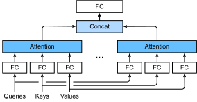

```{.python .input}
%load_ext d2lbook.tab
tab.interact_select('mxnet', 'pytorch', 'tensorflow', 'jax')
```

# 多头注意力
:label:`sec_multihead-attention`


在实践中，给定同一组查询、键和值时，我们可能希望模型能够结合同一注意力机制的不同行为所获得的知识，例如捕获序列中不同范围的依赖关系（如短距离依赖与长距离依赖）。因此，让注意力机制联合使用查询、键和值的不同表示子空间可能是有益的。


为此，我们可以不进行单一的注意力汇聚，而是用$h$个独立学习的线性投影分别变换查询、键和值。然后，这$h$个投影后的查询、键和值并行地送入注意力汇聚。最后，$h$个注意力汇聚输出被连结起来，并经过另一个可学习的线性投影变换，从而产生最终的输出。这种设计称为*多头注意力*（multi-head attention），其中$h$个注意力汇聚输出中的每一个都是一个*头*（head） :cite:`Vaswani.Shazeer.Parmar.ea.2017`。:numref:`fig_multi-head-attention` 描述了使用全连接层执行可学习线性变换的多头注意力。


:label:`fig_multi-head-attention`

```{.python .input}
%%tab mxnet
from d2l import mxnet as d2l
import math
from mxnet import autograd, np, npx
from mxnet.gluon import nn
npx.set_np()
```

```{.python .input}
%%tab pytorch
from d2l import torch as d2l
import math
import torch
from torch import nn
```

```{.python .input}
%%tab tensorflow
from d2l import tensorflow as d2l
import tensorflow as tf
```

```{.python .input}
%%tab jax
from d2l import jax as d2l
from flax import linen as nn
from jax import numpy as jnp
import jax
```

## 模型

在给出多头注意力的实现之前，我们先从数学上形式化这个模型。给定查询$\mathbf{q} \in \mathbb{R}^{d_q}$、键$\mathbf{k} \in \mathbb{R}^{d_k}$和值$\mathbf{v} \in \mathbb{R}^{d_v}$，每个注意力头$\mathbf{h}_i$（$i = 1, \ldots, h$）的计算方式为

$$\mathbf{h}_i = f(\mathbf W_i^{(q)}\mathbf q, \mathbf W_i^{(k)}\mathbf k,\mathbf W_i^{(v)}\mathbf v) \in \mathbb R^{p_v},$$

其中$\mathbf W_i^{(q)}\in\mathbb R^{p_q\times d_q}$、$\mathbf W_i^{(k)}\in\mathbb R^{p_k\times d_k}$和$\mathbf W_i^{(v)}\in\mathbb R^{p_v\times d_v}$是可学习参数，$f$是注意力汇聚，例如 :numref:`sec_attention-scoring-functions` 中的加性注意力和缩放点积注意力。多头注意力的输出是经由可学习参数$\mathbf W_o\in\mathbb R^{p_o\times h p_v}$对$h$个头连结后的结果所做的另一次线性变换：

$$\mathbf W_o \begin{bmatrix}\mathbf h_1\\\vdots\\\mathbf h_h\end{bmatrix} \in \mathbb{R}^{p_o}.$$

基于这种设计，每个头都可能关注输入的不同部分，从而能够表达比简单加权平均更复杂的函数。

## 实现

在我们的实现中，多头注意力的每个头都[**选用缩放点积注意力**]。为了避免计算代价和参数化代价显著增长，我们设$p_q = p_k = p_v = p_o / h$。请注意，$h$个头之所以能够并行计算，是因为我们把查询、键和值的线性变换的输出数量设为$p_q h = p_k h = p_v h = p_o$。在下面的实现中，$p_o$通过参数`num_hiddens`指定。

```{.python .input}
%%tab mxnet
class MultiHeadAttention(d2l.Module):  #@save
    """Multi-head attention."""
    def __init__(self, num_hiddens, num_heads, dropout, use_bias=False,
                 **kwargs):
        super().__init__()
        self.num_heads = num_heads
        self.attention = d2l.DotProductAttention(dropout)
        self.W_q = nn.Dense(num_hiddens, use_bias=use_bias, flatten=False)
        self.W_k = nn.Dense(num_hiddens, use_bias=use_bias, flatten=False)
        self.W_v = nn.Dense(num_hiddens, use_bias=use_bias, flatten=False)
        self.W_o = nn.Dense(num_hiddens, use_bias=use_bias, flatten=False)

    def forward(self, queries, keys, values, valid_lens):
        # Shape of queries, keys, or values:
        # (batch_size, no. of queries or key-value pairs, num_hiddens)
        # Shape of valid_lens: (batch_size,) or (batch_size, no. of queries)
        # After transposing, shape of output queries, keys, or values:
        # (batch_size * num_heads, no. of queries or key-value pairs,
        # num_hiddens / num_heads)
        queries = self.transpose_qkv(self.W_q(queries))
        keys = self.transpose_qkv(self.W_k(keys))
        values = self.transpose_qkv(self.W_v(values))

        if valid_lens is not None:
            # On axis 0, copy the first item (scalar or vector) for num_heads
            # times, then copy the next item, and so on
            valid_lens = valid_lens.repeat(self.num_heads, axis=0)

        # Shape of output: (batch_size * num_heads, no. of queries,
        # num_hiddens / num_heads)
        output = self.attention(queries, keys, values, valid_lens)
        
        # Shape of output_concat: (batch_size, no. of queries, num_hiddens)
        output_concat = self.transpose_output(output)
        return self.W_o(output_concat)
```

```{.python .input}
%%tab pytorch
class MultiHeadAttention(d2l.Module):  #@save
    """Multi-head attention."""
    def __init__(self, num_hiddens, num_heads, dropout, bias=False, **kwargs):
        super().__init__()
        self.num_heads = num_heads
        self.attention = d2l.DotProductAttention(dropout)
        self.W_q = nn.LazyLinear(num_hiddens, bias=bias)
        self.W_k = nn.LazyLinear(num_hiddens, bias=bias)
        self.W_v = nn.LazyLinear(num_hiddens, bias=bias)
        self.W_o = nn.LazyLinear(num_hiddens, bias=bias)

    def forward(self, queries, keys, values, valid_lens):
        # Shape of queries, keys, or values:
        # (batch_size, no. of queries or key-value pairs, num_hiddens)
        # Shape of valid_lens: (batch_size,) or (batch_size, no. of queries)
        # After transposing, shape of output queries, keys, or values:
        # (batch_size * num_heads, no. of queries or key-value pairs,
        # num_hiddens / num_heads)
        queries = self.transpose_qkv(self.W_q(queries))
        keys = self.transpose_qkv(self.W_k(keys))
        values = self.transpose_qkv(self.W_v(values))

        if valid_lens is not None:
            # On axis 0, copy the first item (scalar or vector) for num_heads
            # times, then copy the next item, and so on
            valid_lens = torch.repeat_interleave(
                valid_lens, repeats=self.num_heads, dim=0)

        # Shape of output: (batch_size * num_heads, no. of queries,
        # num_hiddens / num_heads)
        output = self.attention(queries, keys, values, valid_lens)
        # Shape of output_concat: (batch_size, no. of queries, num_hiddens)
        output_concat = self.transpose_output(output)
        return self.W_o(output_concat)
```

```{.python .input}
%%tab tensorflow
class MultiHeadAttention(d2l.Module):  #@save
    """Multi-head attention."""
    def __init__(self, key_size, query_size, value_size, num_hiddens,
                 num_heads, dropout, bias=False, **kwargs):
        super().__init__()
        self.num_heads = num_heads
        self.attention = d2l.DotProductAttention(dropout)
        self.W_q = tf.keras.layers.Dense(num_hiddens, use_bias=bias)
        self.W_k = tf.keras.layers.Dense(num_hiddens, use_bias=bias)
        self.W_v = tf.keras.layers.Dense(num_hiddens, use_bias=bias)
        self.W_o = tf.keras.layers.Dense(num_hiddens, use_bias=bias)
    
    def call(self, queries, keys, values, valid_lens, **kwargs):
        # Shape of queries, keys, or values:
        # (batch_size, no. of queries or key-value pairs, num_hiddens)
        # Shape of valid_lens: (batch_size,) or (batch_size, no. of queries)
        # After transposing, shape of output queries, keys, or values:
        # (batch_size * num_heads, no. of queries or key-value pairs,
        # num_hiddens / num_heads)
        queries = self.transpose_qkv(self.W_q(queries))
        keys = self.transpose_qkv(self.W_k(keys))
        values = self.transpose_qkv(self.W_v(values))
        
        if valid_lens is not None:
            # On axis 0, copy the first item (scalar or vector) for num_heads
            # times, then copy the next item, and so on
            valid_lens = tf.repeat(valid_lens, repeats=self.num_heads, axis=0)
            
        # Shape of output: (batch_size * num_heads, no. of queries,
        # num_hiddens / num_heads)
        output = self.attention(queries, keys, values, valid_lens, **kwargs)
        
        # Shape of output_concat: (batch_size, no. of queries, num_hiddens)
        output_concat = self.transpose_output(output)
        return self.W_o(output_concat)
```

```{.python .input}
%%tab jax
class MultiHeadAttention(nn.Module):  #@save
    num_hiddens: int
    num_heads: int
    dropout: float
    bias: bool = False

    def setup(self):
        self.attention = d2l.DotProductAttention(self.dropout)
        self.W_q = nn.Dense(self.num_hiddens, use_bias=self.bias)
        self.W_k = nn.Dense(self.num_hiddens, use_bias=self.bias)
        self.W_v = nn.Dense(self.num_hiddens, use_bias=self.bias)
        self.W_o = nn.Dense(self.num_hiddens, use_bias=self.bias)

    @nn.compact
    def __call__(self, queries, keys, values, valid_lens, training=False):
        # Shape of queries, keys, or values:
        # (batch_size, no. of queries or key-value pairs, num_hiddens)
        # Shape of valid_lens: (batch_size,) or (batch_size, no. of queries)
        # After transposing, shape of output queries, keys, or values:
        # (batch_size * num_heads, no. of queries or key-value pairs,
        # num_hiddens / num_heads)
        queries = self.transpose_qkv(self.W_q(queries))
        keys = self.transpose_qkv(self.W_k(keys))
        values = self.transpose_qkv(self.W_v(values))

        if valid_lens is not None:
            # On axis 0, copy the first item (scalar or vector) for num_heads
            # times, then copy the next item, and so on
            valid_lens = jnp.repeat(valid_lens, self.num_heads, axis=0)

        # Shape of output: (batch_size * num_heads, no. of queries,
        # num_hiddens / num_heads)
        output, attention_weights = self.attention(
            queries, keys, values, valid_lens, training=training)
        # Shape of output_concat: (batch_size, no. of queries, num_hiddens)
        output_concat = self.transpose_output(output)
        return self.W_o(output_concat), attention_weights
```

为了支持[**多个头的并行计算**]，上面的`MultiHeadAttention`类使用了下面定义的两个转置方法。具体而言，`transpose_output`方法逆转了`transpose_qkv`方法的操作。

```{.python .input}
%%tab mxnet
@d2l.add_to_class(MultiHeadAttention)  #@save
def transpose_qkv(self, X):
    """Transposition for parallel computation of multiple attention heads."""
    # Shape of input X: (batch_size, no. of queries or key-value pairs,
    # num_hiddens). Shape of output X: (batch_size, no. of queries or
    # key-value pairs, num_heads, num_hiddens / num_heads)
    X = X.reshape(X.shape[0], X.shape[1], self.num_heads, -1)
    # Shape of output X: (batch_size, num_heads, no. of queries or key-value
    # pairs, num_hiddens / num_heads)
    X = X.transpose(0, 2, 1, 3)
    # Shape of output: (batch_size * num_heads, no. of queries or key-value
    # pairs, num_hiddens / num_heads)
    return X.reshape(-1, X.shape[2], X.shape[3])

@d2l.add_to_class(MultiHeadAttention)  #@save
def transpose_output(self, X):
    """Reverse the operation of transpose_qkv."""
    X = X.reshape(-1, self.num_heads, X.shape[1], X.shape[2])
    X = X.transpose(0, 2, 1, 3)
    return X.reshape(X.shape[0], X.shape[1], -1)
```

```{.python .input}
%%tab pytorch
@d2l.add_to_class(MultiHeadAttention)  #@save
def transpose_qkv(self, X):
    """Transposition for parallel computation of multiple attention heads."""
    # Shape of input X: (batch_size, no. of queries or key-value pairs,
    # num_hiddens). Shape of output X: (batch_size, no. of queries or
    # key-value pairs, num_heads, num_hiddens / num_heads)
    X = X.reshape(X.shape[0], X.shape[1], self.num_heads, -1)
    # Shape of output X: (batch_size, num_heads, no. of queries or key-value
    # pairs, num_hiddens / num_heads)
    X = X.permute(0, 2, 1, 3)
    # Shape of output: (batch_size * num_heads, no. of queries or key-value
    # pairs, num_hiddens / num_heads)
    return X.reshape(-1, X.shape[2], X.shape[3])

@d2l.add_to_class(MultiHeadAttention)  #@save
def transpose_output(self, X):
    """Reverse the operation of transpose_qkv."""
    X = X.reshape(-1, self.num_heads, X.shape[1], X.shape[2])
    X = X.permute(0, 2, 1, 3)
    return X.reshape(X.shape[0], X.shape[1], -1)
```

```{.python .input}
%%tab tensorflow
@d2l.add_to_class(MultiHeadAttention)  #@save
def transpose_qkv(self, X):
    """Transposition for parallel computation of multiple attention heads."""
    # Shape of input X: (batch_size, no. of queries or key-value pairs,
    # num_hiddens). Shape of output X: (batch_size, no. of queries or
    # key-value pairs, num_heads, num_hiddens / num_heads)
    X = tf.reshape(X, shape=(X.shape[0], X.shape[1], self.num_heads, -1))
    # Shape of output X: (batch_size, num_heads, no. of queries or key-value
    # pairs, num_hiddens / num_heads)
    X = tf.transpose(X, perm=(0, 2, 1, 3))
    # Shape of output: (batch_size * num_heads, no. of queries or key-value
    # pairs, num_hiddens / num_heads)
    return tf.reshape(X, shape=(-1, X.shape[2], X.shape[3]))

@d2l.add_to_class(MultiHeadAttention)  #@save
def transpose_output(self, X):
    """Reverse the operation of transpose_qkv."""
    X = tf.reshape(X, shape=(-1, self.num_heads, X.shape[1], X.shape[2]))
    X = tf.transpose(X, perm=(0, 2, 1, 3))
    return tf.reshape(X, shape=(X.shape[0], X.shape[1], -1))
```

```{.python .input}
%%tab jax
@d2l.add_to_class(MultiHeadAttention)  #@save
def transpose_qkv(self, X):
    """Transposition for parallel computation of multiple attention heads."""
    # Shape of input X: (batch_size, no. of queries or key-value pairs,
    # num_hiddens). Shape of output X: (batch_size, no. of queries or
    # key-value pairs, num_heads, num_hiddens / num_heads)
    X = X.reshape((X.shape[0], X.shape[1], self.num_heads, -1))
    # Shape of output X: (batch_size, num_heads, no. of queries or key-value
    # pairs, num_hiddens / num_heads)
    X = jnp.transpose(X, (0, 2, 1, 3))
    # Shape of output: (batch_size * num_heads, no. of queries or key-value
    # pairs, num_hiddens / num_heads)
    return X.reshape((-1, X.shape[2], X.shape[3]))

@d2l.add_to_class(MultiHeadAttention)  #@save
def transpose_output(self, X):
    """Reverse the operation of transpose_qkv."""
    X = X.reshape((-1, self.num_heads, X.shape[1], X.shape[2]))
    X = jnp.transpose(X, (0, 2, 1, 3))
    return X.reshape((X.shape[0], X.shape[1], -1))
```

让我们用一个键和值相同的简单例子来[**检验我们实现的**]`MultiHeadAttention`类。结果表明，多头注意力输出的形状为（`batch_size`，`num_queries`，`num_hiddens`）。

```{.python .input}
%%tab pytorch
num_hiddens, num_heads = 100, 5
attention = MultiHeadAttention(num_hiddens, num_heads, 0.5)
batch_size, num_queries, num_kvpairs = 2, 4, 6
valid_lens = d2l.tensor([3, 2])
X = d2l.ones((batch_size, num_queries, num_hiddens))
Y = d2l.ones((batch_size, num_kvpairs, num_hiddens))
d2l.check_shape(attention(X, Y, Y, valid_lens),
                (batch_size, num_queries, num_hiddens))
```

```{.python .input}
%%tab mxnet
num_hiddens, num_heads = 100, 5
attention = MultiHeadAttention(num_hiddens, num_heads, 0.5)
attention.initialize()
```

```{.python .input}
%%tab jax
num_hiddens, num_heads = 100, 5
attention = MultiHeadAttention(num_hiddens, num_heads, 0.5)
```

```{.python .input}
%%tab tensorflow
num_hiddens, num_heads = 100, 5
attention = MultiHeadAttention(num_hiddens, num_hiddens, num_hiddens,
                               num_hiddens, num_heads, 0.5)
```

```{.python .input}
%%tab mxnet
batch_size, num_queries, num_kvpairs = 2, 4, 6
valid_lens = d2l.tensor([3, 2])
X = d2l.ones((batch_size, num_queries, num_hiddens))
Y = d2l.ones((batch_size, num_kvpairs, num_hiddens))
d2l.check_shape(attention(X, Y, Y, valid_lens),
                (batch_size, num_queries, num_hiddens))
```

```{.python .input}
%%tab tensorflow
batch_size, num_queries, num_kvpairs = 2, 4, 6
valid_lens = d2l.tensor([3, 2])
X = tf.ones((batch_size, num_queries, num_hiddens))
Y = tf.ones((batch_size, num_kvpairs, num_hiddens))
d2l.check_shape(attention(X, Y, Y, valid_lens, training=False),
                (batch_size, num_queries, num_hiddens))
```

```{.python .input}
%%tab jax
batch_size, num_queries, num_kvpairs = 2, 4, 6
valid_lens = d2l.tensor([3, 2])
X = d2l.ones((batch_size, num_queries, num_hiddens))
Y = d2l.ones((batch_size, num_kvpairs, num_hiddens))
d2l.check_shape(attention.init_with_output(d2l.get_key(), X, Y, Y, valid_lens,
                                           training=False)[0][0],
                (batch_size, num_queries, num_hiddens))
```

## 小结

多头注意力通过查询、键和值的不同表示子空间，结合同一注意力汇聚所获得的知识。要并行计算多头注意力的多个头，需要进行适当的张量操作。


## 练习

1. 可视化本实验中多个头的注意力权重。
1. 假设我们已经有一个基于多头注意力训练好的模型，并希望剪枝掉不太重要的注意力头以提高预测速度。可以如何设计实验来衡量某个注意力头的重要性？

:begin_tab:`mxnet`
[讨论](https://discuss.d2l.ai/t/1634)
:end_tab:

:begin_tab:`pytorch`
[讨论](https://discuss.d2l.ai/t/1635)
:end_tab:

:begin_tab:`tensorflow`
[讨论](https://discuss.d2l.ai/t/3869)
:end_tab:

:begin_tab:`jax`
[讨论](https://discuss.d2l.ai/t/18029)
:end_tab:
