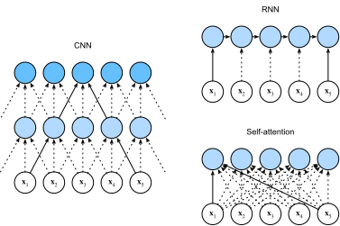

```{.python .input}
%load_ext d2lbook.tab
tab.interact_select('mxnet', 'pytorch', 'tensorflow', 'jax')
```

# 自注意力与位置编码
:label:`sec_self-attention-and-positional-encoding`

在深度学习中，我们经常使用卷积神经网络（CNN）或循环神经网络（RNN）来编码序列。现在，脑海中有了注意力机制，可以设想把一个词元序列送入注意力机制，使得在每一步，每个词元都有自己的查询、键和值。在这里，计算某个词元在下一层的表示时，该词元可以（通过它的查询向量）关注任何其他词元（基于它们的键向量进行匹配）。利用完整的查询-键兼容性得分集合，我们可以通过在其他词元上构建适当的加权和，为每个词元计算表示。由于每个词元都关注其他每个词元（这不同于解码器步骤关注编码器步骤的情形），这种架构通常称为*自注意力*（self-attention）模型 :cite:`Lin.Feng.Santos.ea.2017,Vaswani.Shazeer.Parmar.ea.2017`，而在其他文献中则称为*内部注意力*（intra-attention）模型 :cite:`Cheng.Dong.Lapata.2016,Parikh.Tackstrom.Das.ea.2016,Paulus.Xiong.Socher.2017`。本节将讨论使用自注意力进行序列编码，包括如何利用额外信息来表示序列的顺序。

```{.python .input}
%%tab mxnet
from d2l import mxnet as d2l
import math
from mxnet import autograd, np, npx
from mxnet.gluon import nn
npx.set_np()
```

```{.python .input}
%%tab pytorch
from d2l import torch as d2l
import math
import torch
from torch import nn
```

```{.python .input}
%%tab tensorflow
from d2l import tensorflow as d2l
import numpy as np
import tensorflow as tf
```

```{.python .input}
%%tab jax
from d2l import jax as d2l
from flax import linen as nn
from jax import numpy as jnp
import jax
```

## [**自注意力**]

给定一个输入词元序列$\mathbf{x}_1, \ldots, \mathbf{x}_n$，其中任意$\mathbf{x}_i \in \mathbb{R}^d$（$1 \leq i \leq n$），它的自注意力输出一个长度相同的序列$\mathbf{y}_1, \ldots, \mathbf{y}_n$，其中

$$\mathbf{y}_i = f(\mathbf{x}_i, (\mathbf{x}_1, \mathbf{x}_1), \ldots, (\mathbf{x}_n, \mathbf{x}_n)) \in \mathbb{R}^d$$

这里按照 :eqref:`eq_attention_pooling` 中注意力汇聚的定义来计算。利用多头注意力，下面的代码片段计算形状为（批量大小，时间步数或词元序列长度，$d$）的张量的自注意力，输出张量具有相同的形状。

```{.python .input}
%%tab pytorch
num_hiddens, num_heads = 100, 5
attention = d2l.MultiHeadAttention(num_hiddens, num_heads, 0.5)
batch_size, num_queries, valid_lens = 2, 4, d2l.tensor([3, 2])
X = d2l.ones((batch_size, num_queries, num_hiddens))
d2l.check_shape(attention(X, X, X, valid_lens),
                (batch_size, num_queries, num_hiddens))
```

```{.python .input}
%%tab mxnet
num_hiddens, num_heads = 100, 5
attention = d2l.MultiHeadAttention(num_hiddens, num_heads, 0.5)
attention.initialize()
```

```{.python .input}
%%tab jax
num_hiddens, num_heads = 100, 5
attention = d2l.MultiHeadAttention(num_hiddens, num_heads, 0.5)
```

```{.python .input}
%%tab tensorflow
num_hiddens, num_heads = 100, 5
attention = d2l.MultiHeadAttention(num_hiddens, num_hiddens, num_hiddens,
                                   num_hiddens, num_heads, 0.5)
```

```{.python .input}
%%tab mxnet
batch_size, num_queries, valid_lens = 2, 4, d2l.tensor([3, 2])
X = d2l.ones((batch_size, num_queries, num_hiddens))
d2l.check_shape(attention(X, X, X, valid_lens),
                (batch_size, num_queries, num_hiddens))
```

```{.python .input}
%%tab tensorflow
batch_size, num_queries, valid_lens = 2, 4, tf.constant([3, 2])
X = tf.ones((batch_size, num_queries, num_hiddens))
d2l.check_shape(attention(X, X, X, valid_lens, training=False),
                (batch_size, num_queries, num_hiddens))
```

```{.python .input}
%%tab jax
batch_size, num_queries, valid_lens = 2, 4, d2l.tensor([3, 2])
X = d2l.ones((batch_size, num_queries, num_hiddens))
d2l.check_shape(attention.init_with_output(d2l.get_key(), X, X, X, valid_lens,
                                           training=False)[0][0],
                (batch_size, num_queries, num_hiddens))
```

## 比较CNN、RNN和自注意力
:label:`subsec_cnn-rnn-self-attention`

让我们比较几种架构，它们把$n$个词元的序列映射为另一个等长序列，其中每个输入或输出词元都用一个$d$维向量表示。具体来说，我们将考察CNN、RNN和自注意力。我们将比较它们的计算复杂度、顺序操作和最大路径长度。请注意，顺序操作会阻碍并行计算，而序列位置任意组合之间更短的路径，则使模型更容易学习序列内部的长期依赖关系 :cite:`Hochreiter.Bengio.Frasconi.ea.2001`。



:label:`fig_cnn-rnn-self-attention`


我们可以把任何文本序列看作一个“一维图像”。类似地，一维CNN可以处理文本中的局部特征，例如$n$元语法。给定长度为$n$的序列，考虑一个卷积核大小为$k$、输入和输出通道数均为$d$的卷积层，该卷积层的计算复杂度为$\mathcal{O}(knd^2)$。如 :numref:`fig_cnn-rnn-self-attention` 所示，CNN是分层的，因此有$\mathcal{O}(1)$个顺序操作，最大路径长度为$\mathcal{O}(n/k)$。例如，在 :numref:`fig_cnn-rnn-self-attention` 中，$\mathbf{x}_1$和$\mathbf{x}_5$都位于一个卷积核大小为3的两层CNN的感受野之内。

更新RNN的隐藏状态时，一个$d \times d$的权重矩阵与$d$维隐藏状态相乘的计算复杂度为$\mathcal{O}(d^2)$。由于序列长度为$n$，循环层的计算复杂度为$\mathcal{O}(nd^2)$。根据 :numref:`fig_cnn-rnn-self-attention`，存在$\mathcal{O}(n)$个无法并行化的顺序操作，最大路径长度也是$\mathcal{O}(n)$。

在自注意力中，查询、键和值都是$n \times d$矩阵。考虑 :eqref:`eq_softmax_QK_V` 中介绍的缩放点积注意力，其中一个$n \times d$矩阵与一个$d \times n$矩阵相乘，然后输出的$n \times n$矩阵再与一个$n \times d$矩阵相乘。因此，自注意力的计算复杂度为$\mathcal{O}(n^2d)$。正如从 :numref:`fig_cnn-rnn-self-attention` 中可以看到的，每个词元都通过自注意力与任何其他词元直接相连。因此，计算可以并行进行，顺序操作只有$\mathcal{O}(1)$个，最大路径长度也是$\mathcal{O}(1)$。

总而言之，CNN和自注意力都能并行计算，而自注意力的最大路径长度最短。然而，相对于序列长度的二次计算复杂度使得自注意力在处理很长的序列时慢得令人无法接受。

## [**位置编码**]
:label:`subsec_positional-encoding`


与RNN逐词元地循环处理序列不同，自注意力摒弃了顺序操作，转而采用并行计算。请注意，自注意力本身并不保留序列的顺序。如果模型确实需要知道输入序列到达的先后顺序，我们该怎么办呢？

保留词元顺序信息的主流方法，是把该信息作为与每个词元关联的额外输入提供给模型。这些输入称为*位置编码*（positional encoding），它们既可以学习得到，也可以*先验地*固定。下面我们描述一种基于正弦和余弦函数的简单固定位置编码方案 :cite:`Vaswani.Shazeer.Parmar.ea.2017`。

假设输入表示$\mathbf{X} \in \mathbb{R}^{n \times d}$包含$d$维嵌入，对应一个序列中的$n$个词元。位置编码输出$\mathbf{X} + \mathbf{P}$，其中使用的位置编码矩阵为$\mathbf{P} \in \mathbb{R}^{n \times d}$，形状与之相同，该矩阵第$i^\textrm{th}$行、第$(2j)^\textrm{th}$列或第$(2j + 1)^\textrm{th}$列上的元素为

$$\begin{aligned} p_{i, 2j} &= \sin\left(\frac{i}{10000^{2j/d}}\right),\\p_{i, 2j+1} &= \cos\left(\frac{i}{10000^{2j/d}}\right).\end{aligned}$$
:eqlabel:`eq_positional-encoding-def`

乍一看，这种三角函数的设计显得有些奇怪。在解释这种设计之前，我们先用下面的`PositionalEncoding`类来实现它。

```{.python .input}
%%tab mxnet
class PositionalEncoding(nn.Block):  #@save
    """Positional encoding."""
    def __init__(self, num_hiddens, dropout, max_len=1000):
        super().__init__()
        self.dropout = nn.Dropout(dropout)
        # Create a long enough P
        self.P = d2l.zeros((1, max_len, num_hiddens))
        X = d2l.arange(max_len).reshape(-1, 1) / np.power(
            10000, np.arange(0, num_hiddens, 2) / num_hiddens)
        self.P[:, :, 0::2] = np.sin(X)
        self.P[:, :, 1::2] = np.cos(X)

    def forward(self, X):
        X = X + self.P[:, :X.shape[1], :].as_in_ctx(X.ctx)
        return self.dropout(X)
```

```{.python .input}
%%tab pytorch
class PositionalEncoding(nn.Module):  #@save
    """Positional encoding."""
    def __init__(self, num_hiddens, dropout, max_len=1000):
        super().__init__()
        self.dropout = nn.Dropout(dropout)
        # Create a long enough P
        self.P = d2l.zeros((1, max_len, num_hiddens))
        X = d2l.arange(max_len, dtype=torch.float32).reshape(
            -1, 1) / torch.pow(10000, torch.arange(
            0, num_hiddens, 2, dtype=torch.float32) / num_hiddens)
        self.P[:, :, 0::2] = torch.sin(X)
        self.P[:, :, 1::2] = torch.cos(X)

    def forward(self, X):
        X = X + self.P[:, :X.shape[1], :].to(X.device)
        return self.dropout(X)
```

```{.python .input}
%%tab tensorflow
class PositionalEncoding(tf.keras.layers.Layer):  #@save
    """Positional encoding."""
    def __init__(self, num_hiddens, dropout, max_len=1000):
        super().__init__()
        self.dropout = tf.keras.layers.Dropout(dropout)
        # Create a long enough P
        self.P = np.zeros((1, max_len, num_hiddens))
        X = np.arange(max_len, dtype=np.float32).reshape(
            -1,1)/np.power(10000, np.arange(
            0, num_hiddens, 2, dtype=np.float32) / num_hiddens)
        self.P[:, :, 0::2] = np.sin(X)
        self.P[:, :, 1::2] = np.cos(X)
        
    def call(self, X, **kwargs):
        X = X + self.P[:, :X.shape[1], :]
        return self.dropout(X, **kwargs)
```

```{.python .input}
%%tab jax
class PositionalEncoding(nn.Module):  #@save
    """Positional encoding."""
    num_hiddens: int
    dropout: float
    max_len: int = 1000

    def setup(self):
        # Create a long enough P
        self.P = d2l.zeros((1, self.max_len, self.num_hiddens))
        X = d2l.arange(self.max_len, dtype=jnp.float32).reshape(
            -1, 1) / jnp.power(10000, jnp.arange(
            0, self.num_hiddens, 2, dtype=jnp.float32) / self.num_hiddens)
        self.P = self.P.at[:, :, 0::2].set(jnp.sin(X))
        self.P = self.P.at[:, :, 1::2].set(jnp.cos(X))

    @nn.compact
    def __call__(self, X, training=False):
        # Flax sow API is used to capture intermediate variables
        self.sow('intermediates', 'P', self.P)
        X = X + self.P[:, :X.shape[1], :]
        return nn.Dropout(self.dropout)(X, deterministic=not training)
```

在位置编码矩阵$\mathbf{P}$中，[**行对应序列中的位置，列表示不同的位置编码维度**]。在下面的例子中，我们可以看到位置编码矩阵的第$6^{\textrm{th}}$列和第$7^{\textrm{th}}$列的频率高于第$8^{\textrm{th}}$列和第$9^{\textrm{th}}$列。第$6^{\textrm{th}}$列与第$7^{\textrm{th}}$列之间的偏移（第$8^{\textrm{th}}$列与第$9^{\textrm{th}}$列也是如此）源于正弦函数与余弦函数的交替。

```{.python .input}
%%tab mxnet
encoding_dim, num_steps = 32, 60
pos_encoding = PositionalEncoding(encoding_dim, 0)
pos_encoding.initialize()
X = pos_encoding(np.zeros((1, num_steps, encoding_dim)))
P = pos_encoding.P[:, :X.shape[1], :]
d2l.plot(d2l.arange(num_steps), P[0, :, 6:10].T, xlabel='Row (position)',
         figsize=(6, 2.5), legend=["Col %d" % d for d in d2l.arange(6, 10)])
```

```{.python .input}
%%tab pytorch
encoding_dim, num_steps = 32, 60
pos_encoding = PositionalEncoding(encoding_dim, 0)
X = pos_encoding(d2l.zeros((1, num_steps, encoding_dim)))
P = pos_encoding.P[:, :X.shape[1], :]
d2l.plot(d2l.arange(num_steps), P[0, :, 6:10].T, xlabel='Row (position)',
         figsize=(6, 2.5), legend=["Col %d" % d for d in d2l.arange(6, 10)])
```

```{.python .input}
%%tab tensorflow
encoding_dim, num_steps = 32, 60
pos_encoding = PositionalEncoding(encoding_dim, 0)
X = pos_encoding(tf.zeros((1, num_steps, encoding_dim)), training=False)
P = pos_encoding.P[:, :X.shape[1], :]
d2l.plot(np.arange(num_steps), P[0, :, 6:10].T, xlabel='Row (position)',
         figsize=(6, 2.5), legend=["Col %d" % d for d in np.arange(6, 10)])
```

```{.python .input}
%%tab jax
encoding_dim, num_steps = 32, 60
pos_encoding = PositionalEncoding(encoding_dim, 0)
params = pos_encoding.init(d2l.get_key(), d2l.zeros((1, num_steps, encoding_dim)))
X, inter_vars = pos_encoding.apply(params, d2l.zeros((1, num_steps, encoding_dim)),
                                   mutable='intermediates')
P = inter_vars['intermediates']['P'][0]  # retrieve intermediate value P
P = P[:, :X.shape[1], :]
d2l.plot(d2l.arange(num_steps), P[0, :, 6:10].T, xlabel='Row (position)',
         figsize=(6, 2.5), legend=["Col %d" % d for d in d2l.arange(6, 10)])
```

### 绝对位置信息

为了了解沿编码维度单调递减的频率与绝对位置信息之间的关系，让我们打印出$0, 1, \ldots, 7$的[**二进制表示**]。可以看到，最低位、次低位和第三低位分别对每个数、每两个数和每四个数交替一次。

```{.python .input}
%%tab all
for i in range(8):
    print(f'{i} in binary is {i:>03b}')
```

在二进制表示中，较高位的频率比较低位的频率低。类似地，如下面的热图所示，[**位置编码借助三角函数使频率沿编码维度递减**]。由于输出是浮点数，这种连续表示比二进制表示更节省空间。

```{.python .input}
%%tab mxnet
P = np.expand_dims(np.expand_dims(P[0, :, :], 0), 0)
d2l.show_heatmaps(P, xlabel='Column (encoding dimension)',
                  ylabel='Row (position)', figsize=(3.5, 4), cmap='Blues')
```

```{.python .input}
%%tab pytorch
P = P[0, :, :].unsqueeze(0).unsqueeze(0)
d2l.show_heatmaps(P, xlabel='Column (encoding dimension)',
                  ylabel='Row (position)', figsize=(3.5, 4), cmap='Blues')
```

```{.python .input}
%%tab tensorflow
P = tf.expand_dims(tf.expand_dims(P[0, :, :], axis=0), axis=0)
d2l.show_heatmaps(P, xlabel='Column (encoding dimension)',
                  ylabel='Row (position)', figsize=(3.5, 4), cmap='Blues')
```

```{.python .input}
%%tab jax
P = jnp.expand_dims(jnp.expand_dims(P[0, :, :], axis=0), axis=0)
d2l.show_heatmaps(P, xlabel='Column (encoding dimension)',
                  ylabel='Row (position)', figsize=(3.5, 4), cmap='Blues')
```

### 相对位置信息

除了捕获绝对位置信息之外，上述位置编码还使得模型能够轻松学会按相对位置进行关注。这是因为对于任何固定的位置偏移量$\delta$，位置$i + \delta$处的位置编码都可以由位置$i$处的位置编码经过线性投影表示出来。


这种投影可以从数学上解释。记$\omega_j = 1/10000^{2j/d}$，:eqref:`eq_positional-encoding-def` 中的任意一对$(p_{i, 2j}, p_{i, 2j+1})$都可以线性投影为$(p_{i+\delta, 2j}, p_{i+\delta, 2j+1})$，其中$\delta$是任意固定的位置偏移量：

$$\begin{aligned}
\begin{bmatrix} \cos(\delta \omega_j) & \sin(\delta \omega_j) \\  -\sin(\delta \omega_j) & \cos(\delta \omega_j) \\ \end{bmatrix}
\begin{bmatrix} p_{i, 2j} \\  p_{i, 2j+1} \\ \end{bmatrix}
=&\begin{bmatrix} \cos(\delta \omega_j) \sin(i \omega_j) + \sin(\delta \omega_j) \cos(i \omega_j) \\  -\sin(\delta \omega_j) \sin(i \omega_j) + \cos(\delta \omega_j) \cos(i \omega_j) \\ \end{bmatrix}\\
=&\begin{bmatrix} \sin\left((i+\delta) \omega_j\right) \\  \cos\left((i+\delta) \omega_j\right) \\ \end{bmatrix}\\
=& 
\begin{bmatrix} p_{i+\delta, 2j} \\  p_{i+\delta, 2j+1} \\ \end{bmatrix},
\end{aligned}$$

其中$2\times 2$的投影矩阵不依赖于任何位置索引$i$。

## 小结

在自注意力中，查询、键和值都来自同一个地方。
CNN和自注意力都能并行计算，而自注意力的最大路径长度最短。
然而，相对于序列长度的二次计算复杂度使得自注意力在处理很长的序列时慢得令人无法接受。
为了利用序列的顺序信息，我们可以通过在输入表示上添加位置编码来注入绝对或相对位置信息。

## 练习

1. 假设我们设计一个深度架构，通过堆叠带有位置编码的自注意力层来表示序列。可能出现哪些问题？
1. 你能设计一种可学习的位置编码方法吗？
1. 能否根据自注意力中比较的查询和键之间的不同偏移量，分配不同的可学习嵌入？提示：可以参考相对位置编码 :cite:`shaw2018self,huang2018music`。

:begin_tab:`mxnet`
[讨论](https://discuss.d2l.ai/t/1651)
:end_tab:

:begin_tab:`pytorch`
[讨论](https://discuss.d2l.ai/t/1652)
:end_tab:

:begin_tab:`tensorflow`
[讨论](https://discuss.d2l.ai/t/3870)
:end_tab:

:begin_tab:`jax`
[讨论](https://discuss.d2l.ai/t/18030)
:end_tab:
