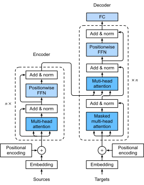

```{.python .input}
%load_ext d2lbook.tab
tab.interact_select('mxnet', 'pytorch', 'tensorflow', 'jax')
```

# Transformer架构
:label:`sec_transformer`


我们已经在 :numref:`subsec_cnn-rnn-self-attention` 中比较了CNN、RNN和自注意力。值得注意的是，自注意力既能并行计算，又具有最短的最大路径长度。因此，用自注意力来设计深度架构是很有吸引力的。早期的自注意力模型仍然依赖RNN来获得输入的表示 :cite:`Cheng.Dong.Lapata.2016,Lin.Feng.Santos.ea.2017,Paulus.Xiong.Socher.2017`，与之不同，Transformer模型完全基于注意力机制，没有任何卷积层或循环层 :cite:`Vaswani.Shazeer.Parmar.ea.2017`。尽管Transformer最初是为文本数据上的序列到序列学习而提出的，但如今它已广泛出现在各种现代深度学习应用中，例如语言、视觉、语音和强化学习等领域。

```{.python .input}
%%tab mxnet
from d2l import mxnet as d2l
import math
from mxnet import autograd, init, np, npx
from mxnet.gluon import nn
import pandas as pd
npx.set_np()
```

```{.python .input}
%%tab pytorch
from d2l import torch as d2l
import math
import pandas as pd
import torch
from torch import nn
```

```{.python .input}
%%tab tensorflow
from d2l import tensorflow as d2l
import numpy as np
import pandas as pd
import tensorflow as tf
```

```{.python .input}
%%tab jax
from d2l import jax as d2l
from flax import linen as nn
from jax import numpy as jnp
import jax
import math
import pandas as pd
```

## 模型

作为编码器-解码器架构的一个实例，Transformer的整体架构如 :numref:`fig_transformer` 所示。可以看到，Transformer由编码器和解码器组成。与 :numref:`fig_s2s_attention_details` 中用于序列到序列学习的Bahdanau注意力不同，这里的输入（源）序列和输出（目标）序列的嵌入在送入编码器和解码器之前都加上了位置编码，而编码器和解码器则由基于自注意力的模块堆叠而成。


:width:`320px`
:label:`fig_transformer`


现在我们概述 :numref:`fig_transformer` 中Transformer架构的总体情况。概括而言，Transformer编码器由多个相同的层堆叠而成，其中每一层有两个子层（每个子层均记为$\textrm{sublayer}$）。第一个子层是多头自注意力汇聚，第二个子层是逐位置的前馈网络。具体而言，在编码器的自注意力中，查询、键和值都来自上一个编码器层的输出。受 :numref:`sec_resnet` 中ResNet设计的启发，两个子层周围都采用了残差连接。在Transformer中，对于序列任意位置上的任意输入$\mathbf{x} \in \mathbb{R}^d$，我们要求$\textrm{sublayer}(\mathbf{x}) \in \mathbb{R}^d$，以便残差连接$\mathbf{x} + \textrm{sublayer}(\mathbf{x}) \in \mathbb{R}^d$是可行的。残差连接带来的这个加法之后紧接着进行层规范化 :cite:`Ba.Kiros.Hinton.2016`。因此，Transformer编码器为输入序列的每个位置输出一个$d$维向量表示。

Transformer解码器同样由多个相同的层堆叠而成，这些层也带有残差连接和层规范化。除了编码器中描述的两个子层之外，解码器在这两个子层之间还插入了第三个子层，称为编码器-解码器注意力（encoder-decoder attention）。在编码器-解码器注意力中，查询来自解码器自注意力子层的输出，而键和值来自Transformer编码器的输出。在解码器自注意力中，查询、键和值都来自上一个解码器层的输出。然而，解码器中的每个位置只允许关注解码器中截至该位置的所有位置。这种*掩码的*注意力保留了自回归特性，确保预测只依赖于那些已经生成的输出词元。


我们已经在 :numref:`sec_multihead-attention` 中描述并实现了基于缩放点积的多头注意力，在 :numref:`subsec_positional-encoding` 中描述并实现了位置编码。接下来，我们将实现Transformer模型的其余部分。

## [**逐位置的前馈网络**]
:label:`subsec_positionwise-ffn`

逐位置的前馈网络使用同一个MLP变换序列所有位置上的表示。这就是我们称其为*逐位置的*的原因。在下面的实现中，形状为（批量大小，时间步数或词元序列长度，隐藏单元数或特征维数）的输入`X`将经由一个两层的MLP变换为形状为（批量大小，时间步数，`ffn_num_outputs`）的输出张量。

```{.python .input}
%%tab mxnet
class PositionWiseFFN(nn.Block):  #@save
    """The positionwise feed-forward network."""
    def __init__(self, ffn_num_hiddens, ffn_num_outputs):
        super().__init__()
        self.dense1 = nn.Dense(ffn_num_hiddens, flatten=False,
                               activation='relu')
        self.dense2 = nn.Dense(ffn_num_outputs, flatten=False)

    def forward(self, X):
        return self.dense2(self.dense1(X))
```

```{.python .input}
%%tab pytorch
class PositionWiseFFN(nn.Module):  #@save
    """The positionwise feed-forward network."""
    def __init__(self, ffn_num_hiddens, ffn_num_outputs):
        super().__init__()
        self.dense1 = nn.LazyLinear(ffn_num_hiddens)
        self.relu = nn.ReLU()
        self.dense2 = nn.LazyLinear(ffn_num_outputs)

    def forward(self, X):
        return self.dense2(self.relu(self.dense1(X)))
```

```{.python .input}
%%tab tensorflow
class PositionWiseFFN(tf.keras.layers.Layer):  #@save
    """The positionwise feed-forward network."""
    def __init__(self, ffn_num_hiddens, ffn_num_outputs):
        super().__init__()
        self.dense1 = tf.keras.layers.Dense(ffn_num_hiddens)
        self.relu = tf.keras.layers.ReLU()
        self.dense2 = tf.keras.layers.Dense(ffn_num_outputs)

    def call(self, X):
        return self.dense2(self.relu(self.dense1(X)))
```

```{.python .input}
%%tab jax
class PositionWiseFFN(nn.Module):  #@save
    """The positionwise feed-forward network."""
    ffn_num_hiddens: int
    ffn_num_outputs: int

    def setup(self):
        self.dense1 = nn.Dense(self.ffn_num_hiddens)
        self.dense2 = nn.Dense(self.ffn_num_outputs)

    def __call__(self, X):
        return self.dense2(nn.relu(self.dense1(X)))
```

下面的例子表明，[**张量的最内层维度发生了变化**]，变为逐位置的前馈网络的输出数量。由于同一个MLP对所有位置进行变换，当这些位置上的输入都相同时，它们的输出也相同。

```{.python .input}
%%tab mxnet
ffn = PositionWiseFFN(4, 8)
ffn.initialize()
ffn(np.ones((2, 3, 4)))[0]
```

```{.python .input}
%%tab pytorch
ffn = PositionWiseFFN(4, 8)
ffn.eval()
ffn(d2l.ones((2, 3, 4)))[0]
```

```{.python .input}
%%tab tensorflow
ffn = PositionWiseFFN(4, 8)
ffn(tf.ones((2, 3, 4)))[0]
```

```{.python .input}
%%tab jax
ffn = PositionWiseFFN(4, 8)
ffn.init_with_output(d2l.get_key(), jnp.ones((2, 3, 4)))[0][0]
```

## 残差连接和层规范化

现在我们关注 :numref:`fig_transformer` 中的“加与规范化”（add & norm）组件。正如本节开头所描述的，它是一个残差连接，后面紧接着层规范化。两者都是构建有效的深度架构的关键。

在 :numref:`sec_batch_norm` 中，我们解释了批量规范化如何在一个小批量内的各样例之间重新中心化和重新缩放。如 :numref:`subsec_layer-normalization-in-bn` 中所讨论的，层规范化与批量规范化相同，只不过前者在特征维度上进行规范化，因而享有尺度无关和批量大小无关的好处。尽管批量规范化在计算机视觉中应用广泛，但在自然语言处理任务中，它的经验效果通常不如层规范化，因为自然语言处理任务的输入往往是变长序列。

下面的代码片段[**比较了层规范化和批量规范化在不同维度上的规范化**]。

```{.python .input}
%%tab mxnet
ln = nn.LayerNorm()
ln.initialize()
bn = nn.BatchNorm()
bn.initialize()
X = d2l.tensor([[1, 2], [2, 3]])
# Compute mean and variance from X in the training mode
with autograd.record():
    print('layer norm:', ln(X), '\nbatch norm:', bn(X))
```

```{.python .input}
%%tab pytorch
ln = nn.LayerNorm(2)
bn = nn.LazyBatchNorm1d()
X = d2l.tensor([[1, 2], [2, 3]], dtype=torch.float32)
# Compute mean and variance from X in the training mode
print('layer norm:', ln(X), '\nbatch norm:', bn(X))
```

```{.python .input}
%%tab tensorflow
ln = tf.keras.layers.LayerNormalization()
bn = tf.keras.layers.BatchNormalization()
X = tf.constant([[1, 2], [2, 3]], dtype=tf.float32)
print('layer norm:', ln(X), '\nbatch norm:', bn(X, training=True))
```

```{.python .input}
%%tab jax
ln = nn.LayerNorm()
bn = nn.BatchNorm()
X = d2l.tensor([[1, 2], [2, 3]], dtype=d2l.float32)
# Compute mean and variance from X in the training mode
print('layer norm:', ln.init_with_output(d2l.get_key(), X)[0],
      '\nbatch norm:', bn.init_with_output(d2l.get_key(), X,
                                           use_running_average=False)[0])
```

现在我们可以实现`AddNorm`类，[**它使用残差连接，后接层规范化**]。此外还应用暂退法进行正则化。

```{.python .input}
%%tab mxnet
class AddNorm(nn.Block):  #@save
    """The residual connection followed by layer normalization."""
    def __init__(self, dropout):
        super().__init__()
        self.dropout = nn.Dropout(dropout)
        self.ln = nn.LayerNorm()

    def forward(self, X, Y):
        return self.ln(self.dropout(Y) + X)
```

```{.python .input}
%%tab pytorch
class AddNorm(nn.Module):  #@save
    """The residual connection followed by layer normalization."""
    def __init__(self, norm_shape, dropout):
        super().__init__()
        self.dropout = nn.Dropout(dropout)
        self.ln = nn.LayerNorm(norm_shape)

    def forward(self, X, Y):
        return self.ln(self.dropout(Y) + X)
```

```{.python .input}
%%tab tensorflow
class AddNorm(tf.keras.layers.Layer):  #@save
    """The residual connection followed by layer normalization."""
    def __init__(self, norm_shape, dropout):
        super().__init__()
        self.dropout = tf.keras.layers.Dropout(dropout)
        self.ln = tf.keras.layers.LayerNormalization(norm_shape)

    def call(self, X, Y, **kwargs):
        return self.ln(self.dropout(Y, **kwargs) + X)
```

```{.python .input}
%%tab jax
class AddNorm(nn.Module):  #@save
    """The residual connection followed by layer normalization."""
    dropout: int

    @nn.compact
    def __call__(self, X, Y, training=False):
        return nn.LayerNorm()(
            nn.Dropout(self.dropout)(Y, deterministic=not training) + X)
```

残差连接要求两个输入具有相同的形状，以便[**加法运算之后输出张量也具有相同的形状**]。

```{.python .input}
%%tab mxnet
add_norm = AddNorm(0.5)
add_norm.initialize()
shape = (2, 3, 4)
d2l.check_shape(add_norm(d2l.ones(shape), d2l.ones(shape)), shape)
```

```{.python .input}
%%tab pytorch
add_norm = AddNorm(4, 0.5)
shape = (2, 3, 4)
d2l.check_shape(add_norm(d2l.ones(shape), d2l.ones(shape)), shape)
```

```{.python .input}
%%tab tensorflow
# Normalized_shape is: [i for i in range(len(input.shape))][1:]
add_norm = AddNorm([1, 2], 0.5)
shape = (2, 3, 4)
d2l.check_shape(add_norm(tf.ones(shape), tf.ones(shape), training=False),
                shape)
```

```{.python .input}
%%tab jax
add_norm = AddNorm(0.5)
shape = (2, 3, 4)
output, _ = add_norm.init_with_output(d2l.get_key(), d2l.ones(shape),
                                      d2l.ones(shape))
d2l.check_shape(output, shape)
```

## 编码器
:label:`subsec_transformer-encoder`

现在我们已经有了组装Transformer编码器所需的全部基本组件，先从实现[**编码器中的单个层**]开始。下面的`TransformerEncoderBlock`类包含两个子层：多头自注意力和逐位置的前馈网络，两个子层周围都采用了残差连接，后接层规范化。

```{.python .input}
%%tab mxnet
class TransformerEncoderBlock(nn.Block):  #@save
    """The Transformer encoder block."""
    def __init__(self, num_hiddens, ffn_num_hiddens, num_heads, dropout,
                 use_bias=False):
        super().__init__()
        self.attention = d2l.MultiHeadAttention(
            num_hiddens, num_heads, dropout, use_bias)
        self.addnorm1 = AddNorm(dropout)
        self.ffn = PositionWiseFFN(ffn_num_hiddens, num_hiddens)
        self.addnorm2 = AddNorm(dropout)

    def forward(self, X, valid_lens):
        Y = self.addnorm1(X, self.attention(X, X, X, valid_lens))
        return self.addnorm2(Y, self.ffn(Y))
```

```{.python .input}
%%tab pytorch
class TransformerEncoderBlock(nn.Module):  #@save
    """The Transformer encoder block."""
    def __init__(self, num_hiddens, ffn_num_hiddens, num_heads, dropout,
                 use_bias=False):
        super().__init__()
        self.attention = d2l.MultiHeadAttention(num_hiddens, num_heads,
                                                dropout, use_bias)
        self.addnorm1 = AddNorm(num_hiddens, dropout)
        self.ffn = PositionWiseFFN(ffn_num_hiddens, num_hiddens)
        self.addnorm2 = AddNorm(num_hiddens, dropout)

    def forward(self, X, valid_lens):
        Y = self.addnorm1(X, self.attention(X, X, X, valid_lens))
        return self.addnorm2(Y, self.ffn(Y))
```

```{.python .input}
%%tab tensorflow
class TransformerEncoderBlock(tf.keras.layers.Layer):  #@save
    """The Transformer encoder block."""
    def __init__(self, key_size, query_size, value_size, num_hiddens,
                 norm_shape, ffn_num_hiddens, num_heads, dropout, bias=False):
        super().__init__()
        self.attention = d2l.MultiHeadAttention(
            key_size, query_size, value_size, num_hiddens, num_heads, dropout,
            bias)
        self.addnorm1 = AddNorm(norm_shape, dropout)
        self.ffn = PositionWiseFFN(ffn_num_hiddens, num_hiddens)
        self.addnorm2 = AddNorm(norm_shape, dropout)

    def call(self, X, valid_lens, **kwargs):
        Y = self.addnorm1(X, self.attention(X, X, X, valid_lens, **kwargs),
                          **kwargs)
        return self.addnorm2(Y, self.ffn(Y), **kwargs)
```

```{.python .input}
%%tab jax
class TransformerEncoderBlock(nn.Module):  #@save
    """The Transformer encoder block."""
    num_hiddens: int
    ffn_num_hiddens: int
    num_heads: int
    dropout: float
    use_bias: bool = False

    def setup(self):
        self.attention = d2l.MultiHeadAttention(self.num_hiddens, self.num_heads,
                                                self.dropout, self.use_bias)
        self.addnorm1 = AddNorm(self.dropout)
        self.ffn = PositionWiseFFN(self.ffn_num_hiddens, self.num_hiddens)
        self.addnorm2 = AddNorm(self.dropout)

    def __call__(self, X, valid_lens, training=False):
        output, attention_weights = self.attention(X, X, X, valid_lens,
                                                   training=training)
        Y = self.addnorm1(X, output, training=training)
        return self.addnorm2(Y, self.ffn(Y), training=training), attention_weights
```

可以看到，[**Transformer编码器中没有哪一层会改变其输入的形状**]。

```{.python .input}
%%tab mxnet
X = d2l.ones((2, 100, 24))
valid_lens = d2l.tensor([3, 2])
encoder_blk = TransformerEncoderBlock(24, 48, 8, 0.5)
encoder_blk.initialize()
d2l.check_shape(encoder_blk(X, valid_lens), X.shape)
```

```{.python .input}
%%tab pytorch
X = d2l.ones((2, 100, 24))
valid_lens = d2l.tensor([3, 2])
encoder_blk = TransformerEncoderBlock(24, 48, 8, 0.5)
encoder_blk.eval()
d2l.check_shape(encoder_blk(X, valid_lens), X.shape)
```

```{.python .input}
%%tab tensorflow
X = tf.ones((2, 100, 24))
valid_lens = tf.constant([3, 2])
norm_shape = [i for i in range(len(X.shape))][1:]
encoder_blk = TransformerEncoderBlock(24, 24, 24, 24, norm_shape, 48, 8, 0.5)
d2l.check_shape(encoder_blk(X, valid_lens, training=False), X.shape)
```

```{.python .input}
%%tab jax
X = jnp.ones((2, 100, 24))
valid_lens = jnp.array([3, 2])
encoder_blk = TransformerEncoderBlock(24, 48, 8, 0.5)
(output, _), _ = encoder_blk.init_with_output(d2l.get_key(), X, valid_lens,
                                              training=False)
d2l.check_shape(output, X.shape)
```

在下面的[**Transformer编码器**]实现中，我们堆叠`num_blks`个上述`TransformerEncoderBlock`类的实例。由于我们使用的固定位置编码的值始终在$-1$和$1$之间，所以在将输入嵌入与位置编码相加之前，先把可学习的输入嵌入的值乘以嵌入维数的平方根进行重新缩放。

```{.python .input}
%%tab mxnet
class TransformerEncoder(d2l.Encoder):  #@save
    """The Transformer encoder."""
    def __init__(self, vocab_size, num_hiddens, ffn_num_hiddens,
                 num_heads, num_blks, dropout, use_bias=False):
        super().__init__()
        self.num_hiddens = num_hiddens
        self.embedding = nn.Embedding(vocab_size, num_hiddens)
        self.pos_encoding = d2l.PositionalEncoding(num_hiddens, dropout)
        self.blks = nn.Sequential()
        for _ in range(num_blks):
            self.blks.add(TransformerEncoderBlock(
                num_hiddens, ffn_num_hiddens, num_heads, dropout, use_bias))
        self.initialize()

    def forward(self, X, valid_lens):
        # Since positional encoding values are between -1 and 1, the embedding
        # values are multiplied by the square root of the embedding dimension
        # to rescale before they are summed up
        X = self.pos_encoding(self.embedding(X) * math.sqrt(self.num_hiddens))
        self.attention_weights = [None] * len(self.blks)
        for i, blk in enumerate(self.blks):
            X = blk(X, valid_lens)
            self.attention_weights[
                i] = blk.attention.attention.attention_weights
        return X
```

```{.python .input}
%%tab pytorch
class TransformerEncoder(d2l.Encoder):  #@save
    """The Transformer encoder."""
    def __init__(self, vocab_size, num_hiddens, ffn_num_hiddens,
                 num_heads, num_blks, dropout, use_bias=False):
        super().__init__()
        self.num_hiddens = num_hiddens
        self.embedding = nn.Embedding(vocab_size, num_hiddens)
        self.pos_encoding = d2l.PositionalEncoding(num_hiddens, dropout)
        self.blks = nn.Sequential()
        for i in range(num_blks):
            self.blks.add_module("block"+str(i), TransformerEncoderBlock(
                num_hiddens, ffn_num_hiddens, num_heads, dropout, use_bias))

    def forward(self, X, valid_lens):
        # Since positional encoding values are between -1 and 1, the embedding
        # values are multiplied by the square root of the embedding dimension
        # to rescale before they are summed up
        X = self.pos_encoding(self.embedding(X) * math.sqrt(self.num_hiddens))
        self.attention_weights = [None] * len(self.blks)
        for i, blk in enumerate(self.blks):
            X = blk(X, valid_lens)
            self.attention_weights[
                i] = blk.attention.attention.attention_weights
        return X
```

```{.python .input}
%%tab tensorflow
class TransformerEncoder(d2l.Encoder):  #@save
    """The Transformer encoder."""
    def __init__(self, vocab_size, key_size, query_size, value_size,
                 num_hiddens, norm_shape, ffn_num_hiddens, num_heads,
                 num_blks, dropout, bias=False):
        super().__init__()
        self.num_hiddens = num_hiddens
        self.embedding = tf.keras.layers.Embedding(vocab_size, num_hiddens)
        self.pos_encoding = d2l.PositionalEncoding(num_hiddens, dropout)
        self.blks = [TransformerEncoderBlock(
            key_size, query_size, value_size, num_hiddens, norm_shape,
            ffn_num_hiddens, num_heads, dropout, bias) for _ in range(
            num_blks)]

    def call(self, X, valid_lens, **kwargs):
        # Since positional encoding values are between -1 and 1, the embedding
        # values are multiplied by the square root of the embedding dimension
        # to rescale before they are summed up
        X = self.pos_encoding(self.embedding(X) * tf.math.sqrt(
            tf.cast(self.num_hiddens, dtype=tf.float32)), **kwargs)
        self.attention_weights = [None] * len(self.blks)
        for i, blk in enumerate(self.blks):
            X = blk(X, valid_lens, **kwargs)
            self.attention_weights[
                i] = blk.attention.attention.attention_weights
        return X
```

```{.python .input}
%%tab jax
class TransformerEncoder(d2l.Encoder):  #@save
    """The Transformer encoder."""
    vocab_size: int
    num_hiddens:int
    ffn_num_hiddens: int
    num_heads: int
    num_blks: int
    dropout: float
    use_bias: bool = False

    def setup(self):
        self.embedding = nn.Embed(self.vocab_size, self.num_hiddens)
        self.pos_encoding = d2l.PositionalEncoding(self.num_hiddens, self.dropout)
        self.blks = [TransformerEncoderBlock(self.num_hiddens,
                                             self.ffn_num_hiddens,
                                             self.num_heads,
                                             self.dropout, self.use_bias)
                     for _ in range(self.num_blks)]

    def __call__(self, X, valid_lens, training=False):
        # Since positional encoding values are between -1 and 1, the embedding
        # values are multiplied by the square root of the embedding dimension
        # to rescale before they are summed up
        X = self.embedding(X) * math.sqrt(self.num_hiddens)
        X = self.pos_encoding(X, training=training)
        attention_weights = [None] * len(self.blks)
        for i, blk in enumerate(self.blks):
            X, attention_w = blk(X, valid_lens, training=training)
            attention_weights[i] = attention_w
        # Flax sow API is used to capture intermediate variables
        self.sow('intermediates', 'enc_attention_weights', attention_weights)
        return X
```

下面我们指定超参数来[**创建一个两层的Transformer编码器**]。Transformer编码器输出的形状为（批量大小，时间步数，`num_hiddens`）。

```{.python .input}
%%tab mxnet
encoder = TransformerEncoder(200, 24, 48, 8, 2, 0.5)
d2l.check_shape(encoder(np.ones((2, 100)), valid_lens), (2, 100, 24))
```

```{.python .input}
%%tab pytorch
encoder = TransformerEncoder(200, 24, 48, 8, 2, 0.5)
d2l.check_shape(encoder(d2l.ones((2, 100), dtype=torch.long), valid_lens),
                (2, 100, 24))
```

```{.python .input}
%%tab tensorflow
encoder = TransformerEncoder(200, 24, 24, 24, 24, [1, 2], 48, 8, 2, 0.5)
d2l.check_shape(encoder(tf.ones((2, 100)), valid_lens, training=False),
                (2, 100, 24))
```

```{.python .input}
%%tab jax
encoder = TransformerEncoder(200, 24, 48, 8, 2, 0.5)
d2l.check_shape(encoder.init_with_output(d2l.get_key(),
                                         jnp.ones((2, 100), dtype=jnp.int32),
                                         valid_lens)[0],
                (2, 100, 24))
```

## 解码器

如 :numref:`fig_transformer` 所示，[**Transformer解码器由多个相同的层组成**]。每一层都在下面的`TransformerDecoderBlock`类中实现，该类包含三个子层：解码器自注意力、编码器-解码器注意力和逐位置的前馈网络。这些子层周围都采用了残差连接，后接层规范化。


正如本节前面所描述的，在掩码的多头解码器自注意力（第一个子层）中，查询、键和值都来自上一个解码器层的输出。训练序列到序列模型时，输出序列所有位置（时间步）上的词元都是已知的。然而，在预测时，输出序列是逐个词元生成的；因此，在解码器的任意时间步，只有已经生成的词元才能用于解码器自注意力。为了在解码器中保留自回归特性，其掩码自注意力通过指定`dec_valid_lens`，使得任何查询都只关注解码器中截至该查询位置的所有位置。

```{.python .input}
%%tab mxnet
class TransformerDecoderBlock(nn.Block):
    # The i-th block in the Transformer decoder
    def __init__(self, num_hiddens, ffn_num_hiddens, num_heads, dropout, i):
        super().__init__()
        self.i = i
        self.attention1 = d2l.MultiHeadAttention(num_hiddens, num_heads,
                                                 dropout)
        self.addnorm1 = AddNorm(dropout)
        self.attention2 = d2l.MultiHeadAttention(num_hiddens, num_heads,
                                                 dropout)
        self.addnorm2 = AddNorm(dropout)
        self.ffn = PositionWiseFFN(ffn_num_hiddens, num_hiddens)
        self.addnorm3 = AddNorm(dropout)

    def forward(self, X, state):
        enc_outputs, enc_valid_lens = state[0], state[1]
        # During training, all the tokens of any output sequence are processed
        # at the same time, so state[2][self.i] is None as initialized. When
        # decoding any output sequence token by token during prediction,
        # state[2][self.i] contains representations of the decoded output at
        # the i-th block up to the current time step
        if state[2][self.i] is None:
            key_values = X
        else:
            key_values = np.concatenate((state[2][self.i], X), axis=1)
        state[2][self.i] = key_values

        if autograd.is_training():
            batch_size, num_steps, _ = X.shape
            # Shape of dec_valid_lens: (batch_size, num_steps), where every
            # row is [1, 2, ..., num_steps]
            dec_valid_lens = np.tile(np.arange(1, num_steps + 1, ctx=X.ctx),
                                     (batch_size, 1))
        else:
            dec_valid_lens = None
        # Self-attention
        X2 = self.attention1(X, key_values, key_values, dec_valid_lens)
        Y = self.addnorm1(X, X2)
        # Encoder-decoder attention. Shape of enc_outputs:
        # (batch_size, num_steps, num_hiddens)
        Y2 = self.attention2(Y, enc_outputs, enc_outputs, enc_valid_lens)
        Z = self.addnorm2(Y, Y2)
        return self.addnorm3(Z, self.ffn(Z)), state
```

```{.python .input}
%%tab pytorch
class TransformerDecoderBlock(nn.Module):
    # The i-th block in the Transformer decoder
    def __init__(self, num_hiddens, ffn_num_hiddens, num_heads, dropout, i):
        super().__init__()
        self.i = i
        self.attention1 = d2l.MultiHeadAttention(num_hiddens, num_heads,
                                                 dropout)
        self.addnorm1 = AddNorm(num_hiddens, dropout)
        self.attention2 = d2l.MultiHeadAttention(num_hiddens, num_heads,
                                                 dropout)
        self.addnorm2 = AddNorm(num_hiddens, dropout)
        self.ffn = PositionWiseFFN(ffn_num_hiddens, num_hiddens)
        self.addnorm3 = AddNorm(num_hiddens, dropout)

    def forward(self, X, state):
        enc_outputs, enc_valid_lens = state[0], state[1]
        # During training, all the tokens of any output sequence are processed
        # at the same time, so state[2][self.i] is None as initialized. When
        # decoding any output sequence token by token during prediction,
        # state[2][self.i] contains representations of the decoded output at
        # the i-th block up to the current time step
        if state[2][self.i] is None:
            key_values = X
        else:
            key_values = torch.cat((state[2][self.i], X), dim=1)
        state[2][self.i] = key_values
        if self.training:
            batch_size, num_steps, _ = X.shape
            # Shape of dec_valid_lens: (batch_size, num_steps), where every
            # row is [1, 2, ..., num_steps]
            dec_valid_lens = torch.arange(
                1, num_steps + 1, device=X.device).repeat(batch_size, 1)
        else:
            dec_valid_lens = None
        # Self-attention
        X2 = self.attention1(X, key_values, key_values, dec_valid_lens)
        Y = self.addnorm1(X, X2)
        # Encoder-decoder attention. Shape of enc_outputs:
        # (batch_size, num_steps, num_hiddens)
        Y2 = self.attention2(Y, enc_outputs, enc_outputs, enc_valid_lens)
        Z = self.addnorm2(Y, Y2)
        return self.addnorm3(Z, self.ffn(Z)), state
```

```{.python .input}
%%tab tensorflow
class TransformerDecoderBlock(tf.keras.layers.Layer):
    # The i-th block in the Transformer decoder
    def __init__(self, key_size, query_size, value_size, num_hiddens,
                 norm_shape, ffn_num_hiddens, num_heads, dropout, i):
        super().__init__()
        self.i = i
        self.attention1 = d2l.MultiHeadAttention(
            key_size, query_size, value_size, num_hiddens, num_heads, dropout)
        self.addnorm1 = AddNorm(norm_shape, dropout)
        self.attention2 = d2l.MultiHeadAttention(
            key_size, query_size, value_size, num_hiddens, num_heads, dropout)
        self.addnorm2 = AddNorm(norm_shape, dropout)
        self.ffn = PositionWiseFFN(ffn_num_hiddens, num_hiddens)
        self.addnorm3 = AddNorm(norm_shape, dropout)

    def call(self, X, state, **kwargs):
        enc_outputs, enc_valid_lens = state[0], state[1]
        # During training, all the tokens of any output sequence are processed
        # at the same time, so state[2][self.i] is None as initialized. When
        # decoding any output sequence token by token during prediction,
        # state[2][self.i] contains representations of the decoded output at
        # the i-th block up to the current time step
        if state[2][self.i] is None:
            key_values = X
        else:
            key_values = tf.concat((state[2][self.i], X), axis=1)
        state[2][self.i] = key_values
        if kwargs["training"]:
            batch_size, num_steps, _ = X.shape
            # Shape of dec_valid_lens: (batch_size, num_steps), where every
            # row is [1, 2, ..., num_steps]
            dec_valid_lens = tf.repeat(
                tf.reshape(tf.range(1, num_steps + 1),
                           shape=(-1, num_steps)), repeats=batch_size, axis=0)
        else:
            dec_valid_lens = None
        # Self-attention
        X2 = self.attention1(X, key_values, key_values, dec_valid_lens,
                             **kwargs)
        Y = self.addnorm1(X, X2, **kwargs)
        # Encoder-decoder attention. Shape of enc_outputs:
        # (batch_size, num_steps, num_hiddens)
        Y2 = self.attention2(Y, enc_outputs, enc_outputs, enc_valid_lens,
                             **kwargs)
        Z = self.addnorm2(Y, Y2, **kwargs)
        return self.addnorm3(Z, self.ffn(Z), **kwargs), state
```

```{.python .input}
%%tab jax
class TransformerDecoderBlock(nn.Module):
    # The i-th block in the Transformer decoder
    num_hiddens: int
    ffn_num_hiddens: int
    num_heads: int
    dropout: float
    i: int

    def setup(self):
        self.attention1 = d2l.MultiHeadAttention(self.num_hiddens,
                                                 self.num_heads,
                                                 self.dropout)
        self.addnorm1 = AddNorm(self.dropout)
        self.attention2 = d2l.MultiHeadAttention(self.num_hiddens,
                                                 self.num_heads,
                                                 self.dropout)
        self.addnorm2 = AddNorm(self.dropout)
        self.ffn = PositionWiseFFN(self.ffn_num_hiddens, self.num_hiddens)
        self.addnorm3 = AddNorm(self.dropout)

    def __call__(self, X, state, training=False):
        enc_outputs, enc_valid_lens = state[0], state[1]
        # During training, all the tokens of any output sequence are processed
        # at the same time, so state[2][self.i] is None as initialized. When
        # decoding any output sequence token by token during prediction,
        # state[2][self.i] contains representations of the decoded output at
        # the i-th block up to the current time step
        if state[2][self.i] is None:
            key_values = X
        else:
            key_values = jnp.concatenate((state[2][self.i], X), axis=1)
        state[2][self.i] = key_values
        if training:
            batch_size, num_steps, _ = X.shape
            # Shape of dec_valid_lens: (batch_size, num_steps), where every
            # row is [1, 2, ..., num_steps]
            dec_valid_lens = jnp.tile(jnp.arange(1, num_steps + 1),
                                      (batch_size, 1))
        else:
            dec_valid_lens = None
        # Self-attention
        X2, attention_w1 = self.attention1(X, key_values, key_values,
                                           dec_valid_lens, training=training)
        Y = self.addnorm1(X, X2, training=training)
        # Encoder-decoder attention. Shape of enc_outputs:
        # (batch_size, num_steps, num_hiddens)
        Y2, attention_w2 = self.attention2(Y, enc_outputs, enc_outputs,
                                           enc_valid_lens, training=training)
        Z = self.addnorm2(Y, Y2, training=training)
        return self.addnorm3(Z, self.ffn(Z), training=training), state, attention_w1, attention_w2
```

为了便于编码器-解码器注意力中的缩放点积运算，以及残差连接中的加法运算，[**解码器的特征维数（`num_hiddens`）与编码器的特征维数相同。**]

```{.python .input}
%%tab mxnet
decoder_blk = TransformerDecoderBlock(24, 48, 8, 0.5, 0)
decoder_blk.initialize()
X = np.ones((2, 100, 24))
state = [encoder_blk(X, valid_lens), valid_lens, [None]]
d2l.check_shape(decoder_blk(X, state)[0], X.shape)
```

```{.python .input}
%%tab pytorch
decoder_blk = TransformerDecoderBlock(24, 48, 8, 0.5, 0)
X = d2l.ones((2, 100, 24))
state = [encoder_blk(X, valid_lens), valid_lens, [None]]
d2l.check_shape(decoder_blk(X, state)[0], X.shape)
```

```{.python .input}
%%tab tensorflow
decoder_blk = TransformerDecoderBlock(24, 24, 24, 24, [1, 2], 48, 8, 0.5, 0)
X = tf.ones((2, 100, 24))
state = [encoder_blk(X, valid_lens), valid_lens, [None]]
d2l.check_shape(decoder_blk(X, state, training=False)[0], X.shape)
```

```{.python .input}
%%tab jax
decoder_blk = TransformerDecoderBlock(24, 48, 8, 0.5, 0)
X = d2l.ones((2, 100, 24))
state = [encoder_blk.init_with_output(d2l.get_key(), X, valid_lens)[0][0],
         valid_lens, [None]]
d2l.check_shape(decoder_blk.init_with_output(d2l.get_key(), X, state)[0][0],
                X.shape)
```

现在我们[**构造完整的Transformer解码器**]，它由`num_blks`个`TransformerDecoderBlock`实例组成。最后，用一个全连接层为所有`vocab_size`个可能的输出词元计算预测。解码器自注意力权重和编码器-解码器注意力权重都被保存下来，以便后续可视化。

```{.python .input}
%%tab mxnet
class TransformerDecoder(d2l.AttentionDecoder):
    def __init__(self, vocab_size, num_hiddens, ffn_num_hiddens, num_heads,
                 num_blks, dropout):
        super().__init__()
        self.num_hiddens = num_hiddens
        self.num_blks = num_blks
        self.embedding = nn.Embedding(vocab_size, num_hiddens)
        self.pos_encoding = d2l.PositionalEncoding(num_hiddens, dropout)
        self.blks = nn.Sequential()
        for i in range(num_blks):
            self.blks.add(TransformerDecoderBlock(
                num_hiddens, ffn_num_hiddens, num_heads, dropout, i))
        self.dense = nn.Dense(vocab_size, flatten=False)
        self.initialize()

    def init_state(self, enc_outputs, enc_valid_lens):
        return [enc_outputs, enc_valid_lens, [None] * self.num_blks]

    def forward(self, X, state):
        X = self.pos_encoding(self.embedding(X) * math.sqrt(self.num_hiddens))
        self._attention_weights = [[None] * len(self.blks) for _ in range (2)]
        for i, blk in enumerate(self.blks):
            X, state = blk(X, state)
            # Decoder self-attention weights
            self._attention_weights[0][
                i] = blk.attention1.attention.attention_weights
            # Encoder-decoder attention weights
            self._attention_weights[1][
                i] = blk.attention2.attention.attention_weights
        return self.dense(X), state

    @property
    def attention_weights(self):
        return self._attention_weights
```

```{.python .input}
%%tab pytorch
class TransformerDecoder(d2l.AttentionDecoder):
    def __init__(self, vocab_size, num_hiddens, ffn_num_hiddens, num_heads,
                 num_blks, dropout):
        super().__init__()
        self.num_hiddens = num_hiddens
        self.num_blks = num_blks
        self.embedding = nn.Embedding(vocab_size, num_hiddens)
        self.pos_encoding = d2l.PositionalEncoding(num_hiddens, dropout)
        self.blks = nn.Sequential()
        for i in range(num_blks):
            self.blks.add_module("block"+str(i), TransformerDecoderBlock(
                num_hiddens, ffn_num_hiddens, num_heads, dropout, i))
        self.dense = nn.LazyLinear(vocab_size)

    def init_state(self, enc_outputs, enc_valid_lens):
        return [enc_outputs, enc_valid_lens, [None] * self.num_blks]

    def forward(self, X, state):
        X = self.pos_encoding(self.embedding(X) * math.sqrt(self.num_hiddens))
        self._attention_weights = [[None] * len(self.blks) for _ in range (2)]
        for i, blk in enumerate(self.blks):
            X, state = blk(X, state)
            # Decoder self-attention weights
            self._attention_weights[0][
                i] = blk.attention1.attention.attention_weights
            # Encoder-decoder attention weights
            self._attention_weights[1][
                i] = blk.attention2.attention.attention_weights
        return self.dense(X), state

    @property
    def attention_weights(self):
        return self._attention_weights
```

```{.python .input}
%%tab tensorflow
class TransformerDecoder(d2l.AttentionDecoder):
    def __init__(self, vocab_size, key_size, query_size, value_size,
                 num_hiddens, norm_shape, ffn_num_hiddens, num_heads,
                 num_blks, dropout):
        super().__init__()
        self.num_hiddens = num_hiddens
        self.num_blks = num_blks
        self.embedding = tf.keras.layers.Embedding(vocab_size, num_hiddens)
        self.pos_encoding = d2l.PositionalEncoding(num_hiddens, dropout)
        self.blks = [TransformerDecoderBlock(
            key_size, query_size, value_size, num_hiddens, norm_shape,
            ffn_num_hiddens, num_heads, dropout, i)
                     for i in range(num_blks)]
        self.dense = tf.keras.layers.Dense(vocab_size)

    def init_state(self, enc_outputs, enc_valid_lens):
        return [enc_outputs, enc_valid_lens, [None] * self.num_blks]

    def call(self, X, state, **kwargs):
        X = self.pos_encoding(self.embedding(X) * tf.math.sqrt(
            tf.cast(self.num_hiddens, dtype=tf.float32)), **kwargs)
        # 2 attention layers in decoder
        self._attention_weights = [[None] * len(self.blks) for _ in range(2)]
        for i, blk in enumerate(self.blks):
            X, state = blk(X, state, **kwargs)
            # Decoder self-attention weights
            self._attention_weights[0][i] = (
                blk.attention1.attention.attention_weights)
            # Encoder-decoder attention weights
            self._attention_weights[1][i] = (
                blk.attention2.attention.attention_weights)
        return self.dense(X), state

    @property
    def attention_weights(self):
        return self._attention_weights
```

```{.python .input}
%%tab jax
class TransformerDecoder(nn.Module):
    vocab_size: int
    num_hiddens: int
    ffn_num_hiddens: int
    num_heads: int
    num_blks: int
    dropout: float

    def setup(self):
        self.embedding = nn.Embed(self.vocab_size, self.num_hiddens)
        self.pos_encoding = d2l.PositionalEncoding(self.num_hiddens,
                                                   self.dropout)
        self.blks = [TransformerDecoderBlock(self.num_hiddens,
                                             self.ffn_num_hiddens,
                                             self.num_heads, self.dropout, i)
                     for i in range(self.num_blks)]
        self.dense = nn.Dense(self.vocab_size)

    def init_state(self, enc_outputs, enc_valid_lens):
        return [enc_outputs, enc_valid_lens, [None] * self.num_blks]

    def __call__(self, X, state, training=False):
        X = self.embedding(X) * jnp.sqrt(jnp.float32(self.num_hiddens))
        X = self.pos_encoding(X, training=training)
        attention_weights = [[None] * len(self.blks) for _ in range(2)]
        for i, blk in enumerate(self.blks):
            X, state, attention_w1, attention_w2 = blk(X, state,
                                                       training=training)
            # Decoder self-attention weights
            attention_weights[0][i] = attention_w1
            # Encoder-decoder attention weights
            attention_weights[1][i] = attention_w2
        # Flax sow API is used to capture intermediate variables
        self.sow('intermediates', 'dec_attention_weights', attention_weights)
        return self.dense(X), state
```

## [**训练**]

让我们按照Transformer架构实例化一个编码器-解码器模型。这里我们指定Transformer编码器和Transformer解码器都有两层，并使用4头注意力。如 :numref:`sec_seq2seq_training` 中那样，我们在英语-法语机器翻译数据集上训练Transformer模型进行序列到序列学习。

```{.python .input}
%%tab all
data = d2l.MTFraEng(batch_size=128)
num_hiddens, num_blks, dropout = 256, 2, 0.2
ffn_num_hiddens, num_heads = 64, 4
if tab.selected('tensorflow'):
    key_size, query_size, value_size = 256, 256, 256
    norm_shape = [2]
if tab.selected('pytorch', 'mxnet', 'jax'):
    encoder = TransformerEncoder(
        len(data.src_vocab), num_hiddens, ffn_num_hiddens, num_heads,
        num_blks, dropout)
    decoder = TransformerDecoder(
        len(data.tgt_vocab), num_hiddens, ffn_num_hiddens, num_heads,
        num_blks, dropout)
if tab.selected('mxnet', 'pytorch'):
    model = d2l.Seq2Seq(encoder, decoder, tgt_pad=data.tgt_vocab['<pad>'],
                        lr=0.001)
    trainer = d2l.Trainer(max_epochs=30, gradient_clip_val=1, num_gpus=1)
if tab.selected('jax'):
    model = d2l.Seq2Seq(encoder, decoder, tgt_pad=data.tgt_vocab['<pad>'],
                        lr=0.001, training=True)
    trainer = d2l.Trainer(max_epochs=30, gradient_clip_val=1, num_gpus=1)
if tab.selected('tensorflow'):
    with d2l.try_gpu():
        encoder = TransformerEncoder(
            len(data.src_vocab), key_size, query_size, value_size, num_hiddens,
            norm_shape, ffn_num_hiddens, num_heads, num_blks, dropout)
        decoder = TransformerDecoder(
            len(data.tgt_vocab), key_size, query_size, value_size, num_hiddens,
            norm_shape, ffn_num_hiddens, num_heads, num_blks, dropout)
        model = d2l.Seq2Seq(encoder, decoder, tgt_pad=data.tgt_vocab['<pad>'],
                            lr=0.001)
    trainer = d2l.Trainer(max_epochs=30, gradient_clip_val=1)
trainer.fit(model, data)
```

训练完成后，我们使用Transformer模型把[**几个英文句子**]翻译成法文，并计算它们的BLEU分数。

```{.python .input}
%%tab all
engs = ['go .', 'i lost .', 'he\'s calm .', 'i\'m home .']
fras = ['va !', 'j\'ai perdu .', 'il est calme .', 'je suis chez moi .']
if tab.selected('pytorch', 'mxnet', 'tensorflow'):
    preds, _ = model.predict_step(
        data.build(engs, fras), d2l.try_gpu(), data.num_steps)
if tab.selected('jax'):
    preds, _ = model.predict_step(
        trainer.state.params, data.build(engs, fras), data.num_steps)
for en, fr, p in zip(engs, fras, preds):
    translation = []
    for token in data.tgt_vocab.to_tokens(p):
        if token == '<eos>':
            break
        translation.append(token)
    print(f'{en} => {translation}, bleu,'
          f'{d2l.bleu(" ".join(translation), fr, k=2):.3f}')
```

让我们在把最后一个英文句子翻译成法文时[**可视化Transformer的注意力权重**]。编码器自注意力权重的形状为（编码器层数，注意力头数，`num_steps`或查询数，`num_steps`或键值对数）。

```{.python .input}
%%tab pytorch, mxnet, tensorflow
_, dec_attention_weights = model.predict_step(
    data.build([engs[-1]], [fras[-1]]), d2l.try_gpu(), data.num_steps, True)
enc_attention_weights = d2l.concat(model.encoder.attention_weights, 0)
shape = (num_blks, num_heads, -1, data.num_steps)
enc_attention_weights = d2l.reshape(enc_attention_weights, shape)
d2l.check_shape(enc_attention_weights,
                (num_blks, num_heads, data.num_steps, data.num_steps))
```

```{.python .input}
%%tab jax
_, (dec_attention_weights, enc_attention_weights) = model.predict_step(
    trainer.state.params, data.build([engs[-1]], [fras[-1]]),
    data.num_steps, True)
enc_attention_weights = d2l.concat(enc_attention_weights, 0)
shape = (num_blks, num_heads, -1, data.num_steps)
enc_attention_weights = d2l.reshape(enc_attention_weights, shape)
d2l.check_shape(enc_attention_weights,
                (num_blks, num_heads, data.num_steps, data.num_steps))
```

在编码器自注意力中，查询和键都来自同一个输入序列。由于填充词元不携带任何含义，在指定了输入序列的有效长度之后，就没有查询会关注填充词元所在的位置。下面逐行展示了两个层的多头注意力权重。每个头都基于查询、键和值的一个独立表示子空间独立地进行关注。

```{.python .input}
%%tab mxnet, tensorflow, jax
d2l.show_heatmaps(
    enc_attention_weights, xlabel='Key positions', ylabel='Query positions',
    titles=['Head %d' % i for i in range(1, 5)], figsize=(7, 3.5))
```

```{.python .input}
%%tab pytorch
d2l.show_heatmaps(
    enc_attention_weights.cpu(), xlabel='Key positions',
    ylabel='Query positions', titles=['Head %d' % i for i in range(1, 5)],
    figsize=(7, 3.5))
```

[**要可视化解码器自注意力权重和编码器-解码器注意力权重，我们需要进行更多的数据操作。**]例如，我们用零填充被掩码的注意力权重。请注意，解码器自注意力权重和编码器-解码器注意力权重具有相同的查询：序列起始词元，随后是输出词元，可能还有序列结束词元。

```{.python .input}
%%tab mxnet
dec_attention_weights_2d = [d2l.tensor(head[0]).tolist()
                            for step in dec_attention_weights
                            for attn in step for blk in attn for head in blk]
dec_attention_weights_filled = d2l.tensor(
    pd.DataFrame(dec_attention_weights_2d).fillna(0.0).values)
dec_attention_weights = d2l.reshape(dec_attention_weights_filled, (
    -1, 2, num_blks, num_heads, data.num_steps))
dec_self_attention_weights, dec_inter_attention_weights = \
    dec_attention_weights.transpose(1, 2, 3, 0, 4)
```

```{.python .input}
%%tab pytorch
dec_attention_weights_2d = [head[0].tolist()
                            for step in dec_attention_weights
                            for attn in step for blk in attn for head in blk]
dec_attention_weights_filled = d2l.tensor(
    pd.DataFrame(dec_attention_weights_2d).fillna(0.0).values)
shape = (-1, 2, num_blks, num_heads, data.num_steps)
dec_attention_weights = d2l.reshape(dec_attention_weights_filled, shape)
dec_self_attention_weights, dec_inter_attention_weights = \
    dec_attention_weights.permute(1, 2, 3, 0, 4)
```

```{.python .input}
%%tab tensorflow
dec_attention_weights_2d = [head[0] for step in dec_attention_weights
                            for attn in step
                            for blk in attn for head in blk]
dec_attention_weights_filled = tf.convert_to_tensor(
    np.asarray(pd.DataFrame(dec_attention_weights_2d).fillna(
        0.0).values).astype(np.float32))
dec_attention_weights = tf.reshape(dec_attention_weights_filled, shape=(
    -1, 2, num_blks, num_heads, data.num_steps))
dec_self_attention_weights, dec_inter_attention_weights = tf.transpose(
    dec_attention_weights, perm=(1, 2, 3, 0, 4))
```

```{.python .input}
%%tab jax
dec_attention_weights_2d = [head[0].tolist() for step in dec_attention_weights
                            for attn in step
                            for blk in attn for head in blk]
dec_attention_weights_filled = d2l.tensor(
    pd.DataFrame(dec_attention_weights_2d).fillna(0.0).values)
dec_attention_weights = dec_attention_weights_filled.reshape(
    (-1, 2, num_blks, num_heads, data.num_steps))
dec_self_attention_weights, dec_inter_attention_weights = \
    dec_attention_weights.transpose(1, 2, 3, 0, 4)
```

```{.python .input}
%%tab all
d2l.check_shape(dec_self_attention_weights,
                (num_blks, num_heads, data.num_steps, data.num_steps))
d2l.check_shape(dec_inter_attention_weights,
                (num_blks, num_heads, data.num_steps, data.num_steps))
```

由于解码器自注意力具有自回归特性，没有查询会关注查询位置之后的键值对。

```{.python .input}
%%tab all
d2l.show_heatmaps(
    dec_self_attention_weights[:, :, :, :],
    xlabel='Key positions', ylabel='Query positions',
    titles=['Head %d' % i for i in range(1, 5)], figsize=(7, 3.5))
```

与编码器自注意力的情形类似，通过指定输入序列的有效长度，[**输出序列中没有任何查询会关注输入序列中的那些填充词元。**]

```{.python .input}
%%tab all
d2l.show_heatmaps(
    dec_inter_attention_weights, xlabel='Key positions',
    ylabel='Query positions', titles=['Head %d' % i for i in range(1, 5)],
    figsize=(7, 3.5))
```

尽管Transformer架构最初是为序列到序列学习而提出的，但正如我们将在本书后面发现的那样，Transformer编码器或Transformer解码器往往会被单独用于不同的深度学习任务。

## 小结

Transformer是编码器-解码器架构的一个实例，不过在实践中，编码器或解码器都可以单独使用。
在Transformer架构中，多头自注意力用于表示输入序列和输出序列，而解码器必须通过掩码版本来保留自回归特性。
Transformer中的残差连接和层规范化对于训练非常深的模型都很重要。
Transformer模型中的逐位置的前馈网络使用同一个MLP变换序列所有位置上的表示。


## 练习

1. 在实验中训练一个更深的Transformer。它如何影响训练速度和翻译性能？
1. 在Transformer中用加性注意力替换缩放点积注意力是一个好主意吗？为什么？
1. 对于语言建模，我们应该使用Transformer编码器、解码器还是两者都用？你将如何设计这一方法？
1. 如果输入序列很长，Transformer会面临哪些挑战？为什么？
1. 你将如何提高Transformer的计算效率和内存效率？提示：可以参考 :citet:`Tay.Dehghani.Bahri.ea.2020` 的综述论文。

:begin_tab:`mxnet`
[讨论](https://discuss.d2l.ai/t/348)
:end_tab:

:begin_tab:`pytorch`
[讨论](https://discuss.d2l.ai/t/1066)
:end_tab:

:begin_tab:`tensorflow`
[讨论](https://discuss.d2l.ai/t/3871)
:end_tab:

:begin_tab:`jax`
[讨论](https://discuss.d2l.ai/t/18031)
:end_tab:
