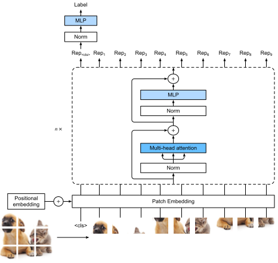

```{.python .input}
%load_ext d2lbook.tab
tab.interact_select(['pytorch', 'jax'])
```

# 视觉Transformer
:label:`sec_vision-transformer`

Transformer架构最初是为序列到序列学习而提出的，主要关注机器翻译。随后，Transformer成为各种自然语言处理任务中的首选模型 :cite:`Radford.Narasimhan.Salimans.ea.2018,Radford.Wu.Child.ea.2019,brown2020language,Devlin.Chang.Lee.ea.2018,raffel2020exploring`。然而，在计算机视觉领域，占主导地位的架构一直是CNN（ :numref:`chap_modern_cnn` ）。自然而然地，研究者开始思考：通过将Transformer模型改造用于图像数据，是否可能取得更好的效果？这个问题在计算机视觉界引发了极大的兴趣。最近，:citet:`ramachandran2019stand` 提出了一种用自注意力取代卷积的方案。然而，该方案在注意力中使用了特殊的模式，使得模型难以在硬件加速器上扩展。随后，:citet:`cordonnier2020relationship` 从理论上证明了自注意力可以学会表现得与卷积类似。在实证上，从图像中取出$2 \times 2$的图像块作为输入，但如此小的图像块尺寸使得模型只适用于低分辨率的图像数据。

*视觉Transformer*（vision Transformer，ViT）对图像块尺寸不作特定约束，它从图像中提取图像块，送入Transformer编码器以获得全局表示，最后再将其变换用于分类 :cite:`Dosovitskiy.Beyer.Kolesnikov.ea.2021`。值得注意的是，Transformer展现出比CNN更好的可扩展性：在更大的数据集上训练更大的模型时，视觉Transformer以显著的优势超过ResNet。与自然语言处理中网络架构设计的格局类似，Transformer也已成为计算机视觉领域的变革者。

```{.python .input}
%%tab pytorch
from d2l import torch as d2l
import torch
from torch import nn
```

```{.python .input}
%%tab jax
from d2l import jax as d2l
from flax import linen as nn
import jax
from jax import numpy as jnp
```

## 模型

:numref:`fig_vit` 描绘了视觉Transformer的模型架构。该架构由一个对图像做图像块化的主干（stem）、一个基于多层Transformer编码器的主体（body）和一个将全局表示变换为输出标签的头（head）组成。


:label:`fig_vit`

考虑一幅高为$h$、宽为$w$、通道数为$c$的输入图像。指定图像块的高度和宽度均为$p$，图像被分成由$m = hw/p^2$个图像块组成的序列，其中每个图像块被展平为一个长度为$cp^2$的向量。这样，Transformer编码器就可以把图像块与文本序列中的词元类似地处理。一个特殊的“&lt;cls&gt;”（类别）词元和$m$个展平的图像块被线性投影为由$m+1$个向量组成的序列，并与可学习的位置编码相加。多层Transformer编码器把这$m+1$个输入向量变换为相同数量、相同长度的输出向量表示。其工作方式与 :numref:`fig_transformer` 中原始Transformer编码器完全相同，只是规范化的位置不同。由于“&lt;cls&gt;”词元通过自注意力关注所有图像块（参见 :numref:`fig_cnn-rnn-self-attention`），它在Transformer编码器输出中的表示将被进一步变换为输出标签。

## 图像块嵌入

要实现视觉Transformer，我们先从 :numref:`fig_vit` 中的图像块嵌入开始。把图像分成图像块，并对这些展平的图像块进行线性投影，可以简化为一次卷积运算，其中卷积核大小和步幅大小都设成图像块的大小。

```{.python .input}
%%tab pytorch
class PatchEmbedding(nn.Module):
    def __init__(self, img_size=96, patch_size=16, num_hiddens=512):
        super().__init__()
        def _make_tuple(x):
            if not isinstance(x, (list, tuple)):
                return (x, x)
            return x
        img_size, patch_size = _make_tuple(img_size), _make_tuple(patch_size)
        self.num_patches = (img_size[0] // patch_size[0]) * (
            img_size[1] // patch_size[1])
        self.conv = nn.LazyConv2d(num_hiddens, kernel_size=patch_size,
                                  stride=patch_size)

    def forward(self, X):
        # Output shape: (batch size, no. of patches, no. of channels)
        return self.conv(X).flatten(2).transpose(1, 2)
```

```{.python .input}
%%tab jax
class PatchEmbedding(nn.Module):
    img_size: int = 96
    patch_size: int = 16
    num_hiddens: int = 512

    def setup(self):
        def _make_tuple(x):
            if not isinstance(x, (list, tuple)):
                return (x, x)
            return x
        img_size, patch_size = _make_tuple(self.img_size), _make_tuple(self.patch_size)
        self.num_patches = (img_size[0] // patch_size[0]) * (
            img_size[1] // patch_size[1])
        self.conv = nn.Conv(self.num_hiddens, kernel_size=patch_size,
                            strides=patch_size, padding='SAME')

    def __call__(self, X):
        # Output shape: (batch size, no. of patches, no. of channels)
        X = self.conv(X)
        return X.reshape((X.shape[0], -1, X.shape[3]))
```

在下面的例子中，以高和宽均为`img_size`的图像作为输入，图像块嵌入输出`(img_size//patch_size)**2`个图像块，这些图像块被线性投影为长度为`num_hiddens`的向量。

```{.python .input}
%%tab pytorch
img_size, patch_size, num_hiddens, batch_size = 96, 16, 512, 4
patch_emb = PatchEmbedding(img_size, patch_size, num_hiddens)
X = d2l.zeros(batch_size, 3, img_size, img_size)
d2l.check_shape(patch_emb(X),
                (batch_size, (img_size//patch_size)**2, num_hiddens))
```

```{.python .input}
%%tab jax
img_size, patch_size, num_hiddens, batch_size = 96, 16, 512, 4
patch_emb = PatchEmbedding(img_size, patch_size, num_hiddens)
X = d2l.zeros((batch_size, img_size, img_size, 3))
output, _ = patch_emb.init_with_output(d2l.get_key(), X)
d2l.check_shape(output, (batch_size, (img_size//patch_size)**2, num_hiddens))
```

## 视觉Transformer编码器
:label:`subsec_vit-encoder`

视觉Transformer编码器的MLP与原始Transformer编码器的逐位置前馈网络略有不同（参见 :numref:`subsec_positionwise-ffn`）。首先，这里的激活函数使用高斯误差线性单元（GELU），可以把它看作ReLU的一种更平滑的版本 :cite:`Hendrycks.Gimpel.2016`。其次，MLP中每个全连接层的输出都应用了暂退法进行正则化。

```{.python .input}
%%tab pytorch
class ViTMLP(nn.Module):
    def __init__(self, mlp_num_hiddens, mlp_num_outputs, dropout=0.5):
        super().__init__()
        self.dense1 = nn.LazyLinear(mlp_num_hiddens)
        self.gelu = nn.GELU()
        self.dropout1 = nn.Dropout(dropout)
        self.dense2 = nn.LazyLinear(mlp_num_outputs)
        self.dropout2 = nn.Dropout(dropout)

    def forward(self, x):
        return self.dropout2(self.dense2(self.dropout1(self.gelu(
            self.dense1(x)))))
```

```{.python .input}
%%tab jax
class ViTMLP(nn.Module):
    mlp_num_hiddens: int
    mlp_num_outputs: int
    dropout: float = 0.5

    @nn.compact
    def __call__(self, x, training=False):
        x = nn.Dense(self.mlp_num_hiddens)(x)
        x = nn.gelu(x)
        x = nn.Dropout(self.dropout, deterministic=not training)(x)
        x = nn.Dense(self.mlp_num_outputs)(x)
        x = nn.Dropout(self.dropout, deterministic=not training)(x)
        return x
```

视觉Transformer编码器块的实现遵循 :numref:`fig_vit` 中的前置规范化（pre-normalization）设计，即规范化恰好应用在多头注意力或MLP*之前*。与后置规范化（post-normalization； :numref:`fig_transformer` 中的“加与规范化”）——规范化恰好放在残差连接*之后*——相比，前置规范化能使Transformer的训练更有效或更高效 :cite:`baevski2018adaptive,wang2019learning,xiong2020layer`。

```{.python .input}
%%tab pytorch
class ViTBlock(nn.Module):
    def __init__(self, num_hiddens, norm_shape, mlp_num_hiddens,
                 num_heads, dropout, use_bias=False):
        super().__init__()
        self.ln1 = nn.LayerNorm(norm_shape)
        self.attention = d2l.MultiHeadAttention(num_hiddens, num_heads,
                                                dropout, use_bias)
        self.ln2 = nn.LayerNorm(norm_shape)
        self.mlp = ViTMLP(mlp_num_hiddens, num_hiddens, dropout)

    def forward(self, X, valid_lens=None):
        X = X + self.attention(*([self.ln1(X)] * 3), valid_lens)
        return X + self.mlp(self.ln2(X))
```

```{.python .input}
%%tab jax
class ViTBlock(nn.Module):
    num_hiddens: int
    mlp_num_hiddens: int
    num_heads: int
    dropout: float
    use_bias: bool = False

    def setup(self):
        self.attention = d2l.MultiHeadAttention(self.num_hiddens, self.num_heads,
                                                self.dropout, self.use_bias)
        self.mlp = ViTMLP(self.mlp_num_hiddens, self.num_hiddens, self.dropout)

    @nn.compact
    def __call__(self, X, valid_lens=None, training=False):
        X = X + self.attention(*([nn.LayerNorm()(X)] * 3),
                               valid_lens, training=training)[0]
        return X + self.mlp(nn.LayerNorm()(X), training=training)
```

正如 :numref:`subsec_transformer-encoder` 中那样，视觉Transformer编码器块不会改变其输入形状。

```{.python .input}
%%tab pytorch
X = d2l.ones((2, 100, 24))
encoder_blk = ViTBlock(24, 24, 48, 8, 0.5)
encoder_blk.eval()
d2l.check_shape(encoder_blk(X), X.shape)
```

```{.python .input}
%%tab jax
X = d2l.ones((2, 100, 24))
encoder_blk = ViTBlock(24, 48, 8, 0.5)
d2l.check_shape(encoder_blk.init_with_output(d2l.get_key(), X)[0], X.shape)
```

## 整合所有组件

下面给出视觉Transformer的前向传播，过程很直接。首先，输入图像被送入`PatchEmbedding`实例，其输出与“&lt;cls&gt;”词元嵌入连结。在暂退法之前，它们与可学习的位置编码相加。然后，输出被送入Transformer编码器，该编码器堆叠`num_blks`个`ViTBlock`类的实例。最后，“&lt;cls&gt;”词元的表示由网络的头投影得到。

```{.python .input}
%%tab pytorch
class ViT(d2l.Classifier):
    """Vision Transformer."""
    def __init__(self, img_size, patch_size, num_hiddens, mlp_num_hiddens,
                 num_heads, num_blks, emb_dropout, blk_dropout, lr=0.1,
                 use_bias=False, num_classes=10):
        super().__init__()
        self.save_hyperparameters()
        self.patch_embedding = PatchEmbedding(
            img_size, patch_size, num_hiddens)
        self.cls_token = nn.Parameter(d2l.zeros(1, 1, num_hiddens))
        num_steps = self.patch_embedding.num_patches + 1  # Add the cls token
        # Positional embeddings are learnable
        self.pos_embedding = nn.Parameter(
            torch.randn(1, num_steps, num_hiddens))
        self.dropout = nn.Dropout(emb_dropout)
        self.blks = nn.Sequential()
        for i in range(num_blks):
            self.blks.add_module(f"{i}", ViTBlock(
                num_hiddens, num_hiddens, mlp_num_hiddens,
                num_heads, blk_dropout, use_bias))
        self.head = nn.Sequential(nn.LayerNorm(num_hiddens),
                                  nn.Linear(num_hiddens, num_classes))

    def forward(self, X):
        X = self.patch_embedding(X)
        X = d2l.concat((self.cls_token.expand(X.shape[0], -1, -1), X), 1)
        X = self.dropout(X + self.pos_embedding)
        for blk in self.blks:
            X = blk(X)
        return self.head(X[:, 0])
```

```{.python .input}
%%tab jax
class ViT(d2l.Classifier):
    """Vision Transformer."""
    img_size: int
    patch_size: int
    num_hiddens: int
    mlp_num_hiddens: int
    num_heads: int
    num_blks: int
    emb_dropout: float
    blk_dropout: float
    lr: float = 0.1
    use_bias: bool = False
    num_classes: int = 10
    training: bool = False

    def setup(self):
        self.patch_embedding = PatchEmbedding(self.img_size, self.patch_size,
                                              self.num_hiddens)
        self.cls_token = self.param('cls_token', nn.initializers.zeros,
                                    (1, 1, self.num_hiddens))
        num_steps = self.patch_embedding.num_patches + 1  # Add the cls token
        # Positional embeddings are learnable
        self.pos_embedding = self.param('pos_embed', nn.initializers.normal(),
                                        (1, num_steps, self.num_hiddens))
        self.blks = [ViTBlock(self.num_hiddens, self.mlp_num_hiddens,
                              self.num_heads, self.blk_dropout, self.use_bias)
                    for _ in range(self.num_blks)]
        self.head = nn.Sequential([nn.LayerNorm(), nn.Dense(self.num_classes)])

    @nn.compact
    def __call__(self, X):
        X = self.patch_embedding(X)
        X = d2l.concat((jnp.tile(self.cls_token, (X.shape[0], 1, 1)), X), 1)
        X = nn.Dropout(emb_dropout, deterministic=not self.training)(X + self.pos_embedding)
        for blk in self.blks:
            X = blk(X, training=self.training)
        return self.head(X[:, 0])
```

## 训练

在Fashion-MNIST数据集上训练视觉Transformer，与 :numref:`chap_modern_cnn` 中训练CNN的方法完全一样。

```{.python .input}
%%tab all
img_size, patch_size = 96, 16
num_hiddens, mlp_num_hiddens, num_heads, num_blks = 512, 2048, 8, 2
emb_dropout, blk_dropout, lr = 0.1, 0.1, 0.1
model = ViT(img_size, patch_size, num_hiddens, mlp_num_hiddens, num_heads,
            num_blks, emb_dropout, blk_dropout, lr)
trainer = d2l.Trainer(max_epochs=10, num_gpus=1)
data = d2l.FashionMNIST(batch_size=128, resize=(img_size, img_size))
trainer.fit(model, data)
```

## 小结与讨论

你可能已经注意到，对于像Fashion-MNIST这样的小数据集，我们实现的视觉Transformer并没有超过 :numref:`sec_resnet` 中的ResNet。即使在ImageNet数据集（120万幅图像）上，也能得到类似的观察结果。这是因为Transformer*缺少*卷积中一些有用的原则，例如平移不变性和局部性（ :numref:`sec_why-conv` ）。然而，当在更大的数据集上训练更大的模型时（例如3亿幅图像），情况就不同了：视觉Transformer在图像分类上大幅超过ResNet，这展示了Transformer在可扩展性方面的内在优越性 :cite:`Dosovitskiy.Beyer.Kolesnikov.ea.2021`。视觉Transformer的出现改变了图像数据建模中网络设计的格局。很快，凭借DeiT的数据高效训练策略，它们被证明在ImageNet数据集上同样有效 :cite:`touvron2021training`。然而，自注意力的二次复杂度（ :numref:`sec_self-attention-and-positional-encoding` ）使得Transformer架构不太适合更高分辨率的图像。为了走向计算机视觉中的通用主干网络，Swin Transformer解决了图像尺寸带来的二次计算复杂度问题（ :numref:`subsec_cnn-rnn-self-attention` ），并恢复了类卷积的先验，将Transformer的适用范围扩展到图像分类之外的一系列计算机视觉任务，并取得了当时最优的结果 :cite:`liu2021swin`。

## 练习

1. `img_size`的取值如何影响训练时间？
1. 如果不把“&lt;cls&gt;”词元的表示投影为输出，你会如何投影各图像块表示的平均值？实现这一改动，并观察它如何影响准确率。
1. 你能修改超参数来提高视觉Transformer的准确率吗？

:begin_tab:`pytorch`
[讨论](https://discuss.d2l.ai/t/8943)
:end_tab:

:begin_tab:`jax`
[讨论](https://discuss.d2l.ai/t/18032)
:end_tab:
