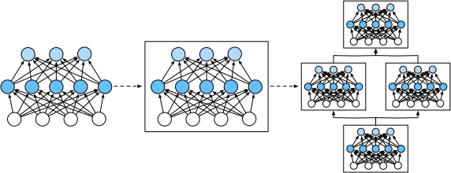

```{.python .input}
%load_ext d2lbook.tab
tab.interact_select(['mxnet', 'pytorch', 'tensorflow', 'jax'])
```

# 层和模块
:label:`sec_model_construction`

当我们最初介绍神经网络时，
关注的是具有单个输出的线性模型。
在这里，整个模型只由一个神经元组成。
请注意，单个神经元
(i) 接受一组输入；
(ii) 产生相应的标量输出；
(iii) 具有一组相关参数，这些参数可以更新
以优化某个感兴趣的目标函数。
然后，当我们开始考虑具有多个输出的网络时，
我们利用向量化算术
来刻画整个神经元层。
与单个神经元一样，
层 (i) 接受一组输入，
(ii) 产生相应的输出，
(iii) 由一组可调参数描述。
当我们研究softmax回归时，
单层本身就是模型。
然而，即使我们随后引入了MLP，
我们仍然可以把模型看作
保留了同样的基本结构。

有趣的是，对于MLP，
整个模型和它的各个组成层
共享这种结构。
整个模型接受原始输入（特征），
产生输出（预测），
并拥有参数
（所有组成层的参数合并在一起）。
同样，每个单独的层接收输入
（由前一层提供），
产生输出（后续层的输入），
并拥有一组可调参数，这些参数
根据从后续层反向流动的信号进行更新。


你可能会认为神经元、层和模型
已经为我们提供了足够的抽象来完成工作，
但实际上我们常常发现，
谈论那些比单个层更大
但比整个模型更小的组件很方便。
例如，在计算机视觉中非常流行的
ResNet-152 架构拥有数百层。
这些层由*层组*的重复模式组成。逐层实现这样的网络会变得很繁琐。
这种担忧并非只是假设——这种
设计模式在实践中很常见。
上面提到的 ResNet 架构
在2015年的 ImageNet 和 COCO 计算机视觉竞赛中
于识别和检测两方面均获胜 :cite:`He.Zhang.Ren.ea.2016`，
至今仍是许多视觉任务的首选架构。
类似地，把层按各种重复模式排列的架构
如今在其他领域也已无处不在，
包括自然语言处理和语音。

为了实现这些复杂的网络，
我们引入神经网络*模块*（module）的概念。
一个模块可以描述单个层、
由多个层组成的组件，
或者整个模型本身！
使用模块抽象的一个好处是，
它们可以组合成更大的构件，
而且常常是递归地组合。:numref:`fig_blocks` 说明了这一点。通过定义按需生成
任意复杂模块的代码，
我们可以写出出奇简洁的代码，
同时仍能实现复杂的神经网络。


:label:`fig_blocks`


从编程的角度看，模块由*类*（class）表示。
它的任何子类都必须定义一个前向传播方法，
把输入变换为输出，
并且必须存储任何必要的参数。
请注意，有些模块根本不需要任何参数。
最后，模块必须拥有反向传播方法，
用于计算梯度。
幸运的是，由于自动微分
（在 :numref:`sec_autograd` 中介绍过）
在幕后发挥的魔力，
在定义自己的模块时，
我们只需要关心参数
和前向传播方法。

```{.python .input}
%%tab mxnet
from mxnet import np, npx
from mxnet.gluon import nn
npx.set_np()
```

```{.python .input}
%%tab pytorch
import torch
from torch import nn
from torch.nn import functional as F
```

```{.python .input}
%%tab tensorflow
import tensorflow as tf
```

```{.python .input}
%%tab jax
from typing import List
from d2l import jax as d2l
from flax import linen as nn
import jax
from jax import numpy as jnp
```

[**作为开始，我们回顾
之前用来实现MLP的代码**]
（:numref:`sec_mlp`）。
下面的代码生成一个网络，
它有一个包含256个单元、使用ReLU激活的
全连接隐藏层，
后面是一个包含十个单元的全连接输出层
（无激活函数）。

```{.python .input}
%%tab mxnet
net = nn.Sequential()
net.add(nn.Dense(256, activation='relu'))
net.add(nn.Dense(10))
net.initialize()

X = np.random.uniform(size=(2, 20))
net(X).shape
```

```{.python .input}
%%tab pytorch
net = nn.Sequential(nn.LazyLinear(256), nn.ReLU(), nn.LazyLinear(10))

X = torch.rand(2, 20)
net(X).shape
```

```{.python .input}
%%tab tensorflow
net = tf.keras.models.Sequential([
    tf.keras.layers.Dense(256, activation=tf.nn.relu),
    tf.keras.layers.Dense(10),
])

X = tf.random.uniform((2, 20))
net(X).shape
```

```{.python .input}
%%tab jax
net = nn.Sequential([nn.Dense(256), nn.relu, nn.Dense(10)])

# get_key is a d2l saved function returning jax.random.PRNGKey(random_seed)
X = jax.random.uniform(d2l.get_key(), (2, 20))
params = net.init(d2l.get_key(), X)
net.apply(params, X).shape
```

:begin_tab:`mxnet`
在这个例子中，我们通过实例化一个 `nn.Sequential`
来构造模型，
并把返回的对象赋给 `net` 变量。
接着，我们反复调用它的 `add` 方法，
按照各层应当执行的顺序
追加各层。
简而言之，`nn.Sequential` 定义了一种特殊的 `Block`，
即 Gluon 中表示*模块*的类。
它维护一个由组成 `Block` 构成的有序列表。
`add` 方法只是把每个后续 `Block`
方便地添加到列表中。
请注意，每个层都是 `Dense` 类的实例，
而该类本身是 `Block` 的子类。
前向传播（`forward`）方法也非常简单：
它把列表中的每个 `Block` 依次连结起来，
并把它的输出作为下一个的输入。
请注意，到目前为止，我们一直通过
构造 `net(X)` 来调用模型以获得输出。
这实际上只是 `net.forward(X)` 的简写，
是通过 `Block` 类的 `__call__` 方法
实现的一个巧妙的 Python 技巧。
:end_tab:

:begin_tab:`pytorch`
在这个例子中，我们通过实例化一个 `nn.Sequential`
来构造模型，并按照各层应当执行的顺序
把各层作为参数传入。
简而言之，(**`nn.Sequential` 定义了一种特殊的 `Module`**)，
即 PyTorch 中表示模块的类。
它维护一个由组成 `Module` 构成的有序列表。
请注意，两个全连接层都是 `Linear` 类的实例，
而该类本身是 `Module` 的子类。
前向传播（`forward`）方法也非常简单：
它把列表中的每个模块依次连结起来，
把每个模块的输出作为下一个的输入。
请注意，到目前为止，我们一直通过
构造 `net(X)` 来调用模型以获得输出。
这实际上只是 `net.__call__(X)` 的简写。
:end_tab:

:begin_tab:`tensorflow`
在这个例子中，我们通过实例化一个 `keras.models.Sequential`
来构造模型，并按照各层应当执行的顺序
把各层作为参数传入。
简而言之，`Sequential` 定义了一种特殊的 `keras.Model`，
即 Keras 中表示模块的类。
它维护一个由组成 `Model` 构成的有序列表。
请注意，两个全连接层都是 `Dense` 类的实例，
而该类本身是 `Model` 的子类。
前向传播（`call`）方法也非常简单：
它把列表中的每个模块依次连结起来，
把每个模块的输出作为下一个的输入。
请注意，到目前为止，我们一直通过
构造 `net(X)` 来调用模型以获得输出。
这实际上只是 `net.call(X)` 的简写，
是通过模块类的 `__call__` 方法
实现的一个巧妙的 Python 技巧。
:end_tab:

## [**自定义模块**]

也许培养“模块如何工作”这一直觉
最容易的方法，就是自己实现一个模块。
在动手之前，
我们简要总结一下每个模块必须提供的
基本功能：


1. 把输入数据作为其前向传播方法的参数来接收。
1. 通过让前向传播方法返回一个值来生成输出。请注意，输出的形状可能与输入不同。例如，上面模型中的第一个全连接层接收任意维度的输入，但返回维度为256的输出。
1. 计算其输出关于其输入的梯度，这可以通过反向传播方法访问。通常这是自动发生的。
1. 存储并提供执行前向传播计算所需的参数。
1. 按需初始化模型参数。


在下面的代码片段中，
我们从零编写一个模块，
它对应一个具有256个隐藏单元的单隐藏层MLP
和一个10维输出层。
请注意，下面的 `MLP` 类继承了表示模块的类。
我们将大量依赖父类的方法，
自己只提供构造函数（Python中的 `__init__` 方法）和前向传播方法。

```{.python .input}
%%tab mxnet
class MLP(nn.Block):
    def __init__(self):
        # Call the constructor of the MLP parent class nn.Block to perform
        # the necessary initialization
        super().__init__()
        self.hidden = nn.Dense(256, activation='relu')
        self.out = nn.Dense(10)

    # Define the forward propagation of the model, that is, how to return the
    # required model output based on the input X
    def forward(self, X):
        return self.out(self.hidden(X))
```

```{.python .input}
%%tab pytorch
class MLP(nn.Module):
    def __init__(self):
        # Call the constructor of the parent class nn.Module to perform
        # the necessary initialization
        super().__init__()
        self.hidden = nn.LazyLinear(256)
        self.out = nn.LazyLinear(10)

    # Define the forward propagation of the model, that is, how to return the
    # required model output based on the input X
    def forward(self, X):
        return self.out(F.relu(self.hidden(X)))
```

```{.python .input}
%%tab tensorflow
class MLP(tf.keras.Model):
    def __init__(self):
        # Call the constructor of the parent class tf.keras.Model to perform
        # the necessary initialization
        super().__init__()
        self.hidden = tf.keras.layers.Dense(units=256, activation=tf.nn.relu)
        self.out = tf.keras.layers.Dense(units=10)

    # Define the forward propagation of the model, that is, how to return the
    # required model output based on the input X
    def call(self, X):
        return self.out(self.hidden((X)))
```

```{.python .input}
%%tab jax
class MLP(nn.Module):
    def setup(self):
        # Define the layers
        self.hidden = nn.Dense(256)
        self.out = nn.Dense(10)

    # Define the forward propagation of the model, that is, how to return the
    # required model output based on the input X
    def __call__(self, X):
        return self.out(nn.relu(self.hidden(X)))
```

让我们先关注前向传播方法。
请注意，它以 `X` 为输入，
计算应用激活函数后的隐藏表示，
并输出其 logits。
在这个 `MLP` 实现中，
两个层都是实例变量。
为了理解为什么这样做是合理的，设想
实例化两个MLP，`net1` 和 `net2`，
并在不同数据上训练它们。
自然，我们会期望它们
代表两个不同的学习得到的模型。

我们在构造函数中
[**实例化MLP的各层**]
(**并在随后调用这些层**)，
每次调用前向传播方法时都会这样做。
请注意几个关键细节。
首先，我们定制的 `__init__` 方法
通过 `super().__init__()` 调用父类的 `__init__` 方法，
省去了我们重述适用于大多数模块的
样板代码的麻烦。
然后我们实例化两个全连接层，
把它们分别赋给 `self.hidden` 和 `self.out`。
请注意，除非我们实现一个新的层，
否则不必操心反向传播方法
或参数初始化。
系统会自动生成这些方法。
我们来试一试。

```{.python .input}
%%tab pytorch, mxnet, tensorflow
net = MLP()
if tab.selected('mxnet'):
    net.initialize()
net(X).shape
```

```{.python .input}
%%tab jax
net = MLP()
params = net.init(d2l.get_key(), X)
net.apply(params, X).shape
```

模块抽象的一个关键优点是其通用性。
我们可以子类化模块来创建层
（例如全连接层类）、
整个模型（例如上面的 `MLP` 类），
或各种中等复杂度的组件。
在接下来的各章中，我们会利用这种通用性，
例如在处理卷积神经网络时。


## [**顺序模块**]
:label:`subsec_model-construction-sequential`

现在我们可以更仔细地看看
`Sequential` 类是如何工作的。
回想一下，`Sequential` 的设计目的
是把其他模块依次连结起来。
要构建我们自己简化的 `MySequential`，
我们只需定义两个关键方法：

1. 一个把一个模块逐个追加到列表中的方法。
1. 一个前向传播方法，按模块被追加的相同顺序让输入依次通过模块链。

下面的 `MySequential` 类
提供了与默认 `Sequential` 类相同的功能。

```{.python .input}
%%tab mxnet
class MySequential(nn.Block):
    def add(self, block):
        # Here, block is an instance of a Block subclass, and we assume that
        # it has a unique name. We save it in the member variable _children of
        # the Block class, and its type is OrderedDict. When the MySequential
        # instance calls the initialize method, the system automatically
        # initializes all members of _children
        self._children[block.name] = block

    def forward(self, X):
        # OrderedDict guarantees that members will be traversed in the order
        # they were added
        for block in self._children.values():
            X = block(X)
        return X
```

```{.python .input}
%%tab pytorch
class MySequential(nn.Module):
    def __init__(self, *args):
        super().__init__()
        for idx, module in enumerate(args):
            self.add_module(str(idx), module)

    def forward(self, X):
        for module in self.children():            
            X = module(X)
        return X
```

```{.python .input}
%%tab tensorflow
class MySequential(tf.keras.Model):
    def __init__(self, *args):
        super().__init__()
        self.modules = args

    def call(self, X):
        for module in self.modules:
            X = module(X)
        return X
```

```{.python .input}
%%tab jax
class MySequential(nn.Module):
    modules: List

    def __call__(self, X):
        for module in self.modules:
            X = module(X)
        return X
```

:begin_tab:`mxnet`
`add` 方法把单个块
添加到有序字典 `_children` 中。
你可能会问，为什么每个 Gluon `Block`
都拥有一个 `_children` 属性，
以及为什么我们使用它，
而不是自己定义一个 Python 列表。
简而言之，`_children` 的主要优点是：
在块的参数初始化过程中，
Gluon 知道要查看 `_children` 字典内部，
找到那些参数也需要初始化的子块。
:end_tab:

:begin_tab:`pytorch`
在 `__init__` 方法中，我们通过调用
`add_modules` 方法添加每个模块。这些模块之后可以通过 `children` 方法访问。
这样系统就知道添加了哪些模块，
并会正确地初始化每个模块的参数。
:end_tab:

当调用 `MySequential` 的前向传播方法时，
每个添加的模块都按照它们被添加的顺序执行。
现在我们可以使用 `MySequential` 类
重新实现一个MLP。

```{.python .input}
%%tab mxnet
net = MySequential()
net.add(nn.Dense(256, activation='relu'))
net.add(nn.Dense(10))
net.initialize()
net(X).shape
```

```{.python .input}
%%tab pytorch
net = MySequential(nn.LazyLinear(256), nn.ReLU(), nn.LazyLinear(10))
net(X).shape
```

```{.python .input}
%%tab tensorflow
net = MySequential(
    tf.keras.layers.Dense(units=256, activation=tf.nn.relu),
    tf.keras.layers.Dense(10))
net(X).shape
```

```{.python .input}
%%tab jax
net = MySequential([nn.Dense(256), nn.relu, nn.Dense(10)])
params = net.init(d2l.get_key(), X)
net.apply(params, X).shape
```

请注意，这里对 `MySequential` 的用法
与我们之前为 `Sequential` 类编写的代码相同
（如 :numref:`sec_mlp` 所述）。

## [**在前向传播方法中执行代码**]

`Sequential` 类使模型构造变得容易，
让我们不必定义自己的类
就能组装新的架构。
然而，并非所有架构都是简单的依次连结。
当需要更大的灵活性时，
我们就需要定义自己的块。
例如，我们可能希望在前向传播方法中
执行 Python 的控制流。
此外，我们可能希望执行
任意的数学运算，
而不是仅仅依赖预定义的神经网络层。

你可能已经注意到，到目前为止，
我们网络中的所有操作
都作用于网络的激活值
及其参数。
然而，有时我们可能希望
加入一些既不是前面层的结果、
也不是可更新参数的项。
我们称这些项为*常数参数*（constant parameter）。
例如，假设我们想要一个层，
它计算函数
$f(\mathbf{x},\mathbf{w}) = c \cdot \mathbf{w}^\top \mathbf{x}$，
其中 $\mathbf{x}$ 是输入，$\mathbf{w}$ 是我们的参数，
$c$ 是某个指定的常数，
在优化过程中不被更新。
于是我们实现一个 `FixedHiddenMLP` 类如下。

```{.python .input}
%%tab mxnet
class FixedHiddenMLP(nn.Block):
    def __init__(self):
        super().__init__()
        # Random weight parameters created with the get_constant method
        # are not updated during training (i.e., constant parameters)
        self.rand_weight = self.params.get_constant(
            'rand_weight', np.random.uniform(size=(20, 20)))
        self.dense = nn.Dense(20, activation='relu')

    def forward(self, X):
        X = self.dense(X)
        # Use the created constant parameters, as well as the relu and dot
        # functions
        X = npx.relu(np.dot(X, self.rand_weight.data()) + 1)
        # Reuse the fully connected layer. This is equivalent to sharing
        # parameters with two fully connected layers
        X = self.dense(X)
        # Control flow
        while np.abs(X).sum() > 1:
            X /= 2
        return X.sum()
```

```{.python .input}
%%tab pytorch
class FixedHiddenMLP(nn.Module):
    def __init__(self):
        super().__init__()
        # Random weight parameters that will not compute gradients and
        # therefore keep constant during training
        self.rand_weight = torch.rand((20, 20))
        self.linear = nn.LazyLinear(20)

    def forward(self, X):
        X = self.linear(X)        
        X = F.relu(X @ self.rand_weight + 1)
        # Reuse the fully connected layer. This is equivalent to sharing
        # parameters with two fully connected layers
        X = self.linear(X)
        # Control flow
        while X.abs().sum() > 1:
            X /= 2
        return X.sum()
```

```{.python .input}
%%tab tensorflow
class FixedHiddenMLP(tf.keras.Model):
    def __init__(self):
        super().__init__()
        self.flatten = tf.keras.layers.Flatten()
        # Random weight parameters created with tf.constant are not updated
        # during training (i.e., constant parameters)
        self.rand_weight = tf.constant(tf.random.uniform((20, 20)))
        self.dense = tf.keras.layers.Dense(20, activation=tf.nn.relu)

    def call(self, inputs):
        X = self.flatten(inputs)
        # Use the created constant parameters, as well as the relu and
        # matmul functions
        X = tf.nn.relu(tf.matmul(X, self.rand_weight) + 1)
        # Reuse the fully connected layer. This is equivalent to sharing
        # parameters with two fully connected layers
        X = self.dense(X)
        # Control flow
        while tf.reduce_sum(tf.math.abs(X)) > 1:
            X /= 2
        return tf.reduce_sum(X)
```

```{.python .input}
%%tab jax
class FixedHiddenMLP(nn.Module):
    # Random weight parameters that will not compute gradients and
    # therefore keep constant during training
    rand_weight: jnp.array = jax.random.uniform(d2l.get_key(), (20, 20))

    def setup(self):
        self.dense = nn.Dense(20)

    def __call__(self, X):
        X = self.dense(X)
        X = nn.relu(X @ self.rand_weight + 1)
        # Reuse the fully connected layer. This is equivalent to sharing
        # parameters with two fully connected layers
        X = self.dense(X)
        # Control flow
        while jnp.abs(X).sum() > 1:
            X /= 2
        return X.sum()
```

在这个模型中，
我们实现了一个隐藏层，其权重
（`self.rand_weight`）在实例化时随机初始化，
此后保持不变。
这个权重不是模型参数，
因此永远不会被反向传播更新。
接着，网络把这个“固定”层的输出
通过一个全连接层。

请注意，在返回输出之前，
我们的模型做了一件不寻常的事。
我们运行了一个 while 循环，检验
它的 $\ell_1$ 范数是否大于 $1$，
并把输出向量除以 $2$，
直到满足条件。
最后，我们返回 `X` 中各元素之和。
据我们所知，没有任何标准神经网络
会执行这种操作。
请注意，这个特定操作在任何真实任务中
可能都没有用。
我们的目的只是向你展示如何
把任意代码集成到神经网络计算的流程中。

```{.python .input}
%%tab pytorch, mxnet, tensorflow
net = FixedHiddenMLP()
if tab.selected('mxnet'):
    net.initialize()
net(X)
```

```{.python .input}
%%tab jax
net = FixedHiddenMLP()
params = net.init(d2l.get_key(), X)
net.apply(params, X)
```

我们可以[**混合搭配各种
组装模块的方式。**]
在下面的例子中，我们以一些有创意的方式
嵌套模块。

```{.python .input}
%%tab mxnet
class NestMLP(nn.Block):
    def __init__(self, **kwargs):
        super().__init__(**kwargs)
        self.net = nn.Sequential()
        self.net.add(nn.Dense(64, activation='relu'),
                     nn.Dense(32, activation='relu'))
        self.dense = nn.Dense(16, activation='relu')

    def forward(self, X):
        return self.dense(self.net(X))

chimera = nn.Sequential()
chimera.add(NestMLP(), nn.Dense(20), FixedHiddenMLP())
chimera.initialize()
chimera(X)
```

```{.python .input}
%%tab pytorch
class NestMLP(nn.Module):
    def __init__(self):
        super().__init__()
        self.net = nn.Sequential(nn.LazyLinear(64), nn.ReLU(),
                                 nn.LazyLinear(32), nn.ReLU())
        self.linear = nn.LazyLinear(16)

    def forward(self, X):
        return self.linear(self.net(X))

chimera = nn.Sequential(NestMLP(), nn.LazyLinear(20), FixedHiddenMLP())
chimera(X)
```

```{.python .input}
%%tab tensorflow
class NestMLP(tf.keras.Model):
    def __init__(self):
        super().__init__()
        self.net = tf.keras.Sequential()
        self.net.add(tf.keras.layers.Dense(64, activation=tf.nn.relu))
        self.net.add(tf.keras.layers.Dense(32, activation=tf.nn.relu))
        self.dense = tf.keras.layers.Dense(16, activation=tf.nn.relu)

    def call(self, inputs):
        return self.dense(self.net(inputs))

chimera = tf.keras.Sequential()
chimera.add(NestMLP())
chimera.add(tf.keras.layers.Dense(20))
chimera.add(FixedHiddenMLP())
chimera(X)
```

```{.python .input}
%%tab jax
class NestMLP(nn.Module):
    def setup(self):
        self.net = nn.Sequential([nn.Dense(64), nn.relu,
                                  nn.Dense(32), nn.relu])
        self.dense = nn.Dense(16)

    def __call__(self, X):
        return self.dense(self.net(X))


chimera = nn.Sequential([NestMLP(), nn.Dense(20), FixedHiddenMLP()])
params = chimera.init(d2l.get_key(), X)
chimera.apply(params, X)
```

## 小结

单个层可以是模块。
许多层可以组成一个模块。
许多模块可以组成一个模块。

模块可以包含代码。
模块负责大量琐碎的日常事务，包括参数初始化和反向传播。
层和模块的顺序连结由 `Sequential` 模块处理。


## 练习

1. 如果把 `MySequential` 改成用 Python 列表存储模块，会出现什么样的问题？
1. 实现一个以两个模块为参数的模块，比如 `net1` 和 `net2`，并在前向传播中返回两个网络连结后的输出。这也称为*并行模块*（parallel module）。
1. 假设你想连结同一个网络的多个实例。实现一个工厂函数，生成同一个模块的多个实例，并据此构建一个更大的网络。

:begin_tab:`mxnet`
[讨论](https://discuss.d2l.ai/t/54)
:end_tab:

:begin_tab:`pytorch`
[讨论](https://discuss.d2l.ai/t/55)
:end_tab:

:begin_tab:`tensorflow`
[讨论](https://discuss.d2l.ai/t/264)
:end_tab:

:begin_tab:`jax`
[讨论](https://discuss.d2l.ai/t/17989)
:end_tab:
