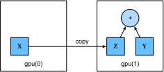

```{.python .input}
%load_ext d2lbook.tab
tab.interact_select(['mxnet', 'pytorch', 'tensorflow', 'jax'])
```

# GPU
:label:`sec_use_gpu`

在 :numref:`tab_intro_decade` 中，我们展示了
过去二十年计算的快速增长。
简而言之，自2000年以来，GPU性能
每十年增长1000倍。
这带来了巨大的机会，但也表明
人们对这种性能有巨大的需求。


在本节中，我们开始讨论如何利用
这种计算性能来开展你的研究。
首先使用单块GPU，之后再讨论
如何使用多块GPU和多台服务器（带多块GPU）。

具体来说，我们将讨论如何
使用单块NVIDIA GPU进行计算。
首先，确保你至少安装了一块NVIDIA GPU。
然后，下载[NVIDIA驱动和CUDA](https://developer.nvidia.com/cuda-downloads)，
并按照提示设置合适的路径。
这些准备工作完成后，
就可以使用 `nvidia-smi` 命令
来(**查看显卡信息**)。

:begin_tab:`mxnet`
你可能已经注意到，MXNet 张量
看起来与NumPy的 `ndarray` 几乎相同。
但有几个关键区别。
MXNet 区别于 NumPy 的关键特性之一，
是它支持多种硬件设备。

在MXNet中，每个数组都有一个上下文。
到目前为止，默认情况下，所有变量
及相关计算
都被分配到CPU上。
通常，其他上下文可能是各种GPU。
当我们在多台服务器上部署任务时，
情况会变得更加复杂。
通过智能地把数组分配到上下文上，
我们可以最小化在设备之间
传输数据所花费的时间。
例如，在带有GPU的服务器上训练神经网络时，
我们通常更希望模型的参数位于GPU上。

接下来，我们需要确认
安装的是MXNet的GPU版本。
如果已经安装了MXNet的CPU版本，
我们需要先卸载它。
例如，使用 `pip uninstall mxnet` 命令，
然后根据你的CUDA版本
安装相应的MXNet版本。
假设你安装的是CUDA 10.0，
可以通过 `pip install mxnet-cu100`
安装支持CUDA 10.0的MXNet版本。
:end_tab:

:begin_tab:`pytorch`
在PyTorch中，每个数组都有一个设备；我们常把它称为*上下文*（context）。
到目前为止，默认情况下，所有变量
及相关计算
都被分配到CPU上。
通常，其他上下文可能是各种GPU。
当我们在多台服务器上部署任务时，
情况会变得更加复杂。
通过智能地把数组分配到上下文上，
我们可以最小化在设备之间
传输数据所花费的时间。
例如，在带有GPU的服务器上训练神经网络时，
我们通常更希望模型的参数位于GPU上。
:end_tab:

要运行本节中的程序，
你至少需要两块GPU。
请注意，这对大多数台式计算机来说可能过于奢侈，
但在云中很容易获得，例如，
通过使用AWS EC2多GPU实例。
几乎所有其他小节都*不*需要多块GPU，但这里我们只是想说明不同设备之间的数据流动。

```{.python .input}
%%tab mxnet
from d2l import mxnet as d2l
from mxnet import np, npx
from mxnet.gluon import nn
npx.set_np()
```

```{.python .input}
%%tab pytorch
from d2l import torch as d2l
import torch
from torch import nn
```

```{.python .input}
%%tab tensorflow
from d2l import tensorflow as d2l
import tensorflow as tf
```

```{.python .input}
%%tab jax
from d2l import jax as d2l
from flax import linen as nn
import jax
from jax import numpy as jnp
```

## [**计算设备**]

我们可以指定设备（例如CPU和GPU）
用于存储和计算。
默认情况下，张量创建在主存中，
然后使用CPU进行计算。

:begin_tab:`mxnet`
在MXNet中，CPU和GPU可以分别用 `cpu()` 和 `gpu()` 表示。
需要注意的是，`cpu()`
（或括号中的任意整数）
表示所有物理CPU和内存。
这意味着MXNet的计算
将尝试使用所有CPU核心。
然而，`gpu()` 只表示一块显卡
及相应的内存。
如果有多块GPU，我们用 `gpu(i)`
表示第 $i^\textrm{th}$ 块GPU（$i$ 从0开始）。
另外，`gpu(0)` 和 `gpu()` 是等价的。
:end_tab:

:begin_tab:`pytorch`
在PyTorch中，CPU和GPU可以分别用 `torch.device('cpu')` 和 `torch.device('cuda')` 表示。
需要注意的是，`cpu` 设备
表示所有物理CPU和内存。
这意味着PyTorch的计算
将尝试使用所有CPU核心。
然而，`gpu` 设备只表示一块显卡
及相应的内存。
如果有多块GPU，我们用 `torch.device(f'cuda:{i}')`
表示第 $i^\textrm{th}$ 块GPU（$i$ 从0开始）。
另外，`gpu:0` 和 `gpu` 是等价的。
:end_tab:

```{.python .input}
%%tab pytorch
def cpu():  #@save
    """Get the CPU device."""
    return torch.device('cpu')

def gpu(i=0):  #@save
    """Get a GPU device."""
    return torch.device(f'cuda:{i}')

cpu(), gpu(), gpu(1)
```

```{.python .input}
%%tab mxnet, tensorflow, jax
def cpu():  #@save
    """Get the CPU device."""
    if tab.selected('mxnet'):
        return npx.cpu()
    if tab.selected('tensorflow'):
        return tf.device('/CPU:0')
    if tab.selected('jax'):
        return jax.devices('cpu')[0]

def gpu(i=0):  #@save
    """Get a GPU device."""
    if tab.selected('mxnet'):
        return npx.gpu(i)
    if tab.selected('tensorflow'):
        return tf.device(f'/GPU:{i}')
    if tab.selected('jax'):
        return jax.devices('gpu')[i]

cpu(), gpu(), gpu(1)
```

我们可以(**查询可用GPU的数量。**)

```{.python .input}
%%tab pytorch
def num_gpus():  #@save
    """Get the number of available GPUs."""
    return torch.cuda.device_count()

num_gpus()
```

```{.python .input}
%%tab mxnet, tensorflow, jax
def num_gpus():  #@save
    """Get the number of available GPUs."""
    if tab.selected('mxnet'):
        return npx.num_gpus()
    if tab.selected('tensorflow'):
        return len(tf.config.experimental.list_physical_devices('GPU'))
    if tab.selected('jax'):
        try:
            return jax.device_count('gpu')
        except:
            return 0  # No GPU backend found

num_gpus()
```

现在我们来[**定义两个便捷函数，
即使所请求的GPU不存在，也能运行代码。**]

```{.python .input}
%%tab all
def try_gpu(i=0):  #@save
    """Return gpu(i) if exists, otherwise return cpu()."""
    if num_gpus() >= i + 1:
        return gpu(i)
    return cpu()

def try_all_gpus():  #@save
    """Return all available GPUs, or [cpu(),] if no GPU exists."""
    return [gpu(i) for i in range(num_gpus())]

try_gpu(), try_gpu(10), try_all_gpus()
```

## 张量与GPU

:begin_tab:`pytorch`
默认情况下，张量创建在CPU上。
我们可以[**查询张量所在的设备。**]
:end_tab:

:begin_tab:`mxnet`
默认情况下，张量创建在CPU上。
我们可以[**查询张量所在的设备。**]
:end_tab:

:begin_tab:`tensorflow, jax`
默认情况下，如果GPU/TPU可用，张量就创建在GPU/TPU上，
否则使用CPU。
我们可以[**查询张量所在的设备。**]
:end_tab:

```{.python .input}
%%tab mxnet
x = np.array([1, 2, 3])
x.ctx
```

```{.python .input}
%%tab pytorch
x = torch.tensor([1, 2, 3])
x.device
```

```{.python .input}
%%tab tensorflow
x = tf.constant([1, 2, 3])
x.device
```

```{.python .input}
%%tab jax
x = jnp.array([1, 2, 3])
x.device()
```

需要注意的是，每当我们想
对多个项进行运算时，
它们必须位于同一设备上。
例如，如果我们要对两个张量求和，
就必须确保两个参数
位于同一设备上——否则框架
就不知道把结果存储在哪里，
甚至不知道如何决定在哪里执行计算。

### GPU上的存储

有几种方法可以[**把张量存储在GPU上。**]
例如，我们可以在创建张量时指定存储设备。
接下来，我们在第一块 `gpu` 上创建张量变量 `X`。
在GPU上创建的张量只消耗这块GPU的内存。
我们可以使用 `nvidia-smi` 命令查看GPU内存使用情况。
一般来说，我们需要确保创建的数据不超过GPU内存上限。

```{.python .input}
%%tab mxnet
X = np.ones((2, 3), ctx=try_gpu())
X
```

```{.python .input}
%%tab pytorch
X = torch.ones(2, 3, device=try_gpu())
X
```

```{.python .input}
%%tab tensorflow
with try_gpu():
    X = tf.ones((2, 3))
X
```

```{.python .input}
%%tab jax
# By default JAX puts arrays to GPUs or TPUs if available
X = jax.device_put(jnp.ones((2, 3)), try_gpu())
X
```

假设你至少有两块GPU，下面的代码将(**在第二块GPU上创建随机张量 `Y`。**)

```{.python .input}
%%tab mxnet
Y = np.random.uniform(size=(2, 3), ctx=try_gpu(1))
Y
```

```{.python .input}
%%tab pytorch
Y = torch.rand(2, 3, device=try_gpu(1))
Y
```

```{.python .input}
%%tab tensorflow
with try_gpu(1):
    Y = tf.random.uniform((2, 3))
Y
```

```{.python .input}
%%tab jax
Y = jax.device_put(jax.random.uniform(jax.random.PRNGKey(0), (2, 3)),
                   try_gpu(1))
Y
```

### 复制

[**如果我们要计算 `X + Y`，
就需要决定在哪里执行这个运算。**]
例如，如 :numref:`fig_copyto` 所示，
我们可以把 `X` 传输到第二块GPU上，
并在那里执行运算。
*不要*直接把 `X` 和 `Y` 相加，
因为这会导致异常。
运行时引擎不知道该怎么办：
它在同一设备上找不到数据，于是失败。
由于 `Y` 位于第二块GPU上，
我们需要先把 `X` 移到那里，才能把两者相加。


:label:`fig_copyto`

```{.python .input}
%%tab mxnet
Z = X.copyto(try_gpu(1))
print(X)
print(Z)
```

```{.python .input}
%%tab pytorch
Z = X.cuda(1)
print(X)
print(Z)
```

```{.python .input}
%%tab tensorflow
with try_gpu(1):
    Z = X
print(X)
print(Z)
```

```{.python .input}
%%tab jax
Z = jax.device_put(X, try_gpu(1))
print(X)
print(Z)
```

现在，[**数据（`Z` 和 `Y`）都在同一块GPU上，我们可以把它们相加。**]

```{.python .input}
%%tab all
Y + Z
```

:begin_tab:`mxnet`
设想你的变量 `Z` 已经位于第二块GPU上。
如果我们仍然调用 `Z.copyto(gpu(1))`，会发生什么？
它会制作一份副本并分配新的内存，
即使该变量已经位于期望的设备上。
有时，取决于我们的代码运行的环境，
两个变量可能已经位于同一设备上。
因此，我们只希望在变量
当前位于不同设备时才进行复制。
在这些情况下，我们可以调用 `as_in_ctx`。
如果变量已经位于指定的设备上，
那么这就是一个空操作。
除非你特别想要制作副本，
否则 `as_in_ctx` 是首选的方法。
:end_tab:

:begin_tab:`pytorch`
但如果你的变量 `Z` 已经位于第二块GPU上呢？
如果我们仍然调用 `Z.cuda(1)`，会发生什么？
它会返回 `Z`，而不是制作副本并分配新的内存。
:end_tab:

:begin_tab:`tensorflow`
设想你的变量 `Z` 已经位于第二块GPU上。
如果我们在相同的设备作用域下仍然调用 `Z2 = Z`，会发生什么？
它会返回 `Z`，而不是制作一份副本并分配新的内存。
:end_tab:

:begin_tab:`jax`
设想你的变量 `Z` 已经位于第二块GPU上。
如果我们在相同的设备作用域下仍然调用 `Z2 = Z`，会发生什么？
它会返回 `Z`，而不是制作一份副本并分配新的内存。
:end_tab:

```{.python .input}
%%tab mxnet
Z.as_in_ctx(try_gpu(1)) is Z
```

```{.python .input}
%%tab pytorch
Z.cuda(1) is Z
```

```{.python .input}
%%tab tensorflow
with try_gpu(1):
    Z2 = Z
Z2 is Z
```

```{.python .input}
%%tab jax
Z2 = jax.device_put(Z, try_gpu(1))
Z2 is Z
```

### 补充说明

人们使用GPU来做机器学习，
是因为他们期望GPU跑得快。
但在设备之间传输变量很慢：比计算慢得多。
所以我们希望你百分之百确定
自己想做的是一件慢的事，然后我们才让你去做。
如果深度学习框架只是在没有崩溃的情况下自动完成复制，
那么你可能不会意识到
自己写了一些很慢的代码。

传输数据不仅慢，还使并行化变得困难得多，
因为我们必须等待数据发送（或者说接收）完成，
才能继续执行更多运算。
这就是为什么复制操作应当非常谨慎。
根据经验，许多小操作
比一个大操作糟糕得多。
此外，一次执行多个操作
比在代码中穿插许多单个操作好得多，
除非你知道自己在做什么。
之所以如此，是因为如果一个设备
必须等待另一个设备才能做别的事情，这类操作就会阻塞。
这有点像在队列中排队点咖啡，
而不是通过电话预订，
等你到的时候发现已经做好了。

最后，当我们打印张量或把张量转换为NumPy格式时，
如果数据不在主存中，
框架会先把它复制到主存，
带来额外的传输开销。
更糟的是，此时它还会受制于可怕的全局解释器锁，
这会让所有东西都等待Python执行完毕。


## [**神经网络与GPU**]

同样，神经网络模型也可以指定设备。
下面的代码把模型参数放到GPU上。

```{.python .input}
%%tab mxnet
net = nn.Sequential()
net.add(nn.Dense(1))
net.initialize(ctx=try_gpu())
```

```{.python .input}
%%tab pytorch
net = nn.Sequential(nn.LazyLinear(1))
net = net.to(device=try_gpu())
```

```{.python .input}
%%tab tensorflow
strategy = tf.distribute.MirroredStrategy()
with strategy.scope():
    net = tf.keras.models.Sequential([
        tf.keras.layers.Dense(1)])
```

```{.python .input}
%%tab jax
net = nn.Sequential([nn.Dense(1)])

key1, key2 = jax.random.split(jax.random.PRNGKey(0))
x = jax.random.normal(key1, (10,))  # Dummy input
params = net.init(key2, x)  # Initialization call
```

在接下来的章节中，我们还会看到许多
如何在GPU上运行模型的例子，
这仅仅是因为模型会变得在计算上更加密集。

例如，当输入是GPU上的张量时，模型会在同一块GPU上计算结果。

```{.python .input}
%%tab mxnet, pytorch, tensorflow
net(X)
```

```{.python .input}
%%tab jax
net.apply(params, x)
```

让我们(**确认模型参数存储在同一块GPU上。**)

```{.python .input}
%%tab mxnet
net[0].weight.data().ctx
```

```{.python .input}
%%tab pytorch
net[0].weight.data.device
```

```{.python .input}
%%tab tensorflow
net.layers[0].weights[0].device, net.layers[0].weights[1].device
```

```{.python .input}
%%tab jax
print(jax.tree_util.tree_map(lambda x: x.device(), params))
```

让训练器支持GPU。

```{.python .input}
%%tab mxnet
@d2l.add_to_class(d2l.Module)  #@save
def set_scratch_params_device(self, device):
    for attr in dir(self):
        a = getattr(self, attr)
        if isinstance(a, np.ndarray):
            with autograd.record():
                setattr(self, attr, a.as_in_ctx(device))
            getattr(self, attr).attach_grad()
        if isinstance(a, d2l.Module):
            a.set_scratch_params_device(device)
        if isinstance(a, list):
            for elem in a:
                elem.set_scratch_params_device(device)
```

```{.python .input}
%%tab mxnet, pytorch
@d2l.add_to_class(d2l.Trainer)  #@save
def __init__(self, max_epochs, num_gpus=0, gradient_clip_val=0):
    self.save_hyperparameters()
    self.gpus = [d2l.gpu(i) for i in range(min(num_gpus, d2l.num_gpus()))]

@d2l.add_to_class(d2l.Trainer)  #@save
def prepare_batch(self, batch):
    if self.gpus:
        batch = [d2l.to(a, self.gpus[0]) for a in batch]
    return batch

@d2l.add_to_class(d2l.Trainer)  #@save
def prepare_model(self, model):
    model.trainer = self
    model.board.xlim = [0, self.max_epochs]
    if self.gpus:
        if tab.selected('mxnet'):
            model.collect_params().reset_ctx(self.gpus[0])
            model.set_scratch_params_device(self.gpus[0])
        if tab.selected('pytorch'):
            model.to(self.gpus[0])
    self.model = model
```

```{.python .input}
%%tab jax
@d2l.add_to_class(d2l.Trainer)  #@save
def __init__(self, max_epochs, num_gpus=0, gradient_clip_val=0):
    self.save_hyperparameters()
    self.gpus = [d2l.gpu(i) for i in range(min(num_gpus, d2l.num_gpus()))]

@d2l.add_to_class(d2l.Trainer)  #@save
def prepare_batch(self, batch):
    if self.gpus:
        batch = [d2l.to(a, self.gpus[0]) for a in batch]
    return batch
```

简而言之，只要所有数据和参数都在同一设备上，我们就能高效地学习模型。在接下来的章节中，我们将看到几个这样的例子。

## 小结

我们可以指定设备用于存储和计算，例如CPU或GPU。
  默认情况下，数据创建在主存中，
  然后使用CPU进行计算。
深度学习框架要求所有用于计算的输入数据
  位于同一设备上，
  无论是CPU还是同一块GPU。
不留心移动数据可能会损失大量性能。
  一个典型的错误如下：在GPU上计算每个小批量的损失，
  并把结果报告回命令行上的用户（或把它记录到NumPy的 `ndarray` 中），
  这会触发全局解释器锁，使所有GPU停滞。
  更好的做法是在GPU内部为记录分配内存，
  只把较大的日志移出来。

## 练习

1. 尝试一个更大的计算任务，例如大矩阵的乘法，
   看看CPU和GPU之间的速度差异。
   那么计算量很小的任务呢？
1. 我们应该如何读写GPU上的模型参数？
1. 测量计算1000次 $100 \times 100$ 矩阵-矩阵乘法所需的时间，
   并每次记录输出矩阵的Frobenius范数。把它与在GPU上保留日志并只传输最终结果的做法进行比较。
1. 测量在两块GPU上同时执行两次矩阵-矩阵乘法所需的时间。
   把它与在一块GPU上顺序计算进行比较。提示：你应该会看到几乎线性的加速。

:begin_tab:`mxnet`
[讨论](https://discuss.d2l.ai/t/62)
:end_tab:

:begin_tab:`pytorch`
[讨论](https://discuss.d2l.ai/t/63)
:end_tab:

:begin_tab:`tensorflow`
[讨论](https://discuss.d2l.ai/t/270)
:end_tab:

:begin_tab:`jax`
[讨论](https://discuss.d2l.ai/t/17995)
:end_tab:
