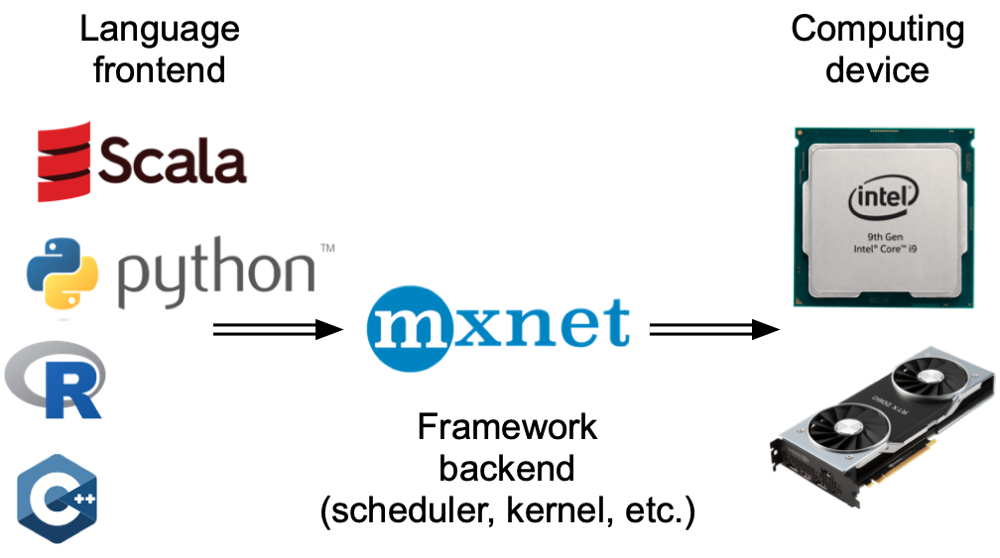
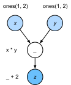
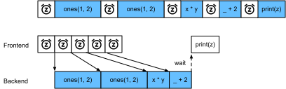

# 异步计算
:label:`sec_async`

当今的计算机是高度并行的系统，由多个 CPU 核心（通常每个核心有多个线程）、每个 GPU 中的多个处理单元以及每台设备中常常存在的多个 GPU 组成。简而言之，我们常常可以在不同的设备上同时处理许多不同的事情。遗憾的是，Python 并不是编写并行和异步代码的好工具，至少在没有额外帮助的情况下不是。毕竟，Python 是单线程的，而且这一点在未来不太可能改变。MXNet 和 TensorFlow 等深度学习框架采用*异步编程*模型来提高性能，
而 PyTorch 使用 Python 自身的调度器，从而带来了不同的性能权衡。
对于 PyTorch，默认情况下 GPU 操作是异步的。当你调用一个使用 GPU 的函数时，这些操作会被排入相应设备的队列，但不一定立即执行，而要等到之后才执行。这使我们能够并行执行更多计算，包括在 CPU 或其他 GPU 上的操作。

因此，理解异步编程的工作方式有助于我们编写更高效的程序，即主动减少计算需求和相互依赖。这使我们能够降低内存开销并提高处理器利用率。

```{.python .input}
#@tab mxnet
from d2l import mxnet as d2l
import numpy, os, subprocess
from mxnet import autograd, gluon, np, npx
from mxnet.gluon import nn
npx.set_np()
```

```{.python .input}
#@tab pytorch
from d2l import torch as d2l
import numpy, os, subprocess
import torch
from torch import nn
```

## 通过后端实现异步

:begin_tab:`mxnet`
作为热身，考虑下面这个玩具问题：我们想生成一个随机矩阵并将它与自身相乘。让我们分别在 NumPy 和 `mxnet.np` 中做这件事，看看差别。
:end_tab:

:begin_tab:`pytorch`
作为热身，考虑下面这个玩具问题：我们想生成一个随机矩阵并将它与自身相乘。让我们分别在 NumPy 和 PyTorch 张量中做这件事，看看差别。
请注意，PyTorch 的 `tensor` 定义在 GPU 上。
:end_tab:

```{.python .input}
#@tab mxnet
with d2l.Benchmark('numpy'):
    for _ in range(10):
        a = numpy.random.normal(size=(1000, 1000))
        b = numpy.dot(a, a)

with d2l.Benchmark('mxnet.np'):
    for _ in range(10):
        a = np.random.normal(size=(1000, 1000))
        b = np.dot(a, a)
```

```{.python .input}
#@tab pytorch
# Warmup for GPU computation
device = d2l.try_gpu()
a = torch.randn(size=(1000, 1000), device=device)
b = torch.mm(a, a)

with d2l.Benchmark('numpy'):
    for _ in range(10):
        a = numpy.random.normal(size=(1000, 1000))
        b = numpy.dot(a, a)

with d2l.Benchmark('torch'):
    for _ in range(10):
        a = torch.randn(size=(1000, 1000), device=device)
        b = torch.mm(a, a)
```

:begin_tab:`mxnet`
通过 MXNet 得到的基准测试输出快了几个数量级。既然二者都在同一个处理器上执行，那一定另有原因。
强制 MXNet 在返回之前完成所有后端计算，就能看出先前发生了什么：计算由后端执行，而前端把控制权交回 Python。
:end_tab:

:begin_tab:`pytorch`
通过 PyTorch 得到的基准测试输出快了几个数量级。
NumPy 的点积在 CPU 处理器上执行，而 PyTorch 的矩阵乘法在 GPU 上执行，因此后者理应快得多。但如此巨大的时间差异表明一定另有原因。
默认情况下，PyTorch 中的 GPU 操作是异步的。
强制 PyTorch 在返回之前完成所有计算，就能看出先前发生了什么：计算由后端执行，而前端把控制权交回 Python。
:end_tab:

```{.python .input}
#@tab mxnet
with d2l.Benchmark():
    for _ in range(10):
        a = np.random.normal(size=(1000, 1000))
        b = np.dot(a, a)
    npx.waitall()
```

```{.python .input}
#@tab pytorch
with d2l.Benchmark():
    for _ in range(10):
        a = torch.randn(size=(1000, 1000), device=device)
        b = torch.mm(a, a)
    torch.cuda.synchronize(device)
```

:begin_tab:`mxnet`
广义地说，MXNet 有一个用于与用户直接交互的前端（例如通过 Python），以及一个供系统用来执行计算的后端。
如 :numref:`fig_frontends` 所示，用户可以用各种前端语言编写 MXNet 程序，例如 Python、R、Scala 和 C++。无论使用哪种前端编程语言，MXNet 程序的执行主要发生在 C++ 实现的后端中。前端语言发出的操作会被传递给后端执行。
后端管理着自己的线程，这些线程不断收集并执行排队中的任务。请注意，要让这一机制正常工作，后端必须能够跟踪计算图中各个步骤之间的依赖关系。因此，相互依赖的操作无法并行化。
:end_tab:

:begin_tab:`pytorch`
广义地说，PyTorch 有一个用于与用户直接交互的前端（例如通过 Python），以及一个供系统用来执行计算的后端。
如 :numref:`fig_frontends` 所示，用户可以用各种前端语言编写 PyTorch 程序，例如 Python 和 C++。无论使用哪种前端编程语言，PyTorch 程序的执行主要发生在 C++ 实现的后端中。前端语言发出的操作会被传递给后端执行。
后端管理着自己的线程，这些线程不断收集并执行排队中的任务。
请注意，要让这一机制正常工作，后端必须能够跟踪计算图中各个步骤之间的依赖关系。因此，相互依赖的操作无法并行化。
:end_tab:


:width:`300px`
:label:`fig_frontends`

让我们再看一个玩具例子，以便更好地理解依赖图。

```{.python .input}
#@tab mxnet
x = np.ones((1, 2))
y = np.ones((1, 2))
z = x * y + 2
z
```

```{.python .input}
#@tab pytorch
x = torch.ones((1, 2), device=device)
y = torch.ones((1, 2), device=device)
z = x * y + 2
z
```


:label:`fig_asyncgraph`


上面的代码片段也在 :numref:`fig_asyncgraph` 中作了图示说明。
每当 Python 前端线程执行前三条语句中的一条时，它只是把任务返回给后端队列。当最后一条语句的结果需要被*打印*时，Python 前端线程会等待 C++ 后端线程完成变量 `z` 结果的计算。这种设计的一个好处是，Python 前端线程不需要执行实际计算。因此，无论 Python 的性能如何，它对程序整体性能的影响都很小。:numref:`fig_threading` 展示了前端和后端如何交互。


:label:`fig_threading`


## 屏障与阻塞

:begin_tab:`mxnet`
有一些操作会强制 Python 等待完成：

* 最明显的是 `npx.waitall()`，它会一直等到所有计算完成，无论这些计算指令是什么时候发出的。在实践中，除非绝对必要，否则使用这个操作符是个坏主意，因为它可能导致性能不佳。
* 如果我们只想等到某个特定变量可用，可以调用 `z.wait_to_read()`。在这种情况下，MXNet 会阻塞返回 Python 的操作，直到变量 `z` 计算完成。其他计算完全可以在此之后继续进行。

让我们看看这在实践中如何工作。
:end_tab:

```{.python .input}
#@tab mxnet
with d2l.Benchmark('waitall'):
    b = np.dot(a, a)
    npx.waitall()

with d2l.Benchmark('wait_to_read'):
    b = np.dot(a, a)
    b.wait_to_read()
```

:begin_tab:`mxnet`
这两个操作完成所需的时间大致相同。除了明显的阻塞操作之外，我们还建议你留意*隐式*阻塞操作。打印一个变量显然要求该变量已经可用，因此是一种阻塞操作。最后，通过 `z.asnumpy()` 转换为 NumPy 以及通过 `z.item()` 转换为标量都是阻塞操作，因为 NumPy 没有异步的概念。它需要访问这些值，就像 `print` 函数一样。

频繁地把少量数据从 MXNet 的作用域复制到 NumPy 再复制回来，会破坏原本高效代码的性能，因为每一个这样的操作都要求计算图*先*求值出得到相关项所需的全部中间结果，然后才能做其他任何事情。
:end_tab:

```{.python .input}
#@tab mxnet
with d2l.Benchmark('numpy conversion'):
    b = np.dot(a, a)
    b.asnumpy()

with d2l.Benchmark('scalar conversion'):
    b = np.dot(a, a)
    b.sum().item()
```

## 改进计算

:begin_tab:`mxnet`
在高度多线程的系统上（即使是普通的笔记本电脑也有 4 个线程或更多，在多插槽服务器上这个数字可能超过 256），调度操作的开销可能变得显著。这就是为什么让计算和调度异步、并行地进行非常可取。为了说明这样做的好处，让我们看看把一个变量多次加 1 会发生什么，分别以串行和异步方式进行。我们通过在每次加法之间插入一个 `wait_to_read` 屏障来模拟同步执行。
:end_tab:

```{.python .input}
#@tab mxnet
with d2l.Benchmark('synchronous'):
    for _ in range(10000):
        y = x + 1
        y.wait_to_read()

with d2l.Benchmark('asynchronous'):
    for _ in range(10000):
        y = x + 1
    npx.waitall()
```

:begin_tab:`mxnet`
Python 前端线程与 C++ 后端线程之间略微简化后的交互可以概括如下：
1. 前端命令后端把计算任务 `y = x + 1` 插入队列。
1. 后端随后从队列中接收计算任务并执行实际的计算。
1. 后端随后把计算结果返回给前端。
假设这三个阶段的时长分别为 $t_1, t_2$ 和 $t_3$。如果我们不使用异步编程，执行 10000 次计算所需的总时间约为 $10000 (t_1+ t_2 + t_3)$。如果使用异步编程，执行 10000 次计算所需的总时间可以减少到 $t_1 + 10000 t_2 + t_3$（假设 $10000 t_2 > 9999t_1$），因为前端不必在每一轮循环中等待后端返回计算结果。
:end_tab:


## 小结


* 深度学习框架可以把 Python 前端与执行后端解耦。这允许快速异步地把命令插入后端，并获得相应的并行性。
* 异步性带来了响应相当灵敏的前端。但是，请小心不要使任务队列过满，因为这可能导致过高的内存消耗。建议在每个小批量处进行同步，使前端和后端大致保持同步。
* 芯片厂商提供了精密的性能分析工具，可以更细粒度地了解深度学习的效率。

:begin_tab:`mxnet`
* 请注意，从 MXNet 的内存管理转换到 Python 会强制后端等到特定变量就绪。`print`、`asnumpy` 和 `item` 等函数都有这种效果。这可能是我们想要的，但粗心使用同步会毁掉性能。
:end_tab:


## 练习

:begin_tab:`mxnet`
1. 我们在上面提到，使用异步计算可以把执行 10000 次计算所需的总时间减少到 $t_1 + 10000 t_2 + t_3$。为什么这里必须假设 $10000 t_2 > 9999 t_1$？
1. 测量 `waitall` 与 `wait_to_read` 之间的差别。提示：执行若干条指令，并针对一个中间结果进行同步。
:end_tab:

:begin_tab:`pytorch`
1. 在 CPU 上对本节中的相同矩阵乘法操作进行基准测试。你还能观察到通过后端实现的异步性吗？
:end_tab:

:begin_tab:`mxnet`
[讨论](https://discuss.d2l.ai/t/361)
:end_tab:

:begin_tab:`pytorch`
[讨论](https://discuss.d2l.ai/t/2564)
:end_tab:
