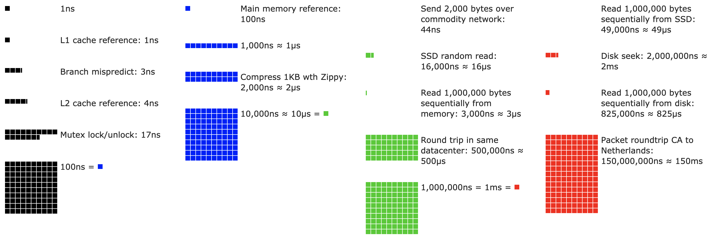
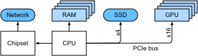
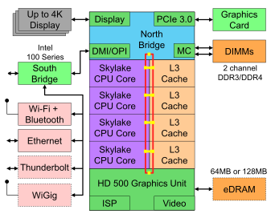
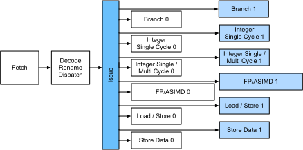
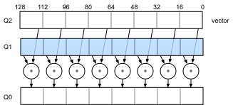
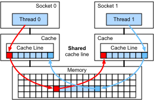
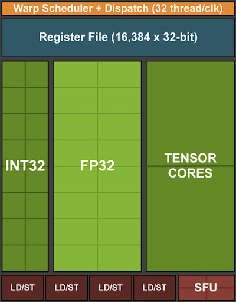
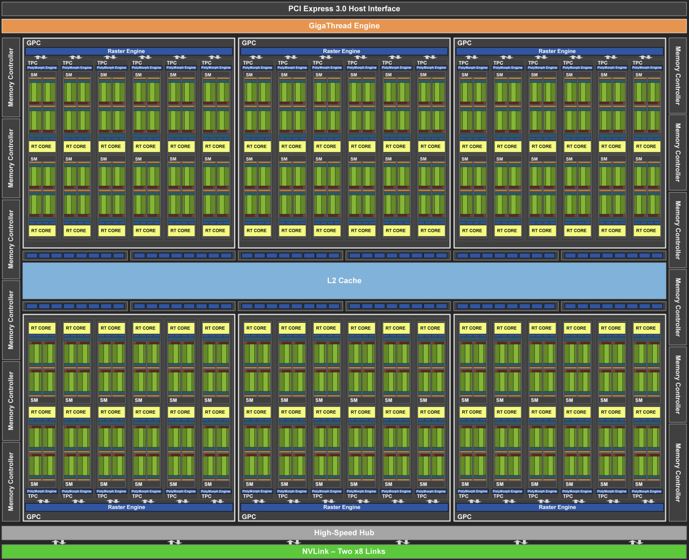
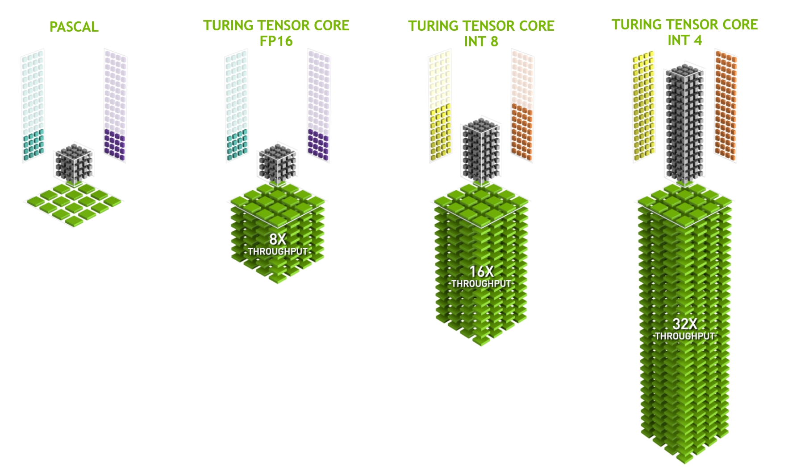

# 硬件
:label:`sec_hardware`

构建高性能系统，需要良好地理解算法和模型，以捕捉问题的统计特性。同时，对底层硬件至少有起码的了解也是不可或缺的。本节并不能替代一门正规的硬件与系统设计课程。相反，它可以作为一个起点，帮助我们理解为什么有些算法比其他算法更高效，以及如何获得良好的吞吐量。良好的设计很容易带来一个数量级的差异，而这又可能决定了我们能否训练出一个网络（例如用一周时间），还是完全训练不出来（需要 3 个月，从而错过截止日期）。
我们将先考察计算机。然后放大视角，更仔细地考察 CPU 和 GPU。最后再缩小视角，回顾多台计算机在服务器中心或云中是如何连接的。

:label:`fig_latencynumbers`

没有耐心的读者也许只靠 :numref:`fig_latencynumbers` 就够了。该图取自 Colin Scott 的[交互式文章](https://people.eecs.berkeley.edu/%7Ercs/research/interactive_latency.html)，它很好地概述了过去十年间的进展。原始数字来自 Jeff Dean 的[2010 年斯坦福演讲](https://static.googleusercontent.com/media/research.google.com/en//people/jeff/Stanford-DL-Nov-2010.pdf)。
下面的讨论解释了这些数字背后的一些道理，以及它们如何指导我们设计算法。下面的讨论非常高层且粗略。它显然*不能替代*一门正规的课程，而只是旨在为统计建模者提供足够的信息，以便做出合适的设计决策。关于计算机体系结构的深入综述，请读者参阅 :cite:`Hennessy.Patterson.2011` 或近期的一门相关课程，例如 [Arste Asanovic](http://inst.eecs.berkeley.edu/%7Ecs152/sp19/) 的课程。

## 计算机

大多数深度学习研究者和实践者都能访问一台拥有相当内存和算力的计算机，其中可能有某种加速器（如 GPU），甚至多个加速器。一台计算机由以下关键组件构成：

* 一个处理器（也称为 CPU），能够执行我们交给它的程序（此外还负责运行操作系统以及许多其他事务），通常由 8 个或更多核心组成。
* 内存（RAM），用于存储和取回计算结果，例如权重向量和激活值，以及训练数据。
* 一个（有时是多个）以太网连接，速度从 1 GB/s 到 100 GB/s 不等。在高端服务器上还可以找到更先进的互连。
* 一条高速扩展总线（PCIe），用于把系统连接到一个或多个 GPU。服务器最多可配有 8 个加速器，通常以先进的拓扑结构连接；而台式机系统有 1 个或 2 个，取决于用户的预算和电源的功率。
* 持久存储，例如磁性硬盘驱动器、固态硬盘，很多情况下通过 PCIe 总线连接。它负责把训练数据高效地传输到系统，并按需存储中间检查点。

:label:`fig_mobo-symbol`

如 :numref:`fig_mobo-symbol` 所示，大多数组件（网络、GPU 和存储）都通过 PCIe 总线连接到 CPU。该总线由多条直接连接到 CPU 的通道组成。例如，AMD 的 Threadripper 3 有 64 条 PCIe 4.0 通道，每条通道都能以 16 Gbit/s 的速率双向传输数据。内存直接连接到 CPU，总带宽最高可达 100 GB/s。

当我们在计算机上运行代码时，需要把数据搬运到处理器（CPU 或 GPU），执行计算，然后再把结果从处理器移回 RAM 和持久存储。因此，为了获得良好的性能，我们需要确保这一过程顺畅无阻，不让其中任何一个系统成为主要瓶颈。例如，如果我们不能足够快地加载图像，处理器就无事可做。同样，如果我们不能足够快地把矩阵搬运到 CPU（或 GPU），其处理单元就会挨饿。最后，如果我们想跨网络同步多台计算机，网络也不应该拖慢计算。一种选择是让通信与计算交替重叠进行。下面我们更详细地考察各个组件。

## 内存

内存最基本的用途是存储需要被快速访问的数据。目前 CPU 的 RAM 通常是 [DDR4](https://en.wikipedia.org/wiki/DDR4_SDRAM) 类型，每个模块提供 20--25 GB/s 的带宽。每个模块有一条 64 位宽的总线。通常使用成对的内存模块来支持多个通道。CPU 有 2 到 4 个内存通道，即其峰值内存带宽在 40GB/s 到 100 GB/s 之间。每个通道通常有两个存储体。例如，AMD 的 Zen 3 Threadripper 有 8 个插槽。

虽然这些数字令人印象深刻，但它们确实只说明了事情的一部分。当我们想从内存中读取一部分数据时，首先需要告诉内存模块信息在哪里。也就是说，我们首先需要把*地址*发送给 RAM。完成这一步之后，我们可以选择只读取一条 64 位的记录，或者读取一长串记录。后者称为*突发读取*（burst read）。简而言之，向内存发送地址并建立传输大约需要 100 ns（具体细节取决于所用内存芯片的具体时序系数），而之后每次传输只需要 0.2 ns。简言之，第一次读取的开销是后续读取的 500 倍！注意，我们每秒最多可以执行 10,000,000 次随机读取。这提示我们应尽可能避免随机内存访问，转而使用突发读取（和写入）。

如果考虑到我们有多个*存储体*，情况会稍微复杂一些。每个存储体基本上可以独立地读取内存。这意味两件事。
一方面，如果这些随机读取均匀分布在内存上，那么有效随机读取次数最多可提高到 4 倍。这也意味着执行随机读取仍然是个坏主意，因为突发读取也同样快了 4 倍。另一方面，由于内存按 64 位边界对齐，最好让所有数据结构都按同样的边界对齐。只要设置了合适的标志，编译器几乎可以[自动地](https://en.wikipedia.org/wiki/Data_structure_alignment)做到这一点。鼓励好奇的读者去学习一下关于 DRAM 的讲座，例如 [Zeshan Chishti](http://web.cecs.pdx.edu/%7Ezeshan/ece585_lec5.pdf) 的讲座。

GPU 内存的带宽要求更高，因为 GPU 的处理单元比 CPU 多得多。总的来说，有两种应对办法。第一种是让内存总线显著加宽。例如，NVIDIA 的 RTX 2080 Ti 有一条 352 位宽的总线。这允许同时传输更多信息。第二种是 GPU 使用专门的高性能内存。消费级设备（如 NVIDIA 的 RTX 和 Titan 系列）通常使用 [GDDR6](https://en.wikipedia.org/wiki/GDDR6_SDRAM) 芯片，总带宽超过 500 GB/s。另一种选择是使用 HBM（high bandwidth memory，高带宽内存）模块。它们使用一种非常不同的接口，在专门的硅晶片上直接与 GPU 连接。这使它们非常昂贵，通常只用于高端服务器芯片，例如 NVIDIA Volta V100 系列加速器。毫不意外，由于 GPU 内存成本更高，它通常*远*小于 CPU 内存。就我们的目的而言，总的来说它们的性能特征相似，只是快得多。就本书而言，我们可以放心忽略其中的细节。它们只有在为高吞吐量调优 GPU 内核时才重要。

## 存储

我们看到，RAM 的一些关键特性是*带宽*和*延迟*。存储设备也是如此，只是差异可能更加极端。

### 硬盘驱动器

*硬盘驱动器*（HDD）已经使用了半个多世纪。简而言之，它们包含若干旋转的盘片，磁头可以定位到任意给定的磁道进行读取或写入。高端磁盘可在 9 张盘片上容纳多达 16 TB 的数据。HDD 的关键优点之一是相对便宜。它的众多缺点之一是典型的灾难性故障模式，以及相对较高的读取延迟。

为了理解后者，考虑 HDD 以大约 7,200 RPM（每分钟转数）的转速旋转这一事实。如果转速再快得多，盘片受到的离心力会使它们碎裂。这在访问磁盘上特定扇区时有一个主要缺点：我们需要等待盘片旋转到位（我们可以移动磁头，但无法让实际的盘片加速）。因此，可能需要超过 8 ms 才能取到所需数据。表达这一点的常见方式是：HDD 大约可以运行在 100 IOPs（每秒输入/输出操作数）。这个数字在过去二十年里基本上没有变化。更糟的是，提高带宽也同样困难（带宽在 100--200 MB/s 的量级）。毕竟，每个磁头读取一个磁道上的比特，因此比特率只能随信息密度的平方根增长。结果，HDD 正迅速被降级为归档存储和超大数据集的低端存储。

### 固态硬盘

固态硬盘（SSD）使用闪存来持久地存储信息。这使对已存储记录的访问*快得多*。现代 SSD 可以运行在 100,000 到 500,000 IOPs，即比 HDD 快多达 3 个数量级。此外，其带宽可达 1--3GB/s，即比 HDD 快一个数量级。这些改进听起来几乎好得令人难以置信。确实，由于 SSD 的设计方式，它们伴随着以下注意事项。

* SSD 以块（256 KB 或更大）为单位存储信息。它们只能整块写入，而这需要相当长的时间。因此，SSD 上按比特的随机写入性能非常差。同样，写入数据通常也需要相当长的时间，因为必须先把块读出、擦除，然后用新信息重写。到目前为止，SSD 控制器和固件已经开发出算法来缓解这个问题。尽管如此，写入仍然可能慢得多，对 QLC（四层单元）SSD 来说尤其如此。提高性能的关键是维护一个操作的*队列*，优先读取，并尽可能按大块写入。
* SSD 中的存储单元相对较快地磨损（往往在几千次写入之后就已经磨损）。磨损均衡保护算法能够把损耗分散到许多单元上。尽管如此，不建议把 SSD 用于交换文件或大量聚集的日志文件。
* 最后，带宽的大幅提升迫使计算机设计者把 SSD 直接连接到 PCIe 总线上。能够处理这种情况的驱动器称为 NVMe（Non Volatile Memory enhanced，非易失性内存增强），最多可使用 4 条 PCIe 通道。在 PCIe 4.0 上这相当于最高 8GB/s。

### 云存储

云存储提供可配置的性能范围。也就是说，存储到虚拟机的分配是动态的，数量和速度都由用户选择。我们建议用户只要延迟过高就增加配置的 IOPs 数量，例如在使用大量小记录进行训练时。

## CPU

中央处理器（CPU）是任何计算机的核心。它由许多关键组件构成：能够执行机器码的*处理器核心*，连接这些核心的*总线*（具体拓扑结构因处理器型号、代次和厂商而异），以及*缓存*，以便获得比从主存读取更高的带宽和更低的延迟。最后，几乎所有现代 CPU 都包含*向量处理单元*，以辅助高性能线性代数和卷积运算，因为这些运算在媒体处理和机器学习中很常见。

:label:`fig_skylake`

:numref:`fig_skylake` 展示了一款 Intel Skylake 消费级四核 CPU。它集成了一块 GPU、若干缓存，以及一条连接四个核心的环形总线。以太网、WiFi、蓝牙、SSD 控制器和 USB 等外围设备，要么是芯片组的一部分，要么直接（通过 PCIe）连接到 CPU。

### 微体系结构

每个处理器核心都由一组相当复杂的组件构成。虽然细节因代次和厂商而异，但基本功能大体上是标准的。前端加载指令，并尝试预测将走哪条路径（例如对控制流而言）。随后，指令从汇编代码解码为微指令。汇编代码往往并不是处理器执行的最低层代码。相反，复杂的指令可能被解码为一组更底层的操作。这些操作随后由实际的执行核心处理。后者通常能够同时执行许多操作。例如，:numref:`fig_cortexa77` 中的 ARM Cortex A77 核心能够同时执行多达 8 个操作。

:label:`fig_cortexa77`

这意味着，只要这些指令能够独立执行，高效的程序就有可能在一个时钟周期内执行多条指令。并非所有单元都是同等设计的。有些单元专门处理整数指令，而另一些则为浮点性能而优化。为了提高吞吐量，处理器在遇到分支指令时还可能同时沿着多条代码路径执行，然后丢弃未采用分支的结果。这就是为什么（前端上的）分支预测单元很重要：只有最有希望的路径才会被追踪。

### 向量化

深度学习极其消耗算力。因此，要让 CPU 适合机器学习，就需要在一个时钟周期内执行许多操作。这通过向量单元来实现。它们有不同的名称：在 ARM 上称为 NEON，在 x86 上（近几代）称为 [AVX2](https://en.wikipedia.org/wiki/Advanced_Vector_Extensions) 单元。它们的共同点是能够执行 SIMD（单指令多数据）操作。:numref:`fig_neon128` 展示了在 ARM 上如何在一个时钟周期内完成 8 个短整数的加法。

:label:`fig_neon128`

取决于体系结构的选择，这类寄存器的长度可达 512 位，允许组合多达 64 对数字。例如，我们可能把两个数相乘并加到第三个数上，这也称为融合乘加。Intel 的 [OpenVino](https://01.org/openvinotoolkit) 利用这些能力，在服务器级 CPU 上为深度学习取得了可观的吞吐量。不过请注意，与 GPU 所能达到的水平相比，这个数字完全相形见绌。例如，NVIDIA 的 RTX 2080 Ti 有 4,352 个 CUDA 核心，每个核心在任何时刻都能处理这样一次操作。

### 缓存

考虑下面的情形：我们有一个如上文 :numref:`fig_skylake` 所示的、具有 4 个核心的普通 CPU 核心，运行频率为 2 GHz。
此外，假设我们的 IPC（每时钟指令数）计数为 1，并且这些单元启用了 256 位宽的 AVX2。再假设用于 AVX2 操作的寄存器中至少有一个需要从内存中取得。这意味着 CPU 每个时钟周期消耗 $4 \times 256 \textrm{ bit} = 128 \textrm{ bytes}$ 的数据。除非我们能够每秒向处理器传输 $2 \times 10^9 \times 128 = 256 \times 10^9$ 字节，否则处理单元就会挨饿。遗憾的是，这种芯片的内存接口只支持 20--40 GB/s 的数据传输，即少了一个数量级。解决办法是尽可能避免从内存加载*新*数据，而改为在 CPU 本地缓存数据。这正是缓存的用武之地。常用以下名称或概念：

* **寄存器**严格来说并不属于缓存。它们帮助暂存指令。尽管如此，CPU 寄存器是 CPU 可以以时钟速度访问而没有任何延迟惩罚的内存位置。CPU 有几十个寄存器。如何高效使用寄存器取决于编译器（或程序员）。例如，C 编程语言有关键字 `register`。
* **L1 缓存**是抵御高内存带宽需求的第一道防线。L1 缓存很小（典型大小可能是 32--64 KB），并且常常分为数据缓存和指令缓存。当数据在 L1 缓存中找到时，访问非常快。如果在那里找不到，搜索就会沿着缓存层次向下进行。
* **L2 缓存**是下一站。取决于体系结构设计和处理器规模，它们可能是独占的。它们可能只能由某个给定核心访问，也可能在多个核心之间共享。L2 缓存更大（通常每个核心 256--512 KB），也比 L1 慢。此外，要访问 L2 中的内容，我们首先需要检查以确认数据不在 L1 中，这会增加少量额外延迟。
* **L3 缓存**在多个核心之间共享，可以相当大。AMD 的 Epyc 3 服务器 CPU 在多个小芯片上分布着高达 256 MB 的缓存。更典型的数字在 4--8 MB 范围内。

预测接下来需要哪些内存元素，是芯片设计中的关键优化参数之一。例如，建议以*向前*的方向遍历内存，因为大多数缓存算法会尝试*预读*而不是向后读。同样，让内存访问模式保持局部性也是提高性能的好方法。

增加缓存是一把双刃剑。一方面，它们确保处理器核心不会因缺少数据而挨饿。同时，它们增大了芯片面积，占用了本来可以用于提高处理能力的面积。此外，*缓存未命中*的代价可能很高。考虑最坏的情况，即 :numref:`fig_falsesharing` 中所示的*伪共享*（false sharing）。当处理器 1 上的一个线程请求数据时，该内存位置却缓存在处理器 0 上。为了取得数据，处理器 0 需要停下正在做的事，把信息写回主存，然后让处理器 1 从内存中读取。在这项操作期间，两个处理器都在等待。这样的代码在多处理器上运行时，很可能会比高效的单处理器实现*更慢*。这也是缓存大小存在实际限制的又一个原因（除了它们的物理尺寸之外）。

:label:`fig_falsesharing`

## GPU 与其他加速器

如果说没有 GPU 深度学习就不可能成功，这并不夸张。同样，也完全有理由认为，GPU 制造商的财富因深度学习而大幅增长。硬件与算法的这种协同演化，导致（无论好坏）深度学习成了首选的统计建模范式。因此，理解 GPU 以及 TPU 等相关加速器所带来的特定好处是值得的 :cite:`Jouppi.Young.Patil.ea.2017`。

值得注意的是实践中经常做出的一个区分：加速器要么针对训练优化，要么针对推理优化。对于后者，我们只需要计算网络中的前向传播。反向传播不需要存储中间数据。此外，我们可能不需要非常精确的计算（FP16 或 INT8 通常就够了）。另一方面，在训练期间，所有中间结果都需要存储以计算梯度。此外，累加梯度需要更高的精度以避免数值下溢（或上溢）。这意味着 FP16（或与 FP32 的混合精度）是最低要求。这一切都要求更快、更大的内存（HBM2 与 GDDR6）以及更强的处理能力。例如，NVIDIA 的 [Turing](https://devblogs.nvidia.com/nvidia-turing-architecture-in-depth/) T4 GPU 针对推理进行了优化，而 V100 GPU 则更适合训练。

回顾 :numref:`fig_neon128` 中所示的向量化。向处理器核心添加向量单元使我们能够显著提高吞吐量。例如，在 :numref:`fig_neon128` 的例子中，我们能够同时执行 16 个操作。
首先，
如果我们加入不仅优化向量之间运算、而且优化矩阵之间运算的操作会怎样？这一策略引出了张量核心（稍后将会介绍）。
其次，如果我们加入多得多的核心会怎样？简而言之，这两种策略概括了 GPU 中的设计决策。:numref:`fig_turing_processing_block` 给出了一个基本处理块的概览。它包含 16 个整数单元和 16 个浮点单元。除此之外，两个张量核心加速了一小部分对深度学习有用的附加操作。每个流式多处理器由四个这样的块组成。

:width:`150px`
:label:`fig_turing_processing_block`

接下来，12 个流式多处理器被分组成图形处理集群，它们构成了高端的 TU102 处理器。充足的内存通道和一个 L2 缓存使这套配置更加完善。:numref:`fig_turing` 给出了相关细节。设计这样一种器件的原因之一是，可以按需增删各个块，从而实现更紧凑的芯片并应对良率问题（有缺陷的模块可能不会被激活）。幸运的是，在 CUDA 和框架代码的层层封装之下，编程这样的器件对普通深度学习研究者来说被很好地隐藏了起来。特别地，只要有可用资源，多个程序很可能可以同时在 GPU 上执行。尽管如此，了解这些器件的局限以避免选择放不进设备内存的模型是值得的。

:width:`350px`
:label:`fig_turing`

最后值得更详细提及的一个方面是*张量核心*（tensor core）。它们是一个近期趋势的例子：加入更多专门对深度学习有效的优化电路。例如，TPU 加入了一个用于快速矩阵乘法的脉动阵列 :cite:`Kung.1988`。那里的设计思路是支持数量很少（第一代 TPU 只有一个）的大型操作。张量核心则处于另一个极端。它们针对涉及 $4 \times 4$ 到 $16 \times 16$ 矩阵的小型操作进行了优化，具体取决于数值精度。:numref:`fig_tensorcore` 给出了这些优化的概览。

:width:`400px`
:label:`fig_tensorcore`

显然，当我们针对计算进行优化时，最终会做出某些妥协。其中之一是 GPU 并不擅长处理中断和稀疏数据。虽然也有一些值得注意的例外，例如 [Gunrock](https://github.com/gunrock/gunrock) :cite:`Wang.Davidson.Pan.ea.2016`，但稀疏矩阵和向量的访问模式与 GPU 擅长的高带宽突发读取操作并不契合。兼顾这两个目标是一个活跃的研究领域。例如参见 [DGL](http://dgl.ai)，这是一个针对图上的深度学习而调优的库。

## 网络与总线

当单个设备不足以完成优化时，我们需要在设备之间传输数据以同步处理。这正是网络和总线派上用场的地方。我们有许多设计参数：带宽、成本、距离和灵活性。
在一端是 WiFi，它有相当好的覆盖范围，非常易于使用（毕竟不需要线缆），价格便宜，但带宽和延迟相对来说平平。任何头脑正常的机器学习研究者都不会用它来构建服务器集群。下面我们重点关注适合深度学习的互连。

* **PCIe** 是一种专用总线，用于非常高带宽的点对点连接（在 PCIe 4.0 的 16 通道插槽中最高可达 32 GB/s）。延迟在个位数微秒的量级（5 μs）。PCIe 链路很宝贵。处理器只有数量有限的链路：AMD 的 EPYC 3 有 128 条通道，Intel 的 Xeon 每块芯片最多 48 条通道；在台式机级 CPU 上，这个数字分别是 20（Ryzen 9）和 16（Core i9）。由于 GPU 通常有 16 条通道，这就限制了能以全带宽连接到 CPU 的 GPU 数量。毕竟，它们还需要与其他高带宽外设（如存储和以太网）共享这些链路。就像内存访问一样，由于分组开销更小，大批量传输更可取。
* **以太网**是连接计算机最常用的方式。虽然它比 PCIe 慢得多，但非常便宜、安装简便且适应性强，还能覆盖长得多的距离。低端服务器的典型带宽是 1 GBit/s。更高端的设备（例如云中的 [C5 实例](https://aws.amazon.com/ec2/instance-types/c5/)）提供 10 到 100 GBit/s 的带宽。与之前所有情况一样，数据传输有显著的开销。请注意，我们几乎从不直接使用原始以太网，而是在物理互连之上执行某种协议（例如 UDP 或 TCP/IP）。这会进一步增加开销。与 PCIe 一样，以太网旨在连接两个设备，例如一台计算机和一台交换机。
* **交换机**使我们能够以这样的方式连接多台设备：任意一对设备都可以同时进行（通常是全带宽的）点对点连接。例如，以太网交换机可以以很高的横截面带宽连接 40 台服务器。请注意，交换机并非传统计算机网络所独有。甚至 PCIe 通道也可以被[交换](https://www.broadcom.com/products/pcie-switches-bridges/pcie-switches)。例如，把大量 GPU 连接到主机处理器时就会发生这种情况，[P2 实例](https://aws.amazon.com/ec2/instance-types/p2/)就是如此。
* **NVLink** 是 PCIe 在超高带宽互连方面的一种替代方案。每条链路提供高达 300 Gbit/s 的数据传输速率。服务器 GPU（Volta V100）有六条链路，而消费级 GPU（RTX 2080 Ti）只有一条链路，以降低后的 100 Gbit/s 速率运行。我们建议使用 [NCCL](https://github.com/NVIDIA/nccl) 来实现 GPU 之间的高数据传输。

## 更多延迟数字

:numref:`table_latency_numbers` 和 :numref:`table_latency_numbers_tesla` 中的汇总数据来自 [Eliot Eshelman](https://gist.github.com/eshelman)，他把这些数字的最新版本维护在一个 [GitHub gist](https://gist.github.com/eshelman/343a1c46cb3fba142c1afdcdeec17646) 中。

:常见延迟数字。

| 操作 | 时间 | 说明 |
| :----------------------------------------- | -----: | :---------------------------------------------- |
| L1 缓存引用/命中                     | 1.5 ns | 4 个时钟周期                                        |
| 浮点加/乘/FMA                | 1.5 ns | 4 个时钟周期                                        |
| L2 缓存引用/命中                     |   5 ns | 12 ~ 17 个时钟周期                                  |
| 分支预测错误                          |   6 ns | 15 ~ 20 个时钟周期                                  |
| L3 缓存命中（未共享缓存）              |  16 ns | 42 个时钟周期                                       |
| L3 缓存命中（在另一核心中共享）      |  25 ns | 65 个时钟周期                                       |
| 互斥锁加锁/解锁                          |  25 ns |                                                 |
| L3 缓存命中（在另一核心中修改）    |  29 ns | 75 个时钟周期                                       |
| L3 缓存命中（在远程 CPU 插槽上）      |  40 ns | 100 ~ 300 个时钟周期（40 ~ 116 ns）                  |
| 到另一个 CPU 的 QPI 跳（每次跳）         |  40 ns |                                                 |
| 64MB 内存引用（本地 CPU）          |  46 ns | Broadwell E5-2690v4 上的 TinyMemBench             |
| 64MB 内存引用（远程 CPU）         |  70 ns | Broadwell E5-2690v4 上的 TinyMemBench             |
| 256MB 内存引用（本地 CPU）         |  75 ns | Broadwell E5-2690v4 上的 TinyMemBench             |
| Intel Optane 随机写                  |  94 ns | UCSD 非易失性系统实验室                   |
| 256MB 内存引用（远程 CPU）        | 120 ns | Broadwell E5-2690v4 上的 TinyMemBench             |
| Intel Optane 随机读                   | 305 ns | UCSD 非易失性系统实验室                   |
| 通过 100 Gbps HPC 结构发送 4KB          |   1 μs | 基于 Intel Omni-Path 的 MVAPICH2                   |
| 用 Google Snappy 压缩 1KB            |   3 μs |                                                 |
| 通过 10 Gbps 以太网发送 4KB             |  10 μs |                                                 |
| 随机向 NVMe SSD 写入 4KB             |  30 μs | DC P3608 NVMe SSD（QOS 99% 为 500μs）            |
| 与 NVLink GPU 之间传输 1MB            |  30 μs | NVIDIA 40GB NVLink 上约 33GB/s                 |
| 与 PCI-E GPU 之间传输 1MB             |  80 μs | PCIe 3.0 x16 链路上约 12GB/s                  |
| 随机从 NVMe SSD 读取 4KB            | 120 μs | DC P3608 NVMe SSD（QOS 99%）                     |
| 从 NVMe SSD 顺序读取 1MB        | 208 μs | DC P3608 NVMe SSD 上约 4.8GB/s                    |
| 随机向 SATA SSD 写入 4KB             | 500 μs | DC S3510 SATA SSD（QOS 99.9%）                   |
| 随机从 SATA SSD 读取 4KB            | 500 μs | DC S3510 SATA SSD（QOS 99.9%）                   |
| 同一数据中心内的往返          | 500 μs | 单向 ping 约为 250μs                          |
| 从 SATA SSD 顺序读取 1MB        |   2 ms | DC S3510 SATA SSD 上约 550MB/s                    |
| 从磁盘顺序读取 1MB            |   5 ms | 服务器 HDD 上约 200MB/s                           |
| 随机磁盘访问（寻道+旋转）         |  10 ms |                                                 |
| 发送数据包 加州->荷兰->加州            | 150 ms |                                                 |
:label:`table_latency_numbers`

:NVIDIA Tesla GPU 的延迟数字。

| 操作 | 时间 | 说明 |
| :------------------------------ | -----: | :---------------------------------------- |
| GPU 共享内存访问        |  30 ns | 30~90 个时钟周期（存储体冲突会增加延迟） |
| GPU 全局内存访问        | 200 ns | 200~800 个时钟周期                            |
| 在 GPU 上启动 CUDA 内核 |  10 μs | 主机 CPU 指示 GPU 启动内核    |
| 与 NVLink GPU 之间传输 1MB |  30 μs | NVIDIA 40GB NVLink 上约 33GB/s           |
| 与 PCI-E GPU 之间传输 1MB  |  80 μs | PCI-Express x16 链路上约 12GB/s         |
:label:`table_latency_numbers_tesla`

## 小结

* 设备执行操作是有开销的。因此，重要的是以少量的大传输为目标，而不是许多小传输。这适用于 RAM、SSD、网络和 GPU。
* 向量化是性能的关键。请务必了解你所用加速器的具体能力。例如，某些 Intel Xeon CPU 特别擅长 INT8 操作，NVIDIA Volta GPU 擅长 FP16 矩阵-矩阵操作，而 NVIDIA Turing 则在 FP16、INT8 和 INT4 操作上表现出色。
* 由于数据类型较小而导致的数值上溢可能在训练期间成为问题（在推理期间问题较小）。
* 别名（aliasing）会显著降低性能。例如，在 64 位 CPU 上，内存对齐应按 64 位边界进行。在 GPU 上，最好让卷积尺寸保持对齐，例如对齐到张量核心。
* 让你的算法与硬件相匹配（例如内存占用和带宽）。当参数能放入缓存时，可以获得巨大的加速（数量级）。
* 我们建议先在纸上勾画新算法的性能，然后再去验证实验结果。出现一个数量级或更大的偏差，就值得警惕了。
* 使用性能分析工具来调试性能瓶颈。
* 训练硬件和推理硬件在价格与性能方面有着不同的最佳平衡点。

## 练习

1. 编写 C 代码，测试访问对齐到外部内存接口的内存与访问未对齐的内存之间在速度上是否有差异。提示：注意缓存效应。
1. 测试顺序访问内存与按给定步幅访问内存之间的速度差异。
1. 你如何测量 CPU 上的缓存大小？
1. 你会如何在多个内存通道上布局数据以获得最大带宽？如果你有很多小线程，又会如何布局？
1. 一块企业级 HDD 以 10,000 rpm 的转速旋转。在最坏情况下，HDD 在读取数据之前绝对需要花费的最短时间是多少（可以假设磁头几乎瞬时移动）？为什么 2.5 英寸 HDD 在商用服务器上日益流行（相对于 3.5 英寸和 5.25 英寸驱动器）？
1. 假设某 HDD 制造商把存储密度从每平方英寸 1 Tbit 提高到每平方英寸 5 Tbit。在一块 2.5 英寸 HDD 的一个环上你能存储多少信息？内圈磁道和外圈磁道之间有差异吗？
1. 从 8 位数据类型变为 16 位数据类型，会使硅片面积大约增加四倍。为什么？为什么 NVIDIA 可能在其 Turing GPU 上加入 INT4 操作？
1. 向前遍历内存读取与向后读取相比快多少？这个数字在不同计算机和不同 CPU 厂商之间会有差异吗？为什么？编写 C 代码并实验。
1. 你能测量磁盘的缓存大小吗？典型 HDD 的缓存是多少？SSD 需要缓存吗？
1. 测量通过以太网发送消息时的分组开销。查阅 UDP 与 TCP/IP 连接之间的差异。
1. 直接内存访问允许 CPU 之外的设备直接写入（和读取）内存。为什么这是个好主意？
1. 查看 Turing T4 GPU 的性能数字。为什么当你从 FP16 转到 INT8 和 INT4 时，性能“只”翻倍？
1. 数据包在旧金山和阿姆斯特丹之间往返所需的最短时间应该是多少？提示：可以假设距离为 10,000 km。

[讨论](https://discuss.d2l.ai/t/363)
