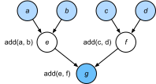

# 编译器和解释器
:label:`sec_hybridize`

到目前为止，本书重点关注的是命令式编程，它使用 `print`、`+` 和 `if` 等语句来改变程序的状态。请看下面这个简单命令式程序的例子。

```{.python .input}
#@tab all
def add(a, b):
    return a + b

def fancy_func(a, b, c, d):
    e = add(a, b)
    f = add(c, d)
    g = add(e, f)
    return g

print(fancy_func(1, 2, 3, 4))
```

Python 是一种*解释型语言*。在求值上面的 `fancy_func` 函数时，它会*按顺序*执行构成函数体的各项操作。也就是说，它会求值 `e = add(a, b)`，并把结果存储为变量 `e`，从而改变程序的状态。接下来的两条语句 `f = add(c, d)` 和 `g = add(e, f)` 也会以类似方式执行，完成加法运算并把结果存储为变量。:numref:`fig_compute_graph` 展示了数据的流动。


:label:`fig_compute_graph`

虽然命令式编程很方便，但它可能效率不高。一方面，即使 `add` 函数在 `fancy_func` 中被反复调用，Python 还是会逐个执行这三次函数调用。如果这些调用是在 GPU（甚至多个 GPU）上执行的，那么 Python 解释器带来的开销可能会变得难以承受。此外，它还需要保存变量 `e` 和 `f` 的值，直到 `fancy_func` 中的所有语句都执行完毕。这是因为在执行完 `e = add(a, b)` 和 `f = add(c, d)` 这两条语句之后，我们并不知道变量 `e` 和 `f` 是否会被程序的其他部分使用。

## 符号式编程

考虑另一种方式，即*符号式编程*：在这种方式下，通常只有在整个过程被完整定义之后才执行计算。包括 Theano 和 TensorFlow（后者已经获得了命令式扩展）在内的多个深度学习框架都采用这种策略。它通常包括以下步骤：

1. 定义要执行的操作。
1. 把操作编译成一个可执行的程序。
1. 提供所需的输入，并调用编译后的程序来执行。

这样可以进行大量的优化。首先，在许多情况下我们可以跳过 Python 解释器，从而消除一个可能变得显著的性能瓶颈——当多个高速 GPU 搭配 CPU 上单个 Python 线程时尤其如此。
其次，编译器可能把上面的代码优化并改写成 `print((1 + 2) + (3 + 4))`，甚至改写成 `print(10)`。这是可能的，因为编译器在把代码转换成机器指令之前能够看到完整的代码。例如，只要某个变量不再需要，它就可以释放内存（或者干脆从不分配内存）。或者，它可以把整段代码变换成等价的一段。
为了更好地理解这一点，请看下面这个对命令式编程的模拟（毕竟用的还是 Python）。

```{.python .input}
#@tab all
def add_():
    return '''
def add(a, b):
    return a + b
'''

def fancy_func_():
    return '''
def fancy_func(a, b, c, d):
    e = add(a, b)
    f = add(c, d)
    g = add(e, f)
    return g
'''

def evoke_():
    return add_() + fancy_func_() + 'print(fancy_func(1, 2, 3, 4))'

prog = evoke_()
print(prog)
y = compile(prog, '', 'exec')
exec(y)
```

命令式（解释型）编程与符号式编程的区别如下：

* 命令式编程更容易。在 Python 中使用命令式编程时，大部分代码都直截了当、易于编写。调试命令式编程代码也更容易，因为更容易获取并打印所有相关的中间变量值，或者使用 Python 内置的调试工具。
* 符号式编程更高效，也更容易移植。符号式编程使编译期的代码优化更容易，同时还能把程序移植成与 Python 无关的形式。这使程序可以在非 Python 环境中运行，从而避免任何与 Python 解释器相关的潜在性能问题。


## 混合式编程

从历史上看，大多数深度学习框架都在命令式方法与符号式方法之间做出选择。例如，Theano、TensorFlow（受前者启发）、Keras 和 CNTK 以符号方式构建模型。相反，Chainer 和 PyTorch 采用命令式方法。在后来的修订版中，TensorFlow 2.0 和 Keras 加入了命令式模式。

:begin_tab:`mxnet`
在设计 Gluon 时，开发者考虑过能否把两种编程范式的优点结合起来。由此产生了一种混合模式：用户可以用纯命令式编程进行开发和调试，同时在需要产品级计算性能和部署时，能够把大多数程序转换成符号式程序来运行。

在实践中，这意味着我们使用 `HybridBlock` 或 `HybridSequential` 类来构建模型。默认情况下，二者中任何一个的执行方式都与命令式编程中执行 `Block` 或 `Sequential` 类的方式相同。
`HybridSequential` 类是 `HybridBlock` 的子类（就像 `Sequential` 是 `Block` 的子类一样）。调用 `hybridize` 函数时，Gluon 会把模型编译成符号式编程中使用的形式。这样就能优化计算密集的组件，而无须牺牲模型的实现方式。下面我们将说明这样做的好处，重点关注顺序模型和块。
:end_tab:

:begin_tab:`pytorch`
如上所述，PyTorch 基于命令式编程，并使用动态计算图。为了利用符号式编程的可移植性和效率，开发者考虑过能否把两种编程范式的优点结合起来。由此产生了 torchscript：它让用户可以用纯命令式编程进行开发和调试，同时在需要产品级计算性能和部署时，能够把大多数程序转换成符号式程序来运行。
:end_tab:

:begin_tab:`tensorflow`
命令式编程范式现在已成为 TensorFlow 2 的默认范式，这对刚接触该语言的人来说是个可喜的变化。然而，同样的符号式编程技术以及由此得到的计算图在 TensorFlow 中依然存在，并且可以通过易于使用的 `tf.function` 装饰器来使用。这为 TensorFlow 带来了命令式编程范式，让用户可以定义更直观的函数，然后利用 TensorFlow 团队称为 [autograph](https://www.tensorflow.org/api_docs/python/tf/autograph) 的特性，把它们包装起来并自动编译成计算图。
:end_tab:

## 混合化 `Sequential` 类

了解混合式编程如何工作的最简便方法，是考察具有多个层的深度网络。通常，Python 解释器需要执行所有层的代码，才能生成一条可以转发给 CPU 或 GPU 的指令。对于单个（快速的）计算设备来说，这不会造成什么大问题。另一方面，如果我们使用像 AWS P3dn.24xlarge 实例这样的高级 8-GPU 服务器，Python 就会难以让所有 GPU 保持忙碌。单线程的 Python 解释器在这里成了瓶颈。让我们看看如何通过把 `Sequential` 替换为 `HybridSequential`，为代码中相当大的一部分解决这个问题。我们先定义一个简单的 MLP。

```{.python .input}
#@tab mxnet
from d2l import mxnet as d2l
from mxnet import np, npx
from mxnet.gluon import nn
npx.set_np()

# Factory for networks
def get_net():
    net = nn.HybridSequential()  
    net.add(nn.Dense(256, activation='relu'),
            nn.Dense(128, activation='relu'),
            nn.Dense(2))
    net.initialize()
    return net

x = np.random.normal(size=(1, 512))
net = get_net()
net(x)
```

```{.python .input}
#@tab pytorch
from d2l import torch as d2l
import torch
from torch import nn

# Factory for networks
def get_net():
    net = nn.Sequential(nn.Linear(512, 256),
            nn.ReLU(),
            nn.Linear(256, 128),
            nn.ReLU(),
            nn.Linear(128, 2))
    return net

x = torch.randn(size=(1, 512))
net = get_net()
net(x)
```

```{.python .input}
#@tab tensorflow
from d2l import tensorflow as d2l
import tensorflow as tf
from tensorflow.keras.layers import Dense

# Factory for networks
def get_net():
    net = tf.keras.Sequential()
    net.add(Dense(256, input_shape = (512,), activation = "relu"))
    net.add(Dense(128, activation = "relu"))
    net.add(Dense(2, activation = "linear"))
    return net

x = tf.random.normal([1,512])
net = get_net()
net(x)
```

:begin_tab:`mxnet`
通过调用 `hybridize` 函数，我们能够编译并优化 MLP 中的计算。模型的计算结果保持不变。
:end_tab:

:begin_tab:`pytorch`
用 `torch.jit.script` 函数转换模型后，我们能够编译并优化 MLP 中的计算。模型的计算结果保持不变。
:end_tab:

:begin_tab:`tensorflow`
以前，TensorFlow 中构建的所有函数都会构建成计算图，因此默认就由 JIT 编译。然而，随着 TensorFlow 2.X 和 EagerTensor 的发布，这不再是默认行为。
我们可以用 tf.function 重新启用这一功能。tf.function 更常用作函数装饰器，但也可以像普通 Python 函数那样直接调用，如下所示。模型的计算结果保持不变。
:end_tab:

```{.python .input}
#@tab mxnet
net.hybridize()
net(x)
```

```{.python .input}
#@tab pytorch
net = torch.jit.script(net)
net(x)
```

```{.python .input}
#@tab tensorflow
net = tf.function(net)
net(x)
```

:begin_tab:`mxnet`
这看起来简直好得令人难以置信：只需把一个块指定为 `HybridSequential`，编写与之前相同的代码，然后调用 `hybridize`。一旦这样做，网络就被优化了（我们将在下面基准测试其性能）。遗憾的是，这并非对每一层都能神奇地奏效。也就是说，如果某一层继承自 `Block` 类而不是 `HybridBlock` 类，那么它就不会被优化。
:end_tab:

:begin_tab:`pytorch`
这看起来简直好得令人难以置信：编写与之前相同的代码，然后简单地用 `torch.jit.script` 转换模型。一旦这样做，网络就被优化了（我们将在下面基准测试其性能）。
:end_tab:

:begin_tab:`tensorflow`
这看起来简直好得令人难以置信：编写与之前相同的代码，然后简单地用 `tf.function` 转换模型。一旦这样做，网络就会作为计算图构建在 TensorFlow 的 MLIR 中间表示中，并在编译器层面进行大量优化，以便快速执行（我们将在下面基准测试其性能）。
在调用 `tf.function()` 时显式添加 `jit_compile = True` 标志，可以在 TensorFlow 中启用 XLA（Accelerated Linear Algebra）功能。在某些情况下，XLA 可以进一步优化 JIT 编译的代码。不显式指定该标志也会启用图模式执行，不过 XLA 可以让某些大型线性代数运算（类似我们在深度学习应用中看到的那类运算）快得多，在 GPU 环境中尤其如此。
:end_tab:

### 通过混合式编程加速

为了展示编译带来的性能提升，我们比较混合前后求值 `net(x)` 所需的时间。让我们先定义一个类来测量这一时间。在本章中，当我们着手测量（并改进）性能时，它会派上用场。

```{.python .input}
#@tab all
#@save
class Benchmark:
    """For measuring running time."""
    def __init__(self, description='Done'):
        self.description = description

    def __enter__(self):
        self.timer = d2l.Timer()
        return self

    def __exit__(self, *args):
        print(f'{self.description}: {self.timer.stop():.4f} sec')
```

:begin_tab:`mxnet`
现在我们可以调用网络两次，一次采用混合式编程，一次不采用。
:end_tab:

:begin_tab:`pytorch`
现在我们可以调用网络两次，一次使用 torchscript，一次不使用。
:end_tab:

:begin_tab:`tensorflow`
现在我们可以调用网络三次：一次以动态图方式执行，一次以图模式执行，再一次使用 JIT 编译的 XLA。
:end_tab:

```{.python .input}
#@tab mxnet
net = get_net()
with Benchmark('Without hybridization'):
    for i in range(1000): net(x)
    npx.waitall()

net.hybridize()
with Benchmark('With hybridization'):
    for i in range(1000): net(x)
    npx.waitall()
```

```{.python .input}
#@tab pytorch
net = get_net()
with Benchmark('Without torchscript'):
    for i in range(1000): net(x)

net = torch.jit.script(net)
with Benchmark('With torchscript'):
    for i in range(1000): net(x)
```

```{.python .input}
#@tab tensorflow
net = get_net()
with Benchmark('Eager Mode'):
    for i in range(1000): net(x)

net = tf.function(net)
with Benchmark('Graph Mode'):
    for i in range(1000): net(x)
```

:begin_tab:`mxnet`
从上面的结果可以看到，在 `HybridSequential` 实例调用 `hybridize` 函数之后，计算性能通过符号式编程得到了提高。
:end_tab:

:begin_tab:`pytorch`
从上面的结果可以看到，在用 `torch.jit.script` 函数对 `nn.Sequential` 实例进行脚本化之后，计算性能通过符号式编程得到了提高。
:end_tab:

:begin_tab:`tensorflow`
从上面的结果可以看到，在用 `tf.function` 函数对 `tf.keras.Sequential` 实例进行脚本化之后，计算性能通过 tensorflow 中的图模式执行、借助符号式编程得到了提高。
:end_tab:

### 序列化

:begin_tab:`mxnet`
编译模型的好处之一在于，我们可以把模型及其参数序列化（保存）到磁盘。这使我们能够以不依赖于所选前端语言的方式来存储模型。这样，我们就可以把训练好的模型部署到其他设备上，并轻松使用其他前端编程语言。同时，代码往往比命令式编程所能达到的速度更快。让我们看看 `export` 函数的实际效果。
:end_tab:

:begin_tab:`pytorch`
编译模型的好处之一在于，我们可以把模型及其参数序列化（保存）到磁盘。这使我们能够以不依赖于所选前端语言的方式来存储模型。这样，我们就可以把训练好的模型部署到其他设备上，并轻松使用其他前端编程语言。同时，代码往往比命令式编程所能达到的速度更快。让我们看看 `save` 函数的实际效果。
:end_tab:

:begin_tab:`tensorflow`
编译模型的好处之一在于，我们可以把模型及其参数序列化（保存）到磁盘。这使我们能够以不依赖于所选前端语言的方式来存储模型。这样，我们就可以把训练好的模型部署到其他设备上，并轻松使用其他前端编程语言，或者在一台服务器上执行训练好的模型。同时，代码往往比命令式编程所能达到的速度更快。
在 TensorFlow 中用于保存的低层 API 是 `tf.saved_model`。
让我们看看 `saved_model` 实例的实际效果。
:end_tab:

```{.python .input}
#@tab mxnet
net.export('my_mlp')
!ls -lh my_mlp*
```

```{.python .input}
#@tab pytorch
net.save('my_mlp')
!ls -lh my_mlp*
```

```{.python .input}
#@tab tensorflow
net = get_net()
tf.saved_model.save(net, 'my_mlp')
!ls -lh my_mlp*
```

:begin_tab:`mxnet`
模型被分解为一个（大型二进制）参数文件和一个 JSON 描述文件，后者描述执行模型计算所需的程序。这些文件可以被 Python 或 MXNet 支持的其他前端语言读取，例如 C++、R、Scala 和 Perl。让我们看看模型描述文件的前几行。
:end_tab:

```{.python .input}
#@tab mxnet
!head my_mlp-symbol.json
```

:begin_tab:`mxnet`
前面我们演示了，在调用 `hybridize` 函数之后，模型能够获得更优越的计算性能和可移植性。不过请注意，混合化可能影响模型的灵活性，尤其是在控制流方面。

此外，与需要使用 `forward` 函数的 `Block` 实例相反，对于 `HybridBlock` 实例，我们需要使用 `hybrid_forward` 函数。
:end_tab:

```{.python .input}
#@tab mxnet
class HybridNet(nn.HybridBlock):
    def __init__(self, **kwargs):
        super(HybridNet, self).__init__(**kwargs)
        self.hidden = nn.Dense(4)
        self.output = nn.Dense(2)

    def hybrid_forward(self, F, x):
        print('module F: ', F)
        print('value  x: ', x)
        x = F.npx.relu(self.hidden(x))
        print('result  : ', x)
        return self.output(x)
```

:begin_tab:`mxnet`
上面的代码实现了一个具有 4 个隐藏单元和 2 个输出的简单网络。`hybrid_forward` 函数多接受一个参数 `F`。这是必需的，因为根据代码是否已经混合化，它会使用稍有不同的库（`ndarray` 或 `symbol`）来处理。这两个类执行的功能非常相似，MXNet 会自动确定该用哪个参数。为了理解发生了什么，我们在函数调用过程中打印这些参数。
:end_tab:

```{.python .input}
#@tab mxnet
net = HybridNet()
net.initialize()
x = np.random.normal(size=(1, 3))
net(x)
```

:begin_tab:`mxnet`
重复前向计算会得到相同的输出（细节从略）。现在我们来看看，如果调用 `hybridize` 函数会发生什么。
:end_tab:

```{.python .input}
#@tab mxnet
net.hybridize()
net(x)
```

:begin_tab:`mxnet`
现在我们不再使用 `ndarray`，而是为 `F` 使用 `symbol` 模块。此外，尽管输入是 `ndarray` 类型，流经网络的数据现在在编译过程中被转换成了 `symbol` 类型。重复调用该函数会得到出人意料的结果：
:end_tab:

```{.python .input}
#@tab mxnet
net(x)
```

:begin_tab:`mxnet`
这与我们之前看到的情况大不相同。`hybrid_forward` 中定义的所有 print 语句都被省略了。确实，混合化之后，`net(x)` 的执行不再涉及 Python 解释器。这意味着任何多余的 Python 代码（例如 print 语句）都会被省略，以换取更精简的执行和更好的性能。取而代之的是，MXNet 直接调用 C++ 后端。还要注意，有些函数在 `symbol` 模块中不受支持（例如 `asnumpy`），并且诸如 `a += b` 和 `a[:] = a + b` 这样的就地操作必须改写为 `a = a + b`。尽管如此，只要速度重要，编译模型就是值得的。收益从几个百分点到两倍以上的速度不等，取决于模型的复杂度、CPU 的速度以及 GPU 的速度和数量。
:end_tab:

## 小结


* 命令式编程使设计新模型变得容易，因为可以编写带有控制流的代码，并且能够利用大量 Python 软件生态。
* 符号式编程要求我们先指定程序并在执行之前编译它。好处是性能得到改进。

:begin_tab:`mxnet`
* MXNet 能够根据需要把两种方法的优点结合起来。
* 由 `HybridSequential` 和 `HybridBlock` 类构建的模型，能够通过调用 `hybridize` 函数把命令式程序转换为符号式程序。
:end_tab:


## 练习


:begin_tab:`mxnet`
1. 在本节的 `HybridNet` 类中，在 `hybrid_forward` 函数的第一行添加 `x.asnumpy()`。执行代码并观察你遇到的错误。这些错误为什么会发生？
1. 如果我们在 `hybrid_forward` 函数中加入控制流，即 Python 语句 `if` 和 `for`，会发生什么？
1. 回顾前几章中你感兴趣的模型。你能否通过重新实现它们来改进其计算性能？
:end_tab:

:begin_tab:`pytorch,tensorflow`
1. 回顾前几章中你感兴趣的模型。你能否通过重新实现它们来改进其计算性能？
:end_tab:


:begin_tab:`mxnet`
[讨论](https://discuss.d2l.ai/t/360)
:end_tab:

:begin_tab:`pytorch`
[讨论](https://discuss.d2l.ai/t/2490)
:end_tab:

:begin_tab:`tensorflow`
[讨论](https://discuss.d2l.ai/t/2492)
:end_tab:
