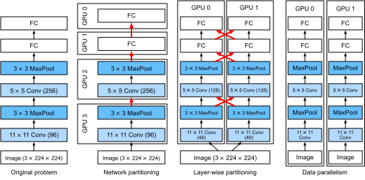
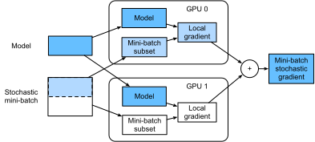

# 多 GPU 训练
:label:`sec_multi_gpu`

到目前为止，我们已经讨论了如何在 CPU 和 GPU 上高效地训练模型。我们甚至还在 :numref:`sec_auto_para` 中展示了深度学习框架如何让计算和通信在它们之间自动并行。我们也在 :numref:`sec_use_gpu` 中展示了如何使用 `nvidia-smi` 命令列出一台计算机上所有可用的 GPU。
我们*没有*讨论的是如何真正实现深度学习训练的并行化。
相反，我们只是顺带暗示：人们可以以某种方式把数据拆分到多个设备上并让它工作起来。本节将补充这些细节，并展示在从零开始的情况下如何并行地训练网络。关于如何利用高级 API 中功能的细节，则留到 :numref:`sec_multi_gpu_concise` 中讨论。
我们假设读者已经熟悉小批量随机梯度下降算法，例如 :numref:`sec_minibatch_sgd` 中描述的那些算法。


## 拆分问题

让我们从一个简单的计算机视觉问题和一个稍显老旧的网络开始，例如包含多个卷积层、汇聚层，最后可能还有几个全连接层。
也就是说，让我们从一个与 LeNet :cite:`LeCun.Bottou.Bengio.ea.1998` 或 AlexNet :cite:`Krizhevsky.Sutskever.Hinton.2012` 非常相似的网络开始。
给定多个 GPU（如果是台式机服务器则为 2 个，AWS g4dn.12xlarge 实例上为 4 个，p3.16xlarge 上为 8 个，p2.16xlarge 上为 16 个），我们希望以某种方式划分训练任务，以便获得良好的加速，同时还能受益于简单且可复现的设计选择。毕竟，多个 GPU 会同时提升*内存*和*计算*能力。简而言之，给定一个小批量的待分类训练数据，我们有以下几种选择。

首先，我们可以把网络划分到多个 GPU 上。也就是说，每个 GPU 把流入某个特定层的数据作为输入，经过后续若干层处理后，再把数据发送给下一个 GPU。
与单个 GPU 所能处理的数据相比，这使我们能够处理更大的网络。
此外，
每个 GPU 的内存占用可以得到很好的控制（它只是整个网络占用的一部分）。

然而，层（因而 GPU）之间的接口需要紧密的同步。这可能很棘手，尤其是当各层之间的计算负载没有恰当匹配时。GPU 数量很大时，这个问题会进一步加剧。
层之间的接口还需要传输大量数据，
例如激活值和梯度。
这可能压垮 GPU 总线的带宽。
此外，计算密集但又顺序执行的操作很难划分。例如，:citet:`Mirhoseini.Pham.Le.ea.2017` 在这方面进行了最大努力。这仍然是一个困难的问题，目前尚不清楚是否有可能在非平凡问题上实现良好的（线性）扩展。除非有出色的框架或操作系统支持把多个 GPU 串联起来，否则我们不推荐这种做法。


其次，我们可以按层来划分工作。例如，与其在单个 GPU 上计算 64 个通道，我们可以把问题拆分到 4 个 GPU 上，每个 GPU 生成 16 个通道的数据。
同样，对于全连接层，我们可以拆分输出单元的数量。:numref:`fig_alexnet_original`（取自 :citet:`Krizhevsky.Sutskever.Hinton.2012`）
展示了这种设计，当时采用该策略是为了应对内存占用非常小（当时只有 2 GB）的 GPU。
只要通道数（或单元数）不太少，这种策略就可以在计算方面获得良好的扩展。
此外，
由于可用内存可以线性扩展，多个 GPU 可以处理越来越大的网络。


:label:`fig_alexnet_original`

然而，
由于每一层都依赖于所有其他层的结果，我们需要*非常大量*的同步或屏障操作。
此外，与把层分布到多个 GPU 上相比，需要传输的数据量可能甚至更大。因此，考虑到带宽成本和复杂性，我们不推荐这种做法。

最后，我们可以把数据划分到多个 GPU 上。这样，所有 GPU 都执行相同类型的工作，只是处理的观测不同。在每个小批量训练数据之后，梯度会在各 GPU 之间聚合。
这是最简单的方法，可以应用在任何情形中。
我们只需要在每个小批量之后同步一次。话虽如此，非常理想的是在其余计算仍在进行时就开始交换梯度参数。
此外，GPU 数量越多，小批量大小就越大，从而提高训练效率。
然而，增加 GPU 并不能让我们训练更大的模型。



:label:`fig_splitting`


不同多 GPU 并行化方式的比较如 :numref:`fig_splitting` 所示。
总的来说，只要我们能够使用内存足够大的 GPU，数据并行就是最方便的推进方式。关于分布式训练中划分的详细描述，另见 :cite:`Li.Andersen.Park.ea.2014`。在深度学习发展早期，GPU 内存曾经是一个问题。如今，除了最特殊的情形之外，这个问题已经得到解决。接下来我们重点关注数据并行。

## 数据并行

假设一台机器上有 $k$ 个 GPU。对于要训练的模型，每个 GPU 都会独立地维护一整套模型参数，不过各 GPU 之间的参数值相同且保持同步。
例如，
当 $k=2$ 时，:numref:`fig_data_parallel` 展示了
使用
数据并行进行训练的情形。



:label:`fig_data_parallel`

一般来说，训练过程如下：

* 在训练的任何一次迭代中，给定一个随机小批量，我们把该批量中的样例分成 $k$ 份，并将它们均匀地分配到各个 GPU 上。
* 每个 GPU 根据分配给它的那部分小批量，计算模型参数的损失和梯度。
* 把 $k$ 个 GPU 各自的局部梯度聚合起来，得到当前的小批量随机梯度。
* 聚合后的梯度会被重新分发到每个 GPU。
* 每个 GPU 使用这个小批量随机梯度来更新它所维护的整套模型参数。


请注意，在实践中，当使用 $k$ 个 GPU 训练时，我们会把小批量大小*增大*到原来的 $k$ 倍，这样每个 GPU 的工作量就与只在单个 GPU 上训练时相同。在 16 个 GPU 的服务器上，这会大幅增加小批量大小，因此我们可能必须相应地增大学习率。
还要注意，:numref:`sec_batch_norm` 中的批量规范化需要调整，例如为每个 GPU 保留单独的批量规范化系数。
接下来，我们将使用一个玩具网络来说明多 GPU 训练。

```{.python .input}
#@tab mxnet
%matplotlib inline
from d2l import mxnet as d2l
from mxnet import autograd, gluon, np, npx
npx.set_np()
```

```{.python .input}
#@tab pytorch
%matplotlib inline
from d2l import torch as d2l
import torch
from torch import nn
from torch.nn import functional as F
```

## [**一个玩具网络**]

我们使用 :numref:`sec_lenet` 中介绍的 LeNet（稍作修改）。我们从头开始定义它，以便详细说明参数交换和同步的过程。

```{.python .input}
#@tab mxnet
# Initialize model parameters
scale = 0.01
W1 = np.random.normal(scale=scale, size=(20, 1, 3, 3))
b1 = np.zeros(20)
W2 = np.random.normal(scale=scale, size=(50, 20, 5, 5))
b2 = np.zeros(50)
W3 = np.random.normal(scale=scale, size=(800, 128))
b3 = np.zeros(128)
W4 = np.random.normal(scale=scale, size=(128, 10))
b4 = np.zeros(10)
params = [W1, b1, W2, b2, W3, b3, W4, b4]

# Define the model
def lenet(X, params):
    h1_conv = npx.convolution(data=X, weight=params[0], bias=params[1],
                              kernel=(3, 3), num_filter=20)
    h1_activation = npx.relu(h1_conv)
    h1 = npx.pooling(data=h1_activation, pool_type='avg', kernel=(2, 2),
                     stride=(2, 2))
    h2_conv = npx.convolution(data=h1, weight=params[2], bias=params[3],
                              kernel=(5, 5), num_filter=50)
    h2_activation = npx.relu(h2_conv)
    h2 = npx.pooling(data=h2_activation, pool_type='avg', kernel=(2, 2),
                     stride=(2, 2))
    h2 = h2.reshape(h2.shape[0], -1)
    h3_linear = np.dot(h2, params[4]) + params[5]
    h3 = npx.relu(h3_linear)
    y_hat = np.dot(h3, params[6]) + params[7]
    return y_hat

# Cross-entropy loss function
loss = gluon.loss.SoftmaxCrossEntropyLoss()
```

```{.python .input}
#@tab pytorch
# Initialize model parameters
scale = 0.01
W1 = torch.randn(size=(20, 1, 3, 3)) * scale
b1 = torch.zeros(20)
W2 = torch.randn(size=(50, 20, 5, 5)) * scale
b2 = torch.zeros(50)
W3 = torch.randn(size=(800, 128)) * scale
b3 = torch.zeros(128)
W4 = torch.randn(size=(128, 10)) * scale
b4 = torch.zeros(10)
params = [W1, b1, W2, b2, W3, b3, W4, b4]

# Define the model
def lenet(X, params):
    h1_conv = F.conv2d(input=X, weight=params[0], bias=params[1])
    h1_activation = F.relu(h1_conv)
    h1 = F.avg_pool2d(input=h1_activation, kernel_size=(2, 2), stride=(2, 2))
    h2_conv = F.conv2d(input=h1, weight=params[2], bias=params[3])
    h2_activation = F.relu(h2_conv)
    h2 = F.avg_pool2d(input=h2_activation, kernel_size=(2, 2), stride=(2, 2))
    h2 = h2.reshape(h2.shape[0], -1)
    h3_linear = torch.mm(h2, params[4]) + params[5]
    h3 = F.relu(h3_linear)
    y_hat = torch.mm(h3, params[6]) + params[7]
    return y_hat

# Cross-entropy loss function
loss = nn.CrossEntropyLoss(reduction='none')
```

## 数据同步

为了实现高效的多 GPU 训练，我们需要两个基本操作。
首先，我们需要能够[**将一组参数分发到多个设备**]并附加梯度（`get_params`）。没有参数，就无法在 GPU 上计算网络。
其次，我们需要能够在多个设备上对参数求和，即需要一个 `allreduce` 函数。

```{.python .input}
#@tab mxnet
def get_params(params, device):
    new_params = [p.copyto(device) for p in params]
    for p in new_params:
        p.attach_grad()
    return new_params
```

```{.python .input}
#@tab pytorch
def get_params(params, device):
    new_params = [p.to(device) for p in params]
    for p in new_params:
        p.requires_grad_()
    return new_params
```

让我们试着把模型参数复制到一个 GPU 上。

```{.python .input}
#@tab all
new_params = get_params(params, d2l.try_gpu(0))
print('b1 weight:', new_params[1])
print('b1 grad:', new_params[1].grad)
```

由于我们还没有执行任何计算，偏置参数对应的梯度仍然是零。
现在假设有一个分布在多个 GPU 上的向量。下面的[**`allreduce` 函数把所有向量相加，并将结果广播回所有 GPU**]。注意，为此我们需要把数据复制到负责累加结果的设备上。

```{.python .input}
#@tab mxnet
def allreduce(data):
    for i in range(1, len(data)):
        data[0][:] += data[i].copyto(data[0].ctx)
    for i in range(1, len(data)):
        data[0].copyto(data[i])
```

```{.python .input}
#@tab pytorch
def allreduce(data):
    for i in range(1, len(data)):
        data[0][:] += data[i].to(data[0].device)
    for i in range(1, len(data)):
        data[i][:] = data[0].to(data[i].device)
```

让我们在不同设备上创建取值不同的向量并聚合它们，以此来测试一下。

```{.python .input}
#@tab mxnet
data = [np.ones((1, 2), ctx=d2l.try_gpu(i)) * (i + 1) for i in range(2)]
print('before allreduce:\n', data[0], '\n', data[1])
allreduce(data)
print('after allreduce:\n', data[0], '\n', data[1])
```

```{.python .input}
#@tab pytorch
data = [torch.ones((1, 2), device=d2l.try_gpu(i)) * (i + 1) for i in range(2)]
print('before allreduce:\n', data[0], '\n', data[1])
allreduce(data)
print('after allreduce:\n', data[0], '\n', data[1])
```

## 分发数据

我们需要一个简单的工具函数，用来[**将一个小批量均匀地分发到多个 GPU 上**]。例如，在两个 GPU 上，我们希望把一半数据复制到其中一个 GPU，另一半复制到另一个 GPU。
由于深度学习框架内置的函数更方便、更简洁，我们用它在一个 $4 \times 5$ 矩阵上试验一下。

```{.python .input}
#@tab mxnet
data = np.arange(20).reshape(4, 5)
devices = [npx.gpu(0), npx.gpu(1)]
split = gluon.utils.split_and_load(data, devices)
print('input :', data)
print('load into', devices)
print('output:', split)
```

```{.python .input}
#@tab pytorch
data = torch.arange(20).reshape(4, 5)
devices = [torch.device('cuda:0'), torch.device('cuda:1')]
split = nn.parallel.scatter(data, devices)
print('input :', data)
print('load into', devices)
print('output:', split)
```

为了后续复用，我们定义一个 `split_batch` 函数，它同时切分数据和标签。

```{.python .input}
#@tab mxnet
#@save
def split_batch(X, y, devices):
    """Split `X` and `y` into multiple devices."""
    assert X.shape[0] == y.shape[0]
    return (gluon.utils.split_and_load(X, devices),
            gluon.utils.split_and_load(y, devices))
```

```{.python .input}
#@tab pytorch
#@save
def split_batch(X, y, devices):
    """Split `X` and `y` into multiple devices."""
    assert X.shape[0] == y.shape[0]
    return (nn.parallel.scatter(X, devices),
            nn.parallel.scatter(y, devices))
```

## 训练

现在我们可以实现[**单个小批量上的多 GPU 训练**]。其实现主要基于本节介绍的数据并行方法。我们将使用刚刚讨论过的辅助函数 `allreduce` 和 `split_and_load`，在多个 GPU 之间同步数据。请注意，我们不需要编写任何特定的代码来实现并行。由于计算图在一个小批量内没有任何跨设备的依赖，它会*自动*并行执行。

```{.python .input}
#@tab mxnet
def train_batch(X, y, device_params, devices, lr):
    X_shards, y_shards = split_batch(X, y, devices)
    with autograd.record():  # Loss is calculated separately on each GPU
        ls = [loss(lenet(X_shard, device_W), y_shard)
              for X_shard, y_shard, device_W in zip(
                  X_shards, y_shards, device_params)]
    for l in ls:  # Backpropagation is performed separately on each GPU
        l.backward()
    # Sum all gradients from each GPU and broadcast them to all GPUs
    for i in range(len(device_params[0])):
        allreduce([device_params[c][i].grad for c in range(len(devices))])
    # The model parameters are updated separately on each GPU
    for param in device_params:
        d2l.sgd(param, lr, X.shape[0])  # Here, we use a full-size batch
```

```{.python .input}
#@tab pytorch
def train_batch(X, y, device_params, devices, lr):
    X_shards, y_shards = split_batch(X, y, devices)
    # Loss is calculated separately on each GPU
    ls = [loss(lenet(X_shard, device_W), y_shard).sum()
          for X_shard, y_shard, device_W in zip(
              X_shards, y_shards, device_params)]
    for l in ls:  # Backpropagation is performed separately on each GPU
        l.backward()
    # Sum all gradients from each GPU and broadcast them to all GPUs
    with torch.no_grad():
        for i in range(len(device_params[0])):
            allreduce([device_params[c][i].grad for c in range(len(devices))])
    # The model parameters are updated separately on each GPU
    for param in device_params:
        d2l.sgd(param, lr, X.shape[0]) # Here, we use a full-size batch
```

现在，我们可以定义[**训练函数**]。它与此前章节中使用的训练函数略有不同：我们需要分配 GPU，并把所有模型参数复制到所有设备上。
显然，每个批量都通过 `train_batch` 函数来处理，以利用多个 GPU。为了方便（以及代码简洁），我们在单个 GPU 上计算准确率，尽管这样做是*低效*的，因为其他 GPU 处于空闲状态。

```{.python .input}
#@tab mxnet
def train(num_gpus, batch_size, lr):
    train_iter, test_iter = d2l.load_data_fashion_mnist(batch_size)
    devices = [d2l.try_gpu(i) for i in range(num_gpus)]
    # Copy model parameters to `num_gpus` GPUs
    device_params = [get_params(params, d) for d in devices]
    num_epochs = 10
    animator = d2l.Animator('epoch', 'test acc', xlim=[1, num_epochs])
    timer = d2l.Timer()
    for epoch in range(num_epochs):
        timer.start()
        for X, y in train_iter:
            # Perform multi-GPU training for a single minibatch
            train_batch(X, y, device_params, devices, lr)
            npx.waitall()
        timer.stop()
        # Evaluate the model on GPU 0
        animator.add(epoch + 1, (d2l.evaluate_accuracy_gpu(
            lambda x: lenet(x, device_params[0]), test_iter, devices[0]),))
    print(f'test acc: {animator.Y[0][-1]:.2f}, {timer.avg():.1f} sec/epoch '
          f'on {str(devices)}')
```

```{.python .input}
#@tab pytorch
def train(num_gpus, batch_size, lr):
    train_iter, test_iter = d2l.load_data_fashion_mnist(batch_size)
    devices = [d2l.try_gpu(i) for i in range(num_gpus)]
    # Copy model parameters to `num_gpus` GPUs
    device_params = [get_params(params, d) for d in devices]
    num_epochs = 10
    animator = d2l.Animator('epoch', 'test acc', xlim=[1, num_epochs])
    timer = d2l.Timer()
    for epoch in range(num_epochs):
        timer.start()
        for X, y in train_iter:
            # Perform multi-GPU training for a single minibatch
            train_batch(X, y, device_params, devices, lr)
            torch.cuda.synchronize()
        timer.stop()
        # Evaluate the model on GPU 0
        animator.add(epoch + 1, (d2l.evaluate_accuracy_gpu(
            lambda x: lenet(x, device_params[0]), test_iter, devices[0]),))
    print(f'test acc: {animator.Y[0][-1]:.2f}, {timer.avg():.1f} sec/epoch '
          f'on {str(devices)}')
```

让我们看看[**在单个 GPU 上**]效果如何。
首先使用 256 的批量大小和学习率 0.2。

```{.python .input}
#@tab all
train(num_gpus=1, batch_size=256, lr=0.2)
```

在保持批量大小和学习率不变的情况下，[**把 GPU 数量增加到 2 个**]，可以看到测试准确率与之前的实验大致相同。
就优化算法而言，两者是相同的。遗憾的是，这样做并不能获得有意义的加速：模型实在太小了；此外我们只有一个很小的数据集，而我们这种略显朴素的多 GPU 训练实现方式受到了大量 Python 开销的影响。今后我们会遇到更复杂的模型以及更精细的并行化方法。
尽管如此，还是让我们看看在 Fashion-MNIST 上会发生什么。

```{.python .input}
#@tab all
train(num_gpus=2, batch_size=256, lr=0.2)
```

## 小结

* 将深度网络训练拆分到多个 GPU 上有多种方式。我们可以在层与层之间拆分、跨层拆分，或者按数据拆分。前两种方式需要精心编排的数据传输。数据并行是最简单的策略。
* 数据并行训练很直接。然而，为了提高效率，它会增大有效的小批量大小。
* 在数据并行中，数据被拆分到多个 GPU 上，每个 GPU 执行自己的前向和反向运算，随后梯度被聚合，结果再被广播回各个 GPU。
* 对于更大的小批量，我们可能会使用稍大一些的学习率。

## 练习

1. 当使用 $k$ 个 GPU 训练时，把小批量大小从 $b$ 变为 $k \cdot b$，即按 GPU 的数量放大。
1. 比较不同学习率下的准确率。它如何随 GPU 数量变化？
1. 实现一个更高效的 `allreduce` 函数，在不同的 GPU 上聚合不同的参数？为什么这样更高效？
1. 实现多 GPU 的测试准确率计算。

:begin_tab:`mxnet`
[讨论](https://discuss.d2l.ai/t/364)
:end_tab:

:begin_tab:`pytorch`
[讨论](https://discuss.d2l.ai/t/1669)
:end_tab:
