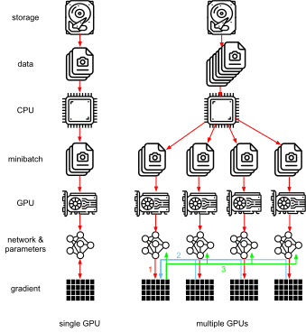
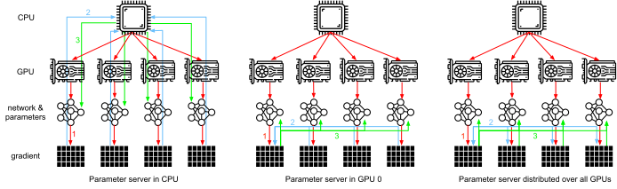
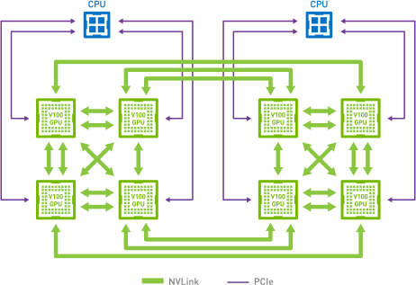
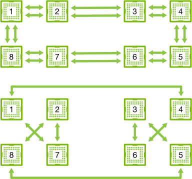
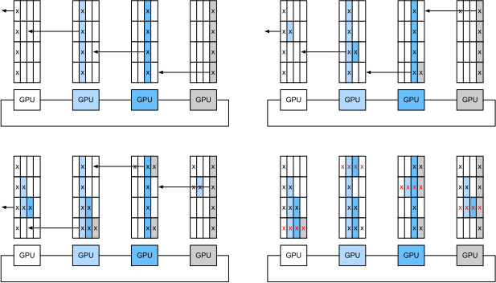
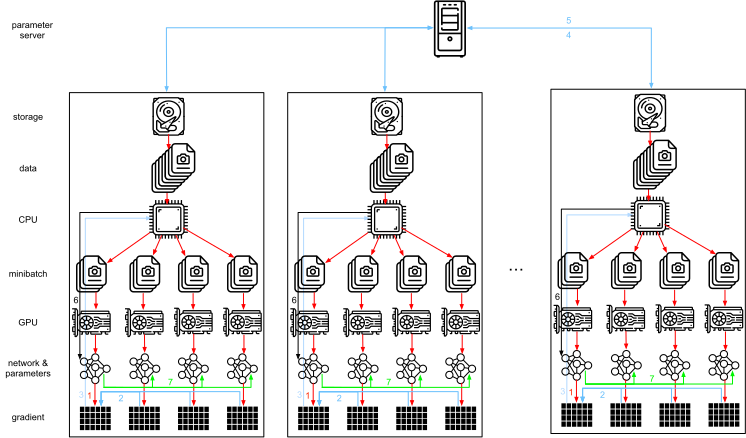
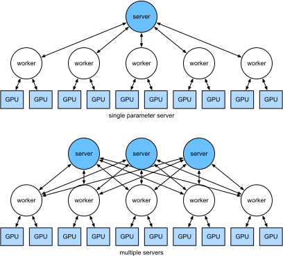

# 参数服务器
:label:`sec_parameterserver`

当我们从单个 GPU 转向多个 GPU，再转向包含多个 GPU 的多台服务器——这些 GPU 可能分布在多个机架和网络交换机上——
用于分布式和并行训练的算法就需要变得复杂得多。细节很重要，因为不同的互连方式具有截然不同的带宽（例如，在合适的设置下，NVLink 可以在 6 条链路上提供高达 100 GB/s 的带宽，PCIe 4.0（16 通道）提供 32 GB/s，而即便是高速的 100GbE 以太网也只能达到 10 GB/s）。与此同时，期望一位统计建模者同时成为网络和系统方面的专家是不合理的。

参数服务器（parameter server）的核心思想是由 :citet:`Smola.Narayanamurthy.2010` 在分布式潜在变量模型的背景下引入的。随后，:citet:`Ahmed.Aly.Gonzalez.ea.2012` 给出了推送（push）和拉取（pull）语义的描述，:citet:`Li.Andersen.Park.ea.2014` 则描述了一个系统及一个开源库。下面我们将说明提升效率所需的各个组件。

## 数据并行训练

让我们回顾用于分布式训练的数据并行训练方法。本节中我们将只使用这一方法，因为它在实际中实现起来要简单得多。由于如今 GPU 拥有充足的内存，除了图上的深度学习之外，几乎不存在更适合其他并行策略的用例。:numref:`fig_parameterserver` 描述了我们在 :numref:`sec_multi_gpu` 中实现的数据并行变体。其关键之处在于，梯度的聚合在单个 GPU（GPU 0）上进行，然后更新后的参数被重新广播到所有 GPU。

:label:`fig_parameterserver`

回过头来看，在 GPU 0 上聚合这一决定似乎相当随意。毕竟，我们完全可以在 CPU 上聚合。事实上，我们甚至可以决定把一部分参数放在一个 GPU 上聚合，把另一部分放在另一个 GPU 上聚合。只要优化算法支持这种做法，就没有理由说我们不能这样做。例如，如果有四个参数向量，对应的梯度分别为 $\mathbf{g}_1, \ldots, \mathbf{g}_4$，我们可以为每个 $\mathbf{g}_i$（$i = 1, \ldots, 4$）在一个 GPU 上聚合其梯度。

这种推理显得随意而轻率。毕竟，从数学上讲整个过程都是一样的。然而，我们面对的是真实的物理硬件，其中不同总线的带宽不同，正如 :numref:`sec_hardware` 中所讨论的那样。
考虑一个如 :numref:`fig_bw_hierarchy` 所述的真实 4 路 GPU 服务器。如果它的连接特别好，可能会有一块 100 GbE 网卡。更典型的数字在 1--10 GbE 范围内，有效带宽为 100 MB/s 到 1 GB/s。
由于 CPU 的 PCIe 通道太少，无法直接连接到所有 GPU（例如，消费级 Intel CPU 有 24 条通道），我们需要一个[多路复用器](https://www.broadcom.com/products/pcie-switches-bridges/pcie-switches)。在 16x Gen3 链路上，来自 CPU 的带宽是 16 GB/s。这也是*每块* GPU 连接到交换机的速度。这意味着在设备之间直接通信更为有效。

:label:`fig_bw_hierarchy`

为了便于讨论，假设梯度有 160 MB。在这种情况下，把梯度从其余 3 块 GPU 发送到第 4 块 GPU 需要 30 ms（每次传输需要 10 ms = 160 MB / 16 GB/s）。再加上 30 ms 把权重向量传回去，总共需要 60 ms。
如果我们把所有数据发送到 CPU，则会带来 40 ms 的额外开销，因为四块 GPU *每块*都需要把数据发送到 CPU，总计 80 ms。最后，假设我们能够把梯度分成 4 个各 40 MB 的部分。现在我们可以*同时*在不同的 GPU 上聚合每个部分，因为 PCIe 交换机在所有链路之间提供全带宽操作。这样只需要 7.5 ms 而不是 30 ms，一次同步操作总共需要 15 ms。简而言之，取决于我们如何同步参数，同样的操作可能耗时 15 ms 到 80 ms。:numref:`fig_ps_distributed` 描绘了交换参数的不同策略。

:label:`fig_ps_distributed`

请注意，在提高性能方面我们还有另一个可用的工具：在深度网络中，从上到下计算所有梯度需要一些时间。我们可以在仍在忙着计算某些参数组的梯度时，就开始同步另一些参数组的梯度。关于如何在 [Horovod](https://github.com/horovod/horovod) 中做到这一点，请参见 :citet:`Sergeev.Del-Balso.2018`。

## 环同步

在现代深度学习硬件上进行同步时，我们经常会遇到非常定制的网络连接。例如，AWS p3.16xlarge 和 NVIDIA DGX-2 实例共享 :numref:`fig_nvlink` 中的连接结构。每块 GPU 通过一条 PCIe 链路连接到主机 CPU，该链路的工作速度最高为 16 GB/s。此外，每块 GPU 还有 6 条 NVLink 连接，每条连接都能以 300 Gbit/s 的速度双向传输。这相当于每条链路每个方向约 18 GB/s。简而言之，NVLink 的聚合带宽显著高于 PCIe 带宽。问题在于如何最有效地利用它。

:label:`fig_nvlink`

事实证明，最优的同步策略是把网络分解为两个环，并利用它们直接同步数据 :cite:`Wang.Li.Liberty.ea.2018`。:numref:`fig_nvlink_twoloop` 表明，网络可以分解为一个具有双倍 NVLink 带宽的环（1-2-3-4-5-6-7-8-1）和一个具有常规带宽的环（1-4-6-3-5-8-2-7-1）。在这种情况下设计一个高效的同步协议并非易事。

:label:`fig_nvlink_twoloop`

考虑下面这个思维实验：给定一个由 $n$ 个计算节点（或 GPU）组成的环，我们可以把梯度从第一个节点发送到第二个节点。在第二个节点上，它被加到本地梯度上，然后继续发送到第三个节点，依此类推。经过 $n-1$ 步之后，聚合后的梯度就可以在最后访问的节点上找到。也就是说，聚合梯度的时间随节点数量线性增长。但如果这样做，算法的效率相当低。毕竟，在任何时刻都只有一个节点在通信。如果我们把梯度分成 $n$ 个块，并从节点 $i$ 开始同步第 $i$ 块，会怎么样呢？
由于每个块的大小为 $1/n$，现在总时间为 $(n-1)/n \approx 1$。换句话说，聚合梯度所花费的时间*并不会*随着环的规模增大而增长。这是一个相当惊人的结果。:numref:`fig_ringsync` 展示了在 $n=4$ 个节点上的操作序列。

:label:`fig_ringsync`

如果我们用同样的例子，在 8 块 V100 GPU 上同步 160 MB 的数据，大约需要 $2 \cdot 160 \textrm{MB} / (3 \cdot 18 \textrm{GB/s}) \approx 6 \textrm{ms}$。尽管我们现在使用了 8 块 GPU，这仍然比使用 PCIe 总线更好。请注意，在实践中这些数字会稍差一些，因为深度学习框架往往无法把通信组合成大的突发传输。

注意，有一种常见的误解认为环同步（ring synchronization）与其他同步算法在本质上是不同的。实际上，与简单的树结构相比，其唯一区别在于同步路径稍微精细一些。

## 多机训练

在多台机器上进行分布式训练带来了另一个挑战：我们需要与一些服务器通信，而这些服务器之间仅通过带宽相对较低的网络结构相连，在某些情况下可能慢一个数量级以上。
跨设备同步很棘手。毕竟，运行训练代码的不同机器会有细微的速度差异。因此，如果我们想使用同步分布式优化，就需要*同步*它们。:numref:`fig_ps_multimachine` 展示了分布式并行训练是如何进行的。

1. 每台机器读取（不同的）一批数据，把它拆分到多个 GPU 上，并传输到 GPU 内存。在那里，预测和梯度分别基于每个 GPU 上的批量计算。
2. 来自所有本地 GPU 的梯度在一个 GPU 上聚合（或者其中一部分在不同的 GPU 上聚合）。
3. 梯度被发送到 CPU。
4. CPU 把梯度发送到中央参数服务器，由它聚合所有梯度。
5. 然后用聚合后的梯度更新参数，更新后的参数被广播回各个 CPU。
6. 这些信息被发送到一块（或多块）GPU。
7. 更新后的参数被分发到所有 GPU 上。

:label:`fig_ps_multimachine`

这些操作中的每一个看起来都相当直接。而且事实上，它们可以在一台机器*内部*高效地执行。
然而，一旦考察多台机器，我们就会发现中央参数服务器成了瓶颈。毕竟，每台服务器的带宽是有限的，因此对于 $m$ 个工作节点来说，把所有梯度发送到服务器所需的时间为 $\mathcal{O}(m)$。我们可以通过把服务器数量增加到 $n$ 来突破这一障碍。此时每台服务器只需要存储 $\mathcal{O}(1/n)$ 的参数，因此更新和优化的总时间变为 $\mathcal{O}(m/n)$。
让这两个数字相匹配，就能得到恒定的扩展性，而与我们处理多少个工作节点无关。在实践中，我们把*同一批*机器同时用作工作节点和服务器。:numref:`fig_ps_multips` 展示了这种设计（细节另见 :cite:`Li.Andersen.Park.ea.2014`）。
特别地，确保多台机器在没有不合理延迟的情况下协同工作并非易事。

:label:`fig_ps_multips`

## 键值存储

在实际中实现分布式多 GPU 训练所需的各个步骤并非易事。
这就是为什么值得采用一种通用的抽象，即带有重新定义更新语义的*键值存储*（key--value store）。

在许多工作节点和许多 GPU 上，梯度 $i$ 的计算可以定义为

$$\mathbf{g}_{i} = \sum_{k \in \textrm{workers}} \sum_{j \in \textrm{GPUs}} \mathbf{g}_{ijk},$$

其中 $\mathbf{g}_{ijk}$ 是梯度 $i$ 在工作节点 $k$ 的 GPU $j$ 上拆分出来的一部分。
这一操作的关键之处在于它是一种*可交换归约*（commutative reduction），也就是说，它把许多向量变成一个，而运算的应用顺序无关紧要。这对我们的目的来说非常好，因为我们并不（需要）细粒度地控制何时收到哪个梯度。此外，请注意该操作在不同的 $i$ 之间是独立的。

这使我们能够定义以下两种操作：*推送*（push）累积梯度，*拉取*（pull）获取聚合后的梯度。由于我们有许多不同的梯度集合（毕竟我们有许多层），需要用键 $i$ 来索引梯度。这与键值存储（例如 Dynamo 中引入的键值存储
:cite:`DeCandia.Hastorun.Jampani.ea.2007`）的相似性并非巧合。它们也满足许多相似的特征，特别是在把参数分布到多台服务器上的时候。

键值存储的推送和拉取操作描述如下：

* **push(key, value)** 把一个特定的梯度（值）从工作节点发送到公共存储。在那里，该值被聚合，例如通过求和来聚合。
* **pull(key, value)** 从公共存储中获取聚合后的值，例如在合并来自所有工作节点的梯度之后。

通过把同步方面的全部复杂性隐藏在简单的推送和拉取操作之后，我们可以把两类人的关注点解耦：一类是希望用简单的方式表达优化的统计建模者，另一类是需要应对分布式同步固有复杂性的系统工程师。

## 小结

* 同步需要高度适应服务器内部特定的网络基础设施和连接方式。这会使同步所需的时间产生显著差异。
* 环同步对于 p3 和 DGX-2 服务器可能是最优的。对于其他服务器则未必如此。
* 当为了增加带宽而添加多个参数服务器时，分层同步策略效果良好。

## 练习

1. 你能进一步提高环同步的性能吗？提示：你可以双向发送消息。
1. 是否可能允许异步通信（在计算仍在进行时）？它如何影响性能？
1. 如果在长时间运行的计算中丢失了一台服务器会怎样？我们如何设计一种*容错*（fault tolerance）机制，以避免完全重新开始计算？

[讨论](https://discuss.d2l.ai/t/366)
