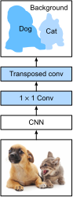

# 全卷积网络
:label:`sec_fcn`

如 :numref:`sec_semantic_segmentation` 中所讨论的，
语义分割
在像素级别上对图像进行分类。
全卷积网络（fully convolutional network，FCN）
使用卷积神经网络
把图像像素变换为像素类别 :cite:`Long.Shelhamer.Darrell.2015`。
与我们之前用于图像分类
或目标检测的 CNN 不同，
全卷积网络
把中间特征图的
高度和宽度变换回
输入图像的高度和宽度：
这是通过
:numref:`sec_transposed_conv` 中介绍的
转置卷积层实现的。
因此，
分类输出
与输入图像
在像素级别上
一一对应：
任意输出像素处的
通道维保存
同一空间位置输入像素的
分类结果。

```{.python .input}
#@tab mxnet
%matplotlib inline
from d2l import mxnet as d2l
from mxnet import gluon, image, init, np, npx
from mxnet.gluon import nn

npx.set_np()
```

```{.python .input}
#@tab pytorch
%matplotlib inline
from d2l import torch as d2l
import torch
import torchvision
from torch import nn
from torch.nn import functional as F
```

## 模型

这里我们描述全卷积网络模型的基本设计。
如 :numref:`fig_fcn` 所示，
该模型首先使用 CNN 提取图像特征，
然后通过 $1\times 1$ 卷积层
把通道数变换为
类别数，
最后通过
:numref:`sec_transposed_conv` 中介绍的转置卷积
把特征图的
高度和宽度
变换为
输入图像的高度和宽度。
因此，
模型输出与输入图像具有相同的高度和宽度，
其中输出通道包含同一空间位置
输入像素的预测类别。



:label:`fig_fcn`

下面，我们[**使用一个在 ImageNet 数据集上预训练的 ResNet-18 模型来提取图像特征**]，
并把该模型实例记为 `pretrained_net`。
该模型的最后几层
包括一个全局平均汇聚层
和一个全连接层：
全卷积网络
不需要它们。

```{.python .input}
#@tab mxnet
pretrained_net = gluon.model_zoo.vision.resnet18_v2(pretrained=True)
pretrained_net.features[-3:], pretrained_net.output
```

```{.python .input}
#@tab pytorch
pretrained_net = torchvision.models.resnet18(pretrained=True)
list(pretrained_net.children())[-3:]
```

接下来，我们[**创建全卷积网络实例 `net`**]。
它复制了 ResNet-18 中所有预训练的层，
但最靠近输出的
最后一个全局平均汇聚层
和全连接层除外。

```{.python .input}
#@tab mxnet
net = nn.HybridSequential()
for layer in pretrained_net.features[:-2]:
    net.add(layer)
```

```{.python .input}
#@tab pytorch
net = nn.Sequential(*list(pretrained_net.children())[:-2])
```

给定高度和宽度分别为 320 和 480 的输入，
`net` 的前向传播
会把输入的高度和宽度减小到原来的 1/32，即 10 和 15。

```{.python .input}
#@tab mxnet
X = np.random.uniform(size=(1, 3, 320, 480))
net(X).shape
```

```{.python .input}
#@tab pytorch
X = torch.rand(size=(1, 3, 320, 480))
net(X).shape
```

接下来，我们[**使用 $1\times 1$ 卷积层把输出通道数变换为 Pascal VOC2012 数据集的类别数（21）。**]
最后，我们需要(**把特征图的高度和宽度增大 32 倍**)，使它们变回输入图像的高度和宽度。
回想一下
:numref:`sec_padding` 中如何计算卷积层的输出形状。
由于 $(320-64+16\times2+32)/32=10$ 且 $(480-64+16\times2+32)/32=15$，我们构造一个步幅为 $32$ 的转置卷积层，
设置
卷积核的高度和宽度为 $64$，填充为 $16$。
一般来说，
我们可以看到，
对于步幅 $s$、
填充 $s/2$（假设 $s/2$ 是整数）
以及卷积核的高度和宽度 $2s$，
转置卷积会把
输入的高度和宽度增大 $s$ 倍。

```{.python .input}
#@tab mxnet
num_classes = 21
net.add(nn.Conv2D(num_classes, kernel_size=1),
        nn.Conv2DTranspose(
            num_classes, kernel_size=64, padding=16, strides=32))
```

```{.python .input}
#@tab pytorch
num_classes = 21
net.add_module('final_conv', nn.Conv2d(512, num_classes, kernel_size=1))
net.add_module('transpose_conv', nn.ConvTranspose2d(num_classes, num_classes,
                                    kernel_size=64, padding=16, stride=32))
```

## [**初始化转置卷积层**]


我们已经知道，
转置卷积层可以增大
特征图的
高度和宽度。
在图像处理中，我们可能需要放大
图像，即*上采样*（upsampling）。
*双线性插值*（bilinear interpolation）
是常用的上采样技术之一。
它也常用于初始化转置卷积层。

为了解释双线性插值，
假设
给定一幅输入图像，
我们想要
计算上采样后输出图像的
每个像素。
为了计算输出图像
在坐标 $(x, y)$ 处的像素，
首先把 $(x, y)$ 映射到输入图像上的坐标 $(x', y')$，例如按照输入尺寸与输出尺寸的比例进行映射。
请注意，映射得到的 $x'$ 和 $y'$ 是实数。
然后，找到输入图像上最接近坐标
$(x', y')$ 的四个像素。
最后，根据输入图像上这四个最接近的像素
及其与 $(x', y')$ 的相对距离，计算输出图像在坐标 $(x, y)$ 处的像素。

双线性插值的上采样
可以通过转置卷积层实现，
其卷积核由下面的 `bilinear_kernel` 函数构造。
由于篇幅限制，下面我们只给出 `bilinear_kernel` 函数的实现
而不讨论其算法设计。

```{.python .input}
#@tab mxnet
def bilinear_kernel(in_channels, out_channels, kernel_size):
    factor = (kernel_size + 1) // 2
    if kernel_size % 2 == 1:
        center = factor - 1
    else:
        center = factor - 0.5
    og = (np.arange(kernel_size).reshape(-1, 1),
          np.arange(kernel_size).reshape(1, -1))
    filt = (1 - np.abs(og[0] - center) / factor) * \
           (1 - np.abs(og[1] - center) / factor)
    weight = np.zeros((in_channels, out_channels, kernel_size, kernel_size))
    weight[range(in_channels), range(out_channels), :, :] = filt
    return np.array(weight)
```

```{.python .input}
#@tab pytorch
def bilinear_kernel(in_channels, out_channels, kernel_size):
    factor = (kernel_size + 1) // 2
    if kernel_size % 2 == 1:
        center = factor - 1
    else:
        center = factor - 0.5
    og = (torch.arange(kernel_size).reshape(-1, 1),
          torch.arange(kernel_size).reshape(1, -1))
    filt = (1 - torch.abs(og[0] - center) / factor) * \
           (1 - torch.abs(og[1] - center) / factor)
    weight = torch.zeros((in_channels, out_channels,
                          kernel_size, kernel_size))
    weight[range(in_channels), range(out_channels), :, :] = filt
    return weight
```

让我们[**试验由转置卷积层实现的双线性插值上采样**]。
我们构造一个把高度和宽度
都加倍的转置卷积层，
并用 `bilinear_kernel` 函数初始化其卷积核。

```{.python .input}
#@tab mxnet
conv_trans = nn.Conv2DTranspose(3, kernel_size=4, padding=1, strides=2)
conv_trans.initialize(init.Constant(bilinear_kernel(3, 3, 4)))
```

```{.python .input}
#@tab pytorch
conv_trans = nn.ConvTranspose2d(3, 3, kernel_size=4, padding=1, stride=2,
                                bias=False)
conv_trans.weight.data.copy_(bilinear_kernel(3, 3, 4));
```

读取图像 `X`，并把上采样输出赋给 `Y`。为了打印图像，我们需要调整通道维的位置。

```{.python .input}
#@tab mxnet
img = image.imread('../img/catdog.jpg')
X = np.expand_dims(img.astype('float32').transpose(2, 0, 1), axis=0) / 255
Y = conv_trans(X)
out_img = Y[0].transpose(1, 2, 0)
```

```{.python .input}
#@tab pytorch
img = torchvision.transforms.ToTensor()(d2l.Image.open('../img/catdog.jpg'))
X = img.unsqueeze(0)
Y = conv_trans(X)
out_img = Y[0].permute(1, 2, 0).detach()
```

正如我们所看到的，转置卷积层把图像的高度和宽度都增大了两倍。
除了坐标尺度不同之外，
用双线性插值放大的图像与 :numref:`sec_bbox` 中打印的原始图像看起来相同。

```{.python .input}
#@tab mxnet
d2l.set_figsize()
print('input image shape:', img.shape)
d2l.plt.imshow(img.asnumpy());
print('output image shape:', out_img.shape)
d2l.plt.imshow(out_img.asnumpy());
```

```{.python .input}
#@tab pytorch
d2l.set_figsize()
print('input image shape:', img.permute(1, 2, 0).shape)
d2l.plt.imshow(img.permute(1, 2, 0));
print('output image shape:', out_img.shape)
d2l.plt.imshow(out_img);
```

在全卷积网络中，我们[**用双线性插值上采样来初始化转置卷积层。对于 $1\times 1$ 卷积层，我们使用 Xavier 初始化。**]

```{.python .input}
#@tab mxnet
W = bilinear_kernel(num_classes, num_classes, 64)
net[-1].initialize(init.Constant(W))
net[-2].initialize(init=init.Xavier())
```

```{.python .input}
#@tab pytorch
W = bilinear_kernel(num_classes, num_classes, 64)
net.transpose_conv.weight.data.copy_(W);
```

## [**读取数据集**]

我们读取
:numref:`sec_semantic_segmentation` 中介绍的
语义分割数据集。
随机裁剪的输出图像形状
指定为 $320\times 480$：高度和宽度都能被 $32$ 整除。

```{.python .input}
#@tab all
batch_size, crop_size = 32, (320, 480)
train_iter, test_iter = d2l.load_data_voc(batch_size, crop_size)
```

## [**训练**]


现在我们可以训练
所构造的全卷积网络。
这里的损失函数和准确率计算
与前面章节图像分类中的
没有本质区别。
由于我们使用
转置卷积层的输出通道来
预测每个像素的类别，
因此在损失计算中指定了通道维。
此外，准确率是根据
所有像素预测类别的正确性
来计算的。

```{.python .input}
#@tab mxnet
num_epochs, lr, wd, devices = 5, 0.1, 1e-3, d2l.try_all_gpus()
loss = gluon.loss.SoftmaxCrossEntropyLoss(axis=1)
net.collect_params().reset_ctx(devices)
trainer = gluon.Trainer(net.collect_params(), 'sgd',
                        {'learning_rate': lr, 'wd': wd})
d2l.train_ch13(net, train_iter, test_iter, loss, trainer, num_epochs, devices)
```

```{.python .input}
#@tab pytorch
def loss(inputs, targets):
    return F.cross_entropy(inputs, targets, reduction='none').mean(1).mean(1)

num_epochs, lr, wd, devices = 5, 0.001, 1e-3, d2l.try_all_gpus()
trainer = torch.optim.SGD(net.parameters(), lr=lr, weight_decay=wd)
d2l.train_ch13(net, train_iter, test_iter, loss, trainer, num_epochs, devices)
```

## [**预测**]


预测时，我们需要对输入图像的每个通道
进行标准化，并把图像变换为 CNN 所需的四维输入格式。

```{.python .input}
#@tab mxnet
def predict(img):
    X = test_iter._dataset.normalize_image(img)
    X = np.expand_dims(X.transpose(2, 0, 1), axis=0)
    pred = net(X.as_in_ctx(devices[0])).argmax(axis=1)
    return pred.reshape(pred.shape[1], pred.shape[2])
```

```{.python .input}
#@tab pytorch
def predict(img):
    X = test_iter.dataset.normalize_image(img).unsqueeze(0)
    pred = net(X.to(devices[0])).argmax(dim=1)
    return pred.reshape(pred.shape[1], pred.shape[2])
```

为了[**可视化预测的类别**]，我们把预测的类别映射回其在数据集中的标签颜色。

```{.python .input}
#@tab mxnet
def label2image(pred):
    colormap = np.array(d2l.VOC_COLORMAP, ctx=devices[0], dtype='uint8')
    X = pred.astype('int32')
    return colormap[X, :]
```

```{.python .input}
#@tab pytorch
def label2image(pred):
    colormap = torch.tensor(d2l.VOC_COLORMAP, device=devices[0])
    X = pred.long()
    return colormap[X, :]
```

测试数据集中的图像大小和形状各不相同。
由于模型使用步幅为 32 的转置卷积层，
当输入图像的高度或宽度不能被 32 整除时，
转置卷积层的
输出高度或宽度将与输入图像的形状不一致。
为了解决这个问题，
我们可以在图像中裁剪多个高度和宽度为 32 的整数倍的矩形区域，
并分别对这些区域中的像素
执行前向传播。
请注意，
这些矩形区域的并集需要完全覆盖输入图像。
当一个像素被多个矩形区域覆盖时，
可以把该同一像素在各区域中
转置卷积输出的平均值
输入 softmax 操作
来预测类别。


为了简单起见，我们只读取几幅较大的测试图像，
并从图像的左上角开始裁剪一个 $320\times480$ 的区域进行预测。
对于这些测试图像，我们
逐行打印它们的裁剪区域、
预测结果
和真实标签。

```{.python .input}
#@tab mxnet
voc_dir = d2l.download_extract('voc2012', 'VOCdevkit/VOC2012')
test_images, test_labels = d2l.read_voc_images(voc_dir, False)
n, imgs = 4, []
for i in range(n):
    crop_rect = (0, 0, 480, 320)
    X = image.fixed_crop(test_images[i], *crop_rect)
    pred = label2image(predict(X))
    imgs += [X, pred, image.fixed_crop(test_labels[i], *crop_rect)]
d2l.show_images(imgs[::3] + imgs[1::3] + imgs[2::3], 3, n, scale=2);
```

```{.python .input}
#@tab pytorch
voc_dir = d2l.download_extract('voc2012', 'VOCdevkit/VOC2012')
test_images, test_labels = d2l.read_voc_images(voc_dir, False)
n, imgs = 4, []
for i in range(n):
    crop_rect = (0, 0, 320, 480)
    X = torchvision.transforms.functional.crop(test_images[i], *crop_rect)
    pred = label2image(predict(X))
    imgs += [X.permute(1,2,0), pred.cpu(),
             torchvision.transforms.functional.crop(
                 test_labels[i], *crop_rect).permute(1,2,0)]
d2l.show_images(imgs[::3] + imgs[1::3] + imgs[2::3], 3, n, scale=2);
```

## 小结

* 全卷积网络首先使用 CNN 提取图像特征，然后通过 $1\times 1$ 卷积层把通道数变换为类别数，最后通过转置卷积把特征图的高度和宽度变换为输入图像的高度和宽度。
* 在全卷积网络中，我们可以使用双线性插值上采样来初始化转置卷积层。


## 练习

1. 如果我们在实验中对转置卷积层使用 Xavier 初始化，结果会怎样变化？
1. 你能通过调参进一步提高模型的准确率吗？
1. 预测测试图像中所有像素的类别。
1. 原始的全卷积网络论文还使用了某些中间 CNN 层的输出 :cite:`Long.Shelhamer.Darrell.2015`。尝试实现这一想法。

:begin_tab:`mxnet`
[讨论](https://discuss.d2l.ai/t/377)
:end_tab:

:begin_tab:`pytorch`
[讨论](https://discuss.d2l.ai/t/1582)
:end_tab:
