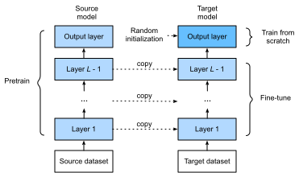

# 微调
:label:`sec_fine_tuning`

在前面的章节中，我们讨论了如何在只有 60000 张图像的 Fashion-MNIST 训练数据集上训练模型。我们还介绍了 ImageNet，这是学术界最广泛使用的大规模图像数据集，包含超过 1000 万张图像和 1000 个物体。然而，我们通常遇到的数据集规模介于这两个数据集之间。


假设我们想从图像中识别不同类型的椅子，然后向用户推荐购买链接。
一种可能的方法是先识别
100 种常见椅子，
为每种椅子拍摄 1000 张不同角度的图像，
然后在收集到的图像数据集上训练一个分类模型。
尽管这个椅子数据集可能比 Fashion-MNIST 数据集大，
但其样例数量仍然不到
ImageNet 中样例数量的十分之一。
这可能导致适合 ImageNet 的复杂模型
在这个椅子数据集上过拟合。
此外，由于训练样例数量有限，
训练得到的模型的准确率
可能无法满足实际需求。


为了解决上述问题，
一个明显的解决办法是收集更多数据。
然而，收集和标注数据可能耗费大量时间和金钱。
例如，为了收集 ImageNet 数据集，研究人员从研究经费中花费了数百万美元。
尽管如今的数据收集成本已显著降低，但这一成本仍然不可忽视。


另一种解决办法是应用*迁移学习*（transfer learning），把从*源数据集*（source dataset）学到的知识迁移到*目标数据集*（target dataset）。
例如，尽管 ImageNet 数据集中的大多数图像与椅子无关，但在该数据集上训练的模型可以提取出更通用的图像特征，这些特征有助于识别边缘、纹理、形状和物体组成。
这些相似的特征可能
对识别椅子也同样有效。


## 步骤


本节我们将介绍迁移学习中的一种常用技术：*微调*（fine-tuning）。如 :numref:`fig_finetune` 所示，微调由以下四个步骤组成：


1. 在源数据集（例如 ImageNet 数据集）上预训练一个神经网络模型，即*源模型*。
1. 创建一个新的神经网络模型，即*目标模型*。它复制了源模型上除输出层外的所有模型设计及其参数。我们假设这些模型参数包含从源数据集学到的知识，并且这些知识同样适用于目标数据集。我们还假设源模型的输出层与源数据集的标签密切相关；因此它不会用于目标模型。
1. 给目标模型添加一个输出层，其输出数量为目标数据集中的类别数。然后随机初始化该层的模型参数。
1. 在目标数据集（例如椅子数据集）上训练目标模型。输出层将从头开始训练，而所有其他层的参数则基于源模型的参数进行微调。


:label:`fig_finetune`

当目标数据集远小于源数据集时，微调有助于提高模型的泛化能力。


## 热狗识别

让我们通过一个具体案例演示微调：
热狗识别。
我们将在一个小型数据集上微调一个 ResNet 模型，
该模型已在 ImageNet 数据集上预训练。
这个小数据集由
数千张包含热狗和不包含热狗的
图像组成。
我们将使用微调后的模型从图像中
识别热狗。

```{.python .input}
#@tab mxnet
%matplotlib inline
from d2l import mxnet as d2l
from mxnet import gluon, init, np, npx
from mxnet.gluon import nn
import os

npx.set_np()
```

```{.python .input}
#@tab pytorch
%matplotlib inline
from d2l import torch as d2l
from torch import nn
import torch
import torchvision
import os
```

### 读取数据集

[**我们使用的热狗数据集取自在线图像**]。
该数据集由 1400 张包含热狗的正类图像，
以及同样多的包含其他食物的负类图像组成。
两类各取 1000 张图像用于训练，其余用于测试。


解压下载的数据集后，
我们得到两个文件夹 `hotdog/train` 和 `hotdog/test`。这两个文件夹都有 `hotdog` 和 `not-hotdog` 子文件夹，每个子文件夹包含对应类别的图像。

```{.python .input}
#@tab all
#@save
d2l.DATA_HUB['hotdog'] = (d2l.DATA_URL + 'hotdog.zip', 
                         'fba480ffa8aa7e0febbb511d181409f899b9baa5')

data_dir = d2l.download_extract('hotdog')
```

我们创建两个实例，分别读取训练数据集和测试数据集中的所有图像文件。

```{.python .input}
#@tab mxnet
train_imgs = gluon.data.vision.ImageFolderDataset(
    os.path.join(data_dir, 'train'))
test_imgs = gluon.data.vision.ImageFolderDataset(
    os.path.join(data_dir, 'test'))
```

```{.python .input}
#@tab pytorch
train_imgs = torchvision.datasets.ImageFolder(os.path.join(data_dir, 'train'))
test_imgs = torchvision.datasets.ImageFolder(os.path.join(data_dir, 'test'))
```

下面展示了前 8 个正类样例和后 8 个负类图像。正如你所看到的，[**这些图像的大小和宽高比各不相同**]。

```{.python .input}
#@tab all
hotdogs = [train_imgs[i][0] for i in range(8)]
not_hotdogs = [train_imgs[-i - 1][0] for i in range(8)]
d2l.show_images(hotdogs + not_hotdogs, 2, 8, scale=1.4);
```

在训练期间，我们首先从图像中裁剪出一个随机大小、随机宽高比的区域，
然后把这个区域
缩放到 $224 \times 224$ 的输入图像。
在测试期间，我们把图像的高度和宽度都缩放到 256 像素，然后裁剪出中心的 $224 \times 224$ 区域作为输入。
此外，
对于 RGB（红、绿、蓝）三个颜色通道，
我们逐通道地对其取值进行*标准化*。
具体来说，
先从该通道的每个取值中减去该通道的均值，再把结果除以该通道的标准差。

[~~数据增广~~]

```{.python .input}
#@tab mxnet
# Specify the means and standard deviations of the three RGB channels to
# standardize each channel
normalize = gluon.data.vision.transforms.Normalize(
    [0.485, 0.456, 0.406], [0.229, 0.224, 0.225])

train_augs = gluon.data.vision.transforms.Compose([
    gluon.data.vision.transforms.RandomResizedCrop(224),
    gluon.data.vision.transforms.RandomFlipLeftRight(),
    gluon.data.vision.transforms.ToTensor(),
    normalize])

test_augs = gluon.data.vision.transforms.Compose([
    gluon.data.vision.transforms.Resize(256),
    gluon.data.vision.transforms.CenterCrop(224),
    gluon.data.vision.transforms.ToTensor(),
    normalize])
```

```{.python .input}
#@tab pytorch
# Specify the means and standard deviations of the three RGB channels to
# standardize each channel
normalize = torchvision.transforms.Normalize(
    [0.485, 0.456, 0.406], [0.229, 0.224, 0.225])

train_augs = torchvision.transforms.Compose([
    torchvision.transforms.RandomResizedCrop(224),
    torchvision.transforms.RandomHorizontalFlip(),
    torchvision.transforms.ToTensor(),
    normalize])

test_augs = torchvision.transforms.Compose([
    torchvision.transforms.Resize([256, 256]),
    torchvision.transforms.CenterCrop(224),
    torchvision.transforms.ToTensor(),
    normalize])
```

### [**定义和初始化模型**]

我们使用在 ImageNet 数据集上预训练的 ResNet-18 作为源模型。这里我们指定 `pretrained=True`，以便自动下载预训练的模型参数。
如果是第一次使用该模型，
下载时需要连接互联网。

```{.python .input}
#@tab mxnet
pretrained_net = gluon.model_zoo.vision.resnet18_v2(pretrained=True)
```

```{.python .input}
#@tab pytorch
pretrained_net = torchvision.models.resnet18(pretrained=True)
```

:begin_tab:`mxnet`
预训练的源模型实例包含两个成员变量：`features` 和 `output`。前者包含模型中除输出层外的所有层，后者是模型的输出层。
这样划分的主要目的是便于微调除输出层外所有层的模型参数。源模型的成员变量 `output` 如下所示。
:end_tab:

:begin_tab:`pytorch`
预训练的源模型实例包含若干特征层以及一个输出层 `fc`。
这样划分的主要目的是便于微调除输出层外所有层的模型参数。源模型的成员变量 `fc` 如下所示。
:end_tab:

```{.python .input}
#@tab mxnet
pretrained_net.output
```

```{.python .input}
#@tab pytorch
pretrained_net.fc
```

作为一个全连接层，它把 ResNet 最后的全局平均汇聚输出变换为 ImageNet 数据集的 1000 类输出。
然后我们构造一个新的神经网络作为目标模型。它的定义方式与预训练的源模型相同，只是把最后一层的输出数量
设置为
目标数据集中的类别数（而不是 1000）。

在下面的代码中，目标模型实例 `finetune_net` 输出层之前的模型参数被初始化为源模型中对应层的模型参数。
由于这些模型参数是通过在 ImageNet 上预训练得到的，
它们是有效的。
因此，我们只能使用
较小的学习率来*微调*这些预训练参数。
相比之下，输出层中的模型参数是随机初始化的，通常需要较大的学习率才能从头开始学习。
设基础学习率为 $\eta$，则输出层中的模型参数将使用 $10\eta$ 的学习率进行迭代。

```{.python .input}
#@tab mxnet
finetune_net = gluon.model_zoo.vision.resnet18_v2(classes=2)
finetune_net.features = pretrained_net.features
finetune_net.output.initialize(init.Xavier())
# The model parameters in the output layer will be iterated using a learning
# rate ten times greater
finetune_net.output.collect_params().setattr('lr_mult', 10)
```

```{.python .input}
#@tab pytorch
finetune_net = torchvision.models.resnet18(pretrained=True)
finetune_net.fc = nn.Linear(finetune_net.fc.in_features, 2)
nn.init.xavier_uniform_(finetune_net.fc.weight);
```

### [**微调模型**]

首先，我们定义一个使用微调的训练函数 `train_fine_tuning`，以便可以多次调用它。

```{.python .input}
#@tab mxnet
def train_fine_tuning(net, learning_rate, batch_size=128, num_epochs=5):
    train_iter = gluon.data.DataLoader(
        train_imgs.transform_first(train_augs), batch_size, shuffle=True)
    test_iter = gluon.data.DataLoader(
        test_imgs.transform_first(test_augs), batch_size)
    devices = d2l.try_all_gpus()
    net.collect_params().reset_ctx(devices)
    net.hybridize()
    loss = gluon.loss.SoftmaxCrossEntropyLoss()
    trainer = gluon.Trainer(net.collect_params(), 'sgd', {
        'learning_rate': learning_rate, 'wd': 0.001})
    d2l.train_ch13(net, train_iter, test_iter, loss, trainer, num_epochs,
                   devices)
```

```{.python .input}
#@tab pytorch
# If `param_group=True`, the model parameters in the output layer will be
# updated using a learning rate ten times greater
def train_fine_tuning(net, learning_rate, batch_size=128, num_epochs=5,
                      param_group=True):
    train_iter = torch.utils.data.DataLoader(torchvision.datasets.ImageFolder(
        os.path.join(data_dir, 'train'), transform=train_augs),
        batch_size=batch_size, shuffle=True)
    test_iter = torch.utils.data.DataLoader(torchvision.datasets.ImageFolder(
        os.path.join(data_dir, 'test'), transform=test_augs),
        batch_size=batch_size)
    devices = d2l.try_all_gpus()
    loss = nn.CrossEntropyLoss(reduction="none")
    if param_group:
        params_1x = [param for name, param in net.named_parameters()
             if name not in ["fc.weight", "fc.bias"]]
        trainer = torch.optim.SGD([{'params': params_1x},
                                   {'params': net.fc.parameters(),
                                    'lr': learning_rate * 10}],
                                lr=learning_rate, weight_decay=0.001)
    else:
        trainer = torch.optim.SGD(net.parameters(), lr=learning_rate,
                                  weight_decay=0.001)    
    d2l.train_ch13(net, train_iter, test_iter, loss, trainer, num_epochs,
                   devices)
```

我们[**把基础学习率设置为一个较小的值**]，
以便*微调*通过预训练得到的模型参数。基于前面的设置，我们将使用十倍大的学习率从头开始训练目标模型的输出层参数。

```{.python .input}
#@tab mxnet
train_fine_tuning(finetune_net, 0.01)
```

```{.python .input}
#@tab pytorch
train_fine_tuning(finetune_net, 5e-5)
```

[**为了进行比较，**]我们定义一个完全相同的模型，但(**把它的所有模型参数初始化为随机值**)。由于整个模型需要从头开始训练，我们可以使用更大的学习率。

```{.python .input}
#@tab mxnet
scratch_net = gluon.model_zoo.vision.resnet18_v2(classes=2)
scratch_net.initialize(init=init.Xavier())
train_fine_tuning(scratch_net, 0.1)
```

```{.python .input}
#@tab pytorch
scratch_net = torchvision.models.resnet18()
scratch_net.fc = nn.Linear(scratch_net.fc.in_features, 2)
train_fine_tuning(scratch_net, 5e-4, param_group=False)
```

正如我们所看到的，在相同的轮数下，微调后的模型往往表现更好，
因为它的初始参数值更有效。


## 小结

* 迁移学习把从源数据集学到的知识迁移到目标数据集。微调是迁移学习的一种常用技术。
* 目标模型复制源模型除输出层外的所有模型设计及其参数，并基于目标数据集对这些参数进行微调。相比之下，目标模型的输出层需要从头开始训练。
* 一般来说，微调参数使用较小的学习率，而从头开始训练输出层可以使用较大的学习率。


## 练习

1. 不断提高 `finetune_net` 的学习率。模型的准确率如何变化？
2. 进一步调整对比实验中 `finetune_net` 和 `scratch_net` 的超参数。它们在准确率上还有差异吗？
3. 把 `finetune_net` 输出层之前的参数设置为源模型的参数，并在训练期间*不*更新它们。模型的准确率如何变化？你可以使用下面的代码。

```{.python .input}
#@tab mxnet
finetune_net.features.collect_params().setattr('grad_req', 'null')
```

```{.python .input}
#@tab pytorch
for param in finetune_net.parameters():
    param.requires_grad = False
```

4. 事实上，`ImageNet` 数据集中有一个“热狗”类。它在输出层中对应的权重参数可以通过下面的代码获得。我们可以如何利用这个权重参数？

```{.python .input}
#@tab mxnet
weight = pretrained_net.output.weight
hotdog_w = np.split(weight.data(), 1000, axis=0)[713]
hotdog_w.shape
```

```{.python .input}
#@tab pytorch
weight = pretrained_net.fc.weight
hotdog_w = torch.split(weight.data, 1, dim=0)[934]
hotdog_w.shape
```

:begin_tab:`mxnet`
[讨论](https://discuss.d2l.ai/t/368)
:end_tab:

:begin_tab:`pytorch`
[讨论](https://discuss.d2l.ai/t/1439)
:end_tab:
