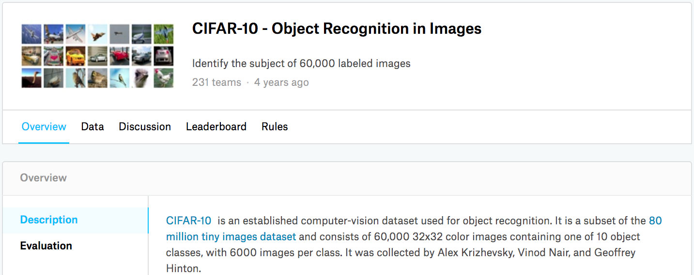

# Kaggle 上的图像分类（CIFAR-10）
:label:`sec_kaggle_cifar10`

到目前为止，我们一直在使用深度学习框架的高级 API，直接以张量格式获取图像数据集。
然而，自定义图像数据集
往往以图像文件的形式出现。
在本节中，我们将从
原始图像文件出发，
逐步组织、读取它们，
然后将其变换为
张量格式。

我们在 :numref:`sec_image_augmentation` 中试验过 CIFAR-10 数据集，
它是计算机视觉中的一个重要数据集。
在本节中，
我们将运用在前几节中学到的知识，
来实践 CIFAR-10 图像分类的
Kaggle 竞赛。
(**该竞赛的网址是 https://www.kaggle.com/c/cifar-10**)

:numref:`fig_kaggle_cifar10` 展示了竞赛网页上的信息。
为了提交结果，
你需要注册一个 Kaggle 账号。


:width:`600px`
:label:`fig_kaggle_cifar10`

```{.python .input}
#@tab mxnet
import collections
from d2l import mxnet as d2l
import math
from mxnet import gluon, init, npx
from mxnet.gluon import nn
import os
import pandas as pd
import shutil

npx.set_np()
```

```{.python .input}
#@tab pytorch
import collections
from d2l import torch as d2l
import math
import torch
import torchvision
from torch import nn
import os
import pandas as pd
import shutil
```

## 获取并组织数据集

竞赛数据集被划分为
训练集和测试集，
分别包含 50000 张和 300000 张图像。
在测试集中，
10000 张图像将用于评估，
而其余 290000 张图像将不会被
评估：
它们被包含进来
只是为了增加难度，
防止利用测试集的
*人工*标注结果作弊。
该数据集中的图像
都是 png 格式的彩色（RGB 通道）图像文件，
高度和宽度均为 32 像素。
这些图像总共涵盖 10 个类别，即飞机、汽车、鸟、猫、鹿、狗、蛙、马、船和卡车。
:numref:`fig_kaggle_cifar10` 的左上角展示了数据集中飞机、汽车和鸟的一些图像。


### 下载数据集

登录 Kaggle 后，我们可以点击 :numref:`fig_kaggle_cifar10` 所示的 CIFAR-10 图像分类竞赛网页上的"Data"标签页，并通过点击"Download All"按钮下载数据集。
在`../data`中解压下载的文件，并解压其中的`train.7z`和`test.7z`后，你将在以下路径中找到整个数据集：

* `../data/cifar-10/train/[1-50000].png`
* `../data/cifar-10/test/[1-300000].png`
* `../data/cifar-10/trainLabels.csv`
* `../data/cifar-10/sampleSubmission.csv`

其中`train`和`test`目录分别包含训练图像和测试图像，`trainLabels.csv`提供训练图像的标签，而`sample_submission.csv`是一个提交样例文件。

为了让入门更容易，[**我们提供了一个小规模的数据集样本，
其中包含前 1000 张训练图像和 5 张随机测试图像。**]
要使用 Kaggle 竞赛的完整数据集，你需要将下面的`demo`变量设置为`False`。

```{.python .input}
#@tab all
#@save
d2l.DATA_HUB['cifar10_tiny'] = (d2l.DATA_URL + 'kaggle_cifar10_tiny.zip',
                                '2068874e4b9a9f0fb07ebe0ad2b29754449ccacd')

# If you use the full dataset downloaded for the Kaggle competition, set
# `demo` to False
demo = True

if demo:
    data_dir = d2l.download_extract('cifar10_tiny')
else:
    data_dir = '../data/cifar-10/'
```

### [**组织数据集**]

我们需要组织数据集，以便于模型训练和测试。
让我们先从 csv 文件中读取标签。
下面的函数返回一个字典，它将
文件名中不含扩展名的部分映射到其标签。

```{.python .input}
#@tab all
#@save
def read_csv_labels(fname):
    """Read `fname` to return a filename to label dictionary."""
    with open(fname, 'r') as f:
        # Skip the file header line (column name)
        lines = f.readlines()[1:]
    tokens = [l.rstrip().split(',') for l in lines]
    return dict(((name, label) for name, label in tokens))

labels = read_csv_labels(os.path.join(data_dir, 'trainLabels.csv'))
print('# training examples:', len(labels))
print('# classes:', len(set(labels.values())))
```

接下来，我们定义`reorg_train_valid`函数，来[**从原始训练集中划分出验证集。**]
该函数中的参数`valid_ratio`是验证集中的样例数与原训练集中的样例数之比。
更具体地说，
令 $n$ 为样例最少的类别的图像数，$r$ 为该比值。
验证集将为每个类别划分出
$\max(\lfloor nr\rfloor,1)$ 张图像。
让我们以`valid_ratio=0.1`为例。由于原始训练集有 50000 张图像，
将有 45000 张图像用于`train_valid_test/train`路径中的训练，
而其余 5000 张图像将被划分出来
作为`train_valid_test/valid`路径中的验证集。组织数据集之后，同一类别的图像将被放在同一个文件夹下。

```{.python .input}
#@tab all
#@save
def copyfile(filename, target_dir):
    """Copy a file into a target directory."""
    os.makedirs(target_dir, exist_ok=True)
    shutil.copy(filename, target_dir)

#@save
def reorg_train_valid(data_dir, labels, valid_ratio):
    """Split the validation set out of the original training set."""
    # The number of examples of the class that has the fewest examples in the
    # training dataset
    n = collections.Counter(labels.values()).most_common()[-1][1]
    # The number of examples per class for the validation set
    n_valid_per_label = max(1, math.floor(n * valid_ratio))
    label_count = {}
    for train_file in os.listdir(os.path.join(data_dir, 'train')):
        label = labels[train_file.split('.')[0]]
        fname = os.path.join(data_dir, 'train', train_file)
        copyfile(fname, os.path.join(data_dir, 'train_valid_test',
                                     'train_valid', label))
        if label not in label_count or label_count[label] < n_valid_per_label:
            copyfile(fname, os.path.join(data_dir, 'train_valid_test',
                                         'valid', label))
            label_count[label] = label_count.get(label, 0) + 1
        else:
            copyfile(fname, os.path.join(data_dir, 'train_valid_test',
                                         'train', label))
    return n_valid_per_label
```

下面的`reorg_test`函数[**为预测期间的数据加载组织测试集。**]

```{.python .input}
#@tab all
#@save
def reorg_test(data_dir):
    """Organize the testing set for data loading during prediction."""
    for test_file in os.listdir(os.path.join(data_dir, 'test')):
        copyfile(os.path.join(data_dir, 'test', test_file),
                 os.path.join(data_dir, 'train_valid_test', 'test',
                              'unknown'))
```

最后，我们用一个函数来[**调用**]
`read_csv_labels`、`reorg_train_valid`和`reorg_test`(**上面定义的函数。**)

```{.python .input}
#@tab all
def reorg_cifar10_data(data_dir, valid_ratio):
    labels = read_csv_labels(os.path.join(data_dir, 'trainLabels.csv'))
    reorg_train_valid(data_dir, labels, valid_ratio)
    reorg_test(data_dir)
```

这里我们只针对小规模数据集样本将批量大小设置为 32。
当训练和测试
Kaggle 竞赛的完整数据集时，
`batch_size`应设置为更大的整数，例如 128。
我们划分出 10% 的训练样例作为验证集，用于调超参数。

```{.python .input}
#@tab all
batch_size = 32 if demo else 128
valid_ratio = 0.1
reorg_cifar10_data(data_dir, valid_ratio)
```

## [**图像增广**]

我们使用图像增广来应对过拟合。
例如，训练时可以对图像进行随机水平翻转。
我们还可以对彩色图像的三个 RGB 通道进行标准化。下面列出了其中一些你可以调整的操作。

```{.python .input}
#@tab mxnet
transform_train = gluon.data.vision.transforms.Compose([
    # Scale the image up to a square of 40 pixels in both height and width
    gluon.data.vision.transforms.Resize(40),
    # Randomly crop a square image of 40 pixels in both height and width to
    # produce a small square of 0.64 to 1 times the area of the original
    # image, and then scale it to a square of 32 pixels in both height and
    # width
    gluon.data.vision.transforms.RandomResizedCrop(32, scale=(0.64, 1.0),
                                                   ratio=(1.0, 1.0)),
    gluon.data.vision.transforms.RandomFlipLeftRight(),
    gluon.data.vision.transforms.ToTensor(),
    # Standardize each channel of the image
    gluon.data.vision.transforms.Normalize([0.4914, 0.4822, 0.4465],
                                           [0.2023, 0.1994, 0.2010])])
```

```{.python .input}
#@tab pytorch
transform_train = torchvision.transforms.Compose([
    # Scale the image up to a square of 40 pixels in both height and width
    torchvision.transforms.Resize(40),
    # Randomly crop a square image of 40 pixels in both height and width to
    # produce a small square of 0.64 to 1 times the area of the original
    # image, and then scale it to a square of 32 pixels in both height and
    # width
    torchvision.transforms.RandomResizedCrop(32, scale=(0.64, 1.0),
                                                   ratio=(1.0, 1.0)),
    torchvision.transforms.RandomHorizontalFlip(),
    torchvision.transforms.ToTensor(),
    # Standardize each channel of the image
    torchvision.transforms.Normalize([0.4914, 0.4822, 0.4465],
                                     [0.2023, 0.1994, 0.2010])])
```

在测试时，
我们只对图像
进行标准化，
以消除评估结果中的
随机性。

```{.python .input}
#@tab mxnet
transform_test = gluon.data.vision.transforms.Compose([
    gluon.data.vision.transforms.ToTensor(),
    gluon.data.vision.transforms.Normalize([0.4914, 0.4822, 0.4465],
                                           [0.2023, 0.1994, 0.2010])])
```

```{.python .input}
#@tab pytorch
transform_test = torchvision.transforms.Compose([
    torchvision.transforms.ToTensor(),
    torchvision.transforms.Normalize([0.4914, 0.4822, 0.4465],
                                     [0.2023, 0.1994, 0.2010])])
```

## 读取数据集

接下来，我们[**读取由原始图像文件组成的已组织数据集**]。每个样例包括一张图像和一个标签。

```{.python .input}
#@tab mxnet
train_ds, valid_ds, train_valid_ds, test_ds = [
    gluon.data.vision.ImageFolderDataset(
        os.path.join(data_dir, 'train_valid_test', folder))
    for folder in ['train', 'valid', 'train_valid', 'test']]
```

```{.python .input}
#@tab pytorch
train_ds, train_valid_ds = [torchvision.datasets.ImageFolder(
    os.path.join(data_dir, 'train_valid_test', folder),
    transform=transform_train) for folder in ['train', 'train_valid']]

valid_ds, test_ds = [torchvision.datasets.ImageFolder(
    os.path.join(data_dir, 'train_valid_test', folder),
    transform=transform_test) for folder in ['valid', 'test']]
```

在训练时，
我们需要[**指定上面定义的所有图像增广操作**]。
当在调超参数时
使用验证集进行模型评估，
不应引入图像增广带来的随机性。
在最终预测之前，
我们在训练集和验证集的合并集上训练模型，以充分利用所有带标签的数据。

```{.python .input}
#@tab mxnet
train_iter, train_valid_iter = [gluon.data.DataLoader(
    dataset.transform_first(transform_train), batch_size, shuffle=True,
    last_batch='discard') for dataset in (train_ds, train_valid_ds)]

valid_iter = gluon.data.DataLoader(
    valid_ds.transform_first(transform_test), batch_size, shuffle=False,
    last_batch='discard')

test_iter = gluon.data.DataLoader(
    test_ds.transform_first(transform_test), batch_size, shuffle=False,
    last_batch='keep')
```

```{.python .input}
#@tab pytorch
train_iter, train_valid_iter = [torch.utils.data.DataLoader(
    dataset, batch_size, shuffle=True, drop_last=True)
    for dataset in (train_ds, train_valid_ds)]

valid_iter = torch.utils.data.DataLoader(valid_ds, batch_size, shuffle=False,
                                         drop_last=True)

test_iter = torch.utils.data.DataLoader(test_ds, batch_size, shuffle=False,
                                        drop_last=False)
```

## 定义[**模型**]

:begin_tab:`mxnet`
在这里，我们基于`HybridBlock`类构建残差块，这与
:numref:`sec_resnet` 中描述的实现略有不同。
这样做是为了提高计算效率。
:end_tab:

```{.python .input}
#@tab mxnet
class Residual(nn.HybridBlock):
    def __init__(self, num_channels, use_1x1conv=False, strides=1, **kwargs):
        super(Residual, self).__init__(**kwargs)
        self.conv1 = nn.Conv2D(num_channels, kernel_size=3, padding=1,
                               strides=strides)
        self.conv2 = nn.Conv2D(num_channels, kernel_size=3, padding=1)
        if use_1x1conv:
            self.conv3 = nn.Conv2D(num_channels, kernel_size=1,
                                   strides=strides)
        else:
            self.conv3 = None
        self.bn1 = nn.BatchNorm()
        self.bn2 = nn.BatchNorm()

    def hybrid_forward(self, F, X):
        Y = F.npx.relu(self.bn1(self.conv1(X)))
        Y = self.bn2(self.conv2(Y))
        if self.conv3:
            X = self.conv3(X)
        return F.npx.relu(Y + X)
```

:begin_tab:`mxnet`
接下来，我们定义 ResNet-18 模型。
:end_tab:

```{.python .input}
#@tab mxnet
def resnet18(num_classes):
    net = nn.HybridSequential()
    net.add(nn.Conv2D(64, kernel_size=3, strides=1, padding=1),
            nn.BatchNorm(), nn.Activation('relu'))

    def resnet_block(num_channels, num_residuals, first_block=False):
        blk = nn.HybridSequential()
        for i in range(num_residuals):
            if i == 0 and not first_block:
                blk.add(Residual(num_channels, use_1x1conv=True, strides=2))
            else:
                blk.add(Residual(num_channels))
        return blk

    net.add(resnet_block(64, 2, first_block=True),
            resnet_block(128, 2),
            resnet_block(256, 2),
            resnet_block(512, 2))
    net.add(nn.GlobalAvgPool2D(), nn.Dense(num_classes))
    return net
```

:begin_tab:`mxnet`
在开始训练之前，我们使用 :numref:`subsec_xavier` 中描述的 Xavier 初始化。
:end_tab:

:begin_tab:`pytorch`
我们定义 :numref:`sec_resnet` 中描述的 ResNet-18 模型。
:end_tab:

```{.python .input}
#@tab mxnet
def get_net(devices):
    num_classes = 10
    net = resnet18(num_classes)
    net.initialize(ctx=devices, init=init.Xavier())
    return net

loss = gluon.loss.SoftmaxCrossEntropyLoss()
```

```{.python .input}
#@tab pytorch
def get_net():
    num_classes = 10
    net = d2l.resnet18(num_classes, 3)
    return net

loss = nn.CrossEntropyLoss(reduction="none")
```

## 定义[**训练函数**]

我们将根据模型在验证集上的表现来选择模型并调超参数。
下面，我们定义模型训练函数`train`。

```{.python .input}
#@tab mxnet
def train(net, train_iter, valid_iter, num_epochs, lr, wd, devices, lr_period,
          lr_decay):
    trainer = gluon.Trainer(net.collect_params(), 'sgd',
                            {'learning_rate': lr, 'momentum': 0.9, 'wd': wd})
    num_batches, timer = len(train_iter), d2l.Timer()
    legend = ['train loss', 'train acc']
    if valid_iter is not None:
        legend.append('valid acc')
    animator = d2l.Animator(xlabel='epoch', xlim=[1, num_epochs],
                            legend=legend)
    for epoch in range(num_epochs):
        metric = d2l.Accumulator(3)
        if epoch > 0 and epoch % lr_period == 0:
            trainer.set_learning_rate(trainer.learning_rate * lr_decay)
        for i, (features, labels) in enumerate(train_iter):
            timer.start()
            l, acc = d2l.train_batch_ch13(
                net, features, labels.astype('float32'), loss, trainer,
                devices, d2l.split_batch)
            metric.add(l, acc, labels.shape[0])
            timer.stop()
            if (i + 1) % (num_batches // 5) == 0 or i == num_batches - 1:
                animator.add(epoch + (i + 1) / num_batches,
                             (metric[0] / metric[2], metric[1] / metric[2],
                              None))
        if valid_iter is not None:
            valid_acc = d2l.evaluate_accuracy_gpus(net, valid_iter,
                                                   d2l.split_batch)
            animator.add(epoch + 1, (None, None, valid_acc))
    measures = (f'train loss {metric[0] / metric[2]:.3f}, '
                f'train acc {metric[1] / metric[2]:.3f}')
    if valid_iter is not None:
        measures += f', valid acc {valid_acc:.3f}'
    print(measures + f'\n{metric[2] * num_epochs / timer.sum():.1f}'
          f' examples/sec on {str(devices)}')
```

```{.python .input}
#@tab pytorch
def train(net, train_iter, valid_iter, num_epochs, lr, wd, devices, lr_period,
          lr_decay):
    trainer = torch.optim.SGD(net.parameters(), lr=lr, momentum=0.9,
                              weight_decay=wd)
    scheduler = torch.optim.lr_scheduler.StepLR(trainer, lr_period, lr_decay)
    num_batches, timer = len(train_iter), d2l.Timer()
    legend = ['train loss', 'train acc']
    if valid_iter is not None:
        legend.append('valid acc')
    animator = d2l.Animator(xlabel='epoch', xlim=[1, num_epochs],
                            legend=legend)
    net = nn.DataParallel(net, device_ids=devices).to(devices[0])
    for epoch in range(num_epochs):
        net.train()
        metric = d2l.Accumulator(3)
        for i, (features, labels) in enumerate(train_iter):
            timer.start()
            l, acc = d2l.train_batch_ch13(net, features, labels,
                                          loss, trainer, devices)
            metric.add(l, acc, labels.shape[0])
            timer.stop()
            if (i + 1) % (num_batches // 5) == 0 or i == num_batches - 1:
                animator.add(epoch + (i + 1) / num_batches,
                             (metric[0] / metric[2], metric[1] / metric[2],
                              None))
        if valid_iter is not None:
            valid_acc = d2l.evaluate_accuracy_gpu(net, valid_iter)
            animator.add(epoch + 1, (None, None, valid_acc))
        scheduler.step()
    measures = (f'train loss {metric[0] / metric[2]:.3f}, '
                f'train acc {metric[1] / metric[2]:.3f}')
    if valid_iter is not None:
        measures += f', valid acc {valid_acc:.3f}'
    print(measures + f'\n{metric[2] * num_epochs / timer.sum():.1f}'
          f' examples/sec on {str(devices)}')
```

## [**训练并验证模型**]

现在，我们可以训练并验证模型了。
以下所有超参数都可以调整。
例如，我们可以增加轮数。
当`lr_period`和`lr_decay`分别设为 4 和 0.9 时，优化算法的学习率将每经过 4 轮乘以 0.9。仅为了便于演示，
我们这里只训练 20 轮。

```{.python .input}
#@tab mxnet
devices, num_epochs, lr, wd = d2l.try_all_gpus(), 20, 0.02, 5e-4
lr_period, lr_decay, net = 4, 0.9, get_net(devices)
net.hybridize()
train(net, train_iter, valid_iter, num_epochs, lr, wd, devices, lr_period,
      lr_decay)
```

```{.python .input}
#@tab pytorch
devices, num_epochs, lr, wd = d2l.try_all_gpus(), 20, 2e-4, 5e-4
lr_period, lr_decay, net = 4, 0.9, get_net()
net(next(iter(train_iter))[0])
train(net, train_iter, valid_iter, num_epochs, lr, wd, devices, lr_period,
      lr_decay)
```

## [**对测试集进行分类**]并在 Kaggle 上提交结果

在得到具有合适超参数的理想模型后，
我们使用所有带标签的数据（包括验证集）重新训练模型，并对测试集进行分类。

```{.python .input}
#@tab mxnet
net, preds = get_net(devices), []
net.hybridize()
train(net, train_valid_iter, None, num_epochs, lr, wd, devices, lr_period,
      lr_decay)

for X, _ in test_iter:
    y_hat = net(X.as_in_ctx(devices[0]))
    preds.extend(y_hat.argmax(axis=1).astype(int).asnumpy())
sorted_ids = list(range(1, len(test_ds) + 1))
sorted_ids.sort(key=lambda x: str(x))
df = pd.DataFrame({'id': sorted_ids, 'label': preds})
df['label'] = df['label'].apply(lambda x: train_valid_ds.synsets[x])
df.to_csv('submission.csv', index=False)
```

```{.python .input}
#@tab pytorch
net, preds = get_net(), []
net(next(iter(train_valid_iter))[0])
train(net, train_valid_iter, None, num_epochs, lr, wd, devices, lr_period,
      lr_decay)

for X, _ in test_iter:
    y_hat = net(X.to(devices[0]))
    preds.extend(y_hat.argmax(dim=1).type(torch.int32).cpu().numpy())
sorted_ids = list(range(1, len(test_ds) + 1))
sorted_ids.sort(key=lambda x: str(x))
df = pd.DataFrame({'id': sorted_ids, 'label': preds})
df['label'] = df['label'].apply(lambda x: train_valid_ds.classes[x])
df.to_csv('submission.csv', index=False)
```

上面的代码
将生成一个`submission.csv`文件，
其格式
符合 Kaggle 竞赛的要求。
向 Kaggle 提交结果的方法
与 :numref:`sec_kaggle_house` 中的方法类似。

## 小结

* 将包含原始图像文件的数据集组织成所需的格式后，我们就可以读取它们。

:begin_tab:`mxnet`
* 我们可以在图像分类竞赛中使用卷积神经网络、图像增广和混合式编程。
:end_tab:

:begin_tab:`pytorch`
* 我们可以在图像分类竞赛中使用卷积神经网络和图像增广。
:end_tab:

## 练习

1. 使用完整的 CIFAR-10 数据集参加这次 Kaggle 竞赛。设置超参数为`batch_size = 128`、`num_epochs = 100`、`lr = 0.1`、`lr_period = 50`和`lr_decay = 0.1`。看看你能在这次竞赛中取得怎样的准确率和排名。你能进一步提高它们吗？
1. 不使用图像增广时，你能达到怎样的准确率？

:begin_tab:`mxnet`
[讨论](https://discuss.d2l.ai/t/379)
:end_tab:

:begin_tab:`pytorch`
[讨论](https://discuss.d2l.ai/t/1479)
:end_tab:
