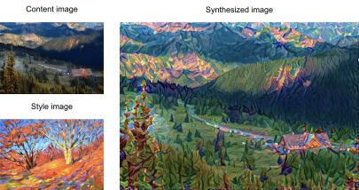
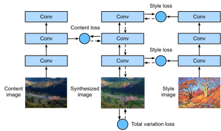

# 神经样式迁移

如果你是一名摄影爱好者，
你可能对滤镜并不陌生。
滤镜可以改变照片的色调，
使风景照片变得更锐利，
或使人像照片的皮肤更白皙。
然而，
一个滤镜通常只能改变
照片的一个方面。
要想给照片应用一个理想的样式，
你可能需要
尝试许多不同的滤镜组合。
这个过程
与为模型调参一样复杂。


本节中，我们将
利用 CNN 的逐层表示，
自动地把一幅图像的样式
应用到另一幅图像上，即*样式迁移*（style transfer）:cite:`Gatys.Ecker.Bethge.2016`。
该任务需要两幅输入图像：
一幅是*内容图像*（content image），
另一幅是*样式图像*（style image）。
我们将使用神经网络
修改内容图像，
使其在样式上接近样式图像。
例如，
:numref:`fig_style_transfer` 中的内容图像是我们在西雅图郊外的
雷尼尔山国家公园拍摄的风景照，
而样式图像是一幅
以秋日橡树为主题的油画。
在输出的合成图像中，
应用了样式图像的
油画笔触，使色彩更加鲜艳，
同时保留了内容图像中
目标的主要形状。


:label:`fig_style_transfer`

## 方法

:numref:`fig_style_transfer_model` 用一个简化的例子
说明了基于 CNN 的样式迁移方法。
首先，我们初始化合成图像，
例如将其初始化为内容图像。
该合成图像是样式迁移过程中需要更新的唯一变量，
即训练过程中需要更新的模型参数。
然后，我们选择一个预训练的 CNN
来提取图像特征，
并在训练过程中固定其
模型参数。
这个深度 CNN 使用多个层
来提取
图像的层次化特征。
我们可以选择其中一些层的输出作为内容特征或样式特征。
以 :numref:`fig_style_transfer_model` 为例。
这里的预训练神经网络有 3 个卷积层，
其中第二层输出内容特征，
第一层和第三层输出样式特征。


:label:`fig_style_transfer_model`

接下来，我们通过前向传播（实线箭头方向）计算样式迁移的损失函数，并通过反向传播（虚线箭头方向）更新模型参数（即用于输出的合成图像）。
样式迁移中常用的损失函数由三部分组成：
（i）*内容损失*（content loss）使合成图像与内容图像在内容特征上接近；
（ii）*样式损失*（style loss）使合成图像与样式图像在样式特征上接近；
（iii）*全变分损失*（total variation loss）有助于减少合成图像中的噪声。
最后，当模型训练结束时，我们输出样式迁移的模型参数，以生成
最终的合成图像。


下面，
我们将通过一个具体实验来解释样式迁移的技术细节。


## [**读取内容和样式图像**]

首先，我们读取内容和样式图像。
从打印出的坐标轴可以看出，
这两幅图像的尺寸不同。

```{.python .input}
#@tab mxnet
%matplotlib inline
from d2l import mxnet as d2l
from mxnet import autograd, gluon, image, init, np, npx
from mxnet.gluon import nn

npx.set_np()

d2l.set_figsize()
content_img = image.imread('../img/rainier.jpg')
d2l.plt.imshow(content_img.asnumpy());
```

```{.python .input}
#@tab pytorch
%matplotlib inline
from d2l import torch as d2l
import torch
import torchvision
from torch import nn

d2l.set_figsize()
content_img = d2l.Image.open('../img/rainier.jpg')
d2l.plt.imshow(content_img);
```

```{.python .input}
#@tab mxnet
style_img = image.imread('../img/autumn-oak.jpg')
d2l.plt.imshow(style_img.asnumpy());
```

```{.python .input}
#@tab pytorch
style_img = d2l.Image.open('../img/autumn-oak.jpg')
d2l.plt.imshow(style_img);
```

## [**预处理和后处理**]

下面，我们定义两个函数，分别用于图像的预处理和后处理。
`preprocess` 函数对输入图像的
三个 RGB 通道分别进行标准化，并把结果变换为 CNN 输入格式。
`postprocess` 函数把输出图像中的像素值恢复为标准化之前的原始值。
由于图像打印函数要求每个像素的浮点值在 0 到 1 之间，
我们把小于 0 或大于 1 的值分别替换为 0 或 1。

```{.python .input}
#@tab mxnet
rgb_mean = np.array([0.485, 0.456, 0.406])
rgb_std = np.array([0.229, 0.224, 0.225])

def preprocess(img, image_shape):
    img = image.imresize(img, *image_shape)
    img = (img.astype('float32') / 255 - rgb_mean) / rgb_std
    return np.expand_dims(img.transpose(2, 0, 1), axis=0)

def postprocess(img):
    img = img[0].as_in_ctx(rgb_std.ctx)
    return (img.transpose(1, 2, 0) * rgb_std + rgb_mean).clip(0, 1)
```

```{.python .input}
#@tab pytorch
rgb_mean = torch.tensor([0.485, 0.456, 0.406])
rgb_std = torch.tensor([0.229, 0.224, 0.225])

def preprocess(img, image_shape):
    transforms = torchvision.transforms.Compose([
        torchvision.transforms.Resize(image_shape),
        torchvision.transforms.ToTensor(),
        torchvision.transforms.Normalize(mean=rgb_mean, std=rgb_std)])
    return transforms(img).unsqueeze(0)

def postprocess(img):
    img = img[0].to(rgb_std.device)
    img = torch.clamp(img.permute(1, 2, 0) * rgb_std + rgb_mean, 0, 1)
    return torchvision.transforms.ToPILImage()(img.permute(2, 0, 1))
```

## [**提取特征**]

我们使用在 ImageNet 数据集上预训练的 VGG-19 模型来提取图像特征 :cite:`Gatys.Ecker.Bethge.2016`。

```{.python .input}
#@tab mxnet
pretrained_net = gluon.model_zoo.vision.vgg19(pretrained=True)
```

```{.python .input}
#@tab pytorch
pretrained_net = torchvision.models.vgg19(pretrained=True)
```

为了提取图像的内容特征和样式特征，我们可以选择 VGG 网络中某些层的输出。
一般来说，越靠近输入层，越容易提取图像的细节；反之，越容易提取图像的全局信息。为了避免在合成图像中
过度保留内容图像的细节，
我们选择较靠近输出的 VGG 层作为*内容层*（content layer），以输出图像的内容特征。
我们还选择不同 VGG 层的输出来提取局部和全局的样式特征。
这些层也称为*样式层*（style layer）。
如 :numref:`sec_vgg` 中所提到的，
VGG 网络使用 5 个卷积块。
在实验中，我们选择第四个卷积块的最后一个卷积层作为内容层，并选择每个卷积块的第一个卷积层作为样式层。
这些层的索引可以通过打印 `pretrained_net` 实例得到。

```{.python .input}
#@tab all
style_layers, content_layers = [0, 5, 10, 19, 28], [25]
```

使用 VGG 层提取特征时，
我们只需要使用从输入层到
最靠近输出层的内容层或样式层之间的所有层。
让我们构造一个新的网络实例 `net`，它只保留
用于特征提取的所有 VGG 层。

```{.python .input}
#@tab mxnet
net = nn.Sequential()
for i in range(max(content_layers + style_layers) + 1):
    net.add(pretrained_net.features[i])
```

```{.python .input}
#@tab pytorch
net = nn.Sequential(*[pretrained_net.features[i] for i in
                      range(max(content_layers + style_layers) + 1)])
```

给定输入 `X`，如果我们只是调用
前向传播 `net(X)`，就只能得到最后一层的输出。
由于我们还需要中间层的输出，
因此需要逐层计算，并保留
内容层和样式层的输出。

```{.python .input}
#@tab all
def extract_features(X, content_layers, style_layers):
    contents = []
    styles = []
    for i in range(len(net)):
        X = net[i](X)
        if i in style_layers:
            styles.append(X)
        if i in content_layers:
            contents.append(X)
    return contents, styles
```

下面定义两个函数：
`get_contents` 函数从内容图像中提取内容特征，
`get_styles` 函数从样式图像中提取样式特征。
由于训练过程中不需要更新预训练 VGG 的模型参数，
我们甚至可以在训练开始之前
就提取内容特征和样式特征。
由于合成图像
是样式迁移中需要更新的一组
模型参数，
因此我们只能在训练过程中通过调用 `extract_features` 函数来提取合成图像的内容特征和样式特征。

```{.python .input}
#@tab mxnet
def get_contents(image_shape, device):
    content_X = preprocess(content_img, image_shape).copyto(device)
    contents_Y, _ = extract_features(content_X, content_layers, style_layers)
    return content_X, contents_Y

def get_styles(image_shape, device):
    style_X = preprocess(style_img, image_shape).copyto(device)
    _, styles_Y = extract_features(style_X, content_layers, style_layers)
    return style_X, styles_Y
```

```{.python .input}
#@tab pytorch
def get_contents(image_shape, device):
    content_X = preprocess(content_img, image_shape).to(device)
    contents_Y, _ = extract_features(content_X, content_layers, style_layers)
    return content_X, contents_Y

def get_styles(image_shape, device):
    style_X = preprocess(style_img, image_shape).to(device)
    _, styles_Y = extract_features(style_X, content_layers, style_layers)
    return style_X, styles_Y
```

## [**定义损失函数**]

现在我们将描述样式迁移的损失函数。该损失函数由
内容损失、样式损失和全变分损失组成。

### 内容损失

与线性回归中的损失函数类似，
内容损失通过
平方损失函数
衡量合成图像与内容图像
在内容特征上的差异。
平方损失函数的两个输入
都是
内容层经 `extract_features` 函数计算得到的输出。

```{.python .input}
#@tab mxnet
def content_loss(Y_hat, Y):
    return np.square(Y_hat - Y).mean()
```

```{.python .input}
#@tab pytorch
def content_loss(Y_hat, Y):
    # We detach the target content from the tree used to dynamically compute
    # the gradient: this is a stated value, not a variable. Otherwise the loss
    # will throw an error.
    return torch.square(Y_hat - Y.detach()).mean()
```

### 样式损失

样式损失与内容损失类似，
也使用平方损失函数来衡量合成图像与样式图像在样式上的差异。
为了表示任意样式层的样式输出，
我们首先使用 `extract_features` 函数
计算样式层的输出。
假设该输出有
1 个样例、$c$ 个通道、
高度 $h$ 和宽度 $w$，
我们可以把这个输出变换为
具有 $c$ 行和 $hw$ 列的矩阵 $\mathbf{X}$。
这个矩阵可以看作
$c$ 个向量 $\mathbf{x}_1, \ldots, \mathbf{x}_c$ 的
连结，
其中每个向量的长度为 $hw$。
这里，向量 $\mathbf{x}_i$ 表示通道 $i$ 的样式特征。

在这些向量的*格拉姆矩阵*（Gram matrix）$\mathbf{X}\mathbf{X}^\top \in \mathbb{R}^{c \times c}$ 中，第 $i$ 行第 $j$ 列的元素 $x_{ij}$ 是向量 $\mathbf{x}_i$ 与 $\mathbf{x}_j$ 的点积。
它表示通道 $i$ 和 $j$ 的样式特征的相关性。
我们用这个格拉姆矩阵来表示任意样式层的样式输出。
请注意，当 $hw$ 的值较大时，
格拉姆矩阵中的值可能也会较大。
还要注意，格拉姆矩阵的高度和宽度都是通道数 $c$。
为了使样式损失不受
这些值的影响，
下面的 `gram` 函数把
格拉姆矩阵除以其元素个数，即 $chw$。

```{.python .input}
#@tab all
def gram(X):
    num_channels, n = X.shape[1], d2l.size(X) // X.shape[1]
    X = d2l.reshape(X, (num_channels, n))
    return d2l.matmul(X, X.T) / (num_channels * n)
```

显然，
样式损失所用平方损失函数的两个格拉姆矩阵输入分别基于
合成图像和样式图像的
样式层输出。
这里假设基于样式图像的格拉姆矩阵 `gram_Y` 已经预先计算好。

```{.python .input}
#@tab mxnet
def style_loss(Y_hat, gram_Y):
    return np.square(gram(Y_hat) - gram_Y).mean()
```

```{.python .input}
#@tab pytorch
def style_loss(Y_hat, gram_Y):
    return torch.square(gram(Y_hat) - gram_Y.detach()).mean()
```

### 全变分损失

有时候，学到的合成图像
会有很多高频噪声，
即特别亮或特别暗的像素。
一种常见的降噪方法是
*全变分去噪*（total variation denoising）。
记 $x_{i, j}$ 为坐标 $(i, j)$ 处的像素值。
减小全变分损失

$$\sum_{i, j} \left|x_{i, j} - x_{i+1, j}\right| + \left|x_{i, j} - x_{i, j+1}\right|$$

可以使合成图像上相邻像素的值更加接近。

```{.python .input}
#@tab all
def tv_loss(Y_hat):
    return 0.5 * (d2l.abs(Y_hat[:, :, 1:, :] - Y_hat[:, :, :-1, :]).mean() +
                  d2l.abs(Y_hat[:, :, :, 1:] - Y_hat[:, :, :, :-1]).mean())
```

### 损失函数

[**样式迁移的损失函数是内容损失、样式损失和全变分损失的加权和**]。
通过调整这些权重超参数，
我们可以在
合成图像的内容保留、
样式迁移
和降噪之间进行权衡。

```{.python .input}
#@tab all
content_weight, style_weight, tv_weight = 1, 1e4, 10

def compute_loss(X, contents_Y_hat, styles_Y_hat, contents_Y, styles_Y_gram):
    # Calculate the content, style, and total variance losses respectively
    contents_l = [content_loss(Y_hat, Y) * content_weight for Y_hat, Y in zip(
        contents_Y_hat, contents_Y)]
    styles_l = [style_loss(Y_hat, Y) * style_weight for Y_hat, Y in zip(
        styles_Y_hat, styles_Y_gram)]
    tv_l = tv_loss(X) * tv_weight
    # Add up all the losses
    l = sum(styles_l + contents_l + [tv_l])
    return contents_l, styles_l, tv_l, l
```

## [**初始化合成图像**]

在样式迁移中，
合成图像是训练过程中需要更新的唯一变量。
因此，我们可以定义一个简单的模型 `SynthesizedImage`，把合成图像当作模型参数。
在该模型中，前向传播只返回模型参数。

```{.python .input}
#@tab mxnet
class SynthesizedImage(nn.Block):
    def __init__(self, img_shape, **kwargs):
        super(SynthesizedImage, self).__init__(**kwargs)
        self.weight = self.params.get('weight', shape=img_shape)

    def forward(self):
        return self.weight.data()
```

```{.python .input}
#@tab pytorch
class SynthesizedImage(nn.Module):
    def __init__(self, img_shape, **kwargs):
        super(SynthesizedImage, self).__init__(**kwargs)
        self.weight = nn.Parameter(torch.rand(*img_shape))

    def forward(self):
        return self.weight
```

接下来，我们定义 `get_inits` 函数。
该函数创建一个合成图像模型实例，并将其初始化为图像 `X`。
样式图像在各样式层的格拉姆矩阵 `styles_Y_gram` 在训练之前就已计算好。

```{.python .input}
#@tab mxnet
def get_inits(X, device, lr, styles_Y):
    gen_img = SynthesizedImage(X.shape)
    gen_img.initialize(init.Constant(X), ctx=device, force_reinit=True)
    trainer = gluon.Trainer(gen_img.collect_params(), 'adam',
                            {'learning_rate': lr})
    styles_Y_gram = [gram(Y) for Y in styles_Y]
    return gen_img(), styles_Y_gram, trainer
```

```{.python .input}
#@tab pytorch
def get_inits(X, device, lr, styles_Y):
    gen_img = SynthesizedImage(X.shape).to(device)
    gen_img.weight.data.copy_(X.data)
    trainer = torch.optim.Adam(gen_img.parameters(), lr=lr)
    styles_Y_gram = [gram(Y) for Y in styles_Y]
    return gen_img(), styles_Y_gram, trainer
```

## [**训练**]


训练样式迁移模型时，
我们不断提取
合成图像的内容特征和样式特征，并计算损失函数。
下面定义训练循环。

```{.python .input}
#@tab mxnet
def train(X, contents_Y, styles_Y, device, lr, num_epochs, lr_decay_epoch):
    X, styles_Y_gram, trainer = get_inits(X, device, lr, styles_Y)
    animator = d2l.Animator(xlabel='epoch', ylabel='loss',
                            xlim=[10, num_epochs], ylim=[0, 20],
                            legend=['content', 'style', 'TV'],
                            ncols=2, figsize=(7, 2.5))
    for epoch in range(num_epochs):
        with autograd.record():
            contents_Y_hat, styles_Y_hat = extract_features(
                X, content_layers, style_layers)
            contents_l, styles_l, tv_l, l = compute_loss(
                X, contents_Y_hat, styles_Y_hat, contents_Y, styles_Y_gram)
        l.backward()
        trainer.step(1)
        if (epoch + 1) % lr_decay_epoch == 0:
            trainer.set_learning_rate(trainer.learning_rate * 0.8)
        if (epoch + 1) % 10 == 0:
            animator.axes[1].imshow(postprocess(X).asnumpy())
            animator.add(epoch + 1, [float(sum(contents_l)),
                                     float(sum(styles_l)), float(tv_l)])
    return X
```

```{.python .input}
#@tab pytorch
def train(X, contents_Y, styles_Y, device, lr, num_epochs, lr_decay_epoch):
    X, styles_Y_gram, trainer = get_inits(X, device, lr, styles_Y)
    scheduler = torch.optim.lr_scheduler.StepLR(trainer, lr_decay_epoch, 0.8)
    animator = d2l.Animator(xlabel='epoch', ylabel='loss',
                            xlim=[10, num_epochs],
                            legend=['content', 'style', 'TV'],
                            ncols=2, figsize=(7, 2.5))
    for epoch in range(num_epochs):
        trainer.zero_grad()
        contents_Y_hat, styles_Y_hat = extract_features(
            X, content_layers, style_layers)
        contents_l, styles_l, tv_l, l = compute_loss(
            X, contents_Y_hat, styles_Y_hat, contents_Y, styles_Y_gram)
        l.backward()
        trainer.step()
        scheduler.step()
        if (epoch + 1) % 10 == 0:
            animator.axes[1].imshow(postprocess(X))
            animator.add(epoch + 1, [float(sum(contents_l)),
                                     float(sum(styles_l)), float(tv_l)])
    return X
```

现在我们[**开始训练模型**]。
我们把内容和样式图像的高度和宽度缩放到 300×450 像素。
我们用内容图像来初始化合成图像。

```{.python .input}
#@tab mxnet
device, image_shape = d2l.try_gpu(), (450, 300)
net.collect_params().reset_ctx(device)
content_X, contents_Y = get_contents(image_shape, device)
_, styles_Y = get_styles(image_shape, device)
output = train(content_X, contents_Y, styles_Y, device, 0.9, 500, 50)
```

```{.python .input}
#@tab pytorch
device, image_shape = d2l.try_gpu(), (300, 450)  # PIL Image (h, w)
net = net.to(device)
content_X, contents_Y = get_contents(image_shape, device)
_, styles_Y = get_styles(image_shape, device)
output = train(content_X, contents_Y, styles_Y, device, 0.3, 500, 50)
```

我们可以看到，合成图像
保留了内容图像的风景和目标，
同时迁移了样式图像的
颜色。
例如，
合成图像中有着与样式图像
类似的色块。
其中一些色块甚至带有微妙的笔触纹理。


## 小结

* 样式迁移中常用的损失函数由三部分组成：（i）内容损失使合成图像与内容图像在内容特征上接近；（ii）样式损失使合成图像与样式图像在样式特征上接近；（iii）全变分损失有助于减少合成图像中的噪声。
* 我们可以使用预训练的 CNN 提取图像特征，并通过最小化损失函数，在训练过程中不断更新作为模型参数的合成图像。
* 我们使用格拉姆矩阵来表示样式层的样式输出。


## 练习

1. 当你选择不同的内容层和样式层时，输出会怎样变化？
1. 调整损失函数中的权重超参数。输出会保留更多内容，还是噪声更少？
1. 使用不同的内容图像和样式图像。你能创建更有趣的合成图像吗？
1. 我们能否将样式迁移应用于文本？提示：你可以参考 :citet:`10.1145/3544903.3544906` 的综述论文。

:begin_tab:`mxnet`
[讨论](https://discuss.d2l.ai/t/378)
:end_tab:

:begin_tab:`pytorch`
[讨论](https://discuss.d2l.ai/t/1476)
:end_tab:
