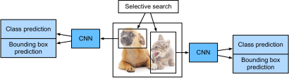
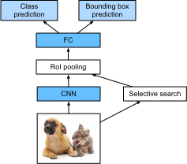
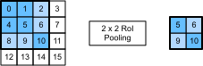
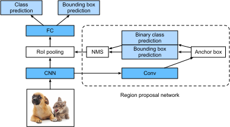
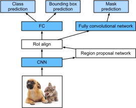

# 基于区域的卷积神经网络（R-CNN）
:label:`sec_rcnn`

除了 :numref:`sec_ssd` 中介绍的单发多框检测之外，
基于区域的 CNN（region-based CNN）或具有 CNN 特征的区域（R-CNN）
也是将深度学习
应用于目标检测的
众多开创性方法之一
:cite:`Girshick.Donahue.Darrell.ea.2014`。
本节将介绍
R-CNN 及其一系列改进：fast R-CNN
:cite:`Girshick.2015`、faster R-CNN :cite:`Ren.He.Girshick.ea.2015`，
以及 mask R-CNN
:cite:`He.Gkioxari.Dollar.ea.2017`。
由于篇幅有限，我们只
关注这些模型的设计。


## R-CNN


*R-CNN* 首先从输入图像中
提取许多（例如 2000 个）*区域提议*（region proposal）
（例如，锚框也可以看作区域提议），
并标注它们的类别和边界框（例如偏移量）。
:cite:`Girshick.Donahue.Darrell.ea.2014`
然后使用一个 CNN
对每个区域提议
执行前向传播以提取其特征。
接下来，把每个区域提议的特征
用于预测该区域提议的
类别和边界框。



:label:`fig_r-cnn`

:numref:`fig_r-cnn` 展示了 R-CNN 模型。更具体地说，R-CNN 由以下四个步骤组成：

1. 在输入图像上执行*选择性搜索*（selective search），提取多个高质量的区域提议 :cite:`Uijlings.Van-De-Sande.Gevers.ea.2013`。这些提议区域通常在多个尺度上选取，具有不同的形状和大小。每个区域提议都会被标注一个类别和一个真实边界框。
1. 选择一个预训练的 CNN，并将其在输出层之前截断。把每个区域提议调整为网络所需的输入大小，并通过前向传播输出为该区域提议提取的特征。
1. 把每个区域提议所提取的特征和标注的类别作为一个样例。训练多个支持向量机来对目标进行分类，其中每个支持向量机分别判定该样例是否包含某个特定的类别。
1. 把每个区域提议所提取的特征和标注的边界框作为一个样例。训练一个线性回归模型来预测真实边界框。


尽管 R-CNN 模型使用预训练的 CNN 有效地提取图像特征，
但它的速度很慢。
想象一下，我们从一个输入图像中
选出数千个区域提议：
这需要数千次
CNN 前向传播才能完成目标检测。
如此巨大的
计算负载使得
R-CNN 难以在现实应用中广泛使用。

## Fast R-CNN

R-CNN 的主要性能瓶颈在于
对每个区域提议独立进行
CNN 前向传播，
而没有共享计算。
由于这些区域通常
相互重叠，
独立的特征提取导致
大量重复计算。
相对于 R-CNN，*fast R-CNN*
的一项主要改进是
CNN 前向传播
只在整个图像上
执行一次 :cite:`Girshick.2015`。


:label:`fig_fast_r-cnn`

:numref:`fig_fast_r-cnn` 描述了 fast R-CNN 模型。其主要计算如下：


1. 与 R-CNN 相比，在 fast R-CNN 中，用于特征提取的 CNN 的输入是整个图像，而不是单个区域提议。此外，这个 CNN 是可训练的。给定一幅输入图像，设 CNN 输出的形状为 $1 \times c \times h_1  \times w_1$。
1. 假设选择性搜索产生了 $n$ 个区域提议。这些（形状不同的）区域提议在 CNN 输出上标出感兴趣的（形状不同的）区域。然后，这些感兴趣区域进一步提取相同形状的特征（即指定高度 $h_2$ 和宽度 $w_2$），以便于连结。为了实现这一点，fast R-CNN 引入了*感兴趣区域（region of interest，RoI）汇聚*层：CNN 输出和区域提议被输入到该层，输出形状为 $n \times c \times h_2 \times w_2$ 的连结特征，这些特征是为所有区域提议进一步提取的。
1. 使用全连接层，把连结特征变换为形状为 $n \times d$ 的输出，其中 $d$ 取决于模型设计。
1. 为 $n$ 个区域提议中的每一个预测类别和边界框。更具体地说，在类别预测和边界框预测中，分别把全连接层的输出变换为形状为 $n \times q$ 的输出（$q$ 是类别数量）和形状为 $n \times 4$ 的输出。类别预测使用 softmax 回归。


fast R-CNN 中提出的感兴趣区域汇聚层与 :numref:`sec_pooling` 中介绍的汇聚层不同。
在汇聚层中，
我们通过指定汇聚窗口、填充和步幅的
大小
来间接控制输出形状。
相比之下，
在感兴趣区域汇聚层中，
我们可以直接指定输出形状。

例如，让我们为每个区域指定
输出高度和宽度
分别为 $h_2$ 和 $w_2$。
对于任何形状为 $h \times w$ 的
感兴趣区域窗口，
该窗口被划分为由子窗口组成的
$h_2 \times w_2$ 网格，
其中每个子窗口的形状约为
$(h/h_2) \times (w/w_2)$。
在实践中，
任何子窗口的高度和宽度都应向上取整，并使用最大的元素作为子窗口的输出。
因此，即使感兴趣区域的形状不同，
感兴趣区域汇聚层也能
提取相同形状的特征。


作为一个说明性示例，
在 :numref:`fig_roi` 中，
在一个 $4 \times 4$ 的输入上
选出左上角的 $3\times 3$ 感兴趣区域。
对于这个感兴趣区域，
我们使用一个 $2\times 2$ 的感兴趣区域汇聚层来得到
$2\times 2$ 的输出。
请注意，
划分出的四个子窗口
分别包含元素
0、1、4、5（最大值为 5）；
2、6（最大值为 6）；
8、9（最大值为 9）；
以及 10。


:label:`fig_roi`

下面我们演示感兴趣区域汇聚层的计算。假设 CNN 提取的特征 `X` 的高度和宽度都是 4，并且只有一个通道。

```{.python .input}
#@tab mxnet
from mxnet import np, npx

npx.set_np()

X = np.arange(16).reshape(1, 1, 4, 4)
X
```

```{.python .input}
#@tab pytorch
import torch
import torchvision

X = torch.arange(16.).reshape(1, 1, 4, 4)
X
```

再进一步假设
输入图像的高度和宽度都是 40 像素，并且选择性搜索在该图像上生成了两个区域提议。
每个区域提议
表示为五个元素：
其目标类别，随后是
左上角和右下角的 $(x, y)$ 坐标。

```{.python .input}
#@tab mxnet
rois = np.array([[0, 0, 0, 20, 20], [0, 0, 10, 30, 30]])
```

```{.python .input}
#@tab pytorch
rois = torch.Tensor([[0, 0, 0, 20, 20], [0, 0, 10, 30, 30]])
```

由于 `X` 的高度和宽度是输入图像高度和宽度的 $1/10$，
按照指定的 `spatial_scale` 参数，
两个区域提议的坐标
都乘以 0.1。
然后，这两个感兴趣区域在 `X` 上分别标记为 `X[:, :, 0:3, 0:3]` 和 `X[:, :, 1:4, 0:4]`。
最后在 $2\times 2$ 的感兴趣区域汇聚中，
每个感兴趣区域被划分为
子窗口组成的网格，以
进一步提取相同形状 $2\times 2$ 的特征。

```{.python .input}
#@tab mxnet
npx.roi_pooling(X, rois, pooled_size=(2, 2), spatial_scale=0.1)
```

```{.python .input}
#@tab pytorch
torchvision.ops.roi_pool(X, rois, output_size=(2, 2), spatial_scale=0.1)
```

## Faster R-CNN

为了在目标检测中更准确，
fast R-CNN 模型
通常不得不在选择性搜索中
生成大量区域提议。
为了在保证准确率的同时
减少区域提议，
*faster R-CNN*
提出用*区域提议网络*（region proposal network）代替选择性搜索 :cite:`Ren.He.Girshick.ea.2015`。



:label:`fig_faster_r-cnn`


:numref:`fig_faster_r-cnn` 展示了 faster R-CNN 模型。与 fast R-CNN 相比，
faster R-CNN 只是把
区域提议方法
从选择性搜索改为区域提议网络。
模型的其余部分保持
不变。
区域提议网络
按以下步骤工作：

1. 使用填充为 1 的 $3\times 3$ 卷积层，把 CNN 输出变换为具有 $c$ 个通道的新输出。这样，CNN 提取的特征图沿空间维度的每个单元都会得到一个长度为 $c$ 的新特征向量。
1. 以特征图的每个像素为中心，生成多个不同尺度和宽高比的锚框并对其进行标注。
1. 利用每个锚框中心处长度为 $c$ 的特征向量，预测该锚框的二分类类别（背景或目标）和边界框。
1. 考虑那些预测类别为目标的预测边界框。使用非极大值抑制移除重叠的结果。其余的目标预测边界框就是感兴趣区域汇聚层所需的区域提议。


值得注意的是，
作为 faster R-CNN 模型的一部分，
区域提议网络
与模型的其余部分联合训练。
换句话说，faster R-CNN 的目标函数
不仅包括
目标检测中的类别预测和边界框预测，
还包括区域提议网络中
锚框的二分类类别预测和边界框预测。
作为端到端训练的结果，
区域提议网络学会了
如何生成高质量的区域提议，
从而在区域提议数量减少
（这些区域提议由数据学习得到）的情况下
仍能保持目标检测的准确率。


## Mask R-CNN

在训练数据集中，
如果还在图像上标注了目标的
像素级位置，
*mask R-CNN* 就可以有效利用
这些详细标签
来进一步提高目标检测的准确率 :cite:`He.Gkioxari.Dollar.ea.2017`。



:label:`fig_mask_r-cnn`

如 :numref:`fig_mask_r-cnn` 所示，
mask R-CNN
是在 faster R-CNN 的基础上修改得到的。
具体地说，
mask R-CNN 把
感兴趣区域汇聚层替换为
*感兴趣区域（RoI）对齐*层。
该感兴趣区域对齐层
使用双线性插值
来保留特征图上的空间信息，这更适合像素级预测。
该层的输出
包含所有感兴趣区域的
相同形状的特征图。
这些特征图
不仅用于预测
每个感兴趣区域的类别和边界框，
还通过一个额外的全卷积网络
预测目标的像素级位置。
关于使用全卷积网络预测图像像素级语义的更多细节
将在本章后续小节中
给出。


## 小结


* R-CNN 从输入图像中提取许多区域提议，使用 CNN 对每个区域提议执行前向传播以提取其特征，然后利用这些特征预测该区域提议的类别和边界框。
* 相对于 R-CNN，fast R-CNN 的一项主要改进是 CNN 前向传播只在整个图像上执行。它还引入了感兴趣区域汇聚层，使得可以为形状不同的感兴趣区域进一步提取相同形状的特征。
* faster R-CNN 用联合训练的区域提议网络替换 fast R-CNN 中使用的选择性搜索，从而在区域提议数量减少的情况下仍能保持目标检测的准确率。
* 在 faster R-CNN 的基础上，mask R-CNN 额外引入一个全卷积网络，从而利用像素级标签进一步提高目标检测的准确率。


## 练习

1. 我们能否把目标检测看作单一的回归问题，例如预测边界框和类别概率？你可以参考 YOLO 模型的设计 :cite:`Redmon.Divvala.Girshick.ea.2016`。
1. 比较单发多框检测与本节介绍的方法。它们的主要区别是什么？你可以参考 :citet:`Zhao.Zheng.Xu.ea.2019` 的图 2。

:begin_tab:`mxnet`
[讨论](https://discuss.d2l.ai/t/374)
:end_tab:

:begin_tab:`pytorch`
[讨论](https://discuss.d2l.ai/t/1409)
:end_tab:
