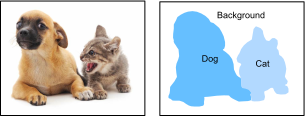

# 语义分割与数据集
:label:`sec_semantic_segmentation`

在 :numref:`sec_bbox`--:numref:`sec_rcnn` 中
讨论目标检测任务时，
矩形边界框
被用来标注和预测图像中的目标。
本节将讨论*语义分割*（semantic segmentation）问题，
它关注如何把一幅图像划分为属于不同语义类别的区域。
与目标检测不同，
语义分割
在像素级别上识别和理解
图像中有什么：
它对语义区域的标注和预测
都是像素级的。
:numref:`fig_segmentation` 展示了
语义分割中对图像中狗、猫和背景的标签。
与目标检测相比，
语义分割中标注的
像素级边界显然更加精细。



:label:`fig_segmentation`


## 图像分割和实例分割

计算机视觉领域中还有两个
与语义分割类似的重要任务，
即图像分割和实例分割。
我们将在下面简要说明
它们与语义分割的区别。

* *图像分割*（image segmentation）把图像划分为若干个组成区域。这类问题的方法通常利用图像中像素之间的相关性。它在训练时不需要关于图像像素的标签信息，也不能保证分割出的区域在预测时具有我们希望得到的语义。以 :numref:`fig_segmentation` 中的图像作为输入，图像分割可能会把狗分成两个区域：一个区域覆盖主要呈黑色的嘴和眼睛，另一个区域覆盖主要呈黄色的身体其余部分。
* *实例分割*（instance segmentation）也称为*同时检测与分割*（simultaneous detection and segmentation）。它研究如何识别图像中每个目标实例的像素级区域。与语义分割不同，实例分割不仅需要区分语义，还需要区分不同的目标实例。例如，如果图像中有两只狗，实例分割需要区分一个像素属于这两只狗中的哪一只。


## Pascal VOC2012 语义分割数据集

[**最重要的语义分割数据集
之一是 [Pascal VOC2012](http://host.robots.ox.ac.uk/pascal/VOC/voc2012/)。**]
在下面，
我们将看一看这个数据集。

```{.python .input}
#@tab mxnet
%matplotlib inline
from d2l import mxnet as d2l
from mxnet import gluon, image, np, npx
import os

npx.set_np()
```

```{.python .input}
#@tab pytorch
%matplotlib inline
from d2l import torch as d2l
import torch
import torchvision
import os
```

该数据集的 tar 文件大约 2 GB，
因此下载该文件可能需要一段时间。
解压后的数据集位于 `../data/VOCdevkit/VOC2012`。

```{.python .input}
#@tab all
#@save
d2l.DATA_HUB['voc2012'] = (d2l.DATA_URL + 'VOCtrainval_11-May-2012.tar',
                           '4e443f8a2eca6b1dac8a6c57641b67dd40621a49')

voc_dir = d2l.download_extract('voc2012', 'VOCdevkit/VOC2012')
```

进入 `../data/VOCdevkit/VOC2012` 路径后，
我们可以看到数据集的不同组成部分。
`ImageSets/Segmentation` 路径包含
指定训练样本和测试样本的文本文件，
而 `JPEGImages` 和 `SegmentationClass` 路径
分别存储每个样例的输入图像和标签。
这里的标签同样是图像格式，
与其标注的输入图像
大小相同。
此外，
任何标签图像中颜色相同的像素都属于同一语义类别。
下面定义 `read_voc_images` 函数，[**把所有输入图像和标签读入内存**]。

```{.python .input}
#@tab mxnet
#@save
def read_voc_images(voc_dir, is_train=True):
    """Read all VOC feature and label images."""
    txt_fname = os.path.join(voc_dir, 'ImageSets', 'Segmentation',
                             'train.txt' if is_train else 'val.txt')
    with open(txt_fname, 'r') as f:
        images = f.read().split()
    features, labels = [], []
    for i, fname in enumerate(images):
        features.append(image.imread(os.path.join(
            voc_dir, 'JPEGImages', f'{fname}.jpg')))
        labels.append(image.imread(os.path.join(
            voc_dir, 'SegmentationClass', f'{fname}.png')))
    return features, labels

train_features, train_labels = read_voc_images(voc_dir, True)
```

```{.python .input}
#@tab pytorch
#@save
def read_voc_images(voc_dir, is_train=True):
    """Read all VOC feature and label images."""
    txt_fname = os.path.join(voc_dir, 'ImageSets', 'Segmentation',
                             'train.txt' if is_train else 'val.txt')
    mode = torchvision.io.image.ImageReadMode.RGB
    with open(txt_fname, 'r') as f:
        images = f.read().split()
    features, labels = [], []
    for i, fname in enumerate(images):
        features.append(torchvision.io.read_image(os.path.join(
            voc_dir, 'JPEGImages', f'{fname}.jpg')))
        labels.append(torchvision.io.read_image(os.path.join(
            voc_dir, 'SegmentationClass' ,f'{fname}.png'), mode))
    return features, labels

train_features, train_labels = read_voc_images(voc_dir, True)
```

我们[**绘制前五幅输入图像及其标签**]。
在标签图像中，白色和黑色分别代表边界和背景，而其他颜色对应不同的类别。

```{.python .input}
#@tab mxnet
n = 5
imgs = train_features[:n] + train_labels[:n]
d2l.show_images(imgs, 2, n);
```

```{.python .input}
#@tab pytorch
n = 5
imgs = train_features[:n] + train_labels[:n]
imgs = [img.permute(1,2,0) for img in imgs]
d2l.show_images(imgs, 2, n);
```

接下来，我们为该数据集中的所有标签[**列举
RGB 颜色值和类别名称**]。

```{.python .input}
#@tab all
#@save
VOC_COLORMAP = [[0, 0, 0], [128, 0, 0], [0, 128, 0], [128, 128, 0],
                [0, 0, 128], [128, 0, 128], [0, 128, 128], [128, 128, 128],
                [64, 0, 0], [192, 0, 0], [64, 128, 0], [192, 128, 0],
                [64, 0, 128], [192, 0, 128], [64, 128, 128], [192, 128, 128],
                [0, 64, 0], [128, 64, 0], [0, 192, 0], [128, 192, 0],
                [0, 64, 128]]

#@save
VOC_CLASSES = ['background', 'aeroplane', 'bicycle', 'bird', 'boat',
               'bottle', 'bus', 'car', 'cat', 'chair', 'cow',
               'diningtable', 'dog', 'horse', 'motorbike', 'person',
               'potted plant', 'sheep', 'sofa', 'train', 'tv/monitor']
```

利用上面定义的两个常量，
我们可以方便地
[**找出标签中每个像素的类别索引**]。
我们定义 `voc_colormap2label` 函数，
建立从上述 RGB 颜色值
到类别索引的映射；
并定义 `voc_label_indices` 函数，
把任意 RGB 值映射到其在该 Pascal VOC2012 数据集中的类别索引。

```{.python .input}
#@tab mxnet
#@save
def voc_colormap2label():
    """Build the mapping from RGB to class indices for VOC labels."""
    colormap2label = np.zeros(256 ** 3)
    for i, colormap in enumerate(VOC_COLORMAP):
        colormap2label[
            (colormap[0] * 256 + colormap[1]) * 256 + colormap[2]] = i
    return colormap2label

#@save
def voc_label_indices(colormap, colormap2label):
    """Map any RGB values in VOC labels to their class indices."""
    colormap = colormap.astype(np.int32)
    idx = ((colormap[:, :, 0] * 256 + colormap[:, :, 1]) * 256
           + colormap[:, :, 2])
    return colormap2label[idx]
```

```{.python .input}
#@tab pytorch
#@save
def voc_colormap2label():
    """Build the mapping from RGB to class indices for VOC labels."""
    colormap2label = torch.zeros(256 ** 3, dtype=torch.long)
    for i, colormap in enumerate(VOC_COLORMAP):
        colormap2label[
            (colormap[0] * 256 + colormap[1]) * 256 + colormap[2]] = i
    return colormap2label

#@save
def voc_label_indices(colormap, colormap2label):
    """Map any RGB values in VOC labels to their class indices."""
    colormap = colormap.permute(1, 2, 0).numpy().astype('int32')
    idx = ((colormap[:, :, 0] * 256 + colormap[:, :, 1]) * 256
           + colormap[:, :, 2])
    return colormap2label[idx]
```

[**例如**]，在第一幅样例图像中，
飞机前部的类别索引为 1，
而背景索引为 0。

```{.python .input}
#@tab all
y = voc_label_indices(train_labels[0], voc_colormap2label())
y[105:115, 130:140], VOC_CLASSES[1]
```

### 数据预处理

在之前的实验中
（例如 :numref:`sec_alexnet`--:numref:`sec_googlenet`），
图像会被缩放
以符合模型所需的输入形状。
然而，在语义分割中，
这样做
需要把预测的像素类别
再缩放回输入图像的原始形状。
这种缩放可能不准确，
尤其是对于属于不同类别的分割区域。为避免这个问题，
我们对图像进行裁剪，使其变为*固定*形状，而不是缩放。具体地说，[**我们使用图像增广中的随机裁剪，裁剪输入图像和标签的相同区域**]。

```{.python .input}
#@tab mxnet
#@save
def voc_rand_crop(feature, label, height, width):
    """Randomly crop both feature and label images."""
    feature, rect = image.random_crop(feature, (width, height))
    label = image.fixed_crop(label, *rect)
    return feature, label
```

```{.python .input}
#@tab pytorch
#@save
def voc_rand_crop(feature, label, height, width):
    """Randomly crop both feature and label images."""
    rect = torchvision.transforms.RandomCrop.get_params(
        feature, (height, width))
    feature = torchvision.transforms.functional.crop(feature, *rect)
    label = torchvision.transforms.functional.crop(label, *rect)
    return feature, label
```

```{.python .input}
#@tab mxnet
imgs = []
for _ in range(n):
    imgs += voc_rand_crop(train_features[0], train_labels[0], 200, 300)
d2l.show_images(imgs[::2] + imgs[1::2], 2, n);
```

```{.python .input}
#@tab pytorch
imgs = []
for _ in range(n):
    imgs += voc_rand_crop(train_features[0], train_labels[0], 200, 300)

imgs = [img.permute(1, 2, 0) for img in imgs]
d2l.show_images(imgs[::2] + imgs[1::2], 2, n);
```

### [**自定义语义分割数据集类**]

我们通过继承高级 API 提供的 `Dataset` 类，
定义一个自定义的语义分割数据集类 `VOCSegDataset`。
通过实现 `__getitem__` 函数，
我们可以任意访问数据集中索引为 `idx` 的输入图像，
以及该图像中每个像素的类别索引。
由于数据集中有些图像的尺寸
小于随机裁剪的输出尺寸，
这些样例会被自定义的 `filter` 函数
过滤掉。
此外，我们还
定义了 `normalize_image` 函数，
对输入图像的三个 RGB 通道值进行标准化。

```{.python .input}
#@tab mxnet
#@save
class VOCSegDataset(gluon.data.Dataset):
    """A customized dataset to load the VOC dataset."""
    def __init__(self, is_train, crop_size, voc_dir):
        self.rgb_mean = np.array([0.485, 0.456, 0.406])
        self.rgb_std = np.array([0.229, 0.224, 0.225])
        self.crop_size = crop_size
        features, labels = read_voc_images(voc_dir, is_train=is_train)
        self.features = [self.normalize_image(feature)
                         for feature in self.filter(features)]
        self.labels = self.filter(labels)
        self.colormap2label = voc_colormap2label()
        print('read ' + str(len(self.features)) + ' examples')

    def normalize_image(self, img):
        return (img.astype('float32') / 255 - self.rgb_mean) / self.rgb_std

    def filter(self, imgs):
        return [img for img in imgs if (
            img.shape[0] >= self.crop_size[0] and
            img.shape[1] >= self.crop_size[1])]

    def __getitem__(self, idx):
        feature, label = voc_rand_crop(self.features[idx], self.labels[idx],
                                       *self.crop_size)
        return (feature.transpose(2, 0, 1),
                voc_label_indices(label, self.colormap2label))

    def __len__(self):
        return len(self.features)
```

```{.python .input}
#@tab pytorch
#@save
class VOCSegDataset(torch.utils.data.Dataset):
    """A customized dataset to load the VOC dataset."""

    def __init__(self, is_train, crop_size, voc_dir):
        self.transform = torchvision.transforms.Normalize(
            mean=[0.485, 0.456, 0.406], std=[0.229, 0.224, 0.225])
        self.crop_size = crop_size
        features, labels = read_voc_images(voc_dir, is_train=is_train)
        self.features = [self.normalize_image(feature)
                         for feature in self.filter(features)]
        self.labels = self.filter(labels)
        self.colormap2label = voc_colormap2label()
        print('read ' + str(len(self.features)) + ' examples')

    def normalize_image(self, img):
        return self.transform(img.float() / 255)

    def filter(self, imgs):
        return [img for img in imgs if (
            img.shape[1] >= self.crop_size[0] and
            img.shape[2] >= self.crop_size[1])]

    def __getitem__(self, idx):
        feature, label = voc_rand_crop(self.features[idx], self.labels[idx],
                                       *self.crop_size)
        return (feature, voc_label_indices(label, self.colormap2label))

    def __len__(self):
        return len(self.features)
```

### [**读取数据集**]

我们使用自定义的 `VOCSegDatase`t 类
分别创建训练集和测试集的实例。
假设
我们指定随机裁剪后图像的输出形状为 $320\times 480$。
下面我们可以查看
训练集和测试集中保留的样例数量。

```{.python .input}
#@tab all
crop_size = (320, 480)
voc_train = VOCSegDataset(True, crop_size, voc_dir)
voc_test = VOCSegDataset(False, crop_size, voc_dir)
```

把批量大小设为 64，
我们定义训练集的数据迭代器。
让我们打印第一个小批量的形状。
与图像分类或目标检测不同，这里的标签是三维张量。

```{.python .input}
#@tab mxnet
batch_size = 64
train_iter = gluon.data.DataLoader(voc_train, batch_size, shuffle=True,
                                   last_batch='discard',
                                   num_workers=d2l.get_dataloader_workers())
for X, Y in train_iter:
    print(X.shape)
    print(Y.shape)
    break
```

```{.python .input}
#@tab pytorch
batch_size = 64
train_iter = torch.utils.data.DataLoader(voc_train, batch_size, shuffle=True,
                                    drop_last=True,
                                    num_workers=d2l.get_dataloader_workers())
for X, Y in train_iter:
    print(X.shape)
    print(Y.shape)
    break
```

### [**把所有组件放在一起**]

最后，我们定义下面的 `load_data_voc` 函数，
用来下载并读取 Pascal VOC2012 语义分割数据集。
它返回训练数据集和测试数据集的
数据迭代器。

```{.python .input}
#@tab mxnet
#@save
def load_data_voc(batch_size, crop_size):
    """Load the VOC semantic segmentation dataset."""
    voc_dir = d2l.download_extract('voc2012', os.path.join(
        'VOCdevkit', 'VOC2012'))
    num_workers = d2l.get_dataloader_workers()
    train_iter = gluon.data.DataLoader(
        VOCSegDataset(True, crop_size, voc_dir), batch_size,
        shuffle=True, last_batch='discard', num_workers=num_workers)
    test_iter = gluon.data.DataLoader(
        VOCSegDataset(False, crop_size, voc_dir), batch_size,
        last_batch='discard', num_workers=num_workers)
    return train_iter, test_iter
```

```{.python .input}
#@tab pytorch
#@save
def load_data_voc(batch_size, crop_size):
    """Load the VOC semantic segmentation dataset."""
    voc_dir = d2l.download_extract('voc2012', os.path.join(
        'VOCdevkit', 'VOC2012'))
    num_workers = d2l.get_dataloader_workers()
    train_iter = torch.utils.data.DataLoader(
        VOCSegDataset(True, crop_size, voc_dir), batch_size,
        shuffle=True, drop_last=True, num_workers=num_workers)
    test_iter = torch.utils.data.DataLoader(
        VOCSegDataset(False, crop_size, voc_dir), batch_size,
        drop_last=True, num_workers=num_workers)
    return train_iter, test_iter
```

## 小结

* 语义分割通过把图像划分为属于不同语义类别的区域，在像素级别上识别和理解图像中有什么。
* 最重要的语义分割数据集之一是 Pascal VOC2012。
* 在语义分割中，由于输入图像和标签在像素上一一对应，因此输入图像被随机裁剪为固定形状，而不是缩放。


## 练习

1. 语义分割如何应用于自动驾驶汽车和医学图像诊断？你还能想到其他应用吗？
1. 回想 :numref:`sec_image_augmentation` 中关于数据增广的描述。图像分类中使用的哪些图像增广方法在语义分割中不可行？


:begin_tab:`mxnet`
[讨论](https://discuss.d2l.ai/t/375)
:end_tab:

:begin_tab:`pytorch`
[讨论](https://discuss.d2l.ai/t/1480)
:end_tab:
