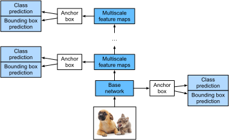

# 单发多框检测
:label:`sec_ssd`

在 :numref:`sec_bbox`--:numref:`sec_object-detection-dataset` 中，
我们介绍了边界框、锚框、
多尺度目标检测以及目标检测数据集。
现在，我们已经准备好利用这些背景知识
来设计一个目标检测模型：
单发多框检测（single shot multibox detection，
SSD）:cite:`Liu.Anguelov.Erhan.ea.2016`。
该模型简单、快速，且被广泛使用。
虽然它只是众多目标检测模型之一，
但本节中的一些设计原则
和实现细节
也适用于其他模型。


## 模型

:numref:`fig_ssd` 给出了
单发多框检测设计的概览。
该模型主要由
一个基础网络
以及随后的
几个多尺度特征图块组成。
基础网络
用于从输入图像中提取特征，
因此它可以使用深度 CNN。
例如，
最初的单发多框检测论文
采用了在分类层之前截断的
VGG 网络 :cite:`Liu.Anguelov.Erhan.ea.2016`，
而 ResNet 也常被使用。
通过我们的设计，
可以使基础网络输出
较大的特征图，
从而生成更多的锚框
来检测较小的目标。
随后，
每个多尺度特征图块
都会将来自前一个块的
特征图的高度和宽度减小（例如减半），
并使特征图的每个单元
在输入图像上的
感受野增大。


回想一下
:numref:`sec_multiscale-object-detection` 中
通过深度神经网络对图像
进行逐层表示
来实现多尺度目标检测的设计。
由于
:numref:`fig_ssd` 中越靠近顶部的多尺度特征图越小
但感受野越大，
因此它们适合检测
数量较少但尺寸较大的目标。

简而言之，
单发多框检测通过其基础网络和几个多尺度特征图块，
生成数量不等、大小不同的锚框，
并通过预测这些锚框（从而得到边界框）
的类别和偏移量
来检测大小不同的目标；
因此，它是一个多尺度目标检测模型。



:label:`fig_ssd`


下面，
我们将描述 :numref:`fig_ssd` 中各个块的实现细节。
首先，我们讨论如何实现类别预测和边界框预测。


### [**类别预测层**]

设目标类别的数量为 $q$。
这样，锚框就有 $q+1$ 个类别，
其中类别 0 是背景。
在某个尺度下，
假设特征图的高度和宽度
分别为 $h$ 和 $w$。
当以这些特征图的
每个空间位置为中心
生成 $a$ 个锚框时，
共有 $hwa$ 个锚框需要分类。
由于参数化成本可能很高，
这往往使基于全连接层的分类不可行。
回想一下我们在 :numref:`sec_nin` 中
是如何利用卷积层的通道
来预测类别的。
单发多框检测使用
同样的技术来降低模型复杂度。

具体地说，
类别预测层使用一个不改变
特征图宽度和高度的卷积层。
这样，在特征图相同的空间维度
（宽度和高度）上，
输出和输入之间就可以
一一对应。
更具体地说，
输出特征图在任意空间位置（$x$，$y$）
处的通道，表示以输入特征图的
（$x$，$y$）为中心的所有锚框的
类别预测。
为了产生有效的预测，
必须有 $a(q+1)$ 个输出通道，
其中对于同一空间位置，
索引为 $i(q+1) + j$ 的输出通道
表示锚框 $i$（$0 \leq i < a$）
属于类别 $j$（$0 \leq j \leq q$）的预测。

下面我们定义这样一个类别预测层，
分别通过参数 `num_anchors` 和 `num_classes`
指定 $a$ 和 $q$。
该层使用填充为 1 的 $3\times3$ 卷积层。
该卷积层输入和输出的
宽度与高度保持不变。

```{.python .input}
#@tab mxnet
%matplotlib inline
from d2l import mxnet as d2l
from mxnet import autograd, gluon, image, init, np, npx
from mxnet.gluon import nn

npx.set_np()

def cls_predictor(num_anchors, num_classes):
    return nn.Conv2D(num_anchors * (num_classes + 1), kernel_size=3,
                     padding=1)
```

```{.python .input}
#@tab pytorch
%matplotlib inline
from d2l import torch as d2l
import torch
import torchvision
from torch import nn
from torch.nn import functional as F

def cls_predictor(num_inputs, num_anchors, num_classes):
    return nn.Conv2d(num_inputs, num_anchors * (num_classes + 1),
                     kernel_size=3, padding=1)
```

### (**边界框预测层**)

边界框预测层的设计与类别预测层类似。
唯一的区别在于每个锚框的输出数量：
这里我们需要预测四个偏移量，而不是 $q+1$ 个类别。

```{.python .input}
#@tab mxnet
def bbox_predictor(num_anchors):
    return nn.Conv2D(num_anchors * 4, kernel_size=3, padding=1)
```

```{.python .input}
#@tab pytorch
def bbox_predictor(num_inputs, num_anchors):
    return nn.Conv2d(num_inputs, num_anchors * 4, kernel_size=3, padding=1)
```

### [**连结多尺度的预测**]

正如我们提到的，单发多框检测
使用多尺度特征图来生成锚框并预测它们的类别和偏移量。
在不同尺度下，
特征图的形状
或者以同一单元为中心的锚框数量
可能不同。
因此，
不同尺度下预测输出的
形状可能不同。

在下面的例子中，
我们为同一个小批量构造两个不同尺度的特征图
`Y1` 和 `Y2`，
其中 `Y2` 的高度和宽度
是 `Y1` 的一半。
让我们以类别预测为例。
假设
在 `Y1` 和 `Y2` 中每个单元
分别生成 5 个和 3 个锚框。
再假设
目标类别的数量为 10。
对于特征图 `Y1` 和 `Y2`，
类别预测输出的通道数
分别为 $5\times(10+1)=55$ 和 $3\times(10+1)=33$，
其中任一输出形状都是
（批量大小，通道数，高度，宽度）。

```{.python .input}
#@tab mxnet
def forward(x, block):
    block.initialize()
    return block(x)

Y1 = forward(np.zeros((2, 8, 20, 20)), cls_predictor(5, 10))
Y2 = forward(np.zeros((2, 16, 10, 10)), cls_predictor(3, 10))
Y1.shape, Y2.shape
```

```{.python .input}
#@tab pytorch
def forward(x, block):
    return block(x)

Y1 = forward(torch.zeros((2, 8, 20, 20)), cls_predictor(8, 5, 10))
Y2 = forward(torch.zeros((2, 16, 10, 10)), cls_predictor(16, 3, 10))
Y1.shape, Y2.shape
```

正如我们所看到的，除了批量大小这一维之外，
其余三个维度的大小都不同。
为了更高效地计算，
我们将把这两个预测输出连结起来，
为此需要将这些张量变换为更一致的格式。

请注意，
通道维保存的是
中心相同的锚框的预测。
我们首先把这一维移到最内层。
由于不同尺度下的批量大小相同，
我们可以把预测输出
变换为一个二维张量，
其形状为（批量大小，高度 $\times$ 宽度 $\times$ 通道数）。
然后，我们就可以沿维度 1
把不同尺度下的这类输出连结起来。

```{.python .input}
#@tab mxnet
def flatten_pred(pred):
    return npx.batch_flatten(pred.transpose(0, 2, 3, 1))

def concat_preds(preds):
    return np.concatenate([flatten_pred(p) for p in preds], axis=1)
```

```{.python .input}
#@tab pytorch
def flatten_pred(pred):
    return torch.flatten(pred.permute(0, 2, 3, 1), start_dim=1)

def concat_preds(preds):
    return torch.cat([flatten_pred(p) for p in preds], dim=1)
```

这样一来，
即使 `Y1` 和 `Y2` 在通道数、高度和宽度上
大小不同，
我们仍然可以把同一小批量下
两个不同尺度的预测输出连结起来。

```{.python .input}
#@tab all
concat_preds([Y1, Y2]).shape
```

### [**下采样块**]

为了在多个尺度上检测目标，
我们定义下面的下采样块 `down_sample_blk`，
它将输入特征图的高度和宽度减半。
事实上，
该块采用了
:numref:`subsec_vgg-blocks` 中 VGG 块的设计。
更具体地说，
每个下采样块由
两个填充为 1 的 $3\times3$ 卷积层
以及随后的一个步幅为 2 的 $2\times2$ 最大汇聚层组成。
众所周知，填充为 1 的 $3\times3$ 卷积层不改变特征图的形状。
然而，随后的 $2\times2$ 最大汇聚会将输入特征图的高度和宽度减半。
对于该下采样块的输入和输出特征图，
由于 $1\times 2+(3-1)+(3-1)=6$，
输出中的每个单元
在输入上具有 $6\times6$ 的感受野。
因此，下采样块增大了其输出特征图中每个单元的感受野。

```{.python .input}
#@tab mxnet
def down_sample_blk(num_channels):
    blk = nn.Sequential()
    for _ in range(2):
        blk.add(nn.Conv2D(num_channels, kernel_size=3, padding=1),
                nn.BatchNorm(in_channels=num_channels),
                nn.Activation('relu'))
    blk.add(nn.MaxPool2D(2))
    return blk
```

```{.python .input}
#@tab pytorch
def down_sample_blk(in_channels, out_channels):
    blk = []
    for _ in range(2):
        blk.append(nn.Conv2d(in_channels, out_channels,
                             kernel_size=3, padding=1))
        blk.append(nn.BatchNorm2d(out_channels))
        blk.append(nn.ReLU())
        in_channels = out_channels
    blk.append(nn.MaxPool2d(2))
    return nn.Sequential(*blk)
```

在下面的例子中，我们构造的下采样块改变了输入通道数，并将输入特征图的高度和宽度减半。

```{.python .input}
#@tab mxnet
forward(np.zeros((2, 3, 20, 20)), down_sample_blk(10)).shape
```

```{.python .input}
#@tab pytorch
forward(torch.zeros((2, 3, 20, 20)), down_sample_blk(3, 10)).shape
```

### [**基础网络块**]

基础网络块用于从输入图像中提取特征。
为了简单起见，
我们构造一个小型基础网络，
它由三个下采样块组成，
每个块都会将通道数加倍。
给定一幅 $256\times256$ 的输入图像，
该基础网络块输出 $32 \times 32$ 的特征图（$256/2^3=32$）。

```{.python .input}
#@tab mxnet
def base_net():
    blk = nn.Sequential()
    for num_filters in [16, 32, 64]:
        blk.add(down_sample_blk(num_filters))
    return blk

forward(np.zeros((2, 3, 256, 256)), base_net()).shape
```

```{.python .input}
#@tab pytorch
def base_net():
    blk = []
    num_filters = [3, 16, 32, 64]
    for i in range(len(num_filters) - 1):
        blk.append(down_sample_blk(num_filters[i], num_filters[i+1]))
    return nn.Sequential(*blk)

forward(torch.zeros((2, 3, 256, 256)), base_net()).shape
```

### 完整模型


[**完整的单发多框检测模型
由五个块组成。**]
每个块产生的特征图
既用于
(i) 生成锚框，
也用于 (ii) 预测这些锚框的类别和偏移量。
在这五个块中，
第一个
是基础网络块，
第二个到第四个是
下采样块，
最后一个块
使用全局最大汇聚
将高度和宽度都减小到 1。
从技术上说，
第二个到第五个块
都是
:numref:`fig_ssd` 中的
多尺度特征图块。

```{.python .input}
#@tab mxnet
def get_blk(i):
    if i == 0:
        blk = base_net()
    elif i == 4:
        blk = nn.GlobalMaxPool2D()
    else:
        blk = down_sample_blk(128)
    return blk
```

```{.python .input}
#@tab pytorch
def get_blk(i):
    if i == 0:
        blk = base_net()
    elif i == 1:
        blk = down_sample_blk(64, 128)
    elif i == 4:
        blk = nn.AdaptiveMaxPool2d((1,1))
    else:
        blk = down_sample_blk(128, 128)
    return blk
```

现在，我们为每个块[**定义前向传播**]。
与图像分类任务不同，
这里的输出包括
(i) CNN 特征图 `Y`，
(ii) 在当前尺度下使用 `Y` 生成的锚框，
以及 (iii) 基于 `Y` 为这些锚框预测的类别和偏移量。

```{.python .input}
#@tab mxnet
def blk_forward(X, blk, size, ratio, cls_predictor, bbox_predictor):
    Y = blk(X)
    anchors = d2l.multibox_prior(Y, sizes=size, ratios=ratio)
    cls_preds = cls_predictor(Y)
    bbox_preds = bbox_predictor(Y)
    return (Y, anchors, cls_preds, bbox_preds)
```

```{.python .input}
#@tab pytorch
def blk_forward(X, blk, size, ratio, cls_predictor, bbox_predictor):
    Y = blk(X)
    anchors = d2l.multibox_prior(Y, sizes=size, ratios=ratio)
    cls_preds = cls_predictor(Y)
    bbox_preds = bbox_predictor(Y)
    return (Y, anchors, cls_preds, bbox_preds)
```

回想一下，
在 :numref:`fig_ssd` 中
越靠近顶部的多尺度特征图块
用于检测较大的目标；
因此，它需要生成较大的锚框。
在上述前向传播中，
在每个多尺度特征图块处，
我们通过所调用的 `multibox_prior` 函数
（见 :numref:`sec_anchor`）的 `sizes` 参数
传入一个包含两个尺度值的列表。
在下面，
区间 0.2 到 1.05
被均匀地分成五段，
以确定五个块中较小的尺度值：0.2、0.37、0.54、0.71 和 0.88。
然后，它们较大的尺度值
由
$\sqrt{0.2 \times 0.37} = 0.272$、$\sqrt{0.37 \times 0.54} = 0.447$ 等给出。

[~~每个块的超参数~~]

```{.python .input}
#@tab all
sizes = [[0.2, 0.272], [0.37, 0.447], [0.54, 0.619], [0.71, 0.79],
         [0.88, 0.961]]
ratios = [[1, 2, 0.5]] * 5
num_anchors = len(sizes[0]) + len(ratios[0]) - 1
```

现在，我们可以如下[**定义完整模型**] `TinySSD`。

```{.python .input}
#@tab mxnet
class TinySSD(nn.Block):
    def __init__(self, num_classes, **kwargs):
        super(TinySSD, self).__init__(**kwargs)
        self.num_classes = num_classes
        for i in range(5):
            # Equivalent to the assignment statement `self.blk_i = get_blk(i)`
            setattr(self, f'blk_{i}', get_blk(i))
            setattr(self, f'cls_{i}', cls_predictor(num_anchors, num_classes))
            setattr(self, f'bbox_{i}', bbox_predictor(num_anchors))

    def forward(self, X):
        anchors, cls_preds, bbox_preds = [None] * 5, [None] * 5, [None] * 5
        for i in range(5):
            # Here `getattr(self, 'blk_%d' % i)` accesses `self.blk_i`
            X, anchors[i], cls_preds[i], bbox_preds[i] = blk_forward(
                X, getattr(self, f'blk_{i}'), sizes[i], ratios[i],
                getattr(self, f'cls_{i}'), getattr(self, f'bbox_{i}'))
        anchors = np.concatenate(anchors, axis=1)
        cls_preds = concat_preds(cls_preds)
        cls_preds = cls_preds.reshape(
            cls_preds.shape[0], -1, self.num_classes + 1)
        bbox_preds = concat_preds(bbox_preds)
        return anchors, cls_preds, bbox_preds
```

```{.python .input}
#@tab pytorch
class TinySSD(nn.Module):
    def __init__(self, num_classes, **kwargs):
        super(TinySSD, self).__init__(**kwargs)
        self.num_classes = num_classes
        idx_to_in_channels = [64, 128, 128, 128, 128]
        for i in range(5):
            # Equivalent to the assignment statement `self.blk_i = get_blk(i)`
            setattr(self, f'blk_{i}', get_blk(i))
            setattr(self, f'cls_{i}', cls_predictor(idx_to_in_channels[i],
                                                    num_anchors, num_classes))
            setattr(self, f'bbox_{i}', bbox_predictor(idx_to_in_channels[i],
                                                      num_anchors))

    def forward(self, X):
        anchors, cls_preds, bbox_preds = [None] * 5, [None] * 5, [None] * 5
        for i in range(5):
            # Here `getattr(self, 'blk_%d' % i)` accesses `self.blk_i`
            X, anchors[i], cls_preds[i], bbox_preds[i] = blk_forward(
                X, getattr(self, f'blk_{i}'), sizes[i], ratios[i],
                getattr(self, f'cls_{i}'), getattr(self, f'bbox_{i}'))
        anchors = torch.cat(anchors, dim=1)
        cls_preds = concat_preds(cls_preds)
        cls_preds = cls_preds.reshape(
            cls_preds.shape[0], -1, self.num_classes + 1)
        bbox_preds = concat_preds(bbox_preds)
        return anchors, cls_preds, bbox_preds
```

我们[**创建一个模型实例，
并用它在一个小批量的 $256 \times 256$ 图像 `X` 上执行前向传播**]。

如本节前面所示，
第一个块输出 $32 \times 32$ 的特征图。
回想一下，
第二个到第四个下采样块
将高度和宽度减半，
而第五个块使用全局汇聚。
由于沿特征图的空间维度
为每个单元生成 4 个锚框，
因此在全部五个尺度下，
每幅图像总共生成 $(32^2 + 16^2 + 8^2 + 4^2 + 1)\times 4 = 5444$ 个锚框。

```{.python .input}
#@tab mxnet
net = TinySSD(num_classes=1)
net.initialize()
X = np.zeros((32, 3, 256, 256))
anchors, cls_preds, bbox_preds = net(X)

print('output anchors:', anchors.shape)
print('output class preds:', cls_preds.shape)
print('output bbox preds:', bbox_preds.shape)
```

```{.python .input}
#@tab pytorch
net = TinySSD(num_classes=1)
X = torch.zeros((32, 3, 256, 256))
anchors, cls_preds, bbox_preds = net(X)

print('output anchors:', anchors.shape)
print('output class preds:', cls_preds.shape)
print('output bbox preds:', bbox_preds.shape)
```

## 训练

现在，我们将解释
如何训练单发多框检测模型
来进行目标检测。


### 读取数据集并初始化模型

首先，让我们[**读取香蕉检测数据集**]，
该数据集已在 :numref:`sec_object-detection-dataset` 中介绍。

```{.python .input}
#@tab all
batch_size = 32
train_iter, _ = d2l.load_data_bananas(batch_size)
```

香蕉检测数据集中只有一个类别。定义模型后，
我们需要(**初始化其参数并定义
优化算法**)。

```{.python .input}
#@tab mxnet
device, net = d2l.try_gpu(), TinySSD(num_classes=1)
net.initialize(init=init.Xavier(), ctx=device)
trainer = gluon.Trainer(net.collect_params(), 'sgd',
                        {'learning_rate': 0.2, 'wd': 5e-4})
```

```{.python .input}
#@tab pytorch
device, net = d2l.try_gpu(), TinySSD(num_classes=1)
trainer = torch.optim.SGD(net.parameters(), lr=0.2, weight_decay=5e-4)
```

### [**定义损失函数和评价函数**]

目标检测有两类损失。
第一类损失与锚框的类别有关：
它的计算
可以直接复用
我们用于图像分类的
交叉熵损失函数。
第二类损失
与正（非背景）锚框的偏移量有关：
这是一个回归问题。
然而，对于这个回归问题，
这里我们不使用
:numref:`subsec_normal_distribution_and_squared_loss` 中描述的平方损失。
相反，
我们使用 $\ell_1$ 范数损失，
即预测值与真实值之差的绝对值。
掩码变量 `bbox_masks` 在损失计算中
过滤掉负锚框和非法（填充的）
锚框。
最后，我们将
锚框类别损失
和锚框偏移量损失相加，
得到模型的损失函数。

```{.python .input}
#@tab mxnet
cls_loss = gluon.loss.SoftmaxCrossEntropyLoss()
bbox_loss = gluon.loss.L1Loss()

def calc_loss(cls_preds, cls_labels, bbox_preds, bbox_labels, bbox_masks):
    cls = cls_loss(cls_preds, cls_labels)
    bbox = bbox_loss(bbox_preds * bbox_masks, bbox_labels * bbox_masks)
    return cls + bbox
```

```{.python .input}
#@tab pytorch
cls_loss = nn.CrossEntropyLoss(reduction='none')
bbox_loss = nn.L1Loss(reduction='none')

def calc_loss(cls_preds, cls_labels, bbox_preds, bbox_labels, bbox_masks):
    batch_size, num_classes = cls_preds.shape[0], cls_preds.shape[2]
    cls = cls_loss(cls_preds.reshape(-1, num_classes),
                   cls_labels.reshape(-1)).reshape(batch_size, -1).mean(dim=1)
    bbox = bbox_loss(bbox_preds * bbox_masks,
                     bbox_labels * bbox_masks).mean(dim=1)
    return cls + bbox
```

我们可以使用准确率来评价分类结果。
由于对偏移量使用了 $\ell_1$ 范数损失，
我们使用*平均绝对误差*（mean absolute error）
来评价预测的边界框。
这些预测结果
由生成的锚框
及其预测偏移量得到。

```{.python .input}
#@tab mxnet
def cls_eval(cls_preds, cls_labels):
    # Because the class prediction results are on the final dimension,
    # `argmax` needs to specify this dimension
    return float((cls_preds.argmax(axis=-1).astype(
        cls_labels.dtype) == cls_labels).sum())

def bbox_eval(bbox_preds, bbox_labels, bbox_masks):
    return float((np.abs((bbox_labels - bbox_preds) * bbox_masks)).sum())
```

```{.python .input}
#@tab pytorch
def cls_eval(cls_preds, cls_labels):
    # Because the class prediction results are on the final dimension,
    # `argmax` needs to specify this dimension
    return float((cls_preds.argmax(dim=-1).type(
        cls_labels.dtype) == cls_labels).sum())

def bbox_eval(bbox_preds, bbox_labels, bbox_masks):
    return float((torch.abs((bbox_labels - bbox_preds) * bbox_masks)).sum())
```

### [**训练模型**]

训练模型时，
我们需要在前向传播中生成多尺度锚框（`anchors`），
并预测它们的类别（`cls_preds`）和偏移量（`bbox_preds`）。
然后，我们根据标签信息 `Y`
为这样生成的锚框标注类别（`cls_labels`）和偏移量（`bbox_labels`）。
最后，我们利用类别和偏移量的
预测值和标注值
计算损失函数。
为了使实现保持简洁，
这里省略了测试数据集的评价。

```{.python .input}
#@tab mxnet
num_epochs, timer = 20, d2l.Timer()
animator = d2l.Animator(xlabel='epoch', xlim=[1, num_epochs],
                        legend=['class error', 'bbox mae'])
for epoch in range(num_epochs):
    # Sum of training accuracy, no. of examples in sum of training accuracy,
    # Sum of absolute error, no. of examples in sum of absolute error
    metric = d2l.Accumulator(4)
    for features, target in train_iter:
        timer.start()
        X = features.as_in_ctx(device)
        Y = target.as_in_ctx(device)
        with autograd.record():
            # Generate multiscale anchor boxes and predict their classes and
            # offsets
            anchors, cls_preds, bbox_preds = net(X)
            # Label the classes and offsets of these anchor boxes
            bbox_labels, bbox_masks, cls_labels = d2l.multibox_target(anchors,
                                                                      Y)
            # Calculate the loss function using the predicted and labeled
            # values of the classes and offsets
            l = calc_loss(cls_preds, cls_labels, bbox_preds, bbox_labels,
                          bbox_masks)
        l.backward()
        trainer.step(batch_size)
        metric.add(cls_eval(cls_preds, cls_labels), cls_labels.size,
                   bbox_eval(bbox_preds, bbox_labels, bbox_masks),
                   bbox_labels.size)
    cls_err, bbox_mae = 1 - metric[0] / metric[1], metric[2] / metric[3]
    animator.add(epoch + 1, (cls_err, bbox_mae))
print(f'class err {cls_err:.2e}, bbox mae {bbox_mae:.2e}')
print(f'{len(train_iter._dataset) / timer.stop():.1f} examples/sec on '
      f'{str(device)}')
```

```{.python .input}
#@tab pytorch
num_epochs, timer = 20, d2l.Timer()
animator = d2l.Animator(xlabel='epoch', xlim=[1, num_epochs],
                        legend=['class error', 'bbox mae'])
net = net.to(device)
for epoch in range(num_epochs):
    # Sum of training accuracy, no. of examples in sum of training accuracy,
    # Sum of absolute error, no. of examples in sum of absolute error
    metric = d2l.Accumulator(4)
    net.train()
    for features, target in train_iter:
        timer.start()
        trainer.zero_grad()
        X, Y = features.to(device), target.to(device)
        # Generate multiscale anchor boxes and predict their classes and
        # offsets
        anchors, cls_preds, bbox_preds = net(X)
        # Label the classes and offsets of these anchor boxes
        bbox_labels, bbox_masks, cls_labels = d2l.multibox_target(anchors, Y)
        # Calculate the loss function using the predicted and labeled values
        # of the classes and offsets
        l = calc_loss(cls_preds, cls_labels, bbox_preds, bbox_labels,
                      bbox_masks)
        l.mean().backward()
        trainer.step()
        metric.add(cls_eval(cls_preds, cls_labels), cls_labels.numel(),
                   bbox_eval(bbox_preds, bbox_labels, bbox_masks),
                   bbox_labels.numel())
    cls_err, bbox_mae = 1 - metric[0] / metric[1], metric[2] / metric[3]
    animator.add(epoch + 1, (cls_err, bbox_mae))
print(f'class err {cls_err:.2e}, bbox mae {bbox_mae:.2e}')
print(f'{len(train_iter.dataset) / timer.stop():.1f} examples/sec on '
      f'{str(device)}')
```

## [**预测**]

在预测时，
目标是在图像上
检测所有感兴趣的目标。
下面
我们读取并调整一幅测试图像的大小，
将其转换为
卷积层所需的
四维张量。

```{.python .input}
#@tab mxnet
img = image.imread('../img/banana.jpg')
feature = image.imresize(img, 256, 256).astype('float32')
X = np.expand_dims(feature.transpose(2, 0, 1), axis=0)
```

```{.python .input}
#@tab pytorch
X = torchvision.io.read_image('../img/banana.jpg').unsqueeze(0).float()
img = X.squeeze(0).permute(1, 2, 0).long()
```

使用下面的 `multibox_detection` 函数，
可以由锚框及其预测偏移量
得到预测的边界框。
然后使用非极大值抑制
来移除相似的预测边界框。

```{.python .input}
#@tab mxnet
def predict(X):
    anchors, cls_preds, bbox_preds = net(X.as_in_ctx(device))
    cls_probs = npx.softmax(cls_preds).transpose(0, 2, 1)
    output = d2l.multibox_detection(cls_probs, bbox_preds, anchors)
    idx = [i for i, row in enumerate(output[0]) if row[0] != -1]
    return output[0, idx]

output = predict(X)
```

```{.python .input}
#@tab pytorch
def predict(X):
    net.eval()
    anchors, cls_preds, bbox_preds = net(X.to(device))
    cls_probs = F.softmax(cls_preds, dim=2).permute(0, 2, 1)
    output = d2l.multibox_detection(cls_probs, bbox_preds, anchors)
    idx = [i for i, row in enumerate(output[0]) if row[0] != -1]
    return output[0, idx]

output = predict(X)
```

最后，我们[**显示
所有置信度不低于 0.9 的预测边界框**]
作为输出。

```{.python .input}
#@tab mxnet
def display(img, output, threshold):
    d2l.set_figsize((5, 5))
    fig = d2l.plt.imshow(img.asnumpy())
    for row in output:
        score = float(row[1])
        if score < threshold:
            continue
        h, w = img.shape[:2]
        bbox = [row[2:6] * np.array((w, h, w, h), ctx=row.ctx)]
        d2l.show_bboxes(fig.axes, bbox, '%.2f' % score, 'w')

display(img, output, threshold=0.9)
```

```{.python .input}
#@tab pytorch
def display(img, output, threshold):
    d2l.set_figsize((5, 5))
    fig = d2l.plt.imshow(img)
    for row in output:
        score = float(row[1])
        if score < threshold:
            continue
        h, w = img.shape[:2]
        bbox = [row[2:6] * torch.tensor((w, h, w, h), device=row.device)]
        d2l.show_bboxes(fig.axes, bbox, '%.2f' % score, 'w')

display(img, output.cpu(), threshold=0.9)
```

## 小结

* 单发多框检测是一种多尺度目标检测模型。通过其基础网络和几个多尺度特征图块，单发多框检测生成数量不等、大小不同的锚框，并通过预测这些锚框（从而得到边界框）的类别和偏移量来检测大小不同的目标。
* 训练单发多框检测模型时，损失函数根据锚框类别和偏移量的预测值与标注值来计算。


## 练习

1. 你能通过改进损失函数来改进单发多框检测吗？例如，对预测的偏移量使用平滑 $\ell_1$ 范数损失来代替 $\ell_1$ 范数损失。该损失函数在零附近使用平方函数以获得平滑性，由超参数 $\sigma$ 控制：

$$
f(x) =
    \begin{cases}
    (\sigma x)^2/2,& \textrm{if }|x| < 1/\sigma^2\\
    |x|-0.5/\sigma^2,& \textrm{otherwise}
    \end{cases}
$$

当 $\sigma$ 非常大时，该损失与 $\ell_1$ 范数损失类似。当其值较小时，损失函数更平滑。

```{.python .input}
#@tab mxnet
sigmas = [10, 1, 0.5]
lines = ['-', '--', '-.']
x = np.arange(-2, 2, 0.1)
d2l.set_figsize()

for l, s in zip(lines, sigmas):
    y = npx.smooth_l1(x, scalar=s)
    d2l.plt.plot(x.asnumpy(), y.asnumpy(), l, label='sigma=%.1f' % s)
d2l.plt.legend();
```

```{.python .input}
#@tab pytorch
def smooth_l1(data, scalar):
    out = []
    for i in data:
        if abs(i) < 1 / (scalar ** 2):
            out.append(((scalar * i) ** 2) / 2)
        else:
            out.append(abs(i) - 0.5 / (scalar ** 2))
    return torch.tensor(out)

sigmas = [10, 1, 0.5]
lines = ['-', '--', '-.']
x = torch.arange(-2, 2, 0.1)
d2l.set_figsize()

for l, s in zip(lines, sigmas):
    y = smooth_l1(x, scalar=s)
    d2l.plt.plot(x, y, l, label='sigma=%.1f' % s)
d2l.plt.legend();
```

此外，在实验中，我们对类别预测使用了交叉熵损失：
设 $p_j$ 为对真实类别 $j$ 的预测概率，交叉熵损失为 $-\log p_j$。我们也可以使用焦点损失（focal loss）
:cite:`Lin.Goyal.Girshick.ea.2017`：给定超参数 $\gamma > 0$
和 $\alpha > 0$，该损失定义为：

$$ - \alpha (1-p_j)^{\gamma} \log p_j.$$

正如我们所看到的，增大 $\gamma$
可以有效降低分类良好样例（例如 $p_j > 0.5$）的相对损失，
从而使训练
更关注那些被错误分类的困难样例。

```{.python .input}
#@tab mxnet
def focal_loss(gamma, x):
    return -(1 - x) ** gamma * np.log(x)

x = np.arange(0.01, 1, 0.01)
for l, gamma in zip(lines, [0, 1, 5]):
    y = d2l.plt.plot(x.asnumpy(), focal_loss(gamma, x).asnumpy(), l,
                     label='gamma=%.1f' % gamma)
d2l.plt.legend();
```

```{.python .input}
#@tab pytorch
def focal_loss(gamma, x):
    return -(1 - x) ** gamma * torch.log(x)

x = torch.arange(0.01, 1, 0.01)
for l, gamma in zip(lines, [0, 1, 5]):
    y = d2l.plt.plot(x, focal_loss(gamma, x), l, label='gamma=%.1f' % gamma)
d2l.plt.legend();
```

2. 由于篇幅限制，我们省略了本节中单发多框检测模型的一些实现细节。你能从以下几个方面进一步改进该模型吗：
    1. 当目标相对于图像小得多时，模型可以将输入图像调整得更大。
    1. 通常存在数量庞大的负锚框。为了使类别分布更均衡，我们可以对负锚框进行下采样。
    1. 在损失函数中，为类别损失和偏移量损失分配不同的权重超参数。
    1. 使用其他方法评价目标检测模型，例如单发多框检测论文 :cite:`Liu.Anguelov.Erhan.ea.2016` 中的方法。


:begin_tab:`mxnet`
[讨论](https://discuss.d2l.ai/t/373)
:end_tab:

:begin_tab:`pytorch`
[讨论](https://discuss.d2l.ai/t/1604)
:end_tab:
