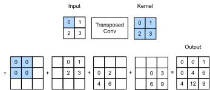
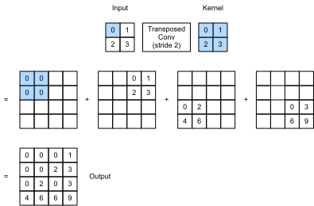

# 转置卷积
:label:`sec_transposed_conv`

到目前为止，我们已经见过的 CNN 层，
例如卷积层（:numref:`sec_conv_layer`）和汇聚层（:numref:`sec_pooling`），
通常会减小（下采样）输入的空间维度（高度和宽度），
或者使其保持不变。
在像素级分类的
语义分割中，
如果输入和输出的
空间维度相同，将会很方便。
例如，
某个输出像素处的通道维
可以保存同一空间位置
输入像素的分类结果。


为了实现这一点，特别是在
空间维度被 CNN 层减小之后，
我们可以使用另一类
CNN 层，
它可以增大（上采样）中间特征图的
空间维度。
本节
我们将介绍
*转置卷积*（transposed convolution），它也称为*分数步幅卷积*（fractionally-strided convolution）:cite:`Dumoulin.Visin.2016`，
用于逆转卷积的下采样操作。

```{.python .input}
#@tab mxnet
from mxnet import np, npx, init
from mxnet.gluon import nn
from d2l import mxnet as d2l

npx.set_np()
```

```{.python .input}
#@tab pytorch
import torch
from torch import nn
from d2l import torch as d2l
```

## 基本操作

暂时忽略通道，
让我们从
步幅为 1、无填充的
基本转置卷积操作开始。
假设
给定一个
$n_h \times n_w$ 的输入张量
和一个 $k_h \times k_w$ 的卷积核。
以步幅 1 在每一行滑动卷积窗口
$n_w$ 次、
在每一列滑动窗口 $n_h$ 次，
总共得到
$n_h n_w$ 个中间结果。
每个中间结果都是
一个初始化为零的
$(n_h + k_h - 1) \times (n_w + k_w - 1)$
张量。
为了计算每个中间张量，
输入张量中的每个元素
都与卷积核相乘，
使得得到的 $k_h \times k_w$ 张量
替换每个中间张量中的一部分。
请注意，
每个中间张量中被替换部分的位置
对应于用于计算的
输入张量中元素的位置。
最后，对所有中间结果
求和以产生输出。

作为一个例子，
:numref:`fig_trans_conv` 说明了
如何对 $2\times 2$ 的输入张量计算使用 $2\times 2$ 卷积核的转置卷积。



:label:`fig_trans_conv`


对于输入矩阵 `X` 和卷积核矩阵 `K`，我们可以(**实现这个基本的转置卷积操作**)`trans_conv`。

```{.python .input}
#@tab all
def trans_conv(X, K):
    h, w = K.shape
    Y = d2l.zeros((X.shape[0] + h - 1, X.shape[1] + w - 1))
    for i in range(X.shape[0]):
        for j in range(X.shape[1]):
            Y[i: i + h, j: j + w] += X[i, j] * K
    return Y
```

与（:numref:`sec_conv_layer` 中）通过卷积核*减小*输入元素的
常规卷积相比，
转置卷积
通过卷积核*广播*输入元素，
从而
产生比输入更大的输出。
我们可以根据 :numref:`fig_trans_conv` 构造输入张量 `X` 和卷积核张量 `K`，来[**验证上述实现**]的基本二维转置卷积操作的输出。

```{.python .input}
#@tab all
X = d2l.tensor([[0.0, 1.0], [2.0, 3.0]])
K = d2l.tensor([[0.0, 1.0], [2.0, 3.0]])
trans_conv(X, K)
```

另一种方式是，
当输入 `X` 和卷积核 `K`
都是四维张量时，
我们可以[**使用高级 API 获得相同的结果**]。

```{.python .input}
#@tab mxnet
X, K = X.reshape(1, 1, 2, 2), K.reshape(1, 1, 2, 2)
tconv = nn.Conv2DTranspose(1, kernel_size=2)
tconv.initialize(init.Constant(K))
tconv(X)
```

```{.python .input}
#@tab pytorch
X, K = X.reshape(1, 1, 2, 2), K.reshape(1, 1, 2, 2)
tconv = nn.ConvTranspose2d(1, 1, kernel_size=2, bias=False)
tconv.weight.data = K
tconv(X)
```

## [**填充、步幅和多通道**]

与填充应用于输入的常规卷积不同，
在转置卷积中，
填充应用于输出。
例如，
当把高度和宽度
两侧的填充数
指定为 1 时，
转置卷积输出的第一行和最后一行
以及第一列和最后一列
将被移除。

```{.python .input}
#@tab mxnet
tconv = nn.Conv2DTranspose(1, kernel_size=2, padding=1)
tconv.initialize(init.Constant(K))
tconv(X)
```

```{.python .input}
#@tab pytorch
tconv = nn.ConvTranspose2d(1, 1, kernel_size=2, padding=1, bias=False)
tconv.weight.data = K
tconv(X)
```

在转置卷积中，
步幅是为中间结果（因而也是输出）指定的，而不是为输入指定的。
使用 :numref:`fig_trans_conv` 中
相同的输入和卷积核张量，
把步幅从 1 改为 2
会同时增大中间张量的高度和宽度，
从而得到 :numref:`fig_trans_conv_stride2` 中的
输出张量。



:label:`fig_trans_conv_stride2`


下面的代码片段可以验证 :numref:`fig_trans_conv_stride2` 中步幅为 2 的转置卷积输出。

```{.python .input}
#@tab mxnet
tconv = nn.Conv2DTranspose(1, kernel_size=2, strides=2)
tconv.initialize(init.Constant(K))
tconv(X)
```

```{.python .input}
#@tab pytorch
tconv = nn.ConvTranspose2d(1, 1, kernel_size=2, stride=2, bias=False)
tconv.weight.data = K
tconv(X)
```

对于多个输入和输出通道，
转置卷积
的工作方式与常规卷积相同。
假设
输入有 $c_i$ 个通道，
并且转置卷积
为每个输入通道
分配一个 $k_h\times k_w$ 的卷积核张量。
当指定多个输出通道时，
每个输出通道都有一个 $c_i\times k_h\times k_w$ 的卷积核。


总而言之，如果我们把 $\mathsf{X}$ 输入卷积层 $f$ 以输出 $\mathsf{Y}=f(\mathsf{X})$，并创建一个与 $f$ 具有相同超参数（除了输出通道数
等于 $\mathsf{X}$ 的通道数之外）的转置卷积层 $g$，
那么 $g(Y)$ 的形状将与 $\mathsf{X}$ 相同。
这可以用下面的例子来说明。

```{.python .input}
#@tab mxnet
X = np.random.uniform(size=(1, 10, 16, 16))
conv = nn.Conv2D(20, kernel_size=5, padding=2, strides=3)
tconv = nn.Conv2DTranspose(10, kernel_size=5, padding=2, strides=3)
conv.initialize()
tconv.initialize()
tconv(conv(X)).shape == X.shape
```

```{.python .input}
#@tab pytorch
X = torch.rand(size=(1, 10, 16, 16))
conv = nn.Conv2d(10, 20, kernel_size=5, padding=2, stride=3)
tconv = nn.ConvTranspose2d(20, 10, kernel_size=5, padding=2, stride=3)
tconv(conv(X)).shape == X.shape
```

## [**与矩阵转置的关系**]
:label:`subsec-connection-to-mat-transposition`

转置卷积是以
矩阵转置命名的。
为了说明这一点，
让我们首先
看看如何使用矩阵乘法
实现卷积。
在下面的例子中，我们定义一个 $3\times 3$ 的输入 `X` 和一个 $2\times 2$ 的卷积核 `K`，然后使用 `corr2d` 函数计算卷积输出 `Y`。

```{.python .input}
#@tab all
X = d2l.arange(9.0).reshape(3, 3)
K = d2l.tensor([[1.0, 2.0], [3.0, 4.0]])
Y = d2l.corr2d(X, K)
Y
```

接下来，我们把卷积核 `K` 重写为
一个包含大量零的
稀疏权重矩阵 `W`。
权重矩阵的形状为（$4$，$9$），
其中非零元素来自
卷积核 `K`。

```{.python .input}
#@tab all
def kernel2matrix(K):
    k, W = d2l.zeros(5), d2l.zeros((4, 9))
    k[:2], k[3:5] = K[0, :], K[1, :]
    W[0, :5], W[1, 1:6], W[2, 3:8], W[3, 4:] = k, k, k, k
    return W

W = kernel2matrix(K)
W
```

把输入 `X` 逐行连结起来，得到一个长度为 9 的向量。然后，`W` 与向量化的 `X` 的矩阵乘法给出一个长度为 4 的向量。
将其重塑之后，我们就可以得到与上面原始卷积操作
相同的结果 `Y`：
我们刚刚用矩阵乘法实现了卷积。

```{.python .input}
#@tab all
Y == d2l.matmul(W, d2l.reshape(X, -1)).reshape(2, 2)
```

同样地，我们可以使用
矩阵乘法实现转置卷积。
在下面的例子中，
我们把上面常规卷积的 $2 \times 2$ 输出 `Y`
作为转置卷积的输入。
为了通过矩阵相乘实现该操作，
我们只需要转置权重矩阵 `W`，
得到新的形状 $(9, 4)$。

```{.python .input}
#@tab all
Z = trans_conv(Y, K)
Z == d2l.matmul(W.T, d2l.reshape(Y, -1)).reshape(3, 3)
```

考虑通过矩阵相乘
来实现卷积。
给定输入向量 $\mathbf{x}$
和权重矩阵 $\mathbf{W}$，
卷积的前向传播函数
可以通过将其输入与权重矩阵相乘
来实现，
即输出向量
$\mathbf{y}=\mathbf{W}\mathbf{x}$。
由于反向传播
遵循链式法则，
且 $\nabla_{\mathbf{x}}\mathbf{y}=\mathbf{W}^\top$，
卷积的反向传播函数
可以通过将其输入与
转置后的权重矩阵 $\mathbf{W}^\top$ 相乘
来实现。
因此，
转置卷积层
只需交换卷积层的
前向传播函数
和反向传播函数：
它的前向传播函数
和反向传播函数
分别将其输入向量与
$\mathbf{W}^\top$ 和 $\mathbf{W}$ 相乘。


## 小结

* 与通过卷积核减小输入元素的常规卷积不同，转置卷积通过卷积核广播输入元素，从而产生比输入更大的输出。
* 如果我们把 $\mathsf{X}$ 输入卷积层 $f$ 以输出 $\mathsf{Y}=f(\mathsf{X})$，并创建一个与 $f$ 具有相同超参数（除了输出通道数等于 $\mathsf{X}$ 的通道数之外）的转置卷积层 $g$，那么 $g(Y)$ 的形状将与 $\mathsf{X}$ 相同。
* 我们可以使用矩阵乘法实现卷积。转置卷积层只需交换卷积层的前向传播函数和反向传播函数。


## 练习

1. 在 :numref:`subsec-connection-to-mat-transposition` 中，卷积输入 `X` 和转置卷积输出 `Z` 具有相同的形状。它们的值相同吗？为什么？
1. 使用矩阵乘法实现卷积高效吗？为什么？

:begin_tab:`mxnet`
[讨论](https://discuss.d2l.ai/t/376)
:end_tab:

:begin_tab:`pytorch`
[讨论](https://discuss.d2l.ai/t/1450)
:end_tab:
