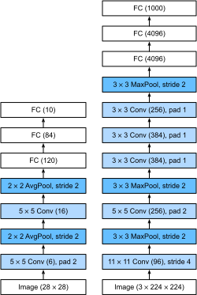

```{.python .input  n=1}
%load_ext d2lbook.tab
tab.interact_select(['mxnet', 'pytorch', 'tensorflow', 'jax'])
```

# 深度卷积神经网络（AlexNet）
:label:`sec_alexnet`


尽管在 LeNet :cite:`LeCun.Jackel.Bottou.ea.1995` 问世之后，
CNN 已在计算机视觉和机器学习界广为人知，
但它们并没有立即主导这一领域。
尽管 LeNet 在早期的小数据集上取得了良好的结果，
但在更大、更真实的数据集上训练 CNN
的性能和可行性仍待确立。
事实上，在20世纪90年代初到
2012年取得分水岭式成果 :cite:`Krizhevsky.Sutskever.Hinton.2012` 之间的大部分时间里，
神经网络经常被其他机器学习方法超越，
例如核方法 :cite:`Scholkopf.Smola.2002`、集成方法 :cite:`Freund.Schapire.ea.1996`
和结构化估计 :cite:`Taskar.Guestrin.Koller.2004`。

对于计算机视觉来说，这种比较也许并不完全准确。
也就是说，尽管卷积网络的输入
由原始或经过轻度处理（例如中心化）的像素值组成，但实践者从不会把原始像素直接输入传统模型。
相反，典型的计算机视觉流程
由人工设计的特征提取流程组成，例如 SIFT :cite:`Lowe.2004`、SURF :cite:`Bay.Tuytelaars.Van-Gool.2006` 和视觉词袋 :cite:`Sivic.Zisserman.2003`。
特征不是被*学习*出来的，而是被*手工设计*出来的。
大部分进展一方面来自对特征提取更巧妙的构想，
另一方面来自对几何的深刻洞见 :cite:`Hartley.Zisserman.2000`。学习算法往往被视为事后的补充。

尽管20世纪90年代已经出现了一些神经网络加速器，
但它们的性能尚不足以
构建参数众多的深度多通道、多层 CNN。
例如，NVIDIA 于1999年推出的 GeForce 256
每秒最多只能处理4.8亿次浮点运算（如加法和乘法）（MFLOPS），
而且除了游戏之外，没有任何有意义的
编程框架可用。如今的加速器每台设备能够执行超过1000 TFLOPs。
此外，当时的数据集仍然相对较小：
对6万幅低分辨率$28 \times 28$像素图像做 OCR 曾被视为极具挑战性的任务。
除这些障碍之外，训练神经网络的关键技巧
也仍然缺失，包括参数初始化启发式方法 :cite:`Glorot.Bengio.2010`、
随机梯度下降的巧妙变体 :cite:`Kingma.Ba.2014`、
非压缩型激活函数 :cite:`Nair.Hinton.2010`
以及有效的正则化技术 :cite:`Srivastava.Hinton.Krizhevsky.ea.2014`。

因此，经典流程并不训练*端到端*（从像素到分类）的系统，
而更像是这样：

1. 获取一个有趣的数据集。在早期，这类数据集需要昂贵的传感器。例如，1994年的 [Apple QuickTake 100](https://en.wikipedia.org/wiki/Apple_QuickTake) 拥有高达0.3兆像素（VGA）的分辨率，最多能存储8幅图像，而价格高达\$1000。
1. 基于光学、几何、其他分析工具方面的知识，偶尔还基于幸运的研究生们的偶然发现，用手工设计的特征对数据集进行预处理。
1. 让数据通过一组标准的特征提取器，例如 SIFT（尺度不变特征变换）:cite:`Lowe.2004`、SURF（加速稳健特征）:cite:`Bay.Tuytelaars.Van-Gool.2006`，或者任意数量的其他手工调优流程。时至今日，OpenCV 仍然提供 SIFT 提取器！
1. 把得到的表示输入你最喜欢的分类器（很可能是线性模型或核方法），以训练一个分类器。

如果你去问机器学习研究者，
他们会回答说机器学习既重要又优美。
优雅的理论证明了各种分类器 :cite:`boucheron2005theory` 的性质，而凸
优化 :cite:`Boyd.Vandenberghe.2004` 已成为获得这些分类器的主流方法。
机器学习领域当时蓬勃发展、严谨且非常有用。然而，
如果你去问计算机视觉研究者，
你会听到完全不同的说法。
他们会告诉你，图像识别不光彩的真相在于：
推动进展的是特征、几何 :cite:`Hartley.Zisserman.2000,hartley2009global` 和工程，
而不是新颖的学习算法。
计算机视觉研究者有理由相信，
更大或更干净的数据集
或者略微改进的特征提取流程，
对最终准确率而言比任何学习算法都重要得多。

```{.python .input  n=2}
%%tab mxnet
from d2l import mxnet as d2l
from mxnet import np, init, npx
from mxnet.gluon import nn
npx.set_np()
```

```{.python .input  n=3}
%%tab pytorch
from d2l import torch as d2l
import torch
from torch import nn
```

```{.python .input  n=4}
%%tab tensorflow
from d2l import tensorflow as d2l
import tensorflow as tf
```

```{.python .input}
%%tab jax
from d2l import jax as d2l
from flax import linen as nn
import jax
from jax import numpy as jnp
```

## 表示学习

换一种说法，当时流程中最重要的部分是表示。
而直到2012年，表示大多是机械地计算出来的。
事实上，设计一组新的特征函数、改进结果并写出方法，
在论文中都占有显著地位。
SIFT :cite:`Lowe.2004`、
SURF :cite:`Bay.Tuytelaars.Van-Gool.2006`、
HOG（方向梯度直方图）:cite:`Dalal.Triggs.2005`、
视觉词袋 :cite:`Sivic.Zisserman.2003`
以及类似的特征提取器占据主导地位。

另一组研究者，
包括 Yann LeCun、Geoff Hinton、Yoshua Bengio、
Andrew Ng、Shun-ichi Amari 和 Juergen Schmidhuber，
有着不同的打算。
他们相信特征本身应当被学习。
此外，他们认为特征要足够复杂，
就应当由多个联合学习的层分层组合而成，
每一层都有可学习的参数。
以图像为例，最低的几层可能会逐渐
检测边缘、颜色和纹理，这与动物视觉系统
处理其输入的方式类似。特别地，诸如通过稀疏编码 :cite:`olshausen1996emergence` 获得的那类
视觉特征的自动设计，直到现代 CNN 出现之前都仍是一个悬而未决的挑战。
直到 :citet:`Dean.Corrado.Monga.ea.2012,le2013building` 之后，从图像数据自动
生成特征的想法才获得了显著关注。

第一个现代 CNN :cite:`Krizhevsky.Sutskever.Hinton.2012`，以
其发明者之一 Alex Krizhevsky 的名字命名为*AlexNet*，它在很大程度上
是 LeNet 的演进式改进。它在2012年 ImageNet 挑战赛中取得了优异的性能。


:width:`400px`
:label:`fig_filters`

有趣的是，在网络的最低层，
模型学习到的特征提取器与一些传统滤波器相似。
:numref:`fig_filters`
展示了较低层次的图像描述子。
网络中较高的层可能在这些表示的基础上构建，
以表示更大的结构，如眼睛、鼻子、草叶等。
更高的层甚至可能表示整个物体，
如人、飞机、狗或飞盘。
最终，最后的隐藏状态学习到一种紧凑的图像表示，
它概括了图像的内容，
使得属于不同类别的数据可以很容易地被区分开。

AlexNet（2012）及其前身 LeNet（1995）共享许多架构要素。这不禁让人发问：为什么花了这么长时间？
一个关键区别在于，在此前的二十年里，可用的数据量和计算能力都显著增加了。因此 AlexNet 大得多：与1995年可用的 CPU 相比，它在多得多的数据上、用快得多的 GPU 进行训练。

### 缺失的要素：数据

具有许多层的深度模型需要大量数据，
才能进入
显著优于基于凸优化的传统方法
（例如线性方法和核方法）的区间。
然而，鉴于计算机存储容量有限、
（成像）传感器相对昂贵，
以及20世纪90年代研究预算相对紧张，
大多数研究依赖于很小的数据集。
许多论文依赖 UCI 数据集集合，
其中很多只包含数百或（少数）数千幅
低分辨率拍摄、背景往往被人为处理干净的图像。

2009年，ImageNet 数据集发布 :cite:`Deng.Dong.Socher.ea.2009`，
它向研究者提出挑战：从100万个样例中学习模型，
这些样例来自1000个不同物体类别、每类1000个。这些类别本身
基于 WordNet :cite:`Miller.1995` 中最流行的名词节点。
ImageNet 团队使用 Google 图片搜索对每个类别的大量候选集合
进行预筛选，并采用
Amazon Mechanical Turk 众包流程
来确认每幅图像是否属于相应类别。
这一规模是前所未有的，比其他数据集高出一个数量级以上
（例如，CIFAR-100 有6万幅图像）。另一个方面是，这些图像具有
$224 \times 224$像素的较高分辨率，不像8000万幅规模的
TinyImages 数据集 :cite:`Torralba.Fergus.Freeman.2008` 那样只包含$32 \times 32$像素的缩略图。
这有利于形成更高层次的特征。
相关的竞赛名为 ImageNet 大规模视觉识别挑战赛
（ImageNet Large Scale Visual Recognition Challenge）:cite:`russakovsky2015imagenet`，
它推动了计算机视觉和机器学习研究的发展，
向研究者提出挑战：在比学术界此前所考虑的更大规模上，哪些模型表现最好。最大的视觉数据集，例如 LAION-5B
:cite:`schuhmann2022laion`，包含数十亿幅带附加元数据的图像。

### 缺失的要素：硬件

深度学习模型是计算周期的贪婪消费者。
训练可能需要进行数百轮，而每次迭代
都需要让数据穿过许多层计算代价高昂的
线性代数运算。
这是20世纪90年代和21世纪初
更偏好基于优化得更高效的
凸目标的简单算法的主要原因之一。

*图形处理器*（graphical processing unit，GPU）被证明是
使深度学习成为可能的关键变革者。
这些芯片最初是为加速
图形处理以服务于计算机游戏而开发的。
特别地，它们针对高吞吐量的$4 \times 4$
矩阵—向量乘积进行了优化，而许多计算机图形任务正需要这类运算。
幸运的是，这种数学与
计算卷积层所需的数学惊人地相似。
大约在同一时期，NVIDIA 和 ATI 开始针对通用计算运算
优化 GPU :cite:`Fernando.2004`，
甚至将它们作为*通用 GPU*（general-purpose GPU，GPGPU）来营销。

为了提供一些直观认识，考虑现代微处理器
（CPU）的核。
每个核都相当强大，运行在高时钟频率上，
并配备大容量缓存（最多可达数兆字节的 L3 缓存）。
每个核都擅长执行各种指令，
它带有分支预测器、深流水线、专用执行单元、
推测执行
以及许多其他精巧机制，
使其能够运行大量具有复杂控制流的程序。
然而，这种明显的优势也正是它的致命弱点：
通用核的制造成本非常高。它们擅长处理
具有大量控制流的通用代码。
这需要大量芯片面积，不仅用于
实际执行计算的 ALU（算术逻辑单元），还用于
上述所有精巧机制，再加上
内存接口、核之间的缓存逻辑、
高速互连等等。与专用硬件相比，
CPU 在任何单一任务上都相对较差。
现代笔记本电脑有4～8个核，
而即便是高端服务器，每个插槽也很少超过64个核，
原因很简单：这样做不划算。

相比之下，GPU 可以由数千个小型处理单元组成（NVIDIA 最新的 Ampere 芯片有多达6912个 CUDA 核），这些处理单元通常被分组为更大的组（NVIDIA 称之为 warp）。
NVIDIA、AMD、ARM 和其他芯片厂商在细节上有所不同。虽然每个核都相对较弱，
运行频率约为1GHz，
但正是这类核的总数使 GPU 比 CPU 快几个数量级。
例如，NVIDIA 近期的 Ampere A100 GPU 每块芯片在专门的16位精度（BFLOAT16）矩阵—矩阵乘法上提供超过300 TFLOPs 的性能，在更通用的浮点运算（FP32）上最高可达20 TFLOPs。
与此同时，CPU 的浮点性能很少超过1 TFLOPs。例如，Amazon 的 Graviton 3 在16位精度运算上达到2 TFLOPs 的峰值性能，这一数字与 Apple M1 处理器的 GPU 性能相近。

就 FLOPs 而言，GPU 比 CPU 快得多的原因有很多。
第一，功耗往往随时钟频率*二次*增长。
因此，对于一个运行速度快四倍（一个典型数值）的 CPU 核的功耗预算，
你可以使用16个速度为其$\frac{1}{4}$的 GPU 核，
从而获得$16 \times \frac{1}{4} = 4$倍的性能。
第二，GPU 核简单得多
（事实上，很长一段时间里它们甚至*无法*
执行通用代码），
这使它们更节能。例如，(i) 它们往往不支持推测求值，(ii) 通常无法对每个处理单元单独编程，(iii) 每个核的缓存往往小得多。
最后，深度学习中的许多运算需要高内存带宽。
GPU 在这方面再次占据优势，其总线的宽度至少是许多 CPU 的10倍。

回到2012年。一个重大突破出现了：
Alex Krizhevsky 和 Ilya Sutskever
实现了一个可以在 GPU 上运行的深度 CNN。
他们意识到，CNN 中的计算瓶颈——
卷积和矩阵乘法——
都是可以在硬件中并行化的运算。
他们使用两块显存为3GB的 NVIDIA GTX 580（其中任何一块都能达到1.5 TFLOPs，这在十年后对大多数 CPU 仍是一项挑战），
实现了快速卷积。
[cuda-convnet](https://code.google.com/archive/p/cuda-convnet/) 代码
足够好，以至于在几年内
它都是业界标准，并为
深度学习热潮最初几年的发展提供了动力。

## AlexNet

AlexNet 采用了一个8层 CNN，
以很大优势赢得了2012年 ImageNet 大规模视觉识别挑战赛
:cite:`Russakovsky.Deng.Huang.ea.2013`。
这个网络首次表明，
通过学习获得的特征能够超越手工设计的特征，打破了计算机视觉中此前的范式。

如 :numref:`fig_alexnet` 所示，AlexNet 和 LeNet 的架构惊人地相似。
注意，我们提供了 AlexNet 的一个略微精简的版本，
去掉了2012年
为了使模型能装进两块小 GPU 而需要的一些设计怪招。


:label:`fig_alexnet`

AlexNet 和 LeNet 之间也存在显著差异。
首先，AlexNet 比相对较小的 LeNet-5 深得多。
AlexNet 由八层组成：五个卷积层、
两个全连接隐藏层和一个全连接输出层。
其次，AlexNet 使用 ReLU 而不是 sigmoid
作为激活函数。下面让我们深入细节。

### 架构

在 AlexNet 的第一层中，卷积窗口形状为$11\times11$。
由于 ImageNet 中的图像比 MNIST 图像高、宽各八倍，
ImageNet 数据中的目标往往占据更多像素、具有更多视觉细节。
因此，需要更大的卷积窗口来捕捉目标。
第二层的卷积窗口形状
减小为$5\times5$，随后是$3\times3$。
此外，在第一、第二和第五个卷积层之后，
网络都添加了窗口形状为$3\times3$、步幅为2的最大汇聚层。
并且，AlexNet 的卷积通道数比 LeNet 多十倍。

在最后的卷积层之后，有两个巨大的全连接层，
它们各有4096个输出。
这些层需要近1GB的模型参数。
由于早期 GPU 内存有限，
原始 AlexNet 采用了双数据流设计，
使两块 GPU 中的每一块只负责
存储和计算模型的一半。
幸运的是，如今 GPU 内存相对充裕，
因此现在我们很少需要把模型拆分到多个 GPU 上
（我们版本的 AlexNet 模型在这方面
与原论文有所不同）。

### 激活函数

此外，AlexNet 将 sigmoid 激活函数改为更简单的 ReLU 激活函数。一方面，ReLU 激活函数的计算更简单。例如，它没有 sigmoid 激活函数中的指数运算。
另一方面，在使用不同的参数初始化方法时，ReLU 激活函数使模型训练更容易。这是因为，当 sigmoid 激活函数的输出非常接近0或1时，这些区域的梯度几乎为0，导致反向传播无法继续更新模型的某些参数。相比之下，ReLU 激活函数在正区间内的梯度始终为1（:numref:`subsec_activation-functions`）。因此，如果模型参数初始化不当，sigmoid 函数在正区间内可能得到几乎为0的梯度，这意味着模型无法被有效地训练。

### 容量控制与预处理

AlexNet 通过暂退法（dropout，:numref:`sec_dropout`）
来控制全连接层的模型复杂度，
而 LeNet 只使用了权重衰减。
为了进一步增广数据，AlexNet 的训练循环
加入了大量图像增广，
例如翻转、裁剪和颜色变化。
这使模型更加稳健，而更大的样本量
有效地减少了过拟合。
关于这类预处理步骤的深入综述，请参见 :citet:`Buslaev.Iglovikov.Khvedchenya.ea.2020`。

```{.python .input  n=5}
%%tab pytorch, mxnet, tensorflow
class AlexNet(d2l.Classifier):
    def __init__(self, lr=0.1, num_classes=10):
        super().__init__()
        self.save_hyperparameters()
        if tab.selected('mxnet'):
            self.net = nn.Sequential()
            self.net.add(
                nn.Conv2D(96, kernel_size=11, strides=4, activation='relu'),
                nn.MaxPool2D(pool_size=3, strides=2),
                nn.Conv2D(256, kernel_size=5, padding=2, activation='relu'),
                nn.MaxPool2D(pool_size=3, strides=2),
                nn.Conv2D(384, kernel_size=3, padding=1, activation='relu'),
                nn.Conv2D(384, kernel_size=3, padding=1, activation='relu'),
                nn.Conv2D(256, kernel_size=3, padding=1, activation='relu'),
                nn.MaxPool2D(pool_size=3, strides=2),
                nn.Dense(4096, activation='relu'), nn.Dropout(0.5),
                nn.Dense(4096, activation='relu'), nn.Dropout(0.5),
                nn.Dense(num_classes))
            self.net.initialize(init.Xavier())
        if tab.selected('pytorch'):
            self.net = nn.Sequential(
                nn.LazyConv2d(96, kernel_size=11, stride=4, padding=1),
                nn.ReLU(), nn.MaxPool2d(kernel_size=3, stride=2),
                nn.LazyConv2d(256, kernel_size=5, padding=2), nn.ReLU(),
                nn.MaxPool2d(kernel_size=3, stride=2),
                nn.LazyConv2d(384, kernel_size=3, padding=1), nn.ReLU(),
                nn.LazyConv2d(384, kernel_size=3, padding=1), nn.ReLU(),
                nn.LazyConv2d(256, kernel_size=3, padding=1), nn.ReLU(),
                nn.MaxPool2d(kernel_size=3, stride=2), nn.Flatten(),
                nn.LazyLinear(4096), nn.ReLU(), nn.Dropout(p=0.5),
                nn.LazyLinear(4096), nn.ReLU(),nn.Dropout(p=0.5),
                nn.LazyLinear(num_classes))
            self.net.apply(d2l.init_cnn)
        if tab.selected('tensorflow'):
            self.net = tf.keras.models.Sequential([
                tf.keras.layers.Conv2D(filters=96, kernel_size=11, strides=4,
                                       activation='relu'),
                tf.keras.layers.MaxPool2D(pool_size=3, strides=2),
                tf.keras.layers.Conv2D(filters=256, kernel_size=5, padding='same',
                                       activation='relu'),
                tf.keras.layers.MaxPool2D(pool_size=3, strides=2),
                tf.keras.layers.Conv2D(filters=384, kernel_size=3, padding='same',
                                       activation='relu'),
                tf.keras.layers.Conv2D(filters=384, kernel_size=3, padding='same',
                                       activation='relu'),
                tf.keras.layers.Conv2D(filters=256, kernel_size=3, padding='same',
                                       activation='relu'),
                tf.keras.layers.MaxPool2D(pool_size=3, strides=2),
                tf.keras.layers.Flatten(),
                tf.keras.layers.Dense(4096, activation='relu'),
                tf.keras.layers.Dropout(0.5),
                tf.keras.layers.Dense(4096, activation='relu'),
                tf.keras.layers.Dropout(0.5),
                tf.keras.layers.Dense(num_classes)])
```

```{.python .input}
%%tab jax
class AlexNet(d2l.Classifier):
    lr: float = 0.1
    num_classes: int = 10
    training: bool = True

    def setup(self):
        self.net = nn.Sequential([
            nn.Conv(features=96, kernel_size=(11, 11), strides=4, padding=1),
            nn.relu,
            lambda x: nn.max_pool(x, window_shape=(3, 3), strides=(2, 2)),
            nn.Conv(features=256, kernel_size=(5, 5)),
            nn.relu,
            lambda x: nn.max_pool(x, window_shape=(3, 3), strides=(2, 2)),
            nn.Conv(features=384, kernel_size=(3, 3)), nn.relu,
            nn.Conv(features=384, kernel_size=(3, 3)), nn.relu,
            nn.Conv(features=256, kernel_size=(3, 3)), nn.relu,
            lambda x: nn.max_pool(x, window_shape=(3, 3), strides=(2, 2)),
            lambda x: x.reshape((x.shape[0], -1)),  # flatten
            nn.Dense(features=4096),
            nn.relu,
            nn.Dropout(0.5, deterministic=not self.training),
            nn.Dense(features=4096),
            nn.relu,
            nn.Dropout(0.5, deterministic=not self.training),
            nn.Dense(features=self.num_classes)
        ])
```

我们[**构造一个高度和宽度都为224的单通道数据实例**]，(**以观察每一层的输出形状**)。它与 :numref:`fig_alexnet` 中的 AlexNet 架构相符。

```{.python .input  n=6}
%%tab pytorch, mxnet
AlexNet().layer_summary((1, 1, 224, 224))
```

```{.python .input  n=7}
%%tab tensorflow
AlexNet().layer_summary((1, 224, 224, 1))
```

```{.python .input}
%%tab jax
AlexNet(training=False).layer_summary((1, 224, 224, 1))
```

## 训练

尽管 :citet:`Krizhevsky.Sutskever.Hinton.2012` 中的 AlexNet 是在 ImageNet 上训练的，
但这里我们使用 Fashion-MNIST，
因为即便在现代 GPU 上，训练一个 ImageNet 模型直到收敛
也可能需要数小时甚至数天。
将 AlexNet 直接应用于[**Fashion-MNIST**]的问题之一是，
它的(**图像分辨率更低**)（$28 \times 28$像素），
(**比 ImageNet 图像低**)。
为了让它工作，(**我们将它们上采样到$224 \times 224$**)。
这通常并不是明智的做法，因为它只是增加了计算
复杂度而没有增加信息。尽管如此，我们在这里这样做是为了忠实于 AlexNet 架构。
我们通过`d2l.FashionMNIST`构造函数中的`resize`参数来执行这种调整大小。

现在，我们可以[**开始训练 AlexNet 了。**]
与 :numref:`sec_lenet` 中的 LeNet 相比，
这里的主要变化是使用了更小的学习率，
以及由于网络更深更宽、
图像分辨率更高、卷积代价更高而慢得多的训练。

```{.python .input  n=8}
%%tab pytorch, mxnet, jax
model = AlexNet(lr=0.01)
data = d2l.FashionMNIST(batch_size=128, resize=(224, 224))
trainer = d2l.Trainer(max_epochs=10, num_gpus=1)
trainer.fit(model, data)
```

```{.python .input  n=9}
%%tab tensorflow
trainer = d2l.Trainer(max_epochs=10)
data = d2l.FashionMNIST(batch_size=128, resize=(224, 224))
with d2l.try_gpu():
    model = AlexNet(lr=0.01)
    trainer.fit(model, data)
```

## 讨论

AlexNet 的结构与 LeNet 惊人地相似，但有几项关键改进，既有针对准确率的（暂退法），也有针对训练便利性的（ReLU）。同样引人注目的是深度学习工具方面取得的巨大进展。2012年需要数月的工作，如今使用任何现代框架只需十几行代码就能完成。

回顾该架构，我们看到 AlexNet 在效率上有一个致命弱点：最后两个隐藏层分别需要大小为$6400 \times 4096$和$4096 \times 4096$的矩阵。这对应164 MB 内存和81 MFLOPs 计算量，二者都是不小的开销，尤其是在手机等较小的设备上。这是 AlexNet 被我们将在后续小节介绍的更有效的架构所超越的原因之一。尽管如此，它是从浅层网络迈向如今所用的深层网络的关键一步。注意，尽管在我们的实验中参数数量远远超过训练数据量（最后两层有超过4000万个参数，而训练数据集只有6万幅图像），却几乎没有过拟合：在整个训练过程中，训练损失和验证损失几乎相同。这归功于现代深度网络设计中固有的改进型正则化（如暂退法）。

虽然 AlexNet 的实现看起来只比 LeNet 多几行代码，但学术界花了很多年才接受这一概念上的变化，并利用其出色的实验结果。这也是由于当时缺乏高效的计算工具。那时 DistBelief :cite:`Dean.Corrado.Monga.ea.2012` 和 Caffe :cite:`Jia.Shelhamer.Donahue.ea.2014` 都还不存在，而 Theano :cite:`Bergstra.Breuleux.Bastien.ea.2010` 仍缺少许多显著特性。正是 TensorFlow :cite:`Abadi.Barham.Chen.ea.2016` 的出现才使局面发生了巨大变化。

## 练习

1. 接续上面的讨论，分析 AlexNet 的计算特性。
    1. 分别计算卷积和全连接层的内存占用。哪一个占主导？
    1. 计算卷积和全连接层的计算代价。
    1. 内存（读写带宽、延迟、容量）如何影响计算？它对训练和推理的影响有差别吗？
1. 你是一名芯片设计者，需要在计算和内存带宽之间进行权衡。例如，更快的芯片需要更多功耗，可能需要更大的芯片面积。更多内存带宽需要更多引脚和控制逻辑，因而也需要更多面积。你会如何优化？
1. 为什么工程师不再报告 AlexNet 的性能基准？
1. 尝试增加训练 AlexNet 的轮数。与 LeNet 相比，结果有何不同？为什么？
1. AlexNet 对于 Fashion-MNIST 数据集可能过于复杂，尤其是由于初始图像分辨率较低。
    1. 尝试简化模型以加快训练，同时确保准确率不会显著下降。
    1. 设计一个能直接处理$28 \times 28$图像的更好的模型。
1. 修改批量大小，观察吞吐量（图像/秒）、准确率和 GPU 内存的变化。
1. 将暂退法和 ReLU 应用于 LeNet-5。效果有改善吗？你能否通过预处理来利用图像固有的不变性，从而进一步改善结果？
1. 你能让 AlexNet 过拟合吗？你需要移除或改变哪个特性才能破坏训练？

:begin_tab:`mxnet`
[讨论](https://discuss.d2l.ai/t/75)
:end_tab:

:begin_tab:`pytorch`
[讨论](https://discuss.d2l.ai/t/76)
:end_tab:

:begin_tab:`tensorflow`
[讨论](https://discuss.d2l.ai/t/276)
:end_tab:

:begin_tab:`jax`
[讨论](https://discuss.d2l.ai/t/18001)
:end_tab:
