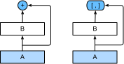
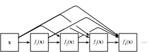

```{.python .input}
%load_ext d2lbook.tab
tab.interact_select(['mxnet', 'pytorch', 'tensorflow', 'jax'])
```

# 稠密连接网络（DenseNet）
:label:`sec_densenet`

ResNet极大地改变了人们对深度网络中函数参数化方式的看法。*DenseNet*（稠密卷积网络）在某种程度上是这种思想的合乎逻辑的延伸 :cite:`Huang.Liu.Van-Der-Maaten.ea.2017`。
DenseNet的特点在于其连接模式：每一层都与之前的所有层相连，
并且使用连结操作（而不是ResNet中的加法运算符）来保留和重用来自先前层的特征。
为了理解它是如何得到的，我们先绕道到数学中稍作停留。

```{.python .input}
%%tab mxnet
from d2l import mxnet as d2l
from mxnet import init, np, npx
from mxnet.gluon import nn
npx.set_np()
```

```{.python .input}
%%tab pytorch
from d2l import torch as d2l
import torch
from torch import nn
```

```{.python .input}
%%tab tensorflow
from d2l import tensorflow as d2l
import tensorflow as tf
```

```{.python .input}
%%tab jax
from d2l import jax as d2l
from flax import linen as nn
from jax import numpy as jnp
import jax
```

## 从ResNet到DenseNet

回想函数的泰勒展开。在$x = 0$处，它可以写成

$$f(x) = f(0) + x \cdot \left[f'(0) + x \cdot \left[\frac{f''(0)}{2!}  + x \cdot \left[\frac{f'''(0)}{3!}  + \cdots \right]\right]\right].$$


关键在于，它把一个函数分解为阶数越来越高的各项。类似地，ResNet把函数分解为

$$f(\mathbf{x}) = \mathbf{x} + g(\mathbf{x}).$$

也就是说，ResNet把$f$分解为一个简单的线性项和一个更复杂的非线性项。
如果我们想要捕捉（而不一定要相加）两项之外的信息，那会怎样？
DenseNet就是这样的解决方案之一 :cite:`Huang.Liu.Van-Der-Maaten.ea.2017`。


:label:`fig_densenet_block`

如 :numref:`fig_densenet_block` 所示，ResNet和DenseNet的关键区别在于，后者中的输出是*连结*（用$[,]$表示）而不是相加。
因此，我们对$\mathbf{x}$进行映射，得到依次应用越来越复杂的函数序列后它的值：

$$\mathbf{x} \to \left[
\mathbf{x},
f_1(\mathbf{x}),
f_2\left(\left[\mathbf{x}, f_1\left(\mathbf{x}\right)\right]\right), f_3\left(\left[\mathbf{x}, f_1\left(\mathbf{x}\right), f_2\left(\left[\mathbf{x}, f_1\left(\mathbf{x}\right)\right]\right)\right]\right), \ldots\right].$$

最后，所有这些函数在多层感知机中组合起来，以便再次减少特征的数量。就实现而言这相当简单：
我们不是把各项相加，而是把它们连结起来。DenseNet这一名称源于变量之间的依赖图变得相当稠密。这样一条链的最后一层与之前的所有层稠密相连。稠密连接如 :numref:`fig_densenet` 所示。


:label:`fig_densenet`

组成DenseNet的主要组件是*稠密块*（dense block）和*过渡层*（transition layer）。前者定义如何连结输入和输出，后者控制通道数使其不至于过大，
因为展开式 $\mathbf{x} \to \left[\mathbf{x}, f_1(\mathbf{x}),
f_2\left(\left[\mathbf{x}, f_1\left(\mathbf{x}\right)\right]\right), \ldots \right]$ 可能具有很高的维数。


## [**稠密块**]

DenseNet使用了ResNet改良版的“批量规范化、激活和卷积”结构（参见 :numref:`sec_resnet` 中的练习）。
首先，我们实现这个卷积块结构。

```{.python .input}
%%tab mxnet
def conv_block(num_channels):
    blk = nn.Sequential()
    blk.add(nn.BatchNorm(),
            nn.Activation('relu'),
            nn.Conv2D(num_channels, kernel_size=3, padding=1))
    return blk
```

```{.python .input}
%%tab pytorch
def conv_block(num_channels):
    return nn.Sequential(
        nn.LazyBatchNorm2d(), nn.ReLU(),
        nn.LazyConv2d(num_channels, kernel_size=3, padding=1))
```

```{.python .input}
%%tab tensorflow
class ConvBlock(tf.keras.layers.Layer):
    def __init__(self, num_channels):
        super(ConvBlock, self).__init__()
        self.bn = tf.keras.layers.BatchNormalization()
        self.relu = tf.keras.layers.ReLU()
        self.conv = tf.keras.layers.Conv2D(
            filters=num_channels, kernel_size=(3, 3), padding='same')

        self.listLayers = [self.bn, self.relu, self.conv]

    def call(self, x):
        y = x
        for layer in self.listLayers.layers:
            y = layer(y)
        y = tf.keras.layers.concatenate([x,y], axis=-1)
        return y
```

```{.python .input}
%%tab jax
class ConvBlock(nn.Module):
    num_channels: int
    training: bool = True

    @nn.compact
    def __call__(self, X):
        Y = nn.relu(nn.BatchNorm(not self.training)(X))
        Y = nn.Conv(self.num_channels, kernel_size=(3, 3), padding=(1, 1))(Y)
        Y = jnp.concatenate((X, Y), axis=-1)
        return Y
```

一个*稠密块*由多个卷积块组成，每个卷积块使用相同数量的输出通道。然而，在前向传播中，我们将每个卷积块的输入和输出在通道维上连结。延迟求值（lazy evaluation）使我们能够自动调整维数。

```{.python .input}
%%tab mxnet
class DenseBlock(nn.Block):
    def __init__(self, num_convs, num_channels):
        super().__init__()
        self.net = nn.Sequential()
        for _ in range(num_convs):
            self.net.add(conv_block(num_channels))

    def forward(self, X):
        for blk in self.net:
            Y = blk(X)
            # Concatenate input and output of each block along the channels
            X = np.concatenate((X, Y), axis=1)
        return X
```

```{.python .input}
%%tab pytorch
class DenseBlock(nn.Module):
    def __init__(self, num_convs, num_channels):
        super(DenseBlock, self).__init__()
        layer = []
        for i in range(num_convs):
            layer.append(conv_block(num_channels))
        self.net = nn.Sequential(*layer)

    def forward(self, X):
        for blk in self.net:
            Y = blk(X)
            # Concatenate input and output of each block along the channels
            X = torch.cat((X, Y), dim=1)
        return X
```

```{.python .input}
%%tab tensorflow
class DenseBlock(tf.keras.layers.Layer):
    def __init__(self, num_convs, num_channels):
        super(DenseBlock, self).__init__()
        self.listLayers = []
        for _ in range(num_convs):
            self.listLayers.append(ConvBlock(num_channels))

    def call(self, x):
        for layer in self.listLayers.layers:
            x = layer(x)
        return x
```

```{.python .input}
%%tab jax
class DenseBlock(nn.Module):
    num_convs: int
    num_channels: int
    training: bool = True

    def setup(self):
        layer = []
        for i in range(self.num_convs):
            layer.append(ConvBlock(self.num_channels, self.training))
        self.net = nn.Sequential(layer)

    def __call__(self, X):
        return self.net(X)
```

在下面的例子中，我们[**定义一个`DenseBlock`实例**]，它包含两个输出通道数为10的卷积块。
当使用有3个通道的输入时，我们将得到$3 + 10 + 10=23$个通道的输出。卷积块的通道数控制了输出通道数相对于输入通道数的增长。这也称为*增长率*（growth rate）。

```{.python .input}
%%tab pytorch, mxnet, tensorflow
blk = DenseBlock(2, 10)
if tab.selected('mxnet'):
    X = np.random.uniform(size=(4, 3, 8, 8))
    blk.initialize()
if tab.selected('pytorch'):
    X = torch.randn(4, 3, 8, 8)
if tab.selected('tensorflow'):
    X = tf.random.uniform((4, 8, 8, 3))
Y = blk(X)
Y.shape
```

```{.python .input}
%%tab jax
blk = DenseBlock(2, 10)
X = jnp.zeros((4, 8, 8, 3))
Y = blk.init_with_output(d2l.get_key(), X)[0]
Y.shape
```

## [**过渡层**]

由于每个稠密块都会增加通道数，添加过多稠密块会导致模型过于复杂。*过渡层*用于控制模型的复杂度。它通过$1\times 1$的卷积来减少通道数。此外，它通过步幅为2的平均汇聚将高度和宽度减半。

```{.python .input}
%%tab mxnet
def transition_block(num_channels):
    blk = nn.Sequential()
    blk.add(nn.BatchNorm(), nn.Activation('relu'),
            nn.Conv2D(num_channels, kernel_size=1),
            nn.AvgPool2D(pool_size=2, strides=2))
    return blk
```

```{.python .input}
%%tab pytorch
def transition_block(num_channels):
    return nn.Sequential(
        nn.LazyBatchNorm2d(), nn.ReLU(),
        nn.LazyConv2d(num_channels, kernel_size=1),
        nn.AvgPool2d(kernel_size=2, stride=2))
```

```{.python .input}
%%tab tensorflow
class TransitionBlock(tf.keras.layers.Layer):
    def __init__(self, num_channels, **kwargs):
        super(TransitionBlock, self).__init__(**kwargs)
        self.batch_norm = tf.keras.layers.BatchNormalization()
        self.relu = tf.keras.layers.ReLU()
        self.conv = tf.keras.layers.Conv2D(num_channels, kernel_size=1)
        self.avg_pool = tf.keras.layers.AvgPool2D(pool_size=2, strides=2)

    def call(self, x):
        x = self.batch_norm(x)
        x = self.relu(x)
        x = self.conv(x)
        return self.avg_pool(x)
```

```{.python .input}
%%tab jax
class TransitionBlock(nn.Module):
    num_channels: int
    training: bool = True

    @nn.compact
    def __call__(self, X):
        X = nn.BatchNorm(not self.training)(X)
        X = nn.relu(X)
        X = nn.Conv(self.num_channels, kernel_size=(1, 1))(X)
        X = nn.avg_pool(X, window_shape=(2, 2), strides=(2, 2))
        return X
```

对上一个例子中稠密块的输出[**应用一个通道数为10的过渡层**]。这会将输出通道数减少到10，并将高度和宽度减半。

```{.python .input}
%%tab mxnet
blk = transition_block(10)
blk.initialize()
blk(Y).shape
```

```{.python .input}
%%tab pytorch
blk = transition_block(10)
blk(Y).shape
```

```{.python .input}
%%tab tensorflow
blk = TransitionBlock(10)
blk(Y).shape
```

```{.python .input}
%%tab jax
blk = TransitionBlock(10)
blk.init_with_output(d2l.get_key(), Y)[0].shape
```

## [**DenseNet模型**]

接下来，我们将构造一个DenseNet模型。DenseNet首先使用与ResNet相同的单个卷积层和最大汇聚层。

```{.python .input}
%%tab pytorch, mxnet, tensorflow
class DenseNet(d2l.Classifier):
    def b1(self):
        if tab.selected('mxnet'):
            net = nn.Sequential()
            net.add(nn.Conv2D(64, kernel_size=7, strides=2, padding=3),
                nn.BatchNorm(), nn.Activation('relu'),
                nn.MaxPool2D(pool_size=3, strides=2, padding=1))
            return net
        if tab.selected('pytorch'):
            return nn.Sequential(
                nn.LazyConv2d(64, kernel_size=7, stride=2, padding=3),
                nn.LazyBatchNorm2d(), nn.ReLU(),
                nn.MaxPool2d(kernel_size=3, stride=2, padding=1))
        if tab.selected('tensorflow'):
            return tf.keras.models.Sequential([
                tf.keras.layers.Conv2D(
                    64, kernel_size=7, strides=2, padding='same'),
                tf.keras.layers.BatchNormalization(),
                tf.keras.layers.ReLU(),
                tf.keras.layers.MaxPool2D(
                    pool_size=3, strides=2, padding='same')])
```

```{.python .input}
%%tab jax
class DenseNet(d2l.Classifier):
    num_channels: int = 64
    growth_rate: int = 32
    arch: tuple = (4, 4, 4, 4)
    lr: float = 0.1
    num_classes: int = 10
    training: bool = True

    def setup(self):
        self.net = self.create_net()

    def b1(self):
        return nn.Sequential([
            nn.Conv(64, kernel_size=(7, 7), strides=(2, 2), padding='same'),
            nn.BatchNorm(not self.training),
            nn.relu,
            lambda x: nn.max_pool(x, window_shape=(3, 3),
                                  strides=(2, 2), padding='same')
        ])
```

然后，与ResNet使用四个由残差块组成的模块类似，
DenseNet使用四个稠密块。
与ResNet一样，我们可以设置每个稠密块中使用的卷积层数。这里我们将其设为4，与 :numref:`sec_resnet` 中的ResNet-18模型保持一致。此外，我们将稠密块中卷积层的通道数（即增长率）设为32，因此每个稠密块将增加128个通道。

在ResNet中，每个模块之间通过步幅为2的残差块来减小高度和宽度。这里，我们使用过渡层将高度和宽度减半，并将通道数减半。与ResNet类似，最后连接一个全局汇聚层和一个全连接层来产生输出。

```{.python .input}
%%tab pytorch, mxnet, tensorflow
@d2l.add_to_class(DenseNet)
def __init__(self, num_channels=64, growth_rate=32, arch=(4, 4, 4, 4),
             lr=0.1, num_classes=10):
    super(DenseNet, self).__init__()
    self.save_hyperparameters()
    if tab.selected('mxnet'):
        self.net = nn.Sequential()
        self.net.add(self.b1())
        for i, num_convs in enumerate(arch):
            self.net.add(DenseBlock(num_convs, growth_rate))
            # The number of output channels in the previous dense block
            num_channels += num_convs * growth_rate
            # A transition layer that halves the number of channels is added
            # between the dense blocks
            if i != len(arch) - 1:
                num_channels //= 2
                self.net.add(transition_block(num_channels))
        self.net.add(nn.BatchNorm(), nn.Activation('relu'),
                     nn.GlobalAvgPool2D(), nn.Dense(num_classes))
        self.net.initialize(init.Xavier())
    if tab.selected('pytorch'):
        self.net = nn.Sequential(self.b1())
        for i, num_convs in enumerate(arch):
            self.net.add_module(f'dense_blk{i+1}', DenseBlock(num_convs,
                                                              growth_rate))
            # The number of output channels in the previous dense block
            num_channels += num_convs * growth_rate
            # A transition layer that halves the number of channels is added
            # between the dense blocks
            if i != len(arch) - 1:
                num_channels //= 2
                self.net.add_module(f'tran_blk{i+1}', transition_block(
                    num_channels))
        self.net.add_module('last', nn.Sequential(
            nn.LazyBatchNorm2d(), nn.ReLU(),
            nn.AdaptiveAvgPool2d((1, 1)), nn.Flatten(),
            nn.LazyLinear(num_classes)))
        self.net.apply(d2l.init_cnn)
    if tab.selected('tensorflow'):
        self.net = tf.keras.models.Sequential(self.b1())
        for i, num_convs in enumerate(arch):
            self.net.add(DenseBlock(num_convs, growth_rate))
            # The number of output channels in the previous dense block
            num_channels += num_convs * growth_rate
            # A transition layer that halves the number of channels is added
            # between the dense blocks
            if i != len(arch) - 1:
                num_channels //= 2
                self.net.add(TransitionBlock(num_channels))
        self.net.add(tf.keras.models.Sequential([
            tf.keras.layers.BatchNormalization(),
            tf.keras.layers.ReLU(),
            tf.keras.layers.GlobalAvgPool2D(),
            tf.keras.layers.Flatten(),
            tf.keras.layers.Dense(num_classes)]))
```

```{.python .input}
%%tab jax
@d2l.add_to_class(DenseNet)
def create_net(self):
    net = self.b1()
    for i, num_convs in enumerate(self.arch):
        net.layers.extend([DenseBlock(num_convs, self.growth_rate,
                                      training=self.training)])
        # The number of output channels in the previous dense block
        num_channels = self.num_channels + (num_convs * self.growth_rate)
        # A transition layer that halves the number of channels is added
        # between the dense blocks
        if i != len(self.arch) - 1:
            num_channels //= 2
            net.layers.extend([TransitionBlock(num_channels,
                                               training=self.training)])
    net.layers.extend([
        nn.BatchNorm(not self.training),
        nn.relu,
        lambda x: nn.avg_pool(x, window_shape=x.shape[1:3],
                              strides=x.shape[1:3], padding='valid'),
        lambda x: x.reshape((x.shape[0], -1)),
        nn.Dense(self.num_classes)
    ])
    return net
```

## [**训练**]

由于这里使用的是更深的网络，本节中我们将把输入的高度和宽度从224减小到96，以简化计算。

```{.python .input}
%%tab mxnet, pytorch, jax
model = DenseNet(lr=0.01)
trainer = d2l.Trainer(max_epochs=10, num_gpus=1)
data = d2l.FashionMNIST(batch_size=128, resize=(96, 96))
trainer.fit(model, data)
```

```{.python .input}
%%tab tensorflow
trainer = d2l.Trainer(max_epochs=10)
data = d2l.FashionMNIST(batch_size=128, resize=(96, 96))
with d2l.try_gpu():
    model = DenseNet(lr=0.01)
    trainer.fit(model, data)
```

## 小结与讨论

组成DenseNet的主要组件是稠密块和过渡层。对于后者，在组合网络时我们需要保持维数可控，方法是添加再次缩减通道数的过渡层。
在跨层连接方面，与将输入和输出相加的ResNet不同，DenseNet在通道维上连结输入和输出。
尽管这些连结操作重用了特征从而获得了计算效率，
但遗憾的是，它们会导致大量的GPU内存消耗。
因此，
应用DenseNet可能需要更节省内存的实现，而这可能会增加训练时间 :cite:`pleiss2017memory`。


## 练习

1. 为什么我们在过渡层中使用平均汇聚而不是最大汇聚？
1. DenseNet论文中提到的一个优点是其模型参数比ResNet更少。为什么会出现这种情况？
1. DenseNet受到批评的一个问题是其内存消耗很高。
    1. 情况真的如此吗？尝试将输入形状改为$224\times 224$，通过实验比较实际的GPU内存消耗。
    1. 你能想到减少内存消耗的替代方法吗？你将需要如何修改框架？
1. 实现DenseNet论文表1中给出的各种DenseNet版本 :cite:`Huang.Liu.Van-Der-Maaten.ea.2017`。
1. 应用DenseNet的思想设计一个基于MLP的模型。将其应用于 :numref:`sec_kaggle_house` 中的房价预测任务。

:begin_tab:`mxnet`
[讨论](https://discuss.d2l.ai/t/87)
:end_tab:

:begin_tab:`pytorch`
[讨论](https://discuss.d2l.ai/t/88)
:end_tab:

:begin_tab:`tensorflow`
[讨论](https://discuss.d2l.ai/t/331)
:end_tab:

:begin_tab:`jax`
[讨论](https://discuss.d2l.ai/t/18008)
:end_tab:
