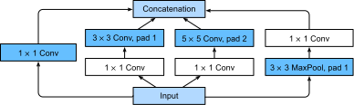
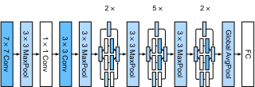

```{.python .input}
%load_ext d2lbook.tab
tab.interact_select(['mxnet', 'pytorch', 'tensorflow', 'jax'])
```

# 多分支网络（GoogLeNet）
:label:`sec_googlenet`

2014 年，*GoogLeNet* 在 ImageNet 挑战赛中夺冠 :cite:`Szegedy.Liu.Jia.ea.2015`，其结构结合了 NiN :cite:`Lin.Chen.Yan.2013` 的优势、重复块 :cite:`Simonyan.Zisserman.2014` 以及多种卷积核的混合。可以说，它也是第一个在卷积神经网络中清晰区分主干（stem，数据输入）、主体（body，数据处理）和头部（head，预测）的网络。此后，这种设计模式一直延续在深度网络的设计中：*主干*由对图像进行操作的前两三个卷积给出，它们从底层图像中提取低级特征；随后是由卷积块组成的*主体*；最后，*头部*将目前获得的特征映射到当前所需的分类、分割、检测或跟踪问题上。

GoogLeNet 的关键贡献在于网络主体的设计。它以巧妙的方式解决了选择卷积核的问题。其他工作试图确定从 $1 \times 1$ 到 $11 \times 11$ 的哪种卷积最好，而 GoogLeNet 只是将多分支卷积*连结*起来。
接下来，我们介绍一个稍作简化的 GoogLeNet 版本：原始设计包含许多通过中间损失函数来稳定训练的技巧，并将其应用于网络的多个层。
由于已有改进的训练算法，这些技巧不再必要。

```{.python .input}
%%tab mxnet
from d2l import mxnet as d2l
from mxnet import np, npx, init
from mxnet.gluon import nn
npx.set_np()
```

```{.python .input}
%%tab pytorch
from d2l import torch as d2l
import torch
from torch import nn
from torch.nn import functional as F
```

```{.python .input}
%%tab tensorflow
import tensorflow as tf
from d2l import tensorflow as d2l
```

```{.python .input}
%%tab jax
from d2l import jax as d2l
from flax import linen as nn
from jax import numpy as jnp
import jax
```

## (**Inception 块**)

GoogLeNet 中的基本卷积块称为 *Inception 块*，
得名于电影*Inception*（《盗梦空间》）中的流行语"我们需要更深入"（we need to go deeper）。


:label:`fig_inception`

如 :numref:`fig_inception` 所示，
Inception 块由四个并行分支组成。
前三个分支使用窗口大小分别为 $1\times 1$、$3\times 3$ 和 $5\times 5$
的卷积层，以从不同的空间尺寸中提取信息。
中间两个分支还会对输入添加一个 $1\times 1$ 卷积，
以减少通道数，从而降低模型的复杂度。
第四个分支使用一个 $3\times 3$ 最大汇聚层，
随后是一个 $1\times 1$ 卷积层
以改变通道数。
四个分支都使用适当的填充，使输入和输出具有相同的高度和宽度。
最后，每个分支的输出沿通道维度连结起来，
构成该块的输出。
Inception 块中通常需要调整的超参数
是每层的输出通道数，即如何在不同尺寸的卷积之间分配容量。

```{.python .input}
%%tab mxnet
class Inception(nn.Block):
    # c1--c4 are the number of output channels for each branch
    def __init__(self, c1, c2, c3, c4, **kwargs):
        super(Inception, self).__init__(**kwargs)
        # Branch 1
        self.b1_1 = nn.Conv2D(c1, kernel_size=1, activation='relu')
        # Branch 2
        self.b2_1 = nn.Conv2D(c2[0], kernel_size=1, activation='relu')
        self.b2_2 = nn.Conv2D(c2[1], kernel_size=3, padding=1,
                              activation='relu')
        # Branch 3
        self.b3_1 = nn.Conv2D(c3[0], kernel_size=1, activation='relu')
        self.b3_2 = nn.Conv2D(c3[1], kernel_size=5, padding=2,
                              activation='relu')
        # Branch 4
        self.b4_1 = nn.MaxPool2D(pool_size=3, strides=1, padding=1)
        self.b4_2 = nn.Conv2D(c4, kernel_size=1, activation='relu')

    def forward(self, x):
        b1 = self.b1_1(x)
        b2 = self.b2_2(self.b2_1(x))
        b3 = self.b3_2(self.b3_1(x))
        b4 = self.b4_2(self.b4_1(x))
        return np.concatenate((b1, b2, b3, b4), axis=1)
```

```{.python .input}
%%tab pytorch
class Inception(nn.Module):
    # c1--c4 are the number of output channels for each branch
    def __init__(self, c1, c2, c3, c4, **kwargs):
        super(Inception, self).__init__(**kwargs)
        # Branch 1
        self.b1_1 = nn.LazyConv2d(c1, kernel_size=1)
        # Branch 2
        self.b2_1 = nn.LazyConv2d(c2[0], kernel_size=1)
        self.b2_2 = nn.LazyConv2d(c2[1], kernel_size=3, padding=1)
        # Branch 3
        self.b3_1 = nn.LazyConv2d(c3[0], kernel_size=1)
        self.b3_2 = nn.LazyConv2d(c3[1], kernel_size=5, padding=2)
        # Branch 4
        self.b4_1 = nn.MaxPool2d(kernel_size=3, stride=1, padding=1)
        self.b4_2 = nn.LazyConv2d(c4, kernel_size=1)

    def forward(self, x):
        b1 = F.relu(self.b1_1(x))
        b2 = F.relu(self.b2_2(F.relu(self.b2_1(x))))
        b3 = F.relu(self.b3_2(F.relu(self.b3_1(x))))
        b4 = F.relu(self.b4_2(self.b4_1(x)))
        return torch.cat((b1, b2, b3, b4), dim=1)
```

```{.python .input}
%%tab tensorflow
class Inception(tf.keras.Model):
    # c1--c4 are the number of output channels for each branch
    def __init__(self, c1, c2, c3, c4):
        super().__init__()
        self.b1_1 = tf.keras.layers.Conv2D(c1, 1, activation='relu')
        self.b2_1 = tf.keras.layers.Conv2D(c2[0], 1, activation='relu')
        self.b2_2 = tf.keras.layers.Conv2D(c2[1], 3, padding='same',
                                           activation='relu')
        self.b3_1 = tf.keras.layers.Conv2D(c3[0], 1, activation='relu')
        self.b3_2 = tf.keras.layers.Conv2D(c3[1], 5, padding='same',
                                           activation='relu')
        self.b4_1 = tf.keras.layers.MaxPool2D(3, 1, padding='same')
        self.b4_2 = tf.keras.layers.Conv2D(c4, 1, activation='relu')

    def call(self, x):
        b1 = self.b1_1(x)
        b2 = self.b2_2(self.b2_1(x))
        b3 = self.b3_2(self.b3_1(x))
        b4 = self.b4_2(self.b4_1(x))
        return tf.keras.layers.Concatenate()([b1, b2, b3, b4])
```

```{.python .input}
%%tab jax
class Inception(nn.Module):
    # `c1`--`c4` are the number of output channels for each branch
    c1: int
    c2: tuple
    c3: tuple
    c4: int

    def setup(self):
        # Branch 1
        self.b1_1 = nn.Conv(self.c1, kernel_size=(1, 1))
        # Branch 2
        self.b2_1 = nn.Conv(self.c2[0], kernel_size=(1, 1))
        self.b2_2 = nn.Conv(self.c2[1], kernel_size=(3, 3), padding='same')
        # Branch 3
        self.b3_1 = nn.Conv(self.c3[0], kernel_size=(1, 1))
        self.b3_2 = nn.Conv(self.c3[1], kernel_size=(5, 5), padding='same')
        # Branch 4
        self.b4_1 = lambda x: nn.max_pool(x, window_shape=(3, 3),
                                          strides=(1, 1), padding='same')
        self.b4_2 = nn.Conv(self.c4, kernel_size=(1, 1))

    def __call__(self, x):
        b1 = nn.relu(self.b1_1(x))
        b2 = nn.relu(self.b2_2(nn.relu(self.b2_1(x))))
        b3 = nn.relu(self.b3_2(nn.relu(self.b3_1(x))))
        b4 = nn.relu(self.b4_2(self.b4_1(x)))
        return jnp.concatenate((b1, b2, b3, b4), axis=-1)
```

为了直观理解这个网络为何效果如此好，
可以考察滤波器的组合。
它们以多种滤波器尺寸探索图像。
这意味着不同范围上的细节
可以被不同尺寸的滤波器高效识别。
同时，我们可以为不同滤波器
分配不同数量的参数。

## [**GoogLeNet 模型**]

如 :numref:`fig_inception_full` 所示，GoogLeNet 使用一个由总共 9 个 Inception 块组成的堆叠，这些块被排列成三组，组间使用最大汇聚，
并在其头部使用全局平均汇聚来生成估计值。
Inception 块之间的最大汇聚降低了维数。
在其主干中，第一个模块类似于 AlexNet 和 LeNet。


:label:`fig_inception_full`

现在我们可以逐个部分地实现 GoogLeNet。首先从主干开始。
第一个模块使用一个 64 通道的 $7\times 7$ 卷积层。

```{.python .input}
%%tab pytorch, mxnet, tensorflow
class GoogleNet(d2l.Classifier):
    def b1(self):
        if tab.selected('mxnet'):
            net = nn.Sequential()
            net.add(nn.Conv2D(64, kernel_size=7, strides=2, padding=3,
                              activation='relu'),
                    nn.MaxPool2D(pool_size=3, strides=2, padding=1))
            return net
        if tab.selected('pytorch'):
            return nn.Sequential(
                nn.LazyConv2d(64, kernel_size=7, stride=2, padding=3),
                nn.ReLU(), nn.MaxPool2d(kernel_size=3, stride=2, padding=1))
        if tab.selected('tensorflow'):
            return tf.keras.models.Sequential([
                tf.keras.layers.Conv2D(64, 7, strides=2, padding='same',
                                       activation='relu'),
                tf.keras.layers.MaxPool2D(pool_size=3, strides=2,
                                          padding='same')])
```

```{.python .input}
%%tab jax
class GoogleNet(d2l.Classifier):
    lr: float = 0.1
    num_classes: int = 10

    def setup(self):
        self.net = nn.Sequential([self.b1(), self.b2(), self.b3(), self.b4(),
                                  self.b5(), nn.Dense(self.num_classes)])

    def b1(self):
        return nn.Sequential([
                nn.Conv(64, kernel_size=(7, 7), strides=(2, 2), padding='same'),
                nn.relu,
                lambda x: nn.max_pool(x, window_shape=(3, 3), strides=(2, 2),
                                      padding='same')])
```

第二个模块使用两个卷积层：
首先是一个 64 通道的 $1\times 1$ 卷积层，
接着是一个 $3\times 3$ 卷积层，它将通道数增加为三倍。这对应于 Inception 块中的第二个分支，并结束了主体的设计。此时我们有 192 个通道。

```{.python .input}
%%tab all
@d2l.add_to_class(GoogleNet)
def b2(self):
    if tab.selected('mxnet'):
        net = nn.Sequential()
        net.add(nn.Conv2D(64, kernel_size=1, activation='relu'),
               nn.Conv2D(192, kernel_size=3, padding=1, activation='relu'),
               nn.MaxPool2D(pool_size=3, strides=2, padding=1))
        return net
    if tab.selected('pytorch'):
        return nn.Sequential(
            nn.LazyConv2d(64, kernel_size=1), nn.ReLU(),
            nn.LazyConv2d(192, kernel_size=3, padding=1), nn.ReLU(),
            nn.MaxPool2d(kernel_size=3, stride=2, padding=1))
    if tab.selected('tensorflow'):
        return tf.keras.Sequential([
            tf.keras.layers.Conv2D(64, 1, activation='relu'),
            tf.keras.layers.Conv2D(192, 3, padding='same', activation='relu'),
            tf.keras.layers.MaxPool2D(pool_size=3, strides=2, padding='same')])
    if tab.selected('jax'):
        return nn.Sequential([nn.Conv(64, kernel_size=(1, 1)),
                              nn.relu,
                              nn.Conv(192, kernel_size=(3, 3), padding='same'),
                              nn.relu,
                              lambda x: nn.max_pool(x, window_shape=(3, 3),
                                                    strides=(2, 2),
                                                    padding='same')])
```

第三个模块串联两个完整的 Inception 块。
第一个 Inception 块的输出通道数为
$64+128+32+32=256$。这相当于
四个分支的输出通道数之比
为 $2:4:1:1$。为了实现这一点，我们首先在第二和第三个分支中分别将输入
维数减少 $\frac{1}{2}$ 和 $\frac{1}{12}$，
分别得到 $96 = 192/2$ 和 $16 = 192/12$ 个通道。

第二个 Inception 块的输出通道数
增加到 $128+192+96+64=480$，得到比率 $128:192:96:64 = 4:6:3:2$。和之前一样，
我们需要减少第二和第三个分支中的中间维数。
分别使用 $\frac{1}{2}$ 和 $\frac{1}{8}$ 的比例就足够了，分别得到 $128$ 和 $32$ 个通道。
这体现在下面 `Inception` 块构造函数的参数中。

```{.python .input}
%%tab all
@d2l.add_to_class(GoogleNet)
def b3(self):
    if tab.selected('mxnet'):
        net = nn.Sequential()
        net.add(Inception(64, (96, 128), (16, 32), 32),
               Inception(128, (128, 192), (32, 96), 64),
               nn.MaxPool2D(pool_size=3, strides=2, padding=1))
        return net
    if tab.selected('pytorch'):
        return nn.Sequential(Inception(64, (96, 128), (16, 32), 32),
                             Inception(128, (128, 192), (32, 96), 64),
                             nn.MaxPool2d(kernel_size=3, stride=2, padding=1))
    if tab.selected('tensorflow'):
        return tf.keras.models.Sequential([
            Inception(64, (96, 128), (16, 32), 32),
            Inception(128, (128, 192), (32, 96), 64),
            tf.keras.layers.MaxPool2D(pool_size=3, strides=2, padding='same')])
    if tab.selected('jax'):
        return nn.Sequential([Inception(64, (96, 128), (16, 32), 32),
                              Inception(128, (128, 192), (32, 96), 64),
                              lambda x: nn.max_pool(x, window_shape=(3, 3),
                                                    strides=(2, 2),
                                                    padding='same')])
```

第四个模块更为复杂。
它串联五个 Inception 块，
它们的输出通道数分别为
$192+208+48+64=512$、$160+224+64+64=512$、
$128+256+64+64=512$、$112+288+64+64=528$，
以及 $256+320+128+128=832$。
分配给这些分支的通道数与第三个模块类似：
带有 $3\times 3$ 卷积层的第二个分支
输出的通道数最多，
其次是只有 $1\times 1$ 卷积层的第一个分支、
带有 $5\times 5$ 卷积层的第三个分支，
以及带有 $3\times 3$ 最大汇聚层的第四个分支。
第二和第三个分支将首先根据比例
减少通道数。
这些比例在不同的 Inception 块中略有不同。

```{.python .input}
%%tab all
@d2l.add_to_class(GoogleNet)
def b4(self):
    if tab.selected('mxnet'):
        net = nn.Sequential()
        net.add(Inception(192, (96, 208), (16, 48), 64),
                Inception(160, (112, 224), (24, 64), 64),
                Inception(128, (128, 256), (24, 64), 64),
                Inception(112, (144, 288), (32, 64), 64),
                Inception(256, (160, 320), (32, 128), 128),
                nn.MaxPool2D(pool_size=3, strides=2, padding=1))
        return net
    if tab.selected('pytorch'):
        return nn.Sequential(Inception(192, (96, 208), (16, 48), 64),
                             Inception(160, (112, 224), (24, 64), 64),
                             Inception(128, (128, 256), (24, 64), 64),
                             Inception(112, (144, 288), (32, 64), 64),
                             Inception(256, (160, 320), (32, 128), 128),
                             nn.MaxPool2d(kernel_size=3, stride=2, padding=1))
    if tab.selected('tensorflow'):
        return tf.keras.Sequential([
            Inception(192, (96, 208), (16, 48), 64),
            Inception(160, (112, 224), (24, 64), 64),
            Inception(128, (128, 256), (24, 64), 64),
            Inception(112, (144, 288), (32, 64), 64),
            Inception(256, (160, 320), (32, 128), 128),
            tf.keras.layers.MaxPool2D(pool_size=3, strides=2, padding='same')])
    if tab.selected('jax'):
        return nn.Sequential([Inception(192, (96, 208), (16, 48), 64),
                              Inception(160, (112, 224), (24, 64), 64),
                              Inception(128, (128, 256), (24, 64), 64),
                              Inception(112, (144, 288), (32, 64), 64),
                              Inception(256, (160, 320), (32, 128), 128),
                              lambda x: nn.max_pool(x, window_shape=(3, 3),
                                                    strides=(2, 2),
                                                    padding='same')])
```

第五个模块有两个 Inception 块，输出通道数分别为
$256+320+128+128=832$
和 $384+384+128+128=1024$。
分配给每个分支的通道数
与第三和第四个模块相同，
但具体数值不同。
需要注意的是，第五个块之后是输出层。
这个块使用全局平均汇聚层
将每个通道的高度和宽度变为 1，就像 NiN 中一样。
最后，我们将输出转换为二维数组，
随后是一个全连接层，
其输出数量为标签类别数。

```{.python .input}
%%tab all
@d2l.add_to_class(GoogleNet)
def b5(self):
    if tab.selected('mxnet'):
        net = nn.Sequential()
        net.add(Inception(256, (160, 320), (32, 128), 128),
                Inception(384, (192, 384), (48, 128), 128),
                nn.GlobalAvgPool2D())
        return net
    if tab.selected('pytorch'):
        return nn.Sequential(Inception(256, (160, 320), (32, 128), 128),
                             Inception(384, (192, 384), (48, 128), 128),
                             nn.AdaptiveAvgPool2d((1,1)), nn.Flatten())
    if tab.selected('tensorflow'):
        return tf.keras.Sequential([
            Inception(256, (160, 320), (32, 128), 128),
            Inception(384, (192, 384), (48, 128), 128),
            tf.keras.layers.GlobalAvgPool2D(),
            tf.keras.layers.Flatten()])
    if tab.selected('jax'):
        return nn.Sequential([Inception(256, (160, 320), (32, 128), 128),
                              Inception(384, (192, 384), (48, 128), 128),
                              # Flax does not provide a GlobalAvgPool2D layer
                              lambda x: nn.avg_pool(x,
                                                    window_shape=x.shape[1:3],
                                                    strides=x.shape[1:3],
                                                    padding='valid'),
                              lambda x: x.reshape((x.shape[0], -1))])
```

既然我们定义了从 `b1` 到 `b5` 的所有块，剩下的就只是将它们全部组装成一个完整的网络。

```{.python .input}
%%tab pytorch, mxnet, tensorflow
@d2l.add_to_class(GoogleNet)
def __init__(self, lr=0.1, num_classes=10):
    super(GoogleNet, self).__init__()
    self.save_hyperparameters()
    if tab.selected('mxnet'):
        self.net = nn.Sequential()
        self.net.add(self.b1(), self.b2(), self.b3(), self.b4(), self.b5(),
                     nn.Dense(num_classes))
        self.net.initialize(init.Xavier())
    if tab.selected('pytorch'):
        self.net = nn.Sequential(self.b1(), self.b2(), self.b3(), self.b4(),
                                 self.b5(), nn.LazyLinear(num_classes))
        self.net.apply(d2l.init_cnn)
    if tab.selected('tensorflow'):
        self.net = tf.keras.Sequential([
            self.b1(), self.b2(), self.b3(), self.b4(), self.b5(),
            tf.keras.layers.Dense(num_classes)])
```

GoogLeNet 模型的计算很复杂。请注意其中大量的
相对随意的超参数，包括所选通道数、降维之前的块数、通道之间容量的相对划分等。这在很大程度上是由于
在 GoogLeNet 被提出时，用于网络定义或设计探索的自动工具
尚不可用。例如，如今我们理所当然地认为，一个合格的深度学习框架能够自动推断输入张量的维数。当时，许多这样的配置必须由实验者显式指定，因而常常拖慢主动实验。此外，自动探索所需的工具仍在不断变化，初始实验在很大程度上相当于代价高昂的暴力探索、遗传算法和类似策略。

目前我们唯一要做的修改是
[**将输入的高度和宽度从 224 减少到 96，
以便在 Fashion-MNIST 上有合理的训练时间。**]
这简化了计算。让我们看看
各模块之间输出形状的变化。

```{.python .input}
%%tab mxnet, pytorch
model = GoogleNet().layer_summary((1, 1, 96, 96))
```

```{.python .input}
%%tab tensorflow, jax
model = GoogleNet().layer_summary((1, 96, 96, 1))
```

## [**训练**]

和之前一样，我们使用 Fashion-MNIST 数据集训练模型。
在调用训练过程之前，
我们将其转换为 $96 \times 96$ 像素分辨率。

```{.python .input}
%%tab mxnet, pytorch, jax
model = GoogleNet(lr=0.01)
trainer = d2l.Trainer(max_epochs=10, num_gpus=1)
data = d2l.FashionMNIST(batch_size=128, resize=(96, 96))
if tab.selected('pytorch'):
    model.apply_init([next(iter(data.get_dataloader(True)))[0]], d2l.init_cnn)
trainer.fit(model, data)
```

```{.python .input}
%%tab tensorflow
trainer = d2l.Trainer(max_epochs=10)
data = d2l.FashionMNIST(batch_size=128, resize=(96, 96))
with d2l.try_gpu():
    model = GoogleNet(lr=0.01)
    trainer.fit(model, data)
```

## 讨论

GoogLeNet 的一个关键特征是，它实际上比其前身计算起来*更便宜*，
同时提供了更高的准确率。这标志着更加深思熟虑的
网络设计的开始——这种设计在评估网络的成本与误差降低之间进行权衡。它也标志着在块级别上对网络设计超参数进行实验的开始，尽管当时这完全是手工进行的。当在 :numref:`sec_cnn-design` 中讨论网络结构探索策略时，我们将重新审视这个主题。

在接下来的几节中，我们会遇到许多设计选择（例如批量规范化、残差连接和通道分组），它们使我们能够显著改进网络。现在，你可以为自己实现了可以说是第一个真正现代的卷积神经网络而感到自豪。

## 练习

1. GoogLeNet 非常成功，以至于经历了多次迭代，逐步提高了速度和准确率。尝试实现并运行其中的一些版本。它们包括以下内容：
    1. 添加批量规范化层 :cite:`Ioffe.Szegedy.2015`，如后文 :numref:`sec_batch_norm` 所述。
    1. 对 Inception 块进行调整（宽度、卷积的选择和顺序），如 :citet:`Szegedy.Vanhoucke.Ioffe.ea.2016` 所述。
    1. 使用标签平滑进行模型正则化，如 :citet:`Szegedy.Vanhoucke.Ioffe.ea.2016` 所述。
    1. 通过添加残差连接 :cite:`Szegedy.Ioffe.Vanhoucke.ea.2017` 对 Inception 块作进一步调整，如后文 :numref:`sec_resnet` 所述。
1. GoogLeNet 工作所需的最小图像尺寸是多少？
1. 你能设计一个适用于 Fashion-MNIST 原始分辨率 $28 \times 28$ 像素的 GoogLeNet 变体吗？如果需要，你将如何改变网络的主干、主体和头部？
1. 比较 AlexNet、VGG、NiN 和 GoogLeNet 的模型参数规模。后两种网络
   架构是如何显著减少模型参数规模的？
1. 比较 GoogLeNet 和 AlexNet 所需的计算量。这如何影响加速器芯片的设计，例如在内存大小、内存带宽、缓存大小、计算量以及专用操作的优势方面？

:begin_tab:`mxnet`
[讨论](https://discuss.d2l.ai/t/81)
:end_tab:

:begin_tab:`pytorch`
[讨论](https://discuss.d2l.ai/t/82)
:end_tab:

:begin_tab:`tensorflow`
[讨论](https://discuss.d2l.ai/t/316)
:end_tab:

:begin_tab:`jax`
[讨论](https://discuss.d2l.ai/t/18004)
:end_tab:
