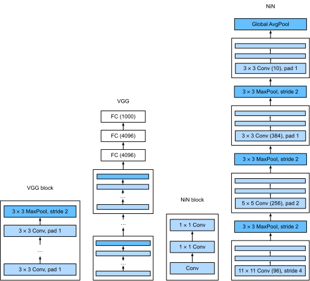

```{.python .input}
%load_ext d2lbook.tab
tab.interact_select(['mxnet', 'pytorch', 'tensorflow', 'jax'])
```

# 网络中的网络（NiN）
:label:`sec_nin`

LeNet、AlexNet 和 VGG 都有一个共同的设计模式：
通过一系列卷积层和汇聚层提取利用*空间*结构的特征，
再通过全连接层对表示进行后处理。
AlexNet 和 VGG 对 LeNet 的改进主要在于，
这些后续网络如何加宽和加深这两个模块。

这种设计带来了两个主要挑战。
第一，架构末端的全连接层消耗了数量惊人的参数。例如，即使
像 VGG-11 这样简单的模型，也需要一个巨大的矩阵，在单精度（FP32）下占用近
400MB 的内存。这对计算是一个重大障碍，尤其是在
移动和嵌入式设备上。毕竟，即使是高端手机，内存也不超过 8GB。而在 VGG 被发明时，这个数字还要少一个数量级（iPhone 4S 只有 512MB）。因此，很难有正当理由将大部分内存花在一个图像分类器上。

第二，同样不可能在网络更早的位置添加全连接层
来增加非线性程度：这样做会破坏
空间结构，并可能需要更多的内存。

*网络中的网络*（network in network，*NiN*）块 :cite:`Lin.Chen.Yan.2013` 提供了一种替代方案，
能够用一种简单的策略同时解决这两个问题。
它们基于一个非常简单的洞见提出：（i）使用 $1 \times 1$ 卷积在通道激活之间添加
局部非线性；（ii）使用全局平均汇聚来整合最后一个表示层中
所有位置的信息。请注意，如果没有添加的非线性，
全局平均汇聚就不会有效。下面我们详细探讨这一点。

```{.python .input}
%%tab mxnet
from d2l import mxnet as d2l
from mxnet import np, npx, init
from mxnet.gluon import nn
npx.set_np()
```

```{.python .input}
%%tab pytorch
from d2l import torch as d2l
import torch
from torch import nn
```

```{.python .input}
%%tab tensorflow
import tensorflow as tf
from d2l import tensorflow as d2l
```

```{.python .input}
%%tab jax
from d2l import jax as d2l
from flax import linen as nn
import jax
from jax import numpy as jnp
```

## (**NiN 块**)

回想 :numref:`subsec_1x1`。在那一节中我们说过，卷积层的输入和输出
由四维张量组成，其轴
分别对应样例、通道、高度和宽度。
还回想一下，全连接层的输入和输出
通常是二维张量，分别对应样例和特征。
NiN 背后的思想是在每个像素位置（对每个高度和宽度）
应用一个全连接层。
由此得到的 $1 \times 1$ 卷积可以看作
是在每个像素位置上独立作用的一个全连接层。

:numref:`fig_nin` 说明了 VGG 与 NiN 之间的主要结构
差异，以及它们各自的块。
请注意 NiN 块中的差异（初始卷积之后是 $1 \times 1$ 卷积，而 VGG 保留 $3 \times 3$ 卷积），以及末尾我们不再需要巨大全连接层这一差异。


:width:`600px`
:label:`fig_nin`

```{.python .input}
%%tab mxnet
def nin_block(num_channels, kernel_size, strides, padding):
    blk = nn.Sequential()
    blk.add(nn.Conv2D(num_channels, kernel_size, strides, padding,
                      activation='relu'),
            nn.Conv2D(num_channels, kernel_size=1, activation='relu'),
            nn.Conv2D(num_channels, kernel_size=1, activation='relu'))
    return blk
```

```{.python .input}
%%tab pytorch
def nin_block(out_channels, kernel_size, strides, padding):
    return nn.Sequential(
        nn.LazyConv2d(out_channels, kernel_size, strides, padding), nn.ReLU(),
        nn.LazyConv2d(out_channels, kernel_size=1), nn.ReLU(),
        nn.LazyConv2d(out_channels, kernel_size=1), nn.ReLU())
```

```{.python .input}
%%tab tensorflow
def nin_block(out_channels, kernel_size, strides, padding):
    return tf.keras.models.Sequential([
    tf.keras.layers.Conv2D(out_channels, kernel_size, strides=strides,
                           padding=padding),
    tf.keras.layers.Activation('relu'),
    tf.keras.layers.Conv2D(out_channels, 1),
    tf.keras.layers.Activation('relu'),
    tf.keras.layers.Conv2D(out_channels, 1),
    tf.keras.layers.Activation('relu')])
```

```{.python .input}
%%tab jax
def nin_block(out_channels, kernel_size, strides, padding):
    return nn.Sequential([
        nn.Conv(out_channels, kernel_size, strides, padding),
        nn.relu,
        nn.Conv(out_channels, kernel_size=(1, 1)), nn.relu,
        nn.Conv(out_channels, kernel_size=(1, 1)), nn.relu])
```

## [**NiN 模型**]

NiN 使用与 AlexNet 相同的初始卷积尺寸（它是在 AlexNet 之后不久提出的）。
核尺寸分别为 $11\times 11$、$5\times 5$ 和 $3\times 3$，
输出通道数与 AlexNet 相同。每个 NiN 块后面都跟着一个
步幅为 2、窗口形状为 $3\times 3$ 的最大汇聚层。

NiN 与 AlexNet、VGG 的第二个显著差异
在于，NiN 完全避免了全连接层。
取而代之的是，NiN 使用一个输出通道数等于标签类别数的 NiN 块，随后是一个*全局*平均汇聚层，
得到一个 logit 向量。
这种设计显著减少了所需的模型参数数量，尽管可能要以训练时间增加为代价。

```{.python .input}
%%tab pytorch, mxnet, tensorflow
class NiN(d2l.Classifier):
    def __init__(self, lr=0.1, num_classes=10):
        super().__init__()
        self.save_hyperparameters()
        if tab.selected('mxnet'):
            self.net = nn.Sequential()
            self.net.add(
                nin_block(96, kernel_size=11, strides=4, padding=0),
                nn.MaxPool2D(pool_size=3, strides=2),
                nin_block(256, kernel_size=5, strides=1, padding=2),
                nn.MaxPool2D(pool_size=3, strides=2),
                nin_block(384, kernel_size=3, strides=1, padding=1),
                nn.MaxPool2D(pool_size=3, strides=2),
                nn.Dropout(0.5),
                nin_block(num_classes, kernel_size=3, strides=1, padding=1),
                nn.GlobalAvgPool2D(),
                nn.Flatten())
            self.net.initialize(init.Xavier())
        if tab.selected('pytorch'):
            self.net = nn.Sequential(
                nin_block(96, kernel_size=11, strides=4, padding=0),
                nn.MaxPool2d(3, stride=2),
                nin_block(256, kernel_size=5, strides=1, padding=2),
                nn.MaxPool2d(3, stride=2),
                nin_block(384, kernel_size=3, strides=1, padding=1),
                nn.MaxPool2d(3, stride=2),
                nn.Dropout(0.5),
                nin_block(num_classes, kernel_size=3, strides=1, padding=1),
                nn.AdaptiveAvgPool2d((1, 1)),
                nn.Flatten())
            self.net.apply(d2l.init_cnn)
        if tab.selected('tensorflow'):
            self.net = tf.keras.models.Sequential([
                nin_block(96, kernel_size=11, strides=4, padding='valid'),
                tf.keras.layers.MaxPool2D(pool_size=3, strides=2),
                nin_block(256, kernel_size=5, strides=1, padding='same'),
                tf.keras.layers.MaxPool2D(pool_size=3, strides=2),
                nin_block(384, kernel_size=3, strides=1, padding='same'),
                tf.keras.layers.MaxPool2D(pool_size=3, strides=2),
                tf.keras.layers.Dropout(0.5),
                nin_block(num_classes, kernel_size=3, strides=1, padding='same'),
                tf.keras.layers.GlobalAvgPool2D(),
                tf.keras.layers.Flatten()])
```

```{.python .input}
%%tab jax
class NiN(d2l.Classifier):
    lr: float = 0.1
    num_classes = 10
    training: bool = True

    def setup(self):
        self.net = nn.Sequential([
            nin_block(96, kernel_size=(11, 11), strides=(4, 4), padding=(0, 0)),
            lambda x: nn.max_pool(x, (3, 3), strides=(2, 2)),
            nin_block(256, kernel_size=(5, 5), strides=(1, 1), padding=(2, 2)),
            lambda x: nn.max_pool(x, (3, 3), strides=(2, 2)),
            nin_block(384, kernel_size=(3, 3), strides=(1, 1), padding=(1, 1)),
            lambda x: nn.max_pool(x, (3, 3), strides=(2, 2)),
            nn.Dropout(0.5, deterministic=not self.training),
            nin_block(self.num_classes, kernel_size=(3, 3), strides=1, padding=(1, 1)),
            lambda x: nn.avg_pool(x, (5, 5)),  # global avg pooling
            lambda x: x.reshape((x.shape[0], -1))  # flatten
        ])
```

我们创建一个数据样例来查看[**每个块的输出形状**]。

```{.python .input}
%%tab mxnet, pytorch
NiN().layer_summary((1, 1, 224, 224))
```

```{.python .input}
%%tab tensorflow
NiN().layer_summary((1, 224, 224, 1))
```

```{.python .input}
%%tab jax
NiN(training=False).layer_summary((1, 224, 224, 1))
```

## [**训练**]

和之前一样，我们使用 Fashion-MNIST 来训练模型，所用
优化器与训练 AlexNet 和 VGG 时相同。

```{.python .input}
%%tab mxnet, pytorch, jax
model = NiN(lr=0.05)
trainer = d2l.Trainer(max_epochs=10, num_gpus=1)
data = d2l.FashionMNIST(batch_size=128, resize=(224, 224))
if tab.selected('pytorch'):
    model.apply_init([next(iter(data.get_dataloader(True)))[0]], d2l.init_cnn)
trainer.fit(model, data)
```

```{.python .input}
%%tab tensorflow
trainer = d2l.Trainer(max_epochs=10)
data = d2l.FashionMNIST(batch_size=128, resize=(224, 224))
with d2l.try_gpu():
    model = NiN(lr=0.05)
    trainer.fit(model, data)
```

## 小结

NiN 的参数数量远少于 AlexNet 和 VGG。这主要源于它不需要巨大的全连接层。相反，它在网络主体的最后一个阶段之后使用全局平均汇聚来聚合所有图像位置的信息。这消除了昂贵的（可学习的）降维操作的必要性，并用简单的平均取而代之。当时令研究者惊讶的是，这种平均操作并没有损害准确率。请注意，对低分辨率（具有许多通道）的表示进行平均，还增加了网络所能处理的平移不变性。

少用宽核卷积、改用 $1 \times 1$ 卷积，进一步有助于减少参数。在每个给定位置上，它都能在通道之间提供相当程度的非线性。$1 \times 1$ 卷积和全局平均汇聚都对后来的卷积神经网络设计产生了重大影响。

## 练习

1. 为什么每个 NiN 块中有两个 $1\times 1$ 卷积层？将其数量增加到三个。再将其数量减少到一个。会发生什么变化？
1. 如果将 $1 \times 1$ 卷积替换为 $3 \times 3$ 卷积，会发生什么变化？
1. 如果将全局平均汇聚替换为全连接层，会发生什么（速度、准确率、参数数量）？
1. 计算 NiN 的资源使用情况。
    1. 参数数量是多少？
    1. 计算量是多少？
    1. 训练时需要多少内存？
    1. 预测时需要多少内存？
1. 一步将 $384 \times 5 \times 5$ 的表示缩减为 $10 \times 5 \times 5$ 的表示，可能出现什么问题？
1. 借鉴 VGG 中造就 VGG-11、VGG-16 和 VGG-19 的结构设计决策，设计一族类似 NiN 的网络。

:begin_tab:`mxnet`
[讨论](https://discuss.d2l.ai/t/79)
:end_tab:

:begin_tab:`pytorch`
[讨论](https://discuss.d2l.ai/t/80)
:end_tab:

:begin_tab:`jax`
[讨论](https://discuss.d2l.ai/t/18003)
:end_tab:
