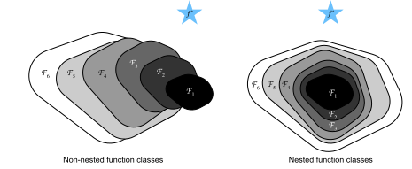
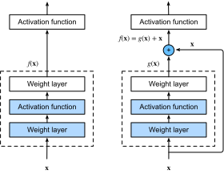
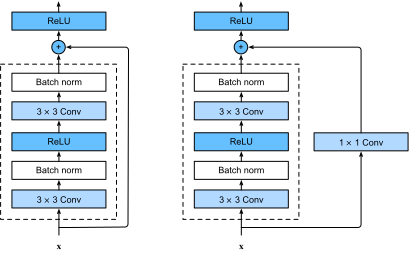
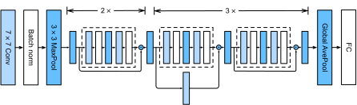
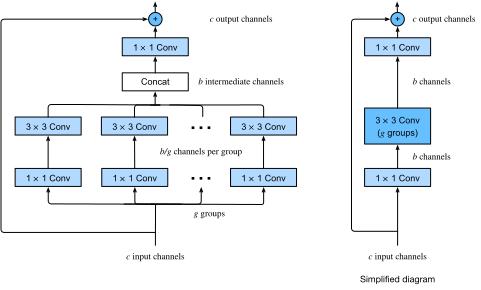

```{.python .input}
%load_ext d2lbook.tab
tab.interact_select(['mxnet', 'pytorch', 'tensorflow', 'jax'])
```

# 残差网络（ResNet）与 ResNeXt
:label:`sec_resnet`

当我们设计越来越深的网络时，理解添加层如何能增加网络的复杂度和表达能力就变得至关重要。
甚至更重要的是，要有能力设计出这样的网络：添加层使网络严格地更具表达能力，而不仅仅是有别于原来。
为了取得一些进展，我们需要一点数学。

```{.python .input}
%%tab mxnet
from d2l import mxnet as d2l
from mxnet import np, npx, init
from mxnet.gluon import nn
npx.set_np()
```

```{.python .input}
%%tab pytorch
from d2l import torch as d2l
import torch
from torch import nn
from torch.nn import functional as F
```

```{.python .input}
%%tab tensorflow
import tensorflow as tf
from d2l import tensorflow as d2l
```

```{.python .input}
%%tab jax
from d2l import jax as d2l
from flax import linen as nn
from jax import numpy as jnp
import jax
```

## 函数类

考虑 $\mathcal{F}$，即某个特定网络架构（连同学习率和其他超参数设置）所能达到的函数类。
也就是说，对于所有 $f \in \mathcal{F}$，都存在某组参数（例如权重和偏置），这些参数可以通过在合适的数据集上训练得到。
让我们假设 $f^*$ 是我们真正希望找到的“真值”函数。
如果它属于 $\mathcal{F}$，那我们就很幸运，但通常我们不会这么走运。
相反，我们会尝试找到某个 $f^*_\mathcal{F}$，它是我们在 $\mathcal{F}$ 内的最佳选择。
例如，
给定具有特征 $\mathbf{X}$
和标签 $\mathbf{y}$ 的数据集，
我们可能尝试通过求解以下优化问题来找到它：

$$f^*_\mathcal{F} \stackrel{\textrm{def}}{=} \mathop{\mathrm{argmin}}_f L(\mathbf{X}, \mathbf{y}, f) \textrm{ subject to } f \in \mathcal{F}.$$

我们知道正则化 :cite:`tikhonov1977solutions,morozov2012methods` 可以控制 $\mathcal{F}$ 的复杂度
并达到一致性，因此训练数据规模越大，
通常得到的 $f^*_\mathcal{F}$ 越好。
我们完全有理由假设：如果我们设计一个不同且更强大的架构 $\mathcal{F}'$，就应该得到更好的结果。换句话说，我们会期望 $f^*_{\mathcal{F}'}$ 比 $f^*_{\mathcal{F}}$ “更好”。然而，如果 $\mathcal{F} \not\subseteq \mathcal{F}'$，那么甚至不能保证这种情况会发生。事实上，$f^*_{\mathcal{F}'}$ 完全可能更差。
如 :numref:`fig_functionclasses` 所示，
对于非嵌套函数类，更大的函数类并不总是更接近“真值”函数 $f^*$。例如，
在 :numref:`fig_functionclasses` 的左侧，
尽管 $\mathcal{F}_3$ 比 $\mathcal{F}_1$ 更接近 $f^*$，但 $\mathcal{F}_6$ 却偏离得更远，并且不能保证进一步增加复杂度就能减小与 $f^*$ 的距离。
对于嵌套函数类，
即 :numref:`fig_functionclasses` 右侧的
$\mathcal{F}_1 \subseteq \cdots \subseteq \mathcal{F}_6$，
我们可以避免非嵌套函数类所带来的上述问题。



:label:`fig_functionclasses`

因此，
只有当较大的函数类包含较小的函数类时，我们才能保证增加它们会严格增加网络的表达能力。
对于深度神经网络，
如果我们能把
新添加的层训练成一个恒等函数 $f(\mathbf{x}) = \mathbf{x}$，新模型就会和原模型一样有效。由于新模型可能获得更好的解来拟合训练数据集，添加的层可能会使减小训练误差变得更容易。

这正是 :citet:`He.Zhang.Ren.ea.2016` 在研究非常深的计算机视觉模型时所考虑的问题。
他们所提出的*残差网络*（residual network，*ResNet*）的核心思想是：每一个额外的层都应
更容易地
将恒等函数作为其元素之一包含进来。
这些考虑相当深刻，但它们引出了一个惊人简单的
解决方案——*残差块*（residual block）。
凭借它，ResNet 在 2015 年赢得了 ImageNet 大规模视觉识别挑战赛。这一设计对如何
构建深度神经网络产生了深远影响。例如，残差块已被添加到循环网络 :cite:`prakash2016neural,kim2017residual`。同样，Transformer :cite:`Vaswani.Shazeer.Parmar.ea.2017` 使用它们来高效地堆叠许多层网络。它也被用于图神经网络 :cite:`Kipf.Welling.2016`，并且作为一个基本概念，它已在计算机视觉中被广泛使用 :cite:`Redmon.Farhadi.2018,Ren.He.Girshick.ea.2015`。
请注意，在残差网络之前已有公路网络（highway network）:cite:`srivastava2015highway`，二者共享部分动机，尽管后者没有围绕恒等函数的优雅参数化。


## (**残差块**)
:label:`subsec_residual-blks`

让我们关注神经网络的一个局部部分，如 :numref:`fig_residual_block` 所示。用 $\mathbf{x}$ 表示输入。
我们假设 $f(\mathbf{x})$ 是我们希望通过学习获得的理想底层映射，它将作为顶层激活函数的输入。
在左侧，
虚线框内的部分
必须直接学习 $f(\mathbf{x})$。
在右侧，
虚线框内的部分
需要学习*残差映射* $g(\mathbf{x}) = f(\mathbf{x}) - \mathbf{x}$，
残差块正是由此得名。
如果恒等映射 $f(\mathbf{x}) = \mathbf{x}$ 是理想的底层映射，
那么残差映射就变为 $g(\mathbf{x}) = 0$，因此更容易学习：
我们只需将虚线框内
上层权重层（例如全连接层和卷积层）
的权重和偏置
推为零。
右图展示了 ResNet 的*残差块*，
其中将层输入
$\mathbf{x}$ 传送到加法算子的实线
称为*残差连接*（residual connection，或*捷径连接*（shortcut connection））。
有了残差块，输入可以
更快地通过残差连接跨层前向传播。
事实上，
残差块
可以看作
多分支 Inception 块的一个特例：
它有两个分支，
其中一个是恒等映射。


:label:`fig_residual_block`


ResNet 具有 VGG 完整的 $3\times 3$ 卷积层设计。残差块有两个 $3\times 3$ 卷积层，输出通道数相同。每个卷积层后面跟着一个批量规范化层和一个 ReLU 激活函数。然后，我们跳过这两个卷积操作，并在最终的 ReLU 激活函数之前直接加上输入。
这种设计要求两个卷积层的输出必须与输入具有相同的形状，以便它们可以相加。如果我们想改变通道数，就需要引入一个额外的 $1\times 1$ 卷积层，将输入变换为加法运算所需的形状。让我们看看下面的代码。

```{.python .input}
%%tab mxnet
class Residual(nn.Block):  #@save
    """The Residual block of ResNet models."""
    def __init__(self, num_channels, use_1x1conv=False, strides=1, **kwargs):
        super().__init__(**kwargs)
        self.conv1 = nn.Conv2D(num_channels, kernel_size=3, padding=1,
                               strides=strides)
        self.conv2 = nn.Conv2D(num_channels, kernel_size=3, padding=1)
        if use_1x1conv:
            self.conv3 = nn.Conv2D(num_channels, kernel_size=1,
                                   strides=strides)
        else:
            self.conv3 = None
        self.bn1 = nn.BatchNorm()
        self.bn2 = nn.BatchNorm()

    def forward(self, X):
        Y = npx.relu(self.bn1(self.conv1(X)))
        Y = self.bn2(self.conv2(Y))
        if self.conv3:
            X = self.conv3(X)
        return npx.relu(Y + X)
```

```{.python .input}
%%tab pytorch
class Residual(nn.Module):  #@save
    """The Residual block of ResNet models."""
    def __init__(self, num_channels, use_1x1conv=False, strides=1):
        super().__init__()
        self.conv1 = nn.LazyConv2d(num_channels, kernel_size=3, padding=1,
                                   stride=strides)
        self.conv2 = nn.LazyConv2d(num_channels, kernel_size=3, padding=1)
        if use_1x1conv:
            self.conv3 = nn.LazyConv2d(num_channels, kernel_size=1,
                                       stride=strides)
        else:
            self.conv3 = None
        self.bn1 = nn.LazyBatchNorm2d()
        self.bn2 = nn.LazyBatchNorm2d()

    def forward(self, X):
        Y = F.relu(self.bn1(self.conv1(X)))
        Y = self.bn2(self.conv2(Y))
        if self.conv3:
            X = self.conv3(X)
        Y += X
        return F.relu(Y)
```

```{.python .input}
%%tab tensorflow
class Residual(tf.keras.Model):  #@save
    """The Residual block of ResNet models."""
    def __init__(self, num_channels, use_1x1conv=False, strides=1):
        super().__init__()
        self.conv1 = tf.keras.layers.Conv2D(num_channels, padding='same',
                                            kernel_size=3, strides=strides)
        self.conv2 = tf.keras.layers.Conv2D(num_channels, kernel_size=3,
                                            padding='same')
        self.conv3 = None
        if use_1x1conv:
            self.conv3 = tf.keras.layers.Conv2D(num_channels, kernel_size=1,
                                                strides=strides)
        self.bn1 = tf.keras.layers.BatchNormalization()
        self.bn2 = tf.keras.layers.BatchNormalization()

    def call(self, X):
        Y = tf.keras.activations.relu(self.bn1(self.conv1(X)))
        Y = self.bn2(self.conv2(Y))
        if self.conv3 is not None:
            X = self.conv3(X)
        Y += X
        return tf.keras.activations.relu(Y)
```

```{.python .input}
%%tab jax
class Residual(nn.Module):  #@save
    """The Residual block of ResNet models."""
    num_channels: int
    use_1x1conv: bool = False
    strides: tuple = (1, 1)
    training: bool = True

    def setup(self):
        self.conv1 = nn.Conv(self.num_channels, kernel_size=(3, 3),
                             padding='same', strides=self.strides)
        self.conv2 = nn.Conv(self.num_channels, kernel_size=(3, 3),
                             padding='same')
        if self.use_1x1conv:
            self.conv3 = nn.Conv(self.num_channels, kernel_size=(1, 1),
                                 strides=self.strides)
        else:
            self.conv3 = None
        self.bn1 = nn.BatchNorm(not self.training)
        self.bn2 = nn.BatchNorm(not self.training)

    def __call__(self, X):
        Y = nn.relu(self.bn1(self.conv1(X)))
        Y = self.bn2(self.conv2(Y))
        if self.conv3:
            X = self.conv3(X)
        Y += X
        return nn.relu(Y)
```

这段代码生成两种类型的网络：一种在 `use_1x1conv=False` 时，在应用 ReLU 非线性之前将输入加到输出上；另一种在相加之前通过 $1 \times 1$ 卷积调整通道和分辨率。:numref:`fig_resnet_block` 说明了这一点。


:label:`fig_resnet_block`

现在让我们看看[**输入和输出形状相同的情形**]，此时不需要 $1 \times 1$ 卷积。

```{.python .input}
%%tab mxnet, pytorch
if tab.selected('mxnet'):
    blk = Residual(3)
    blk.initialize()
if tab.selected('pytorch'):
    blk = Residual(3)
X = d2l.randn(4, 3, 6, 6)
blk(X).shape
```

```{.python .input}
%%tab tensorflow
blk = Residual(3)
X = d2l.normal((4, 6, 6, 3))
Y = blk(X)
Y.shape
```

```{.python .input}
%%tab jax
blk = Residual(3)
X = jax.random.normal(d2l.get_key(), (4, 6, 6, 3))
blk.init_with_output(d2l.get_key(), X)[0].shape
```

我们也可以选择[**将输出的高度和宽度减半，同时增加输出通道数**]。
在这种情况下，我们通过 `use_1x1conv=True` 使用 $1 \times 1$ 卷积。这在每个 ResNet 块的开头通过 `strides=2` 减小空间维数时很方便。

```{.python .input}
%%tab pytorch, mxnet, tensorflow
blk = Residual(6, use_1x1conv=True, strides=2)
if tab.selected('mxnet'):
    blk.initialize()
blk(X).shape
```

```{.python .input}
%%tab jax
blk = Residual(6, use_1x1conv=True, strides=(2, 2))
blk.init_with_output(d2l.get_key(), X)[0].shape
```

## [**ResNet 模型**]

ResNet 的前两层与我们之前描述的 GoogLeNet 相同：具有 64 个输出通道、步幅为 2 的 $7\times 7$ 卷积层，之后是步幅为 2 的 $3\times 3$ 最大汇聚层。不同之处在于 ResNet 在每个卷积层之后添加了批量规范化层。

```{.python .input}
%%tab pytorch, mxnet, tensorflow
class ResNet(d2l.Classifier):
    def b1(self):
        if tab.selected('mxnet'):
            net = nn.Sequential()
            net.add(nn.Conv2D(64, kernel_size=7, strides=2, padding=3),
                    nn.BatchNorm(), nn.Activation('relu'),
                    nn.MaxPool2D(pool_size=3, strides=2, padding=1))
            return net
        if tab.selected('pytorch'):
            return nn.Sequential(
                nn.LazyConv2d(64, kernel_size=7, stride=2, padding=3),
                nn.LazyBatchNorm2d(), nn.ReLU(),
                nn.MaxPool2d(kernel_size=3, stride=2, padding=1))
        if tab.selected('tensorflow'):
            return tf.keras.models.Sequential([
                tf.keras.layers.Conv2D(64, kernel_size=7, strides=2,
                                       padding='same'),
                tf.keras.layers.BatchNormalization(),
                tf.keras.layers.Activation('relu'),
                tf.keras.layers.MaxPool2D(pool_size=3, strides=2,
                                          padding='same')])
```

```{.python .input}
%%tab jax
class ResNet(d2l.Classifier):
    arch: tuple
    lr: float = 0.1
    num_classes: int = 10
    training: bool = True

    def setup(self):
        self.net = self.create_net()

    def b1(self):
        return nn.Sequential([
            nn.Conv(64, kernel_size=(7, 7), strides=(2, 2), padding='same'),
            nn.BatchNorm(not self.training), nn.relu,
            lambda x: nn.max_pool(x, window_shape=(3, 3), strides=(2, 2),
                                  padding='same')])
```

GoogLeNet 使用由 Inception 块组成的四个模块。
然而，ResNet 使用由残差块组成的四个模块，每个模块使用若干个输出通道数相同的残差块。
第一个模块中的通道数与输入通道数相同。由于已经使用了步幅为 2 的最大汇聚层，因此无需减小高度和宽度。在后续每个模块的第一个残差块中，通道数比前一个模块翻倍，高度和宽度减半。

```{.python .input}
%%tab mxnet
@d2l.add_to_class(ResNet)
def block(self, num_residuals, num_channels, first_block=False):
    blk = nn.Sequential()
    for i in range(num_residuals):
        if i == 0 and not first_block:
            blk.add(Residual(num_channels, use_1x1conv=True, strides=2))
        else:
            blk.add(Residual(num_channels))
    return blk
```

```{.python .input}
%%tab pytorch
@d2l.add_to_class(ResNet)
def block(self, num_residuals, num_channels, first_block=False):
    blk = []
    for i in range(num_residuals):
        if i == 0 and not first_block:
            blk.append(Residual(num_channels, use_1x1conv=True, strides=2))
        else:
            blk.append(Residual(num_channels))
    return nn.Sequential(*blk)
```

```{.python .input}
%%tab tensorflow
@d2l.add_to_class(ResNet)
def block(self, num_residuals, num_channels, first_block=False):
    blk = tf.keras.models.Sequential()
    for i in range(num_residuals):
        if i == 0 and not first_block:
            blk.add(Residual(num_channels, use_1x1conv=True, strides=2))
        else:
            blk.add(Residual(num_channels))
    return blk
```

```{.python .input}
%%tab jax
@d2l.add_to_class(ResNet)
def block(self, num_residuals, num_channels, first_block=False):
    blk = []
    for i in range(num_residuals):
        if i == 0 and not first_block:
            blk.append(Residual(num_channels, use_1x1conv=True,
                                strides=(2, 2), training=self.training))
        else:
            blk.append(Residual(num_channels, training=self.training))
    return nn.Sequential(blk)
```

然后，我们将所有模块添加到 ResNet 中。这里，每个模块使用两个残差块。最后，就像 GoogLeNet 一样，我们添加一个全局平均汇聚层，其后是全连接层输出。

```{.python .input}
%%tab pytorch, mxnet, tensorflow
@d2l.add_to_class(ResNet)
def __init__(self, arch, lr=0.1, num_classes=10):
    super(ResNet, self).__init__()
    self.save_hyperparameters()
    if tab.selected('mxnet'):
        self.net = nn.Sequential()
        self.net.add(self.b1())
        for i, b in enumerate(arch):
            self.net.add(self.block(*b, first_block=(i==0)))
        self.net.add(nn.GlobalAvgPool2D(), nn.Dense(num_classes))
        self.net.initialize(init.Xavier())
    if tab.selected('pytorch'):
        self.net = nn.Sequential(self.b1())
        for i, b in enumerate(arch):
            self.net.add_module(f'b{i+2}', self.block(*b, first_block=(i==0)))
        self.net.add_module('last', nn.Sequential(
            nn.AdaptiveAvgPool2d((1, 1)), nn.Flatten(),
            nn.LazyLinear(num_classes)))
        self.net.apply(d2l.init_cnn)
    if tab.selected('tensorflow'):
        self.net = tf.keras.models.Sequential(self.b1())
        for i, b in enumerate(arch):
            self.net.add(self.block(*b, first_block=(i==0)))
        self.net.add(tf.keras.models.Sequential([
            tf.keras.layers.GlobalAvgPool2D(),
            tf.keras.layers.Dense(units=num_classes)]))
```

```{.python .input}
# %%tab jax
@d2l.add_to_class(ResNet)
def create_net(self):
    net = nn.Sequential([self.b1()])
    for i, b in enumerate(self.arch):
        net.layers.extend([self.block(*b, first_block=(i==0))])
    net.layers.extend([nn.Sequential([
        # Flax does not provide a GlobalAvg2D layer
        lambda x: nn.avg_pool(x, window_shape=x.shape[1:3],
                              strides=x.shape[1:3], padding='valid'),
        lambda x: x.reshape((x.shape[0], -1)),
        nn.Dense(self.num_classes)])])
    return net
```

每个模块中有四个卷积层（不包括 $1\times 1$ 卷积层）。再加上第一个 $7\times 7$ 卷积层和最后的全连接层，总共有 18 层。因此，该模型通常被称为 ResNet-18。
通过在模块中配置不同的通道数和残差块数，我们可以创建不同的 ResNet 模型，例如更深的 152 层 ResNet-152。尽管 ResNet 的主体架构与 GoogLeNet 类似，但 ResNet 的结构更简单、更容易修改。所有这些因素导致 ResNet 得到了迅速而广泛的应用。:numref:`fig_resnet18` 描绘了完整的 ResNet-18。


:label:`fig_resnet18`

在训练 ResNet 之前，让我们[**观察 ResNet 中输入形状在不同模块之间的变化**]。与之前所有架构一样，分辨率降低而通道数增加，直到全局平均汇聚层聚合所有特征。

```{.python .input}
%%tab pytorch, mxnet, tensorflow
class ResNet18(ResNet):
    def __init__(self, lr=0.1, num_classes=10):
        super().__init__(((2, 64), (2, 128), (2, 256), (2, 512)),
                       lr, num_classes)
```

```{.python .input}
%%tab jax
class ResNet18(ResNet):
    arch: tuple = ((2, 64), (2, 128), (2, 256), (2, 512))
    lr: float = 0.1
    num_classes: int = 10
```

```{.python .input}
%%tab pytorch, mxnet
ResNet18().layer_summary((1, 1, 96, 96))
```

```{.python .input}
%%tab tensorflow
ResNet18().layer_summary((1, 96, 96, 1))
```

```{.python .input}
%%tab jax
ResNet18(training=False).layer_summary((1, 96, 96, 1))
```

## [**训练**]

和之前一样，我们在 Fashion-MNIST 数据集上训练 ResNet。ResNet 是一个相当强大且灵活的架构。捕获训练损失和验证损失的曲线图显示两条曲线之间存在显著差距，训练损失要低得多。对于这样灵活的网络，更多训练数据将在缩小差距和提高准确率方面带来明显的好处。

```{.python .input}
%%tab mxnet, pytorch, jax
model = ResNet18(lr=0.01)
trainer = d2l.Trainer(max_epochs=10, num_gpus=1)
data = d2l.FashionMNIST(batch_size=128, resize=(96, 96))
if tab.selected('pytorch'):
    model.apply_init([next(iter(data.get_dataloader(True)))[0]], d2l.init_cnn)
trainer.fit(model, data)
```

```{.python .input}
%%tab tensorflow
trainer = d2l.Trainer(max_epochs=10)
data = d2l.FashionMNIST(batch_size=128, resize=(96, 96))
with d2l.try_gpu():
    model = ResNet18(lr=0.01)
    trainer.fit(model, data)
```

## ResNeXt
:label:`subsec_resnext`

在 ResNet 的设计中，人们遇到的一个挑战是给定块内非线性与维数之间的权衡。也就是说，我们可以通过增加层数或增加卷积宽度来添加更多非线性。另一种策略是增加能在块之间传递信息的通道数。不幸的是，后者伴随着二次方代价，因为接收 $c_\textrm{i}$ 个通道并产生 $c_\textrm{o}$ 个通道的计算成本与 $\mathcal{O}(c_\textrm{i} \cdot c_\textrm{o})$ 成正比（参见我们在 :numref:`sec_channels` 中的讨论）。

我们可以从 :numref:`fig_inception` 的 Inception 块中获得一些启发，其中信息以相互独立的分组流经该块。将多个独立分组的思想应用于 :numref:`fig_resnet_block` 的 ResNet 块，就引出了 ResNeXt 的设计 :cite:`Xie.Girshick.Dollar.ea.2017`。
与 Inception 中大杂烩式的变换不同，
ResNeXt 在所有分支中采用*相同*的变换，
从而最大限度减少了分别调优每个分支的需要。


:label:`fig_resnext_block`

将一个从 $c_\textrm{i}$ 个通道到 $c_\textrm{o}$ 个通道的卷积拆分为 $g$ 组、每组大小为 $c_\textrm{i}/g$，并生成 $g$ 个大小为 $c_\textrm{o}/g$ 的输出，这被恰如其分地称为*分组卷积*（grouped convolution）。计算成本（按比例）从 $\mathcal{O}(c_\textrm{i} \cdot c_\textrm{o})$ 降低为 $\mathcal{O}(g \cdot (c_\textrm{i}/g) \cdot (c_\textrm{o}/g)) = \mathcal{O}(c_\textrm{i} \cdot c_\textrm{o} / g)$，也就是说，快了 $g$ 倍。更好的是，生成输出所需的参数数量也从 $c_\textrm{i} \times c_\textrm{o}$ 的矩阵减少为 $g$ 个大小为 $(c_\textrm{i}/g) \times (c_\textrm{o}/g)$ 的较小矩阵，同样减少了 $g$ 倍。在下文中，我们假设 $c_\textrm{i}$ 和 $c_\textrm{o}$ 都能被 $g$ 整除。

这种设计的唯一挑战在于，$g$ 个分组之间不交换信息。:numref:`fig_resnext_block` 的 ResNeXt 块
以两种方式弥补了这一点：使用 $3 \times 3$ 核的分组卷积夹在两个 $1 \times 1$ 卷积之间。第二个卷积起双重作用，将通道数变回去。好处是我们只需为 $1 \times 1$ 核付出 $\mathcal{O}(c \cdot b)$ 的代价，而对于 $3 \times 3$ 核只需 $\mathcal{O}(b^2 / g)$ 的代价。与
:numref:`subsec_residual-blks` 中的残差块实现类似，残差连接被一个 $1 \times 1$ 卷积所取代（从而被推广）。

:numref:`fig_resnext_block` 中的右图对所得的网络块给出了更加简洁的总结。它还将在 :numref:`sec_cnn-design` 中通用现代 CNN 的设计中发挥重要作用。请注意，分组卷积的思想可以追溯到 AlexNet 的实现 :cite:`Krizhevsky.Sutskever.Hinton.2012`。当把网络分布到两个内存有限的 GPU 上时，该实现将每个 GPU 视为自己的通道，而没有产生不良影响。

下面的 `ResNeXtBlock` 类实现以 `groups`（$g$）为参数，以
`bot_channels`（$b$）作为中间（瓶颈）通道数。最后，当我们需要减小表示的高度和宽度时，我们通过设置 `use_1x1conv=True, strides=2` 来添加步幅 $2$。

```{.python .input}
%%tab mxnet
class ResNeXtBlock(nn.Block):  #@save
    """The ResNeXt block."""
    def __init__(self, num_channels, groups, bot_mul,
                 use_1x1conv=False, strides=1, **kwargs):
        super().__init__(**kwargs)
        bot_channels = int(round(num_channels * bot_mul))
        self.conv1 = nn.Conv2D(bot_channels, kernel_size=1, padding=0,
                               strides=1)
        self.conv2 = nn.Conv2D(bot_channels, kernel_size=3, padding=1, 
                               strides=strides, groups=bot_channels//groups)
        self.conv3 = nn.Conv2D(num_channels, kernel_size=1, padding=0,
                               strides=1)
        self.bn1 = nn.BatchNorm()
        self.bn2 = nn.BatchNorm()
        self.bn3 = nn.BatchNorm()
        if use_1x1conv:
            self.conv4 = nn.Conv2D(num_channels, kernel_size=1,
                                   strides=strides)
            self.bn4 = nn.BatchNorm()
        else:
            self.conv4 = None

    def forward(self, X):
        Y = npx.relu(self.bn1(self.conv1(X)))
        Y = npx.relu(self.bn2(self.conv2(Y)))
        Y = self.bn3(self.conv3(Y))
        if self.conv4:
            X = self.bn4(self.conv4(X))
        return npx.relu(Y + X)
```

```{.python .input}
%%tab pytorch
class ResNeXtBlock(nn.Module):  #@save
    """The ResNeXt block."""
    def __init__(self, num_channels, groups, bot_mul, use_1x1conv=False,
                 strides=1):
        super().__init__()
        bot_channels = int(round(num_channels * bot_mul))
        self.conv1 = nn.LazyConv2d(bot_channels, kernel_size=1, stride=1)
        self.conv2 = nn.LazyConv2d(bot_channels, kernel_size=3,
                                   stride=strides, padding=1,
                                   groups=bot_channels//groups)
        self.conv3 = nn.LazyConv2d(num_channels, kernel_size=1, stride=1)
        self.bn1 = nn.LazyBatchNorm2d()
        self.bn2 = nn.LazyBatchNorm2d()
        self.bn3 = nn.LazyBatchNorm2d()
        if use_1x1conv:
            self.conv4 = nn.LazyConv2d(num_channels, kernel_size=1, 
                                       stride=strides)
            self.bn4 = nn.LazyBatchNorm2d()
        else:
            self.conv4 = None

    def forward(self, X):
        Y = F.relu(self.bn1(self.conv1(X)))
        Y = F.relu(self.bn2(self.conv2(Y)))
        Y = self.bn3(self.conv3(Y))
        if self.conv4:
            X = self.bn4(self.conv4(X))
        return F.relu(Y + X)
```

```{.python .input}
%%tab tensorflow
class ResNeXtBlock(tf.keras.Model):  #@save
    """The ResNeXt block."""
    def __init__(self, num_channels, groups, bot_mul, use_1x1conv=False,
                 strides=1):
        super().__init__()
        bot_channels = int(round(num_channels * bot_mul))
        self.conv1 = tf.keras.layers.Conv2D(bot_channels, 1, strides=1)
        self.conv2 = tf.keras.layers.Conv2D(bot_channels, 3, strides=strides,
                                            padding="same",
                                            groups=bot_channels//groups)
        self.conv3 = tf.keras.layers.Conv2D(num_channels, 1, strides=1)
        self.bn1 = tf.keras.layers.BatchNormalization()
        self.bn2 = tf.keras.layers.BatchNormalization()
        self.bn3 = tf.keras.layers.BatchNormalization()
        if use_1x1conv:
            self.conv4 = tf.keras.layers.Conv2D(num_channels, 1,
                                                strides=strides)
            self.bn4 = tf.keras.layers.BatchNormalization()
        else:
            self.conv4 = None

    def call(self, X):
        Y = tf.keras.activations.relu(self.bn1(self.conv1(X)))
        Y = tf.keras.activations.relu(self.bn2(self.conv2(Y)))
        Y = self.bn3(self.conv3(Y))
        if self.conv4:
            X = self.bn4(self.conv4(X))
        return tf.keras.activations.relu(Y + X)
```

```{.python .input}
%%tab jax
class ResNeXtBlock(nn.Module):  #@save
    """The ResNeXt block."""
    num_channels: int
    groups: int
    bot_mul: int
    use_1x1conv: bool = False
    strides: tuple = (1, 1)
    training: bool = True

    def setup(self):
        bot_channels = int(round(self.num_channels * self.bot_mul))
        self.conv1 = nn.Conv(bot_channels, kernel_size=(1, 1),
                               strides=(1, 1))
        self.conv2 = nn.Conv(bot_channels, kernel_size=(3, 3),
                               strides=self.strides, padding='same',
                               feature_group_count=bot_channels//self.groups)
        self.conv3 = nn.Conv(self.num_channels, kernel_size=(1, 1),
                               strides=(1, 1))
        self.bn1 = nn.BatchNorm(not self.training)
        self.bn2 = nn.BatchNorm(not self.training)
        self.bn3 = nn.BatchNorm(not self.training)
        if self.use_1x1conv:
            self.conv4 = nn.Conv(self.num_channels, kernel_size=(1, 1),
                                       strides=self.strides)
            self.bn4 = nn.BatchNorm(not self.training)
        else:
            self.conv4 = None

    def __call__(self, X):
        Y = nn.relu(self.bn1(self.conv1(X)))
        Y = nn.relu(self.bn2(self.conv2(Y)))
        Y = self.bn3(self.conv3(Y))
        if self.conv4:
            X = self.bn4(self.conv4(X))
        return nn.relu(Y + X)
```

它的用法与前面讨论的 `ResNetBlock` 完全类似。例如，当使用（`use_1x1conv=False, strides=1`）时，输入和输出形状相同。或者，设置 `use_1x1conv=True, strides=2` 会将输出的高度和宽度减半。

```{.python .input}
%%tab mxnet, pytorch
blk = ResNeXtBlock(32, 16, 1)
if tab.selected('mxnet'):
    blk.initialize()
X = d2l.randn(4, 32, 96, 96)
blk(X).shape
```

```{.python .input}
%%tab tensorflow
blk = ResNeXtBlock(32, 16, 1)
X = d2l.normal((4, 96, 96, 32))
Y = blk(X)
Y.shape
```

```{.python .input}
%%tab jax
blk = ResNeXtBlock(32, 16, 1)
X = jnp.zeros((4, 96, 96, 32))
blk.init_with_output(d2l.get_key(), X)[0].shape
```

## 小结与讨论

嵌套函数类是理想的，因为当增加容量时，它们使我们能够获得严格地*更强大*、而不仅仅是微妙地*不同*的函数类。实现这一点的一种方式是让额外的层简单地将输入传递到输出。残差连接允许这样做。因此，这把归纳偏置从简单函数具有 $f(\mathbf{x}) = 0$ 的形式改变为简单函数看起来像 $f(\mathbf{x}) = \mathbf{x}$。


残差映射可以更容易地学习恒等函数，例如将权重层中的参数推为零。通过残差块，我们可以训练一个有效的*深度*神经网络。输入可以通过残差连接跨层更快地前向传播。因此，我们可以训练深得多的网络。例如，原始 ResNet 论文 :cite:`He.Zhang.Ren.ea.2016` 最多允许 152 层。残差网络的另一个好处是，它允许我们在训练过程*期间*添加初始化为恒等函数的层。毕竟，层的默认行为是让数据原样通过。在某些情况下，这可以加速非常大的网络的训练。

在残差连接之前，
人们引入了带门控单元（gating unit）的旁路路径，
以有效训练超过 100 层的公路网络
:cite:`srivastava2015highway`。
ResNet 使用恒等函数作为旁路路径，
在多项计算机视觉任务上
表现出色。
残差连接对后续深度神经网络（无论是卷积性质还是序列性质）的设计产生了重大影响。
正如我们稍后将介绍的，
Transformer 架构 :cite:`Vaswani.Shazeer.Parmar.ea.2017`
采用了残差连接（连同其他设计选择），并广泛存在于
语言、视觉、语音和强化学习等不同领域。

ResNeXt 是卷积神经网络设计如何随时间演变的一个例子：通过对计算更加节俭，并将其与激活的规模（通道数）进行权衡，它允许以更低的成本获得更快、更准确的网络。看待分组卷积的另一种方式是为卷积权重考虑一个块对角矩阵。请注意，有相当多这样的“技巧”可以带来更高效的网络。例如，ShiftNet :cite:`wu2018shift` 模仿 $3 \times 3$ 卷积的效果，它只是向通道添加平移后的激活，从而提高了函数复杂度，而这一次没有任何计算成本。

到目前为止我们讨论的设计有一个共同特点：网络设计相当手工化，主要依赖设计者的聪明才智来找到“正确”的网络超参数。虽然这显然是可行的，但在人的时间方面代价非常高，而且不能保证结果在任何意义上都是最优的。在 :numref:`sec_cnn-design` 中，我们将讨论一些以更自动化的方式获得高质量网络的策略。特别是，我们将回顾导致 RegNetX/Y 模型的*网络设计空间*（network design space）概念
:cite:`Radosavovic.Kosaraju.Girshick.ea.2020`。

## 练习

1. Inception 块（:numref:`fig_inception`）与残差块的主要区别是什么？它们在计算、准确率以及所能描述的函数类方面有何比较？
1. 参考 ResNet 论文 :cite:`He.Zhang.Ren.ea.2016` 中的表 1 来实现网络的不同变体。
1. 对于更深的网络，ResNet 引入了“瓶颈”（bottleneck）架构以降低模型复杂度。尝试实现它。
1. 在后续版本的 ResNet 中，作者将“卷积、批量规范化和激活”结构改为“批量规范化、激活和卷积”结构。请自行完成这一改进。详情参见 :citet:`He.Zhang.Ren.ea.2016*1` 中的图 1。
1. 为什么即使函数类是嵌套的，我们也不能无限制地增加函数的复杂度？

:begin_tab:`mxnet`
[讨论](https://discuss.d2l.ai/t/85)
:end_tab:

:begin_tab:`pytorch`
[讨论](https://discuss.d2l.ai/t/86)
:end_tab:

:begin_tab:`tensorflow`
[讨论](https://discuss.d2l.ai/t/8737)
:end_tab:

:begin_tab:`jax`
[讨论](https://discuss.d2l.ai/t/18006)
:end_tab:
