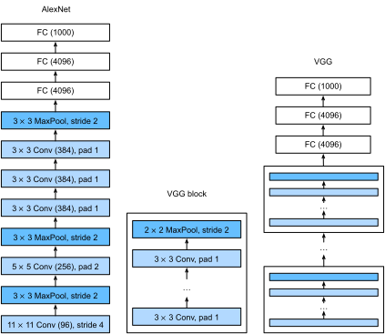

```{.python .input  n=1}
%load_ext d2lbook.tab
tab.interact_select(['mxnet', 'pytorch', 'tensorflow', 'jax'])
```

# 使用块的网络（VGG）
:label:`sec_vgg`

虽然 AlexNet 提供了经验证据，表明深度卷积神经网络可以取得良好的结果，但它并没有提供一个通用模板来指导后续研究者设计新的网络。
在接下来的几节中，我们将介绍几个常用于设计深度网络的启发式概念。

这一领域的进展与芯片设计中 VLSI（超大规模集成电路）的进展类似：
工程师们从放置晶体管，发展到使用逻辑元件，再发展到使用逻辑块 :cite:`Mead.1980`。
同样，神经网络架构的设计也逐步变得更加抽象：
研究者们从以单个神经元为单位思考，发展到以整层为单位思考，如今又发展到以块（层的重复模式）为单位思考。
十年之后，这一进程已经发展到研究者使用整个训练好的模型，将其重用于不同但相关的任务。
这种大型预训练模型通常称为*基础模型*（foundation models）:cite:`bommasani2021opportunities`。

回到网络设计。使用块的思想最早来自牛津大学的视觉几何组（Visual Geometry Group，VGG），
他们在以其命名的 *VGG* 网络中提出了这一思想 :cite:`Simonyan.Zisserman.2014`。
借助循环和子程序，我们可以很容易地用任何现代深度学习框架在代码中实现这些重复结构。

```{.python .input}
%%tab mxnet
from d2l import mxnet as d2l
from mxnet import np, npx, init
from mxnet.gluon import nn
npx.set_np()
```

```{.python .input}
%%tab pytorch
from d2l import torch as d2l
import torch
from torch import nn
```

```{.python .input}
%%tab tensorflow
import tensorflow as tf
from d2l import tensorflow as d2l
```

```{.python .input}
%%tab jax
from d2l import jax as d2l
from flax import linen as nn
import jax
```

## (**VGG 块**)
:label:`subsec_vgg-blocks`

卷积神经网络的基本构件由以下内容依次组成：
（i）一个带有填充的卷积层，以保持分辨率；
（ii）一个非线性激活函数，例如 ReLU；
（iii）一个汇聚层，例如最大汇聚，以降低分辨率。
这种方法的问题之一是空间分辨率下降得相当快。
具体而言，这给网络施加了一个硬性限制：在全部维度（$d$）被耗尽之前，最多只能有 $\log_2 d$ 个卷积层。
例如，在 ImageNet 的情况下，用这种方式不可能拥有超过 8 个卷积层。

:citet:`Simonyan.Zisserman.2014` 的核心思想是：在通过最大汇聚进行下采样之间，以块的形式使用*多个*卷积。
他们主要关心的是深度网络还是宽网络表现更好。
例如，连续应用两个 $3 \times 3$ 卷积所触及的像素与单个 $5 \times 5$ 卷积相同。
与此同时，后者使用的参数数量（$25 \cdot c^2$）与三个 $3 \times 3$ 卷积大致相同（$3 \cdot 9 \cdot c^2$）。
在一项相当详细的分析中，他们表明深层窄网络显著优于其浅层对应网络。
这使得深度学习开始追求越来越深的网络，在典型应用中层数超过 100。
堆叠 $3 \times 3$ 卷积已成为后来深度网络中的黄金标准（这一设计决策直到最近才被 :citet:`liu2022convnet` 重新审视）。
因此，小卷积的快速实现在 GPU 上已成为标配 :cite:`lavin2016fast`。

回到 VGG：一个 VGG 块由*一系列*卷积组成，这些卷积使用 $3\times3$ 的核、填充为 1
（保持高度和宽度），随后是一个 $2 \times 2$ 的最大汇聚层，步幅为 2
（在每个块之后将高度和宽度减半）。
在下面的代码中，我们定义一个名为 `vgg_block` 的函数来实现一个 VGG 块。

下面的函数接受两个参数，分别对应卷积层的数量 `num_convs`
和输出通道的数量 `num_channels`。

```{.python .input  n=2}
%%tab mxnet
def vgg_block(num_convs, num_channels):
    blk = nn.Sequential()
    for _ in range(num_convs):
        blk.add(nn.Conv2D(num_channels, kernel_size=3,
                          padding=1, activation='relu'))
    blk.add(nn.MaxPool2D(pool_size=2, strides=2))
    return blk
```

```{.python .input  n=3}
%%tab pytorch
def vgg_block(num_convs, out_channels):
    layers = []
    for _ in range(num_convs):
        layers.append(nn.LazyConv2d(out_channels, kernel_size=3, padding=1))
        layers.append(nn.ReLU())
    layers.append(nn.MaxPool2d(kernel_size=2,stride=2))
    return nn.Sequential(*layers)
```

```{.python .input  n=4}
%%tab tensorflow
def vgg_block(num_convs, num_channels):
    blk = tf.keras.models.Sequential()
    for _ in range(num_convs):
        blk.add(
            tf.keras.layers.Conv2D(num_channels, kernel_size=3,
                                   padding='same', activation='relu'))
    blk.add(tf.keras.layers.MaxPool2D(pool_size=2, strides=2))
    return blk
```

```{.python .input}
%%tab jax
def vgg_block(num_convs, out_channels):
    layers = []
    for _ in range(num_convs):
        layers.append(nn.Conv(out_channels, kernel_size=(3, 3), padding=(1, 1)))
        layers.append(nn.relu)
    layers.append(lambda x: nn.max_pool(x, window_shape=(2, 2), strides=(2, 2)))
    return nn.Sequential(layers)
```

## [**VGG 网络**]
:label:`subsec_vgg-network`

与 AlexNet 和 LeNet 一样，
VGG 网络可以分为两部分：
第一部分主要由卷积层和汇聚层组成，
第二部分由全连接层组成，且与 AlexNet 中的全连接层相同。
关键区别在于，
卷积层被组合成保持维数不变的非线性变换，
随后是一个降低分辨率的步骤，
如 :numref:`fig_vgg` 所示。


:width:`400px`
:label:`fig_vgg`

网络的卷积部分依次连接了 :numref:`fig_vgg` 中的几个 VGG 块（这些块也在 `vgg_block` 函数中定义）。
这种卷积的分组方式在过去十年中几乎保持不变，尽管具体操作的选择已经发生了相当大的修改。
变量 `arch` 由元组列表组成（每个块对应一个元组），
每个元组包含两个值：卷积层的数量
和输出通道的数量，
它们正是调用 `vgg_block` 函数所需的参数。
因此，VGG 定义的是一*类*网络，而不仅仅是某一种具体形态。
要构建特定的网络，我们只需遍历 `arch` 来组合各个块。

```{.python .input  n=5}
%%tab pytorch, mxnet, tensorflow
class VGG(d2l.Classifier):
    def __init__(self, arch, lr=0.1, num_classes=10):
        super().__init__()
        self.save_hyperparameters()
        if tab.selected('mxnet'):
            self.net = nn.Sequential()
            for (num_convs, num_channels) in arch:
                self.net.add(vgg_block(num_convs, num_channels))
            self.net.add(nn.Dense(4096, activation='relu'), nn.Dropout(0.5),
                         nn.Dense(4096, activation='relu'), nn.Dropout(0.5),
                         nn.Dense(num_classes))
            self.net.initialize(init.Xavier())
        if tab.selected('pytorch'):
            conv_blks = []
            for (num_convs, out_channels) in arch:
                conv_blks.append(vgg_block(num_convs, out_channels))
            self.net = nn.Sequential(
                *conv_blks, nn.Flatten(),
                nn.LazyLinear(4096), nn.ReLU(), nn.Dropout(0.5),
                nn.LazyLinear(4096), nn.ReLU(), nn.Dropout(0.5),
                nn.LazyLinear(num_classes))
            self.net.apply(d2l.init_cnn)
        if tab.selected('tensorflow'):
            self.net = tf.keras.models.Sequential()
            for (num_convs, num_channels) in arch:
                self.net.add(vgg_block(num_convs, num_channels))
            self.net.add(
                tf.keras.models.Sequential([
                tf.keras.layers.Flatten(),
                tf.keras.layers.Dense(4096, activation='relu'),
                tf.keras.layers.Dropout(0.5),
                tf.keras.layers.Dense(4096, activation='relu'),
                tf.keras.layers.Dropout(0.5),
                tf.keras.layers.Dense(num_classes)]))
```

```{.python .input  n=5}
%%tab jax
class VGG(d2l.Classifier):
    arch: list
    lr: float = 0.1
    num_classes: int = 10
    training: bool = True

    def setup(self):
        conv_blks = []
        for (num_convs, out_channels) in self.arch:
            conv_blks.append(vgg_block(num_convs, out_channels))

        self.net = nn.Sequential([
            *conv_blks,
            lambda x: x.reshape((x.shape[0], -1)),  # flatten
            nn.Dense(4096), nn.relu,
            nn.Dropout(0.5, deterministic=not self.training),
            nn.Dense(4096), nn.relu,
            nn.Dropout(0.5, deterministic=not self.training),
            nn.Dense(self.num_classes)])
```

原始的 VGG 网络有五个卷积块，
其中前两个块各有一个卷积层，
后三个块各包含两个卷积层。
第一个块有 64 个输出通道，
之后每个块将输出通道数翻倍，
直到该数量达到 512。
由于该网络使用 8 个卷积层
和 3 个全连接层，因此通常被称为 VGG-11。

```{.python .input  n=6}
%%tab pytorch, mxnet
VGG(arch=((1, 64), (1, 128), (2, 256), (2, 512), (2, 512))).layer_summary(
    (1, 1, 224, 224))
```

```{.python .input  n=7}
%%tab tensorflow
VGG(arch=((1, 64), (1, 128), (2, 256), (2, 512), (2, 512))).layer_summary(
    (1, 224, 224, 1))
```

```{.python .input}
%%tab jax
VGG(arch=((1, 64), (1, 128), (2, 256), (2, 512), (2, 512)),
    training=False).layer_summary((1, 224, 224, 1))
```

如你所见，我们在每个块中将高度和宽度减半，
最终在展平表示以便由网络的全连接部分处理之前，达到高度和宽度均为 7。
:citet:`Simonyan.Zisserman.2014` 还描述了 VGG 的其他几种变体。
事实上，在引入新架构时提出具有不同速度-准确率权衡的*网络家族*已成为惯例。

## 训练

[**由于 VGG-11 比 AlexNet 的计算需求更大，
我们构建一个通道数较少的网络。**]
这对于在 Fashion-MNIST 上训练来说绰绰有余。
该[**模型训练**]过程与 :numref:`sec_alexnet` 中的 AlexNet 类似。
我们再次观察到验证损失与训练损失非常接近，
这表明只有少量过拟合。

```{.python .input  n=8}
%%tab mxnet, pytorch, jax
model = VGG(arch=((1, 16), (1, 32), (2, 64), (2, 128), (2, 128)), lr=0.01)
trainer = d2l.Trainer(max_epochs=10, num_gpus=1)
data = d2l.FashionMNIST(batch_size=128, resize=(224, 224))
if tab.selected('pytorch'):
    model.apply_init([next(iter(data.get_dataloader(True)))[0]], d2l.init_cnn)
trainer.fit(model, data)
```

```{.python .input  n=9}
%%tab tensorflow
trainer = d2l.Trainer(max_epochs=10)
data = d2l.FashionMNIST(batch_size=128, resize=(224, 224))
with d2l.try_gpu():
    model = VGG(arch=((1, 16), (1, 32), (2, 64), (2, 128), (2, 128)), lr=0.01)
    trainer.fit(model, data)
```

## 小结

有人可能会说，VGG 是第一个真正现代的卷积神经网络。
虽然 AlexNet 引入了许多使深度学习能够大规模有效运作的组件，但可以说正是 VGG 引入了诸如多个卷积组成的块以及对深层窄网络的偏好等关键特性。
它也是第一个实际上由参数相似的一整族模型构成的网络，为从业者在复杂度和速度之间提供了充足的权衡空间。
现代深度学习框架也正是在这里大放异彩：
不再需要生成 XML 配置文件来指定网络，只需通过简单的 Python 代码即可组装所述网络。

最近，ParNet :cite:`Goyal.Bochkovskiy.Deng.ea.2021` 证明了通过大量并行计算，使用浅得多的架构也有可能达到有竞争力的性能。
这是一个令人兴奋的进展，人们希望它能影响未来的架构设计。
不过，在本章的其余部分，我们将沿过去十年科学进展的路径继续前进。

## 练习


1. 与 AlexNet 相比，VGG 在计算方面慢得多，而且还需要更多的 GPU 内存。
    1. 比较 AlexNet 和 VGG 所需的参数数量。
    1. 比较卷积层和全连接层中使用的浮点运算数量。
    1. 怎样才能降低全连接层带来的计算成本？
1. 在显示网络各层相关的维度时，我们只看到与八个块相关的信息（以及一些辅助变换），尽管该网络有 11 层。剩下的三层到哪里去了？
1. 使用 VGG 论文 :cite:`Simonyan.Zisserman.2014` 中的表 1 来构建其他常见模型，例如 VGG-16 或 VGG-19。
1. 将 Fashion-MNIST 的分辨率从 $28 \times 28$ 上采样八倍到 $224 \times 224$ 维非常浪费。尝试修改网络架构和分辨率转换方式，例如改为将其输入设为 56 或 84 维。你能否在不降低网络准确率的情况下做到这一点？关于在下采样之前增加更多非线性的思路，请参阅 VGG 论文 :cite:`Simonyan.Zisserman.2014`。

:begin_tab:`mxnet`
[讨论](https://discuss.d2l.ai/t/77)
:end_tab:

:begin_tab:`pytorch`
[讨论](https://discuss.d2l.ai/t/78)
:end_tab:

:begin_tab:`tensorflow`
[讨论](https://discuss.d2l.ai/t/277)
:end_tab:

:begin_tab:`jax`
[讨论](https://discuss.d2l.ai/t/18002)
:end_tab:
