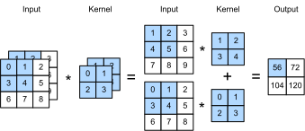
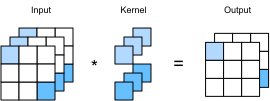

```{.python .input}
%load_ext d2lbook.tab
tab.interact_select(['mxnet', 'pytorch', 'tensorflow', 'jax'])
```

# 多输入多输出通道
:label:`sec_channels`

虽然我们在 :numref:`subsec_why-conv-channels` 中
描述了构成每幅图像的多个通道
（例如，彩色图像具有标准的 RGB 通道，
用来表示红、绿、蓝的分量）
以及多通道的卷积层，
但到目前为止，我们通过只使用单个输入通道和单个输出通道
简化了所有数值示例。
这使我们能够把输入、卷积核
和输出都看作二维张量。

当把通道引入进来之后，
我们的输入和隐藏表示
都变成了三维张量。
例如，每幅 RGB 输入图像的形状为$3\times h\times w$。
我们将这个大小为3的轴称为*通道*（channel）维度。通道的概念
与 CNN 本身一样古老：例如，LeNet-5 :cite:`LeCun.Jackel.Bottou.ea.1995` 就使用了通道。
在本节中，我们将更深入地考察
具有多个输入通道和多个输出通道的卷积核。

```{.python .input}
%%tab mxnet
from d2l import mxnet as d2l
from mxnet import np, npx
npx.set_np()
```

```{.python .input}
%%tab pytorch
from d2l import torch as d2l
import torch
```

```{.python .input}
%%tab jax
from d2l import jax as d2l
import jax
from jax import numpy as jnp
```

```{.python .input}
%%tab tensorflow
from d2l import tensorflow as d2l
import tensorflow as tf
```

## 多输入通道

当输入数据包含多个通道时，
我们需要构造一个
输入通道数与输入数据相同的卷积核，
以便它能与输入数据执行互相关运算。
假设输入数据的通道数为$c_\textrm{i}$，
那么卷积核的输入通道数也需要是$c_\textrm{i}$。如果卷积核的窗口形状为$k_\textrm{h}\times k_\textrm{w}$，
那么当$c_\textrm{i}=1$时，我们可以把卷积核
看作仅仅是一个形状为$k_\textrm{h}\times k_\textrm{w}$的二维张量。

然而，当$c_\textrm{i}>1$时，我们需要一个
包含*每个*输入通道的形状为$k_\textrm{h}\times k_\textrm{w}$的张量的核。将这些$c_\textrm{i}$个张量连结在一起，
就得到一个形状为$c_\textrm{i}\times k_\textrm{h}\times k_\textrm{w}$的卷积核。
由于输入和卷积核各有$c_\textrm{i}$个通道，
我们可以对每个通道的输入二维张量
和卷积核的二维张量
执行互相关运算，再将这$c_\textrm{i}$个结果相加
（对通道求和），
得到一个二维张量。
这就是多通道输入与
多输入通道卷积核之间
二维互相关的结果。

:numref:`fig_conv_multi_in` 给出了
具有两个输入通道的二维互相关的例子。
阴影部分是第一个输出元素，
以及用于输出计算的输入张量和核张量元素：
$(1\times1+2\times2+4\times3+5\times4)+(0\times0+1\times1+3\times2+4\times3)=56$。


:label:`fig_conv_multi_in`


为了确保我们真正理解这里发生的事情，
我们可以自己(**实现多输入通道的互相关运算**)。
注意，我们所做的只是对每个通道
执行一次互相关运算，然后把结果相加。

```{.python .input}
%%tab mxnet, pytorch, jax
def corr2d_multi_in(X, K):
    # Iterate through the 0th dimension (channel) of K first, then add them up
    return sum(d2l.corr2d(x, k) for x, k in zip(X, K))
```

```{.python .input}
%%tab tensorflow
def corr2d_multi_in(X, K):
    # Iterate through the 0th dimension (channel) of K first, then add them up
    return tf.reduce_sum([d2l.corr2d(x, k) for x, k in zip(X, K)], axis=0)
```

我们可以构造与 :numref:`fig_conv_multi_in` 中数值
对应的输入张量`X`和核张量`K`，
以(**验证互相关运算的输出**)。

```{.python .input}
%%tab all
X = d2l.tensor([[[0.0, 1.0, 2.0], [3.0, 4.0, 5.0], [6.0, 7.0, 8.0]],
               [[1.0, 2.0, 3.0], [4.0, 5.0, 6.0], [7.0, 8.0, 9.0]]])
K = d2l.tensor([[[0.0, 1.0], [2.0, 3.0]], [[1.0, 2.0], [3.0, 4.0]]])

corr2d_multi_in(X, K)
```

## 多输出通道
:label:`subsec_multi-output-channels`

无论输入通道数是多少，
到目前为止，我们最终总是只得到一个输出通道。
然而，正如我们在 :numref:`subsec_why-conv-channels` 中所讨论的，
在每一层都拥有多个通道是至关重要的。
在最流行的神经网络架构中，
随着网络加深，我们实际上会增加通道维度，
通常通过下采样来
以空间分辨率换取更大的*通道深度*。
直观地说，你可以把每个通道
看作是对不同特征集合作出响应。
现实比这稍微复杂一些。一种朴素的理解会
认为，表示是按像素或按通道独立学习的。
相反，通道是被联合优化为共同有用的。
这意味着，与其说把单个通道映射为边缘检测器，
不如说可能只是
通道空间中的某个方向对应于检测边缘。

用$c_\textrm{i}$和$c_\textrm{o}$分别表示输入通道数和输出通道数，
用$k_\textrm{h}$和$k_\textrm{w}$表示核的高度和宽度。
为了得到具有多个通道的输出，
我们可以为*每个*输出通道创建
一个形状为$c_\textrm{i}\times k_\textrm{h}\times k_\textrm{w}$
的核张量。
我们将它们在输出通道维度上连结，
于是卷积核的形状为
$c_\textrm{o}\times c_\textrm{i}\times k_\textrm{h}\times k_\textrm{w}$。
在互相关运算中，
每个输出通道上的结果由
与该输出通道对应的卷积核计算得到，
并从输入张量的所有通道获取输入。

如下所示，我们实现一个互相关函数
来[**计算多个通道的输出**]。

```{.python .input}
%%tab all
def corr2d_multi_in_out(X, K):
    # Iterate through the 0th dimension of K, and each time, perform
    # cross-correlation operations with input X. All of the results are
    # stacked together
    return d2l.stack([corr2d_multi_in(X, k) for k in K], 0)
```

我们通过将核张量`K`与`K+1`和`K+2`连结，
构造一个
具有三个输出通道的简单卷积核。

```{.python .input}
%%tab all
K = d2l.stack((K, K + 1, K + 2), 0)
K.shape
```

下面，我们用核张量`K`
对输入张量`X`执行互相关运算。
现在输出包含三个通道。
第一个通道的结果与
之前输入张量`X`和多输入通道、
单输出通道核的结果一致。

```{.python .input}
%%tab all
corr2d_multi_in_out(X, K)
```

## $1\times 1$卷积层
:label:`subsec_1x1`

乍一看，[**$1 \times 1$卷积**]（即$k_\textrm{h} = k_\textrm{w} = 1$）
似乎没有多大意义。
毕竟，卷积关联的是相邻像素。
而$1 \times 1$卷积显然不是这样。
尽管如此，它们仍是常用的运算，
有时会被纳入复杂深度网络的设计中 :cite:`Lin.Chen.Yan.2013,Szegedy.Ioffe.Vanhoucke.ea.2017`。
让我们较为详细地看看它实际做了什么。

由于使用了最小的窗口，
$1\times 1$卷积失去了较大的卷积层
在高度和宽度维度上识别由相邻元素交互
构成的模式的能力。
$1\times 1$卷积的唯一计算
发生在通道维度上。

:numref:`fig_conv_1x1` 展示了
使用$1\times 1$卷积核、
具有3个输入通道和2个输出通道的互相关计算。
注意，输入和输出具有相同的高度和宽度。
输出中的每个元素都来自
输入图像中*同一位置*元素的线性组合。
你可以把$1\times 1$卷积层
看作是在每个像素位置上都应用了一个全连接层，
将$c_\textrm{i}$个相应的输入值变换为$c_\textrm{o}$个输出值。
由于这仍然是一个卷积层，
权重在各像素位置之间是共享的。
因此，$1\times 1$卷积层需要$c_\textrm{o}\times c_\textrm{i}$个权重
（加上偏置）。还要注意，卷积层之后通常
接有非线性。这确保了$1 \times 1$卷积不能简单地
折叠进其他卷积中。


:label:`fig_conv_1x1`

让我们在实践中检验这是否可行：
我们用全连接层实现一个$1 \times 1$卷积。
唯一需要做的是，在矩阵乘法前后
对数据形状做一些调整。

```{.python .input}
%%tab all
def corr2d_multi_in_out_1x1(X, K):
    c_i, h, w = X.shape
    c_o = K.shape[0]
    X = d2l.reshape(X, (c_i, h * w))
    K = d2l.reshape(K, (c_o, c_i))
    # Matrix multiplication in the fully connected layer
    Y = d2l.matmul(K, X)
    return d2l.reshape(Y, (c_o, h, w))
```

在执行$1\times 1$卷积时，
上面的函数等价于之前实现的互相关函数`corr2d_multi_in_out`。
让我们用一些样本数据来检验这一点。

```{.python .input}
%%tab mxnet, pytorch
X = d2l.normal(0, 1, (3, 3, 3))
K = d2l.normal(0, 1, (2, 3, 1, 1))
Y1 = corr2d_multi_in_out_1x1(X, K)
Y2 = corr2d_multi_in_out(X, K)
assert float(d2l.reduce_sum(d2l.abs(Y1 - Y2))) < 1e-6
```

```{.python .input}
%%tab tensorflow
X = d2l.normal((3, 3, 3), 0, 1)
K = d2l.normal((2, 3, 1, 1), 0, 1)
Y1 = corr2d_multi_in_out_1x1(X, K)
Y2 = corr2d_multi_in_out(X, K)
assert float(d2l.reduce_sum(d2l.abs(Y1 - Y2))) < 1e-6
```

```{.python .input}
%%tab jax
X = jax.random.normal(jax.random.PRNGKey(d2l.get_seed()), (3, 3, 3)) + 0 * 1
K = jax.random.normal(jax.random.PRNGKey(d2l.get_seed()), (2, 3, 1, 1)) + 0 * 1
Y1 = corr2d_multi_in_out_1x1(X, K)
Y2 = corr2d_multi_in_out(X, K)
assert float(d2l.reduce_sum(d2l.abs(Y1 - Y2))) < 1e-6
```

## 讨论

通道使我们能够兼得两者之长：既有多层感知机带来的显著非线性，又有卷积带来的对特征的*局部化*分析。特别地，通道使 CNN 能够同时用多种特征进行推理，例如边缘检测器和形状检测器。它们还在平移不变性和局部性带来的参数急剧减少与计算机视觉中对表达能力强且多样的模型的需求之间，提供了一种实际的权衡。

不过请注意，这种灵活性是有代价的。给定一幅大小为$(h \times w)$的图像，计算$k \times k$卷积的代价为$\mathcal{O}(h \cdot w \cdot k^2)$。对于分别为$c_\textrm{i}$和$c_\textrm{o}$的输入和输出通道数，这会增加到$\mathcal{O}(h \cdot w \cdot k^2 \cdot c_\textrm{i} \cdot c_\textrm{o})$。对于一幅$256 \times 256$像素的图像、$5 \times 5$的核以及分别为$128$的输入和输出通道数，这总计超过530亿次运算（我们分别统计乘法和加法）。稍后我们将遇到降低代价的有效策略，例如要求逐通道运算是块对角的，从而引出 ResNeXt :cite:`Xie.Girshick.Dollar.ea.2017` 之类的架构。

## 练习

1. 假设我们有两个大小分别为$k_1$和$k_2$的卷积核
   （中间没有非线性）。
    1. 证明该运算的结果可以用单个卷积表示。
    1. 等价的单个卷积的维度是多少？
    1. 反过来是否成立，即你总能把一个卷积分解为两个更小的卷积？
1. 假设输入形状为$c_\textrm{i}\times h\times w$，卷积核形状为
   $c_\textrm{o}\times c_\textrm{i}\times k_\textrm{h}\times k_\textrm{w}$，填充为$(p_\textrm{h}, p_\textrm{w})$，步幅为$(s_\textrm{h}, s_\textrm{w})$。
    1. 前向传播的计算代价（乘法和加法）是多少？
    1. 内存占用是多少？
    1. 反向计算的内存占用是多少？
    1. 反向传播的计算代价是多少？
1. 如果同时将输入通道数
   $c_\textrm{i}$和输出通道数$c_\textrm{o}$加倍，计算量会增加多少倍？如果将填充加倍，又会发生什么？
1. 本节最后一个示例中的变量`Y1`和`Y2`完全相同吗？为什么？
1. 即使卷积窗口不是$1 \times 1$，也将卷积表示为矩阵乘法。
1. 你的任务是用$k \times k$的核实现快速卷积。候选算法之一
   是水平扫描源数据，读取一条$k$宽的条带，并一次计算一个值的$1$宽输出条带。
   另一种做法是读取$k + \Delta$宽的条带，并计算$\Delta$宽
   的输出条带。为什么后者更可取？$\Delta$的取值是否有上限？
1. 假设我们有一个$c \times c$的矩阵。
    1. 如果将该矩阵分解为$b$个块，与块对角矩阵相乘会快多少？
    1. 分成$b$个块有什么缺点？你怎样才能（至少部分地）解决它？

:begin_tab:`mxnet`
[讨论](https://discuss.d2l.ai/t/69)
:end_tab:

:begin_tab:`pytorch`
[讨论](https://discuss.d2l.ai/t/70)
:end_tab:

:begin_tab:`tensorflow`
[讨论](https://discuss.d2l.ai/t/273)
:end_tab:

:begin_tab:`jax`
[讨论](https://discuss.d2l.ai/t/17998)
:end_tab:
