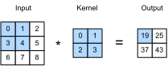

```{.python .input}
%load_ext d2lbook.tab
tab.interact_select(['mxnet', 'pytorch', 'tensorflow', 'jax'])
```

# 图像的卷积
:label:`sec_conv_layer`

既然我们已经从理论上理解了卷积层如何工作，
现在就可以看看它们在实践中如何工作。
基于将卷积神经网络作为探索图像数据结构的
高效架构这一动机，
我们继续以图像作为贯穿的例子。

```{.python .input}
%%tab mxnet
from d2l import mxnet as d2l
from mxnet import autograd, np, npx
from mxnet.gluon import nn
npx.set_np()
```

```{.python .input}
%%tab pytorch
from d2l import torch as d2l
import torch
from torch import nn
```

```{.python .input}
%%tab jax
from d2l import jax as d2l
from flax import linen as nn
import jax
from jax import numpy as jnp
```

```{.python .input}
%%tab tensorflow
from d2l import tensorflow as d2l
import tensorflow as tf
```

## 互相关运算

回想一下，严格来说，卷积层是一个用词不当的名称，
因为它们所表达的运算
更准确地说是互相关。
基于我们在 :numref:`sec_why-conv` 中对卷积层的描述，
在这样的层中，输入张量
和核张量通过
(**互相关运算**)
组合起来产生输出张量。

我们暂时忽略通道，看看它在二维数据和隐藏表示上如何工作。
在 :numref:`fig_correlation` 中，
输入是一个高度为3、宽度为3的二维张量。
我们把张量的形状记为$3 \times 3$或（$3$，$3$）。
核的高度和宽度都是2。
*核窗口*（或*卷积窗口*）
的形状由核的高度和宽度决定
（这里是$2 \times 2$）。


:label:`fig_correlation`

在二维互相关运算中，
我们首先将卷积窗口放在输入张量的左上角，
然后让它从左到右、从上到下地滑过输入张量。
当卷积窗口滑动到某个位置时，
该窗口所包含的输入子张量
与核张量按元素相乘，
再将所得张量求和，
得到一个标量值。
这个结果就是输出张量在相应位置上的值。
这里，输出张量的高度为2、宽度为2，
四个元素由
二维互相关运算导出：

$$
0\times0+1\times1+3\times2+4\times3=19,\\
1\times0+2\times1+4\times2+5\times3=25,\\
3\times0+4\times1+6\times2+7\times3=37,\\
4\times0+5\times1+7\times2+8\times3=43.
$$

注意，沿每个轴，输出尺寸
都略小于输入尺寸。
由于核的宽度和高度都大于$1$，
我们只能在核完全位于图像内部的位置正确计算互相关，
输出尺寸由输入尺寸$n_\textrm{h} \times n_\textrm{w}$
减去卷积核尺寸$k_\textrm{h} \times k_\textrm{w}$得到，
即

$$(n_\textrm{h}-k_\textrm{h}+1) \times (n_\textrm{w}-k_\textrm{w}+1).$$

之所以如此，是因为我们需要足够的空间
来在图像上“移动”卷积核。
稍后我们将看到如何通过在图像边界周围填充零
来保持尺寸不变，
以便有足够的空间移动卷积核。
接下来，我们在`corr2d`函数中实现这一过程，
该函数接受输入张量`X`和核张量`K`，
并返回输出张量`Y`。

```{.python .input}
%%tab mxnet
def corr2d(X, K):  #@save
    """Compute 2D cross-correlation."""
    h, w = K.shape
    Y = d2l.zeros((X.shape[0] - h + 1, X.shape[1] - w + 1))
    for i in range(Y.shape[0]):
        for j in range(Y.shape[1]):
            Y[i, j] = d2l.reduce_sum((X[i: i + h, j: j + w] * K))
    return Y
```

```{.python .input}
%%tab pytorch
def corr2d(X, K):  #@save
    """Compute 2D cross-correlation."""
    h, w = K.shape
    Y = d2l.zeros((X.shape[0] - h + 1, X.shape[1] - w + 1))
    for i in range(Y.shape[0]):
        for j in range(Y.shape[1]):
            Y[i, j] = d2l.reduce_sum((X[i: i + h, j: j + w] * K))
    return Y
```

```{.python .input}
%%tab jax
def corr2d(X, K):  #@save
    """Compute 2D cross-correlation."""
    h, w = K.shape
    Y = jnp.zeros((X.shape[0] - h + 1, X.shape[1] - w + 1))
    for i in range(Y.shape[0]):
        for j in range(Y.shape[1]):
            Y = Y.at[i, j].set((X[i:i + h, j:j + w] * K).sum())
    return Y
```

```{.python .input}
%%tab tensorflow
def corr2d(X, K):  #@save
    """Compute 2D cross-correlation."""
    h, w = K.shape
    Y = tf.Variable(tf.zeros((X.shape[0] - h + 1, X.shape[1] - w + 1)))
    for i in range(Y.shape[0]):
        for j in range(Y.shape[1]):
            Y[i, j].assign(tf.reduce_sum(
                X[i: i + h, j: j + w] * K))
    return Y
```

我们可以根据 :numref:`fig_correlation` 构造输入张量`X`和核张量`K`，
以[**验证上述实现的输出**]，
即二维互相关运算的输出。

```{.python .input}
%%tab all
X = d2l.tensor([[0.0, 1.0, 2.0], [3.0, 4.0, 5.0], [6.0, 7.0, 8.0]])
K = d2l.tensor([[0.0, 1.0], [2.0, 3.0]])
corr2d(X, K)
```

## 卷积层

卷积层将输入和核进行互相关运算，
并加上一个标量偏置来产生输出。
卷积层的两个参数
是核和标量偏置。
当训练基于卷积层的模型时，
我们通常随机初始化核，
就像处理全连接层时一样。

现在，我们准备基于上面定义的`corr2d`函数
[**实现一个二维卷积层**]。
在`__init__`构造方法中，
我们声明`weight`和`bias`作为两个模型参数。
前向传播方法
调用`corr2d`函数并加上偏置。

```{.python .input}
%%tab mxnet
class Conv2D(nn.Block):
    def __init__(self, kernel_size, **kwargs):
        super().__init__(**kwargs)
        self.weight = self.params.get('weight', shape=kernel_size)
        self.bias = self.params.get('bias', shape=(1,))

    def forward(self, x):
        return corr2d(x, self.weight.data()) + self.bias.data()
```

```{.python .input}
%%tab pytorch
class Conv2D(nn.Module):
    def __init__(self, kernel_size):
        super().__init__()
        self.weight = nn.Parameter(torch.rand(kernel_size))
        self.bias = nn.Parameter(torch.zeros(1))

    def forward(self, x):
        return corr2d(x, self.weight) + self.bias
```

```{.python .input}
%%tab tensorflow
class Conv2D(tf.keras.layers.Layer):
    def __init__(self):
        super().__init__()

    def build(self, kernel_size):
        initializer = tf.random_normal_initializer()
        self.weight = self.add_weight(name='w', shape=kernel_size,
                                      initializer=initializer)
        self.bias = self.add_weight(name='b', shape=(1, ),
                                    initializer=initializer)

    def call(self, inputs):
        return corr2d(inputs, self.weight) + self.bias
```

```{.python .input}
%%tab jax
class Conv2D(nn.Module):
    kernel_size: int

    def setup(self):
        self.weight = nn.param('w', nn.initializers.uniform, self.kernel_size)
        self.bias = nn.param('b', nn.initializers.zeros, 1)

    def forward(self, x):
        return corr2d(x, self.weight) + self.bias
```

在
$h \times w$卷积
或$h \times w$卷积核中，
卷积核的高度和宽度分别为$h$和$w$。
我们也将
带有$h \times w$
卷积核的卷积层
简称为$h \times w$卷积层。


## 图像中目标的边缘检测

让我们花点时间解析
[**卷积层的一个简单应用：
通过找到像素变化的位置来检测图像中目标的边缘**]。
首先，我们构造一个$6\times 8$像素的“图像”。
中间四列为黑色（$0$），其余为白色（$1$）。

```{.python .input}
%%tab mxnet, pytorch
X = d2l.ones((6, 8))
X[:, 2:6] = 0
X
```

```{.python .input}
%%tab tensorflow
X = tf.Variable(tf.ones((6, 8)))
X[:, 2:6].assign(tf.zeros(X[:, 2:6].shape))
X
```

```{.python .input}
%%tab jax
X = jnp.ones((6, 8))
X = X.at[:, 2:6].set(0)
X
```

接下来，我们构造一个高度为1、宽度为2的核`K`。
当我们用它与输入执行互相关运算时，
如果水平相邻的元素相同，
输出为0。
否则，输出非零。
注意，这个核是有限差分算子的一个特例。在位置$(i,j)$处，它计算$x_{i,j} - x_{(i+1),j}$，即计算水平相邻像素值之差。这是水平方向一阶导数的离散近似。毕竟，对于函数$f(i,j)$，其导数$-\partial_i f(i,j) = \lim_{\epsilon \to 0} \frac{f(i,j) - f(i+\epsilon,j)}{\epsilon}$。让我们看看这在实践中如何工作。

```{.python .input}
%%tab all
K = d2l.tensor([[1.0, -1.0]])
```

我们现在准备用参数`X`（我们的输入）和`K`（我们的核）
执行互相关运算。
如你所见，[**对于从白到黑的边缘我们检测到$1$，
对于从黑到白的边缘检测到$-1$。**]
其余所有输出值均为$0$。

```{.python .input}
%%tab all
Y = corr2d(X, K)
Y
```

现在我们可以将这个核应用于转置后的图像。
正如预期的那样，它消失了。[**核`K`只能检测垂直边缘。**]

```{.python .input}
%%tab all
corr2d(d2l.transpose(X), K)
```

## 学习卷积核

如果我们知道要找的正是边缘，
那么用有限差分`[1, -1]`设计一个边缘检测器是简洁的。
然而，当我们考察更大的核，
并考虑连续的卷积层时，
可能无法手工精确指定
每个滤波器应该做什么。

现在，让我们看看能否仅通过观察输入—输出对
来[**学习由`X`生成`Y`的核**]。
我们首先构造一个卷积层，
并将其核初始化为随机张量。
接下来，在每次迭代中，我们将使用平方误差
来比较`Y`与卷积层的输出。
然后，我们可以计算梯度来更新核。
为简单起见，
下面我们使用内置的
二维卷积层类，
并忽略偏置。

```{.python .input}
%%tab mxnet
# Construct a two-dimensional convolutional layer with 1 output channel and a
# kernel of shape (1, 2). For the sake of simplicity, we ignore the bias here
conv2d = nn.Conv2D(1, kernel_size=(1, 2), use_bias=False)
conv2d.initialize()

# The two-dimensional convolutional layer uses four-dimensional input and
# output in the format of (example, channel, height, width), where the batch
# size (number of examples in the batch) and the number of channels are both 1
X = X.reshape(1, 1, 6, 8)
Y = Y.reshape(1, 1, 6, 7)
lr = 3e-2  # Learning rate

for i in range(10):
    with autograd.record():
        Y_hat = conv2d(X)
        l = (Y_hat - Y) ** 2
    l.backward()
    # Update the kernel
    conv2d.weight.data()[:] -= lr * conv2d.weight.grad()
    if (i + 1) % 2 == 0:
        print(f'epoch {i + 1}, loss {float(l.sum()):.3f}')
```

```{.python .input}
%%tab pytorch
# Construct a two-dimensional convolutional layer with 1 output channel and a
# kernel of shape (1, 2). For the sake of simplicity, we ignore the bias here
conv2d = nn.LazyConv2d(1, kernel_size=(1, 2), bias=False)

# The two-dimensional convolutional layer uses four-dimensional input and
# output in the format of (example, channel, height, width), where the batch
# size (number of examples in the batch) and the number of channels are both 1
X = X.reshape((1, 1, 6, 8))
Y = Y.reshape((1, 1, 6, 7))
lr = 3e-2  # Learning rate

for i in range(10):
    Y_hat = conv2d(X)
    l = (Y_hat - Y) ** 2
    conv2d.zero_grad()
    l.sum().backward()
    # Update the kernel
    conv2d.weight.data[:] -= lr * conv2d.weight.grad
    if (i + 1) % 2 == 0:
        print(f'epoch {i + 1}, loss {l.sum():.3f}')
```

```{.python .input}
%%tab tensorflow
# Construct a two-dimensional convolutional layer with 1 output channel and a
# kernel of shape (1, 2). For the sake of simplicity, we ignore the bias here
conv2d = tf.keras.layers.Conv2D(1, (1, 2), use_bias=False)

# The two-dimensional convolutional layer uses four-dimensional input and
# output in the format of (example, height, width, channel), where the batch
# size (number of examples in the batch) and the number of channels are both 1
X = tf.reshape(X, (1, 6, 8, 1))
Y = tf.reshape(Y, (1, 6, 7, 1))
lr = 3e-2  # Learning rate

Y_hat = conv2d(X)
for i in range(10):
    with tf.GradientTape(watch_accessed_variables=False) as g:
        g.watch(conv2d.weights[0])
        Y_hat = conv2d(X)
        l = (abs(Y_hat - Y)) ** 2
        # Update the kernel
        update = tf.multiply(lr, g.gradient(l, conv2d.weights[0]))
        weights = conv2d.get_weights()
        weights[0] = conv2d.weights[0] - update
        conv2d.set_weights(weights)
        if (i + 1) % 2 == 0:
            print(f'epoch {i + 1}, loss {tf.reduce_sum(l):.3f}')
```

```{.python .input}
%%tab jax
# Construct a two-dimensional convolutional layer with 1 output channel and a
# kernel of shape (1, 2). For the sake of simplicity, we ignore the bias here
conv2d = nn.Conv(1, kernel_size=(1, 2), use_bias=False, padding='VALID')

# The two-dimensional convolutional layer uses four-dimensional input and
# output in the format of (example, height, width, channel), where the batch
# size (number of examples in the batch) and the number of channels are both 1
X = X.reshape((1, 6, 8, 1))
Y = Y.reshape((1, 6, 7, 1))
lr = 3e-2  # Learning rate

params = conv2d.init(jax.random.PRNGKey(d2l.get_seed()), X)

def loss(params, X, Y):
    Y_hat = conv2d.apply(params, X)
    return ((Y_hat - Y) ** 2).sum()

for i in range(10):
    l, grads = jax.value_and_grad(loss)(params, X, Y)
    # Update the kernel
    params = jax.tree_map(lambda p, g: p - lr * g, params, grads)
    if (i + 1) % 2 == 0:
        print(f'epoch {i + 1}, loss {l:.3f}')
```

注意，经过10次迭代后，误差已经降到很小的值。现在我们将[**看看学习到的核张量。**]

```{.python .input}
%%tab mxnet
d2l.reshape(conv2d.weight.data(), (1, 2))
```

```{.python .input}
%%tab pytorch
d2l.reshape(conv2d.weight.data, (1, 2))
```

```{.python .input}
%%tab tensorflow
d2l.reshape(conv2d.get_weights()[0], (1, 2))
```

```{.python .input}
%%tab jax
params['params']['kernel'].reshape((1, 2))
```

确实，学习到的核张量
与之前定义的核张量`K`非常接近。

## 互相关与卷积

回想我们在 :numref:`sec_why-conv` 中观察到的
互相关运算与卷积运算之间的对应关系。
这里我们继续考虑二维卷积层。
如果这类层
执行的是 :eqref:`eq_2d-conv-discrete` 中所定义的严格卷积运算，
而不是互相关运算，会怎样呢？
为了得到严格*卷积*运算的输出，我们只需将二维核张量在水平和垂直方向上翻转，然后与输入张量执行*互相关*运算。

值得注意的是，由于在深度学习中核是从数据中学习得到的，
所以无论这类层
执行的是
严格卷积运算
还是互相关运算，
卷积层的输出都保持不变。

为了说明这一点，假设某个卷积层执行*互相关*，并学习到 :numref:`fig_correlation` 中的核，这里将其记为矩阵$\mathbf{K}$。
假设其他条件保持不变，
当该层改为执行严格*卷积*时，
学习到的核$\mathbf{K}'$
——将$\mathbf{K}'$在水平和垂直方向翻转之后——
将与$\mathbf{K}$相同。
也就是说，
当卷积层
对 :numref:`fig_correlation` 中的输入和$\mathbf{K}'$
执行严格*卷积*时，
将得到与 :numref:`fig_correlation` 中
（输入与$\mathbf{K}$的互相关）
相同的输出。

为了与深度学习文献中的标准术语保持一致，
我们将继续把互相关运算
称为卷积，尽管严格来说它略有不同。
此外，
我们用术语*元素*（element）来指代
表示层表示或卷积核的任意张量的
一个条目（或分量）。


## 特征图与感受野

如 :numref:`subsec_why-conv-channels` 所述，
:numref:`fig_correlation`
中的卷积层输出
有时被称为*特征图*，
因为它可以被看作是在空间维度（例如宽度和高度）上
为后续层提供的已学习表示（特征）。
在 CNN 中，
对于某一层的任意元素$x$，
其*感受野*（receptive field）是指
在前向传播过程中
可能影响$x$的计算的
所有元素（来自所有之前的层）。
注意，感受野
可能大于输入的实际尺寸。

我们继续用 :numref:`fig_correlation` 来解释感受野。
给定$2 \times 2$的卷积核，
阴影输出元素（值为$19$）的感受野
是
输入中阴影部分的四个元素。
现在，我们将$2 \times 2$的
输出记为$\mathbf{Y}$，
并考虑一个更深的 CNN，
它增加一个以$\mathbf{Y}$为输入的$2 \times 2$卷积层，
输出
单个元素$z$。
在这种情况下，
$z$在$\mathbf{Y}$上的感受野
包括$\mathbf{Y}$的全部四个元素，
而
在输入上的感受野
包括全部九个输入元素。
因此，
当特征图中的任意元素
需要更大的感受野
来在更广阔的区域上检测输入特征时，
我们可以构建更深的网络。


感受野这个名称来自神经生理学。
一系列对不同动物使用不同刺激的实验
:cite:`Hubel.Wiesel.1959,Hubel.Wiesel.1962,Hubel.Wiesel.1968` 探究了所谓的视觉
皮层对这些刺激的响应。总的来说，他们发现较低层次对边缘及相关
形状作出响应。后来，:citet:`Field.1987` 用只能称之为卷积核的东西，在自然
图像上说明了这种效应。
我们在 :numref:`field_visual` 中转载了一幅关键图，以说明这种惊人的相似性。


:label:`field_visual`

事实证明，这种关系甚至对在图像分类任务上训练的网络较深层所计算的特征也成立，例如 :citet:`Kuzovkin.Vicente.Petton.ea.2018` 所展示的那样。可以毫不夸张地说，卷积已被证明是计算机视觉中一个极其强大的工具，无论在生物学中还是在代码中都是如此。因此，（事后看来）它们预示着深度学习近期的成功，这一点并不令人惊讶。

## 小结

卷积层所需的核心计算是互相关运算。我们看到，计算它的值只需要一个简单的嵌套 for 循环。如果我们有多个输入通道和多个输出通道，那么就是在通道之间执行矩阵—矩阵运算。可以看出，这种计算非常简单，而且最重要的是，它高度*局部*。这为显著的硬件优化提供了条件，计算机视觉领域的许多近期成果正是因此才成为可能。毕竟，这意味着在为卷积进行优化时，芯片设计者可以投资于快速计算，而不是内存。虽然这对其他应用可能不会带来最优设计，但它确实为无处不在且价格可负担的计算机视觉打开了大门。

就卷积本身而言，它们可以用于许多目的，例如检测边缘和线条、模糊图像或锐化图像。最重要的是，不需要统计学家（或工程师）发明合适的滤波器。相反，我们可以直接从数据中*学习*它们。这用基于证据的统计取代了特征工程的启发式规则。最后，令人十分高兴的是，这些滤波器不仅有利于构建深度网络，而且还对应大脑中的感受野和特征图。这让我们相信，我们走在正确的道路上。

## 练习

1. 构造一幅带有对角边缘的图像`X`。
    1. 如果把本节中的核`K`应用于它，会发生什么？
    1. 如果转置`X`，会发生什么？
    1. 如果转置`K`，会发生什么？
1. 手工设计一些核。
    1. 给定方向向量$\mathbf{v} = (v_1, v_2)$，推导一个边缘检测核，用于检测
       与$\mathbf{v}$正交的边缘，即沿$(v_2, -v_1)$方向的边缘。
    1. 推导二阶导数的有限差分算子。与之相关的
       卷积核的最小尺寸是多少？图像中哪些结构对它响应最强烈？
    1. 你会如何设计一个模糊核？为什么可能想使用这样的核？
    1. 要得到$d$阶导数，核的最小尺寸是多少？
1. 当你尝试为我们创建的`Conv2D`类自动求梯度时，会看到什么样的错误消息？
1. 如何通过改变输入张量和核张量，将互相关运算表示为矩阵乘法？

:begin_tab:`mxnet`
[讨论](https://discuss.d2l.ai/t/65)
:end_tab:

:begin_tab:`pytorch`
[讨论](https://discuss.d2l.ai/t/66)
:end_tab:

:begin_tab:`tensorflow`
[讨论](https://discuss.d2l.ai/t/271)
:end_tab:

:begin_tab:`jax`
[讨论](https://discuss.d2l.ai/t/17996)
:end_tab:
