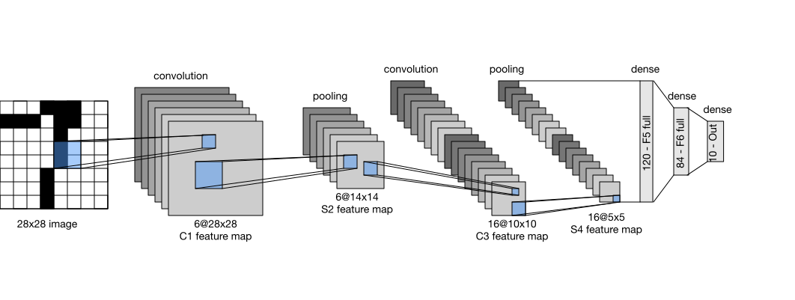
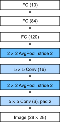

```{.python .input}
%load_ext d2lbook.tab
tab.interact_select(['mxnet', 'pytorch', 'tensorflow', 'jax'])
```

# 卷积神经网络（LeNet）
:label:`sec_lenet`

现在，我们已经具备了
组装一个功能完备的 CNN 所需的全部要素。
在之前处理图像数据时，我们对
Fashion-MNIST 数据集中的服装图片应用了
带 softmax 回归的线性模型（:numref:`sec_softmax_scratch`）
和多层感知机（:numref:`sec_mlp-implementation`）。
为了使这类数据适合处理，我们首先将每幅图像从$28\times28$的矩阵
展平为一个固定长度的$784$维向量，
然后用全连接层对其进行处理。
既然我们已经掌握了卷积层，
就可以保留图像中的空间结构。
用卷积层替换全连接层的另一个好处是，
我们将获得参数少得多的更简约的模型。

在本节中，我们将介绍*LeNet*，
它是最早发表的 CNN 之一，
因其在计算机视觉任务上的性能而广受关注。
该模型由当时在 AT&T 贝尔实验室工作的研究者
Yann LeCun 提出（并以他的名字命名），
目的是识别图像中的手写数字 :cite:`LeCun.Bottou.Bengio.ea.1998`。
这项工作代表了
十年技术研发的顶峰；
LeCun 的团队发表了第一项
通过反向传播成功训练 CNN 的研究 :cite:`LeCun.Boser.Denker.ea.1989`。

当时，LeNet 取得了出色的结果，
与支持向量机（当时监督学习中的主流方法）的性能相匹配，
每个数字的错误率低于1%。
LeNet 最终被改造用于识别数字，
以处理 ATM 机中的存款。
时至今日，一些 ATM 机仍在运行
Yann LeCun 和他的同事 Leon Bottou 在20世纪90年代编写的代码！

```{.python .input}
%%tab mxnet
from d2l import mxnet as d2l
from mxnet import autograd, gluon, init, np, npx
from mxnet.gluon import nn
npx.set_np()
```

```{.python .input}
%%tab pytorch
from d2l import torch as d2l
import torch
from torch import nn
```

```{.python .input}
%%tab tensorflow
import tensorflow as tf
from d2l import tensorflow as d2l
```

```{.python .input}
%%tab jax
from d2l import jax as d2l
from flax import linen as nn
import jax
from jax import numpy as jnp
from types import FunctionType
```

## LeNet

从高层来看，(**LeNet（LeNet-5）由两部分组成：
(i) 由两个卷积层组成的卷积编码器；
(ii) 由三个全连接层组成的稠密块**)。
其架构概括在 :numref:`img_lenet` 中。


:label:`img_lenet`

每个卷积块中的基本单元
是卷积层、sigmoid 激活函数
以及随后的平均汇聚操作。
注意，虽然 ReLU 和最大汇聚效果更好，
但当时它们尚未被发现。
每个卷积层使用$5\times 5$的核
和 sigmoid 激活函数。
这些层将空间排列的输入
映射为若干二维特征图，通常
会增加通道数。
第一个卷积层有6个输出通道，
第二个有16个。
每个$2\times2$汇聚操作（步幅2）
通过空间下采样将维度缩小$4$倍。
卷积块输出的形状为
（批量大小，通道数，高度，宽度）。

为了将卷积块的输出
传递给稠密块，
我们必须将小批量中的每个样例展平。
换句话说，我们取这个四维输入，并将其变换为
全连接层所期望的二维输入：
提醒一下，我们所需的二维表示用第一个维度索引小批量中的样例，
用第二个维度给出每个样例的展平向量表示。
LeNet 的稠密块有三个全连接层，
分别有120、84和10个输出。
因为我们仍在执行分类，
所以10维的输出层对应于
可能的输出类别数。

要真正理解
LeNet 内部发生了什么，可能需要费一番功夫，
但我们希望下面的代码片段能让你相信：
用现代深度学习框架实现这类模型
是极其简单的。
我们只需实例化一个`Sequential`块，
并将合适的层依次串联起来，
同时使用 :numref:`subsec_xavier` 中
介绍的 Xavier 初始化。

```{.python .input}
%%tab pytorch
def init_cnn(module):  #@save
    """Initialize weights for CNNs."""
    if type(module) == nn.Linear or type(module) == nn.Conv2d:
        nn.init.xavier_uniform_(module.weight)
```

```{.python .input}
%%tab pytorch, mxnet, tensorflow
class LeNet(d2l.Classifier):  #@save
    """The LeNet-5 model."""
    def __init__(self, lr=0.1, num_classes=10):
        super().__init__()
        self.save_hyperparameters()
        if tab.selected('mxnet'):
            self.net = nn.Sequential()
            self.net.add(
                nn.Conv2D(channels=6, kernel_size=5, padding=2,
                          activation='sigmoid'),
                nn.AvgPool2D(pool_size=2, strides=2),
                nn.Conv2D(channels=16, kernel_size=5, activation='sigmoid'),
                nn.AvgPool2D(pool_size=2, strides=2),
                nn.Dense(120, activation='sigmoid'),
                nn.Dense(84, activation='sigmoid'),
                nn.Dense(num_classes))
            self.net.initialize(init.Xavier())
        if tab.selected('pytorch'):
            self.net = nn.Sequential(
                nn.LazyConv2d(6, kernel_size=5, padding=2), nn.Sigmoid(),
                nn.AvgPool2d(kernel_size=2, stride=2),
                nn.LazyConv2d(16, kernel_size=5), nn.Sigmoid(),
                nn.AvgPool2d(kernel_size=2, stride=2),
                nn.Flatten(),
                nn.LazyLinear(120), nn.Sigmoid(),
                nn.LazyLinear(84), nn.Sigmoid(),
                nn.LazyLinear(num_classes))
        if tab.selected('tensorflow'):
            self.net = tf.keras.models.Sequential([
                tf.keras.layers.Conv2D(filters=6, kernel_size=5,
                                       activation='sigmoid', padding='same'),
                tf.keras.layers.AvgPool2D(pool_size=2, strides=2),
                tf.keras.layers.Conv2D(filters=16, kernel_size=5,
                                       activation='sigmoid'),
                tf.keras.layers.AvgPool2D(pool_size=2, strides=2),
                tf.keras.layers.Flatten(),
                tf.keras.layers.Dense(120, activation='sigmoid'),
                tf.keras.layers.Dense(84, activation='sigmoid'),
                tf.keras.layers.Dense(num_classes)])
```

```{.python .input}
%%tab jax
class LeNet(d2l.Classifier):  #@save
    """The LeNet-5 model."""
    lr: float = 0.1
    num_classes: int = 10
    kernel_init: FunctionType = nn.initializers.xavier_uniform

    def setup(self):
        self.net = nn.Sequential([
            nn.Conv(features=6, kernel_size=(5, 5), padding='SAME',
                    kernel_init=self.kernel_init()),
            nn.sigmoid,
            lambda x: nn.avg_pool(x, window_shape=(2, 2), strides=(2, 2)),
            nn.Conv(features=16, kernel_size=(5, 5), padding='VALID',
                    kernel_init=self.kernel_init()),
            nn.sigmoid,
            lambda x: nn.avg_pool(x, window_shape=(2, 2), strides=(2, 2)),
            lambda x: x.reshape((x.shape[0], -1)),  # flatten
            nn.Dense(features=120, kernel_init=self.kernel_init()),
            nn.sigmoid,
            nn.Dense(features=84, kernel_init=self.kernel_init()),
            nn.sigmoid,
            nn.Dense(features=self.num_classes, kernel_init=self.kernel_init())
        ])
```

在复现 LeNet 时，我们做了一点自由处理，把
高斯激活层替换成了 softmax 层。这大大简化了实现，尤其是因为
如今很少使用高斯解码器。除此之外，这个网络
与原版 LeNet-5 架构一致。

:begin_tab:`pytorch, mxnet, tensorflow`
让我们看看网络内部发生了什么。将一个
单通道（黑白）
$28 \times 28$的图像输入网络，
并打印每一层的输出形状，
我们就可以[**检查模型**]，以确保
其运算与我们期望的
:numref:`img_lenet_vert` 一致。
:end_tab:

:begin_tab:`jax`
让我们看看网络内部发生了什么。将一个
单通道（黑白）
$28 \times 28$的图像输入网络，
并打印每一层的输出形状，
我们就可以[**检查模型**]，以确保
其运算与我们期望的
:numref:`img_lenet_vert` 一致。
Flax 提供了`nn.tabulate`，这是一个用于汇总网络中
各个层和参数的巧妙方法。这里我们使用`bind`方法创建绑定模型。
此时变量被绑定到`d2l.Module`类，即这个绑定模型
变成了一个有状态对象，随后可以用它来访问`Sequential`
对象属性`net`以及其中的`layers`。注意，`bind`方法
只应用于交互式实验，它并不是`apply`方法的直接
替代品。
:end_tab:


:label:`img_lenet_vert`

```{.python .input}
%%tab mxnet, pytorch
@d2l.add_to_class(d2l.Classifier)  #@save
def layer_summary(self, X_shape):
    X = d2l.randn(*X_shape)
    for layer in self.net:
        X = layer(X)
        print(layer.__class__.__name__, 'output shape:\t', X.shape)
        
model = LeNet()
model.layer_summary((1, 1, 28, 28))
```

```{.python .input}
%%tab tensorflow
@d2l.add_to_class(d2l.Classifier)  #@save
def layer_summary(self, X_shape):
    X = d2l.normal(X_shape)
    for layer in self.net.layers:
        X = layer(X)
        print(layer.__class__.__name__, 'output shape:\t', X.shape)

model = LeNet()
model.layer_summary((1, 28, 28, 1))
```

```{.python .input}
%%tab jax
@d2l.add_to_class(d2l.Classifier)  #@save
def layer_summary(self, X_shape, key=d2l.get_key()):
    X = jnp.zeros(X_shape)
    params = self.init(key, X)
    bound_model = self.clone().bind(params, mutable=['batch_stats'])
    _ = bound_model(X)
    for layer in bound_model.net.layers:
        X = layer(X)
        print(layer.__class__.__name__, 'output shape:\t', X.shape)

model = LeNet()
model.layer_summary((1, 28, 28, 1))
```

注意，在整个卷积块中，
每一层表示的高度和宽度
（与上一层相比）都在减小。
第一个卷积层使用两个像素的填充，
以补偿使用$5 \times 5$的核原本
会导致的高度和宽度缩减。
顺便说一句，原始
MNIST OCR 数据集中$28 \times 28$像素的图像尺寸，
是从尺寸为$32 \times 32$像素的
原始扫描图像中*裁剪*掉两行（和两列）像素的结果。这样做主要是为了
节省空间（减少30%），在那个兆字节还很宝贵的年代。

相比之下，第二个卷积层不使用填充，
因此高度和宽度都减少四个像素。
随着我们逐层向上，
通道数逐层增加：
从输入中的1个，到第一个卷积层后的6个，
再到第二个卷积层后的16个。
然而，每个汇聚层都会将高度和宽度减半。
最后，每个全连接层都会降低维度，
最终输出的维度
与类别数相匹配。


## 训练

既然我们已经实现了模型，
就让我们[**做一个实验，看看 LeNet-5 模型在 Fashion-MNIST 上的表现如何**]。

虽然 CNN 的参数更少，
但它们计算起来仍可能比
深度相近的多层感知机更昂贵，
因为每个参数参与的
乘法运算要多得多。
如果你可以使用 GPU，那么现在
正是让它发挥作用以加速训练的好时机。
注意，
`d2l.Trainer`类会处理所有细节。
默认情况下，它会在
可用的设备上初始化模型参数。
与多层感知机一样，我们的损失函数是交叉熵，
并通过小批量随机梯度下降来最小化它。

```{.python .input}
%%tab pytorch, mxnet, jax
trainer = d2l.Trainer(max_epochs=10, num_gpus=1)
data = d2l.FashionMNIST(batch_size=128)
model = LeNet(lr=0.1)
if tab.selected('pytorch'):
    model.apply_init([next(iter(data.get_dataloader(True)))[0]], init_cnn)
trainer.fit(model, data)
```

```{.python .input}
%%tab tensorflow
trainer = d2l.Trainer(max_epochs=10)
data = d2l.FashionMNIST(batch_size=128)
with d2l.try_gpu():
    model = LeNet(lr=0.1)
    trainer.fit(model, data)
```

## 小结

在本章中，我们取得了重大进展。我们从20世纪80年代的多层感知机走到了90年代和21世纪初的 CNN。所提出的架构，例如 LeNet-5 这一形式，时至今日仍然有意义。值得比较以下几组在 Fashion-MNIST 上可达到的错误率：LeNet-5 的错误率，与多层感知机（:numref:`sec_mlp-implementation`）所能达到的最好结果，以及与 ResNet（:numref:`sec_resnet`）等先进得多的架构所能达到的结果。LeNet 与后者相似得多，而与前者相去甚远。正如我们将看到的，主要差异之一是更多的计算量使得复杂得多的架构成为可能。

第二个差异是我们实现 LeNet 相对轻松。过去需要花费数月的 C++ 和汇编代码才能完成的工程难题、改进 SN（一个早期基于 Lisp 的深度学习工具 :cite:`Bottou.Le-Cun.1988`）的工程工作，以及最终的模型实验，如今几分钟就能完成。正是这种惊人的生产力提升，极大地推动了深度学习模型开发的普及。在下一章中，我们将沿着这条线索继续深入，看看它会带我们走向何方。

## 练习

1. 让我们对 LeNet 进行现代化改造。实现并测试以下改动：
    1. 用最大汇聚替换平均汇聚。
    1. 用 ReLU 替换 softmax 层。
1. 尝试改变 LeNet 风格网络的规模，以在最大汇聚和 ReLU 之外进一步提高其准确率。
    1. 调整卷积窗口大小。
    1. 调整输出通道数。
    1. 调整卷积层数。
    1. 调整全连接层数。
    1. 调整学习率和其他训练细节（例如初始化和轮数）。
1. 在原始 MNIST 数据集上试试改进后的网络。
1. 显示 LeNet 第一层和第二层对不同输入（例如毛衣和外套）的激活。
1. 当你向网络输入差异很大的图像（例如猫、汽车甚至随机噪声）时，激活会发生什么变化？

:begin_tab:`mxnet`
[讨论](https://discuss.d2l.ai/t/73)
:end_tab:

:begin_tab:`pytorch`
[讨论](https://discuss.d2l.ai/t/74)
:end_tab:

:begin_tab:`tensorflow`
[讨论](https://discuss.d2l.ai/t/275)
:end_tab:

:begin_tab:`jax`
[讨论](https://discuss.d2l.ai/t/18000)
:end_tab:
