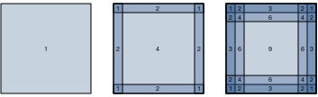
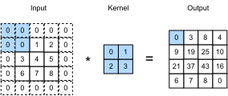
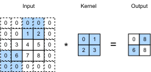

```{.python .input}
%load_ext d2lbook.tab
tab.interact_select(['mxnet', 'pytorch', 'tensorflow', 'jax'])
```

# 填充与步幅
:label:`sec_padding`

回想 :numref:`fig_correlation` 中卷积的例子。
输入的高度和宽度都是3，
卷积核的高度和宽度都是2，
于是得到的输出表示的维度为$2\times2$。
假设输入形状为$n_\textrm{h}\times n_\textrm{w}$，
卷积核形状为$k_\textrm{h}\times k_\textrm{w}$，
那么输出形状将为$(n_\textrm{h}-k_\textrm{h}+1) \times (n_\textrm{w}-k_\textrm{w}+1)$：
我们只能将卷积核移动到一定位置，
再移动就会用完可供卷积的像素。

接下来，我们将探讨若干技术，
包括填充和带步幅的卷积，
它们能对输出尺寸提供更多控制。
作为动机，请注意：由于核的宽度和高度
通常大于$1$，
在应用许多连续的卷积之后，
我们往往会得到比输入小得多的输出。
如果从一幅$240 \times 240$像素的图像开始，
十层$5 \times 5$卷积
会把图像缩小到$200 \times 200$像素，
切掉图像的$30 \%$，同时也
抹掉了原图像边界上任何有趣的信息。
*填充*（padding）是处理这一问题最常用的工具。
在其他情况下，我们可能希望大幅降低维度，
例如当我们发现原始输入分辨率难以处理时。
*带步幅的卷积*（strided convolution）是一种常用的技术，在这些情形下可以派上用场。

```{.python .input}
%%tab mxnet
from mxnet import np, npx
from mxnet.gluon import nn
npx.set_np()
```

```{.python .input}
%%tab pytorch
import torch
from torch import nn
```

```{.python .input}
%%tab tensorflow
import tensorflow as tf
```

```{.python .input}
%%tab jax
from d2l import jax as d2l
from flax import linen as nn
import jax
from jax import numpy as jnp
```

## 填充

如上所述，应用卷积层时一个棘手的问题是，
我们往往会丢失图像边缘的像素。考虑 :numref:`img_conv_reuse`，它描绘了像素利用率随卷积核大小和像素在图像中位置的变化。角落处的像素几乎完全没有被用到。


:label:`img_conv_reuse`

由于我们通常使用较小的核，
对任一次卷积来说，
我们可能只会丢失少量像素，
但当应用许多连续的卷积层时，
这些损失会累积起来。
这个问题的一个直接解决办法
是在输入图像的边界周围增加额外的填充像素，
从而增大图像的有效尺寸。
通常，我们将额外像素的值设为零。
在 :numref:`img_conv_pad` 中，我们对$3 \times 3$的输入进行填充，
将其尺寸增大到$5 \times 5$。
相应的输出也随之增大到$4 \times 4$的矩阵。
阴影部分是第一个输出元素，以及用于输出计算的输入张量和核张量元素：$0\times0+0\times1+0\times2+0\times3=0$。


:label:`img_conv_pad`

一般地，如果我们总共添加$p_\textrm{h}$行填充
（大约一半在上方、一半在下方），
并总共添加$p_\textrm{w}$列填充
（大约一半在左侧、一半在右侧），
输出形状将为

$$(n_\textrm{h}-k_\textrm{h}+p_\textrm{h}+1)\times(n_\textrm{w}-k_\textrm{w}+p_\textrm{w}+1).$$

这意味着输出的高度和宽度
将分别增加$p_\textrm{h}$和$p_\textrm{w}$。

在许多情况下，我们会希望令$p_\textrm{h}=k_\textrm{h}-1$、$p_\textrm{w}=k_\textrm{w}-1$，
使输入和输出具有相同的高度和宽度。
这样在构建网络时更容易预测每一层的输出形状。
假设这里$k_\textrm{h}$是奇数，
我们将在高度的两侧各填充$p_\textrm{h}/2$行。
如果$k_\textrm{h}$是偶数，一种可能是
在输入的上方填充$\lceil p_\textrm{h}/2\rceil$行，
在下方填充$\lfloor p_\textrm{h}/2\rfloor$行。
对宽度两侧我们也用同样的方式填充。

CNN 通常使用
高度和宽度为奇数的卷积核，例如1、3、5或7。
选择奇数核尺寸的好处是：
我们可以在顶部和底部填充相同行数、
在左侧和右侧填充相同列数的同时保持维度不变。

此外，使用奇数核和填充来精确保持维度
的做法还带来书写上的便利。
对于任意二维张量`X`，
当核的尺寸为奇数
且各边的填充行数和列数都相同时，
由此产生的输出与输入具有相同的高度和宽度，
我们知道输出`Y[i, j]`是由
输入与卷积核进行互相关计算得到的，
其中窗口以`X[i, j]`为中心。

在下面的例子中，我们创建一个高度和宽度都为3的二维卷积层，
并(**在所有的侧边应用1像素的填充。**)
给定一幅高度和宽度都为8的输入，
我们发现输出的高度和宽度也是8。

```{.python .input}
%%tab mxnet
# We define a helper function to calculate convolutions. It initializes 
# the convolutional layer weights and performs corresponding dimensionality 
# elevations and reductions on the input and output
def comp_conv2d(conv2d, X):
    conv2d.initialize()
    # (1, 1) indicates that batch size and the number of channels are both 1
    X = X.reshape((1, 1) + X.shape)
    Y = conv2d(X)
    # Strip the first two dimensions: examples and channels
    return Y.reshape(Y.shape[2:])

# 1 row and column is padded on either side, so a total of 2 rows or columns are added
conv2d = nn.Conv2D(1, kernel_size=3, padding=1)
X = np.random.uniform(size=(8, 8))
comp_conv2d(conv2d, X).shape
```

```{.python .input}
%%tab pytorch
# We define a helper function to calculate convolutions. It initializes the
# convolutional layer weights and performs corresponding dimensionality
# elevations and reductions on the input and output
def comp_conv2d(conv2d, X):
    # (1, 1) indicates that batch size and the number of channels are both 1
    X = X.reshape((1, 1) + X.shape)
    Y = conv2d(X)
    # Strip the first two dimensions: examples and channels
    return Y.reshape(Y.shape[2:])

# 1 row and column is padded on either side, so a total of 2 rows or columns
# are added
conv2d = nn.LazyConv2d(1, kernel_size=3, padding=1)
X = torch.rand(size=(8, 8))
comp_conv2d(conv2d, X).shape
```

```{.python .input}
%%tab tensorflow
# We define a helper function to calculate convolutions. It initializes
# the convolutional layer weights and performs corresponding dimensionality
# elevations and reductions on the input and output
def comp_conv2d(conv2d, X):
    # (1, 1) indicates that batch size and the number of channels are both 1
    X = tf.reshape(X, (1, ) + X.shape + (1, ))
    Y = conv2d(X)
    # Strip the first two dimensions: examples and channels
    return tf.reshape(Y, Y.shape[1:3])
# 1 row and column is padded on either side, so a total of 2 rows or columns
# are added
conv2d = tf.keras.layers.Conv2D(1, kernel_size=3, padding='same')
X = tf.random.uniform(shape=(8, 8))
comp_conv2d(conv2d, X).shape
```

```{.python .input}
%%tab jax
# We define a helper function to calculate convolutions. It initializes
# the convolutional layer weights and performs corresponding dimensionality
# elevations and reductions on the input and output
def comp_conv2d(conv2d, X):
    # (1, X.shape, 1) indicates that batch size and the number of channels are both 1
    key = jax.random.PRNGKey(d2l.get_seed())
    X = X.reshape((1,) + X.shape + (1,))
    Y, _ = conv2d.init_with_output(key, X)
    # Strip the dimensions: examples and channels
    return Y.reshape(Y.shape[1:3])
# 1 row and column is padded on either side, so a total of 2 rows or columns are added
conv2d = nn.Conv(1, kernel_size=(3, 3), padding='SAME')
X = jax.random.uniform(jax.random.PRNGKey(d2l.get_seed()), shape=(8, 8))
comp_conv2d(conv2d, X).shape
```

当卷积核的高度和宽度不同时，
我们可以通过[**为高度和宽度设置不同的填充数**]
来使输出与输入具有相同的高度和宽度。

```{.python .input}
%%tab mxnet
# We use a convolution kernel with height 5 and width 3. The padding on
# either side of the height and width are 2 and 1, respectively
conv2d = nn.Conv2D(1, kernel_size=(5, 3), padding=(2, 1))
comp_conv2d(conv2d, X).shape
```

```{.python .input}
%%tab pytorch
# We use a convolution kernel with height 5 and width 3. The padding on either
# side of the height and width are 2 and 1, respectively
conv2d = nn.LazyConv2d(1, kernel_size=(5, 3), padding=(2, 1))
comp_conv2d(conv2d, X).shape
```

```{.python .input}
%%tab tensorflow
# We use a convolution kernel with height 5 and width 3. The padding on
# either side of the height and width are 2 and 1, respectively
conv2d = tf.keras.layers.Conv2D(1, kernel_size=(5, 3), padding='same')
comp_conv2d(conv2d, X).shape
```

```{.python .input}
%%tab jax
# We use a convolution kernel with height 5 and width 3. The padding on
# either side of the height and width are 2 and 1, respectively
conv2d = nn.Conv(1, kernel_size=(5, 3), padding=(2, 1))
comp_conv2d(conv2d, X).shape
```

## 步幅

在计算互相关时，
我们从输入张量的左上角开始放置卷积窗口，
然后将其向下和向右滑过所有位置。
在前面的例子中，我们默认一次滑动一个元素。
然而，有时为了计算效率，
或者因为我们希望下采样，
我们会一次将窗口移动一个以上的元素，
跳过中间位置。如果卷积核很大，
这会特别有用，因为大核会捕捉底层图像的大片区域。

我们将每次滑动所遍历的行数和列数称为*步幅*（stride）。
到目前为止，我们在高度和宽度上使用的步幅都为1。
有时，我们可能希望使用更大的步幅。
:numref:`img_conv_stride` 展示了一个垂直方向步幅为3、水平方向步幅为2的二维互相关运算。
阴影部分是输出元素，以及用于输出计算的输入张量和核张量元素：$0\times0+0\times1+1\times2+2\times3=8$，$0\times0+6\times1+0\times2+0\times3=6$。
可以看到，当生成第一列的第二个元素时，
卷积窗口向下滑动三行。
当生成第一行的第二个元素时，
卷积窗口向右滑动两列。
当卷积窗口继续在输入上向右滑动两列时，
就没有输出了，因为输入元素无法填满窗口
（除非我们再添加一列填充）。


:label:`img_conv_stride`

一般地，当高度的步幅为$s_\textrm{h}$
、宽度的步幅为$s_\textrm{w}$时，输出形状为

$$\lfloor(n_\textrm{h}-k_\textrm{h}+p_\textrm{h}+s_\textrm{h})/s_\textrm{h}\rfloor \times \lfloor(n_\textrm{w}-k_\textrm{w}+p_\textrm{w}+s_\textrm{w})/s_\textrm{w}\rfloor.$$

如果令$p_\textrm{h}=k_\textrm{h}-1$、$p_\textrm{w}=k_\textrm{w}-1$，
那么输出形状可以简化为
$\lfloor(n_\textrm{h}+s_\textrm{h}-1)/s_\textrm{h}\rfloor \times \lfloor(n_\textrm{w}+s_\textrm{w}-1)/s_\textrm{w}\rfloor$。
更进一步，如果输入的高度和宽度
能被高度和宽度上的步幅整除，
那么输出形状将是$(n_\textrm{h}/s_\textrm{h}) \times (n_\textrm{w}/s_\textrm{w})$。

下面，我们[**将高度和宽度上的步幅都设为2**]，
从而将输入的高度和宽度减半。

```{.python .input}
%%tab mxnet
conv2d = nn.Conv2D(1, kernel_size=3, padding=1, strides=2)
comp_conv2d(conv2d, X).shape
```

```{.python .input}
%%tab pytorch
conv2d = nn.LazyConv2d(1, kernel_size=3, padding=1, stride=2)
comp_conv2d(conv2d, X).shape
```

```{.python .input}
%%tab tensorflow
conv2d = tf.keras.layers.Conv2D(1, kernel_size=3, padding='same', strides=2)
comp_conv2d(conv2d, X).shape
```

```{.python .input}
%%tab jax
conv2d = nn.Conv(1, kernel_size=(3, 3), padding=1, strides=2)
comp_conv2d(conv2d, X).shape
```

让我们看一个(**稍微复杂的例子**)。

```{.python .input}
%%tab mxnet
conv2d = nn.Conv2D(1, kernel_size=(3, 5), padding=(0, 1), strides=(3, 4))
comp_conv2d(conv2d, X).shape
```

```{.python .input}
%%tab pytorch
conv2d = nn.LazyConv2d(1, kernel_size=(3, 5), padding=(0, 1), stride=(3, 4))
comp_conv2d(conv2d, X).shape
```

```{.python .input}
%%tab tensorflow
conv2d = tf.keras.layers.Conv2D(1, kernel_size=(3,5), padding='valid',
                                strides=(3, 4))
comp_conv2d(conv2d, X).shape
```

```{.python .input}
%%tab jax
conv2d = nn.Conv(1, kernel_size=(3, 5), padding=(0, 1), strides=(3, 4))
comp_conv2d(conv2d, X).shape
```

## 小结与讨论

填充可以增加输出的高度和宽度。这通常用于使输出与输入具有相同的高度和宽度，以避免输出不期望的收缩。此外，它还能确保所有像素被使用的频率相同。通常我们在输入高度和宽度的两侧选择对称填充。在这种情况下，我们称之为$(p_\textrm{h}, p_\textrm{w})$填充。最常见的是令$p_\textrm{h} = p_\textrm{w}$，这时我们简单地说选择填充$p$。

类似的约定也适用于步幅。当水平步幅$s_\textrm{h}$与垂直步幅$s_\textrm{w}$相同时，我们简单地谈论步幅$s$。步幅可以降低输出的分辨率，例如当$n > 1$时，将输出的高度和宽度减小到输入的$1/n$。默认情况下，填充为0，步幅为1。

到目前为止，我们讨论的所有填充都只是用零来扩展图像。这具有显著的计算优势，因为实现起来非常简单。此外，可以对算子进行设计，使其隐式地利用这种填充，而无需分配额外的内存。同时，它使 CNN 能够仅仅通过学习“空白”所在的位置，就在图像中编码隐式的位置信息。零填充有许多替代方案。:citet:`Alsallakh.Kokhlikyan.Miglani.ea.2020` 对这些方案做了广泛的综述（尽管没有明确说明何时应使用非零填充，除非出现伪影）。


## 练习

1. 对于本节最后一个代码示例，核大小为$(3, 5)$、填充为$(0, 1)$、步幅为$(3, 4)$，
   计算输出形状，检验它是否与实验结果一致。
1. 对于音频信号，步幅为2对应什么？
1. 实现镜像填充，即通过简单镜像边界值来扩展张量的填充。
1. 步幅大于1有什么计算上的好处？
1. 步幅大于1可能有什么统计上的好处？
1. 你会如何实现步幅$\frac{1}{2}$？它对应什么？什么时候会有用？

:begin_tab:`mxnet`
[讨论](https://discuss.d2l.ai/t/67)
:end_tab:

:begin_tab:`pytorch`
[讨论](https://discuss.d2l.ai/t/68)
:end_tab:

:begin_tab:`tensorflow`
[讨论](https://discuss.d2l.ai/t/272)
:end_tab:

:begin_tab:`jax`
[讨论](https://discuss.d2l.ai/t/17997)
:end_tab:
