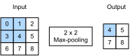

```{.python .input}
%load_ext d2lbook.tab
tab.interact_select(['mxnet', 'pytorch', 'tensorflow', 'jax'])
```

# 汇聚
:label:`sec_pooling`

在许多情况下，我们的最终任务
会对图像提出某种全局问题，
例如，*它包含猫吗？* 因此，最后一层的单元
应当对整个输入敏感。
通过逐步聚合信息，
得到越来越粗糙的特征图，
我们就能实现最终学习全局表示这一目标，
同时保留卷积层在处理中间层时的所有优势。
网络越深，
每个隐藏节点所敏感的感受野（相对于输入）
就越大。降低空间分辨率
会加速这一过程，
因为卷积核覆盖的有效区域更大了。

此外，在检测边缘等较低层次的特征时
（如 :numref:`sec_conv_layer` 中所讨论的），
我们往往希望自己的表示在某种程度上对平移不变。
例如，如果我们取一幅黑白之间分界鲜明的图像`X`，
并将整幅图像向右移动一个像素，
即`Z[i, j] = X[i, j + 1]`，
那么新图像`Z`的输出可能大不相同。
边缘会平移一个像素。
在现实中，目标几乎不会恰好出现在同一个位置。
事实上，即使使用三脚架和静止的目标，
快门运动引起的相机振动
也可能使所有东西偏移一个像素左右
（高端相机配备了专门的功能来解决这个问题）。

本节介绍*汇聚层*（pooling layer），
它有两个目的：
减轻卷积层对位置的敏感性，
以及对表示进行空间下采样。

```{.python .input}
%%tab mxnet
from d2l import mxnet as d2l
from mxnet import np, npx
from mxnet.gluon import nn
npx.set_np()
```

```{.python .input}
%%tab pytorch
from d2l import torch as d2l
import torch
from torch import nn
```

```{.python .input}
%%tab jax
from d2l import jax as d2l
from flax import linen as nn
import jax
from jax import numpy as jnp
```

## 最大汇聚与平均汇聚

与卷积层类似，*汇聚*（pooling）运算符
由一个固定形状的窗口组成，
该窗口根据其步幅滑过
输入中的所有区域，
为固定形状窗口（有时称为*汇聚窗口*）
遍历的每个位置计算一个输出。
然而，与卷积层中输入和核的互相关计算不同，
汇聚层不含参数（这里没有*核*）。
相反，汇聚运算符是确定性的，
通常计算汇聚窗口中元素的最大值或平均值。
这两种运算分别称为
*最大汇聚*（maximum pooling，简称*max-pooling*）
和*平均汇聚*（average pooling）。

*平均汇聚*与 CNN 本身差不多一样古老。其思想类似于
对图像进行下采样。与其只为低分辨率图像每隔一个（或每隔三个）
像素取值，我们可以对相邻像素求平均，
从而得到信噪比更好的图像，因为我们合并了
来自多个相邻像素的信息。*最大汇聚*由
:citet:`Riesenhuber.Poggio.1999` 在认知神经科学背景下提出，
用于描述信息聚合如何可能为了
目标识别的目的而分层聚合；语音识别中已有更早的版本 :cite:`Yamaguchi.Sakamoto.Akabane.ea.1990`。在几乎所有情况下，最大汇聚（也常这样简称）
都优于平均汇聚。

在这两种情况下，与互相关运算符一样，
我们可以把汇聚窗口
看作从输入张量的左上角开始，
从左到右、从上到下地滑过输入。
在汇聚窗口到达的每个位置，
它计算窗口中输入子张量的最大值或平均值，
取决于采用的是最大汇聚还是平均汇聚。



:label:`fig_pooling`

:numref:`fig_pooling` 中的输出张量
高度为2、宽度为2。
四个元素来自每个汇聚窗口中的最大值：

$$
\max(0, 1, 3, 4)=4,\\
\max(1, 2, 4, 5)=5,\\
\max(3, 4, 6, 7)=7,\\
\max(4, 5, 7, 8)=8.\\
$$

更一般地，我们可以通过对某个大小区域进行聚合
来定义$p \times q$汇聚层。回到边缘检测问题，
我们将卷积层的输出
作为$2\times 2$最大汇聚的输入。
用`X`表示卷积层的输入，用`Y`表示汇聚层的输出。
无论`X[i, j]`、`X[i, j + 1]`、
`X[i+1, j]`和`X[i+1, j + 1]`的值是否不同，
汇聚层总是输出`Y[i, j] = 1`。
也就是说，使用$2\times 2$最大汇聚层，
我们仍然可以检测出
卷积层所识别的模式
是否在高度或宽度上移动不超过一个元素。

在下面的代码中，我们在`pool2d`函数中
(**实现汇聚层的前向传播**)。
这个函数与 :numref:`sec_conv_layer` 中的
`corr2d`函数类似。
然而，这里不需要核，
而是将输出计算为输入中每个区域的最大值或平均值。

```{.python .input}
%%tab mxnet, pytorch
def pool2d(X, pool_size, mode='max'):
    p_h, p_w = pool_size
    Y = d2l.zeros((X.shape[0] - p_h + 1, X.shape[1] - p_w + 1))
    for i in range(Y.shape[0]):
        for j in range(Y.shape[1]):
            if mode == 'max':
                Y[i, j] = X[i: i + p_h, j: j + p_w].max()
            elif mode == 'avg':
                Y[i, j] = X[i: i + p_h, j: j + p_w].mean()
    return Y
```

```{.python .input}
%%tab jax
def pool2d(X, pool_size, mode='max'):
    p_h, p_w = pool_size
    Y = jnp.zeros((X.shape[0] - p_h + 1, X.shape[1] - p_w + 1))
    for i in range(Y.shape[0]):
        for j in range(Y.shape[1]):
            if mode == 'max':
                Y = Y.at[i, j].set(X[i: i + p_h, j: j + p_w].max())
            elif mode == 'avg':
                Y = Y.at[i, j].set(X[i: i + p_h, j: j + p_w].mean())
    return Y
```

```{.python .input}
%%tab tensorflow
import tensorflow as tf

def pool2d(X, pool_size, mode='max'):
    p_h, p_w = pool_size
    Y = tf.Variable(tf.zeros((X.shape[0] - p_h + 1, X.shape[1] - p_w +1)))
    for i in range(Y.shape[0]):
        for j in range(Y.shape[1]):
            if mode == 'max':
                Y[i, j].assign(tf.reduce_max(X[i: i + p_h, j: j + p_w]))
            elif mode =='avg':
                Y[i, j].assign(tf.reduce_mean(X[i: i + p_h, j: j + p_w]))
    return Y
```

我们可以构造 :numref:`fig_pooling` 中的输入张量`X`，
以[**验证二维最大汇聚层的输出**]。

```{.python .input}
%%tab all
X = d2l.tensor([[0.0, 1.0, 2.0], [3.0, 4.0, 5.0], [6.0, 7.0, 8.0]])
pool2d(X, (2, 2))
```

此外，我们还可以试验(**平均汇聚层**)。

```{.python .input}
%%tab all
pool2d(X, (2, 2), 'avg')
```

## [**填充与步幅**]

与卷积层一样，汇聚层
也会改变输出形状。
和之前一样，我们可以通过填充输入并调整步幅
来调整运算，以达到期望的输出形状。
我们可以通过深度学习框架内置的
二维最大汇聚层
来演示汇聚层中填充和步幅的使用。
我们首先构造一个形状为四维的输入张量`X`，
其中样例数（批量大小）和通道数都为1。

:begin_tab:`tensorflow`
注意，与其他框架不同，TensorFlow
偏好并针对*通道在后*（channels-last）的输入进行了优化。
:end_tab:

```{.python .input}
%%tab mxnet, pytorch
X = d2l.reshape(d2l.arange(16, dtype=d2l.float32), (1, 1, 4, 4))
X
```

```{.python .input}
%%tab tensorflow, jax
X = d2l.reshape(d2l.arange(16, dtype=d2l.float32), (1, 4, 4, 1))
X
```

由于汇聚会聚合一整片区域的信息，
(**深度学习框架默认使汇聚窗口大小与步幅相匹配。**)
例如，如果我们使用形状为`(3, 3)`的汇聚窗口，
那么默认情况下会得到形状为`(3, 3)`的步幅。

```{.python .input}
%%tab mxnet
pool2d = nn.MaxPool2D(3)
# Pooling has no model parameters, hence it needs no initialization
pool2d(X)
```

```{.python .input}
%%tab pytorch
pool2d = nn.MaxPool2d(3)
# Pooling has no model parameters, hence it needs no initialization
pool2d(X)
```

```{.python .input}
%%tab tensorflow
pool2d = tf.keras.layers.MaxPool2D(pool_size=[3, 3])
# Pooling has no model parameters, hence it needs no initialization
pool2d(X)
```

```{.python .input}
%%tab jax
# Pooling has no model parameters, hence it needs no initialization
nn.max_pool(X, window_shape=(3, 3), strides=(3, 3))
```

不用说，如有需要，可以
[**手动指定步幅和填充**]
来覆盖框架的默认值。

```{.python .input}
%%tab mxnet
pool2d = nn.MaxPool2D(3, padding=1, strides=2)
pool2d(X)
```

```{.python .input}
%%tab pytorch
pool2d = nn.MaxPool2d(3, padding=1, stride=2)
pool2d(X)
```

```{.python .input}
%%tab tensorflow
paddings = tf.constant([[0, 0], [1,0], [1,0], [0,0]])
X_padded = tf.pad(X, paddings, "CONSTANT")
pool2d = tf.keras.layers.MaxPool2D(pool_size=[3, 3], padding='valid',
                                   strides=2)
pool2d(X_padded)
```

```{.python .input}
%%tab jax
X_padded = jnp.pad(X, ((0, 0), (1, 0), (1, 0), (0, 0)), mode='constant')
nn.max_pool(X_padded, window_shape=(3, 3), padding='VALID', strides=(2, 2))
```

当然，我们也可以分别指定
任意高度和宽度的任意矩形汇聚窗口，
如下面的例子所示。

```{.python .input}
%%tab mxnet
pool2d = nn.MaxPool2D((2, 3), padding=(0, 1), strides=(2, 3))
pool2d(X)
```

```{.python .input}
%%tab pytorch
pool2d = nn.MaxPool2d((2, 3), stride=(2, 3), padding=(0, 1))
pool2d(X)
```

```{.python .input}
%%tab tensorflow
paddings = tf.constant([[0, 0], [0, 0], [1, 1], [0, 0]])
X_padded = tf.pad(X, paddings, "CONSTANT")

pool2d = tf.keras.layers.MaxPool2D(pool_size=[2, 3], padding='valid',
                                   strides=(2, 3))
pool2d(X_padded)
```

```{.python .input}
%%tab jax

X_padded = jnp.pad(X, ((0, 0), (0, 0), (1, 1), (0, 0)), mode='constant')
nn.max_pool(X_padded, window_shape=(2, 3), strides=(2, 3), padding='VALID')
```

## 多通道

在处理多通道输入数据时，
[**汇聚层分别对每个输入通道进行汇聚**]，
而不是像卷积层那样
在通道上对输入求和。
这意味着汇聚层的输出通道数
与输入通道数相同。
下面，我们将张量`X`和`X + 1`
在通道维度上连结，以构造一个具有两个通道的输入。

:begin_tab:`tensorflow`
注意，由于采用了通道在后的语法，
对 TensorFlow 来说，这需要沿最后一个维度进行连结。
:end_tab:

```{.python .input}
%%tab mxnet, pytorch
X = d2l.concat((X, X + 1), 1)
X
```

```{.python .input}
%%tab tensorflow, jax
# Concatenate along `dim=3` due to channels-last syntax
X = d2l.concat([X, X + 1], 3)
X
```

可以看到，汇聚之后的输出通道数仍然是两个。

```{.python .input}
%%tab mxnet
pool2d = nn.MaxPool2D(3, padding=1, strides=2)
pool2d(X)
```

```{.python .input}
%%tab pytorch
pool2d = nn.MaxPool2d(3, padding=1, stride=2)
pool2d(X)
```

```{.python .input}
%%tab tensorflow
paddings = tf.constant([[0, 0], [1,0], [1,0], [0,0]])
X_padded = tf.pad(X, paddings, "CONSTANT")
pool2d = tf.keras.layers.MaxPool2D(pool_size=[3, 3], padding='valid',
                                   strides=2)
pool2d(X_padded)

```

```{.python .input}
%%tab jax
X_padded = jnp.pad(X, ((0, 0), (1, 0), (1, 0), (0, 0)), mode='constant')
nn.max_pool(X_padded, window_shape=(3, 3), padding='VALID', strides=(2, 2))
```

:begin_tab:`tensorflow`
注意，TensorFlow 的汇聚输出乍看之下似乎不同，然而
在数值上呈现的结果与 MXNet 和 PyTorch 相同。
差别在于维度，垂直地读取
输出会得到与其他实现相同的输出。
:end_tab:

## 小结

汇聚是一个极其简单的运算。它做的正是其名称所示的事情：在一个取值窗口上聚合结果。所有卷积语义（例如步幅和填充）都以与之前相同的方式适用。注意，汇聚对通道一视同仁，即它保持通道数不变，并对每个通道分别应用。最后，在两种流行的汇聚选择中，最大汇聚优于平均汇聚，因为它赋予输出一定程度的不变性。一种常见的选择是取$2 \times 2$的汇聚窗口大小，将输出的空间分辨率降为四分之一。

注意，除汇聚之外还有许多降低分辨率的方法。例如，在随机汇聚 :cite:`Zeiler.Fergus.2013` 和分数最大汇聚 :cite:`Graham.2014` 中，聚合与随机化结合在一起。这在某些情况下可以略微提高准确率。最后，正如我们稍后在注意力机制中将看到的，还有更精细的输出聚合方式，例如利用查询与表示向量之间的对齐。


## 练习

1. 通过卷积实现平均汇聚。
1. 证明仅通过卷积无法实现最大汇聚。
1. 最大汇聚可以用 ReLU 运算实现，即$\textrm{ReLU}(x) = \max(0, x)$。
    1. 仅使用 ReLU 运算表示$\max (a, b)$。
    1. 利用这一点，通过卷积和 ReLU 层实现最大汇聚。
    1. 对于$2 \times 2$卷积，你需要多少个通道和层？对于$3 \times 3$卷积又需要多少？
1. 汇聚层的计算代价是多少？假设汇聚层的输入大小为$c\times h\times w$，汇聚窗口的形状为$p_\textrm{h}\times p_\textrm{w}$，填充为$(p_\textrm{h}, p_\textrm{w})$，步幅为$(s_\textrm{h}, s_\textrm{w})$。
1. 为什么你认为最大汇聚和平均汇聚会以不同方式工作？
1. 我们需要单独的最小汇聚层吗？能否用其他运算替代它？
1. 我们可以用 softmax 运算来进行汇聚。为什么它可能不那么流行？

:begin_tab:`mxnet`
[讨论](https://discuss.d2l.ai/t/71)
:end_tab:

:begin_tab:`pytorch`
[讨论](https://discuss.d2l.ai/t/72)
:end_tab:

:begin_tab:`tensorflow`
[讨论](https://discuss.d2l.ai/t/274)
:end_tab:

:begin_tab:`jax`
[讨论](https://discuss.d2l.ai/t/17999)
:end_tab:
