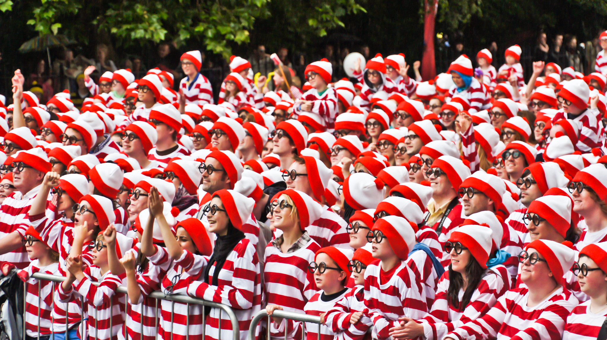
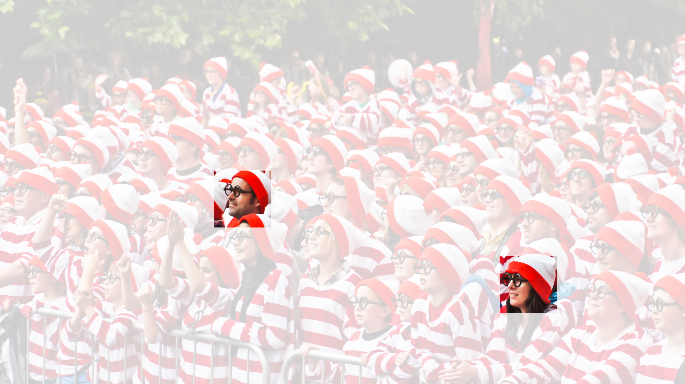

# 从全连接层到卷积
:label:`sec_why-conv`

时至今日，
我们此前讨论的模型
在处理表格数据时
仍然是合适的选择。
所谓表格数据，是指数据由
对应样例的行
和对应特征的列构成。
对于表格数据，我们可能预期
所要寻找的模式会涉及
特征之间的交互，
但我们并不*先验地*假设
特征之间如何交互的任何结构。

有时，我们确实缺乏足够的知识，
无法指导构建更精巧的架构。
在这种情况下，多层感知机（MLP）
可能是我们所能做到的最好选择。
然而，对于高维感知数据，
这种无结构的网络可能变得臃肿不堪。

例如，让我们回到一直使用的区分猫和狗的例子。
假设我们在数据收集方面做得很彻底，
收集了一个由一百万像素照片组成的带标注数据集。
这意味着网络的每个输入有一百万维。
即使大胆地将隐藏维度降到一千，
也需要一个由$10^6 \times 10^3 = 10^9$个参数刻画的全连接层。
除非我们有大量GPU、擅长分布式优化，
并且有超凡的耐心，
否则学习这个网络的参数
可能不可行。

细心的读者可能会反驳这一论证，
理由是未必需要一百万像素的分辨率。
然而，即使我们或许可以用十万像素应付过去，
大小为1000的隐藏层也大大低估了
学习良好图像表示所需的隐藏单元数量，
因此实际系统仍将需要数十亿个参数。
此外，通过拟合如此多的参数来学习一个分类器，
可能需要收集极其庞大的数据集。
但时至今日，人类和计算机都能
相当好地区分猫和狗，
这似乎与上述直觉相矛盾。
原因在于图像呈现出丰富的结构，
人类和机器学习模型都可以利用这些结构。
卷积神经网络（convolutional neural networks，CNN）是机器学习
为利用自然图像中某些已知结构而采用的一种富有创造性的方法。

## 不变性

设想我们想要检测图像中的某个目标。
无论我们用什么方法来识别目标，
都不应过分关注目标在图像中的精确位置，
这似乎是合理的。
理想情况下，我们的系统应当利用这一知识。
猪通常不会飞，飞机通常也不会游泳。
尽管如此，如果一头猪出现在图像顶部，
我们仍然应该能认出它。
我们可以从儿童游戏“沃尔多在哪里”（Where's Waldo）
中获得一些启发（该游戏本身也启发了许多现实中的模仿版本，
如 :numref:`img_waldo` 所描绘的那样）。
该游戏由许多充满活动的混乱场景组成。
沃尔多会在每个场景的某个地方出现，
通常潜伏在某个出人意料的位置。
读者的目标是找到他。
尽管他有标志性的装束，
但由于干扰物很多，
这可能会出乎意料地困难。
然而，*沃尔多看起来是什么样*
并不取决于*沃尔多位于哪里*。
我们可以用一个沃尔多检测器扫过整幅图像，
为每个图像块打分，
表示该图像块包含沃尔多的可能性。
事实上，许多目标检测和分割算法
都基于这种方法 :cite:`Long.Shelhamer.Darrell.2015`。
卷积神经网络将这种*空间不变性*（spatial invariance）的思想系统化，
利用它以较少的参数学习有用的表示。

:width:`400px`
:label:`img_waldo`

现在，我们可以通过列举几条期望，
使这些直觉更加具体，
以指导我们设计适合计算机视觉的神经网络架构：

1. 在网络的最早几层，
   无论同一图像块出现在图像的什么位置，
   网络都应对其作出相似的响应。这一原则称为*平移不变性*（translation invariance）（或*平移等变性*（translation equivariance））。
1. 网络的最早几层应关注局部区域，
   而不必考虑图像中较远区域的内容。这就是*局部性*（locality）原则。
   最终，这些局部表示可以被聚合起来，
   以做出整个图像级别的预测。
1. 随着网络向前推进，较深的层应能够捕捉图像中
   范围更长的特征，其方式类似于自然界中的高级视觉。

让我们看看这在数学上是如何体现的。

## 约束多层感知机

首先，我们考虑一个多层感知机，
其输入是二维图像$\mathbf{X}$，
其直接的隐藏表示$\mathbf{H}$同样表示为矩阵
（在代码中它们是二维张量），并且$\mathbf{X}$和$\mathbf{H}$具有相同的形状。
请仔细体会这一点。
现在我们设想，不仅有输入，
而且隐藏表示也具有空间结构。

令$[\mathbf{X}]_{i, j}$和$[\mathbf{H}]_{i, j}$分别表示
输入图像和隐藏表示中
位置$(i,j)$处的像素。
因此，为了让每个隐藏单元
都接收来自每个输入像素的输入，
我们将不再使用权重矩阵
（正如之前在多层感知机中所做的那样），
而是将参数表示为
四阶权重张量$\mathsf{W}$。
假设$\mathbf{U}$包含偏置，
我们可以将全连接层形式化地表示为

$$\begin{aligned} \left[\mathbf{H}\right]_{i, j} &= [\mathbf{U}]_{i, j} + \sum_k \sum_l[\mathsf{W}]_{i, j, k, l}  [\mathbf{X}]_{k, l}\\ &=  [\mathbf{U}]_{i, j} +
\sum_a \sum_b [\mathsf{V}]_{i, j, a, b}  [\mathbf{X}]_{i+a, j+b}.\end{aligned}$$

从$\mathsf{W}$到$\mathsf{V}$的转换目前完全是形式上的，
因为这两个四阶张量中的系数之间存在一一对应关系。
我们只是重新索引下标$(k, l)$，
使得$k = i+a$、$l = j+b$。
换句话说，我们令$[\mathsf{V}]_{i, j, a, b} = [\mathsf{W}]_{i, j, i+a, j+b}$。
索引$a$和$b$遍历正偏移和负偏移，
覆盖整幅图像。
对于隐藏表示$[\mathbf{H}]_{i, j}$中的任意给定位置（$i$，$j$），
我们通过在以$(i, j)$为中心、
并受$[\mathsf{V}]_{i, j, a, b}$加权的$x$中的像素上求和来计算其值。
在继续之前，让我们考虑这种参数化中*单个*层所需的总参数数量：
一幅$1000 \times 1000$的图像（100万像素）
被映射到一个$1000 \times 1000$的隐藏表示。
这需要$10^{12}$个参数，
远远超出计算机目前能够处理的范围。

### 平移不变性

现在，让我们引用上面建立的第一个原则：
平移不变性 :cite:`Zhang.ea.1988`。
这意味着输入$\mathbf{X}$的平移
应当只导致隐藏表示$\mathbf{H}$的平移。
只有当$\mathsf{V}$和$\mathbf{U}$实际上不依赖于$(i, j)$时，
这才可能。
因此，我们有$[\mathsf{V}]_{i, j, a, b} = [\mathbf{V}]_{a, b}$，
并且$\mathbf{U}$是一个常数，比如$u$。
于是，我们可以简化$\mathbf{H}$的定义：

$$[\mathbf{H}]_{i, j} = u + \sum_a\sum_b [\mathbf{V}]_{a, b}  [\mathbf{X}]_{i+a, j+b}.$$

这就是*卷积*（convolution）！
我们实际上是用系数$[\mathbf{V}]_{a, b}$
对位置$(i, j)$附近$(i+a, j+b)$处的像素进行加权，
从而得到$[\mathbf{H}]_{i, j}$的值。
注意，$[\mathbf{V}]_{a, b}$所需的系数
比$[\mathsf{V}]_{i, j, a, b}$少得多，
因为它不再依赖于图像中的位置。
因此，所需的参数数量不再是$10^{12}$，
而是一个合理得多的$4 \times 10^6$：
我们仍然依赖于$a, b \in (-1000, 1000)$。
简言之，我们取得了重大进展。
时延神经网络（time-delay neural networks，TDNN）是最早利用这一思想的例子之一 :cite:`Waibel.Hanazawa.Hinton.ea.1989`。

### 局部性

现在，让我们引用第二个原则：局部性。
正如上文所述，我们认为不应
从位置$(i, j)$向很远的地方去寻找相关信息，
以判断$[\mathbf{H}]_{i, j}$处发生了什么。
这意味着在某个范围$|a|> \Delta$或$|b| > \Delta$之外，
我们应令$[\mathbf{V}]_{a, b} = 0$。
等价地，我们可以将$[\mathbf{H}]_{i, j}$重写为

$$[\mathbf{H}]_{i, j} = u + \sum_{a = -\Delta}^{\Delta} \sum_{b = -\Delta}^{\Delta} [\mathbf{V}]_{a, b}  [\mathbf{X}]_{i+a, j+b}.$$
:eqlabel:`eq_conv-layer`

这将参数数量从$4 \times 10^6$减少到$4 \Delta^2$，
其中$\Delta$通常小于$10$。
这样，我们又减少了四个数量级的参数。
注意，:eqref:`eq_conv-layer` 简而言之就是所谓的*卷积层*（convolutional layer）。
*卷积神经网络*（convolutional neural networks，CNN）
是一类包含卷积层的特殊神经网络。
在深度学习研究界，
$\mathbf{V}$被称为*卷积核*（convolution kernel）、
*滤波器*（filter），或者直接称为该层的*权重*（weights），
即可学习参数。

以前，我们可能需要数十亿个参数
来表示图像处理网络中的仅仅一层，
而现在通常只需要几百个参数，
并且无需改变输入或隐藏表示的维度。
这种参数急剧减少的代价是：
我们的特征现在具有平移不变性，
并且层在确定每个隐藏激活值时
只能纳入局部信息。
所有学习都依赖于施加归纳偏置（inductive bias）。
当这种偏置与现实相符时，
我们就能得到样本高效的模型，
并能很好地泛化到未见过的数据。
但当然，如果这些偏置与现实不符，
例如图像并不具有平移不变性，
那么我们的模型可能连拟合训练数据都很困难。

这种参数的急剧减少引出了我们的最后一个期望，
即较深的层应表示图像中更大、更复杂的方面。
这可以通过反复交替使用非线性和卷积层来实现。

## 卷积

让我们简要回顾一下为什么 :eqref:`eq_conv-layer` 被称为卷积。
在数学中，两个函数之间的*卷积* :cite:`Rudin.1973`，
比如$f, g: \mathbb{R}^d \to \mathbb{R}$，定义为

$$(f * g)(\mathbf{x}) = \int f(\mathbf{z}) g(\mathbf{x}-\mathbf{z}) d\mathbf{z}.$$

也就是说，当一个函数进行“翻转”并平移$\mathbf{x}$时，
我们度量$f$与$g$之间的重叠。
每当处理离散对象时，
积分就变成求和。
例如，对于来自平方可和无限维向量集合的向量，
其索引遍历$\mathbb{Z}$，我们得到如下定义：

$$(f * g)(i) = \sum_a f(a) g(i-a).$$

对于二维张量，我们有一个相应的求和，
其中$f$的索引为$(a, b)$，$g$的索引为$(i-a, j-b)$：

$$(f * g)(i, j) = \sum_a\sum_b f(a, b) g(i-a, j-b).$$
:eqlabel:`eq_2d-conv-discrete`

这看起来与 :eqref:`eq_conv-layer` 相似，但有一个主要区别。
这里我们不使用$(i+a, j+b)$，
而是使用差值。
不过请注意，这种区别主要是形式上的，
因为我们总是可以让 :eqref:`eq_conv-layer` 与 :eqref:`eq_2d-conv-discrete` 之间的记号相互匹配。
我们在 :eqref:`eq_conv-layer` 中的原始定义
更确切地描述的是*互相关*（cross-correlation）。
我们将在下一节回到这一点。

## 通道
:label:`subsec_why-conv-channels`

回到我们的沃尔多检测器，让我们看看它是什么样子。
卷积层按照滤波器$\mathsf{V}$
选取给定大小的窗口并对强度加权，
如 :numref:`fig_waldo_mask` 所示。
我们可能希望学习一个模型，
使得在“沃尔多属性”最强的地方，
我们应当在隐藏层表示中找到一个峰值。

:width:`400px`
:label:`fig_waldo_mask`

这种方法只有一个问题。
到目前为止，我们一直愉快地忽略了
图像由三个通道（channel）组成：红色、绿色和蓝色。
总之，图像不是二维对象，
而是三阶张量，
由高度、宽度和通道来刻画，
例如形状为$1024 \times 1024 \times 3$像素。
其中前两个轴涉及空间关系，
第三个轴可以看作是为每个像素位置
赋予一个多维表示。
因此，我们将$\mathsf{X}$索引为$[\mathsf{X}]_{i, j, k}$。
卷积滤波器必须相应地调整。
现在不再有$[\mathbf{V}]_{a,b}$，而是有$[\mathsf{V}]_{a,b,c}$。

此外，正如我们的输入由三阶张量构成，
事实证明，将隐藏表示同样形式化为
三阶张量$\mathsf{H}$是个好主意。
换句话说，我们不再只为每个空间位置
设置一个隐藏表示，
而是希望为每个空间位置
设置一个完整的隐藏表示向量。
我们可以把隐藏表示看作
由若干二维网格堆叠而成。
与输入中一样，这些网格有时被称为*通道*。
它们有时也被称为*特征图*（feature map），
因为每个特征图都为下一层
提供了一组空间化的已学习特征。
直观地说，你可以设想在更接近输入的较低层，
某些通道可能专门用于识别边缘，
而另一些通道可能专门用于识别纹理。

为了同时支持输入（$\mathsf{X}$）和隐藏表示（$\mathsf{H}$）中的多个通道，
我们可以给$\mathsf{V}$增加第四个坐标：$[\mathsf{V}]_{a, b, c, d}$。
将一切综合起来，我们有：

$$[\mathsf{H}]_{i,j,d} = \sum_{a = -\Delta}^{\Delta} \sum_{b = -\Delta}^{\Delta} \sum_c [\mathsf{V}]_{a, b, c, d} [\mathsf{X}]_{i+a, j+b, c},$$
:eqlabel:`eq_conv-layer-channels`

其中$d$索引隐藏表示$\mathsf{H}$中的输出通道。
后续的卷积层将以三阶张量$\mathsf{H}$作为输入。
鉴于其一般性，我们将
:eqref:`eq_conv-layer-channels`
作为多通道卷积层的定义，
其中$\mathsf{V}$是该层的核或滤波器。

还有许多操作需要我们处理。
例如，我们需要弄清楚
如何将所有隐藏表示组合成一个输出，
比如图像中*任何地方*是否存在沃尔多。
我们还需要决定如何高效地计算、
如何组合多个层、
采用怎样的激活函数，
以及如何做出合理的设计选择，
以得到在实践中有效的网络。
我们将在本章其余部分讨论这些问题。

## 小结与讨论

在本节中，我们从第一性原理出发推导了卷积神经网络的结构。虽然尚不清楚这是否就是发明 CNN 所走过的路线，但令人满意的是：当我们把合理的原理应用到图像处理和计算机视觉算法应当如何运行（至少在较低层）时，CNN 是*正确*的选择。特别地，图像的平移不变性意味着图像的所有图像块都将以相同的方式处理。局部性意味着只有一小片像素邻域会被用来计算相应的隐藏表示。关于 CNN 的一些最早文献以 Neocognitron 的形式出现 :cite:`Fukushima.1982`。

我们在推理中遇到的第二个原则是：如何在不限制函数类表达能力的情况下减少其参数数量，至少在关于模型的某些假设成立时。我们看到，这一限制带来了复杂度的急剧降低，将计算上和统计上不可行的问题转变为可处理的模型。

增加通道使我们找回了一些复杂度，这些复杂度原本因局部性和平移不变性对卷积核施加的限制而损失。注意，增加红、绿、蓝之外的通道是很自然的。许多卫星图像（尤其是农业和气象领域的卫星图像）有几十到几百个通道，从而生成高光谱图像。这些图像记录了许多不同波长的数据。在下文中，我们将看到如何有效地利用卷积来操纵所处理图像的维度、如何从基于位置的表示转向基于通道的表示，以及如何高效地处理大量类别。

## 练习

1. 假设卷积核的大小为$\Delta = 0$。
   证明在这种情况下，卷积核
   为每组通道独立地实现了一个多层感知机。这引出了 Network in Network
   架构 :cite:`Lin.Chen.Yan.2013`。
1. 音频数据通常表示为一维序列。
    1. 什么时候你可能希望为音频施加局部性和平移不变性？
    1. 推导音频的卷积运算。
    1. 能否用与计算机视觉相同的工具来处理音频？提示：使用频谱图。
1. 为什么平移不变性最终可能并不是一个好主意？给出一个例子。
1. 你认为卷积层是否也可能适用于文本数据？
   用语言处理时你可能会遇到哪些问题？
1. 当目标位于图像边界时，卷积会发生什么？
1. 证明卷积是对称的，即$f * g = g * f$。

[讨论](https://discuss.d2l.ai/t/64)
