# 高斯过程简介

在很多情况下，机器学习就是要从数据中估计参数。这些参数往往数量众多且相对难以解释——例如神经网络的权重。相比之下，高斯过程提供了一种机制，可以直接对能够拟合我们数据的函数的高层性质进行推理。例如，我们可能对这样的函数是否快速变化、是否具有周期性、是否涉及条件独立性或平移不变性有某种感觉。高斯过程使我们能够通过直接指定一个关于可能拟合数据的函数值的高斯分布，将这些性质轻松地纳入模型。

让我们从一些例子入手，感受一下高斯过程是如何运作的。

假设我们观察到如下数据集：回归目标（输出）$y$ 由输入 $x$ 索引。举例来说，这些目标可以是二氧化碳浓度的变化，而输入可以是记录这些目标的时间。数据有哪些特征？它看起来变化得有多快？我们是在规则间隔上收集的数据点，还是存在缺失的输入？你会如何想象填补缺失区域，或一直预测到 $x=25$？

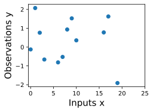

为了用高斯过程拟合数据，我们首先要指定一个先验分布，用来表示我们认为哪些类型的函数是合理的。这里我们展示从高斯过程中采样的若干样本函数。这个先验看起来合理吗？请注意，这里我们寻找的不是能拟合数据集的函数，而是为解指定合理的高层性质，例如它们随输入变化的快慢。请注意，在后续关于先验和推断的笔记本中，我们将看到复现本笔记本中所有图表的代码。

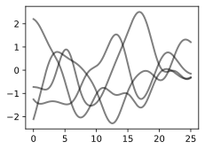

一旦以数据为条件，我们就可以利用这个先验来推断能够拟合数据的函数上的后验分布。这里我们展示样本后验函数。

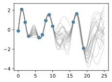

可以看到，这些函数中的每一个都与我们的数据完全一致，完美地穿过每个观测点。为了利用这些后验样本进行预测，我们可以对后验中每一个可能的样本函数的值求平均，从而得到下方粗蓝色的曲线。请注意，要计算这个期望，我们实际上不必抽取无穷多个样本；正如我们稍后将看到的，我们可以用闭式解来计算该期望。

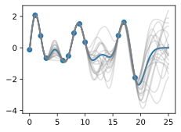

我们可能还希望得到不确定性的表示，以便知道应该对预测有多大把握。直观上，在样本后验函数变化更大的地方，不确定性应该更大，因为这告诉我们真实函数可能取的值多得多。这类不确定性称为 _认知不确定性_（epistemic uncertainty），它是与信息缺乏有关的 _可约不确定性_。随着我们获得更多数据，这类不确定性会消失，因为与观测结果一致的解会越来越少。与后验均值一样，我们也可以用闭式解计算后验方差（即这些函数在后验中的变化程度）。我们用阴影表示均值两侧两倍后验标准差的范围，构成一个 _置信区间_（credible interval），对任何输入 $x$，该区间包含函数真实值的概率为 95%。

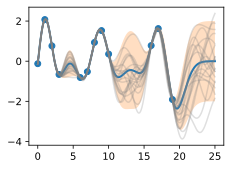

如果去掉后验样本，只可视化数据、后验均值和 95% 置信集，图像会显得更简洁一些。请注意，不确定性随着远离数据而增大，这是认知不确定性的一个性质。

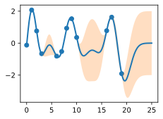

我们用来拟合数据的高斯过程的性质，受到所谓的 _协方差函数_ 的强烈控制，协方差函数也称为 _核函数_。我们使用的协方差函数称为 _RBF（径向基函数）核_，其形式为
$$ k_{\textrm{RBF}}(x,x') = \textrm{Cov}(f(x),f(x')) = a^2 \exp\left(-\frac{1}{2\ell^2}||x-x'||^2\right) $$

该核函数的 _超参数_ 是可解释的。_振幅_ 参数 $a$ 控制函数变化的垂直尺度，而 _长度尺度_ 参数 $\ell$ 控制函数的变化速率（即抖动程度）。$a$ 越大，函数值越大；$\ell$ 越大，函数变化越慢。让我们看看当我们改变 $a$ 和 $\ell$ 时，样本先验函数和后验函数会发生什么变化。

长度尺度对高斯过程的预测和不确定性有着特别显著的影响。当 $||x-x'|| = \ell$ 时，一对函数值之间的协方差为 $a^2\exp(-0.5)$。在距离大于 $\ell$ 时，函数值之间几乎不相关。这意味着，如果我们想在某个点 $x_*$ 处进行预测，那么输入为 $x$、且满足 $||x-x'||>\ell$ 的函数值不会对我们的预测产生强烈影响。

让我们看看改变长度尺度会如何影响样本先验函数、后验函数以及置信集。上面的拟合使用长度尺度 $2$。现在我们考虑 $\ell = 0.1, 0.5, 2, 5, 10$。相对于我们所考虑的输入域范围 $25$ 而言，长度尺度 $0.1$ 非常小。例如，在这样的长度尺度下，函数在 $x=5$ 和 $x=10$ 处的值本质上不相关。另一方面，对于长度尺度 $10$，这些输入处的函数值将高度相关。请注意，以下各图中的垂直尺度会发生变化。

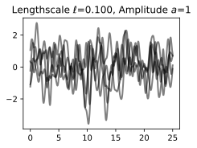
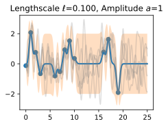

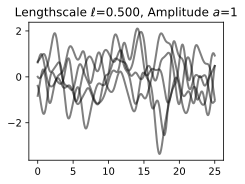
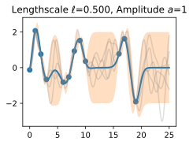

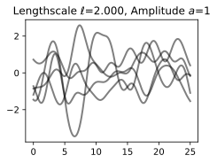
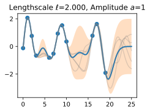

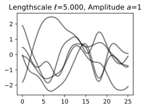
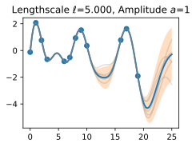

请注意，随着长度尺度增大，函数的“抖动程度”降低，我们的不确定性也随之降低。如果长度尺度很小，那么当我们远离数据时，不确定性会迅速增大，因为数据点对函数值所提供的信息越来越少。

现在，我们改变振幅参数，同时把长度尺度固定为 $2$。请注意，先验样本的垂直尺度保持不变，而后验样本的垂直尺度会变化，这样你就能清楚地看到函数尺度的增大以及对数据的拟合情况。

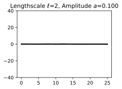
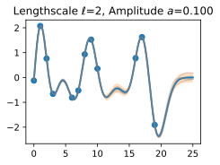

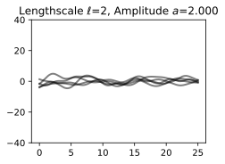
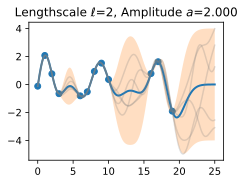

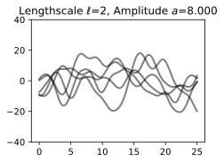
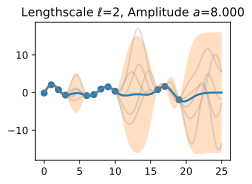

我们看到，振幅参数影响函数的尺度，但不影响变化的速率。至此我们也能感觉到，我们的方法的泛化性能将取决于这些超参数是否取到合理的值。$\ell=2$ 和 $a=1$ 似乎能给出合理的拟合，而其他一些取值则不能。幸运的是，有一种稳健且自动的方法来设定这些超参数，即使用所谓的 _边际似然_，我们将在关于推断的笔记本中回到这个话题。

那么，高斯过程究竟是什么？正如一开始所说，高斯过程只是说：由任意一组输入 $x_1,\dots,x_n$ 索引的任意一组函数值 $f(x_1),\dots,f(x_n)$，服从一个联合多元高斯分布。该分布的均值向量 $\mu$ 由 _均值函数_ 给出，通常取为常数或零。该分布的协方差矩阵由 _核函数_ 在所有输入对 $x$ 处的取值给出。

$$\begin{bmatrix}f(x) \\f(x_1) \\ \vdots \\ f(x_n) \end{bmatrix}\sim \mathcal{N}\left(\mu, \begin{bmatrix}k(x,x) & k(x, x_1) & \dots & k(x,x_n) \\ k(x_1,x) & k(x_1,x_1) & \dots & k(x_1,x_n) \\ \vdots & \vdots & \ddots & \vdots \\ k(x_n, x) & k(x_n, x_1) & \dots & k(x_n,x_n) \end{bmatrix}\right)$$
:eqlabel:`eq_gp_prior`

式 :eqref:`eq_gp_prior` 指定了一个高斯过程先验。我们可以计算给定已观测到的函数值 $f(x_1), \dots, f(x_n)$ 时，任意 $x$ 处 $f(x)$ 的条件分布。这个条件分布称为 _后验_，我们正是用它来进行预测。

具体而言，

$$f(x) | f(x_1), \dots, f(x_n) \sim \mathcal{N}(m,s^2)$$

其中

$$m = k(x,x_{1:n}) k(x_{1:n},x_{1:n})^{-1} f(x_{1:n})$$

$$s^2 = k(x,x) - k(x,x_{1:n})k(x_{1:n},x_{1:n})^{-1}k(x,x_{1:n})$$

其中 $k(x,x_{1:n})$ 是一个 $1 \times n$ 向量，由对 $i=1,\dots,n$ 计算 $k(x,x_{i})$ 得到；而 $k(x_{1:n},x_{1:n})$ 是一个 $n \times n$ 矩阵，由对 $i,j = 1,\dots,n$ 计算 $k(x_i,x_j)$ 得到。$m$ 可以用作任意 $x$ 处的点预测器，$s^2$ 则用于表示不确定性：如果我们要构造一个区间，使 $f(x)$ 位于该区间内的概率为 95%，就会使用 $m \pm 2s$。上面所有图形中的预测均值和不确定性都是用这些公式计算出来的。观测到的数据点由 $f(x_1), \dots, f(x_n)$ 给出，预测时选取了一组细粒度的 $x$ 点。

假设我们观测到一个数据点 $f(x_1)$，并且想确定 $f(x)$ 在某个 $x$ 处的值。由于 $f(x)$ 由一个高斯过程描述，我们知道 $(f(x), f(x_1))$ 上的联合分布是高斯分布：

$$
\begin{bmatrix}
f(x) \\ 
f(x_1) \\
\end{bmatrix}
\sim
\mathcal{N}\left(\mu, 
\begin{bmatrix}
k(x,x) & k(x, x_1) \\
k(x_1,x) & k(x_1,x_1)
\end{bmatrix}
\right)
$$

非对角元素 $k(x,x_1) = k(x_1,x)$ 告诉我们函数值之间会有多相关，即 $f(x)$ 在多大程度上由 $f(x_1)$ 决定。我们已经看到，如果使用的长度尺度相对于 $x$ 与 $x_1$ 之间的距离 $||x-x_1||$ 较大，那么函数值将高度相关。我们既可以在函数空间中、也可以在 $f(x_1), f(x)$ 上的联合分布中，可视化从 $f(x_1)$ 确定 $f(x)$ 的过程。让我们先考虑某个 $x$，使得 $k(x,x_1) = 0.9$ 且 $k(x,x)=1$，这意味着 $f(x)$ 的值与 $f(x_1)$ 的值中度相关。在联合分布中，等概率轮廓将是相对狭窄的椭圆。

假设我们观测到 $f(x_1) = 1.2$。为了以这个 $f(x_1)$ 的值为条件，我们可以在密度图上画一条位于 $1.2$ 的水平线，并看到 $f(x)$ 的值大致被限制在 $[0.64,1.52]$ 内。我们还在函数空间中画出了该图，用橙色显示观测点 $f(x_1)$，并用蓝色显示 $f(x)$ 的高斯过程预测分布中围绕均值 $1.08$ 的一个标准差范围。

现在假设我们有更强的相关性 $k(x,x_1) = 0.95$。此时椭圆进一步变窄，$f(x)$ 的值更加由 $f(x_1)$ 决定。在 $1.2$ 处画一条水平线，我们看到 $f(x)$ 的轮廓主要支持 $[0.83, 1.45]$ 内的值。同样，我们也在函数空间中展示该图，其中均值预测值 $1.14$ 附近有一个标准差的范围。

我们看到，高斯过程的后验均值预测器更接近 $1.2$，因为此时相关性更强。我们还看到，不确定性（误差棒）有所减小。尽管这些函数值之间相关性很强，我们的不确定性仍然相当大，因为只观测了一个数据点！

对于我们已经观测到的任意数量的点，这个过程都能给出任意 $x$ 处 $f(x)$ 的后验。假设我们观测到 $f(x_1), f(x_2)$。现在我们可视化函数空间中某个特定 $x=x'$ 处 $f(x)$ 的后验。$f(x)$ 的精确分布由上面的公式给出。$f(x)$ 服从高斯分布，其均值为

$$m = k(x,x_{1:3}) k(x_{1:3},x_{1:3})^{-1} f(x_{1:3})$$

以及方差为

$$s^2 = k(x,x) - k(x,x_{1:3})k(x_{1:3},x_{1:3})^{-1}k(x,x_{1:3})$$

在这个引言笔记本中，我们一直考虑的是 _无噪声_ 观测。正如我们将看到的，把观测噪声包含进来很容易。如果我们假设数据是由一个潜在的、无噪声的函数 $f(x)$ 加上独立同分布的高斯噪声 $\epsilon(x) \sim \mathcal{N}(0,\sigma^2)$ 生成的，且该噪声的方差为 $\sigma^2$，那么我们的协方差函数就变为 $k(x_i,x_j) \to k(x_i,x_j) + \delta_{ij}\sigma^2$，其中当 $i=j$ 时 $\delta_{ij} = 1$，否则为 $0$。

我们已经开始对如何使用高斯过程来指定解上的先验和后验、以及核函数如何影响这些解的性质，形成了一些直觉。在后续笔记本中，我们将精确地展示如何指定高斯过程先验、介绍并推导各种核函数，然后详细讲解如何自动学习核函数超参数，并构造高斯过程后验以进行预测。虽然要习惯“函数上的分布”这类概念需要时间和练习，但推导高斯过程预测公式的实际操作其实相当简单——这使我们很容易通过练习来形成对这些概念的直观理解。

## 小结

在典型的机器学习中，我们用一个带有若干自由参数（如神经网络及其权重）的函数来建模，并专注于估计这些参数，而这些参数可能难以解释。使用高斯过程时，我们则直接对函数上的分布进行推理，这使我们能够对解的高层性质进行推理。这些性质由协方差函数（核函数）控制，它通常有少数几个高度可解释的超参数。这些超参数包括 _长度尺度_，它控制函数的快速程度（抖动程度）。另一个超参数是振幅，它控制函数变化的垂直尺度。
表示众多能够拟合数据的不同函数，并把它们全部组合成一个预测分布，是贝叶斯方法的一个显著特征。由于远离数据处可能解之间的差异更大，直观上，我们的不确定性会随着远离数据而增大。

高斯过程通过对所有可能的函数值指定一个多元正态（高斯）分布，来表示函数上的分布。我们可以轻松地对高斯分布进行运算，从而根据任意一组其他函数值来求某个函数值的分布。换句话说，如果我们观测到一组点，就可以以这些点为条件，推断函数在任意其他输入处的取值可能服从的分布。我们如何对这些点之间的相关性建模，由协方差函数决定，而它也正是定义高斯过程泛化性质的东西。虽然习惯高斯过程需要时间，但它们易于使用、应用广泛，并能帮助我们理解和开发其他模型类别，例如神经网络。

## 练习

1. 认知不确定性与观测不确定性之间有什么区别？
2. 除了变化速率和振幅，我们可能还想考虑函数的哪些其他性质？具备这些性质的函数在现实世界中有哪些例子？
3. 我们考虑的 RBF 协方差函数表明，观测之间的协方差（和相关性）随它们在输入空间（时间、空间位置等）中的距离而减小。这个假设合理吗？为什么合理或为什么不合理？
4. 两个高斯变量之和是高斯变量吗？两个高斯变量之积是高斯变量吗？如果 (a,b) 具有联合高斯分布，那么 a|b（给定 b 时的 a）是高斯变量吗？a 是高斯变量吗？
5. 重复我们观测到数据点 $f(x_1) = 1.2$ 的练习，但现在假设我们还观测到 $f(x_2) = 1.4$。令 $k(x,x_1) = 0.9$、$k(x,x_2) = 0.8$。与只观测到 $f(x_1)$ 时相比，我们对 $f(x)$ 的值会更有把握还是更没把握？此时我们对 $f(x)$ 的值的均值和 95\% 置信集是什么？
6. 你认为增大我们对观测噪声的估计，会使我们对真实函数长度尺度的估计增大还是减小？
7. 假设当我们远离数据时，预测分布中的不确定性增加到某个程度后就不再增加。这种情况为什么可能发生？

:begin_tab:`pytorch`
[讨论](https://discuss.d2l.ai/t/12115)
:end_tab:
