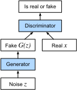

# 生成对抗网络
:label:`sec_basic_gan`

在本书的大部分篇幅中，我们讨论的都是如何做出预测。我们以某种形式使用深度神经网络来学习从数据样例到标签的映射。这类学习称为判别式学习（discriminative learning），例如，我们希望能够区分猫的照片和狗的照片。分类器和回归器都是判别式学习的例子。而通过反向传播训练的神经网络彻底改变了我们对大型复杂数据集上判别式学习的认识。在仅仅 5-6 年的时间里，高分辨率图像的分类准确率从毫无用处提升到了人类水平（附带一些说明）。关于深度神经网络在其他判别式任务上表现惊人的情况，我们就不再长篇大论了。

但机器学习不仅仅是解决判别式任务。例如，给定一个大型数据集，在没有任何标签的情况下，我们可能希望学习一个简洁地刻画该数据特征的模型。给定这样的模型，我们就可以采样出与训练数据分布相似的合成数据样例。例如，给定一个大型人脸照片语料库，我们可能希望能够生成一张新的、逼真的图像，它看起来可能是来自同一个数据集。这类学习称为生成式建模（generative modeling）。

直到最近，我们还没有任何方法能够合成新颖的逼真图像。但深度神经网络在判别式学习上的成功开辟了新的可能性。过去三年中的一个重要趋势是，应用判别式深度网络来克服那些我们通常不认为是监督学习问题的问题。循环神经网络语言模型就是一个例子：使用一个判别式网络（训练来预测下一个字符），一旦训练完成，它就可以充当生成模型。

2014 年，一篇突破性论文提出了生成对抗网络（GANs）:cite:`Goodfellow.Pouget-Abadie.Mirza.ea.2014`，这是一种利用判别模型的力量来获得良好生成模型的巧妙新方法。GAN 的核心思想是：如果我们无法区分假数据和真数据，那么数据生成器就是好的。在统计学中，这称为双样本检验（two-sample test）——用于回答数据集 $X=\{x_1,\ldots, x_n\}$ 和 $X'=\{x'_1,\ldots, x'_n\}$ 是否抽自同一分布这一问题的检验。大多数统计学论文与 GAN 的主要区别在于，后者以一种建设性的方式使用这一思想。换句话说，他们不是仅仅训练一个模型说“嘿，这两个数据集看起来不像来自同一个分布”，而是利用[双样本检验](https://en.wikipedia.org/wiki/Two-sample_hypothesis_testing)向生成模型提供训练信号。这使我们能够改进数据生成器，直到它生成出类似真实数据的东西。至少，它需要骗过分类器，即使我们的分类器是最先进的深度神经网络。


:label:`fig_gan`


GAN 的架构如图 :numref:`fig_gan` 所示。
如你所见，GAN 架构中有两个部分：首先，我们需要一个设备（比如一个深度网络，但它实际上可以是任何东西，例如游戏渲染引擎），它可能潜在地能够生成看起来与真实事物一模一样的数据。如果我们处理的是图像，它就需要生成图像。如果我们处理的是语音，它就需要生成音频序列，等等。我们称其为生成器网络。第二个组件是判别器网络。它试图把假数据和真数据区分开。两个网络相互竞争。生成器网络试图骗过判别器网络。在那一时刻，判别器网络适应新的假数据。这个信息反过来又用于改进生成器网络，如此循环往复。


判别器是一个二元分类器，用于区分输入 $x$ 是真实的（来自真实数据）还是假的（来自生成器）。通常，判别器对输入 $\mathbf x$ 输出一个标量预测 $o\in\mathbb R$，例如使用隐藏大小为 1 的全连接层，然后应用 sigmoid 函数得到预测概率 $D(\mathbf x) = 1/(1+e^{-o})$。假设真实数据的标签 $y$ 为 $1$，假数据的标签为 $0$。我们训练判别器来最小化交叉熵损失，*即*

$$ \min_D \{ - y \log D(\mathbf x) - (1-y)\log(1-D(\mathbf x)) \},$$

对于生成器，它首先从某个随机性来源（*例如*，正态分布 $\mathbf z \sim \mathcal{N} (0, 1)$）中抽取某个参数 $\mathbf z\in\mathbb R^d$。我们通常把 $\mathbf z$ 称为潜在变量。
然后它应用一个函数来生成 $\mathbf x'=G(\mathbf z)$。生成器的目标是骗过判别器，把 $\mathbf x'=G(\mathbf z)$ 分类为真实数据，*即*，我们希望 $D( G(\mathbf z)) \approx 1$。
换句话说，对于给定的判别器 $D$，我们更新生成器 $G$ 的参数，使得当 $y=0$ 时交叉熵损失最大化，*即*，

$$ \max_G \{ - (1-y) \log(1-D(G(\mathbf z))) \} = \max_G \{ - \log(1-D(G(\mathbf z))) \}.$$

如果生成器做得完美，那么 $D(\mathbf x')\approx 1$，所以上述损失接近 0，这会导致梯度过小，使判别器无法取得良好的进展。因此，我们通常最小化以下损失：

$$ \min_G \{ - y \log(D(G(\mathbf z))) \} = \min_G \{ - \log(D(G(\mathbf z))) \}, $$

这不过就是将 $\mathbf x'=G(\mathbf z)$ 输入判别器，但给出标签 $y=1$。


总而言之，$D$ 和 $G$ 在综合目标函数下进行一场“极小极大”博弈：

$$\min_D \max_G \{ -E_{x \sim \textrm{Data}} \log D(\mathbf x) - E_{z \sim \textrm{Noise}} \log(1 - D(G(\mathbf z))) \}.$$


GAN 的许多应用都出现在图像领域。作为演示，我们先满足于拟合一个简单得多的分布。我们将说明，如果用 GAN 来构建世界上效率最低的高斯参数估计器会发生什么。让我们开始吧。

```{.python .input}
#@tab mxnet
%matplotlib inline
from d2l import mxnet as d2l
from mxnet import autograd, gluon, init, np, npx
from mxnet.gluon import nn
npx.set_np()
```

```{.python .input}
#@tab pytorch
%matplotlib inline
from d2l import torch as d2l
import torch
from torch import nn
```

```{.python .input}
#@tab tensorflow
from d2l import tensorflow as d2l
import tensorflow as tf
```

## 生成一些“真实”数据

由于这将是世界上最蹩脚的例子，我们干脆生成从高斯分布中抽取的数据。

```{.python .input}
#@tab mxnet, pytorch
X = d2l.normal(0.0, 1, (1000, 2))
A = d2l.tensor([[1, 2], [-0.1, 0.5]])
b = d2l.tensor([1, 2])
data = d2l.matmul(X, A) + b
```

```{.python .input}
#@tab tensorflow
X = d2l.normal((1000, 2), 0.0, 1)
A = d2l.tensor([[1, 2], [-0.1, 0.5]])
b = d2l.tensor([1, 2], tf.float32)
data = d2l.matmul(X, A) + b
```

让我们看看得到了什么。这应该是一个以某种相当任意的方式平移了的高斯分布，其均值为 $b$，协方差矩阵为 $A^TA$。

```{.python .input}
#@tab mxnet, pytorch
d2l.set_figsize()
d2l.plt.scatter(d2l.numpy(data[:100, 0]), d2l.numpy(data[:100, 1]));
print(f'The covariance matrix is\n{d2l.matmul(A.T, A)}')
```

```{.python .input}
#@tab tensorflow
d2l.set_figsize()
d2l.plt.scatter(d2l.numpy(data[:100, 0]), d2l.numpy(data[:100, 1]));
print(f'The covariance matrix is\n{tf.matmul(A, A, transpose_a=True)}')
```

```{.python .input}
#@tab all
batch_size = 8
data_iter = d2l.load_array((data,), batch_size)
```

## 生成器

我们的生成器网络将是最简单的网络——一个单层线性模型。这是因为我们将用高斯数据生成器来驱动这个线性网络。因此，它实际上只需要学习参数，就能完美地伪造数据。

```{.python .input}
#@tab mxnet
net_G = nn.Sequential()
net_G.add(nn.Dense(2))
```

```{.python .input}
#@tab pytorch
net_G = nn.Sequential(nn.Linear(2, 2))
```

```{.python .input}
#@tab tensorflow
net_G = tf.keras.layers.Dense(2)
```

## 判别器

对于判别器，我们会稍微更有辨别力一些：我们将使用一个 3 层的 MLP，让事情更有趣一点。

```{.python .input}
#@tab mxnet
net_D = nn.Sequential()
net_D.add(nn.Dense(5, activation='tanh'),
          nn.Dense(3, activation='tanh'),
          nn.Dense(1))
```

```{.python .input}
#@tab pytorch
net_D = nn.Sequential(
    nn.Linear(2, 5), nn.Tanh(),
    nn.Linear(5, 3), nn.Tanh(),
    nn.Linear(3, 1))
```

```{.python .input}
#@tab tensorflow
net_D = tf.keras.models.Sequential([
    tf.keras.layers.Dense(5, activation="tanh", input_shape=(2,)),
    tf.keras.layers.Dense(3, activation="tanh"),
    tf.keras.layers.Dense(1)
])
```

## 训练

首先，我们定义一个更新判别器的函数。

```{.python .input}
#@tab mxnet
#@save
def update_D(X, Z, net_D, net_G, loss, trainer_D):
    """Update discriminator."""
    batch_size = X.shape[0]
    ones = np.ones((batch_size,), ctx=X.ctx)
    zeros = np.zeros((batch_size,), ctx=X.ctx)
    with autograd.record():
        real_Y = net_D(X)
        fake_X = net_G(Z)
        # Do not need to compute gradient for `net_G`, detach it from
        # computing gradients.
        fake_Y = net_D(fake_X.detach())
        loss_D = (loss(real_Y, ones) + loss(fake_Y, zeros)) / 2
    loss_D.backward()
    trainer_D.step(batch_size)
    return float(loss_D.sum())
```

```{.python .input}
#@tab pytorch
#@save
def update_D(X, Z, net_D, net_G, loss, trainer_D):
    """Update discriminator."""
    batch_size = X.shape[0]
    ones = torch.ones((batch_size,), device=X.device)
    zeros = torch.zeros((batch_size,), device=X.device)
    trainer_D.zero_grad()
    real_Y = net_D(X)
    fake_X = net_G(Z)
    # Do not need to compute gradient for `net_G`, detach it from
    # computing gradients.
    fake_Y = net_D(fake_X.detach())
    loss_D = (loss(real_Y, ones.reshape(real_Y.shape)) +
              loss(fake_Y, zeros.reshape(fake_Y.shape))) / 2
    loss_D.backward()
    trainer_D.step()
    return loss_D
```

```{.python .input}
#@tab tensorflow
#@save
def update_D(X, Z, net_D, net_G, loss, optimizer_D):
    """Update discriminator."""
    batch_size = X.shape[0]
    ones = tf.ones((batch_size,)) # Labels corresponding to real data
    zeros = tf.zeros((batch_size,)) # Labels corresponding to fake data
    # Do not need to compute gradient for `net_G`, so it is outside GradientTape
    fake_X = net_G(Z)
    with tf.GradientTape() as tape:
        real_Y = net_D(X)
        fake_Y = net_D(fake_X)
        # We multiply the loss by batch_size to match PyTorch's BCEWithLogitsLoss
        loss_D = (loss(ones, tf.squeeze(real_Y)) + loss(
            zeros, tf.squeeze(fake_Y))) * batch_size / 2
    grads_D = tape.gradient(loss_D, net_D.trainable_variables)
    optimizer_D.apply_gradients(zip(grads_D, net_D.trainable_variables))
    return loss_D
```

生成器的更新方式类似。这里我们复用交叉熵损失，但把假数据的标签从 $0$ 改为 $1$。

```{.python .input}
#@tab mxnet
#@save
def update_G(Z, net_D, net_G, loss, trainer_G):
    """Update generator."""
    batch_size = Z.shape[0]
    ones = np.ones((batch_size,), ctx=Z.ctx)
    with autograd.record():
        # We could reuse `fake_X` from `update_D` to save computation
        fake_X = net_G(Z)
        # Recomputing `fake_Y` is needed since `net_D` is changed
        fake_Y = net_D(fake_X)
        loss_G = loss(fake_Y, ones)
    loss_G.backward()
    trainer_G.step(batch_size)
    return float(loss_G.sum())
```

```{.python .input}
#@tab pytorch
#@save
def update_G(Z, net_D, net_G, loss, trainer_G):
    """Update generator."""
    batch_size = Z.shape[0]
    ones = torch.ones((batch_size,), device=Z.device)
    trainer_G.zero_grad()
    # We could reuse `fake_X` from `update_D` to save computation
    fake_X = net_G(Z)
    # Recomputing `fake_Y` is needed since `net_D` is changed
    fake_Y = net_D(fake_X)
    loss_G = loss(fake_Y, ones.reshape(fake_Y.shape))
    loss_G.backward()
    trainer_G.step()
    return loss_G
```

```{.python .input}
#@tab tensorflow
#@save
def update_G(Z, net_D, net_G, loss, optimizer_G):
    """Update generator."""
    batch_size = Z.shape[0]
    ones = tf.ones((batch_size,))
    with tf.GradientTape() as tape:
        # We could reuse `fake_X` from `update_D` to save computation
        fake_X = net_G(Z)
        # Recomputing `fake_Y` is needed since `net_D` is changed
        fake_Y = net_D(fake_X)
        # We multiply the loss by batch_size to match PyTorch's BCEWithLogits loss
        loss_G = loss(ones, tf.squeeze(fake_Y)) * batch_size
    grads_G = tape.gradient(loss_G, net_G.trainable_variables)
    optimizer_G.apply_gradients(zip(grads_G, net_G.trainable_variables))
    return loss_G
```

判别器和生成器都执行带有交叉熵损失的二元逻辑回归。我们使用 Adam 来平滑训练过程。在每次迭代中，我们先更新判别器，再更新生成器。我们可视化两种损失以及生成的样例。

```{.python .input}
#@tab mxnet
def train(net_D, net_G, data_iter, num_epochs, lr_D, lr_G, latent_dim, data):
    loss = gluon.loss.SigmoidBCELoss()
    net_D.initialize(init=init.Normal(0.02), force_reinit=True)
    net_G.initialize(init=init.Normal(0.02), force_reinit=True)
    trainer_D = gluon.Trainer(net_D.collect_params(),
                              'adam', {'learning_rate': lr_D})
    trainer_G = gluon.Trainer(net_G.collect_params(),
                              'adam', {'learning_rate': lr_G})
    animator = d2l.Animator(xlabel='epoch', ylabel='loss',
                            xlim=[1, num_epochs], nrows=2, figsize=(5, 5),
                            legend=['discriminator', 'generator'])
    animator.fig.subplots_adjust(hspace=0.3)
    for epoch in range(num_epochs):
        # Train one epoch
        timer = d2l.Timer()
        metric = d2l.Accumulator(3)  # loss_D, loss_G, num_examples
        for X in data_iter:
            batch_size = X.shape[0]
            Z = np.random.normal(0, 1, size=(batch_size, latent_dim))
            metric.add(update_D(X, Z, net_D, net_G, loss, trainer_D),
                       update_G(Z, net_D, net_G, loss, trainer_G),
                       batch_size)
        # Visualize generated examples
        Z = np.random.normal(0, 1, size=(100, latent_dim))
        fake_X = net_G(Z).asnumpy()
        animator.axes[1].cla()
        animator.axes[1].scatter(data[:, 0], data[:, 1])
        animator.axes[1].scatter(fake_X[:, 0], fake_X[:, 1])
        animator.axes[1].legend(['real', 'generated'])
        # Show the losses
        loss_D, loss_G = metric[0]/metric[2], metric[1]/metric[2]
        animator.add(epoch + 1, (loss_D, loss_G))
    print(f'loss_D {loss_D:.3f}, loss_G {loss_G:.3f}, '
          f'{metric[2] / timer.stop():.1f} examples/sec')
```

```{.python .input}
#@tab pytorch
def train(net_D, net_G, data_iter, num_epochs, lr_D, lr_G, latent_dim, data):
    loss = nn.BCEWithLogitsLoss(reduction='sum')
    for w in net_D.parameters():
        nn.init.normal_(w, 0, 0.02)
    for w in net_G.parameters():
        nn.init.normal_(w, 0, 0.02)
    trainer_D = torch.optim.Adam(net_D.parameters(), lr=lr_D)
    trainer_G = torch.optim.Adam(net_G.parameters(), lr=lr_G)
    animator = d2l.Animator(xlabel='epoch', ylabel='loss',
                            xlim=[1, num_epochs], nrows=2, figsize=(5, 5),
                            legend=['discriminator', 'generator'])
    animator.fig.subplots_adjust(hspace=0.3)
    for epoch in range(num_epochs):
        # Train one epoch
        timer = d2l.Timer()
        metric = d2l.Accumulator(3)  # loss_D, loss_G, num_examples
        for (X,) in data_iter:
            batch_size = X.shape[0]
            Z = torch.normal(0, 1, size=(batch_size, latent_dim))
            metric.add(update_D(X, Z, net_D, net_G, loss, trainer_D),
                       update_G(Z, net_D, net_G, loss, trainer_G),
                       batch_size)
        # Visualize generated examples
        Z = torch.normal(0, 1, size=(100, latent_dim))
        fake_X = net_G(Z).detach().numpy()
        animator.axes[1].cla()
        animator.axes[1].scatter(data[:, 0], data[:, 1])
        animator.axes[1].scatter(fake_X[:, 0], fake_X[:, 1])
        animator.axes[1].legend(['real', 'generated'])
        # Show the losses
        loss_D, loss_G = metric[0]/metric[2], metric[1]/metric[2]
        animator.add(epoch + 1, (loss_D, loss_G))
    print(f'loss_D {loss_D:.3f}, loss_G {loss_G:.3f}, '
          f'{metric[2] / timer.stop():.1f} examples/sec')
```

```{.python .input}
#@tab tensorflow
def train(net_D, net_G, data_iter, num_epochs, lr_D, lr_G, latent_dim, data):
    loss = tf.keras.losses.BinaryCrossentropy(
        from_logits=True, reduction=tf.keras.losses.Reduction.SUM)
    for w in net_D.trainable_variables:
        w.assign(tf.random.normal(mean=0, stddev=0.02, shape=w.shape))
    for w in net_G.trainable_variables:
        w.assign(tf.random.normal(mean=0, stddev=0.02, shape=w.shape))
    optimizer_D = tf.keras.optimizers.Adam(learning_rate=lr_D)
    optimizer_G = tf.keras.optimizers.Adam(learning_rate=lr_G)
    animator = d2l.Animator(
        xlabel="epoch", ylabel="loss", xlim=[1, num_epochs], nrows=2,
        figsize=(5, 5), legend=["discriminator", "generator"])
    animator.fig.subplots_adjust(hspace=0.3)
    for epoch in range(num_epochs):
        # Train one epoch
        timer = d2l.Timer()
        metric = d2l.Accumulator(3)  # loss_D, loss_G, num_examples
        for (X,) in data_iter:
            batch_size = X.shape[0]
            Z = tf.random.normal(
                mean=0, stddev=1, shape=(batch_size, latent_dim))
            metric.add(update_D(X, Z, net_D, net_G, loss, optimizer_D),
                       update_G(Z, net_D, net_G, loss, optimizer_G),
                       batch_size)
        # Visualize generated examples
        Z = tf.random.normal(mean=0, stddev=1, shape=(100, latent_dim))
        fake_X = net_G(Z)
        animator.axes[1].cla()
        animator.axes[1].scatter(data[:, 0], data[:, 1])
        animator.axes[1].scatter(fake_X[:, 0], fake_X[:, 1])
        animator.axes[1].legend(["real", "generated"])

        # Show the losses
        loss_D, loss_G = metric[0] / metric[2], metric[1] / metric[2]
        animator.add(epoch + 1, (loss_D, loss_G))

    print(f'loss_D {loss_D:.3f}, loss_G {loss_G:.3f}, '
          f'{metric[2] / timer.stop():.1f} examples/sec')
```

现在我们指定用于拟合高斯分布的超参数。

```{.python .input}
#@tab all
lr_D, lr_G, latent_dim, num_epochs = 0.05, 0.005, 2, 20
train(net_D, net_G, data_iter, num_epochs, lr_D, lr_G,
      latent_dim, d2l.numpy(data[:100]))
```

## 小结

* 生成对抗网络（GAN）由两个深度网络组成：生成器和判别器。
* 生成器通过最大化交叉熵损失（*即* $\max \log(D(\mathbf{x'}))$）生成尽可能接近真实图像的图像，以骗过判别器。
* 判别器通过最小化交叉熵损失（*即* $\min - y \log D(\mathbf{x}) - (1-y)\log(1-D(\mathbf{x}))$）试图把生成的图像与真实图像区分开。

## 练习

* 是否存在生成器获胜的均衡，*即*判别器最终无法在有限样本上区分这两个分布？

:begin_tab:`mxnet`
[讨论](https://discuss.d2l.ai/t/408)
:end_tab:

:begin_tab:`pytorch`
[讨论](https://discuss.d2l.ai/t/1082)
:end_tab:
