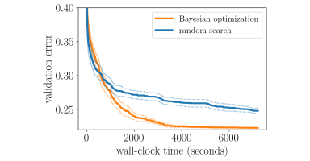

```{.python .input  n=1}
%load_ext d2lbook.tab
tab.interact_select(["pytorch"])
```

# 超参数优化 API
:label:`sec_api_hpo`

在深入方法论之前，我们先讨论一种基本的代码
结构，它使我们能够高效地实现各种 HPO 算法。一般而
言，这里考虑的所有 HPO 算法都需要实现两个决策
原语：*搜索*（searching）和*调度*（scheduling）。首先，它们需要采样新的
超参数配置，这通常涉及在配置空间上进行某种搜索。
其次，对于每个配置，HPO 算法需要调度其评估，并决定为它分配多少资源。
一旦我们开始评估某个配置，我们就把它称为一次*试验*（trial）。我们
把这些决策映射到两个类：`HPOSearcher` 和 `HPOScheduler`。在此基础之上，
我们还提供一个 `HPOTuner` 类来执行优化过程。

这种调度器与搜索器的概念同样实现在流行的 HPO
库中，例如 Syne Tune :cite:`salinas-automl22`、Ray Tune
:cite:`liaw-arxiv18` 或 Optuna :cite:`akiba-sigkdd19`。

```{.python .input  n=2}
%%tab pytorch
import time
from d2l import torch as d2l
from scipy import stats
```

## 搜索器

下面我们定义搜索器的基类，它通过 `sample_configuration` 函数给出新的候选
配置。实现这个函数的一种简单方式是均匀随机地采样配置，
就像我们在 :numref:`sec_what_is_hpo` 中对随机搜索所做的那样。更精巧的
算法（例如贝叶斯优化）会根据先前试验的性能来做这些
决策。因此，这些算法能够随着时间推移采样出更有希望的候选配置。我们添加
`update` 函数来更新先前试验的历史，随后便可利用它来改进我们的采样分布。

```{.python .input  n=3}
%%tab pytorch
class HPOSearcher(d2l.HyperParameters):  #@save
    def sample_configuration() -> dict:
        raise NotImplementedError

    def update(self, config: dict, error: float, additional_info=None):
        pass
```

下面的代码展示了如何在这个 API 中实现上一节介绍的随机搜索优化器。
作为一点小扩展，我们允许用户通过 `initial_config` 指定
要评估的第一个配置，而后续配置则随机抽取。

```{.python .input  n=4}
%%tab pytorch
class RandomSearcher(HPOSearcher):  #@save
    def __init__(self, config_space: dict, initial_config=None):
        self.save_hyperparameters()

    def sample_configuration(self) -> dict:
        if self.initial_config is not None:
            result = self.initial_config
            self.initial_config = None
        else:
            result = {
                name: domain.rvs()
                for name, domain in self.config_space.items()
            }
        return result
```

## 调度器

除了为新试验采样配置之外，我们还需要决定一次试验何时运行、
运行多久。在实践中，所有这些决策都由
`HPOScheduler` 做出，它把选择新配置的工作委托给
`HPOSearcher`。每当有可用于训练的资源
变得可用时，就会调用 `suggest` 方法。除了调用搜索器的 `sample_configuration` 之外，
它还可能决定诸如 `max_epochs` 之类的参数（即训练
模型多长时间）。每当一次试验返回新的
观测时，就会调用 `update` 方法。

```{.python .input  n=5}
%%tab pytorch
class HPOScheduler(d2l.HyperParameters):  #@save
    def suggest(self) -> dict:
        raise NotImplementedError
    
    def update(self, config: dict, error: float, info=None):
        raise NotImplementedError
```

要实现随机搜索，同时也要实现其他 HPO 算法，我们只需要一个基本的
调度器：每当有新资源变得可用时，它就调度一个新配置。

```{.python .input  n=6}
%%tab pytorch
class BasicScheduler(HPOScheduler):  #@save
    def __init__(self, searcher: HPOSearcher):
        self.save_hyperparameters()

    def suggest(self) -> dict:
        return self.searcher.sample_configuration()

    def update(self, config: dict, error: float, info=None):
        self.searcher.update(config, error, additional_info=info)
```

## 调优器

最后，我们需要一个组件来运行调度器/搜索器，并对结果做一些
记录工作。下面的代码实现了 HPO 试验的串行
执行，即一个接一个地评估训练任务，
它将作为一个基本示例。稍后我们将使用 *Syne Tune* 来处理
更具可扩展性的分布式 HPO 情形。

```{.python .input  n=7}
%%tab pytorch
class HPOTuner(d2l.HyperParameters):  #@save
    def __init__(self, scheduler: HPOScheduler, objective: callable):
        self.save_hyperparameters()
        # Bookeeping results for plotting
        self.incumbent = None
        self.incumbent_error = None
        self.incumbent_trajectory = []
        self.cumulative_runtime = []
        self.current_runtime = 0
        self.records = []

    def run(self, number_of_trials):
        for i in range(number_of_trials):
            start_time = time.time()
            config = self.scheduler.suggest()
            print(f"Trial {i}: config = {config}")
            error = self.objective(**config)
            error = float(d2l.numpy(error.cpu()))
            self.scheduler.update(config, error)
            runtime = time.time() - start_time
            self.bookkeeping(config, error, runtime)
            print(f"    error = {error}, runtime = {runtime}")
```

## 记录 HPO 算法的性能

对任何 HPO 算法而言，我们最关心的是在给定的
实际时间（wall-clock time）之后性能最好的配置（称为*当前最优配置*（incumbent））及其验证误差。
这就是为什么我们记录每次迭代的 `runtime`，它既包括
运行一次评估（调用 `objective`）的时间，也包括
做出决策（调用 `scheduler.suggest`）的时间。接下来，我们将绘制
`cumulative_runtime` 相对于 `incumbent_trajectory` 的曲线，以便可视化
在 `scheduler`（以及 `searcher`）意义下定义的 HPO 算法的
*任意时刻性能*（any-time performance）。这使我们不仅能够量化优化器
找到的配置工作得有多好，还能量化优化器能多快地找到它。

```{.python .input  n=8}
%%tab pytorch
@d2l.add_to_class(HPOTuner)  #@save
def bookkeeping(self, config: dict, error: float, runtime: float):
    self.records.append({"config": config, "error": error, "runtime": runtime})
    # Check if the last hyperparameter configuration performs better 
    # than the incumbent
    if self.incumbent is None or self.incumbent_error > error:
        self.incumbent = config
        self.incumbent_error = error
    # Add current best observed performance to the optimization trajectory
    self.incumbent_trajectory.append(self.incumbent_error)
    # Update runtime
    self.current_runtime += runtime
    self.cumulative_runtime.append(self.current_runtime)
```

## 示例：优化卷积神经网络的超参数

现在我们使用新实现的随机搜索来优化
:numref:`sec_lenet` 中 `LeNet` 卷积神经网络的
*批量大小*和*学习率*。我们首先定义目标函数，
它同样将是验证误差。

```{.python .input  n=9}
%%tab pytorch
def hpo_objective_lenet(learning_rate, batch_size, max_epochs=10):  #@save
    model = d2l.LeNet(lr=learning_rate, num_classes=10)
    trainer = d2l.HPOTrainer(max_epochs=max_epochs, num_gpus=1)
    data = d2l.FashionMNIST(batch_size=batch_size)
    model.apply_init([next(iter(data.get_dataloader(True)))[0]], d2l.init_cnn)
    trainer.fit(model=model, data=data)
    validation_error = trainer.validation_error()
    return validation_error
```

我们还需要定义配置空间。此外，第一个要评估的配置
是 :numref:`sec_lenet` 中使用的默认设置。

```{.python .input  n=10}
config_space = {
    "learning_rate": stats.loguniform(1e-2, 1),
    "batch_size": stats.randint(32, 256),
}
initial_config = {
    "learning_rate": 0.1,
    "batch_size": 128,
}
```

现在我们可以开始随机搜索了：

```{.python .input}
searcher = RandomSearcher(config_space, initial_config=initial_config)
scheduler = BasicScheduler(searcher=searcher)
tuner = HPOTuner(scheduler=scheduler, objective=hpo_objective_lenet)
tuner.run(number_of_trials=5)
```

下面我们绘制当前最优配置的优化轨迹，以得到随机搜索的任意时刻
性能：

```{.python .input  n=11}
board = d2l.ProgressBoard(xlabel="time", ylabel="error")
for time_stamp, error in zip(
    tuner.cumulative_runtime, tuner.incumbent_trajectory
):
    board.draw(time_stamp, error, "random search", every_n=1)
```

## 比较 HPO 算法

正如训练算法或模型架构一样，重要的是要理解如何最好地比较不同的 HPO 算法。
每次 HPO 运行都取决于两个主要的随机性来源：训练过程的随机效应，
例如随机权重初始化或小批量顺序；以及 HPO 算法本身固有的
随机性，例如随机搜索的随机采样。因此，在比较不同算法时，
关键是要将每个实验运行多次，并报告统计量（例如均值或中位数），
这些统计量是在基于随机数生成器不同种子的多次算法重复所构成的总体上计算的。

为了说明这一点，我们比较随机搜索（见 :numref:`sec_rs`）和贝叶斯优化
:cite:`snoek-nips12` 在调整前馈
神经网络超参数上的表现。每种算法都使用不同的随机种子
评估了 $50$ 次。实线表示当前最优配置在这 $50$ 次重复上的平均
性能，虚线表示标准差。我们可以看到，随机搜索和贝叶斯优化在约 1000 秒以内
表现大致相同，但贝叶斯优化能够利用过去的观测来识别更好的配置，
从而在此之后迅速超越随机搜索。


:label:`example_anytime_performance`

## 小结

本节给出了一个简单而灵活的接口，用于实现本章将要介绍的多种 HPO
算法。在流行的开源 HPO 框架中也能找到类似的接口。
我们还探讨了如何比较 HPO 算法，以及需要注意的潜在陷阱。

## 练习

1. 本题的目标是为一个稍具挑战性的 HPO 问题实现目标函数，并运行更贴近实际的实验。我们将使用 :numref:`sec_dropout` 中实现的两个隐藏层 MLP `DropoutMLP`。
    1. 编写目标函数，它应当依赖于模型的所有超参数以及 `batch_size`。使用 `max_epochs=50`。GPU 在这里没有帮助，因此设 `num_gpus=0`。提示：修改 `hpo_objective_lenet`。
    2. 选择一个合理的搜索空间，其中 `num_hiddens_1`、`num_hiddens_2` 是 $[8, 1024]$ 内的整数，暂退法取值位于 $[0, 0.95]$，而 `batch_size` 位于 $[16, 384]$。使用 `scipy.stats` 中合理的分布给出 `config_space` 的代码。
    3. 在这个例子上用 `number_of_trials=20` 运行随机搜索并绘制结果。确保首先评估 :numref:`sec_dropout` 的默认配置，即 `initial_config = {'num_hiddens_1': 256, 'num_hiddens_2': 256, 'dropout_1': 0.5, 'dropout_2': 0.5, 'lr': 0.1, 'batch_size': 256}`。
2. 在本练习中，你将实现一个新的搜索器（`HPOSearcher` 的子类），它根据过去的数据做出决策。它依赖于参数 `probab_local`、`num_init_random`。其 `sample_configuration` 方法的工作方式如下。对于前 `num_init_random` 次调用，做法与 `RandomSearcher.sample_configuration` 相同。否则，以概率 `1 - probab_local` 做与 `RandomSearcher.sample_configuration` 相同的事。否则，挑选迄今为止达到最小验证误差的配置，随机选择它的一个超参数，并像 `RandomSearcher.sample_configuration` 中那样随机采样其取值，但保持所有其他取值不变。返回这个配置，它除了这一个超参数之外，与迄今为止的最佳配置相同。
    1. 编写这个新的 `LocalSearcher`。提示：你的搜索器在构造时需要 `config_space` 作为参数。可以随意使用一个 `RandomSearcher` 类型的成员。你还需要实现 `update` 方法。
    2. 使用你的新搜索器代替 `RandomSearcher` 重新运行上一题的实验。尝试不同的 `probab_local`、`num_init_random` 取值。但是请注意，要恰当地比较不同的 HPO 方法，需要重复实验多次，并且最好考虑若干基准任务。


:begin_tab:`pytorch`
[讨论](https://discuss.d2l.ai/t/12092)
:end_tab:
