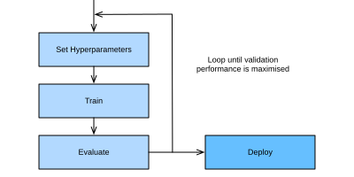

```{.python .input}
%load_ext d2lbook.tab
tab.interact_select(["pytorch"])
```

# 什么是超参数优化？
:label:`sec_what_is_hpo`

正如前几章所见，深度神经网络带有大量在训练过程中学习的参数或权重。
除此之外，每个神经网络还有需要用户配置的额外 *超参数*。
例如，为确保随机梯度下降收敛到训练损失的局部最优
（见 :numref:`chap_optimization`），我们必须调整学习率和批量大小。
为避免在训练数据集上过拟合，
我们可能必须设置正则化参数，例如权重衰减
（见 :numref:`sec_weight_decay`）或暂退法（见 :numref:`sec_dropout`）。我们可以
通过设置层数以及每层的单元数或滤波器数（即有效的权重数量）来
定义模型的容量和归纳偏置。

不幸的是，我们不能简单地通过最小化训练损失来调整这些超参数，
因为这样做会导致在训练数据上过拟合。例如，把暂退法或权重衰减等正则化参数
设为零会得到很小的训练损失，但可能损害
泛化性能。


:label:`ml_workflow`

如果没有另一种形式的自动化，超参数就只能以试错的方式手动设置，
这成了机器学习工作流中耗时且困难的一部分。例如，考虑在 CIFAR-10 上
训练一个 ResNet（见 :numref:`sec_resnet`），在 Amazon 弹性云计算（EC2）`g4dn.xlarge` 实例上
这需要 2 个多小时。即使只是
依次尝试十组超参数配置，这也已经需要我们
大约一天的时间。更糟的是，超参数通常不能直接
跨架构和数据集迁移
:cite:`feurer-arxiv22,wistuba-ml18,bardenet-icml13a`，并且需要为每个新任务重新优化。
此外，对大多数超参数而言并不存在经验法则，
需要专家知识才能找到合理的取值。

*超参数优化（HPO）* 算法旨在以有原则且自动化的方式解决这一问题 :cite:`feurer-automlbook18a`，
其做法是把问题表述为一个全局优化问题。默认的目标是
留出验证数据集上的误差，但原则上也可以是任何其他业务
指标。它可以与训练时间、推断时间或模型复杂度等次要目标结合，
或受其约束。

近来，超参数优化已被扩展到 *神经架构搜索（NAS）* :cite:`elsken-arxiv18a,wistuba-arxiv19`，
其目标是找到全新的神经网络架构。与经典的 HPO 相比，NAS 在计算上
更加昂贵，并且需要额外的努力才能在实践中保持
可行。HPO 和 NAS 都可以看作
AutoML :cite:`hutter-book19a` 的子领域，AutoML 旨在自动化整个机器学习流水线。

本节我们将介绍 HPO，并展示如何自动
为 :numref:`sec_softmax_concise` 中引入的逻辑回归示例
找到最佳超参数。

##  优化问题
:label:`sec_definition_hpo`

我们将从一个简单的玩具问题开始：为 :numref:`sec_softmax_concise` 中的
多类逻辑回归模型`SoftmaxRegression`搜索学习率，
以最小化 Fashion MNIST 数据集上的验证误差。虽然批量大小或轮数等其他超参数
也值得调优，但为简单起见，我们只关注学习率。

```{.python .input}
%%tab pytorch
from d2l import torch as d2l
import numpy as np
import torch
from torch import nn
from scipy import stats
```

在运行 HPO 之前，我们首先需要定义两个要素：目标函数
和配置空间。

### 目标函数

学习算法的性能可以看作一个函数
$f: \mathcal{X} \rightarrow \mathbb{R}$，它把超参数空间
$\mathbf{x} \in \mathcal{X}$ 映射到验证损失。对于每一次
$f(\mathbf{x})$ 的求值，我们都必须训练并验证我们的机器学习模型，
而对于在大型数据集上训练的深度神经网络而言，这可能是时间和计算密集的。
给定我们的准则 $f(\mathbf{x})$，我们的目标是找到
$\mathbf{x}_{\star} \in \mathrm{argmin}_{\mathbf{x} \in \mathcal{X}} f(\mathbf{x})$。

没有简单的方法可以计算 $f$ 关于 $\mathbf{x}$ 的梯度，
因为这需要把梯度传播穿过整个训练
过程。虽然最近有工作 :cite:`maclaurin-icml15,franceschi-icml17a`
试图通过近似的“超梯度”来驱动 HPO，但现有方法
没有一个能与当前最先进的方法相竞争，因此我们在此不讨论它们。
此外，求值 $f$ 的计算负担要求 HPO
算法以尽可能少的样本逼近全局最优。

神经网络的训练是随机的（例如，权重随机
初始化、小批量随机采样），因此我们的观测将是
带噪声的：$y \sim f(\mathbf{x}) + \epsilon$，其中我们通常假设
$\epsilon \sim N(0, \sigma)$ 的观测噪声服从高斯分布。

面对所有这些挑战，我们通常试图快速找出少数
性能良好的超参数配置，
而不是精确地命中全局
最优。然而，由于大多数神经网络模型的计算需求很大，
即使做到这一点也可能需要数天或数周的计算。我们将在 :numref:`sec_mf_hpo` 中探讨
如何通过分布式搜索或使用目标函数的更廉价近似
来加速优化过程。

我们首先介绍一种计算模型验证误差的方法。

```{.python .input  n=8}
%%tab pytorch
class HPOTrainer(d2l.Trainer):  #@save
    def validation_error(self):
        self.model.eval()
        accuracy = 0
        val_batch_idx = 0
        for batch in self.val_dataloader:
            with torch.no_grad():
                x, y = self.prepare_batch(batch)
                y_hat = self.model(x)
                accuracy += self.model.accuracy(y_hat, y)
            val_batch_idx += 1
        return 1 -  accuracy / val_batch_idx
```

我们针对由`learning_rate`组成的超参数配置`config`优化验证误差。
对于每次求值，我们把模型训练`max_epochs`轮，然后计算并返回其验证误差：

```{.python .input  n=5}
%%tab pytorch
def hpo_objective_softmax_classification(config, max_epochs=8):
    learning_rate = config["learning_rate"]
    trainer = d2l.HPOTrainer(max_epochs=max_epochs)
    data = d2l.FashionMNIST(batch_size=16)
    model = d2l.SoftmaxRegression(num_outputs=10, lr=learning_rate)
    trainer.fit(model=model, data=data)
    return d2l.numpy(trainer.validation_error())
```

### 配置空间
:label:`sec_intro_config_spaces`

除了目标函数 $f(\mathbf{x})$，我们还需要定义
要优化的可行集 $\mathbf{x} \in \mathcal{X}$，称为
*配置空间* 或 *搜索空间*。对于逻辑回归示例，
我们将使用：

```{.python .input  n=6}
config_space = {"learning_rate": stats.loguniform(1e-4, 1)}
```

这里我们使用 SciPy 中的`loguniform`对象，它表示
对数空间中介于 -4 与 -1 之间的均匀分布。这个对象
允许我们从该分布中采样随机变量。

每个超参数都有一个数据类型，例如`learning_rate`的类型是`float`，
以及一个闭有界范围（即上下界）。我们通常为每个超参数
指定一个用于采样的先验分布（例如均匀分布或对数均匀分布）。
一些正参数（例如`learning_rate`）最好在对数尺度上表示，
因为最优值可能相差好几个数量级；而另一些参数（例如动量）则采用线性尺度。

下面我们展示一个简单示例，其配置空间由多层感知机的典型
超参数组成，并包括它们的类型和标准
范围。

: 多层感知机的示例配置空间
:label:`tab_example_configspace`

| 名称                | 类型        |超参数范围           | 对数尺度 |
| :----:              | :----:      |:------------------------------:|:---------:|
| 学习率       | float       |      $[10^{-6},10^{-1}]$       |    是    |
| 批量大小          | integer     |           $[8,256]$            |    是    |
| 动量            | float       |           $[0,0.99]$           |    否     |
| 激活函数 | categorical | $\{\textrm{tanh}, \textrm{relu}\}$ |     -     |
| 单元数     | integer     |          $[32, 1024]$          |    是    |
| 层数    | integer     |            $[1, 6]$            |    否     |


一般来说，配置空间 $\mathcal{X}$ 的结构可能很复杂，
并且可能与 $\mathbb{R}^d$ 有很大不同。在实践中，一些
超参数可能依赖于其他超参数的取值。例如，假设我们试图
调优多层感知机的层数，以及每层的单元数。
只有当网络至少有 $l+1$ 层时，第 $l\textrm{-th}$ 层的单元数才有意义。这些高级的 HPO
问题超出了本章的范围。感兴趣的读者
可参阅 :cite:`hutter-lion11a,jenatton-icml17a,baptista-icml18a`。

配置空间对超参数优化很重要，
因为没有任何算法能找出配置空间中没有包含的东西。另一方面，如果
范围太大，找到性能良好的配置所需的计算预算
可能变得不可行。

## 随机搜索
:label:`sec_rs`

*随机搜索* 是我们要考虑的第一个超参数优化算法。随机搜索的
主要思想是从配置空间中独立采样，直到用完预定义的预算（例如
最大迭代次数），并返回观测到的最佳
配置。所有求值都可以独立并行执行（见
:numref:`sec_rs_async`），但为简单起见，这里我们使用顺序循环。

```{.python .input  n=7}
errors, values = [], []
num_iterations = 5

for i in range(num_iterations):
    learning_rate = config_space["learning_rate"].rvs()
    print(f"Trial {i}: learning_rate = {learning_rate}")
    y = hpo_objective_softmax_classification({"learning_rate": learning_rate})
    print(f"    validation_error = {y}")
    values.append(learning_rate)
    errors.append(y)
```

那么，最佳学习率就是验证误差最低的那个。

```{.python .input  n=7}
best_idx = np.argmin(errors)
print(f"optimal learning rate = {values[best_idx]}")
```

由于其简单性和通用性，随机搜索是最常用的
HPO 算法之一。它不需要任何复杂的实现，
只要能为每个超参数定义某种概率分布，
就可以应用于任何配置空间。

不幸的是，随机搜索也有一些缺点。首先，它不会
根据迄今收集的先前观测来调整采样分布。因此，
它采样到一个性能很差的配置与采样到一个性能更好的配置的概率是相同的。其次，所有配置
都花费同样多的资源，即使其中一些可能在初期表现出
很差的性能、并且不太可能优于之前见过的
配置。

在接下来的几节中，我们将研究样本效率更高的超参数
优化算法，它们利用模型来引导搜索，从而克服随机搜索的
缺点。我们还会研究一些算法，它们能自动停止对性能不佳的配置的求值过程，
以加速优化进程。

## 小结

本节介绍了超参数优化（HPO），以及如何通过定义配置空间和目标函数
把它表述为一个全局优化问题。我们还实现了第一个 HPO 算法——随机搜索，
并将它应用到一个简单的 softmax 分类问题上。

虽然随机搜索非常简单，但它是网格搜索的更好替代方案，
因为网格搜索只是对一组固定的超参数进行求值。随机搜索
在一定程度上缓解了维数灾难 :cite:`bellman-science66`，并且
当准则最强烈地依赖于一小部分超参数时，它可以比网格搜索
高效得多。

## 练习

1. 在本章中，我们优化的是模型在与训练集不相交的集合上训练后的验证误差。为简单起见，我们的代码使用`Trainer.val_dataloader`，它映射到围绕`FashionMNIST.val`的数据加载器。
    1. 通过查看代码说服自己：这意味着我们使用原始 FashionMNIST 训练集（60000 个样例）进行训练，并使用原始 *测试集*（10000 个样例）进行验证。
    2. 这种做法为什么可能有问题？提示：重新阅读 :numref:`sec_generalization_basics`，尤其是关于 *模型选择* 的内容。
    3. 我们本来应该怎么做？
2. 我们在上面说过，用梯度下降做超参数优化非常困难。考虑一个小问题，例如在 FashionMNIST 数据集（:numref:`sec_mlp-implementation`）上以批量大小 256 训练一个两层感知机。我们希望调优 SGD 的学习率，以便在一轮训练后最小化某个验证指标。
    1. 为什么我们不能为此使用验证 *误差*？你会使用验证集上的什么指标？
    2. 大致画出训练一轮后验证指标的计算图。你可以假设初始权重和超参数（例如学习率）是该图的输入节点。提示：重新阅读 :numref:`sec_backprop` 中关于计算图的内容。
    3. 粗略估计在这张图上做一次前向传播需要存储的浮点值数量。提示：FashionMNIST 有 60000 个样本。假设所需内存主要由每层之后的激活值决定，并查阅 :numref:`sec_mlp-implementation` 中的层宽度。
    5. 除了巨大的计算和存储需求之外，基于梯度的超参数优化还会遇到哪些其他问题？提示：重新阅读 :numref:`sec_numerical_stability` 中关于梯度消失和梯度爆炸的内容。
    6. *进阶*：阅读 :cite:`maclaurin-icml15`，了解一种优雅（但仍有些不太实用）的基于梯度的 HPO 方法。
3. 网格搜索是另一种 HPO 基准方法：我们为每个超参数定义一个等间距网格，然后遍历（组合的）笛卡尔积来建议配置。
    1. 我们在上面说过，当准则最强烈地依赖于一小部分超参数时，对于相当多的超参数进行 HPO，随机搜索可以比网格搜索高效得多。为什么呢？提示：阅读 :cite:`bergstra2011algorithms`。


:begin_tab:`pytorch`
[讨论](https://discuss.d2l.ai/t/12090)
:end_tab:
